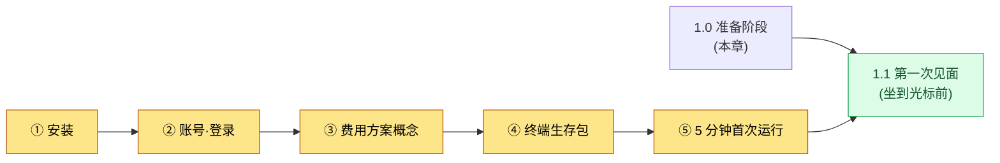
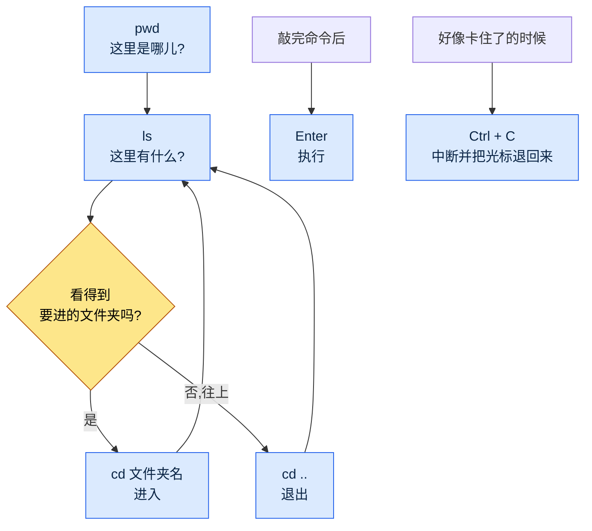

# 1.0 开始之前 —— 安装·账号·费用·终端生存包

1.1 是"第一次见面"。是坐在闪烁的光标前、敲点什么试试的环节。但要坐到那个位置上,先得准备好一些东西。工具已经装好,登录已经完成,大致知道费用是怎么产生的,在黑屏前会敲上几个字。本章比 1.1 还要靠前一步。

很多入门书会跳过这一步。只写一行"打开终端"就略过去了。可入门者恰恰就卡在那一行。终端在哪里、要装什么、装的过程中冒出红字该怎么办——在第一行就停下的人,根本到不了 1.1。本章的目标只有一个,就是让你不要卡在第一行。

本章分为五个部分。安装、账号·登录、费用方案的概念、终端生存包,以及"5 分钟首次运行"清单。按顺序跟下来,坐到 1.1 那个位置上的准备就完成了。



---

## 1.0.1 安装 —— 各操作系统一行命令

安装的原则是遵循官方指引。工具经常变化,通过非官方渠道下载的安装文件有风险。所以本书不附下载链接,而是教你如何找到官方渠道。在搜索框里输入"Claude Code 官方文档"或"Claude Code install",Anthropic 的官方文档页面会排在最前面。安装命令直接照搬那个页面上的,是最安全的做法。

大方向最好先了解一下。Claude Code(本书统一用英文写法)是一个在终端里运行的工具,通常用一行命令安装。各操作系统的流程略有不同。

| 操作系统 | 准备物 | 安装流程(概念) |
|---|---|---|
| Windows | PowerShell(系统自带) | 把官方文档里的安装命令一行粘贴到 PowerShell |
| macOS | 终端(系统自带) | 把官方文档里的安装命令一行粘贴到终端 |
| Linux | 终端 | 把官方文档里的安装命令一行粘贴到终端 |

三个操作系统的流程都一样。"打开终端 → 粘贴官方文档里的那一行 → 回车"。命令不需要背。从官方文档里复制粘贴才是正道。

安装过程中即便冒出红字(报错)也不必慌张。入门者遇到的安装错误大多是两种之一。要么是权限问题,要么是缺少前置工具(例如 Node.js 这类运行时)。如果出现了红字,把整句话原样复制去搜索或者问 AI,十有八九能解决。报错信息不是敌人,而是线索。

> 确认是否安装成功的方法:在终端里敲 `claude --version` 并回车。如果出现一行版本号,就是安装成功了。如果出现"找不到命令"之类的提示,说明要么还没装好,要么需要重新打开终端。把终端彻底关掉再重新打开,然后再确认一次吧。

---

## 1.0.2 账号·登录

装完不等于马上就能用。Claude Code 是一个借用 Anthropic 的 AI 模型来工作的工具,所以需要一个确认"是谁在用"的登录环节。

流程很简单。在终端里第一次运行 `claude`,就会出现登录指引。通常网页浏览器会自动打开,在那里用 Anthropic 账号登录即可(如果没有账号,可以在那个界面新建)。登录完成后,浏览器会显示"现在可以回到终端了"之类的提示,终端那边也会出现完成标志。

入门者在这里经常卡住的地方有两处。

第一,浏览器没有自动打开的情况。这时终端里会显示一行很长的网址(URL)。把那个网址复制到浏览器地址栏里打开就行。这不是卡住了,只是要手动多做一步而已。

第二,弄不清账号类型的情况。在网页聊天(Claude.ai)里用的账号,和 Claude Code 的账号·费用是怎么关联的,这一点的政策可能因时期而异。遵循登录界面的指引和官方文档是最准确的。按照首次运行界面的提示一步步走,大多都能顺利登录。

登录一次之后,在那台 PC 上就会一直保持。不需要每次都重新登录。

---

## 1.0.3 费用方案概念 —— 包月订阅 vs API 按量

入门者最不安的部分就是"会花多少钱?"。总有一种模糊的担忧:是不是每敲一个字就会产生费用。先把大方向搞清楚,这种不安就会减轻。费用方式大致分两条路。

| 方式 | 计费形态 | 类比 | 适合谁 |
|---|---|---|---|
| 包月订阅 | 每月固定金额 | 通信包月套餐 | 入门者·日常使用 |
| API 按量 | 用多少算多少(按 token) | 电表 | 大量·自动化·开发集成 |

**包月订阅**是按月支付一笔固定金额、在额度内随意使用的方式。和手机包月套餐类似。每月花费相同,容易预测,不需要在意"每敲一行多少钱"。所以入门者通常以包月订阅起步,心里会更踏实(作者推测——具体的方案构成与额度因时期而变,请在官方费用页面确认)。超过额度后,要么等到下个周期,要么升到更高的方案。

**API 按量**是按实际使用量(token)成比例计费的方式。像电表一样,用多少就计费多少。适合大量处理、自动化流水线,或者与其他程序集成的情况。用得精细就高效,但在入门阶段,在对用量没有感觉之前,成本可能难以预测。

token 是什么、为什么用它来计费,会在 1.2(AI 模型·token·驱动框架)里详细讲。这里只需记住一点。**入门者通常以包月订阅起步。**因为每月金额固定,可以在没有"用着用着会不会被天价账单砸中"这种担忧的情况下练习。方案名称·价格·额度经常变化,所以本书不附具体数字。本书内容以 2026 年中为基准撰写,费用方案·模型·功能在那之后仍会持续变化。当前的数值,在官方费用页面确认最准确。

> 一句话总结:对"是不是每用一次就要花钱"的担忧 → 包月订阅就是每月固定。入门以包月起步,心里会踏实。

---

## 1.0.4 终端生存包 —— 减少对黑屏的恐惧

现在来到最大的那堵墙,黑屏。1.1 之所以以"在闪烁的光标前迟疑"开场,原因就在这里。对一双用 GUI 工作了 24 年的手来说,终端是陌生的。但要做到不卡在第一行,需要的命令并不多。下面这六个就够了。

| 命令 | 读法 | 作用 | 类比 |
|---|---|---|---|
| `pwd` | pee-double-u-dee | 显示我现在在哪个文件夹 | "这里是哪儿?" |
| `ls` | el-es | 列出当前文件夹里有什么 | 打开文件夹窗口看看 |
| `cd 文件夹名` | cee-dee | 进入那个文件夹 | 双击文件夹 |
| `cd ..` | cee-dee 点点 | 退回上一级文件夹 | 后退 |
| `Enter` | 回车 | 执行敲下的命令 | 确认按钮 |
| `Ctrl + C` | control-cee | 中断正在运行的东西 | 停止按钮 |

(Windows PowerShell 里 `ls`·`cd`·`pwd` 也照样能用。macOS·Linux 也一样。所以这六个不挑操作系统。)

用这六个命令做的事,画成图就是这样。在终端里的移动归根结底就是在文件夹内外进进出出,和在 GUI 里双击文件夹或者后退是一样的动作。



黑屏可怕的真正原因,是"敲错了好像会弄坏什么"的那种感觉。但上面这六个里没有哪个命令会弄坏东西。`pwd`·`ls`·`cd` 只是查看或移动,不会删除或修改文件。`Enter` 只是执行,`Ctrl + C` 只是中断。所以这六个命令随时都可以放心敲。

有时屏幕看起来像是卡住了。敲了命令却半天没反应,或者光标在另一行闪烁、好像在等什么的时候。这种时候按一下 `Ctrl + C`,大多就会回到原来的光标。光是知道有这个"停止按钮",黑屏就会变得没那么可怕。卡住了就用 `Ctrl + C` 退出来,重新开始就行。

最后,当敲过的字堆了一大堆、看着乱糟糟的时候,可以把屏幕清空。Windows PowerShell·macOS·Linux 都用 `clear` 命令清屏。清空了也不会让做过的事消失,只是把看得到的字整理一下而已。

---

## 1.0.5 "5 分钟首次运行"清单

走到这里,准备就完成了。如果能在 5 分钟内通过下面这五格,就有资格坐到 1.1 那个位置上了。哪怕只卡在一格,回到对应的那一节(1.0.1\~1.0.4)就行。


- [ ] ① 能打开终端(Windows:PowerShell / macOS:终端)
- [ ] ② 敲 `claude --version` 会出现一行版本号(确认安装)
- [ ] ③ 运行 `claude` 时已经处于登录状态(或按指引完成登录)
- [ ] ④ 能用 `pwd` 看当前位置、用 `ls` 看文件夹内容
- [ ] ⑤ 卡住时能用 `Ctrl + C` 退出来

五格都填满了的话,黑屏就不再是一堵未知的墙了。工具装好了,登录完成了,知道了费用方式的大方向,也会在屏幕里移动和停下。1.1 就在这个准备之上开始。坐到闪烁的光标前,第一次敲下"帮我总结一下这个文件夹里有什么",到那个位置上就行了。

---

## 1.0.6 Python·pip —— 要运行工具的话(只在需要时)

本书前半部分(第 1·2 部分)只用自然语言提示词就能跟下来。不过第 4 部分之后的部分章节会直接运行小的 Python 脚本(例如 `pip install pyyaml`、`pip install pyvis`)。即使第一次接触 Python 也没关系。有两条路。

第一,**自己安装的路。**Python 从 python.org 下载安装(安装界面里一定要勾选"Add to PATH"),在终端里用 `python --version` 确认。`pip` 是随 Python 一起装上的包安装工具,像 `pip install pyyaml` 这样,一行就能装上需要的包。

第二,**交给 AI 的路(推荐)。**更简单的路是把环境搭建本身交给 AI。在终端里这样请求就行。

```
确认一下是否装了 Python,如果没有,告诉我适合我操作系统的安装方法。
然后给我一行命令,用来安装本章需要的 pyyaml 包。
```

AI 会检查你的环境并帮你生成安装命令。卡住了就当场把报错信息原样贴上,问"这个错误怎么解决?"就行。每个要运行工具的章节,有这一个模式就够了。在 Python·pip 让你觉得有负担的环节,那一章的「单人精简版」会给出不写代码、走得更轻松的路。

---

### 下一章预告
- 1.1 游戏策划与 Claude Code 的第一次见面 —— 坐到光标前,挺过头 30 分钟

---

## 动手试试

**setup**
1. 打开你正在用的操作系统的终端(Windows:PowerShell,macOS:终端)。
2. 搜索"Claude Code 官方文档",把官方安装指引页面打开放着。
3. 把计时器设为 5 分钟——目标是通过 1.0.5 清单的五格。

**prompt**(一行一行,按顺序敲敲看。这是命令,不是自然语言提问)
```
① claude --version      # 出现版本就是安装成功
② pwd                   # 现在我在哪个文件夹
③ ls                    # 这个文件夹里有什么
④ cd ..                 # 退回上一级(然后再 ls 一次)
⑤ claude                # 运行 Claude Code(出现登录指引就跟着走)
```

**verify**
- 在 ① 出现一行版本号,就说明安装完成了。如果出现"找不到命令",关掉终端再重新打开,然后再试一次。
- 用 ②·③·④ 查看和移动文件夹的过程中,亲自确认一下什么都不会被弄坏。这三个是只查看·只移动的安全命令。
- ⑤ 运行过程中好像卡住了,就用 `Ctrl + C` 退出来。能退出来,就说明你已经亲身确认了"有个停止按钮"。

### 单人精简版

如果你是既没有团队也没有公司文件夹的个人,那就先把安装(①)和用 `Ctrl + C` 退出来这两件事学会。用 `claude --version` 确认"工具装好了",用 `Ctrl + C` 确认"卡住了也能退出来",对黑屏的恐惧有一半,一个人也能在 5 分钟内整理清楚。费用先以包月订阅起步,就能不用担心成本、尽情练习。
