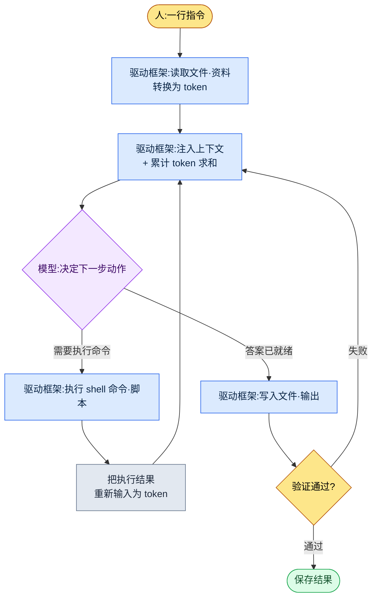

# 1.2 模型·token·驱动框架 —— 一次任务中 token 流动的路径

这是某次做完一件任务、查看用量时的事。这周的五份会议记录堆在文件夹里,我得在周一上午站会之前把"已确定的内容"整理成一页。我在 Claude Code 窗口里敲下一行字:"从这个文件夹的会议记录里,只把决策事项挑出来做成表格。"按下回车后约 0.4 秒,画面下方闪出一行小小的灰色字。

```
Reading meeting-2026-05-25.md ... (1,840 tokens)
Reading meeting-2026-05-27.md ... (2,310 tokens)
```

这行灰色字就是本章的主题。你抛出一句中文,工具就把它切成 token,把文件读成 token 喂给模型,再接收模型的回答写进文件。这一来一回每转一圈,就计一次费,资料也在模型的"视野"里不断累积。本章用游戏策划的语言,拆解这行灰色字背后发生的事。模型·token·上下文·驱动框架,这四个词就够了。

> **术语备注**
> - 模型(model):生成答案的大脑。有 Opus·Sonnet·Haiku 这样大小和性格各异的种类。
> - token:把文字切碎后的片段。计费·速度·视野都以这个单位来数。
> - 上下文窗口(context window):模型一次能装进脑中的 token 最大量。
> - 驱动框架(harness):让模型干活的车体。Claude Code 就是一例。

---

## 1.2.1 驱动框架循环 —— 灰色字的真面目

上面那行灰色字不是随机日志,而是一个固定循环中的一格。驱动框架(harness)所做的事归根结底就是快速地转同一个圈:把文件读出来喂给模型,模型说"执行这条命令"就去执行,再把结果重新喂给模型。这个圈一直转到任务结束为止。



在这张图里,人动手的格子只有最上面(指令)和最下面(确认验证结果)两处,中间的圈由驱动框架自主运转。读五份会议记录时灰色字闪了五次,就是把 `Read → Inject` 这格转了五圈。换成网页聊天,你得亲自打开五个文件复制·粘贴。驱动框架替你干掉这份劳动——这正是把聊天机器人和 CLI 型驱动框架分成两种不同工具的决定性差别。

循环每转一圈,就在 `Inject` 格里把累计 token 求和。所以不先理解 token,这个循环的成本和上限都看不见。先从 token 看起。

---

## 1.2.2 token —— 一次任务花掉的真实货币

token 不是字,而是模型把文字切开后的片段。按经验法则,英文大约 4 个字符算 1 个 token,中文(及韩文)大约 2 个字符接近 1 个 token(这不是官方换算,而是运营用的粗估——实际值由模型的分词器决定,且因句而异)。含空格 20 个字符,大致就是 10 个 token 上下。

把那次会议记录任务用 token 跟一遍(下面的数字是同一任务的单次测量。会随会议记录篇幅·摘要长度变化,所以请把它当作量级和比例来读,而非绝对值)。

| 步骤 | 做什么 | token(输入) | token(输出) |
|---|---|---|---|
| 指令 | "只挑决策事项做成表格"一行 | \~25 | — |
| 读会议记录 ×5 | 5 个 md 文件正文 | \~10,400 | — |
| 注入分类规则 | 会议类别 atom 1 条(JIT) | \~480 | — |
| 模型推理·制表 | 把 12 条决策做成表 | — | \~1,600 |
| 验证再输入 | 对 Linter 揪出的 1 处遗漏再追问 | \~320 | \~210 |
| **累计** | | **\~11,225** | **\~1,810** |

有两点扎眼。第一,我敲的指令是 25 个 token,而整个任务光输入就超过 1 万 1 千 token。成本几乎全部不来自我的句子,而来自工具读进来的资料。第二,输出(1,810)大约是输入(11,225)的六分之一。大多数策划自动化都是这样读得多、写得少。所以要降本,与其打磨输出,不如治理输入资料的量,后者效果大得多。

任务结束后敲 `/context`,就能看到这个会话占了多少上下文。不留意 token 时,它就像打印纸一样无意识地流走;一旦可视化,姿态就变了。这份可视化正是节约的起点。

治理 token 的工具不是抽象的节约精神,而是把输入资料细致处理的具体技法。

1. **JIT 注入** —— 不预先把全部资料都装上,只在需要时用关键词匹配拉取。上表的"注入分类规则 480 token"就是一例。进来的不是会议分类规则的整篇文档(数千 token),而仅是匹配到的一条 atom。
2. **摘要缓存** —— 长文档在供人看的原件之外,另备一份供 AI 看的摘要本。AI 读摘要本。
3. **atom 拆分** —— 一个文件只装一条决策(2.2 详述),就能精确拉取所需片段,从而节约 token。
4. **整理上下文** —— 会话变长就压缩。Claude Code 支持自动压缩。
5. **模型选择** —— 简单转换若用大模型,同样的 token 成本也会更贵。这是下一节的主题。

其中第 1 项 JIT 注入,是本书工作环境里实际运转的装置。一旦输入一行字,`inject_memory.py` 钩子就按分数高低匹配内存 atom,只挑出排名前几条来注入,即便失败也不阻断工作流(实现细节在 1.3 详述)。"只取需要的资料、只取前几条、即便失败也安静"这条 token 节约原则,原样写进了一个代码文件里。

---

## 1.2.3 模型 —— 同一车体,不同引擎

模型就像汽车引擎,可以在 Claude Code 这同一车体上换装 Opus·Sonnet·Haiku 这些不同的引擎。换了引擎,任务的性格就变了。

<svg viewBox="0 0 640 230" xmlns="http://www.w3.org/2000/svg" font-family="sans-serif" font-size="13">
  <rect x="0" y="0" width="640" height="230" fill="#fafafa" stroke="#ddd"/>
  <text x="20" y="28" font-size="15" font-weight="bold">模型匹配 —— 深度 vs 速度·成本</text>
  <!-- axes -->
  <line x1="80" y1="190" x2="600" y2="190" stroke="#888" stroke-width="1.5"/>
  <line x1="80" y1="190" x2="80" y2="55" stroke="#888" stroke-width="1.5"/>
  <text x="600" y="224" text-anchor="end" fill="#555">→ 速度·低成本</text>
  <text x="76" y="50" text-anchor="end" fill="#555">推理深度 ↑</text>
  <!-- Opus -->
  <circle cx="150" cy="80" r="34" fill="#7b4fbf" opacity="0.85"/>
  <text x="150" y="78" text-anchor="middle" fill="#fff" font-weight="bold">Opus</text>
  <text x="150" y="94" text-anchor="middle" fill="#fff" font-size="11">大型引擎</text>
  <text x="150" y="138" text-anchor="middle" fill="#444" font-size="11">设计评审·GDD 合成</text>
  <!-- Sonnet -->
  <circle cx="330" cy="120" r="34" fill="#3a86c8" opacity="0.85"/>
  <text x="330" y="118" text-anchor="middle" fill="#fff" font-weight="bold">Sonnet</text>
  <text x="330" y="134" text-anchor="middle" fill="#fff" font-size="11">中型引擎</text>
  <text x="330" y="170" text-anchor="middle" fill="#444" font-size="11">会议记录·日常 80%</text>
  <!-- Haiku -->
  <circle cx="510" cy="155" r="34" fill="#2a9d6f" opacity="0.85"/>
  <text x="510" y="153" text-anchor="middle" fill="#fff" font-weight="bold">Haiku</text>
  <text x="510" y="169" text-anchor="middle" fill="#fff" font-size="11">紧凑型</text>
  <text x="510" y="205" text-anchor="middle" fill="#444" font-size="11">配置表简单转换</text>
</svg>

对照策划工作来看,大致这样划分。像系统设计评审、整合多份资料合成 GDD(Game Design Document,游戏设计文档,即详细规格书)初稿这类需要深度推理和一致性的活,交给 Opus;像会议记录决策抽取、每日摘要这类大多数日常工作,交给 Sonnet;像数据表的简单格式转换这类几乎不需要判断的活,交给 Haiku。前一节的会议记录任务跑在 Sonnet 上,也是按这个标准——挑出决策搬进表格,比起深度推理,更讲究均衡与速度。

引入初期人人都会掉进一个陷阱:想把所有任务都跑在最好的引擎,也就是 Opus 上的冲动。顺着这股冲动走,成本·速度的负担很快会转成运营负担,而"让模型去匹配任务"的手感也立不起来。运营真正的本事不是每次都在脑子里挑模型,而是在模式成型后用自动化把它固化下来。

- 写每日复盘 → 自动用 Sonnet
- 系统设计评审 → 自动用 Opus
- 数据表一致性检查 → 自动用 Haiku

这类固化,就把模型明确写进 settings.json 或斜杠命令里(1.3 详述)。一旦固化,每次挑选的工夫就没了。

模型大约每半年出一个新版本,即便名字相同,4.5 和 4.6 也不一样。新版本出来时,只拿工作流中最核心的五项任务、用同样的输入做对比。要全部测试会累垮。光看这五项的结果差异,就足以判断要不要切换。

---

## 1.2.4 上下文窗口 —— 循环逐渐填满的上限

前面说过,循环每转一圈,就在 `Inject` 格里累积 token。那份累积撞上的天花板就是上下文窗口,也就是模型一次能处理的 token 最大量。拿人来比,就是工作记忆(working memory)。

- Claude 4 系列:标准 200K token,扩展 1M token 选项
- 200K token ≈ 以中文计约 300 页、以韩文计约 A4 400 页篇幅

前面那个会议记录任务,累计输入是 1 万 1 千 token 级,相对 200K 天花板只占 6% 出头,很宽裕。但若不切换任务、在同一窗口里把会话拖得很长,就会逼近天花板。一旦装满,旧内容就被截掉,模型开始丢失前半部分的"记忆",自动压缩随之触发,先前的对话被替换成摘要本。

治理这个天花板的习惯有四条。

| 模式 | 何时 |
|---|---|
| 会话分离 | 转向别的主题时,新开一个会话 |
| 显式压缩 | 一件任务结束后,只留核心再压缩 |
| 内存外置 | 常用资料拆成 atom,用 JIT 随时注入 |
| 上下文可视化 | 用 `/context` 用眼睛确认当前用量 |

游戏策划常碰到的吃重场景,是会议资料·策划案·数据表同时需要的任务,这时 1M 选项就有用。不过 1M 伴随成本·速度负担,所以平时 200K 就够,只有资料包真的很大时才动用。

---

## 1.2.5 驱动框架真正过滤虚假之处 —— 验证格

回到循环图最下面的 `验证通过?` 格。没有这一格,模型那套煞有介事的谎话就会原样存进文件。模型有时会自信满满地把错误答案当成正确答案抛出来(幻觉,hallucination),这种频率随代际上升而下降,但不会归零。所以把验证设为常设的一格。

策划中危险的幻觉很具体:引用一个根本不存在的数据表列,用错误的公式算数值,或者把会议上没敲定的事当成已确定的来摘要。会议记录任务里最可怕的是第三种——"只讨论、暂时搁置的事项"悄悄爬上了决策表。

验证有五种模式。

1. **原文对照** —— 把 AI 输出与原始资料再比一遍("帮我确认这个是不是真在那份资料里")。
2. **双向转换** —— A→B 转换后,再把 B→A 反向转换,看是否一致。
3. **抽样评审** —— 从输出里随机挑 3\~5 条由人亲自确认。
4. **Linter 自动化** —— 自动检查输出是否违反既定的格式·范围·规则。
5. **两模型交叉验证** —— 让 Opus 评审 Sonnet 的输出。

不必每次五个全做,而是按任务的风险度挑 1\~3 个。会议记录任务里,把第 4 项 Linter("决策是否齐全包含主体·内容·期限")和第 3 项抽样评审做一次捆在一起。前面 token 表最后一行"验证再输入 320 token",正是 Linter 揪出遗漏、向模型回问的那一来一回,换成循环图就是 `验证失败 → Inject` 又多转了一圈。

每次都靠人全检,引入效果就减半,所以验证本身也是自动化对象。会议记录决策抽取由 Linter 检查格式遗漏,数据表转换检查行数·合计·外键一致性,GDD 自动生成检查核心章节遗漏。通过的人就不用看,只看没通过的。这就像在塞满柜子的文件里,只把贴了红标的文件夹拿到手中的画面。让人的视线只落在危险的地方——这正是验证自动化的目的。

---

## 1.2.6 四个词被串进一次任务的所在

现在把那次会议记录任务从头到尾捋一遍,看四个词如何被串进一行。

| 格 | 干什么 | 对应哪个概念 |
|---|---|---|
| 1 | 在会议记录文件夹里运行 Claude Code | 驱动框架 |
| 2 | 任务是分析会议记录,故选 Sonnet | 模型 |
| 3 | 合计约 11K token,在 200K 窗口内 —— OK | token·上下文 |
| 4 | 把会议分类规则 atom 用 JIT 自动注入 | token(节约) |
| 5 | 模型把 12 条决策输出为表 | 模型·驱动框架循环 |
| 6 | Linter 查出 1 处格式遗漏 → 回问补全 | 验证(循环多 1 次) |
| 7 | 以 `weekly-decisions-2026-W21.md` 保存·提交 | 驱动框架 |

如果用手做,打开五份会议记录读一遍、只挑出决策搬抄、再对齐格式,要花 30 分钟。一旦自动化就缩到 5 分钟,而这 5 分钟里人手只做扫一遍验证抽样这一件事。人的时间只落在真正需要的地方(看搁置事项有没有被错当成决策爬上去)。关键不是省下的 25 分钟,而是那道视线落点变了。

---

## 1.2.7 常见误解

"Opus 总是更好"最常见。若无视成本·速度确实如此,但对简单任务而言 Opus 是浪费。按任务匹配才是答案。

"1M 上下文总是必需的"也常出现。大多数 200K 就够,1M 伴随负担,所以只用在资料包真的很大时。

"验证是人来做的"只对一半。可自动验证的部分占多数,人则专注剩下的。

"token 不用操心"在个人工作里某种程度上行得通,但多人一起用时,累计成本会迅速变大。从一开始就把可视化·节约模式固定下来更稳妥。

"驱动框架没有差别"也意外地多。即便是同一个模型,是聊天机器人还是 CLI,也会分成不同的工具。前面看到的有没有复制·粘贴劳动,就是那个差别。

---

## 1.2.8 动手试试

用一件小任务,亲手把本章的四个词跑一遍。

**setup**

- 在已安装 Claude Code 的状态下,准备一个装有 2\~3 份文本笔记(会议记录·备忘)的文件夹。
- 在那个文件夹里打开 Claude Code。

**prompt**

```
从这个文件夹的笔记里,只挑出"已确定的内容",
做成主体·内容·期限 3 列的表格。
搁置·讨论中的事项剔除,并为表中每一行
标上它来自哪个文件的文件名。
```

**verify**

- 任务结束后敲 `/context`,看看这个会话用了多少 token(你会发现输入比想象中大)。
- 挑表里一两行,打开所标的文件名,与原文对照确认它是否真以"决策"写明(原文对照验证)。
- 扫一遍看搁置的事项有没有被错放进表里(抽样评审)。

**单人精简版**

如果你刚开始用工具,上面只需抓住两件事。第一,把笔记整个文件夹交出去,别亲自复制·粘贴(交给驱动框架循环)。第二,输出表一律连同文件名一起拿到,只对可疑的行打开原文看。模型选择或 token 可视化,等熟练了再加也不迟。不用手搬资料、把输出与原文对照,光这两个习惯,引入就立稳了一半。

---

### 本章要点
- 驱动框架自主运转读取→执行→再输入的循环,人只在指令和验证两格动手
- 一次任务的成本几乎全部不来自我敲的指令,而来自工具读进来的资料
- 模型按任务换装,上下文天花板和验证则用自动化来治理

### 下一章预告
- 第 3 章. 内存·权限·配置基础设施 —— 一次配好便永久干活的根基
