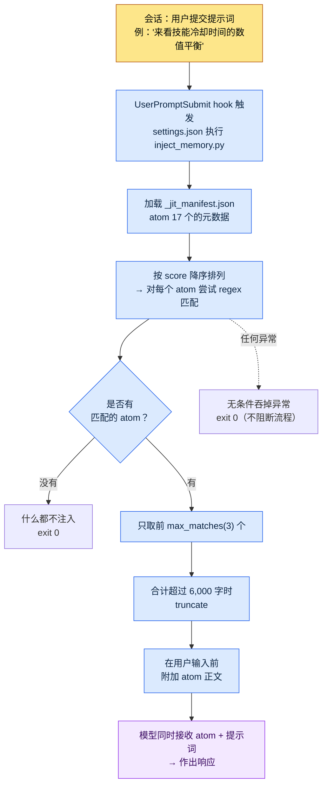

# 1.3 记忆·权限·配置基础设施

我打开一个新会话，输入"来看一下技能冷却时间的数值平衡吧"。在按下回车之前，屏幕下方有一行灰色小字一闪而过：`[memory injected: 2 atoms, 1,842 chars]`。我并没有打开任何文件，这意味着上周固化下来的冷却时间规则文档，已经被附加到了模型输入的前面。这就是搭好基础设施的工作环境发出的第一个信号。打开工具的那一刻，工具已经记得我。

要让这个画面成立，需要三样东西提前各就各位。AI 记住什么（记忆）、AI 在没有人工批准的情况下能做什么（权限），以及开关这两者的中央开关（settings.json）。第一次安装最多花一个小时，而这一个小时会化作此后 6 个月里每天省下的时间回到你身边。这是一笔几乎能全额收回的投资。

本章是一段实地走查（walkthrough）：依次展开作者在个人 PC 上实际运行的那一行 `settings.json`、它所调用的 `inject_memory.py`，以及那个文件读取的 `_jit_manifest.json`，一步步跟着走。读到最后，你就能亲手指出"记忆被自动注入"这句话，到底发生在哪个文件的哪一行。

---

## 1.3.1 settings.json —— 一切的起点，只有一行

先从结论看起。在作者的个人 PC 上，开启记忆自动注入的，就是 `settings.json` 里仅有的一个代码块。

```json
{
  "hooks": {
    "UserPromptSubmit": [
      {
        "hooks": [
          {
            "type": "command",
            "command": "python ~/.claude/hooks/inject_memory.py"
          }
        ]
      }
    ]
  }
}
```

把这个代码块说的话翻译成大白话就是："每当用户提交提示词的事件（`UserPromptSubmit`）发生时，就执行一次名为 `inject_memory.py` 的 Python 脚本。"就这么简单。不是 AI 聪明到会自动记住，而是每当有输入进来时，人事先登记好的脚本就插进来执行一次的结构。

`settings.json` 是控制 Claude Code 所有行为的中央文件，分为两层。

- `~/.claude/settings.json` —— 全局。对所有会话生效。可与团队共享的配置。
- `~/.claude/settings.local.json` —— 本地。仅在这台 PC 上生效。个人 PC 的特殊配置。

两者会合并后生效。所以作者把团队需要共享的 hook、权限放在 `settings.json`，把仅在这台家用 PC 上使用的绝对路径或个人工具路径分开放在 `settings.local.json`。这样的分离既能在协作时避免 git 冲突，也能防止个人配置泄漏到团队仓库里。

除了 hook 之外，还有几个经常会用到的条目。

- `effortLevel` —— 模型的推理深度。low / medium / high。像策划案设计这种需要深度判断的工作，就设为 high。
- `permissions` —— AI 在没有批准的情况下可以执行的命令范围（1.3.4 详述）。
- `enabledPlugins` —— 已启用的插件列表。

这里有一个最重要的运营习惯。`settings.json` 哪怕只有一个小小的笔误，都会让工具本身起不来。JSON 里少一个逗号，解析就会崩。所以修改前备份是必须的。作者的 PC 上实际就留有这样的备份文件。

```
settings.json.bak_2026-05
settings.local.json.bak_2026-05
```

用日期后缀备一份，回滚只要 1 秒。用 git 管理就更好了。就像抽屉里的一把旧钥匙，平时用不上，但在锁着的门前，总会有非用一次不可的那一刻。

---

## 1.3.2 inject_memory.py —— hook 内部实际发生的事

现在进入 `settings.json` 调用的脚本内部。这是走查的脊柱。代码只有一百来行，但核心是五个动作。



把这五个动作展开来说就是这样。

**1）读取 manifest。** 脚本首先打开 `~/.claude/projects/C--Users-user/memory/_jit_manifest.json`。这个文件里整理着 atom 的元数据（名称·路径·匹配 regex·分数）。作者的个人 PC 上目前登记了 17 个 atom。

**2）按 score 降序排列。** 每个 atom 都有一个 `score` 值。分数越高的 atom，越先被尝试匹配。当同一个关键词命中多个 atom 时，这个分数决定谁拥有优先权。

**3）用 regex 匹配。** 把用户输入的字符串与每个 atom 的 `regex` 模式逐一比对。输入里只要有"冷却时间"，带有 `쿨다운|cooldown|GCD` 模式的 atom 就会被命中。比对时不区分大小写。

**4）最多只截取 3 个。** 无论匹配出多少，只要超过 `max_matches`（作者环境是 3）就只保留前 3 个。如果被选中的 atom 正文合计长度超过 6,000 字，就 truncate。用双重上限来防止输入膨胀，是一道安全装置。

**5）无论出什么异常，都以 exit 0 结束。** 这是设计的核心。无论 manifest 损坏、文件消失，还是 regex 写错，脚本都会悄悄吞掉异常，以退出码 0 结束。因为 hook 一旦以非 0 的码退出，用户的提示词本身可能就被阻断。"哪怕记忆注入失败，也绝不阻断用户的工作流程"这条原则，被记录在代码最外层的 try/except 里。

重心落在第 4 条和第 5 条上。第 4 条（上限）防止记忆把 token 撑爆，第 5 条（吞掉异常）防止基础设施妨碍工作。两者都是同一套哲学的两副面孔——"自动化不让人觉得碍手碍脚"。

---

## 1.3.3 _jit_manifest.json —— 唤醒 atom 的关键词字典

1.2 里承诺过"只取需要的资料、只取前几个、失败也悄悄略过"这条节省 token 的原则，并把实现细节留到了本章。那个细节就住在 `inject_memory.py` 读取的 manifest 里。它是 JIT（Just-In-Time，仅在需要时才载入资料的方式）的心脏，一个 atom 的条目长这个样子。

```json
{
  "atoms": [
    {
      "name": "combat_cooldown_rule_v2",
      "path": "atoms/combat/combat_cooldown_rule_v2.md",
      "regex": "쿨다운|cooldown|GCD",
      "score": 80
    },
    {
      "name": "user_health",
      "path": "memory/user_health.md",
      "regex": "건강|복약|컨디션|약물",
      "score": 95
    }
  ],
  "config": {
    "max_matches": 3,
    "case_insensitive": true
  }
}
```

四个字段定义一个 atom。

- `name` —— atom 的唯一名称。
- `path` —— 一旦匹配就去读取正文的文件路径。
- `regex` —— 定义哪些关键词出现在输入里时会唤醒这个 atom 的模式。
- `score` —— 排序优先级。越高就越先被匹配、越先占到位置。

`config` 块里的 `max_matches: 3`，就是 1.3.2 中看到的"最多 3 个"上限的出处。用手改 manifest，行为立刻就变。

这里点一下规模感。作者的**个人 PC** 用 17 个 atom、一份 manifest 就轻量地跑起来了。相比之下，公司实务环境（项目A）截至 2026 年 5 月的备份里，登记着团队 atom 304 个、skill 48 个。有一个 hot atom 的 score 高达 356.53（属于处理文件名规则的 `view_html_filename_convention` 系列），它并非一开始就高，而是在反复调用·验证中累积下来的痕迹。

个人 PC 的 17 个与公司的 304 个之间的差距说明：哪怕是同一套 JIT 机制，资料堆积的速度和规模也与项目密度成正比。没必要一开始就造出 304 个。从 5 个核心 atom 起步，每周固化一两个，不知不觉 manifest 就厚起来了。

> 作者推测（未经验证）：关于 score 随匹配·验证次数累积的说法，是基于运营模式的一种解读。分数的计算公式本身会随各环境的 manifest 设计而不同，因此上面 356.53 这样的绝对值只是作者环境的实测快照，并非通用标准。

记忆分两层来放的原则，这里再点一遍。

| 区分 | 位置 | 何时加载 | 用途 |
|---|---|---|---|
| 全局 | `~/.claude/memory/` | 所有会话 | 本人身份·协作规则·语言设置 |
| 项目 | `~/.claude/projects/<项目>/memory/` | 对应项目的会话 | 各项目的 atom·规则·资料 |

全局保持轻量更安全。一旦全局变重，那份重量就会以 token 成本累积到每一个会话上。拿办公室打比方，全局就是桌上的名片夹（越轻每天越好用），项目记忆则是旁边柜子里的文件夹（按项目单位变厚也不会增加平时的负担）。所以自动加载的全局里只放核心，丰富的资料堆到项目记忆里，再用 JIT 在需要时唤醒。

---

## 1.3.4 权限 —— 沉淀工作痕迹的白名单

接下来是基础设施的第三根支柱，权限。Claude Code 可以删文件、执行命令、调用外部 API。强大与危险结伴而来。权限系统管理着这份危险。

权限分两类。无需人工批准就自动执行的，和每次都要拿到批准的。哪一类放什么，由 `settings.json` 的 `permissions` 块定义。

```json
{
  "permissions": {
    "allow": [
      "Bash(ls:*)",
      "Bash(git status:*)",
      "Bash(git diff:*)",
      "Read(*)",
      "Grep(*)"
    ],
    "deny": [
      "Bash(rm -rf:*)",
      "Bash(git push --force:*)"
    ]
  }
}
```

这里需要一次视角的转换。这份 `allow` 列表不是单纯的配置值，而是**工作痕迹的沉淀**。一开始只把读取·检索这类放进自动允许，几乎是空的。可是同样的工作反复做上一两个月，就会冒出"这个命令每次都要按批准好烦"这样的模式，于是把它们一个个挪进 `allow`。变长的列表，正是"我用这个工具反复做了什么"的指纹。

作者的公司环境（项目A）有大约 80 个自动允许的模式。从 20 个起步，历经 6 个月又加上了 60 个，把那 60 个倒着读，过去半年反复做了哪些工作便一目了然。数据表提取、关系图生成、模式（schema）文档化——常用的工具，正是常常被允许的权限。

权限运营中会沉淀下四种模式。

- **从白名单（Whitelist）起步** —— 自动允许以最小集合出发，只在需要时才追加。不是先大开再收窄，而是先紧闭再打开的方向。
- **危险命令明示阻断** —— 像 `rm -rf`、`git push --force` 这种一次事故就致命的命令，写进 `deny`。哪怕自动允许越扩越广，这两个也绝不去碰。
- **定期清理** —— 每个季度重新审视 `allow`，把已经不用的权限去掉。痕迹只堆不清，就成了噪声。
- **按领域分离** —— 把全局权限和项目权限分开。就像家用 PC 和公司 PC 有不同的策略，每个环境的允许范围都不一样。

每次都弹出批准弹窗，人会累。也有减轻疲劳的装置。可以用 `fewer-permission-prompts` 之类的斜杠命令把频繁出现的模式批量登记，或在一个会话内给出临时允许，或仅在个人工作中使用全权自动允许模式。不过最后这个选项，在团队环境里不推荐。

疲劳感与安全之间的平衡，由本人来调。太严格工作转不动，太宽松会出事故。哪怕宽松地起步，只要备好季度清理的周期，平衡自然会找到位置。

---

## 1.3.5 会话开始时 —— 记忆与权限一同加载的全景

到目前为止看到的三根支柱（settings·记忆·权限）在一个会话里如何同时运作，以一行输入为基准展开来看。下面是输入"来看技能冷却时间的数值平衡"时实际发生之事的一个剖面。

<svg viewBox="0 0 720 400" xmlns="http://www.w3.org/2000/svg" font-family="sans-serif" font-size="13">
  <rect x="0" y="0" width="720" height="400" fill="#fafafa"/>
  <!-- 세로 레인 -->
  <rect x="20" y="20" width="200" height="360" fill="#eef3fb" stroke="#9bb8e0"/>
  <rect x="260" y="20" width="200" height="360" fill="#eef9f0" stroke="#9bd0a8"/>
  <rect x="500" y="20" width="200" height="360" fill="#fdf3ec" stroke="#e0b893"/>
  <text x="120" y="42" text-anchor="middle" font-weight="bold">settings.json</text>
  <text x="360" y="42" text-anchor="middle" font-weight="bold">记忆 (JIT)</text>
  <text x="600" y="42" text-anchor="middle" font-weight="bold">权限 (permissions)</text>
  <!-- settings 레인 박스 -->
  <rect x="35" y="60" width="170" height="46" rx="5" fill="#ffffff" stroke="#7aa0d0"/>
  <text x="120" y="80" text-anchor="middle">UserPromptSubmit</text>
  <text x="120" y="97" text-anchor="middle">hook 触发</text>
  <rect x="35" y="130" width="170" height="46" rx="5" fill="#ffffff" stroke="#7aa0d0"/>
  <text x="120" y="150" text-anchor="middle">inject_memory.py</text>
  <text x="120" y="167" text-anchor="middle">执行（保证 exit 0）</text>
  <!-- 메모리 레인 박스 -->
  <rect x="275" y="130" width="170" height="46" rx="5" fill="#ffffff" stroke="#5fae7e"/>
  <text x="360" y="150" text-anchor="middle">manifest 17 atom</text>
  <text x="360" y="167" text-anchor="middle">score 排序·regex</text>
  <rect x="275" y="200" width="170" height="46" rx="5" fill="#ffffff" stroke="#5fae7e"/>
  <text x="360" y="220" text-anchor="middle">前 3 个·6000 字</text>
  <text x="360" y="237" text-anchor="middle">应用上限</text>
  <rect x="275" y="270" width="170" height="46" rx="5" fill="#ffffff" stroke="#5fae7e"/>
  <text x="360" y="290" text-anchor="middle">cooldown atom</text>
  <text x="360" y="307" text-anchor="middle">附加到输入前</text>
  <!-- 권한 레인 박스 -->
  <rect x="515" y="270" width="170" height="46" rx="5" fill="#ffffff" stroke="#cf9560"/>
  <text x="600" y="290" text-anchor="middle">allow / deny</text>
  <text x="600" y="307" text-anchor="middle">每次工具调用检查</text>
  <rect x="515" y="340" width="170" height="34" rx="5" fill="#ffffff" stroke="#cf9560"/>
  <text x="600" y="361" text-anchor="middle">读取自动 · 删除需批准</text>
  <!-- 화살표 -->
  <line x1="120" y1="106" x2="120" y2="130" stroke="#555" stroke-width="1.5" marker-end="url(#a)"/>
  <line x1="205" y1="153" x2="275" y2="153" stroke="#555" stroke-width="1.5" marker-end="url(#a)"/>
  <line x1="360" y1="176" x2="360" y2="200" stroke="#555" stroke-width="1.5" marker-end="url(#a)"/>
  <line x1="360" y1="246" x2="360" y2="270" stroke="#555" stroke-width="1.5" marker-end="url(#a)"/>
  <line x1="445" y1="293" x2="515" y2="293" stroke="#555" stroke-width="1.5" marker-end="url(#a)"/>
  <defs>
    <marker id="a" markerWidth="8" markerHeight="8" refX="6" refY="3" orient="auto">
      <path d="M0,0 L6,3 L0,6 Z" fill="#555"/>
    </marker>
  </defs>
</svg>

三条泳道在同一次输入上交会。settings.json 唤醒 hook，hook 挑出记忆附到输入上，由此生成的响应在调用工具时，权限作为最后一道关卡发挥作用。用户明明只敲了"来看冷却时间"这一行，三套基础设施却在看不见的地方依次干活。这就是工具让人感觉成了"我的工具"那一刻的内部结构。

---

## 1.3.6 首次配置指南 —— 一小时内进入可运营状态

理论看过了，就动手。第一次装好 Claude Code 之后，一个小时就能把上面那整张图铺到你自己的 PC 上。分成五个区间。

**0\~10 分钟，确认安装·运行。** 安装后在终端里启动 Claude Code。在某个文件夹里问一句"这个文件夹里有什么？"，确认能得到响应。先看工具是不是活着。

**10\~25 分钟，写好三个全局记忆。** 自动加载的全局，三个文件就够了。

- `MEMORY.md`（5 行）—— 本人身份一行 + 通向其他文件的指针。
- `user-profile.md`（20\~30 行）—— 姓名·角色·专长领域·联系方式。
- `feedback-collaboration-style.md`（20\~30 行）—— 语言·语气·执行优先·说明简洁这类协作规则。

照着作者的样例原样抄来起步也好。在运营中慢慢打磨即可。

**25\~40 分钟，settings.json 基本配置。** 把 `effortLevel` 设为 high，放入权限起始集（读取·检索自动，写入·删除需批准），再备一份备份（`settings.json.bak_<日期>`）。备份是这一区间里最重要的一行。

**40\~55 分钟，第一批项目 atom 五个。** 把本人每次都会忘的决定、经常要查的信息挑五个做成 atom。文件夹是 `~/.claude/projects/<项目>/memory/`。格式参考第 5 章。有这五个，即便暂时不做 JIT manifest，仅靠全局自动加载也能见效。

**55\~60 分钟，测试一次。** 打开一个新会话，抛出一个本人领域的问题。确认全局记忆有没有自动加载，响应的语气是否遵循本人的协作规则。

到这里就是一个小时。JIT manifest 与 hook，等 atom 超过 50 个、自动加载开始变重的时候再引入也不迟。到那个时候，把 1.3.2 的 `inject_memory.py` 铺上去就行。

---

## 1.3.7 常见错误与规避法

引入初期反复出现的错误归为五类，而每一类都站在同一个事故成因之上。

| 错误 | 事故成因 | 规避法 |
|---|---|---|
| 往全局塞太多 | 所有会话都变重、浪费 token | 全局控制在 5KB 以内，细节转移到项目记忆 |
| 把所有权限设为自动允许 | 便利遮蔽了危险的第一现场 | 只把读取·检索设为自动，写入·删除需批准（含季度清理） |
| 不备份就改 settings | 损坏的 settings 让工具本身起不来 | 改动前自动保存 `settings.json.bak_<日期>` |
| 把 atom 无限堆进记忆文件夹 | 自动加载逼近 token 上限 | 约从 50 个起引入 JIT manifest |
| 团队·个人配置混在一个文件里 | git 冲突·个人配置泄漏 | 团队用 `settings.json`，本人用 `settings.local.json` |

这五条没必要从第一天起就全部规避。全局膨胀和漏备份，最好在头一个小时内就把规避模式立住；其余三条，则在运营一个月左右、于本人最可能出事故的位置上装上规避装置，会更自然。

---

## 1.3.8 第 1 部分收尾

1.1 是缩短面对工具时那份距离感的场，1.2 是抓住该工具最小运作机制的场，1.3 则是用记忆·权限·settings 铺好第一套基础设施的场。这三章构成本书的导入部分。到这里收住，让工具不间断运营的基本骨架就立住了。

关键在于：这套骨架不是静态的配置。manifest 的 atom 每周都在增，`allow` 列表沿着工作痕迹变长，score 经过验证不断累积。基础设施不是铺下去那一刻就完成，而是在铺好的地基之上与使用者一同生长。个人 PC 的 17 个拉开到公司 304 个的差距，正是这份生长的距离。

从 Part 2 开始，正式进入信息架构。第 4 章 YAML 前置数据（frontmatter）、第 5 章 Atom、第 6 章 Layer、第 7 章本体论（ontology），依次铺开。在 1.3 里只作为 manifest 的一个条目出现过的 atom，到 2.2 会成为一整章的主角。脊柱立住之后，各分领域的章节才能在同一套坐标上找到自己的位置。

---

### 本章要点
- 记忆自动注入，是 settings.json 里一行 hook 唤醒 inject_memory.py 的结构
- 权限 allow 列表不是配置，而是工作痕迹的沉淀，每个季度清理一次
- 基础设施不是铺好就结束，而是 atom·权限·score 一同生长的活骨架

### 下一章预告
- Part 2 开始：第 4 章。YAML 前置数据（frontmatter）—— 把所有文档变成数据

---

## 动手试试

**setup**
1. 打开 `~/.claude/settings.json`，在改动前以 `settings.json.bak_<今天日期>` 备份一份。
2. 在 `permissions.allow` 里放入 `Read(*)`、`Grep(*)`、`Bash(ls:*)`、`Bash(git status:*)`，在 `permissions.deny` 里写入 `Bash(rm -rf:*)`、`Bash(git push --force:*)`。
3. （atom 在 50 个以上时）在 `hooks.UserPromptSubmit` 里登记 `python ~/.claude/hooks/inject_memory.py`，并在 `_jit_manifest.json` 里写好 atom 条目（name·path·regex·score）和 `config.max_matches: 3`。

**prompt**
- 在新会话里，抛出一个有意包含 manifest 中某个 atom 关键词的问题。例如："以冷却时间规则为基准，来看技能数值平衡吧"。

**verify**
- 确认输入之后是否出现 `[memory injected: N atoms]` 之类的信号。
- 看看预期的 atom 有没有反映到响应里。
- 故意往 manifest 里塞一段损坏的 JSON 试试，确认提示词是否依旧不被阻断、照常运作（保证 exit 0），然后再还原回去。

**单人精简版**
- 不要 hook，也不要 manifest，就这么起步。在全局 `MEMORY.md` 一个文件里只写身份 3 行 + 协作规则 3 行，权限只把 `Read(*)`·`Grep(*)` 设为自动允许。等 atom 用顺手、接近 50 个的时候，再把 1.3.2 的 hook 叠上去。基础设施是从小起步、沿着痕迹养大的，而不是一开始就备齐 304 个。
