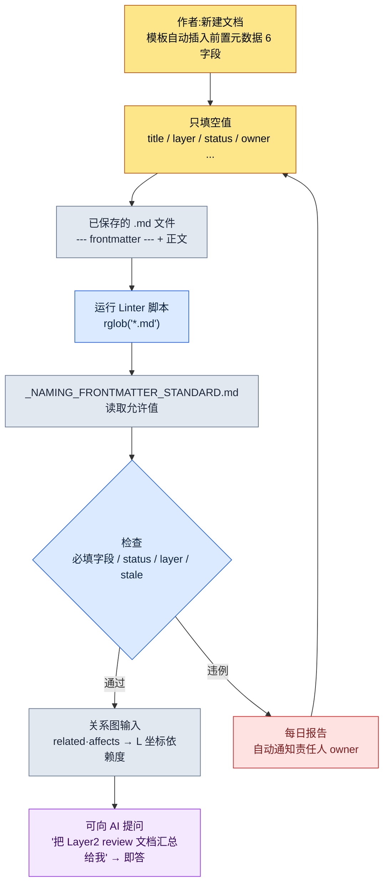

# 2.1 YAML 前置元数据 —— 让所有文档成为数据

里程碑构建前一天的晚上,系统策划团队成员 A 通过即时通讯工具问我:"这周改过奖励曲线的文档有几个?评审到哪一步了?"我答不上来。文档散落在某个文件夹里,谁最后改过它、它属于哪个里程碑,这些信息分散在各自的记忆和文件名约定里。那天晚上我们做的事,就是定下一条约定——在文档第一行写上六行字。正是那六行字,让从下一个里程碑起,团队成员 A 的问题不必有人打开文件夹就能回答。

文档最上方 `---` 之间写的几行 YAML,就叫前置元数据(frontmatter)。这条约定让人和机器无需读正文一个字,就同时知道"这份文档是什么"。本章会用一段真实运行的脚本,跟踪这一行字如何成为整个信息架构的入口坐标。

先只交代一个术语。本书把策划文档分成五个 **Layer**(第 6 章正式展开):L0=世界观·概念,L1=系统规则,L2=内容,L3=数据,L4=实现坐标。自上而下依赖是正常方向。下文出现的 `layer: 2`,就是"这份文档属于内容 Layer"的坐标声明。

---

## 2.1.1 为什么不是"文档"而是"作为数据的文档"

传统的策划文档一直活在 Word、PPT、Google Docs 上。正文是为人阅读而优化的。可是文档的类型、责任、状态、位置这类元信息,要么融在正文里,要么依赖文件夹结构和文件名约定。于是要知道"这份文档属于哪个里程碑、谁是责任人、上次评审是什么时候",就得打开正文看。

这里叠加了两重局限。第一,文档不会自己说明身份。身份藏在人的记忆和文件夹约定里,而那套约定随时间腐化。第二,AI 没有线索去推断上下文。你对 Claude Code 说"帮我评审这份文档",它会把正文从头读到尾、浪费 token,也不知道责任边界到哪里。

YAML 前置元数据一次解决这两点。在文档第一行明确地写入元数据,人和机器都不必打开正文就能识别文档。这就像柜子抽屉正面贴了标签,不拉开抽屉也知道里面装什么。而且这枚标签不止是分类工具。后文会看到,仅 `layer` 这一个字段,就成了程序化生成与自动验收的入口坐标。

---

## 2.1.2 真实的前置元数据 —— 一份文档的头 14 行

不用抽象示例,我们直接看项目A的奖励曲线文档头上实际顶着的前置元数据(仅对 ID·实名做化名处理,结构与线上运营完全一致)。

```yaml
---
title: "主线任务第12章奖励曲线"
layer: 2
status: review
owner: teammate_a
created: 2026-04-15
updated: 2026-05-20
related:
  - quest_main_chapter12
  - reward_curve_milestone_2
affects:
  - L3_BalanceSheet_v2
ip_check: passed
---

# 主线任务第12章奖励曲线

(正文开始)
```

关键是 `---` 上方与下方的分离。上方是解析器读取的数据,下方是人阅读的正文。Markdown 渲染器通常会隐藏前置元数据,阅读时不受干扰。一个文件同时承载数据(frontmatter)和内容(正文),成为单一真实来源。

要特别留意 `layer: 2` 和 `affects: [L3_BalanceSheet_v2]` 这两行。它声明的是"这份内容(L2)文档会影响数据 Layer(L3)的配置表"。仅凭这一点,工具就能不读正文、把 L2→L3 的依赖关系画成图。反过来,如果一份 L3 数据文档用 `depends_on` 去引用 L1 系统规则(自下而上的反向依赖),那就是设计上的坏味道。工具会自动检出这种反向引用。

YAML 比 JSON 更易于手写,原因很简单:用缩进表达结构,几乎不需要引号,还能写 `#` 注释。适合策划亲自填写。

---

## 2.1.3 标准住在哪里 —— `_NAMING_FRONTMATTER_STANDARD`

字段可以无限增加。越加,撰写负担越重,标准越容易崩。所以项目A分两层来运营:所有文档共通的最小核心字段,以及按领域分的扩展字段。

共通的最小核心字段有六个。

| 字段 | 格式 | 用途 |
|------|------|------|
| `title` | 字符串 | 人可读标题。可与文件名不同 |
| `layer` | 0\~4 | 第 6 章 Layer 坐标 |
| `status` | draft / review / approved / archived | 文档状态 |
| `owner` | 用户名 | 责任人(1 人) |
| `created` | YYYY-MM-DD | 创建日 |
| `updated` | YYYY-MM-DD | 最后修改日 |

仅这六个,就能即刻知道文档的新鲜度、责任与位置。头一个月要忍住继续添加的冲动。运营一阵后,哪个字段真正必要,会自然浮现。

按领域的扩展字段因领域而异。系统策划爱用 `depends_on`·`affects`,战斗策划爱用 `combat_phase`·`anim_target`,叙事爱用 `world_region`·`chapter`,数值策划爱用 `data_sheet`·`formula_id`。这些扩展字段不能各自随意发散,所以由唯一一份标准文档钉死它们的正式名称、允许值与示例。那份文档就是 `_NAMING_FRONTMATTER_STANDARD.md`。要新增字段,必须经过这份文档。而且这份标准文档本身被注册为 atom,与那条强制在文档名前加 Layer 编号的规则(`docs_layer_numeric_prefix_naming` atom)归在同一序列里管理。

这里发生了一个重要的转变。如果标准只是一份给人读的文档,人就会违反它。而把标准做成**机器读取的数据**,机器就会强制执行它。下一节就是这一转变的真实代码。

---

## 2.1.4 实操记录(worked transcript)—— 用代码强制标准,以及一个 datetime bug 带来的教训

> **实操记录(worked transcript):完整保留的真实操作过程记录。**

现在我让 Claude Code 做一个"检查项目A所有 Markdown 文档是否遵守前置元数据标准的 Linter"。核心要求有两点:抓出检查项(必填字段缺失、status 非标准值、layer 0\~4 违例、状态为 review 却 90 天以上没动过的文档),并且**不要把允许值硬编码进代码,而要从标准文档里读取**。这一分离是关键。改了标准,不改代码,检查基准也随之改变。(脚本全文与直接运行步骤放在本章末尾的「动手试试」。)

这里出过一件事。Claude 最初给出的代码在 STALE 检查里用 `today - fm["updated"]` 计算日期差,并在注释里写道"像 `updated: 2026-05-20` 这样写的话,PyYAML 会自动解析为 `datetime.date`"。这话只对了一半。在真实文档上一跑,部分文件抛出了 traceback。

```
TypeError: unsupported operand type(s) for -: 'datetime.date' and 'str'
```

原因出在人手上。有的作者写 `updated: 2026-05-20`(被解析为 date),有的作者写 `updated: "2026-05-20"`、加了引号(被解析为字符串)。在标准没有钉死日期格式的地方,人手出现了分歧,而 Claude 只假设了其中一种。我拒绝了这段代码,重新要求"把两种写法都安全地规范化为 date,`updated` 缺失的情况也要过滤出来"。Claude 插入了一个检查输入类型、把两者都规范化为 `datetime.date` 的辅助函数(修正后的代码块也见「动手试试」)。

真正的教训不是代码 bug。而是**标准没有钉死日期写法的地方,人手出现了分歧**。于是我在 `_NAMING_FRONTMATTER_STANDARD.md` 里加了一行 `updated: YYYY-MM-DD (不加引号)`。Linter 在检查代码的过程中,反倒暴露了检查对象——标准本身——的漏洞。

修正后脚本的第一次输出并不干净。下面把真实跑出来的脏结果原样保留。

```
[NO-FM]   manuscript/legacy/old_combat_notes.md
[MISSING] manuscript/system/quest_flag_table.md: layer
[STATUS]  manuscript/content/town_intro.md: WIP
[LAYER]   manuscript/balance/dps_v2.md: None
[STALE]   manuscript/system/inventory_rules.md: 134d
```

这五行就是导入初期团队的真实状态。旧文档压根没有前置元数据(`NO-FM`),某份文档漏了 `layer`,有人写了 `status: WIP` 这样的非标准值,某份数值文档把 `layer` 留空成了 `None`,某份系统规则文档已经在 `review` 状态里睡了 134 天。标准从一开始就不会被遵守。Linter 只是每天早晨把这个事实摆出来而已。

---

## 2.1.5 从 frontmatter 到脚本 —— 流程

把上面的实操记录压缩成一张流程图,就是下面这样。它展示了人写下的一行字,如何一路流向机器的检查关卡。



关键有两点。第一,标准(E)与脚本(D)是分离的。改了标准,不改代码,检查基准也随之改变。第二,违例(H)不是死路,而是回到撰写阶段(B)的循环。这不是责怪人,而是把本人文档退回去让本人自己改。

---

## 2.1.6 运营案例 —— 某中等规模团队的 6 个月

作者作为总监运营的项目A,约在 6 个月前把前置元数据引入了整个策划团队(4\~5 人)。引入不是一蹴而就,而是经过了四个节点。

引入第 1 周最大的抵触是"这玩意儿每次都要手写?"。每份新文档都要背着写六行,确实麻烦。解法是模板自动插入。VSCode 代码片段、Obsidian 模板、策划门户的"新建文档"按钮,会自动塞进一个空的 YAML 块。作者只填空值。抵触在一周内消失了。

第 1 个月爆发了标准冲突。多人各自随意添加字段,`owner`·`responsible`·`author` 同时出现。明明是同一个概念,却有三种写法,搜索和自动化都崩了。解法是用 `_NAMING_FRONTMATTER_STANDARD.md` 一份文档整理所有字段的正式名称、允许值与示例,并把新字段的添加规则化为必经此文档。标准在一个月内稳定下来。

第 3 个月,2.1.4 里那个 Linter 进来了。哪怕有标准,人也会违反。所以让每天早晨自动生成一份一致性报告,落到团队即时通讯工具的公共频道里。责任人只看自己的文档就行。自动化之后,标准违例明显减少(作者估测,非精确测量值——体感大致降到一半以下)。

第 6 个月,与 AI 的结合大放异彩。标准稳定后,下面这类提问都能即答返回。

- "把最近两周更新过的 Layer 2 文档里 status 为 review 的全汇总给我"
- "给我画一条我作为 owner 的所有文档的状态变化时间线"
- "把这个变更请求会影响到的其他文档列出来"——沿着 `related`·`affects` 图自动生成

最终,前置元数据成了人与 AI 之间的公共词汇。人写,AI 理解;AI 写,人验证。两边看同一批 key。只不过第 1 周的抵触、第 1 个月的冲突、第 3 个月的 Linter、第 6 个月的结合——这是累积 6 个月才形成的结果,不是一蹴而就的。

---

## 2.1.7 常见错误与规避法

导入初期反复出现的错误,可归为五类。它们都站在同一个根上——"把标准只交给人的意志的那个地方"。

| 错误 | 事故原因 | 规避法 |
|---|---|---|
| 一开始就定义太多字段 | 作者填空值填到累,质量下降 | 从核心 6 个起步,1\~2 个月后只补常用的 |
| 字段名不停改(`tag`→`tags`→`category`) | 旧名残留在累积文档里,搜索·自动化崩坏 | 改名时同步迁移脚本。发现旧名时自动转换或告警 |
| 每次都人手写 | 拼写错误·字段缺失·日期写法分歧(2.1.4 那个 bug)成了家常便饭 | 优先模板·代码片段·"新建文档"自动化。人手只用在有意义的值上 |
| 只立标准、不验证就放任 | 哪怕有标准也不知道谁违反了,自然腐化 | 用 Linter + 每日自动报告,让违规者本人去改 |
| 忘了 `layer` 字段 | 没有 Layer 坐标,跨领域可见性与验收关卡都建不起来 | 把 `layer` 强制为必填字段。Linter 检出缺失 |

五个错误不必从第一天就全堵上。第 1·3 项在导入第 1 周就把规避模式立好,第 2·4·5 项则边运营、边从本团队最常撞上的地方开始依次嵌入,这样更自然。

---

## 2.1.8 小处起步 —— 在 3 周内落地

前置元数据的导入,意外地是项轻活。3 周就能在一个团队里站稳。

第一周定义核心六字段、做好模板,只对新文档应用,把撰写负担降到最低。第二周对常看的前 20 份文档手动应用,在真实使用中检查哪些字段不够用。第三周启动 Linter 和每日报告,从那时起,标准就不再靠人的意志、而是靠工具之力来维持。

不要把现有文档全部一次性迁移。从常看的开始,从新文档开始。过了 6 个月左右,几乎所有文档都会带上前置元数据。但 100% 并不是目标。为了把一次都没打开过的旧文档也迁移而花时间,是浪费。

---

## 动手试试

以最小单位,亲手跑一遍完整的一个循环。

**setup**
- 在工作文件夹里放 2\~3 份待检查的 `.md` 文档。其中一部分故意去掉 `layer`,或填入 `status: WIP` 这样的非标准值。
- 在同一文件夹放一份标准文档,写上几行。
  ```
  status: allowed = ["draft", "review", "approved", "archived"]
  updated: YYYY-MM-DD (不加引号)
  ```

**prompt**(输入给 Claude Code)
> 给我写一个 Python 脚本,检查这个文件夹下所有 .md 的 YAML 前置元数据。抓出必填字段 title·layer·status·owner 缺失、status 违反允许值(从标准文档里读取)、layer 非 0\~4 整数、status 为 review 但 updated 超过 90 天。`updated` 无论以字符串还是 date 形式传入,都要安全处理,并按文件逐个输出违例。

**verify**
- 跑一遍脚本,确认故意埋的违例是否全被抓到。
- 在标准文档的 `allowed` 列表里加上 `WIP` 后再跑一遍,确认在没改一行代码的情况下,`status: WIP` 是否变成通过。这就是标准与代码已分离的证据。
- 把加引号的文档和不加引号的文档都放进去,确认不会出现 2.1.4 里看到的 `TypeError`。

**参考:Linter 脚本全文**

这是 2.1.4 里 Claude 最初给出的代码。STALE 检查那一行(`age = (today - fm["updated"]).days`)里原封不动地带着 datetime bug。

```python
import sys, datetime, pathlib, re
import yaml  # PyYAML

ROOT = pathlib.Path("manuscript")
STANDARD = pathlib.Path("_NAMING_FRONTMATTER_STANDARD.md")
REQUIRED = ["title", "layer", "status", "owner"]

def load_allowed_status(standard_path):
    # 从标准文档中提取 `status` 的允许值
    text = standard_path.read_text(encoding="utf-8")
    m = re.search(r"status:\s*allowed\s*=\s*\[(.*?)\]", text)
    if not m:
        return ["draft", "review", "approved", "archived"]
    return [s.strip().strip('"').strip("'") for s in m.group(1).split(",")]

def parse_frontmatter(md_path):
    text = md_path.read_text(encoding="utf-8")
    if not text.startswith("---"):
        return None
    end = text.find("---", 3)
    block = text[3:end]
    return yaml.safe_load(block)

def main():
    allowed = load_allowed_status(STANDARD)
    today = datetime.date.today()
    violations = 0
    for md in ROOT.rglob("*.md"):
        fm = parse_frontmatter(md)
        if fm is None:
            print(f"[NO-FM]   {md}")
            violations += 1
            continue
        for field in REQUIRED:
            if field not in fm:
                print(f"[MISSING] {md}: {field}")
                violations += 1
        if fm.get("status") not in allowed:
            print(f"[STATUS]  {md}: {fm.get('status')}")
            violations += 1
        if not isinstance(fm.get("layer"), int) or not (0 <= fm.get("layer") <= 4):
            print(f"[LAYER]   {md}: {fm.get('layer')}")
            violations += 1
        if fm.get("status") == "review":
            age = (today - fm["updated"]).days   # ← 这里会崩
            if age > 90:
                print(f"[STALE]   {md}: {age}d")
                violations += 1
    sys.exit(violations)
```

重新要求后修正过来的核心代码块。`updated` 无论以字符串还是 date 形式传入,都安全地规范化。

```python
def as_date(v):
    if isinstance(v, datetime.date):
        return v
    if isinstance(v, str):
        return datetime.date.fromisoformat(v.strip())
    return None

# main() 中 STALE 检查的替换部分
if fm.get("status") == "review":
    upd = as_date(fm.get("updated"))
    if upd is None:
        print(f"[MISSING] {md}: updated")
        violations += 1
    elif (today - upd).days > 90:
        print(f"[STALE]   {md}: {(today - upd).days}d")
        violations += 1
```

### 单人精简版

没有团队也行。在自己用的笔记文件夹里,把核心字段缩到 `title`·`status`·`updated` 三个,Linter 只抓"status 为 review 但 updated 超过 30 天的文档"。仅凭这一点,"我评审到一半就忘掉的文档"每周就会浮上水面一次。标准-模板-检查的三角形,在单人规模下也照样运转。

---

### 本章要点
- 前置元数据的一行字,是无需读正文就能识别文档的最小数据砖块
- 把标准从代码里分离、作为文档来放,就能不改代码也改变检查基准
- 仅 `layer` 一个字段,就成了程序化生成与自动验收的入口坐标
