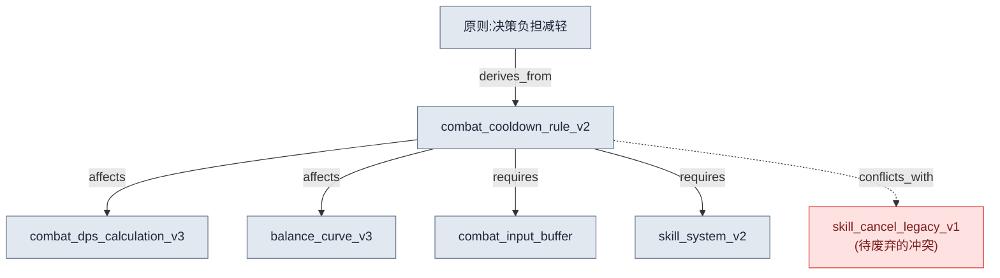
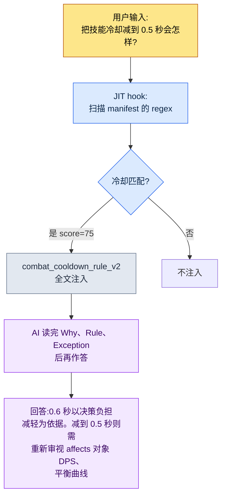

# 2.2 按页 Atom —— 单文档单决策的解剖

新人入职的第一周,他在聊天里问我:"战斗冷却时间是 0.6 秒,对吗?写在哪份文档里?"我答:"在技能系统 GDD(Game Design Document,详细规格文档)里。"他又问:"那 GDD 的哪一节?从职业设计到伤害曲线,再到 UI 显示方式,一共 220 行。"我打开文件,亲自帮他找。在第 137 行。他最后问:"可为什么是 0.6 秒?0.5 不行吗?"这个答案任何文档里都没有。我记得是六个月前的一次会议上定的,但理由埋在某份会议记录的某个角落里。

这场五分钟的对话里,包含了 220 行整合文档的全部三种失败:找不到位置(检索失败)、没有理由(脉络丢失)、每次都得有人居中转述(无法自动化)。把同样的问题抛给 AI,情况更糟。AI 会把 220 行全部读完,然后连和冷却无关的伤害曲线也一并掺进答案里。

本章的处方很简单。**一份文档只装一个决策。**按这个原则切得很细的决策单元文档,就叫 atom。把 220 行的 GDD 拆开,"冷却时间是 0.6 秒"就成了一个 atom,而这个 atom 里,位置、内容、理由、例外、关系都汇聚在一处。本章不讲抽象理论,而是把一个真实的 atom 从头解剖到尾:它如何命名、写入哪些 frontmatter、如何标明关系,以及最终 AI 如何只精准地拎出这一个 atom。

---

## 2.2.1 取一份检材 —— `combat_cooldown_rule_v2`

要解剖的检材,是项目A中实际运行的一个 atom。它的名字是 `combat_cooldown_rule_v2`。文件全文如下。不长,因为只装了一个决策。

```markdown
---
name: combat_cooldown_rule_v2
title: "战斗冷却规则 —— v2"
type: rule
layer: 1
status: approved
owner: 李旼洙
created: 2026-03-10
updated: 2026-05-12
applies_to: [skill_system, item_system]
---

# 战斗冷却规则 v2

Why(为什么):限制可同时使用的技能数量,以减轻瞬时决策负担,
并保留连招输入的意义。

Rule(规则):所有主动技能都具有全局冷却 0.6 秒 + 单独
冷却(各技能自定义)。全局冷却进行期间,任何
主动技能都无法施法。

How to apply(适用):
- 定义新技能时必须明确标注单独冷却
- L3_SkillSheet 的 cooldown 列若为 0,则违反本规则
- 构建阶段的一致性检查会自动检出违规

Exceptions(例外):
- 被动技能不适用本规则
- 终极技能采用单独的能量条系统(See: [[ultimate_gauge_system]])

Relations(关系):
- affects: [[combat_dps_calculation_v3]], [[balance_curve_v3]]
- derives_from: [[principle_decision_load_reduction]]
- conflicts_with: [[skill_cancel_rule_legacy_v1]]
- requires: [[combat_input_buffer_system]], [[skill_system_v2]]
- is_a: rule
- part_of: combat_system_master
```

把这一页文件分成五个部位来看:命名、frontmatter、单一决策、关系、可追溯性。五个部位都齐备,AI 才会把这个 atom 读作"独自也说得通的单元"。

---

## 2.2.2 部位 ① 命名 —— 名字本身就是坐标

文件名是 `combat_cooldown_rule_v2`。这不是随手起的名字,而是有三段式结构。

```
combat_         cooldown_rule          _v2
└ prefix        └ 决策正文            └ 版本
  (哪个领域)     (关于什么的决策)       (第几次修订)
```

prefix `combat_` 是"这是战斗领域的决策"这一坐标。项目A的规则 atom 以 prefix 区分领域:`quest_`(任务)、`data_`(数据运营)、`docs_`(文档运营)、`meeting_`(会议记录)、`portal_`(策划查看器)。光看 prefix,就能抓住这个决策属于谁的责任范围、会从哪里受到影响。

命名一旦动摇,一切都跟着动摇。同一个决策若以 `skill-cooldown.md` 和 `cooldown_skill_v2.md` 两次出现,检索会崩,后文要讲的 JIT 匹配也会崩。所以项目A先把命名规则本身固化成了一个 atom。那就是 `atom_naming_convention_v1`,它强制要求 snake_case、必带 prefix、版本 suffix。而且这条规则不靠人的自觉,而是由 Linter 来守。没有 prefix 的文件名一旦被提交,就会在构建阶段被拦下。

命名背后,埋着贯穿全书的更大设计。frontmatter 里的 `layer: 1` 就是第二个坐标。如果说 prefix 指明"哪个领域",那么 Layer 指明"哪个抽象层级"。两个坐标结合,atom 的位置才被确定为平面上的一个点。这里 Layer 只是坐标(0\~4 层级定义的细节见 2.3)。冷却规则是"控制生成的输入规则",所以坐落于 Layer 1。把这个 Layer 坐标以数字 prefix 强制写在文档名前的规则也另有一条 —— `docs_layer_numeric_prefix_naming`。一个名字里,等于明示了两条坐标轴。

这套设计的本质不是整理癖。我对团队反复说过一句话。**"当初分 Layer,就是为了做程序化生成。"**只要每个 atom 都明示了领域坐标(prefix)与层级坐标(Layer),日后 AI 就能做到"把 Layer 1 的全部 combat 规则作为输入,自动生成 Layer 2 的内容"。名字,就是那套自动化的寻址体系。

---

## 2.2.3 部位 ② frontmatter —— 机器读取的标签

正文上方 `---` 之间的 YAML 块,就是 frontmatter。它是把 2.1 讲过的标准原样应用到 atom 上,是给机器(构建脚本、JIT hook、关系图生成器)而非给人读的标签。

| 字段 | 值 | 机器用它来做的事 |
|---|---|---|
| `name` | combat_cooldown_rule_v2 | 成为其他 atom link 目标的唯一 ID |
| `type` | rule | 按类别统计、筛选(rule / concept / decision ……) |
| `layer` | 1 | 按 Layer 着色、排序,反向引用检出的基准轴 |
| `status` | approved | draft、approved、archived 中只有 approved 进入构建 |
| `applies_to` | [skill_system, item_system] | 影响范围 —— 这条规则触及的系统 |
| `created`/`updated` | 2026-03-10 / 2026-05-12 | 变更追踪,陈旧 atom 排查的基准日 |

这些标签写好了,自动检查就成为可能。例如,被声明为 `layer: 1` 的系统规则,若在正文里直接引用 `[[L3_SkillSheet_row_0042]]` 这样的数据 atom(Layer 3),那就是上层被绑死在下层具体值上的**反向引用(L3→L1)**。项目A在构建阶段自动检出这种模式。因为规则应该引用数据的格式,而不是数据的某一行。frontmatter 里没有 `layer` 这一行,这项检查本身就无从成立。

`status: archived` 的处理也是 frontmatter 的活儿。决策变了,atom 不被删除,而是获得 `status: archived` + `archived_at` 日期。构建与 JIT 会排除 archived 的 atom。记录留下,但退出现役。在项目A六个月的运营中,废弃率约为 15%(作者实测)。如果这个比例接近 0%,就读作废弃工作流没有运转的信号。

---

## 2.2.4 部位 ③ 单一决策 —— 能否用一句话概括

atom 解剖的核心,是确认正文是否只装了一个决策。检查法很简单。**试着把这个 atom 的决策用一句话概括。**

> "所有主动技能都具有全局冷却 0.6 秒。"

一句话就结束了。合格。如果概括变成"冷却是 0.6 秒,连招中缩短 50%"这样的两句,那就是两个决策。要拆成 `combat_cooldown_rule_v2`(基础冷却)和 `combat_combo_cooldown_reduction_v1`(连招缩短)。

判断单一性还有两个辅助检查。

**独立废弃检查。**只废弃这一个 atom,系统会不会垮?废弃冷却规则,战斗平衡会动摇,但系统照转。单元是对的。反过来,如果废弃它会连带另外五个一起垮,那这五个其实是一个决策的五块碎片。该合并成更大的 atom。

**单一引用检查。**别处只挂 `[[combat_cooldown_rule_v2]]` 这一个 link,意思是否通?通,单元就对。如果为了引用这一行,得把正文好几处都读一遍,那就是还没拆够。

通过这些检查的正文,自然会对齐成五个小节 —— Why、Rule、How、Exceptions、Relations。尤其是**别删掉 Why。**前面引子里,新人最后问的"为什么是 0.6 秒?",答案就在这儿 —— "为减轻瞬时决策负担、保留连招输入的意义。"六个月后,有谁提议"减到 0.5 秒"时,这一行就成了讨论的起点。失去 Why 的 atom,会变成谁也不敢动的化石。

---

## 2.2.5 部位 ④ 关系 —— 箭头制造出影响分析

atom 最下方的 Relations 小节,把这份检材从一张孤立的便签,变成图中的一个节点。关键不在于只写"相关文档",而在于**明示关系的种类**。



六种关系各自做着不同的事。

- `derives_from`:这个决策派生自哪条上层原则。冷却 0.6 秒,是"决策负担减轻"这条原则的具体化。
- `affects`:这个 atom 一旦改动,什么会受影响。把 0.6 秒改成 0.5 秒,DPS 计算和平衡曲线就会动摇。**改动前就能自动拉出影响范围。**
- `requires`:这个决策要成立,什么必须先存在。没有输入缓冲系统,全局冷却就会把输入吃掉。
- `conflicts_with`:与什么矛盾。它与旧版技能取消规则冲突,这条 link 就是"两者必须废其一"的信号。
- `is_a` / `part_of`:分类(rule)与归属(combat_system_master)。图的骨架。

若只是简单的 "Related: [文档A]、[文档B]" 链接,就得人去逐一推敲。关系类型一旦以 enum 写入,机器就能推敲。"把改动这个 atom 会受影响的全部列出来",就成了沿 `affects` 追溯的自动查询;"找出现在互相矛盾的所有规则",就成了扫描 `conflicts_with` 的自动检查。这六个 enum 正式的本体论(ontology)设计放在 2.4 讲,2.2 只点明:atom 标准是预先套用了那套 enum 的形态。

关系箭头同时也是关系图生成工具的输入。项目A的 `gen_relation_map.py` 会读取所有 atom 的 frontmatter `layer` 与 Relations 小节,自动绘出按 Layer 着色的交互式关系图 HTML。正因为每一个 atom 都带着坐标(Layer)与箭头(Relations),这才成为可能。

---

## 2.2.6 部位 ⑤ 可追溯性 —— 一个 atom 挡下的 30 分钟

五个部位都齐备的 atom,是可追溯的。谁、何时、为何作出这个决策,把什么判为违规,全都在一处。可追溯性的价值,在用真实挡下的事件来呈现时,才最为鲜明,而不是靠统计。

项目A的 `meeting_image_caption_standard` atom,是一条规则:会议记录里附的图片,必须以图注明确标注"是哪个画面、为什么附上、是什么决策"。没有这个 atom 的年代,一张截图没带图注就贴进了某份会议记录,一周后看到它的同事为了向作者确认"这是什么画面?",花了 30 分钟。有了这个 atom 之后,同样的遗漏再次发生时,构建阶段的 Linter 自动逮住了没图注的图片。改到完成只用 5 分钟。30 分钟变成了 5 分钟。

另一份检材 `skill_listing_budget_wrapper_only_policy`,是这样一条规则:把全局斜杠命令槽位限制为 12 个,本体技能另置于单独目录,但在全局只暴露 12 个 wrapper。固化之前,全局斜杠命令一度膨胀到将近 40 个,每次会话开始都在啃食 token 预算。定义了这个 atom 之后,自动整理工具会在每次会话开始时清理超额部分。规则靠工具来执行,而不是靠人的记忆。

这样的 atom,在项目A里累积了约 304 个(作者实测,六个月运营时点)。只看分布的大类:防止复发的规则(rule)占比最大,其次是一次性决策的固化(decision)、领域概念(concept)、协作校正(feedback)。一个 atom 挡下的时间以分钟计,但 304 个累积起来,节省的总量就跨进了以天计。这就是把 atom 称作"资产"而非"整理"的理由。

---

## 2.2.7 把解剖变成自动注入 —— JIT 的实际运作

至此,我们对一个 atom 作了静态解剖。现在来看它活动起来的瞬间。1.3 的 JIT(Just-In-Time)hook,只挑出与输入关键词匹配的 atom,当场注入上下文。JIT manifest 是一份把匹配关键词与分数映射到各 atom 的 JSON。

```json
{
  "name": "combat_cooldown_rule_v2",
  "path": "atoms/combat/combat_cooldown_rule_v2.md",
  "regex": "쿨다운|cooldown|글로벌 쿨다운|GCD",
  "score": 75
}
```

实际注入是这样流转的。



关键在最后一格。AI 不会只答"曾经是 0.6 秒"。它读了 atom 的 Why,就给得出依据;读了 Relations 的 `affects`,就连改动时会动摇的对象(DPS 计算、平衡曲线)也提前点到。切细、写明理由、标注关系的五个部位,全都在回答里活了起来。

到这里,单一决策原则是自动化前提这一点就显露了。假如这个 atom 是 220 行的整合 GDD,"冷却"一词被匹配的那一刻,职业设计、伤害曲线、UI 就会被整块注入,token 预算被削减,AI 也会在五个决策中迷失该答哪一个的焦点。**atom 越小越清晰,JIT 准确度越高。切得细,不是整理的美德,而是自动注入的前提条件。**

score 是守住上下文预算的装置。一次输入匹配到多个 atom 时,只注入 score 排名前 N 个(默认 3 个)。打分标准在运营中定。

- 安全、保密、健康相关的 atom = 95\~99(绝对禁止遗漏)
- 核心信息、理念类 atom = 90\~94
- 领域核心规则 = 75\~89(冷却规则在此,75)
- 参考、历史类 atom = 30\~50

---

## 2.2.8 个人 atom 与团队共享 atom —— 两层的分离

解剖过的检材 `combat_cooldown_rule_v2`,是拿到 `status: approved` 的团队共享 atom。并非所有 atom 一开始就坐到这个位置。项目A把 atom 分为两层。

- **个人 atom** —— 未定假设、个人备忘、时点固化。只有本人看。标准较松。
- **团队共享 atom** —— 经过验证的规则。全体团队成员都看。须通过命名、结构、审批流程。

分层的理由是心理上的。个人 atom 自由,才能毫无负担地写下验证前的假设,并在一周后废弃。如果一开始就对团队公开,就会因"这要是错了怎么办"而干脆不写。反过来,团队共享 atom 严格,全员才会信任并引用。

`combat_cooldown_rule_v2` 起初恐怕也只是个人 atom 里"冷却 0.6 秒,试试看吧"的一行备忘。在 Alpha 版本中验证过后,以变更请求的形式晋升为团队共享,再经另一位策划评审,成了 `approved`。这套个人→团队的晋升流程本身,就是 atom 系统随时间变聪明的 self-improving 循环的一条主轴。

---

## 2.2.9 五种常见错误

atom 运营初期反复出现的错误,可归纳为五种。它们都出自同一个根:"把 atom 当作一次性备忘,而非资产。"

| 错误 | 什么被破坏 | 规避法 |
|---|---|---|
| 头一周造太多 | 未验证的 atom 堆积,运营垮掉 | 从验证过的一两个起步,交给自然增长 |
| 不做废弃 | 陈旧 atom 持续被 JIT 匹配,生成错误答案 | 季度排查,`status: archived` + `archived_at` |
| 太抽象/太具体 | "做出好设计"无法验证,一行杂感毫无意义 | 做到"攻击距离只有 0.5/1.5/3.0/5.0"的程度 |
| 命名不一致 | 检索、JIT 匹配整块崩坏 | 先做命名规则 atom,再用 Linter 强制 |
| 不写 Why | 时间一久,变成谁也不敢碰的化石 | 强制 Why、Rule、How、Exception、Relations 五个小节 |

不必从第一个月就完美避开这五种。第 1 和第 4 种,用一个命名规则 atom 就一起解决了;第 2、3、5 种,在运营第三个月时跑一次季度排查,自然就会对齐。

---

## 2.2.10 通往下一章

本章把一个 atom 分成五个部位看了一遍:名字(坐标)、frontmatter(机器标签)、单一决策(一句话检查)、关系(影响分析)、可追溯性(挡下的 30 分钟)。并确认了这五个部位在 JIT 自动注入中如何整块活起来。

名字里明示的两条坐标,其中之一 `layer: 1`,2.2 只是一带而过。2.3 会正面处理那个 Layer。只要给每个 atom 赋予 Layer 坐标,即便分属不同领域,也开始看得见彼此的产出物坐落在哪里。而 2.4 会把本章只借用了 enum 名字的六种关系(affects、derives_from、conflicts_with、requires、is_a、part_of)正式形式化为本体论。在 YAML(2.1)→ Atom(2.2)→ Layer(2.3)→ Ontology(2.4)一路延伸的信息架构骨架中,本章是其第二个关节。

---

### 本章要点
- 一个 atom 是名字、frontmatter、单一决策、关系、可追溯性五个部位之和
- 单一决策原则不是整理癖,而是 JIT 自动注入的前提条件
- 名字里明示的领域、Layer 两条坐标,成为程序化生成的寻址体系

---

## 动手试试 —— 造一个 atom 并用 JIT 注入

**setup.** 在工作文件夹里建一个 `atoms/` 目录,最先写命名规则 atom(`atom_naming_convention_v1`)。哪怕只写 snake_case、必带 prefix、版本 suffix 三行也行。如果用 JIT,就放一个 `_jit_manifest.json` 空数组。

**prompt.** 挑一个你每次都忘的决策,用下面的提示词拿到 atom 初稿。

> "把下面这个决策做成 atom 标准格式。决策:'主动技能具有全局冷却 0.6 秒。'小节为 Why、Rule、How to apply、Exceptions、Relations 五个。frontmatter 里放 name(snake_case+prefix)、type、layer、status: draft、owner、created。最后再确认决策能否用一句话概括。"

**verify.** 用三点检查拿到的 atom。① 决策能否用一句话概括(不能就拆开)。② Why 是否非空。③ 在 manifest 里加上 `{"name", "path", "regex", "score"}` 一行,把那个 regex 关键词作为真实输入抛出去,atom 是否被注入。三点都通过,第一个 atom 就完成了。

---

## 单人精简版

如果你是没有团队、没有 Linter、没有构建流水线的单人开发者,可以把本章整章压缩成一个笔记应用的文件夹。

- **命名**:文件名统一为 `domain_decision_v1` 这一条规则。Linter 由你自己的眼睛来代替。
- **单一决策**:一张笔记一个决策。标题写不成一句话,就拆成两张。
- **Why 必填**:在笔记最上方写一行"为什么这样定"。这一行,会救六个月后的你。
- **关系**:不用正式 enum,只用 `→ 影响:`、`↑ 依据:`、`✕ 冲突:` 三个标记,影响追溯的九成就保住了。
- **JIT 替代**:不用 manifest,开工前手动打开相关的 1\~2 条、2\~3 条笔记,贴给 AI。这就是手动 JIT。

核心不是工具,而是五个部位的习惯。最初的 10 条笔记最难,熬过那个坎,接下来的 100 条,手会自己造出来。
