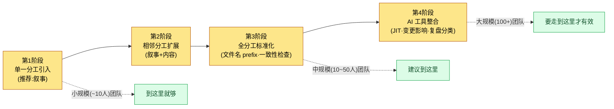

# 2.3 Layer 设计 —— 游戏系统抽象化

那是分工从三个增长到八个的时段。战斗策划把技能攻击距离定为 8m。同一周,关卡设计师把副本通道宽度锁定为 6m。两者在各自分工内都是完全合理的决定。问题在三周后的版本里暴露出来。范围技能穿过通道墙壁打出去,敌人在玩家根本看不见的地方被打死。这不是任何人的失误。只是两个人没有一扇窗户能看见彼此的决定而已。

本章讲的就是造出这扇窗户的故事。让每个分工保留自己的房间,同时只凭一个坐标就能知道隔壁房间里在发生什么。这个坐标系,就叫作 Layer。

---

## 2.3.1 孤岛化 —— 每次都会再次遭遇的敌人

游戏策划的分工被切得很细。系统、战斗、叙事、内容、关卡、数值、UX、QA。每个分工都有自己的工具、产出物、会议。规模越大,各自越是深入自己的领域,陷入不知道别的分工在做什么的状态。这就叫作孤岛(silo)化。

孤岛化的代价要等时间过去才会显现。

- 战斗策划定下的技能攻击距离,与关卡设计的通道宽度对不上。
- 叙事设计的 NPC 动机,与内容策划的任务奖励结构相冲突。
- 数值策划拟定的经济循环,与运营(LiveOps)的登录奖励排期相错位。

原因不是能力不足。各自在自己的分工里做了合理的决定,只是没有一条通道能让人察觉别的分工的决定而已。用会议来填补,会议就会暴增;用群聊来填补,信号就会被噪声淹没。这并不是说会议和群聊毫无价值,关键在于把"能填补的部分"和"不能填补的部分"之间的边界划清楚。

解决办法是:既不收窄各自的领域(保持分工分化),又能让彼此看见对方的流程(统一可见性)。这两个看似冲突的诉求,只要对齐到同一个坐标系上,就能同时达成。那个坐标系就是 Layer。拿办公室来打比方,就相当于每个人都有自己的桌子,同时看着同一面挂钟和日历。

---

## 2.3.2 Layer 的定义 —— 5 层抽象

本书使用的 Layer 是 0\~4 的 5 层抽象。越往上越抽象、越少变更;越往下越具体、变更越频繁。

<svg viewBox="0 0 760 300" xmlns="http://www.w3.org/2000/svg" font-family="sans-serif" role="img" aria-label="Layer 0到4的5层抽象结构以及各层的程序化生成角色">
  <defs>
    <marker id="arrowDown" markerWidth="8" markerHeight="8" refX="4" refY="7" orient="auto">
      <path d="M0,0 L8,0 L4,8 z" fill="#555"/>
    </marker>
  </defs>
  <text x="20" y="24" font-size="13" fill="#888">抽象 · 不变</text>
  <text x="640" y="24" font-size="13" fill="#888">具体 · 变动</text>

  <rect x="20" y="36" width="720" height="42" rx="6" fill="#c0392b" opacity="0.9"/>
  <text x="34" y="55" font-size="14" fill="#fff" font-weight="bold">L0 愿景·核心价值</text>
  <text x="34" y="72" font-size="12" fill="#fff">程序化生成角色:上下文锚点 —— 不变,每次调用都注入的基准点</text>

  <rect x="20" y="86" width="720" height="42" rx="6" fill="#e67e22" opacity="0.9"/>
  <text x="34" y="105" font-size="14" fill="#fff" font-weight="bold">L1 系统·世界骨架</text>
  <text x="34" y="122" font-size="12" fill="#fff">程序化生成角色:生成输入规则 —— 规则手册·关系·标签(生成器遵循的约束)</text>

  <rect x="20" y="136" width="720" height="42" rx="6" fill="#f1c40f" opacity="0.95"/>
  <text x="34" y="155" font-size="14" fill="#333" font-weight="bold">L2 内容·流程</text>
  <text x="34" y="172" font-size="12" fill="#333">程序化生成角色:生成正文堆积的地方 —— 任务·进度·关卡曲线</text>

  <rect x="20" y="186" width="720" height="42" rx="6" fill="#27ae60" opacity="0.9"/>
  <text x="34" y="205" font-size="14" fill="#fff" font-weight="bold">L3 实现·配置表</text>
  <text x="34" y="222" font-size="12" fill="#fff">程序化生成角色:数值·ID·关系 —— 模拟的输入值</text>

  <rect x="20" y="236" width="720" height="42" rx="6" fill="#2980b9" opacity="0.9"/>
  <text x="34" y="255" font-size="14" fill="#fff" font-weight="bold">L4 版本·QA 产出物</text>
  <text x="34" y="272" font-size="12" fill="#fff">程序化生成角色:验证关卡 —— 版本结果·缺陷·试玩捕获</text>

  <line x1="10" y1="40" x2="10" y2="274" stroke="#555" stroke-width="1.5" marker-end="url(#arrowDown)"/>
</svg>

五个层各自在程序化生成·自动化管线中所承担的角色,写在上图右侧的标签里。这个映射是本章的脊柱。如果只把 Layer 看成"整理得很好的文件夹",那只看到了一半。每个层都精确对应生成管线的某一个阶段(锚点 → 规则 → 正文 → 数值 → 关卡)。

| Layer | 装什么 | 变更频率 |
|-------|---------------|-----------|
| Layer 0 | 游戏想给玩家的核心体验。可压缩为一句话 | 极低(贯穿项目整个生命周期) |
| Layer 1 | 游戏系统的大结构与世界观骨架 | 低(以里程碑为单位) |
| Layer 2 | 游玩流程、任务线、进度阶段、关卡曲线 | 中(以冲刺为单位) |
| Layer 3 | 实际数据值、参数、公式、变量 | 高(以日为单位) |
| Layer 4 | 在版本中确认到的结果、缺陷报告、试玩视频 | 极高(实时) |

这 5 层并非游戏专用概念。可以把同一条脊柱原样搬到一般 IT 产品开发上。没有做过游戏的读者,请用下面的职务翻译表把每一层对应到自己的产出物上(左边是游戏策划的 Layer,右边是 SaaS·App·内部系统等中放在相同位置上的产出物)。

| Layer | 游戏策划 | 一般 IT 产品 | 相同的问题 |
|-------|-----------|--------------|-----------|
| L0 核心体验 | 想给玩家的核心体验(一句话) | 产品愿景 —— 为谁、解决什么问题、怎么解决 | "为什么要做这个" |
| L1 系统规则 | 系统结构·世界观骨架 | 业务·功能规则 —— 领域规则、权限模型、核心工作流 | "什么应该如何运作" |
| L2 内容 | 任务线·进度阶段·关卡曲线 | 发布·路线图 —— 功能打包、上线顺序、里程碑 | "在什么时候放出什么" |
| L3 数据 | 数据值·参数·公式 | 规格表 —— API 规格、字段定义、配置值、阈值 | "准确的值和定义是什么" |
| L4 版本·QA | 版本结果·缺陷·试玩视频 | 部署·QA —— 部署产出物、缺陷报告、监控日志 | "实际放出去的东西跑得对不对" |

读法和游戏完全一样。越往上变更越少(产品愿景每季度变一次),越往下越频繁(配置值每天都变)。前面看到的孤岛事故 —— 攻击距离和通道宽度冲突的那一幕 —— 与一般 IT 中"后端字段定义(L3)和前端画面规则(L1)对不上,在上线前夕爆掉"的事,是完全相同的结构。只是分工的名字不同,脊柱是同一条。

这 5 层并非绝对。根据规模和领域,4 层可能就够,也可能需要 6 层。关键不在于数字是不是 5,而在于"明确定义层级"这一行为本身。

一个产出物也可能横跨两个 Layer。"技能系统 GDD(Game Design Document,详细规格书)"同时装着系统设计(Layer 1)和具体数据(Layer 3)。这时要么把文档拆开,要么把主 Layer 定为 1、把数据部分分离成单独的表格,但无论哪种方式,都要明确标出每个部分住在哪个 Layer。

---

## 2.3.3 元原则 —— 同时实现分化与整合

分工横向铺开,Layer 纵向堆叠。一个分工的工作横跨多个 Layer。下面的矩阵用单元格的颜色深浅,表现 11 个分工(横轴)× Layer 0\~4(纵轴)的分布重心。深色格就是那个分工的重心 Layer。

<svg viewBox="0 0 820 320" xmlns="http://www.w3.org/2000/svg" font-family="sans-serif" font-size="11" role="img" aria-label="11个分工横轴与Layer 0到4纵轴的分化整合矩阵">
  <!-- column headers (분야) -->
  <g fill="#333">
    <text x="120" y="30" transform="rotate(-35 120 30)">系统</text>
    <text x="180" y="30" transform="rotate(-35 180 30)">战斗</text>
    <text x="240" y="30" transform="rotate(-35 240 30)">叙事</text>
    <text x="300" y="30" transform="rotate(-35 300 30)">内容</text>
    <text x="360" y="30" transform="rotate(-35 360 30)">关卡</text>
    <text x="420" y="30" transform="rotate(-35 420 30)">数值</text>
    <text x="480" y="30" transform="rotate(-35 480 30)">UX/UI</text>
    <text x="540" y="30" transform="rotate(-35 540 30)">QA</text>
    <text x="600" y="30" transform="rotate(-35 600 30)">角色</text>
    <text x="660" y="30" transform="rotate(-35 660 30)">美术</text>
    <text x="720" y="30" transform="rotate(-35 720 30)">运营</text>
  </g>
  <!-- row labels (Layer) -->
  <g fill="#333" text-anchor="end">
    <text x="95" y="74">L0 愿景</text>
    <text x="95" y="124">L1 系统</text>
    <text x="95" y="174">L2 内容</text>
    <text x="95" y="224">L3 数据</text>
    <text x="95" y="274">L4 版本·QA</text>
  </g>
  <!-- grid cells: x columns at 110,170,...,710 ; y rows at 60,110,160,210,260 ; cell 50x40 -->
  <!-- color helper: dark=#2c3e50 mid=#7f8c9b light=#dfe4ea -->
  <!-- L0 row (y=60) -->
  <g>
    <rect x="110" y="60" width="50" height="40" fill="#dfe4ea" stroke="#fff"/>
    <rect x="170" y="60" width="50" height="40" fill="#dfe4ea" stroke="#fff"/>
    <rect x="230" y="60" width="50" height="40" fill="#2c3e50" stroke="#fff"/>
    <rect x="290" y="60" width="50" height="40" fill="#dfe4ea" stroke="#fff"/>
    <rect x="350" y="60" width="50" height="40" fill="#dfe4ea" stroke="#fff"/>
    <rect x="410" y="60" width="50" height="40" fill="#dfe4ea" stroke="#fff"/>
    <rect x="470" y="60" width="50" height="40" fill="#dfe4ea" stroke="#fff"/>
    <rect x="530" y="60" width="50" height="40" fill="#7f8c9b" stroke="#fff"/>
    <rect x="590" y="60" width="50" height="40" fill="#dfe4ea" stroke="#fff"/>
    <rect x="650" y="60" width="50" height="40" fill="#2c3e50" stroke="#fff"/>
    <rect x="710" y="60" width="50" height="40" fill="#dfe4ea" stroke="#fff"/>
  </g>
  <!-- L1 row (y=110) -->
  <g>
    <rect x="110" y="110" width="50" height="40" fill="#2c3e50" stroke="#fff"/>
    <rect x="170" y="110" width="50" height="40" fill="#2c3e50" stroke="#fff"/>
    <rect x="230" y="110" width="50" height="40" fill="#7f8c9b" stroke="#fff"/>
    <rect x="290" y="110" width="50" height="40" fill="#dfe4ea" stroke="#fff"/>
    <rect x="350" y="110" width="50" height="40" fill="#7f8c9b" stroke="#fff"/>
    <rect x="410" y="110" width="50" height="40" fill="#dfe4ea" stroke="#fff"/>
    <rect x="470" y="110" width="50" height="40" fill="#2c3e50" stroke="#fff"/>
    <rect x="530" y="110" width="50" height="40" fill="#7f8c9b" stroke="#fff"/>
    <rect x="590" y="110" width="50" height="40" fill="#2c3e50" stroke="#fff"/>
    <rect x="650" y="110" width="50" height="40" fill="#7f8c9b" stroke="#fff"/>
    <rect x="710" y="110" width="50" height="40" fill="#dfe4ea" stroke="#fff"/>
  </g>
  <!-- L2 row (y=160) -->
  <g>
    <rect x="110" y="160" width="50" height="40" fill="#7f8c9b" stroke="#fff"/>
    <rect x="170" y="160" width="50" height="40" fill="#7f8c9b" stroke="#fff"/>
    <rect x="230" y="160" width="50" height="40" fill="#2c3e50" stroke="#fff"/>
    <rect x="290" y="160" width="50" height="40" fill="#2c3e50" stroke="#fff"/>
    <rect x="350" y="160" width="50" height="40" fill="#2c3e50" stroke="#fff"/>
    <rect x="410" y="160" width="50" height="40" fill="#dfe4ea" stroke="#fff"/>
    <rect x="470" y="160" width="50" height="40" fill="#7f8c9b" stroke="#fff"/>
    <rect x="530" y="160" width="50" height="40" fill="#dfe4ea" stroke="#fff"/>
    <rect x="590" y="160" width="50" height="40" fill="#7f8c9b" stroke="#fff"/>
    <rect x="650" y="160" width="50" height="40" fill="#dfe4ea" stroke="#fff"/>
    <rect x="710" y="160" width="50" height="40" fill="#2c3e50" stroke="#fff"/>
  </g>
  <!-- L3 row (y=210) -->
  <g>
    <rect x="110" y="210" width="50" height="40" fill="#2c3e50" stroke="#fff"/>
    <rect x="170" y="210" width="50" height="40" fill="#2c3e50" stroke="#fff"/>
    <rect x="230" y="210" width="50" height="40" fill="#7f8c9b" stroke="#fff"/>
    <rect x="290" y="210" width="50" height="40" fill="#7f8c9b" stroke="#fff"/>
    <rect x="350" y="210" width="50" height="40" fill="#2c3e50" stroke="#fff"/>
    <rect x="410" y="210" width="50" height="40" fill="#2c3e50" stroke="#fff"/>
    <rect x="470" y="210" width="50" height="40" fill="#7f8c9b" stroke="#fff"/>
    <rect x="530" y="210" width="50" height="40" fill="#7f8c9b" stroke="#fff"/>
    <rect x="590" y="210" width="50" height="40" fill="#2c3e50" stroke="#fff"/>
    <rect x="650" y="210" width="50" height="40" fill="#dfe4ea" stroke="#fff"/>
    <rect x="710" y="210" width="50" height="40" fill="#7f8c9b" stroke="#fff"/>
  </g>
  <!-- L4 row (y=260) -->
  <g>
    <rect x="110" y="260" width="50" height="40" fill="#dfe4ea" stroke="#fff"/>
    <rect x="170" y="260" width="50" height="40" fill="#7f8c9b" stroke="#fff"/>
    <rect x="230" y="260" width="50" height="40" fill="#7f8c9b" stroke="#fff"/>
    <rect x="290" y="260" width="50" height="40" fill="#dfe4ea" stroke="#fff"/>
    <rect x="350" y="260" width="50" height="40" fill="#dfe4ea" stroke="#fff"/>
    <rect x="410" y="260" width="50" height="40" fill="#7f8c9b" stroke="#fff"/>
    <rect x="470" y="260" width="50" height="40" fill="#dfe4ea" stroke="#fff"/>
    <rect x="530" y="260" width="50" height="40" fill="#2c3e50" stroke="#fff"/>
    <rect x="590" y="260" width="50" height="40" fill="#dfe4ea" stroke="#fff"/>
    <rect x="650" y="260" width="50" height="40" fill="#7f8c9b" stroke="#fff"/>
    <rect x="710" y="260" width="50" height="40" fill="#2c3e50" stroke="#fff"/>
  </g>
  <!-- legend -->
  <g>
    <rect x="110" y="305" width="14" height="12" fill="#2c3e50"/>
    <text x="128" y="315" fill="#333">重心</text>
    <rect x="220" y="305" width="14" height="12" fill="#7f8c9b"/>
    <text x="238" y="315" fill="#333">次要分布</text>
    <rect x="320" y="305" width="14" height="12" fill="#dfe4ea"/>
    <text x="338" y="315" fill="#333">微弱·无</text>
  </g>
</svg>

纵向读,能看出一个分工横跨哪些 Layer;横向读,能看出一个 Layer 聚集了哪些分工。L0(愿景)这一行,叙事和美术指导最深 —— 这是离愿景最近的两个分工。L3(数据)这一行,系统·战斗·关卡·数值·角色聚得很深 —— 这是它们在配置表里彼此碰撞的信号。

只要明确地拥有这份分布,别的分工就能立刻知道"得去看战斗的 Layer 2"的位置。这不是孤岛的墙被推倒,而是在墙上凿出了一扇窗。

把整个矩阵压成一句话就是这样:纵轴 Layer 是为了把生成自动化而分,横轴分工是为了发挥专业性而分。两者在网格的某一格里相遇。

---

## 2.3.4 运营案例 —— 某 MMORPG 项目的实测

笔者作为设计总监运营的 MMORPG 项目A,与策划团队(4\~5 人)一起把 Layer 系统运营了约 6 个月(整个开发团队属于中等规模,10\~50 人)。看看具体案例。

先看叙事 5 层。叙事策划文件夹本身就按 Layer 做了分割。

<svg viewBox="0 0 640 230" xmlns="http://www.w3.org/2000/svg" font-family="sans-serif" font-size="13" role="img" aria-label="叙事文件夹的Layer 0到4分割结构">
  <text x="20" y="26" font-weight="bold" fill="#333">NarrativeDocs/</text>
  <g>
    <rect x="40" y="40" width="240" height="30" rx="4" fill="#c0392b" opacity="0.9"/>
    <text x="52" y="60" fill="#fff">Layer0_Vision/</text>
    <text x="300" y="60" fill="#555">世界的核心信息,1.1~1.2</text>
  </g>
  <g>
    <rect x="40" y="76" width="240" height="30" rx="4" fill="#e67e22" opacity="0.9"/>
    <text x="52" y="96" fill="#fff">Layer1_World/</text>
    <text x="300" y="96" fill="#555">地区·势力·时代设定</text>
  </g>
  <g>
    <rect x="40" y="112" width="240" height="30" rx="4" fill="#f1c40f" opacity="0.95"/>
    <text x="52" y="132" fill="#333">Layer2_StoryLine/</text>
    <text x="300" y="132" fill="#555">主线任务流程</text>
  </g>
  <g>
    <rect x="40" y="148" width="240" height="30" rx="4" fill="#27ae60" opacity="0.9"/>
    <text x="52" y="168" fill="#fff">Layer3_DialogueSheet/</text>
    <text x="300" y="168" fill="#555">实际台词·名称数据</text>
  </g>
  <g>
    <rect x="40" y="184" width="240" height="30" rx="4" fill="#2980b9" opacity="0.9"/>
    <text x="52" y="204" fill="#fff">Layer4_BuildVO/</text>
    <text x="300" y="204" fill="#555">已进入版本的配音</text>
  </g>
</svg>

叙事作者在 Layer 2 改动主线故事的一个分支,就会影响到 Layer 3 的台词表,对已经录好的 Layer 4 配音则可能产生不可逆的影响。正因为明确标了 Layer,才能立刻追溯影响范围。

关系图自动生成工具 `gen_relation_map.py` 也一并在运营。它分析配置表之间的外键关系,生成交互式 HTML 关系图,并用节点颜色表现 Layer(红=L1 系统,黄=L2 内容,绿=L3 数据)。从哪个 Layer 向哪个 Layer 流动依赖,一目了然。如果依赖倒着流 —— L3 朝 L1 射出箭头 —— 几乎总是设计缺陷。

程序化关卡生成的主文档,把 Layer 坐标明确写在 frontmatter 里。

```yaml
---
title: 程序化关卡设计主文档 v0.1
layer_inputs: [L1.World, L2.StoryLine]
layer_outputs: [L3.LevelData, L4.PlayCapture]
---
```

这两行就声明了"这条管线以 Layer 1·2 为输入,生成 Layer 3·4",并且在变更时影响范围的计算被自动化。L0 愿景即使不写也始终是输入 —— 因为任何生成,愿景锚点每次都会跟着。

还有一条强制在文档名里加 Layer prefix 的 atom 规则。团队共享的 atom 之一是这样:

> **`docs_layer_numeric_prefix_naming`**:配置表文件名必须带 Layer 编号 prefix(`L1_`、`L2_`、`L3_`)。没有 prefix 的表会在一致性检查中告警。

规则越简单越强大。只要按名称排序就会按 Layer 聚到一起,AI 工具也仅凭文件名就知道 Layer。人忘了,一致性检查也会抓住。

---

## 2.3.5 反向引用检出 —— 实操记录

前一节(2.3.4)说过"L3 朝 L1 射出箭头几乎总是设计缺陷"。如果把这种检出交给 AI 而不是人眼,会怎么样。把实际跑过的一段过程不加修饰地原样照搬过来(仅对公司可识别信息做匿名化)。

**[提示词全文]**

```
看一下附上的两个 frontmatter,Layer 依赖方向正不正常。
引用只有从高编号→低编号流动才算正常。倒过来就告警。

--- 文档 A (L1_combat_system.md) ---
title: 战斗系统骨架
layer: L1
refs: [L3_skill_damage_sheet, L2_combat_flow]

--- 文档 B (L3_skill_damage_sheet.md) ---
title: 技能伤害表
layer: L3
refs: [L1_combat_system]
```

**[Claude 原始输出 —— 不加摘要,原样照搬]**

```
我检查了两个文档。

文档 B (L3_skill_damage_sheet, L3):
  refs → [L1_combat_system]
  方向:L3 → L1 (具体 → 抽象)
  判定:正常。配置表引用自己所遵循的系统骨架,
        是自然的方向。

文档 A (L1_combat_system, L1):
  refs → [L3_skill_damage_sheet, L2_combat_flow]
  - L1 → L2 :正常 (设计指向下层流程)
  - L1 → L3 :⚠ 反方向告警
        L1 系统骨架直接引用了 L3 配置表。
        这意味着"设计文档从属于特定的数据值",
        会造成数据每次变更都得动设计文档的
        耦合。

建议:从文档 A 的 refs 中移除 L3_skill_damage_sheet。
      如果系统骨架确实需要知道具体数值,就把那个数值
      作为抽象规则上移到 L1(例如:"基础伤害为
      职业系数 × 等级"),或经由 L2 流程文档中转。

摘要:检出反向引用 1 处 (A: L1 → L3)。
```

**[人工验证 / 否决]**

AI 的判定是对的。只是"经由 L2 流程文档中转"的建议在这个案例里过头了。L1 需要知道的是伤害公式的*形态*,而不是表里的某个特定单元格。所以只采纳了第二条建议(上移为抽象规则),否决了中转的提议。

**[再次请求]**

```
去掉中转的提议,只按"把伤害公式的形态作为抽象规则
上移到 L1"这个方向,给出 L1_combat_system.md 的修改 diff。
也把 refs 整理一下。
```

这一个循环就是反向引用检出的大本营。AI 抓住方向违规(自动),人削掉建议的适当尺度(评审),只把收窄后的工作再交回去(再次请求)。在项目A中,`gen_relation_map.py` 以图为单位、`portal_layer_change_impact_check` atom 在变更被检测到的时点触发,强制做影响范围检查。

如果这种比对由人来亲自做,光是打开两个文档对齐 refs、判定方向就要花好几分钟。当文档增加到数百个,实际上就不可能了。反向引用总是一两个一两个地悄悄混进来,过了很久才在版本里爆掉。

---

## 2.3.6 Layer 分解 = 程序化生成·自动化的前提

Layer 整合的表面目的是消解孤岛、统一协作语言(2.3.1\~2.3.5)。本质目的还要再深一层。当 Layer 分解扎下根来,程序化生成·自动化的前提条件就齐备了。

前两节的运营案例,处于人来决定、AI 协助验证·注入的阶段。再下一步,就进入到分工本身的量产由 AI 生成候选、由人采纳的阶段。这一步的前提之所以是 Layer 分解,有三个理由。① AI 生成候选,必须能明确"要生成哪个 Layer 的什么"。② 自动一致性检查,要在 Layer 间依赖方向标准化之后才能运作(2.3.5 的反向引用检出)。③ 变更影响的自动计算,要有"变更发生在哪个 Layer"的坐标才有可能。三者都汇聚到"没有 Layer 分解,自动化本身就被堵死"。把坐标分开的那双手的尽头,从一开始就摆着程序化生成。

在还没看到各分工部分的阶段无需深入,所以只把应用的两个阶段勾出轮廓。**保守应用**是人来决定,AI 自动协助一致性检查·变更影响计算·JIT 注入 —— 2.3.4·2.3.5 的运营案例就在这里。工具成本小,累积效果到运营第 6 个月左右才显现,大多数中等规模(10\~50 人)团队都能达到。**进取应用**则更进一步,分工的量产本身由 AI 生成候选(叙事 Persona、PCG 规则手册、程序化关卡、数值变更候选、美术资产等),人只决定"采纳哪个候选"。各分工的具体形态和工具成熟度,在相应分工的部分里展开。

进取应用各分工共通需要的 3 要素是:① Layer 分离·标注基础设施(frontmatter·atom·文件名 prefix),② 候选生成·评估循环(AI 候选 N 个 → 自动评估 → 排名·依据报告),③ 人工评审关卡(只有被采纳的结果才进入下一个 Layer)。不过,在任何时点,确定性核心(模拟·物理·法律约束)都由人·确定性代码负责,所有评审都在进入不可逆阶段(录音·选角·上线曝光等)之前的可逆阶段就了结 —— 这条可逆/不可逆的边界是各分工共通的原则。

最后说一个时点。保守应用在 2010 年代也部分可行,但进取应用被三个限制卡着:AI 候选生成的表现力、自动评估的自然语言解读、人工评审负担。LLM 发展之后,三者都进入实用领域,进取应用从纸面上的愿景下降到了实务阶段。AI 的发展抬高了程序化生成·自动化的可实现性 —— 贯穿本书全书的这条元信息,就在这里。

---

## 2.3.7 分工坐标 —— 本书各分工部分所住的地方

本书的各分工部分,会在导入处明确各分工主要分布在哪个 Layer,在章节内部也频繁使用 Layer 坐标。先整理在此(这是把 2.3.3 矩阵的重心搬成了表格)。

| 分工 | 主 Layer | 备注 |
|------|----------|------|
| 系统策划 | L1\~L3 | 从设计骨架到配置表,涵盖面广 |
| 战斗策划 | L1\~L3,L4 一部分 | 连招骨架\~伤害表,版本测量 |
| 叙事策划 | L0\~L4 | 用文件夹运营 5 层结构 |
| 内容策划 | 以 L2 为中心 | 进度流程·任务线 |
| 关卡设计 | L2\~L3 | 含程序化生成管线 |
| 数值策划 | 以 L3 为中心,L4 测量 | 数据值·曲线·验证测量 |
| UX/UI 设计 | L1\~L3 | 交互骨架\~画面数据 |
| QA 设计 | 以 L4 为中心,L0\~L3 验证 | 验证所有 Layer 是否都反映进版本 |
| 角色·宠物·坐骑 | L1\~L3 | 系统·世界·数据 |
| 美术指导 | L0\~L1 + L4 产出物 | 愿景·世界指南 + 版本评审 |
| 运营 | L2\~L4 | 运营循环·实时数据 |

每个分工也会触及别的 Layer,但只要知道重心,协作通道就看得见。数值(L3)和运营(L2\~L4)在 L3 相遇,所以始终要紧密协作;离愿景(L0)最近的两个分工是叙事和美术指导。这些相邻关系在坐标系上自然地显现出来。

---

## 2.3.8 从小处开始,往大处培养

要想一开始就完美地引入 Layer 系统,就连开始都做不到。渐进地引入才是正解。



- **第 1 阶段(单一分工)**:只挑一个分工(推荐:叙事),把文件夹按 Layer 分割。其他分工先放着,运营一两个月,逐步打磨 Layer 的定义。
- **第 2 阶段(相邻分工扩展)**:对分化曲线相近的两个分工(例:叙事+内容)同时应用,观察 Layer 咬合的模式,用 atom 做 1\~2 条一致性规则。
- **第 3 阶段(全分工标准化)**:给全分工赋予 Layer 坐标,引入文件名规则(`L1_`·`L2_`·`L3_` prefix),把关系图·一致性检查自动化。
- **第 4 阶段(AI 工具整合)**:在 JIT hook 中利用 Layer 元数据,自动计算变更影响范围,在复盘系统中加上 Layer 分类。

每个阶段至少一个月,长则以季度为单位。硬推,人就会累。把运营负担控制在不超过引入价值的范围内、调节速度,这是总监的工作。

小规模(\~10 人)走 1\~2 阶段,中规模(10\~50 人)走第 3 阶段,大规模(100+)要走到第 4 阶段才会出效果。这并不是说小团队用不了。只是深度不同,核心价值在第 1 阶段就已经开始了。

---

## 2.3.9 结论 —— 全书的脊柱

Layer 不是单纯的文件夹整理技巧。它是把分化的游戏策划捆进一个坐标系、让 AI 能够推理的元原则,进而是各分工程序化生成·自动化的共通前提条件。

- 分化要保留 —— 每个分工的专业性和工具原样留着。
- 整合要叠加 —— 所有产出物对齐到同一个坐标系上。
- AI 理解这个坐标系,执行自动注入·一致性检查·变更传播(保守应用)。
- 在同一个坐标系上,各分工的进取应用分阶段地生长起来。

本书其余所有部分都以本章为前提。各分工部分会在导入处明确各分工在 Layer 中占据的坐标,流程部分讲横跨 Layer 的运营系统,运营部分讲 Layer 系统本身的 self-improving 循环。

下一章(游戏本体论与知识图谱)在 Layer 之上叠加语义关系。如果说 Layer 是坐标,那么本体论就是坐标之上的语义箭头。两者合在一起,AI 才终于能自主推理"这个文档会影响那个文档"。

有一点要说清楚。本章的任何自动化都没有代替决定。在反向引用检出中,机器只是把违规候选铺开,选择接受什么、接受到哪一步的,是人的手。Layer 是帮助人更快做出更好决定的坐标系,不是把决定甩出去的装置。

---

### 本章要点

- Layer 是既保留分工分化、又叠加统一可见性的坐标系,也是全书的脊柱。
- 5 层各自对应程序化生成的一个角色(锚点·规则·正文·数值·关卡)。
- 像反向引用(L3→L1)检出那样,AI 抓、人削,才是自动化的正确形态。

### 本章核心 atom(参考)

- `layer_unified_design_philosophy` —— 本章的母体 atom
- `docs_layer_numeric_prefix_naming` —— 文件名 prefix 强制规则
- `dead_table_5layer_cleanup` —— 5 层之外的表清理规则
- `portal_layer_change_impact_check` —— 变更影响自动检查

### 下一章预告

- 第 7 章. 游戏本体论与知识图谱 —— 在 Layer 坐标之上叠加语义箭头
- 第 8 章. Wikilink 系统 —— 从运营经验中提取的引用模式

---

## 动手试试

**setup** —— 挑一个分工(推荐:叙事)的文件夹,把下级文件夹从 `Layer0_Vision/` 到 `Layer4_BuildVO/` 分成 5 个。把现有文件移动到对应的 Layer。名字含糊的文件,以"这个文档变化的频率"为标准来安放(变得越勤就放越下面的 Layer)。

**prompt** —— 挑两个配置表的 frontmatter,把 2.3.5 的提示词全文原样粘进去,让它判定 Layer 依赖方向。只要准确给出一条核心规则就行。"引用只能从具体→抽象(高编号→低编号)流动才算正常。"

**verify** —— AI 抓出反方向引用时,不要原样接受它的建议,要亲自削掉适当尺度(2.3.5 的"人工验证/否决")。只把采纳的方向作为 diff 再次请求。按名称排序时,如果 Layer 看上去从上到下聚在一起,就说明 prefix 规则站稳了。

## 单人精简版

一个人作业,Layer 也照样起作用。没有团队,就没有"分工之间的孤岛",但有"时点之间的孤岛"。三周前的我和今天的我会忘记彼此的决定。只要把文件夹仅按 Layer 0\~4 分开 —— 愿景一张,系统骨架几张,进度流程,配置表,版本备忘 —— 就能立刻找到过去的我把什么放在了哪一格。只要对 AI 加一行"现在在做 L2 工作",它就不会拽来无关 Layer 的资料。减到 4 层·3 层也行。核心不是数字,而是"明确标出层级"这一行为。
