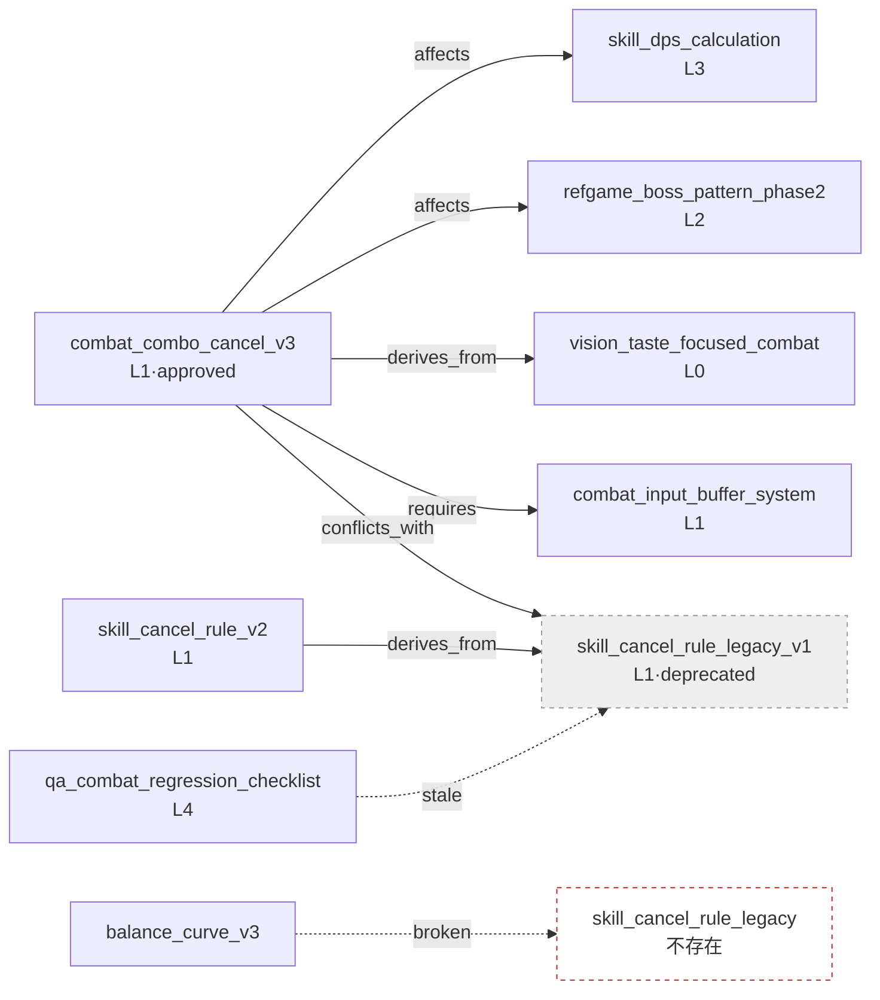

# 2.4 本体与 wikilink 图谱 —— 验证语义箭头

周一上午,一条变更请求被提了上来。战斗团队的成员 A 在团队即时通讯工具里写下一行字:"我想把全局冷却从 0.5 秒改成 0.3 秒。有谁受影响吗?"换作平时,从这里开始就是一场半小时的会议。负责伤害计算公式的人举手,负责连招取消规则的人插话,还有人问"Boss 的招式会不会也受影响"。没有人把整张图都装在脑子里,于是会议被翻找记忆这件事填满。

可这一次不一样。请求提上来 1 秒后,机器人自动加了一条评论:"修改这个 atom 会影响 4 个 atom。`skill_dps_calculation`、`combat_combo_cancel_v3`、`refgame_boss_pattern_phase2`、`balance_curve_v3`。负责人:成员 B、成员 A、成员 C。"会议没有召开。4 个人各自只确认了自己的 atom 就结束了。(这个机器人我们会在后面亲手做出来 —— 见 2.4.3。)

这条评论不是魔法。在 2.3 里我们给所有 atom 赋予了 Layer 坐标,在此之上,本章又加上了**语义箭头** —— 哪个决策影响哪个决策。坐标只说到"这里有什么"。"这个影响那个""那个必须先存在才成立""这两个不能同时开启"之类的关系,是画在坐标之上的箭头。本章讲的就是如何标注这些箭头,以及如何自动揪出断掉的箭头。

> **术语备注**
> - 本体(ontology):把概念及其之间的关系明确定义出来的体系。本书采用简化为 6\~12 种关系的轻量版本。
> - wikilink:`[[atom_name]]` 形式的文档间链接。借用了 Obsidian、Roam 等工具中使用的写法。
> - 反向引用(backlink):"指向这个 atom 的那些 atom"的列表。正向引用的反方向。
> - 孤立节点(orphan):任何地方都没有引用的 atom。废弃候选的信号。
> - 断链(broken link):指向不存在的 atom 的 wikilink。错别字、改名留下的痕迹。

---

## 2.4.1 关系就是箭头 —— 仅凭 wikilink 为何不够

在 2.1 里,我们用 YAML 前言(frontmatter)附上了元数据,又在 atom 正文里撒下了 wikilink。仅凭这些,文档就已经像网一样连接起来了。问题在于,这些连接**没有写明它意味着什么**。

```markdown
这个决策成立于 [[skill_cooldown_rule_v2]] 之上。
```

这一行只说到"提及了 skill_cooldown_rule_v2"。为什么提及?是这个决策**需要**那条规则(requires),是从那条规则**派生**而来(derives_from),还是与那条规则**冲突**(conflicts_with)?人读句子就明白,机器却不知道。就算问 AI"开启这个决策会不会有什么东西被破坏",仅凭没有语义的链接也答不出来。

所以要给 wikilink 套上**关系类型**。游戏策划中实际用到的关系,出乎意料地少。下面这六种就覆盖了 90% 以上。

<svg viewBox="0 0 720 250" xmlns="http://www.w3.org/2000/svg" font-family="sans-serif" font-size="13">
  <rect x="0" y="0" width="720" height="250" fill="#fbfbfd" stroke="#ddd"/>
  <!-- affects -->
  <rect x="20" y="20" width="120" height="44" rx="6" fill="#fff" stroke="#222"/>
  <text x="80" y="40" text-anchor="middle" font-weight="bold">affects</text>
  <text x="80" y="56" text-anchor="middle" fill="#666">施加影响</text>
  <!-- derives_from -->
  <rect x="160" y="20" width="120" height="44" rx="6" fill="#fff" stroke="#1a66cc"/>
  <text x="220" y="40" text-anchor="middle" font-weight="bold" fill="#1a66cc">derives_from</text>
  <text x="220" y="56" text-anchor="middle" fill="#666">派生自~</text>
  <!-- requires -->
  <rect x="300" y="20" width="120" height="44" rx="6" fill="#fff" stroke="#e08a00"/>
  <text x="360" y="40" text-anchor="middle" font-weight="bold" fill="#e08a00">requires</text>
  <text x="360" y="56" text-anchor="middle" fill="#666">须先存在</text>
  <!-- conflicts_with -->
  <rect x="440" y="20" width="130" height="44" rx="6" fill="#fff" stroke="#cc2222"/>
  <text x="505" y="40" text-anchor="middle" font-weight="bold" fill="#cc2222">conflicts_with</text>
  <text x="505" y="56" text-anchor="middle" fill="#666">不可同时启用</text>
  <!-- is_a -->
  <rect x="590" y="20" width="110" height="44" rx="6" fill="#fff" stroke="#888"/>
  <text x="645" y="40" text-anchor="middle" font-weight="bold" fill="#888">is_a</text>
  <text x="645" y="56" text-anchor="middle" fill="#666">特例</text>
  <!-- part_of -->
  <rect x="300" y="90" width="120" height="44" rx="6" fill="#fff" stroke="#bbb"/>
  <text x="360" y="110" text-anchor="middle" font-weight="bold" fill="#999">part_of</text>
  <text x="360" y="126" text-anchor="middle" fill="#666">~的一部分</text>
  <!-- example wiring -->
  <text x="360" y="175" text-anchor="middle" fill="#333" font-size="14">例:combat_combo_cancel_v3 —[affects]→ skill_dps_calculation</text>
  <text x="360" y="200" text-anchor="middle" fill="#333" font-size="14">combat_combo_cancel_v3 —[derives_from]→ vision_taste_focused_combat</text>
  <text x="360" y="225" text-anchor="middle" fill="#333" font-size="14">combat_combo_cancel_v3 —[requires]→ combat_input_buffer_system</text>
</svg>

把这六种用 enum 固定下来的 atom 就是 `ontology_relation_enum_v1`。要新增关系类型,必须经过变更请求评审。即便增加,10\~12 个也是适当的上限,起步时只用 affects、derives_from、requires 三个也足够。写关系的位置是 atom 的 YAML 前言。

```yaml
---
name: combat_combo_cancel_v3
layer: 1
affects: [skill_dps_calculation, refgame_boss_pattern_phase2]
derives_from: [vision_taste_focused_combat]
requires: [combat_input_buffer_system, skill_cooldown_rule_v2]
conflicts_with: [skill_cancel_rule_legacy_v1]
---
```

人只写正向的那一行。反向("谁在 affects 我")由工具扫描全部来计算。如果在两边都写 affects,同步负担就会翻倍,而一旦只改一边、忘了另一边,图谱就开始说谎。**一个方向靠人手,反方向靠工具**,这是贯穿本章始终的原则。

---

## 2.4.2 实操记录(worked transcript) —— 一次性验证 wikilink 反向引用与图谱完整性

从这里开始,我把实际发生的一次会话整段照搬过来。"实操记录"是本书的专有词,指完整保留的真实操作过程记录。情形是这样的:把连招取消规则从 v2 推翻重做为 v3 时,决定废弃 `skill_cancel_rule_legacy_v1`。但在废弃之前,必须确认**有没有别的 atom 指向这个 atom**(反向引用),以及**废弃之后会不会留下断链或冲突**(图谱完整性)。靠手动 grep 会漏掉。交给 Claude。

### 提示词(全文)

```
我附上的 atom 文件夹(decisions/)里有 atom,前言里应该写着关系
(affects/derives_from/requires/conflicts_with/is_a/part_of)。
正文里也有 wikilink。现在我想废弃 skill_cancel_rule_legacy_v1,
废弃前请帮我检查 3 项:1) 反向引用 2) 断链 3) 冲突。
不要猜测,实际读取文件再回答。找不到就说找不到。
// 反向引用=YAML 关系+正文 wikilink 两边 / 断链=因废弃而 stale、变为不存在的链接
// 冲突=conflicts_with 对象中是否还有 status: approved 存活
```

### Claude 的输出(原始 —— 不做摘要、不做整理)

> 我读取了 decisions/ 文件夹中的 47 个文件。以下是针对 `skill_cancel_rule_legacy_v1` 的 3 项检查结果。
>
> **1. 反向引用(指向这个 atom 的 atom)**
>
> 通过 YAML 关系指向的 atom:
> - `combat_combo_cancel_v3` —— `conflicts_with: [skill_cancel_rule_legacy_v1]`
> - `skill_cancel_rule_v2` —— `derives_from: [skill_cancel_rule_legacy_v1]`
>
> 通过正文 wikilink 指向的 atom:
> - `combat_combo_cancel_v3` 正文:"解决了旧版 `[[skill_cancel_rule_legacy_v1]]` 的输入缓冲问题"
> - `qa_combat_regression_checklist` 正文:"回归项第 3 条是按 `[[skill_cancel_rule_legacy_v1]]` 编写的"
>
> 也就是说**有 4 个 atom 引用这个 atom**。(YAML 2 个 + 正文 wikilink 2 个,但 combat_combo_cancel_v3 两边都有,所以实际 atom 数为 3 个)
>
> **2. 断链(废弃时会断掉的地方)**
>
> 仅靠废弃本身,wikilink 并不会"断掉" —— 文件仍然保留,只是 status 变成 deprecated。不过:
> - `qa_combat_regression_checklist` 是以这个被废弃的 atom 为基准定义回归项的,因此**内容上失效**。这不算断链,但属于 stale link。需要复查。
> - 如果你连文件都**删除**,那么上述 4 处引用就全部变成断链。
>
> ⚠️ 有一处含糊的地方:`balance_curve_v3` 正文里有一个 `[[skill_cancel_rule_legacy]]`(末尾没有 `_v1`)的链接。它是错别字、本想指向 `_v1`,还是有意指向另一个 atom,仅凭文件无法确定。名为 `skill_cancel_rule_legacy` 的文件在文件夹里**不存在**。也就是说,这很可能已经是一条断链。需要确认。
>
> **3. 冲突残留(conflicts_with 对象是否存活)**
>
> 与 `skill_cancel_rule_legacy_v1` 以 `conflicts_with` 绑定的 atom:只有 `combat_combo_cancel_v3` 一个。
> - `combat_combo_cancel_v3` 的 status:**approved**(存活)
>
> → 与废弃对象冲突的新规则处于正常批准状态。这是正常的。这是废弃旧版、新版存活下来的自然替换。**不是冲突残留警告。**
>
> ---
> **总结**:废弃是安全的,但请先处理两件事。
> (a) `qa_combat_regression_checklist` 的 stale link —— 更新回归项第 3 条。
> (b) `balance_curve_v3` 的 `[[skill_cancel_rule_legacy]]` —— 疑似错别字。可能已经是断链。

### 人的验证与否决

在这里,我没有照单全收这份输出。(a)是对的 —— 回归检查清单得由我来更新。但我在(b)处停了下来。Claude 说 `balance_curve_v3` 的 `[[skill_cancel_rule_legacy]]` "疑似错别字",可它究竟是不是断链,我得亲自去看文件夹。AI 说"无法确定",这是诚实的信号,不是结论。

打开文件夹一看,名为 `skill_cancel_rule_legacy` 的文件确实不存在。可查看 git log 才发现,6 个月前有一次把 `skill_cancel_rule_legacy` **只改了名**为 `skill_cancel_rule_legacy_v1` 的提交。那时 `balance_curve_v3` 的正文链接没能更新就被放过去了。也就是说,这不是错别字,而是**改名后变成孤儿的断链**。Claude 的"疑似错别字"这一猜测只对了一半。原因不是错别字,而是 rename 遗漏。这点区别如果我没抓住,就会只改回归检查清单,断链则被原样埋掉。

### 重新请求(反映已确认的事实)

```
确认过了。[[skill_cancel_rule_legacy]] 不是错别字,而是 6 个月前
rename(_legacy → _legacy_v1)时没能改正文链接而留下的断链。

那就趁这个机会,把整个文件夹里"指向不存在的 atom 的 wikilink"
全部找出来。以正文 wikilink 为准,凡是目标文件不在文件夹里的,全部列出。
用表格列出文件名和其中的断链。
```

> 我收集了 47 个文件中所有 `[[...]]` 正文 wikilink,并与文件夹的文件清单做了比对。目标文件不存在的断链共 **3 条**。
>
> | 含链接的文件 | 断掉的 wikilink | 推测原因 |
> |---|---|---|
> | `balance_curve_v3` | `[[skill_cancel_rule_legacy]]` | rename 遗漏(→ `_v1`) |
> | `quest_reward_table_v2` | `[[concept_reward_currency]]` | 目标 atom 未编写(只有计划,没有文件) |
> | `refgame_boss_pattern_phase2` | `[[skill_global_cooldown]]` | rename 遗漏(→ `skill_global_cooldown_rule`) |
>
> 3 条中有 2 条(rename 遗漏)只要把目标 atom 名改成 `_v1` / `_rule` 即可。1 条(`concept_reward_currency`)由于所指向的 atom 本身不存在,需要你去编写,或删除该链接。我没有自动修改 —— 请在确认你想要哪一种后再进行。

三条全都属实。如果靠手动 grep,`quest_reward_table_v2` 的断链几乎肯定会被漏掉。那条链接是"预先指向一个尚未创建的 atom"的、有意为之的未来引用,可 6 个月里没人去创建那个 atom,它实际上已经成了一句作废的承诺。

这次会话所展现的事很简单。**反向引用检出与断链检出,AI 擅长读取并比对整个文件夹;而原因判定与意图确认,则由人来做。** AI 做到"这里断了"为止,人则做到"为什么断、怎么修"为止。

---

## 2.4.3 画成图谱才看得见的东西 —— 把验证搬到视觉上

前一节的检查也可以每次都用提示词来跑,但把同样的检查用代码固化下来,就能在图谱上一目了然。项目A 里有一个由 2.3 中介绍的 `gen_relation_map.py` 扩展而来的图谱工具在做 R&D。核心是读取文件夹里的 atom,用 `networkx` 构建有向图之后,再叠上四个检查函数。

```python
import networkx as nx

# build_graph(folder): 读取 atom 文件夹,以节点(=atom)和
#   YAML 关系边构建 DiGraph。(全文见「动手试试」)

def find_cycles(G):                      # 循环依赖
    return list(nx.simple_cycles(G))

def find_orphans(G):                     # 入度为 0 = 孤立候选
    return [n for n in G.nodes if G.in_degree(n) == 0]
```

核心就是两行。`simple_cycles` 抓出循环依赖(A requires B requires C requires A),`in_degree(n) == 0` 抓出孤立节点 —— 不需要亲手写 DFS。其余两个函数也是同等分量的一行式。`find_broken_wikilinks` 用正则收集正文 `[[...]]`,挑出不在节点清单里的;反向引用则把图谱倒着遍历一遍就出来(全文见「动手试试」)。可视化时把节点颜色按 Layer 涂,边的颜色按关系类型涂,被引用很多的节点(入边多的节点)画大一些,让枢纽显露出来。就像在文件柜上贴好彩色标签、整理过的文件夹那样,模式会先在视野中浮现。

下面是把 2.4.2 会话中涉及的那些 atom 的实际关系搬过来画成的图谱。箭头方向意味着"起点 atom 朝着终点 atom 建立关系"。



用虚线画出的两条边,正是 2.4.2 里靠人工验证抓到的问题。`qa → legacy` 是以废弃 atom 为基准的 stale link,`balance_curve_v3 → skill_cancel_rule_legacy` 是指向不存在节点的断链。画成图谱后,这两条虚线就在实线之间凸显出来。要是只用文本来运营,它们就会埋没在 47 个文件的某处,永远看不见。

在验证关卡(verification gate,由人或检查器把关验证的环节,类似质量门禁 quality gate)(Layer 4)上自动运行的规则有四条。

- **循环依赖**:`requires` 链条若绕回自己,就告警。用 `simple_cycles` 检出。
- **冲突激活**:以 `conflicts_with` 绑定的两个 atom 若都是 `status: approved`,就告警。(2.4.2 的案例因一方为 deprecated 而通过。)
- **孤立节点**:入度为 0 且没有父节点的 atom,作为废弃候选按季度排查。atom `graph_orphan_detection_quarterly` 明确规定了这个周期。
- **Layer 逆行**:L1 → L3 affects 是正常的(上层决策影响下层数据),L3 → L1 affects 则可疑。与 2.3 的反向引用检出是同一原理。由于 atom `docs_layer_numeric_prefix_naming` 强制在文件名上加 Layer 编号前缀,逆行只看文件名就能先做一轮筛除。

这四条规则一旦用代码固化,就不必像 2.4.2 那样每次都编写提示词。变更请求一提上来,机器人就重新构建图谱,把受影响的 atom 清单与断链、循环、冲突自动写成评论。章首那条"有 4 个 atom 受影响"的评论,正是这个 —— 这个机器人就是前面预告过的那个机器人。

---

## 2.4.4 为什么是 Layer —— 为了程序化生成而划分的坐标

这里得说清楚 2.3 与 2.4 为什么是一个整体。Layer 坐标与关系箭头不是分头引入的,而是同一目的的两个面。

表面上,Layer 统一了协作语言 —— 叫它"这是 L1 系统决策""那是 L3 数据",哪怕领域不同也共享同一套坐标。但本质目的在别处。**Layer 是为了程序化生成而划分的坐标。**

L0 愿景是上下文锚点 —— 它不变,且每次都注入给 AI。L1 系统是生成的输入规则 —— 规则手册、关系、标签都住在这里。L2 内容是生成出来的正文堆积的地方,L3 数据以数值、ID、关系充当模拟的输入,L4 构建·QA 是验证关卡。关系箭头在这套坐标之上作为**生成的约束条件**运转。AI 生成新内容时,`requires` 箭头成为"这个必须先存在"的前提,`conflicts_with` 箭头成为"这个不能一起开启"的禁令。

领域会分化(战斗、任务、经济各自拥有专长),但所有产出物都带有 Layer 坐标,因而彼此认知。分化与整合在同一套坐标系上同时成立。等这张图谱长得足够大,AI 在生成候选时就会把关系箭头当作自动约束来读,人只需在评审关卡上确认有没有违反即可。2.4.2 的实操记录就是它的缩小版 —— AI 读取图谱、找出约束违反(断链、冲突),人在关卡上判定。

---

## 2.4.5 领域概念也是节点 —— 一部小型词汇词典

成为关系箭头起点、终点的节点,不只有决策 atom。把"技能""任务""奖励"这类领域概念定义出来的 atom,同样是图谱的一等公民。`concept_skill_definition_v1` 长这样。

```markdown
# 技能 (Skill)
Definition: 角色在战斗中发动的单位动作。包含输入、冷却时间、资源、效果。
Required Properties: input / cooldown / cost / effects
Subtypes: active_skill (is_a) / passive_skill (is_a) / ultimate_skill (is_a)
Not a skill: 自动攻击 [[concept_auto_attack]] / 变身 [[concept_transformation]]
```

只要写上 `boss_skill is_a skill`,上位概念的规则就会自动继承。项目A 里这类概念定义 atom 大约有 19 个,所有决策 atom 都引用它们。词汇一旦统一为一本词典,会议、文档、代码之间的翻译负担就消失了。等于是不在每张桌子上各放一本不同的词典,而是共享同一本词典。前面实操记录中被当作断链抓到的 `concept_reward_currency`,正是"约好要收进词典、却还没创建的空条目"。

---

## 2.4.6 保持轻量 —— 学术本体的陷阱

读到这里,会有人问"这不就是 OWL/RDF 那样的正式本体吗"。不是。而且我是故意让它不是的。

学术本体(OWL、RDF、SKOS)很强大,但关系类型有几十到几百种,需要专用推理引擎,要运营就得有本体专家驻场。在搜索引擎、医疗、法律这类精密推理生死攸关的领域,它是必需的。可游戏策划中实际需要的推理只有"变更影响范围""先决依赖""冲突检出"三种,而且全都用沿图谱逐格遍历的简单搜索(BFS、DFS)就够了。前一节用 `networkx` 一行抓出循环就是证据。正式推理引擎是过剩配置。

标准只有一条。**策划能否靠手动运营。** YAML 6 个 enum、`networkx` 处理、用 pyvis 或 D3.js 可视化。一旦越过这条线,工具就不再是工具,而成了又一份负担。轻量不是妥协,而是设计意图。

要避开这个陷阱,有五个反复出现的错误。它们都从"把本体当成强制标准来对待"这同一个根上长出来。

| 错误 | 规避法 |
|---|---|
| 一开始就定义太多关系类型 | 从三个(affects、derives_from、requires)起步,只在需要时再加 |
| 强制每个决策都带关系 | 没有关系的 atom 也认作正常 —— 空关系会弄脏图谱 |
| 把 affects 写成双向 | 只手写一个方向,反方向靠工具自动计算 |
| 执着于 OWL、RDF | 停留在可运营的水平(YAML + enum) |
| 没有可视化、只用文本运营 | 哪怕是简单的 HTML 视图也从一开始就提供 —— 就像 2.4.3 的虚线,看不见就不会去修 |

第 1、2、3 个在引入后 1 个月内就能摸到规律,第 4、5 个在第 3 个月的复盘中排查,自然就会对齐。

---

## 2.4.7 小处起步与下一章

头一个月是亏本的。只是关系书写的负担在累积,看得见的效果却没有。所以要从小处起步。第一周只用 affects、derives_from、requires 三种关系,第 2\~4 周对 20 个核心 atom 应用,看着图谱长起来。在第 1 个月做一个前一节那种水平的 HTML 图谱视图,从第二个月起可视化就开始体现价值,到第三个月,自动验证(循环、冲突、孤立、断链)就直接缩短了会议时间。能否熬过这亏本的一个月,是引入成败的分水岭。

下一个第 8 章 Wikilink 会从运营层面深挖本章用箭头处理过的 `[[...]]` 写法 —— 反向引用面板每天怎么用,改名时如何一次性更新链接(从源头杜绝 2.4.2 的 rename 遗漏),如何把 Obsidian 这类工具的图谱视图融入实务。YAML(第 4 章)→ Atom(第 5 章)→ Layer(第 6 章)→ Ontology(第 7 章)→ Wikilink(第 8 章)就是信息架构完整的五边形。

---

## 动手试试

**setup.** 定下一个汇集 atom 的文件夹(例如 `decisions/`),为每个 atom 的 YAML 做好写关系键的准备。一开始只用 `affects`、`derives_from`、`requires` 三个。正文链接统一为 `[[atom_name]]` 形式。

**prompt.** 在废弃、改名之前抛出下面这段。

```
读取这个文件夹里的 Markdown atom,我想废弃/变更 [目标_atom],请检查:
(1) 反向引用:用 YAML 关系和正文 wikilink 指向这个 atom 的全部 atom
(2) 断链:变更/删除时会断掉或变 stale 的链接
(3) 冲突残留:conflicts_with 对象中 status: approved 的那些
不要猜测,实际读取文件,找不到就说找不到。
```

**verify.** AI 标注"疑似错别字""无法确定"的地方,要由人亲自打开。断链的**原因**(是错别字、rename 遗漏还是未编写)由人借助 git log 和文件夹实物来判定。不要让它自动修改,确认意图后亲手修。

### 图谱工具全文(2.4.3 节选)

正文(2.4.3)中只展示了核心的两个函数。把整个文件夹构建成图谱并挂上四项检查的全文如下。

```python
import networkx as nx
import re, yaml, glob, os

REL_TYPES = ["affects", "derives_from", "requires",
             "conflicts_with", "is_a", "part_of"]
WIKILINK = re.compile(r"\[\[([a-zA-Z0-9_]+)\]\]")

def build_graph(folder):
    G = nx.DiGraph()
    files = {}
    for path in glob.glob(os.path.join(folder, "*.md")):
        name = os.path.splitext(os.path.basename(path))[0]
        text = open(path, encoding="utf-8").read()
        fm = yaml.safe_load(text.split("---")[1]) or {}
        files[name] = fm
        G.add_node(name, layer=fm.get("layer"), status=fm.get("status"))
    # YAML 关系边
    for name, fm in files.items():
        for rel in REL_TYPES:
            for tgt in (fm.get(rel) or []):
                G.add_edge(name, tgt, type=rel)
    return G, files

def find_broken_wikilinks(folder, known_nodes):
    broken = []
    for path in glob.glob(os.path.join(folder, "*.md")):
        text = open(path, encoding="utf-8").read()
        for m in WIKILINK.findall(text):
            if m not in known_nodes:
                broken.append((os.path.basename(path), m))
    return broken

def find_orphans(G):
    # 入度为 0 且没有 part_of/is_a 父节点的节点
    return [n for n in G.nodes if G.in_degree(n) == 0]

def find_cycles(G):
    return list(nx.simple_cycles(G))
```

### 单人精简版

没有工具也行。一个 atom 文件夹、一个 Claude 就够了。写新决策时只在 YAML 里加 `requires`、`affects` 两行,每当发生废弃、改名时就把上面的 prompt 跑一遍。图谱可视化是以后的事 —— 在变更前把断链和冲突过一遍的习惯,这一次,就挡住了单人运营中最大的亏损。

---

### 本章要点
- 在坐标之上套上语义箭头,"什么影响什么"才能被自动推断
- 反向引用、断链检出由 AI 来做,原因判定与意图确认由人来做
- 轻量不是妥协,而是设计意图 —— 手动运营不了,工具就成了负担
