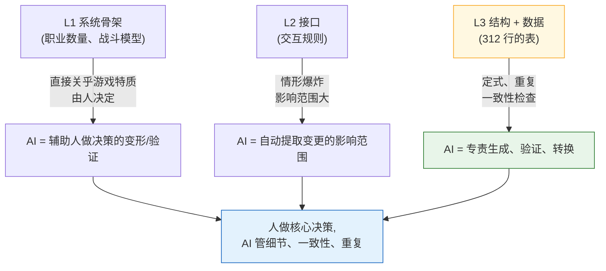

# 3.1 系统策划的日常与 Layer 坐标

周四下午 4 点 50 分。数值策划填好的技能表刚刚上传。技能 312 个。每个技能都要在 `effect_id` 这一栏里填上效果编号,而那个编号指向另一张效果表里的某一行。两者对上了,游戏才能跑起来。对不上,客户端就会调用一个空效果,或者悄无声息地崩溃。

从前的我是用手一行行核对的。技能表点一格,跳到效果表,确认编号,再跳回来。312 遍。再快也要两个小时。在眼睛发花的最后 50 个里,总会漏掉一两个,而正是这一两个,在 QA 版本里炸了。

本章要讲的,是那两个小时去了哪里,以及那道一致性检查在系统策划的工作地图上究竟落在哪个坐标。坐标不先定好,你就只能凭感觉去判断该把 AI 嵌在哪里,而且永远只能凭感觉。

---

## 3.1.1 系统策划要做四样东西

系统策划是在抽象度与具体度之间游走范围最广的人。他接过名为愿景的那团雾,一直把它拽到数据表最后一格那个坚硬的数字为止。在这段旅程中产出的成果,共有四类。

**(1) 把愿景翻译成结构。** 当总监说"打击感十足的动作战斗"时,系统策划就把它转化成技能、连招、取消、顿帧这套骨架。"成长的自主决定权"就变成职业、技能树、装备系统。这是雾凝结成构筑物的第一瞬间。

**(2) 为系统之间的接口编写规格。** 战斗、移动、背包、商店、任务、公会同时在跑。战斗中打开背包会不会附加无敌?强化途中收到 PvP 申请怎么办?这些情形的答案汇聚起来,造就了所谓"做得好"的那种手感。每一处缺了答案的地方,玩家都会感到烦躁。

**(3) 对数据表及其结构(schema)负责。** 312 个技能的系数,数百件道具的效果,数十种怪物的行为。数值要么自己填,要么交给数值策划或内容策划。但表的**列定义(结构,schema)**这一块,得攥在系统策划手里。这是替别人做好一只只贴了标签的抽屉的活儿。抽屉做得潦草,每个人填法就各不相同,一致性也就破了。

**(4) 设计行为逻辑。** 角色、怪物的 AI 会以状态机(FSM,Finite State Machine,有限状态机)、行为树(Behavior Tree,以下简称 BT)、决策表、程序化规则等形态产出。这些资料交到程序员手中,变成代码。

四样东西全都汇到同一个人的桌上,这一点是关键。所以"今天把时间花在什么上"就成了系统策划最大的运营决策。

---

## 3.1.2 系统产出有它的 Layer 坐标

在 2.3 里,我们把整个游戏制作物从 L0(愿景)到 L4(版本)放上了一根坐标轴。现在,就把 3.1.1 的四样产出原样标在那根轴上。像系统策划这样,一个领域的产出物横跨多个 Layer、铺得这么开的情形,是很罕见的。

下面这张图,把产出物落在 Layer 上的哪个位置、又在每个坐标上与谁相遇,都画在了一张纸上。

<svg viewBox="0 0 720 360" xmlns="http://www.w3.org/2000/svg" font-family="sans-serif" font-size="13">
  <!-- Layer bands -->
  <rect x="20" y="20" width="680" height="60" fill="#eceff1" stroke="#b0bec5"/>
  <rect x="20" y="80" width="680" height="60" fill="#e3f2fd" stroke="#90caf9"/>
  <rect x="20" y="140" width="680" height="60" fill="#e8f5e9" stroke="#a5d6a7"/>
  <rect x="20" y="200" width="680" height="60" fill="#fff8e1" stroke="#ffe082"/>
  <rect x="20" y="260" width="680" height="60" fill="#eceff1" stroke="#b0bec5"/>
  <!-- Layer labels -->
  <text x="34" y="55" font-weight="bold">L0</text>
  <text x="34" y="115" font-weight="bold" fill="#1565c0">L1</text>
  <text x="34" y="175" font-weight="bold" fill="#2e7d32">L2</text>
  <text x="34" y="235" font-weight="bold" fill="#f9a825">L3</text>
  <text x="34" y="295" font-weight="bold">L4</text>
  <!-- Layer descriptions -->
  <text x="80" y="55" fill="#607d8b">愿景 —— 系统策划只负责接收</text>
  <text x="80" y="108" fill="#0d47a1">系统骨架:职业、战斗、背包、公会的定义</text>
  <text x="80" y="168" fill="#1b5e20">接口:系统间交互规则、优先级</text>
  <text x="80" y="228" fill="#e65100">结构 + 数据:表的列定义,部分数值</text>
  <text x="80" y="295" fill="#607d8b">版本 —— QA 验证意图是否落地</text>
  <!-- Collaborator column -->
  <line x1="500" y1="20" x2="500" y2="320" stroke="#90a4ae" stroke-dasharray="4 3"/>
  <text x="512" y="55" fill="#607d8b" font-size="12">↔ 总监、叙事</text>
  <text x="512" y="115" fill="#1565c0" font-size="12">↔ 美术指导</text>
  <text x="512" y="175" fill="#2e7d32" font-size="12">↔ 其他系统策划</text>
  <text x="512" y="235" fill="#f9a825" font-size="12">↔ 数值、内容</text>
  <text x="512" y="295" fill="#607d8b" font-size="12">↔ QA</text>
  <!-- responsibility arrow -->
  <line x1="62" y1="90" x2="62" y2="250" stroke="#c62828" stroke-width="2.5" marker-end="url(#ah)"/>
  <defs>
    <marker id="ah" markerWidth="8" markerHeight="8" refX="4" refY="4" orient="auto">
      <path d="M0,0 L8,4 L0,8 Z" fill="#c62828"/>
    </marker>
  </defs>
  <text x="335" y="338" fill="#c62828" font-size="12" font-weight="bold">系统策划亲手制作的区段(L1→L3)</text>
</svg>

这张图说明的有两点。第一,系统策划负责的是从 L0**接过来**、一直**送达**到 L4 的这段长路。第二,亲手制作的区段是 L1\~L3,而这三格里每一格协作对象都不一样。每换一格,协作语言就变,所以不把坐标放在心上,会议就会一次次空转。

不过这并不是说一个人要把 L1\~L3 全都包了。团队大,L1\~L2 负责人和 L3 负责人就会分开;团队小,一个人全看。坐标是分工的地图,不是把活儿全推给一个人的命令。

---

## 3.1.3 坐标定下来,就能看清把 AI 嵌在哪里

图画好了,现在该上色了。哪个坐标引入 AI 的效果大?不是闷头"全部自动化",而是看坐标的性质来挑。



关键在于**坐标越往下走,AI 专责的比重越大**。L1 的"职业要做几个"关乎游戏特质,得攥在人手里。反过来,L3 的"312 行外键是不是都对得上"是定式、重复,该整个交给 AI。L2 在中间——决策由人来做,但"改了这条规则会牵连到哪里"这样的影响范围提取,由 AI 来托着。

这张图解释了为什么 3.1.4 之后的所有实操都从 L3 附近起步:因为那是效果最大、风险最小的位置。结构工具就算出故障也不会闯祸,关系图只是画画图而已,一致性检查则可以由人否决。

---

## 3.1.4 实操记录(worked transcript):在坐标 L3 上把一致性检查交给 AI

理论到此为止。现在回到 3.1 开头的那个周四。技能表里 312 个 `effect_id` 是否与效果表对得上,让 AI 来试一试。不做删减,把实际往来原样照搬。(实操记录,worked transcript:完整保留的真实操作过程记录。)

数据录入遵循 `schema-first` 原则。也就是说,人先定义**说明书表**,从那里产出 Enum 和 `.proto`(由 VBA(Excel 宏语言) Export),最后才填入 csv 数据。所以验证提示词也以"先读结构"开头。要钉死一点:正本不是结构文档,而是**实际 export 出来的 JSON**(`json_over_schema_doc_as_source_of_truth`)。因为文档会撒谎,export 出来的 JSON 撒不了谎。

### 提示词(全文)

> 你是我们项目的数据一致性检查器。
> 输入是两个 export JSON。
> 1) `skill.json` —— 每个技能对象都有 `skill_id`、`name`、`effect_id` 字段。
> 2) `effect.json` —— 每个效果对象都有 `effect_id`、`effect_type`。
>
> 请检查以下各项。
> (A) `skill.json` 里所有 `effect_id` 是否都存在于 `effect.json` 中(外键一致性)。
> (B) 存在于 `effect.json`、却没有任何技能引用的孤立(orphan)效果。
> (C) `skill.json` 中 `effect_id` 为空或为 0 的行。
>
> 规则:不要猜测。JSON 中没有的字段,就报告"字段缺失"。
> 输出分为 (A)(B)(C) 三个小节,每条违规用一行写出 `skill_id`(或 effect_id)和原因。
> 若没有违规,就在对应小节里只写"无违规"。

### Claude 的原始输出(未加工、未美化)

> 没有收到两个输入 JSON。当前消息中没有附带文件内容。
> 请用以下任意一种方式重新发来。
> - `skill.json` 和 `effect.json` 的实际内容(粘贴或附件)
> - 或者两个文件的路径
>
> 收到内容后,我会按 (A)(B)(C) 的顺序检查。没有文件,我不会编造结果。

在这里停下,反倒是值得信赖的信号。如果输入是空的,却回来一份像模像样的报告,那份干净利落本身才是危险信号。不凭空造出检查结果,而是反问"先把文件给我"的那一方,才靠得住。我把两个 JSON 实际粘了进去,重新发起请求(因篇幅所限,正文中只摘录一部分)。

```json
// skill.json (摘录)
[
  {"skill_id": 1001, "name": "强击",     "effect_id": 5001},
  {"skill_id": 1002, "name": "回旋斩", "effect_id": 5002},
  {"skill_id": 1003, "name": "举盾","effect_id": 0},
  {"skill_id": 1004, "name": "涂毒", "effect_id": 5099}
]
```

```json
// effect.json (摘录)
[
  {"effect_id": 5001, "effect_type": "DAMAGE"},
  {"effect_id": 5002, "effect_type": "DAMAGE"},
  {"effect_id": 5003, "effect_type": "BUFF"}
]
```

### Claude 的第二次输出(基于实际数据)

> **(A) 外键一致性 —— 违规 1 件**
> - `skill_id: 1004` → `effect_id: 5099` 在 `effect.json` 中不存在(dangling reference)
>
> **(B) 孤立效果 —— 违规 1 件**
> - `effect_id: 5003` (BUFF) → 没有任何技能引用
>
> **(C) 空/0 effect_id —— 违规 1 件**
> - `skill_id: 1003` → `effect_id: 0`。可能是有意为之的"无效果",请在结构中确认 0 是否为有效值。

### 人的验证与否决

三件里有两件是明摆着的 bug。`5099` 是数值策划还没在效果表里加上那一行,就先把它填进技能里了——典型的工序错位的情形。抓到了。

而 (C) 我**否决**了。在我们项目里,`effect_id: 0` 表示"被动槽位,无效果",是个有效的约定值。AI 不知道这一点,于是把它当作"请确认"提了上来——这个判断没错,但不该算成违规。于是我转向下一步——把这个约定固化成 atom,让下一次检查起,AI 就把 0 认作有效值。

### 再次请求(注入领域知识)

> 追加规则:`effect_id == 0` 表示"被动,无效果",是我们项目的有效约定值。
> 因此在 (C) 中,`effect_id == 0` 不算违规。只把空字符串、null、负数作为 (C) 违规报告。

> **(C) 空/0 effect_id —— 无违规**
> (`effect_id: 0` 按有效约定值处理。无空值/null/负数。)

这一行约定,正是领域知识的累积。系统策划的决策相对长久,一旦固化下来,一年后同样的检查也会按同样的标准来跑。柜子里又叠上了一张决策卡。

在这段记录里,人做的事**只有三件**——(1) 指定"先读结构"的输入顺序,(2) 确认 `5099` 是真 bug,(3) 知道 `0` 是有效值,从而否决并纠正 AI 的判断。其余 312 行那种一格一格跳着看的两个小时,消失了。被自动化掉的是"跳转加比对"这种劳动,而剩下的那三行判断,才是核心。

---

## 3.1.5 不断累积的资产:把坐标固化为代码

上面那段记录里的检查,固然可以每次都用手去让它跑,但 L3 上反复出现的活儿,用工具固化下来才是系统策划的正道。这里引用笔者在用的两样东西——不是抽象的"项目A的工具",而是真真切切在桌上跑着的东西。

`gen_relation_map.py` 会分析表的列名、数值,自动检测外键关系,并生成可交互的 HTML 关系图。如果说 3.1.4 里 `skill.effect_id → effect.effect_id` 这道箭头是人在脑子里画出来的,那么这个脚本就把那道箭头对整张表画成了图。依赖逆行的地方(L3 数据反过来引用 L1 骨架的风险),在图里会立刻跳出来。

`schema-doc` 技能会解析 xlsm 的 **$结构表**,自动生成 Markdown 结构文档。3.1.4 (C) 里冒出的那个"请在结构中确认 0 是否为有效值"的疑问,问的就是这份结构——它让人不必翻别的文件,就能直接读到最新的结构。表一变,文档跟着变,文档与实际数据对不上的那个老毛病也就少了。

把这两样工具的位置再用坐标说一遍,就是这样。`schema-doc` 守的是 L3 的**列定义**,`gen_relation_map.py` 守的是 L2\~L3 之间的**关系**。AI 辅助提示词(像 3.1.4 那样的验证)则在它们之上运转。三者不是各跑各的,而是分管同一根坐标轴的不同高度。

这些工具的实际用法,会在 3.2、3.3、3.4 里动手照着做。3.1 是定下"嵌在哪里"的地图,接下来三章是动手嵌进去的活儿。

---

## 3.1.6 渐进引入:从风险小的坐标开始

三样工具一次性全开,运营负担会比效果先到。按笔者的经验,安全的顺序是从风险小的坐标(下面那头)开始。

| 时点(建议) | 引入 | 坐标 | 出错时会发生什么 |
|---|---|---|---|
| 1 个月 | 结构优先(3.2) | L3 | 不过是文档少更新了一次 |
| 2\~3 个月 | 关系图可视化(3.3) | L2\~L3 | 不过是图不准确 |
| 3\~6 个月 | AI 辅助提示词(3.4) | L1\~L3 | 要经过验证,人可以否决 |

时间不是绝对标准。视团队规模、既有基础设施而定,可能要花两倍,也可能减半就完事(笔者推测,未经验证)。不变的是**顺序**。把风险大的决策辅助放在最后,等前两样工具已让团队养成验证习惯之后,再去碰最敏感的那个位置。

---

## 3.1.7 测量 —— 诚实地

不美化数字,如实记下。下面是笔者作为总监运营的 MMORPG 项目(以下简称"项目A")的策划团队(4\~5 人,整个开发团队为中等规模 10\~50 人,运营约 6 个月)里观察到的情况。这不是精确的自动计量,而是基于工作日志和复盘记录的**笔者的观察**,建议只当作方向和大致的比例来读。

- **一致性检查**:312 行的技能↔效果外键比对,用手最快也要两个小时(开头那个周四)。用 AI 验证,除去准备输入,几分钟内就出来违规清单。减掉的是跳转、比对的劳动,不是判断。
- **新策划入职培训**:有一张关系图 HTML,过去要用嘴解释系统依赖结构的会议,就能省下好几次。具体省几次因人而异,不下定论(笔者观察)。
- **变更影响讨论**:过去要靠开会去摸"改了这条规则哪里会动",改成了先让 AI 出一份影响范围初稿、再由人审阅的方式。会议没有消失,而是会议变成了**审阅**。

关键在于:省下来的时间,不是不做游戏的时间。那段时间会回流到像 L1 骨架那样、没法交给 AI 的深层决策上。减掉劳动,用在判断上——这就是本章想给的一句话。

---

## 动手试试:在坐标 L3 上做一次一致性检查

**setup.** 把两张表(例如技能、效果)export 成 csv。手头方便的话,转成 JSON 备着(正本是 export 结果而非文档的原则)。在两张表之间挑一对外键(例如 `skill.effect_id → effect.effect_id`)。

**prompt.** 把 3.1.4 的提示词全文原样用上。三句核心别落下——(1)"先读结构/构造",(2)"不要猜测,没有的就报告没有",(3)"没违规就只写无违规"。

**verify.** AI 提上来的违规清单,由人一行行看。真 bug 就修,因为领域约定值(例如 `0 = 无效果`)产生的误报就**否决**,并把那个约定加进提示词(或 atom)。下次检查起同样的误报消失了,就是又叠上了一张资产。

### 单人精简版

如果你是没团队也没表的单人开发者,谷歌表格开两个标签页就够了。一个标签页是"技能",另一个是"效果"。用 `effect_id` 这一列把两者连起来。把标签页下载成 csv,粘进 3.1.4 的提示词,那么哪怕不是 312 行、而是 30 行的表,同样能抓出 dangling reference 和孤立效果。只是规模不同,坐标是一样的。从 L3 起步,上手之后再用关系图和影响范围一格一格往上爬就行。

---

### 本章要点
- 系统产出的四样东西,从 L1 骨架到 L3 表格都各有坐标,而坐标就是协作对象
- 坐标越往下(L3)走,AI 专责的比重越大,风险越小
- 被自动化的是跳转、比对的劳动,而确认 bug、否决误报这类判断,归人来做
