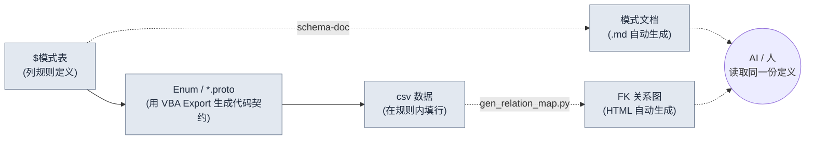

# 3.2 模式优先 —— $模式比数据更先行

周一上午，新来的策划填好了技能表的 120 行，用 csv 构建后，客户端日志里跳出了 28 条红色报错。`class_id` 引用了 47 号，但职业表里根本没有 47 号。`element` 列里，有人写成了 `Fire`，又有人写成了 `fire`，还有一行用韩文写着 `화염`。为了逐行手动排查这 28 条红线，半个下午就这么没了。

这次事故的原因，并不是数据填错了。而是**在生成数据之前，没有把这些数据必须遵循的规则写明白**。规则只留在脑子里，人一换，规则也跟着变。本章讲的就是把规则——模式（schema）——比数据更先建立起来的工作流。而且，让这套规则不靠人的手、而靠工具以文档的形式强制执行。

---

> **术语备注**
> - 模式（schema）：数据表的列定义。名称、类型、范围、外键、说明。
> - `$模式`：放在 Excel 数据表（xlsm）内、专门用于列定义的工作表。它装的不是数据行，而只是列的规则。
> - FK（外键）：引用其他表 PK（主键）的列。比如 `class_id` 指向 Class 表的某一行。
> - proto：Protocol Buffers 定义（`.proto`）。客户端与服务器共享的数据结构、Enum 契约。
> - 单一事实来源（single source of truth）：同一信息只在一处管理，让所有人都看向那一处的运营原则。

---

## 3.2.1 输入顺序本身就是模式

如果把模式优先只理解为"提前定义好列"，那只抓住了一半。核心在于**先输入什么的顺序**。填数据的手按什么顺序移动，决定了一致性是被守住还是被打破。

本书推荐的输入顺序，是一条四格的管线。



从左向右流动的实线就是**强制的输入顺序**。先定义 `$模式`，再从那里用 VBA（Excel 宏语言）Export 抽出 Enum 与 proto，然后只在那份契约之内填 csv 数据。虚线是从这份输入中自动派生出来的产物——模式文档（`schema-doc`）与 FK 关系图（`gen_relation_map.py`）——人和 AI 通过这些派生物看到同一份定义。

只要这个顺序被强制执行，本章开头看到的那 28 条红线，大部分都会**在填数据之前**就被关掉。如果 `element` 只能是 `fire/ice/lightning/none` 四者之一这件事，被 proto 的 Enum 固定下来，那么 `Fire` 也好、`화염` 也好，都会在输入阶段被拦下。如果 `class_id` 引用 Class 表 PK 这件事，被写明在 `$模式` 里，那么 47 号的缺失，就不是在构建时、而是在检查时更早被抓住。

一旦把顺序颠倒——先填数据、再回过头来整理模式——模式就变成了事后打扫。在已经堆了 1000 行的地方去修列规则，规则就会反过来跟着数据走，那一刻，事实来源就立反了。

---

## 3.2.2 实操记录（worked transcript，完整保留的真实操作过程记录）—— 从 `$模式` 到 csv 一次走通

与其用嘴解释，不如真的把一张表从头到尾走一遍。假设要新建一张技能表。下面是带着 AI 辅助进行的全程记录。不做删减，把出错的地方和人否决的地方原样留下。

### 第 1 步 —— 人先用手写 `$模式`

工具和 AI 都还不叫。列规则由人亲自定义。唯独这一步不外包。

```
# Skill 表 $模式 (由人编写)
列              类型       范围/约束              FK                  说明
skill_id       int        1000~9999            (PK)                技能唯一 ID
name           string     1~30字                -                  显示名称
class_id       int(FK)    -                    Class.class_id      可用职业
cooldown       float      0.0~120.0            -                   冷却时间(秒)
damage_coef    float      0.0~10.0             -                   攻击力乘数系数
element        enum       fire/ice/lightning/none  -              属性
is_passive     bool       true/false           -                  是否被动
```

### 第 2 步 —— 让 AI 起草 proto Enum（提示词全文）

把 `$模式` 的 `element` enum 和 FK 结构搬进 proto 契约。这是格式转换，是可以交给 AI 的活儿。

> **提示词（全文）：**
> 下面是一张游戏数据表的列规格。请把这份规格转换成 Protocol Buffers（proto3）的 message 和 Enum。规则：(1) enum 类型的列要单独定义为 enum，首个值必须以 `_UNSPECIFIED = 0` 开头。(2) FK 列把引用对象写进注释。(3) 范围约束在 proto 里无法表达，只写进注释。规格里没有的列不要新增。
> ```
> skill_id int PK / name string / class_id int FK→Class.class_id /
> cooldown float 0~120 / damage_coef float 0~10 /
> element enum{fire,ice,lightning,none} / is_passive bool
> ```

### 第 3 步 —— Claude 的原始输出（原样，未作改动）

```proto
syntax = "proto3";

// Skill 表数据契约
// 注意: 范围约束(cooldown 0~120, damage_coef 0~10)
//       proto 无法强制。请在 Linter 中检查。

enum SkillElement {
  SKILL_ELEMENT_UNSPECIFIED = 0;
  SKILL_ELEMENT_FIRE = 1;
  SKILL_ELEMENT_ICE = 2;
  SKILL_ELEMENT_LIGHTNING = 3;
  SKILL_ELEMENT_NONE = 4;   // ← 人工评审标记
}

message Skill {
  int32 skill_id = 1;       // PK
  string name = 2;
  int32 class_id = 3;       // FK → Class.class_id
  float cooldown = 4;
  float damage_coef = 5;
  SkillElement element = 6;
  bool is_passive = 7;
}
```

### 第 4 步 —— 人的验证与否决

到这里，人否决了一处。AI 把 `none` 放成了 `SKILL_ELEMENT_NONE = 4`，置于 enum 的**末尾**，可在 `$模式` 里，`none` 是"无属性"这一默认状态。争议点在 proto 的 0 号值。在 proto3 中，enum 的 0 号是"当值没被填时自动落入的位置"，所以 0 号到底是空着留给 `_UNSPECIFIED`（未填值），还是用 `none`（有意为之的无属性）这类语义值填上，就会分道扬镳。一旦把两者合在同一个位置，**把列留空的行（失误）**和**特意选了无属性的行（有意）**就都以 0 落进来，从此再也分不清。AI 虽然把 `_UNSPECIFIED = 0` 与 `none` 分开放了，却把 `none` 挪到了 4 号末位，让最常见的默认状态在检索、调试时离得更远了。

人做出的决定：
- `_UNSPECIFIED = 0` 保留（用于检出缺失）。
- `none` 照旧保留，但在 csv 编写规则里追加一条："无属性必须显式写 `none`，禁止留空"。空白=0=UNSPECIFIED 一律视为输入错误。
- 把这个决定在 `$模式` 的 `element` 行说明里追加一行："无属性也要显式写明（none）。空白即错误。"

没有照搬 AI 的输出。格式接受了，语义的边界由人来划。

### 第 5 步 —— 用 VBA Export 按钮从表里抽出 Enum/proto

验证过的 proto 定义，由 Excel 的 Export 宏（`$模式` 表上的按钮）一致地输出。人不在 IDE 里重新打字。表才是事实来源，所以 proto 由表里产出。这个顺序，是 3.3 将要讲的"输出即正本"（`json_over_schema_doc_as_source_of_truth`）原则的延伸——不是文档去解释代码，而是表去产出代码。

### 第 6 步 —— 这才开始填 csv 数据（AI 辅助，含再请求）

> **提示词（全文）：**
> 请生成 5 个满足上述 Skill proto 与 $模式 的 csv 行。约束：class_id 取 [1,2,3] 之一（当前 Class 表中存在的 PK），damage_coef 在被动（is_passive=true）时为 0.0，element 原样写 fire/ice/lightning/none 字符串，禁止留空。

Claude 的首次输出里，有一行出了岔。

```
skill_id,name,class_id,cooldown,damage_coef,element,is_passive
1001,烈焰斩,1,3.5,2.4,fire,false
1002,冰封之手,2,8.0,3.1,ice,false
1003,生命恢复,1,0.0,1.2,none,true     ← 否决: 明明是被动 damage_coef 却≠0
1004,雷枪,3,5.0,2.8,lightning,false
1005,防御姿态,2,0.0,0.0,none,true
```

第 1003 行违反了规则（`is_passive=true` 时 `damage_coef` 应为 `0.0`）。人否决并再次请求。

> **再请求（全文）：** 第 1003 行违反规则。is_passive=true，但 damage_coef 是 1.2。被动应为 0.0。只改第 1003 行重新给我。

> **Claude 再输出：** `1003,生命恢复,1,0.0,0.0,none,true`

AI 第一次没能全部答对，不是缺陷，而就是会发生的事。要紧的是，正因为铺好了模式，那一行出岔的数据才能**用眼睛点出来、用一行就退回去**。要是没有模式，第 1003 行就会在构建后、于游戏里以"被动技能却造成伤害"的 bug 形式被发现。

这整段记录的教训很简单。只要输入顺序被固定为 `$模式 → proto → csv`，AI 就能快速把格式填好，人只检查语义和违规。一旦顺序崩了，人就得从格式到语义全部一肩扛起。

---

## 3.2.3 schema-doc —— 不让人去誊抄模式

把 `$模式` 放在 Excel 里，对策划来说方便，但对 AI、git 和外部工具而言，那是一处封闭的位置。所以我们运营一个把 `$模式` 自动转换成 Markdown 的工具。斜杠技能 `schema-doc` 做的就是这件事。

它的动作分四步。

1. 解析 Excel（xlsm）的 `$模式` 表（python-calamine，Rust 加速）
2. 抽取列定义的 5 要素
3. 转换为 Markdown 表
4. 在同一文件夹生成 `<表名>_schema.md`

核心是**人不把模式写两遍**。在 Excel 里定义一次，Markdown 就由工具来生成。两者不可能对不上。3.3 将要讲的"把模式文档当正本，就会与实际输出对不上"这一陷阱，在这里被翻转成"Excel 是正本，文档是派生"来规避。

`schema-doc` 生成的结果（以前面记录中的 Skill 表为准）：

```markdown
# Skill 表模式  (自动生成 —— 禁止直接修改)

| 列 | 类型 | 范围/约束 | FK | 说明 |
|---|---|---|---|---|
| skill_id | int | 1000~9999 | (PK) | 技能唯一 ID |
| name | string | 1~30字 | - | 显示名称 |
| class_id | int(FK) | - | Class.class_id | 可用职业 |
| cooldown | float | 0.0~120.0 | - | 冷却时间(秒) |
| damage_coef | float | 0.0~10.0 | - | 攻击力乘数系数 |
| element | enum | fire/ice/lightning/none | - | 属性。无属性也要显式写明(none)，空白即错误 |
| is_passive | bool | true/false | - | 是否被动。为 true 则 damage_coef=0 |

_source: Skill.xlsm / generated by schema-doc_
```

请看 `element` 与 `is_passive` 说明列里，3.2.2 第 4、6 步中人划下的边界原样跟了进来。人在 `$模式` 里写了一行，文档、proto、验证就都共享了同一条规则。这就是单一事实来源真正运转起来的样子。

落到 Markdown 上的模式，会立刻被三处直接用上。

- **AI 生成数据**：生成行之前先读这张表，只生成遵守了所定义的 7 个列、各项约束、FK 的行。
- **新策划入职**：这一张表比开三次会还快。
- **Linter**：自动比对每一行 csv 是否违反了这张表。

---

## 3.2.4 gen_relation_map.py —— FK 是否还活着，用图来看

如果说模式是表**内部**的规则，那么 FK 就是表与表**之间**的规则。`class_id` 引用 Class 表这一定义写在 `$模式` 里，但这条引用此时此刻是否真的还活着，需要另作检查。

`gen_relation_map.py` 自动侦测各数据表的 FK 关系，绘制成交互式 HTML 关系图。当 Skill 的 `class_id`→Class、Item 的 `set_id`→ItemSet 这样的箭头汇聚到一个画面上，"引用对象已消失的 FK"就会以断开的箭头显眼地呈现。本章开头那种 47 号缺失的事故，便不是以构建日志里的红线、而是以关系图里断掉的线，**在填数据的途中**就被看见。

这个工具的实操使用与可视化，将在 3.3 正式展开。本章要记住的只有一点。`$模式` 若不写明 FK，关系图也好、一致性检查也好，都没有可画的图。**写明 FK 不是可选项，而是模式优先的前提。**

---

## 3.2.5 模式优先五步工作流

把 3.2.2 的记录一般化，就成了五个步骤。把每一步的主体与产出分开来看，什么由人攥着、什么交给工具，就一目了然了。

<svg xmlns="http://www.w3.org/2000/svg" width="720" height="300" font-family="sans-serif" font-size="13">
  <rect x="0" y="0" width="720" height="300" fill="#fbfbfb" stroke="#ddd"/>
  <text x="20" y="28" font-size="15" font-weight="bold">模式优先五步 —— 主体 × 产出</text>
  <!-- columns header -->
  <text x="40" y="62" font-weight="bold">步骤</text>
  <text x="230" y="62" font-weight="bold">主体</text>
  <text x="430" y="62" font-weight="bold">产出</text>
  <line x1="20" y1="72" x2="700" y2="72" stroke="#bbb"/>
  <!-- rows -->
  <text x="40" y="100">1. 模式设计</text>
  <rect x="220" y="86" width="120" height="22" fill="#e8f0fe" stroke="#9bb"/>
  <text x="232" y="102">人</text>
  <text x="430" y="100">$模式 5 要素·FK 定义</text>
  <text x="40" y="138">2. 自动文档化</text>
  <rect x="220" y="124" width="120" height="22" fill="#e6f4ea" stroke="#9c9"/>
  <text x="232" y="140">schema-doc</text>
  <text x="430" y="138">模式 .md</text>
  <text x="40" y="176">3. 契约抽取</text>
  <rect x="220" y="162" width="120" height="22" fill="#e6f4ea" stroke="#9c9"/>
  <text x="232" y="178">VBA Export</text>
  <text x="430" y="176">Enum / *.proto</text>
  <text x="40" y="214">4. 数据初稿</text>
  <rect x="220" y="200" width="120" height="22" fill="#fef7e0" stroke="#dca"/>
  <text x="232" y="216">AI + 人</text>
  <text x="430" y="214">csv 行 (违规否决·再请求)</text>
  <text x="40" y="252">5. 一致性·影响</text>
  <rect x="220" y="238" width="120" height="22" fill="#e6f4ea" stroke="#9c9"/>
  <text x="232" y="254">Linter / 关系图</text>
  <text x="430" y="252">违规报告·FK 图</text>
  <line x1="20" y1="270" x2="700" y2="270" stroke="#bbb"/>
  <text x="40" y="290" font-size="11" fill="#666">蓝=人的决定 / 绿=工具自动 / 黄=AI 初稿+人工评审</text>
</svg>

五个步骤不必在头一个月就全部备齐。哪怕只跑第 1、2 步（模式设计 + 自动文档化），也能抓住一半的价值。第 3\~5 步等运营熟练之后再逐步接上。一开始就强推五步，编写者的负担会在落地之前就把运营拖停。

---

## 3.2.6 在项目A中测到的东西

笔者作为总监运营的某 MMORPG 项目（以下称"项目A"）里，把这套工作流跑了约 6 个月。下面的数字中，数据表列一致性、新表初稿时间是从工具日志和工作记录里汇总的实测，FK 断裂频次则是从构建失败的 issue 反推得来的**笔者估算（未验证）**。

| 项目 | 引入前 | 引入后 | 依据 |
|---|---|---|---|
| 列名一致性 | 约 60% | 约 95% | schema-doc 比对实测 |
| FK 断裂频次 | 每周 2\~3 起 | 每月 1 起以下 | 构建 issue 反推（笔者估算） |
| 新表初稿时间 | 4\~8 小时 | 1\~2 小时 | 工作记录实测 |
| 新策划理解表 | 开会 3 次 | 文档 1 次 + 开会 1 次 | 入职案例（仅方向） |

引入成本是工具初期开发约 3 天 + 运营落地约 1 个月。引入成本相对 6 个月的累计效果而言很小，这是运营得出的结论。不过上述比例只是一个团队、一个项目的单一案例，并不保证能原样搬到别的团队。

---

## 3.2.7 AI 与模式的协同，以及边界

铺好模式，AI 的数据生成可靠度会飞跃式上升。原因在于，模式会预先把那种成为幻觉温床的模糊输入范围关掉。面对"给我做 20 个技能"这样的请求，若没有模式，AI 就会发明出貌似合理的列，填进与本表不兼容的值。有了模式，同样的请求就会以遵守了所定义的 7 个列、各项约束、FK 的行返回。即便像 3.2.2 第 1003 行那样冒出违规，点出一行再请求一次就完事。

代价是，边界很分明。**数值不交给 AI。**`damage_coef` 若让 AI"随手"定，就会与游戏的意图冲突。把格式正确的候选快速铺出来，到这里为止是 AI 的份内事，而"这个技能的系数取 2.4 对不对"，由人来回答。话虽如此，并不是说 AI 对数值毫无用处——曲线是否平滑、离群值、范围统计，AI 能迅速抓出来。测量数字交给工具，而那个数字对不对则由人来甄别。

---

## 3.2.8 常见错误与规避

| 错误 | 规避 |
|---|---|
| 堆了 1000 行模式之后才引入 | 新表一律先写 `$模式` |
| `$模式` 与 csv 的同步崩了 | 用 schema-doc 自动化把两者绑到同一来源 |
| 不写明 FK | 不写明 FK 则关系图、一致性检查都无意义 |
| proto Enum 的 0 号用了语义值 | 0 是 `_UNSPECIFIED`（检出缺失），语义值从 1 起 |
| 模式文档只有人在读 | 用 Markdown 表 + 元信息统一，让 AI 也能读 |

---

## 动手试试

**setup**
1. 选一张你所在领域里最核心的表（技能、道具、怪物中选一个）。
2. 在那个 Excel 文件里追加一张名为 `$模式` 的表，给每一列写上 5 要素（名称、类型、范围、FK、说明）各一行。这一步由人亲自来做。

**prompt**（只在 proto/csv 初稿上用 AI）
> 请把下面的 $模式 转换成 proto3 的 message 与 Enum。enum 首个值为 `_UNSPECIFIED = 0`。FK 把引用对象写进注释。范围约束只写进注释。规格里没有的列禁止新增。
> （把你自己的 $模式 粘到这里）

接着：
> 请生成 5 个满足上述 proto 与 $模式 的 csv 行。不要生成违反约束的行。is_passive=true 则 damage_coef=0。

**verify**
1. 把 AI 给的 5 行逐行与模式比对。若有违规行，就以"第 N 行违规，只改那一行给我"再请求（否决与再请求是正常过程）。
2. 用 `schema-doc`（或同级的简单 Python 脚本）把 `$模式` 抽成 `.md`，确认 Excel 定义与文档是否一致。
3. 若有 FK，就把引用对象的 PK 是否真实存在比对一遍。

---

## 单人精简版

如果没有工具也没有团队，一个人起步，那么一个 Excel 文件、一个文本编辑器就够了。

1. 在表的第一个标签页建 `$模式`，把列规则按 5 要素写好（15 分钟）。
2. 把那份规格原样复制，向 AI 请求"proto Enum + csv 5 行"（10 分钟）。
3. 把拿到的 csv 与模式用眼睛比对，把违规的一行用再请求改好（10 分钟）。
4. 把 `$模式` 文本以 `skill_schema.md` 存进记事本。这就是你自己的第一个单一事实来源。

转到下一张表时，重复同样的 4 步。当一个季度内有 5\~10 张核心表按同样的顺序排齐，那时才真正值得接上 schema-doc 这类自动化。

---

### 本章要点
- 把输入顺序强制为 `$模式→Enum/proto→csv`，违规就会在填数据之前被关掉
- Excel 是正本、文档是派生，schema-doc 把两者绑成一个来源，让人与 AI 看到同一份定义
- 数值由人来决定，AI 只负责格式候选与离群值测量

### 下一章预告
- 3.3. 关系图可视化 —— 用 gen_relation_map.py 把 FK 依赖用眼睛看到
