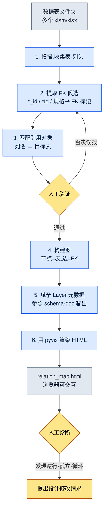

# 3.3 关系图可视化 —— 用眼睛看清依赖关系

一位新来的策划入职第一周走到我的座位前。"我想改一下任务奖励表,可这东西一动,会把哪里弄崩呢?"我正要指着显示器作答,却停了下来。我脑子里有一幅图。`RewardTable` 咬着 `ItemTable`,`ItemTable` 咬着 `ItemEffectTable`,在它们之上 `QuestTable` 又引用着奖励……可一旦把那幅图用话说出口,听者脑中的形体就崩塌了。我在白板上画了七个方框。箭头开始缠成一团。30 分钟后,他点点头回到了座位,第二天又带着同一个问题回来了。

正是这一幕让我写下了这一章。系统策划的脑子里有一张依赖关系图。问题在于,它只存在于脑子里。人一换,图也就消失了。我需要一件把这幅图外化出来的工具,于是做出了 `gen_relation_map.py`。

数据表只有 5\~10 张时,靠脑子就够了。一旦超过 30 张,人的工作记忆就应付不来了。一个项目的表格文件夹,通常很早就越过了那条线。把哪里依赖哪里用文字写成的表,即便读了也画不出图来。这一章会从头到尾跟着走一遍:把外键关系自动生成为可交互的 HTML 关系图的完整操作过程(worked transcript,完整保留的真实操作过程记录)。

---

## 3.3.1 关系图能解决的四个问题

在做工具之前,先理清没有关系图时实际上会卡在哪里。有四个场景反复出现。

**新策划入职引导。** 新策划为了熟悉系统结构而约了会。就是上面那一幕。用话传达的依赖关系,在听者脑中撑不了几天。如果一起点开一张关系图,第一次会议就能画出一半以上。它与白板上的手绘图有一个决定性的不同:图不会被擦掉,而是留在原处。

**变更影响范围讨论。** 系统变更请求提了上来。"这个会影响到哪里?"约了会,讨论了半天,还是漏掉了一两个区域。如果有关系图,只要点击要变更的节点、沿着入边(inbound edge)追下去,影响范围就一目了然。讨论只需确定"这个影响是不是真的成立"以及优先级即可。

**检出依赖逆行。** L3 数据表引用 L1 系统文档是正常的。反方向(上层 Layer 直接引用下层数据表)则几乎总是设计缺陷。在用文字罗列的 FK 清单里,人是抓不住这种逆行的。在图里,它会立刻以一根 Layer 颜色错乱的箭头显现出来。

**发现孤立的表。** 偶尔会发现一张哪里都没有引用的表。要么是旧策划留下的残迹,要么是决定废弃却只剩文件没删的情况。这就像办公室角落里滚着一个没贴标签的箱子。要有图,才能发现那座孤岛。

这四个问题的共同点是:都属于"必须用眼睛看清结构才能解决"的范畴。靠文字和表格是行不通的。

---

## 3.3.2 实操记录:从数据表到关系图

现在真正跟着走一遍。输入是一个装着数据表的文件夹,输出是在浏览器中打开的一张可交互 HTML。我会把这中间 AI 做了什么、人在哪里做了验证/否决,毫无遗漏地记下来。

### 3.3.2.1 整体流程



核心是第 3 步和第 5 步之间的人工验证回路。FK 候选提取由机器铺好初稿,人在其中剔除误报。一旦省掉这个回路,关系图看上去煞有介事,却是一幅错的图。

### 3.3.2.2 FK 从哪里来 —— 输入顺序

这件工具的准确度,取决于你从哪里把输入拉过来。3.2 中定下的 schema-first 原则原样适用。FK 信息的正本顺序如下。

1. **`$스키마` 표** —— 每张数据表的第一份正本。按列明确标注了类型、Enum、FK 目标。这里若写明了 FK,那它就是第一优先。
2. **`*.proto` / Enum 定义** —— 由 VBA(Excel 宏语言)Export 导出的 schema。当规格书为空时,用它补全类型。
3. **实际 `csv` 输出** —— 表格导出的实际数据。规格书里没有的关系,也会在数据中以模式显现(例如:若 `npc_id` 列的值全部落在 `NPCTable` 的键范围之内,那它实际上就是 FK)。

这里要明确一条原则。**正本不是 schema 文档,而是实际的 JSON/csv 输出。** 即便规格书里写着 `reward_id` 是 FK,只要实际数据中该列为空或指向了无关的值,那就是规格书错了。工具在两者不一致时信任数据这一侧,并把不一致本身记进报告。这就是不把 schema-doc 当正本的理由。

### 3.3.2.3 第 1 步 —— 文件夹扫描与 FK 候选提取

工具的第一个动作,是打开文件夹内所有 xlsm/xlsx,收集表与列头。这一步本身是机械的,没什么意思。有意思的是提取 FK 候选的规则。一开始很简单:列名若以 `*_id` 或 `*Id` 结尾,就视为 FK 候选。可单凭这一条规则,误报和漏报都出现了。

这里我接入了 AI。把整份列头清单丢过去,让它推断 FK 目标表。下面是我实际抛出的提示词全文与原始输出。

> **提示词:**
> 下面是若干游戏数据表的表名与列头清单。请推断每一列是否为外键(FK),若为 FK,则它引用了哪张表的哪一列。列名规则通常为 `<目标表单数形式>_id`。但若没有把握,请标为"不确定"并写明理由。不要凭猜测填充。
>
> ```
> QuestTable: quest_id, title, npc_id, reward_id, prev_quest_id, region_id
> NPCTable: npc_id, name, region_id, faction_id
> RewardTable: reward_id, item_id, count, currency_id
> ItemTable: item_id, name, item_effect_id, grade
> ItemEffectTable: item_effect_id, effect_type, value
> RegionTable: region_id, name, parent_region_id
> ```

> **Claude 原始输出(PK 行省略,仅摘录 FK 判断):**
>
> **QuestTable**
> - `npc_id` → NPCTable.npc_id(推测为发布任务的 NPC)
> - `reward_id` → RewardTable.reward_id
> - `prev_quest_id` → QuestTable.quest_id(前置任务,**自引用**)
> - `region_id` → RegionTable.region_id
>
> **NPCTable**
> - `region_id` → RegionTable.region_id
> - `faction_id` → **不确定**:输入清单中没有 FactionTable。按列名规则看,应引用 FactionTable.faction_id,但由于未提供该表,无法确定目标。
>
> **RewardTable**
> - `item_id` → ItemTable.item_id
> - `currency_id` → **不确定**:清单中没有 CurrencyTable。货币种类也有可能以 Enum 管理,因此可能并非 FK。需要核对规格书。
>
> **ItemTable**
> - `item_effect_id` → ItemEffectTable.item_effect_id
> - `grade` → 非 FK(推测为 Enum:等级值)
>
> **ItemEffectTable**
> - `effect_type` → 非 FK(推测为 Enum)
>
> **RegionTable**
> - `parent_region_id` → RegionTable.region_id(**自引用**,地区层级结构)
>
> 注意:以上推断基于列名规则,并未核对实际数据值。特别是 `count`、`value` 这类不以 `_id` 结尾的列,我已从 FK 检查范围中排除;若存在隐藏引用,则会被漏掉。

在这份输出上,人做的事有三件。

- **否决 1:** `faction_id` →AI 因为没有 FactionTable 而做了不确定处理。这是对的。不过实际上 `faction_id` 是 Enum。阵营固定为 6 种,所以不另建表,直接用 Enum 管理。多亏 AI 没有捏造一张不存在的表、而是停住了判断,人才能照着规格书把它确定为 Enum。**从 FK 中排除。**
- **否决 2:** `currency_id` →AI 把两种可能性都留着。一看实际数据,`CurrencyTable` 是存在的(是我在输入清单里漏掉了)。**确定为 FK。** 这怪不得 AI,是人的输入遗漏。
- **采纳:** `prev_quest_id` 与 `parent_region_id` 的自引用检出。这一点若是单纯的正则规则,本会漏掉。AI 还附上了"前置任务""地区层级"这样的语义,让验证更快了。

这里得到的教训很明确。AI 最有用的地方,不是快速推断,而是**把不知道的位置留作"不确定"的那份克制**。要是它硬把空格填满,`faction_id` 就会被连到无关的表上,而那个误报会作为一根假箭头留在关系图里,把新策划引向歧途。

### 3.3.2.4 第 2 步 —— 构建图与赋予 Layer

得到经过验证的 FK 清单后,`gen_relation_map.py` 就来构建图。表是节点,FK 是有向边。数它的入边数(有多少张别的表引用了我),据此决定节点大小。被引用得越多,节点越大,也就是系统的枢纽。

Layer 元数据从 `schema-doc` 技能生成的 Markdown schema 文档里拉取。3.1 中定义的 Layer 坐标(L0\~L4)以标签的形式附在每张表上,工具读取它来给节点上色。这个衔接很重要。关系图若不知道 Layer,就只是一堆方框和箭头;只有知道 Layer,才能用颜色来诊断"逆行"。

把工具内部结构以代码骨架的形式呈现,大致如下(仅摘录核心流程)。

```python
# gen_relation_map.py (仅摘录核心流程)
from pyvis.network import Network

LAYER_COLORS = {          # Layer 调色板 —— 用 1 个 atom 标准化
    "L0": "#2c3e50",      # 元/公用
    "L1": "#2980b9",      # 系统
    "L2": "#27ae60",      # 内容
    "L3": "#f39c12",      # 数据实例
    "L4": "#c0392b",      # 派生/缓存
}

def build_graph(fk_list, layer_map):
    net = Network(directed=True, height="900px")
    inbound = count_inbound(fk_list)          # 入边统计
    for sheet in all_sheets(fk_list):
        layer = layer_map.get(sheet, "L0")
        size = 10 + inbound[sheet] * 3        # 越是枢纽节点越大
        net.add_node(sheet, color=LAYER_COLORS[layer],
                     size=size, title=sheet_tooltip(sheet))
    for src, dst, col in fk_list:
        # Layer 逆行检测:上层 Layer 引用下层时用警示色
        edge_color = "#e74c3c" if is_reverse(src, dst, layer_map) else "#888"
        net.add_edge(src, dst, title=col, color=edge_color)
    return net
```

`is_reverse` 是这件工具的小核心。若一条边的出发表比到达表处于更上层(例如 L1 → L3),就判为逆行并把边涂成红色。当人打开图、看到红色箭头时,那几乎总是该动手处理的地方。

### 3.3.2.5 第 3 步 —— HTML 渲染与结果结构

最后一步是 pyvis 吐出可交互 HTML。点击节点时,该表的列、Layer、入边数会以工具提示(tooltip)弹出,还能在搜索框里按表名过滤。之所以必须是 HTML 而非静态 PNG,原因就在这里 —— 一旦节点数超过几十个,静态图里箭头就会缠成一团,什么都看不见。要用鼠标拖开铺展,再点击把关注区域收窄,才抓得住模式。

把用上述示例数据生成的关系图结构转成 SVG,大致如下。颜色代表 Layer,红色箭头表示(本例中没有)逆行的位置。

<svg viewBox="0 0 720 360" xmlns="http://www.w3.org/2000/svg" font-family="sans-serif" font-size="13">
  <defs>
    <marker id="arrow" markerWidth="10" markerHeight="10" refX="9" refY="3" orient="auto" markerUnits="strokeWidth">
      <path d="M0,0 L9,3 L0,6 Z" fill="#888"/>
    </marker>
  </defs>
  <!-- nodes -->
  <rect x="40" y="30" width="130" height="40" rx="6" fill="#2980b9"/>
  <text x="105" y="55" fill="#fff" text-anchor="middle">RegionTable (L1)</text>
  <rect x="300" y="30" width="130" height="40" rx="6" fill="#27ae60"/>
  <text x="365" y="55" fill="#fff" text-anchor="middle">QuestTable (L2)</text>
  <rect x="560" y="30" width="130" height="40" rx="6" fill="#27ae60"/>
  <text x="625" y="55" fill="#fff" text-anchor="middle">NPCTable (L2)</text>
  <rect x="300" y="150" width="130" height="40" rx="6" fill="#f39c12"/>
  <text x="365" y="175" fill="#fff" text-anchor="middle">RewardTable (L3)</text>
  <rect x="560" y="150" width="130" height="40" rx="6" fill="#f39c12"/>
  <text x="625" y="175" fill="#fff" text-anchor="middle">ItemTable (L3)</text>
  <rect x="560" y="270" width="150" height="40" rx="6" fill="#f39c12"/>
  <text x="635" y="295" fill="#fff" text-anchor="middle">ItemEffectTable (L3)</text>
  <!-- edges -->
  <line x1="300" y1="50" x2="172" y2="50" stroke="#888" stroke-width="2" marker-end="url(#arrow)"/>
  <line x1="560" y1="50" x2="432" y2="50" stroke="#888" stroke-width="2" marker-end="url(#arrow)"/>
  <line x1="625" y1="70" x2="380" y2="150" stroke="#888" stroke-width="2" marker-end="url(#arrow)"/>
  <line x1="365" y1="70" x2="365" y2="150" stroke="#888" stroke-width="2" marker-end="url(#arrow)"/>
  <line x1="560" y1="170" x2="432" y2="170" stroke="#888" stroke-width="2" marker-end="url(#arrow)"/>
  <line x1="625" y1="190" x2="625" y2="270" stroke="#888" stroke-width="2" marker-end="url(#arrow)"/>
  <!-- self-ref -->
  <path d="M170,40 q40,-30 0,-10" fill="none" stroke="#888" stroke-width="2" marker-end="url(#arrow)"/>
  <text x="200" y="20" fill="#666" font-size="11">parent_region_id (自引用)</text>
</svg>

看节点大小就知道,`RegionTable` 被引用得最多(Quest·NPC 都指向它)。这就是枢纽。`ItemEffectTable` 是叶子节点,所以小。新策划问"要理解这个系统该从哪儿看起",答案已按节点大小的顺序写在图里了。

---

## 3.3.3 图造就的诊断 —— 与 Layer 结合

3.1 中定义了 Layer 坐标。当这一章的关系图把那套坐标提升到视觉层面时,用文字或表格无法实现的四种诊断,就能在同一屏内完成。

- **Layer 逆行** —— Layer 颜色逆向流动的箭头(红色)。这是数据表反过来影响系统设计的不自然结构。
- **孤立节点** —— 与任何边都不相连的孤岛。是废弃的候选。
- **枢纽过载** —— 入边异常多的巨大节点。这是一张表背负了过多责任的信号,应考虑拆分。
- **循环依赖** —— 箭头绕成一圈的地方。几乎总是设计缺陷,并会牵连出数据加载顺序问题。

不过这并不意味着图能抓住所有问题。图抓的是**结构性缺陷**。这个 FK 在语义上是否真的是对的关系(例如 `npc_id` 究竟是"发布任务的 NPC"还是"任务中出现的 NPC"),图是解不开的。那是人的领域判断之责。工具只不过是为人的判断铺好施展的舞台。

---

## 3.3.4 没有自动更新就会腐烂

关系图不是做一次就完事的。表每周都在新增、变更。交给手动更新的关系图,一两个月就会与实际结构错位,而错位的地图会指错路,那还不如没有。被一张错图坑过的团队成员,从此就不再看图了 —— 这是最昂贵的失败。

所以,把更新挂到自动触发上。

- **Git pre-push hook** —— 在推送数据表之前重新生成关系图。始终保证最新状态。
- **变更请求时点** —— 数据表变更请求一提上来,就把变更前后的关系图做成 diff 比较,附在评论里。新增的边为绿色,消失的边为红色。评审者用图看清影响范围。
- **夜间批处理** —— 每天晚上生成新的关系图,并留下与前一天的 diff。
- **手动命令** —— 用 `/relation-map` 斜杠命令即时生成。会议中临时要展示时用。

生成的 HTML 会自动部署到内部静态托管(策划门户)上。无需另装工具,只要有浏览器,人人都能看到同一张地图。这就像桌边总是摊开着的那张地图。无论谁来问,都指着同一幅图一起作答。

---

## 3.3.5 常见错误与规避法

| 错误 | 为何发生 | 规避法 |
|---|---|---|
| 节点超过 100 个、图缠成一团 | 把所有领域硬塞进一屏 | 按领域过滤、按分组拆分视图 |
| Layer 颜色每件工具都不同 | 调色板在每段代码里重新定义 | 用 1 个 atom 把调色板标准化(`LAYER_COLORS`) |
| FK 检出只抓 `*_id`,导致漏报·误报 | 依赖一行正则 | 规格书 FK 标注 + 实际数据值验证并行 |
| 图是做了,可没人看 | 没接入工作流 | 强制在变更请求·会议中附上图 |
| 做了却不更新而腐烂 | 依赖手动更新 | 必须自动触发,手动一个月就失效 |

在 `gen_relation_map.py` 的运营里,最常被坑的是第三行。只信 `*_id` 规则,就会漏掉 `count` 或 `value` 这类隐藏引用(3.3.2.3 中的 AI 也自行警示了这一局限),并把 Enum 的 `grade` 误判为 FK。规格书和实际数据两者都看的验证回路,才是这一行的答案。

---

## 3.3.6 先用单人精简版试一试

想一口气处理整个公司的数据表,既沉重,又会在展示出价值之前就把人累垮。从自己分管的一个文件夹起步,小规模开始。

### 动手试试

**setup.**
1. 选一个装着你自己负责的 5\~10 张数据表的文件夹。
2. 用 `pip install pyvis openpyxl` 装好依赖(读 Excel 用 `excel-reader` 技能或 openpyxl)。
3. 先确认各表的 `$스키마` 表里是否标注了 FK。没有的话,就只收集列头。

**prompt.** 把列头清单汇总起来,原样抛出 3.3.2.3 的提示词。关键在最后一行 —— "若没有把握就标为不确定,不要凭猜测填充"。这句话挡住了假箭头。

**verify.**
1. 把 AI 抛出的 FK 候选一行一行地看。对标为"不确定"的行,用规格书/实际数据来确定。
2. 疑似 Enum 的列(像 `grade`、`effect_type` 这种没有 `_id` 却看着像 FK 的)要从 FK 中剔除。
3. 确认自引用(`prev_*_id`、`parent_*_id`)是否抓对了。
4. 用验证过的清单画图,在浏览器中打开,用眼睛找出红色箭头(逆行)和孤岛(孤立)。

### 单人精简版

如果没时间做工具,第一周用一张手绘的 mermaid 起步也行。把 5 张表的 FK 按 3.3.2.3 的格式直接写进 mermaid。带着这一张去开会,展示"这就是我们系统的依赖关系",价值就在那一刻当场得到证明。价值一旦显现,自动化工具自然会随后跟上。"必须一开始就拿出能跑的工具"这份负担,你大可放下。

扩展会按这个顺序自然流动 —— 第 1 周自己表格的 mermaid 手绘图 → 第 2 周加上 Layer 颜色和点击 → 1 个月自动更新(git hook 或夜间批处理)→ 3 个月部署到内部门户 → 6 个月全部表格的整合关系图。

---

## 3.3.7 与下一章的衔接

3.2 讲了表的内侧(schema),3.3 讲了表的外侧(关系)。3.4 会在这之上叠加 AI 辅助提示词模式。在 schema 与关系都已就位的系统之上,AI 如何辅助一致性检查与影响范围提取,接下来会以一系列实用模式展开。

---

### 本章要点
- 把脑中的依赖关系图外化出来,即便人换了,同一幅图也会留在原处。
- FK 提取的准确度,来自人在 AI 铺好的初稿上剔除误报的验证回路。
- 没有自动更新的关系图,一两个月就会腐烂、失去信任。

### 下一章预告
- 3.4. AI 辅助系统设计提示词模式
