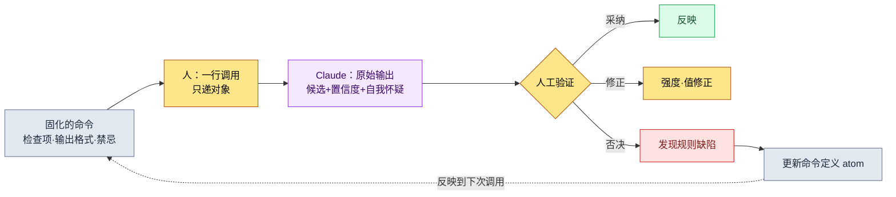
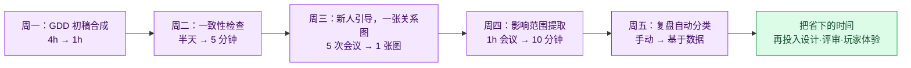

# 3.4 AI 辅助系统设计的提示词模式

那是 Alpha 版本即将到来的一周。我在技能表里新增了一个职业的一行并保存。可那一行所引用的 buff ID，其实是前一天有人删掉的那一行——这一点我直到第二天早上构建崩了之后才发现。为了顺着崩掉的构建回溯找出原因，花了我两个小时。要是在删掉那一行之前能先问一句"这个删了没关系吗？"，这两个小时本可以不必花。

本章讲的就是如何让 AI 替你问出那个问题。重点不在于把提示词写得多漂亮，而在于把同一个问题固化下来，不必每次都从 0 重写一遍。在 3.2 里铺好了模式（schema），在 3.3 里铺好了关系图。两者都是数据的骨架。本章要在这副骨架之上，把人抛给 AI 的问题本身固化为资产。

先钉死一点。AI 造出来的不是答案，而是候选。本章出现的所有模式里，最终拍板的那只手始终留在人这一侧。

---

## 3.4.1 即兴提示词漏在两处

刚开始用 AI 时，每次都用自然语言即兴敲。大致是这样：

```
帮我看下技能表。确认有没有外键断掉的，
有奇怪的就告诉我。哦对，还有冷却时间为负的。
```

这条提示词在两处漏掉东西。

第一，检查项每次都不一样。今天想起了"冷却时间为负"，明天就忘了。昨天筛过一次的"重复 PK（Primary Key，主键）"，今天的提示词里没了。依赖人记忆的检查，会随人的状态而漏。

第二，结果格式每次都不一样。同一个意图，写成"帮我确认""检查下""扫一遍"这些不同说法，AI 有些天用表格回，有些天用大段文字回。格式参差不齐，结果就没法再拿去自动处理。

解法是把提示词从手上拿下来，放进抽屉。把每次手写的便条，换成贴了标签的卡片，从同一个抽屉里取。那张卡片就是本书所说的斜杠命令（skill）和 atom。

---

## 3.4.2 固化的三种形态与取舍标准

固化有三种容器。把什么装进哪一个，取决于调用频率与稳定性。

<svg viewBox="0 0 720 300" xmlns="http://www.w3.org/2000/svg" font-family="sans-serif" font-size="13">
  <rect x="0" y="0" width="720" height="300" fill="#fbfbfd"/>
  <line x1="120" y1="40" x2="120" y2="280" stroke="#bbb" stroke-width="1"/>
  <line x1="120" y1="160" x2="700" y2="160" stroke="#bbb" stroke-width="1"/>
  <text x="60" y="35" text-anchor="middle" font-weight="bold">调用频率</text>
  <text x="60" y="55" text-anchor="middle" fill="#888" font-size="11">高 ↑</text>
  <text x="60" y="270" text-anchor="middle" fill="#888" font-size="11">低 ↓</text>
  <text x="410" y="298" text-anchor="middle" font-weight="bold">定义稳定性 →</text>

  <rect x="150" y="70" width="200" height="70" rx="8" fill="#e8f0fe" stroke="#4285f4"/>
  <text x="250" y="98" text-anchor="middle" font-weight="bold">斜杠命令（skill）</text>
  <text x="250" y="118" text-anchor="middle" font-size="11" fill="#555">高频·稳定 → /check-sheet</text>
  <text x="250" y="133" text-anchor="middle" font-size="11" fill="#555">一词调用，结果格式固定</text>

  <rect x="400" y="70" width="270" height="70" rx="8" fill="#fef7e0" stroke="#f9ab00"/>
  <text x="535" y="98" text-anchor="middle" font-weight="bold">atom 自动注入（JIT）</text>
  <text x="535" y="118" text-anchor="middle" font-size="11" fill="#555">高频·核心约束 → 关键词触发</text>
  <text x="535" y="133" text-anchor="middle" font-size="11" fill="#555">无需记忆，嵌入自然语言中</text>

  <rect x="150" y="190" width="200" height="70" rx="8" fill="#e6f4ea" stroke="#34a853"/>
  <text x="250" y="218" text-anchor="middle" font-weight="bold">模板文件（.md）</text>
  <text x="250" y="238" text-anchor="middle" font-size="11" fill="#555">偶尔·大型作业 → 调用文件</text>
  <text x="250" y="253" text-anchor="middle" font-size="11" fill="#555">用眼看、易于修改</text>

  <rect x="400" y="190" width="270" height="70" rx="8" fill="#f1f3f4" stroke="#9aa0a6"/>
  <text x="535" y="225" text-anchor="middle" font-size="12" fill="#777">偶尔·定义不稳定 →</text>
  <text x="535" y="243" text-anchor="middle" font-size="12" fill="#777">先别固化（保持即兴）</text>
</svg>

高频且定义已定型的作业用斜杠命令。高频但"不能忘的约束"用 atom JIT 自动注入。偶尔做但分量大的作业用模板文件。而定义仍在摇摆的作业，先不固化，留作即兴。三者不必一开始就备齐。从一两个斜杠命令起步，看到价值再增加。

---

## 3.4.3 模式 ① 一致性检查 —— 实操记录（worked transcript）

与其用嘴解释，不如把一个模式从头到尾走一遍。这是一个在删掉一个空行之前，自动先问一句"这个删了没关系吗？"的模式。它的名字叫 `/check-sheet`。里面固化着检查项与输出格式。

作为依据的资产，藏在本书各处嵌入的实测作业记录里。数据录入遵循 schema-first 原则（atom `data_entry_schema_first`）。录入顺序是 `$스키마` 表 → `Enum/*.proto`（VBA（Excel 宏语言）Export）→ csv。而正本不是模式文档，而是实际的 JSON 输出（atom `json_over_schema_doc_as_source_of_truth`）。一致性检查就是把这两条原则原样搬成检查规则。

### setup —— 固化命令的内部

展开 `/check-sheet`，里面装着这样一段提示词正文。这就是不必每次手敲的那部分。

```
角色：你是游戏数据表的一致性检查器。

要检查的表：{{sheet_name}}
可参考的模式：$스키마 表（各列的类型·范围·FK 对象）
可参考的正本：同一张表的 export JSON（优先于模式文档）

检查项（按此顺序）：
1. 外键有效性 —— FK 列的值是否实际存在于被引用的表中
2. 范围越界 —— 超出 $스키마 中定义的 min/max 的值
3. 必填列缺失 —— required=true 的列为空的行
4. 重复 PK —— 同一 PK 出现两次以上

输出格式（务必照此表）：
| # | 行 | 列 | 违规类型 | 当前值 | 修正候选 | 置信度 |

规则：
- 修正候选只提建议。绝不直接改表。
- 置信度为高/中/低三者之一。若属猜测则为低。
- 没有违规时，只输出"违规 0 件"并结束。
```

这段正文里要紧的是最后三行规则。"不直接改"、"标注置信度"、"猜测要坦白为低"。这三行把 AI 拴在推候选的位子上，而不是给答案的位子上。

### prompt —— 人实际敲的一行

```
/check-sheet skill_table
```

结束了。只递一个表名。四个检查项也好、输出表格式也好，都不再重写。这就是固化的价值。

### Claude 的原始输出

下面是实际跑了一次后返回的输出。不做摘要，把含糊之处与 AI 犹豫的地方都原样附上。

```
skill_table 一致性检查结果如下。共发现 4 件违规。

| # | 行  | 列          | 违规类型     | 当前值 | 修正候选                | 置信度 |
|---|-----|------------|------------|--------|----------------------|------|
| 1 | 142 | buff_id    | 外键违规     | 9007   | 9070（疑似笔误，差 1 位） | 中   |
| 2 | 142 | buff_id    | 外键违规     | 9007   | 9012（名称"猛毒"相近）   | 低   |
| 3 | 88  | cooldown   | 范围越界     | -1     | 0（不可为负）           | 高   |
| 4 | 215 | combo_next | 必填缺失     | （空白） | 暂不判断               | 低   |

补充几点注意事项。

- 第 1 条与第 2 条是针对同一行（142）同一列的两个不同候选。
  9007 这个 ID 在 buff 表中并不存在。9070 与之只差一位数字，
  有可能是笔误；9012 的名称"猛毒"相近，因此也列为候选。
  两者置信度都低。需要由人来选。

- 第 4 条（215 行 combo_next 空白）很含糊。$스키마 中标为 required=true，
  但查看 export JSON 后发现，此列为空的行还有 12 个。
  可能是说明书未更新，也可能存在"连招收招技能的 combo_next 留空"这条
  规则，只是说明书未予反映。我无法断定，
  因此置为"暂不判断"。

- 若想在 cooldown 之外再跑更多范围检查，需要确认 $스키마 其他列的
  min/max，但我所收到的信息中 range_check 列有一部分为空，
  因此 cast_time 列未能检查。
```

这份输出之所以是好输出，不在于它干净，而在于它诚实。它没有把第 4 条断定为"既然必填就填上"，而是流露出"说明书可能未更新"的自我怀疑。它也坦白了没能看到 cast_time 这一限制。倘若 AI 自信满满地说第 4 条"请填 0"，那很可能是会毁掉连招收招技能的错答。

### verify —— 人的验证与否决

接着由人逐行裁定。验证自动伴随，意味着这张表会自动生成，并不意味着人不看。

- **第 3 条（cooldown -1 → 0）**：采纳。置信度高，负数冷却时间是明显的录入失误。立即改正。
- **第 1·2 条（buff_id 9007）**：搁置。两者置信度都低。决定直接打开 buff 表，确认"猛毒"系 buff 的实际 ID。AI 的两个候选都不采纳。
- **第 4 条（combo_next 空白）**：**否决**。AI 的怀疑是对的。这个技能是连招收招技能，combo_next 留空才是正常的。不是违规。否决，而且这是说明书一侧的问题。

最后第 4 条是关键。在原样相信 AI 输出就会毁掉完好数据的位置上，人的否决起了作用。同时，第 4 条也暴露了检查规则本身的缺陷。说明书的 `required=true` 是错的。

### 再请求 —— 否决会修正规则

到这里并不收手。否决是让下一次检查更聪明的输入。人接着敲：

```
第 4 条不是违规。combo_finisher=true 的技能，combo_next 留空
才正常。把这条例外规则加进检查项里，今后 finisher 行的
combo_next 空白不要再当违规抓。还有，说明书的 required 定义
看起来错了的项，单独拆到"说明书疑点"小节里告诉我。
```

```
明白了。我会把例外反映进 /check-sheet 的检查规则。

新增规则：
- 进行 combo_next 必填检查时，先确认同一行的 combo_finisher 值。
  若 combo_finisher=true，则 combo_next 空白按正常处理（排除违规）。

新设小节：
- "说明书疑点" —— 当 export JSON 的实际分布与 $스키마 定义相悖时，
  把需要改的对象分离为说明书（而非数据）候选并报告。
  （依据"正本为 JSON"的原则，若多数数据违背说明书，
   则怀疑说明书一侧。）

要把这条变更记录到 /check-sheet 命令定义的 atom 里吗？
```

最后那一行才是这个模式的完成。一次否决没有止于一次性的修改，而是被记录进命令定义的 atom，传播给下一个人、下一次检查。这就是固化的复利。同一个失误不会被筛第二次。

---

## 3.4.4 模式 ② 变更影响范围提取 —— 实操记录（worked transcript）

第二个模式，是要消掉开头那个场景里的那两个小时。在改一行、改一个决定之前，先问"这会波及到哪里"。它的名字叫 `/impact`。3.3 里做的关系图（`gen_relation_map.py` 输出的 FK 关系 HTML）就是这个模式的燃料。

### setup —— 固化的探查路径

`/impact` 里固化着"该翻查哪里才能不遗漏地找全影响"，分四条线。

```
角色：你是变更影响范围提取器。

变更对象：{{target}}  （表名·列·atom_id·系统决定，四者之一）

探查路径（四条都要走）：
1. 关系图入站 —— 在 gen_relation_map.py 输出中，以 FK 引用
   {{target}} 的那些表（指向这张表的箭头）
2. 正文提及 —— 在 sources/manuscript 中，{{target}} 的 ID·名称
   直接出现的文档
3. atom affects 关系 —— 与 {{target}} 经 affects 相连的 atom
4. 反向引用 —— 以 [[wikilink]] 指向 {{target}} 的笔记

输出格式：
| 类型 | 名称 | 关联依据 | 影响强度 | 负责人 |

规则：
- 影响强度为直接/间接/弱三者。直接 FK 为"直接"，正文提及为"间接"，推定为"弱"。
- 若担心遗漏，哪怕标为弱也要列上。漏掉比列上更糟。
- 不做优先级或工作指派。只生成清单。
```

### prompt

```
/impact buff_id=9012
```

用一行问出"想把猛毒 buff（9012）换成别的效果，哪里会动摇？"。

### Claude 的原始输出

```
buff_id=9012（猛毒）的变更影响范围如下。已探查全部 4 条路径。

| 类型    | 名称                | 关联依据              | 影响强度 | 负责人    |
|--------|--------------------|----------------------|---------|----------|
| 表      | skill_table         | buff_id FK 直接引用    | 直接     | teammate_a |
| 表      | monster_drop        | reward_buff FK 引用    | 直接     | teammate_b |
| 表      | set_item_effect     | proc_buff FK 引用      | 直接     | teammate_a |
| 文档    | 독계열_밸런스_노트.md  | 正文直接提及"9012"     | 间接     | （作者）   |
| atom    | poison_stack_rule   | affects: 9012          | 间接     | （作者）   |
| 笔记    | 상태이상_설계.md       | [[맹독]] 反向引用       | 弱       | （作者）   |

补充几点。

- skill_table 中引用 9012 的行有 3 个（刺客职业技能）。
  替换后这 3 个技能的实际效果会变。这是最强的影响。

- monster_drop 的 reward_buff，我把握得稍弱。列名虽是
  reward_buff，但部分行里似乎混进了指向 item 而非 buff 的
  值。建议这张表你直接打开确认一次。

- "독계열_밸런스_노트.md"只是以文本提及 9012，并非 FK，
  因此置为间接。不过它是写有平衡意图的文档，实际影响可能
  很强。请留意：强度（间接）与重要度可能并不一致。

- set_item_effect 中有 4 种套装道具以 proc_buff 使用 9012。
  抽掉猛毒，这些套装的概念就会变。
```

### verify —— 人的验证与否决

- **skill_table（直接，队员 A）**：确认。刺客的 3 个技能直接受影响。需要共享给队员 A。采纳。
- **monster_drop（直接）**：AI 自己存疑的项。直接打开表确认。结果：reward_buff 列里确实混进了 item ID，而引用 9012 的行实际只有 1 个。AI 的"把握较弱"坦白是准确的。把强度由直接**下调修正**为间接。
- **set_item_effect（直接，队员 A）**：确认。4 种套装受影响。采纳。
- **상태이상_설계.md（弱）**：单纯的反向引用，正文无影响。清单里保留，但排除出作业对象。

这里 AI 的诚实同样帮了验证。要是把 monster_drop 断定为直接，就会夸大影响、约出一场不必要的协调会。多亏 AI 说"建议你确认一下"、把球交回给人，强度才得以纠正。

### 再请求 —— 从提取到共享

清单一经验证，下一步的手就是把它传达给人。

```
按直接受影响的负责人分组，给 teammate_a / teammate_b 各拟一份
要发的简短共享备忘草稿。格式为"正在考虑把 9012 猛毒换成 X，
你的表里有 N 行受影响"。决定还没定，所以用征求意见的语气、
而非通知的语气。
```

```
按负责人分的共享备忘草稿如下。用的是征求意见而非通知的语气。

[致 teammate_a]
正在考虑把猛毒 buff（9012）换成别的效果的方案。尚未确定，
想先听听意见。影响范围：
- skill_table：刺客技能有 3 行引用 9012（直接影响）
- set_item_effect：4 种套装道具以 proc_buff 使用 9012
替换后这些技能·套装的概念会变。若有反对或补充意见，请在
本周内告知。

[致 teammate_b]
想请你确认 monster_drop 的 reward_buff。正在考虑替换猛毒
buff（9012），看上去受影响的行只有 1 个（reward_buff 列里
混进了 item ID，最初看上去更多）。能否帮我确认实际只有这 1 行
是对的吗？

两份备忘都置为"正在考虑·征求意见"，未放入确定通知的措辞。
发送前，你需要先填上替换候选效果（X 处）。
```

开头那两个小时在这里消失了。在变更之前先问影响、提前共享给负责人，于是在第二天构建崩掉之前，协调就已结束。而 AI 造出来的始终只是备忘草稿，按下发送的手指是人的。

---

## 3.4.5 两个模式共有的骨架

上面两份记录遵循同一副骨架。其余所有模式也都搭在这副骨架上。



关键是右下角的虚线。否决不是终点，而是作为修正命令本身的输入折返回来。一致性检查里被否决的第 4 条成了 finisher 例外规则，那条规则被记录进 atom，传播给下一次检查。没有这个反馈，同一个错答每周都会被重新筛一遍。

三处留着人的手。调用（选对象）、验证（采纳·修正·否决）、规则改进（否决的回流）。AI 只在这之间做推候选的活儿。

---

## 3.4.6 其余模式 —— 同一骨架的变奏

把同一副骨架搬到别的作业上，模式就会增多。不附记录，只点位置。它们都原样遵循 3.4.5 的骨架，因此制作时关键在于不漏掉"固化的检查项"与"人工验证位"。

| 模式 | 一行调用 | AI 推的候选 | 人握的决定 |
|---|---|---|---|
| GDD 初稿合成 | `/gdd-new <系统>` | 标准 9 小节初稿，未定处标 [TBD] | 愿景·优先级·删减 |
| 状态机/BT 转换 | `/diagram-state` | 自然语言 → mermaid + 可达性验证 | 状态定义·转移条件 |
| 接口冲突检查 | `/check-interface <GDD>` | 输入输出·时间窗口冲突用例 | 优先级规则 |
| 数值计算 | `/balance-calc <表> <公式atom>` | 曲线计算值 + 与现有的 diff | 公式·游戏意图 |
| 复盘作业分类 | `/retro-classify <周期>` | Layer×领域分布 + 异常信号 | 分类校正·解读 |

数值计算里只钉死一点。曲线在数值上即便平滑地下落，那份平滑是否契合游戏的意图，是另一回事。本想把 Boss 前的区段故意留得陡峭，AI 却以"离群值"为由把它削平的事是有的。所以数值计算即便自动附带了曲线验证，最后一行也要在人将其与意图对照之后才闭合。

---

## 3.4.7 运营的五项原则与收敛点

模式一多，就需要运营纪律。下面五项原则不是要背的规则，而是要嵌进工具本身的设计原则。

| 原则 | 为什么 |
|---|---|
| 一命令 = 一作业 | 越小越易于复用·调试。不把检查·修改·共享都塞进 `/check` |
| 命令自动伴随验证 | 在输出表本身加上置信度·依据列，减轻人工验证的负担 |
| 命令定义化为 atom | 像 3.4.3 的否决→规则回流那样，把缘由·示例·变更历史留在 atom 里 |
| 度量使用频率 | 月调用不足 1 次的命令是淘汰候选。用数据来砍 |
| 人的手只在决定上 | 命令只到生成候选为止。禁止自动决定 |

最后一个收敛点。在作者运营过的某个 MMORPG 项目里，能在系统策划中稳定留存的斜杠命令，随时间推移收敛到 12 个上下。这不是公开标准，而是一个项目的观察值（作者经验，未经验证）。但方向是明确的。命令不是无限地增，而是每月加减 1～2 个，停在脑子里装得下的数目上。贴了 100 个标签的抽屉，和没贴标签的抽屉一样。

引入不必一次到位。第一个月，把每周重复的一件作业固化为斜杠命令就够了。那一件显出价值，下个月自然就蔓延到两件、三件。

---

## 3.4.8 Part 3 收尾

在 3.1 铺好系统策划的 Layer 坐标，在 3.2 铺好模式，在 3.3 铺好关系图，再在 3.4 于其上叠加 AI 辅助提示词。走过四章的系统策划，一周会这样改变。



杂活时间减少，那些时间又回到深入的设计与对玩家体验的思考上。不把省下的时间重新填满杂活——这才是引入工具的真正理由。

下一个 Part 4 是战斗策划。它是系统策划最近的兄弟，3.1～3.4 的工具与模式可原样过渡过去。

---

## 本章要点

- 把即兴提示词固化为斜杠命令·atom·模板的循环，是 AI 辅助回收价值最大的地方。
- 所有模式都遵循一行调用 → 原始输出 → 人工验证·否决 → 规则回流这同一副骨架。
- AI 推候选，而采纳·修正·否决的最后一只手始终留在人这一侧。

---

## 动手试试

**setup.** 挑一件每周重复的检查作业（例如表的一致性）。把该作业的 4 个检查项与输出表格式写下来，固化为一个斜杠命令。务必把三行规则（"不直接改 / 标注置信度 / 猜测要坦白"）放进命令正文。

**prompt.** 只把对象用一行递过去来调用。

```
/check-sheet skill_table
```

**verify.** 把返回的表逐行以采纳·修正·否决裁定。一旦出现否决，那不是运气，而是规则的缺陷。把那条例外追加进命令定义的那一行再发一次，让下一次调用不会把同一个失误筛第二次。

### 单人精简版

如果既没有团队也没有 atom 系统，就用备忘录应用里的一个文本块代替斜杠命令。标题写"表检查提示词"。内容是上面 setup 的 4 个检查项 + 3 行规则。每次检查时复制这个文本块，只改表名再粘给 AI。一旦碰上要否决的事，就在那个备忘块里直接加一行例外。工具无论是斜杠命令还是一张备忘，循环（固化 → 调用 → 验证·否决 → 规则更新）都照样转。
