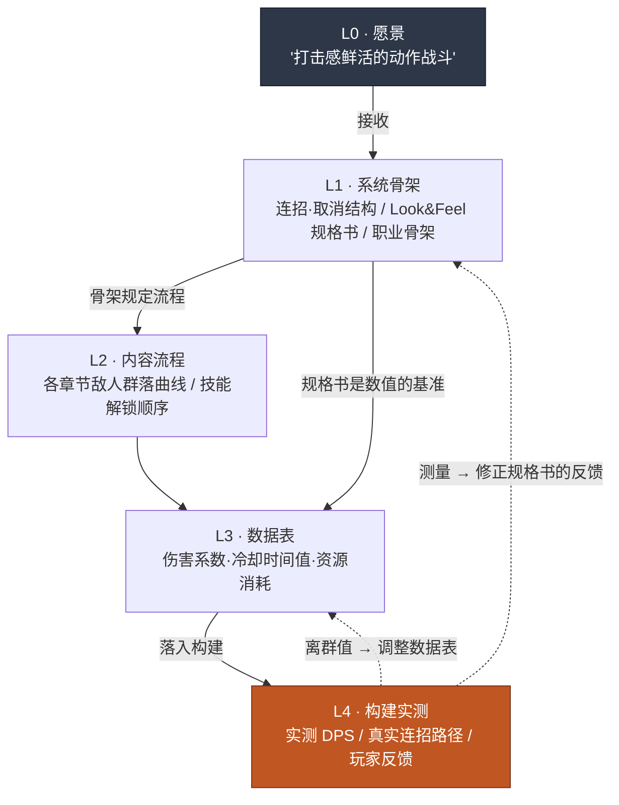

# 4.1 战斗策划与 Layer —— 打击感落在哪一格

> **本章学习目标**（难度 🟡 实务 · 前置:四则运算·表格计算):学会把"打击感"这类抽象形容词拆解为可测量的信号,并用坐标指定战斗策划的五项产出各自落在 Layer 的哪一格。

构建评审会议室。程序员把刚接入的新技能投到显示器上。角色挥剑,敌人被向后击退。五个人在看。有人开口。

"嗯……总觉得打击感有点弱。"

旁边的人点头。"对,有点平。"

程序员问:"该改哪里、怎么改呢?"

沉默。会议室里的五个人没有一个能用数字回答这个问题。"打击感弱"是五个人都感受到的,但没有人能说出"把顿帧从 3 帧改到 5 帧"。会议花了 40 分钟来回抛"再厚重一点""冲击力不够"之类的形容词,最后以"先放到下个构建里再看吧"收场。

这一幕浓缩了战斗策划的全部问题。这是玩家最直接感受到的领域,可一旦要把这种感受落成语言,剩下的就只有形容词。形容词无法测量,无法测量就无法调整。战斗策划的第一项工作,就是把这些形容词拉下来变成数字。

本章要定的,是这些数字落在哪一格。战斗策划做的五项产出各自落在 Layer 的何处,以及这套坐标为何成为自动化的前提条件。4.2、4.3、4.4 的实战工具都在这套坐标之上运转。

> **给非本专业读者的一句话。** 在本部分,你不必记住战斗数值或帧单位。你只需带走这一条 —— **"以形容词来回传递的请求,既测不了也调不了。"** 把"再厚重一点"拉成"把什么改成几"的那一刻,协作才能转起来 —— 这个思路对游戏之外任何岗位的模糊反馈都同样适用。4.1.1 的五项产出可以轻轻扫过,你只把这一条握在手里再往下走也行。

---

## 4.1.1 战斗策划桌上的五样东西

把战斗策划负责的产出用一句话概括,就是"玩家的输入被转换为屏幕上动作的全过程"。把它切成五块。

**第一,战斗 Look & Feel 规格书。** 把打击感、反馈性、重量感这类抽象,翻译成可测量数值的文档。这是本领域最难的产出,同时也是评判其余四样的基准。

Look & Feel 又可拆为四个信号。

- **命中时序** —— 从按下输入按钮的时点,到视觉·听觉反馈出现在屏幕上,经过了多少 ms
- **顿帧(hitstop)** —— 攻击命中的瞬间,画面停顿多少帧(通常 1\~6 帧)
- **镜头震动** —— 振幅·持续时间·衰减曲线
- **特效同步** —— VFX·SFX·UI 反馈是否在同一帧触发

没有这份规格书,会议室那一幕就会重演。有了规格书,就能给出"顿帧 3→5 帧,镜头震动振幅 +20%"这样的调整指令。

**第二,技能·连招·取消系统。** 这是输入被转换为动作的规则。

- 技能释放流程:输入 → 施法 → 触发 → 后摇
- 连招规则:某个技能后面能接哪个技能、其加成是什么
- 取消规则:某个动作进行中能取消进入哪个动作
- 输入队列:动作进行中接收下一个输入的窗口(ms)有多长

**第三,角色·怪物 AI。** NPC 行为逻辑 —— 行为树(Behavior Tree,以下简称 BT)、状态机(FSM(Finite State Machine,有限状态机)/HFSM)、决策表。怪物行为模式、Boss 阶段切换、同伴 NPC 协同、集群模拟都归在这里。

**第四,伤害·资源·冷却时间公式。** 这是玩家的选择被转换为结果的数学。伤害系数·防御减免·暴击·属性修正,资源(MP/气力/耐力)的消耗·恢复曲线,冷却时间分布。

**第五,动画控制规格书。** 这是规定策划意图在实际构建中如何呈现的图纸 —— 动画图(graph)·BT·IK 连接。这通常是与程序员·动画师的协作,但如果策划不提供意图的规格书,意图就会在构建里走样。只丢材料不给图纸,盖出来的会是另一栋房子。

这里的关键是:**五样东西在同一张桌子上相遇**。连招规则(第二)一变,伤害公式(第四)的 DPS 就变,那又反过来改变 Look & Feel(第一)的体感重量。哪样产出是哪样产出的输入,如果没有写明,一次改动就会牵动五处。所以需要坐标。

---

## 4.1.2 五项产出落在 Layer 的哪一格

在 2.3 立下的 L0\~L4 坐标之上,把五项战斗产出摆上去。这套映射是本章的脊椎。



用表格再整理一遍是这样。

| Layer | 战斗策划的产出 | 变更频率 |
|---|---|---|
| L0 | (接收 —— 愿景:"打击感鲜活的动作战斗") | 几乎固定 |
| L1 | 连招·取消结构 / Look & Feel 规格书 / 职业骨架 | 慢 |
| L2 | 各章节敌人群落推进曲线 / 技能解锁流程 | 中等 |
| L3 | 技能伤害系数表、冷却时间值、资源消耗 | 快 |
| L4 | 构建实测 DPS、真实可行连招路径、玩家反馈 | 每个构建 |

战斗策划的特点是:**L4 的比重比其他领域都大**。剧情策划的 L1 规格书几乎就等于最终成品,而战斗不同。"打击感好"属于必须在构建里亲手打、看着画面才能知道的领域。规格书里写了"顿帧 5 帧",它实际是否体感厚重,只能在 L4 里确认。所以仿真与自动测量工具在本领域创造的价值最大(4.4)。

不过,L4 大并不意味着 L1 不重要。看那些虚线箭头。L4 的测量值会反馈回 L1 规格书。没有规格书,测量值就失去了"比对的基准"。要有 5 帧的规格书,才会得出"实测 4 帧,少了 1 帧"这样的诊断。规格书 → 构建 → 测量 → 修正规格书的循环,贯穿全部五个 Layer。战斗策划把手按在整个循环上,是同一张桌子上同时转动着最多 Layer 的位置。

---

## 4.1.3 把形容词变成数字 —— 一段真实工作的脊椎

抽象论到此为止。现在回到会议室那一幕,用实操记录(worked transcript,完整保留的真实操作过程记录)来看"打击感弱"实际被拉成数字的过程。工具只有一个 LLM。输出不加修饰,连人否决掉的部分也原样保留。

笔者作为总监运营的某 MMORPG 项目(以下称"项目A")的战斗 TF 中,将某个新近战技能的 Look & Feel 规格化的真实流程,在此还原。

### 提示词(全文)

```
把这个技能的 Look & Feel 不要用形容词,改成 ms·帧数值。
命中时序、顿帧、镜头震动、特效同步、后摇,共五项。
没把握的就写"需在本游戏中验证"。

技能:大剑纵劈 (heavy_overhead_slash)
意图:"沉重地劈下,敌人踉跄的感觉"
帧率:60fps
```

### Claude 原始输出(不做摘要·整理)

> 大剑纵劈的"沉重感"主要由**顿帧与后摇的长度**,以及**镜头震动的衰减**塑造。按项目逐条给出。
>
> **1) 命中时序。** 武器越重,从输入到触发的前摇越长,重量感才立得起来。从输入到第一次视觉反馈(角色开始举剑)建议 **50\~80ms**(3\~5 帧)。不过,第一次*视觉*反馈和第一次*命中*反馈是两回事。命中落实取决于动作长度,这里无法断言 —— **需在本游戏的动作长度下验证**。
>
> **2) 顿帧。** 是厚重一击的核心变量。如果轻攻击是 1\~2 帧,那么大剑纵劈建议 **4\~6 帧**(约 67\~100ms)。超过 6 帧,"厚重"就会滑向"卡顿",反馈性变差。
>
> **3) 镜头震动。** 振幅约为屏幕高度的 1\~2%,持续 0.2\~0.3 秒,衰减比起线性更应该是 **ease-out(快速减弱)**。厚重一击适合首次振动强、随后快速平息的曲线。
>
> **4) 特效同步。** VFX(命中特效)·SFX(命中音)·顿帧**必须在命中帧上完全一致地**触发。哪怕只错开 1\~2 帧,也会被体感为"发平"。UI 反馈(伤害数字)晚 1\~2 帧无妨。
>
> **5) 后摇。** 厚重的代价是后摇长。命中后到可被击中状态的恢复建议 **20\~30 帧**(333\~500ms)。但这个值会随游戏整体战斗节奏(快节奏动作 vs 沉稳的魂类)而大幅变化 —— **需在本游戏的基准节奏下验证**。
>
> 综合来看,"厚重感 = 长前摇 + 4\~6 帧顿帧 + ease-out 震动 + 同帧 VFX/SFX/顿帧 + 长后摇"。不过以上数字是一般建议范围,**真正的重量感必须在构建里亲手打、再调整才能定下来。**

### 人的验证·否决·重新请求

到这里,策划不会整份照单全收。他在两处停下。

**否决 1 —— 镜头震动振幅"屏幕高度 1\~2%"。** 这款游戏移动优先。在小屏幕上 1\~2% 几乎看不见。还有移动端晕动问题。策划否决了这个建议值,改用"移动端不靠震动,而以强化顿帧来表现重量"这一自有原则。LLM 只给了一般论,它并不知道这款游戏的平台约束。

**保留 2 —— 顿帧"4\~6 帧"。** 这不是否决而是保留。范围上是对的,但确切的值要在构建里靠手感定。规格书里写"以 4 帧为默认值放进构建,并做出 5、6 帧的变体,把三者亲手比较"。

重新请求是这样发出的。

```
这是移动优先项目。把镜头震动最小化,把重量感
改用顿帧·后摇·SFX 来表现的方向,重写规格书。
顿帧把 4/5/6 帧三种变体做成构建比较用的表格。
```

在这第二次输出里,LLM 做出了反映移动端约束的规格表。那张表进了构建,在下一次构建会议上,策划不再用形容词,而是说"4 帧变体太轻,采用 5 帧"。40 分钟的会议缩短为 5 分钟的决定。

### 这段实操记录展示了什么

三点。第一,LLM **很擅长把形容词拉成数字范围的初稿** —— 这能打破会议室里的沉默。第二,LLM **不知道这款游戏的约束(移动端·节奏·动作长度)** —— 所以它只能给一般建议值,否决·调整是人的份内事。第三,LLM 自己两次咬定"必须在构建里亲手打才能定下来" —— 重量感的最终判断在 L4 的人手上,这一点连工具都知道。

---

## 4.1.4 AI 收回引入价值的四个位置

上面那段实操记录只展示了一个位置(规格化)。在整个战斗策划中,AI 创造价值的位置有四处。

**1) 仿真 —— 价值最大。** 把 DPS(Damage Per Second,每秒伤害)曲线·连招路径·资源消耗,在不出构建的情况下预先计算。比做出构建再亲手测量要快得多。4.4 会用 `simulate_dps` 仿真器直接处理。

**2) 状态机·BT 自动生成。** 把"这个 Boss 在血量 50% 以下狂暴化,狂暴期间使用三连击模式"这样的自然语言描述,转换为 BT/FSM 图。准确度高 —— 规则结构是 LLM 擅长处理的领域。把脑中的逻辑移到图上的时间被省下来。

**3) 构建捕获自动分析。** 从游戏画面中自动提取命中时序·连招成功率·伤害分布。不过,这是**实现难度最高的位置**(下面会诚实地掂量)。

**4) 数值调整候选建议。** 分析数据表的每一行,检出离群值·曲线不平滑,提出调整候选。人只做选择。

这四个位置里,构建捕获自动分析(3)在"做得到"和"轻松做到"之间的距离最远。书里常写"AI 从视频里自动全提取出来",可实际上没那么简单。视频像素级的计算机视觉、现成的视觉 API、游戏内 telemetry 日志 —— 这三种捕获方法在准确度·实现负担上的比较,**以 4.4 为正本,请参照那边**。这里只点出结论。

最现实的路是**游戏内 telemetry 日志**。让引擎直接打出"第 1204 帧 skill_overhead 命中,伤害 340,连招计数 3"这样的事件。这是源数据,所以准确,而且插入一次日志代码即告完成。LLM 则用来读这些日志,摘要成自然语言报告("到 3 连为止资源效率不错,但从 4 连开始骤降")。视频则留作辅助,只让人用眼确认可疑的个例。

也就是说,"AI 自动分析视频"这一愿景的现实形态是 **telemetry 日志 + LLM 摘要**,而非像素视觉。这一诚实的区分,是 4.4 工具选择的出发点。

而四个位置里都不变的一件事是:**"打击感好"的最终判断,AI 做不了。** 那属于玩家情感的领域,对那份情感的责任由人扛起。AI 只是快速地为那份情感判断做出**依据材料**。仿真数值、BT 图、telemetry 报告 —— 全是供人凭手感做决定的素材。

---

## 4.1.5 划分坐标的真正理由 —— 自动化的前提条件

到这里为止,都是"把产出按 Layer 划分,协作时话能说通"这种表面理由。把连招规则放在 L1、伤害表放在 L3,解释过是因为变更频率不同。这话没错,但不是全部。

划分坐标的本质理由是:**自动化只在它之上才运作**。Layer 分解是程序化生成·自动化的前提,这一一般命题在 2.3 已经讲过,这里只聚焦于这个前提在战斗领域的三种自动化里如何分流。

**第一,仿真要"分清什么是输入、什么可改"才转得起来。** 确定性内核(物理·攻击判定框 —— L1 骨架)与可变更的规格(伤害值·冷却时间 —— L3 数据表)如果混在一起,仿真器就无法定义"可变更候选空间"。内核固定、数据表可变 —— 有了这一分离,`simulate_dps` 才能做"把伤害系数从 280 到 340 每次加 20、画出 DPS 曲线"这样的搜索。

**第二,构建捕获自动分析要动作 atom 已被标注才有意义。** 在规格层标注了"这一帧区间是 `skill_overhead` 的 hit 阶段"这样的 atom,才能把 telemetry 日志中提取的信号与规格自动比对。没有标注,日志就是"第 1204 帧某物命中"这种无意义点位的罗列。

**第三,LLM 连招序列生成要取消规则·输入队列被分离为外部文档才能运作。** "在这个角色的 7 对可取消组合和输入队列 200ms 之内,提出 10 条 5 连招序列"这样的限定请求,只有在取消规则没有固化在代码里、而是落成文档时才可能。

这三点说的是同一句话。**确定性内核与规格混在一起,自动化就被堵死;分离开,自动化就被打开。** Layer 分解,表面目的是统一协作语言,本质目的是为自动仿真·捕获分析·LLM 序列搜索铺好前提条件。

### 从保守应用到进阶应用

铺好这个前提后,战斗运营会分两步进化。

**保守应用 —— 人来设计,自动来验证。** 当下大多数动作·MMORPG 的战斗运营都在这里。人亲手写连招·取消规格,自动则仿真 DPS·资源、用 telemetry 捕获,产出"规格 vs 测量"的比较报告。人解读其中的差异,决定修正规格,再回到写规格,循环转动。设计是人,仿真·捕获·比较是自动。

**进阶应用 —— AI 发起候选,人只做采纳。** 这是下一步。AI 在可取消组合和输入队列之内自动枚举 10\~30 条序列,自动并行仿真每条序列的 DPS·资源,LLM 给出"资源效率第 1,输入难度中"这样的排名·解读。留在人手上的决定只有"候选中采纳哪条序列作为标志性"这一个,以及总监对构建落地·动作捕获的决定。从零做出序列,与从 30 条中挑一条,工作负担是两个量级。

进阶应用要立住,得具备三样。(1) 不出构建、在 1 秒内算出 DPS·资源·生存时间的确定性仿真基础设施,(2) 连招·取消·输入队列被分离为外部文档并标注的动作 atom,(3) 基于 telemetry 的捕获自动分析。三样都是上面说的 Layer 分解的直接产物。

### 动作捕获是不可逆步骤 —— 决策门

最后是可逆性。战斗策划的验收循环里,混着可回退和不可回退的步骤,知道这道边界很重要。

<svg viewBox="0 0 720 230" xmlns="http://www.w3.org/2000/svg" font-family="sans-serif">
  <rect x="0" y="0" width="720" height="230" fill="#fbfbfb"/>
  <text x="20" y="30" font-size="15" font-weight="bold" fill="#1a202c">可逆 ──────────────────▶ 决策门 ──────▶ 不可逆</text>

  <!-- 可逆 단계 박스들 -->
  <rect x="20" y="55" width="150" height="44" rx="6" fill="#c6f6d5" stroke="#2f855a"/>
  <text x="95" y="78" font-size="12" text-anchor="middle" fill="#22543d">连招·取消</text>
  <text x="95" y="93" font-size="12" text-anchor="middle" fill="#22543d">规格修正</text>

  <rect x="20" y="110" width="150" height="44" rx="6" fill="#c6f6d5" stroke="#2f855a"/>
  <text x="95" y="133" font-size="12" text-anchor="middle" fill="#22543d">仿真执行·报告</text>
  <text x="95" y="148" font-size="11" text-anchor="middle" fill="#22543d">(结果可自由丢弃)</text>

  <rect x="20" y="165" width="150" height="44" rx="6" fill="#c6f6d5" stroke="#2f855a"/>
  <text x="95" y="188" font-size="12" text-anchor="middle" fill="#22543d">数据表</text>
  <text x="95" y="203" font-size="12" text-anchor="middle" fill="#22543d">数值调整</text>

  <!-- 부분 가역 -->
  <rect x="220" y="110" width="160" height="44" rx="6" fill="#feebc8" stroke="#c05621"/>
  <text x="300" y="133" font-size="12" text-anchor="middle" fill="#7b341e">落入构建 (开发)</text>
  <text x="300" y="148" font-size="11" text-anchor="middle" fill="#7b341e">部分可逆</text>

  <!-- 게이트 -->
  <line x1="430" y1="40" x2="430" y2="215" stroke="#e53e3e" stroke-width="2.5" stroke-dasharray="6 4"/>
  <text x="430" y="225" font-size="12" text-anchor="middle" fill="#e53e3e" font-weight="bold">决策门</text>

  <!-- 비가역 -->
  <rect x="480" y="80" width="210" height="48" rx="6" fill="#fed7d7" stroke="#c53030"/>
  <text x="585" y="103" font-size="12" text-anchor="middle" fill="#742a2a">动作捕获 (标志性动作)</text>
  <text x="585" y="119" font-size="11" text-anchor="middle" fill="#742a2a">捕获工作室·演员·重拍成本</text>

  <rect x="480" y="140" width="210" height="48" rx="6" fill="#fed7d7" stroke="#c53030"/>
  <text x="585" y="163" font-size="12" text-anchor="middle" fill="#742a2a">落入构建 (线上)</text>
  <text x="585" y="179" font-size="11" text-anchor="middle" fill="#742a2a">热修复成本·用户认知变化</text>
</svg>

动作捕获是战斗中最厚的不可逆步骤。捕获工作室的档期、演员的邀约、重拍成本都很大。所以标志性动作的动作捕获,只在**仿真·捕获自动分析充分运转、序列已定下来之后**才进行。无论保守还是进阶,都把动作捕获和线上构建之前设为决策门。战斗策划的所有验收,都要在这道门左侧的可逆步骤内结束,才安全。

---

## 4.1.6 公司里的景象 —— 减少了什么

这是项目A的战斗 TF 把上述坐标与工具运营 6 个月所测得的变化。下表数字取自 TF 运营记录里的大致平均值,并非精密测量值,把它当作**体感变化的方向**来读才准确。

| 项目 | 引入前 | 引入后 |
|---|---|---|
| Look & Feel 会议时间 | 平均 2 小时(主观讨论) | 平均 30 分钟(以测量值为准) |
| 连招图绘制 | 1\~2 小时/技能组 | 10 分钟/技能组 |
| DPS 曲线验证 | 出构建后手动测量(≈1 天) | 仿真(≈10 分钟) |
| 新技能数值调整 | 3\~4 轮构建周期 | 1\~2 轮构建周期 |

比数字本身更关键的是方向。四个项目全都从"主观讨论·手动测量·构建反复"挪向了"测量值·仿真·图自动化"。会议室里形容词少了,数字多了。这就是本章想说的那一句话 —— 战斗策划的工作,是在主观(打击感·趣味)与客观(数值·仿真)之间架一座桥,而 AI 是快速铺起那座桥的工具。桥的尽头,决定"厚重"的那只手,依旧是人的。

---

## 本章要点

- 战斗策划是从 L1 规格书,到 L3 数据表,再到 L4 构建实测,在同一张桌子上同时转动着最多 Layer 的位置。
- Layer 分解,统一协作语言只是表面,本质是仿真·捕获·LLM 搜索这一自动化的前提条件。
- "打击感好"的最终判断归人,AI 则快速做出那份判断的依据材料。

---

## 动手试试 —— 把形容词拉成数字

**setup.** 有一个 LLM 就够。挑出手边一个技能(新的旧的都行)。用一行形容词写下这个技能的意图 —— "厚重地""轻捷地""沉钝地"之类。

**prompt.** 在下面的骨架里填进技能信息。

```
你是战斗策划助手。把下面技能的 Look & Feel 转换为"可测量的
数值规格"。不要形容词,要 ms·帧·% 单位。
没把握的项目明确写"需在本游戏中验证"。

技能:[名称]
意图:"[一行形容词]"
帧率:[如 60fps]
项目:1)命中时序 2)顿帧 3)镜头震动 4)特效同步 5)后摇
```

**verify.** 对输出里的每一个数字抛出两个问题。(1) 在这款游戏的约束(平台·节奏·动作长度)下,这个值对吗?→ 不对就把约束告知它并重新请求。(2) 这个值需要在构建里靠手定吗?→ 若是,就别写单一值,把 2\~3 个变体写进规格,在构建里比较。LLM 咬定"需验证"的项目,绝不要原样照单全收。

## 4.1.7 单人精简版

如果是独自做的游戏,五项产出·五个 Layer 不必全备。最少做两样。**一,Look & Feel 规格书一页** —— 对核心动作 3\~5 个,只把顿帧·后摇·同步用数字写下来。用形容词写的备注,半年后连你自己都认不出。**二,把连招·取消从代码里分离成一个文件** —— 把可取消组合抽成数据,日后就能让 LLM"用这些组合提出 5 条连招"。这两样,是独自开发也能为自动化敞开门的最小坐标。
