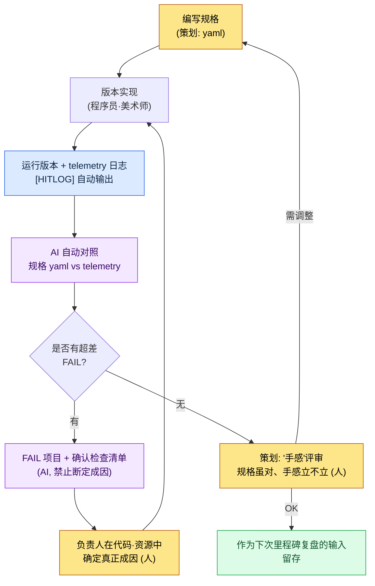

# 4.2 战斗 Look & Feel —— 把手感转化为数值的环节

会议室的显示器前围着五个人。同一个版本、同一个技能、同一段 30 秒的视频正在屏幕上第三次循环播放。客户端程序员先开口:"我觉得还行。"美术抱着胳膊说:"太弱了。感觉缺了点什么。"旁边的策划插话:"特效是不错,可就是不'跟手'。"总监盯着看了好一会儿,做出决定:"嗯……再稍微做得'厚重'一点吧。"

然后会议就结束了。"再稍微厚重一点"到底是多少 ms、多少帧,没有一个人记下来。下一个版本里,程序员实现的是他自己理解的"厚重",美术叠加的是他自己理解的"厚重"。然后下一周,在同一个会议室里看着同一段视频,同样的对话又重复一遍。

打击感、手感、Look & Feel。这是战斗策划中用得最频繁、却又最缺乏定义的词。所有人都自以为懂,可脑子里的定义各不相同,于是讨论结束后什么也没留下。本章要做的,就是把那种"感觉"分解成可测量的数值。这是把手感从抽象拉回数据的环节。

---

## 4.2.1 战斗 = Look & Feel,系统 = 行为

先把边界划清楚。战斗策划大致分为两条线。

- **战斗系统**:它如何运作。伤害公式、冷却时间、层数累积、状态异常规则。这是下一章(4.3 连招·取消、4.4 AI 模拟)的范畴。
- **战斗 Look & Feel**:它给人什么感觉。按下按钮之后画面何时响应、命中瞬间画面停顿多久、特效与声音与震动是否在同一瞬间爆发。

本章只讲后者。伤害是 100 还是 120,与手感没有直接关系。那 100 点伤害"打进去的那一瞬间"玩家如何体感,才是手感。即便是同一个伤害公式,只要命中时机与顿帧不同,就会让人感觉像是完全不同的游戏。

先得老实指出一点:打击感不是仅凭三个数值就能完成的。攻击动作(动画)的加速·减速曲线、被击方的反应(受击反馈·硬直)、80—90 年代日本动作游戏惯用的夸张变形(deformation,即命中瞬间把角色拉伸、压扁的残影·糊化表现),这些全凑齐了,"打中了"这一整块的感觉才立得起来。**本章集中、并能拉回到可测量数值的**,是其中的三条轴。动作·受击反应·夸张变形是动画师·美术师着手更多的领域,留到后面几章和美术部分讲;这里把重心放在策划可以用规格固定、并能在版本中验证的三条轴上。这三条轴可以这样拆分。

<svg viewBox="0 0 720 250" xmlns="http://www.w3.org/2000/svg" font-family="sans-serif">
  <rect x="0" y="0" width="720" height="250" fill="#fafafa" stroke="#ddd"/>
  <text x="360" y="32" text-anchor="middle" font-size="17" font-weight="bold" fill="#222">可测量的三条轴(并非手感的全部)</text>
  <!-- axis 1 -->
  <rect x="40" y="70" width="190" height="140" rx="8" fill="#e8f0fe" stroke="#4a76d4" stroke-width="2"/>
  <text x="135" y="100" text-anchor="middle" font-size="15" font-weight="bold" fill="#2a4a9a">命中时机</text>
  <text x="135" y="128" text-anchor="middle" font-size="12" fill="#444">输入 → 反应</text>
  <text x="135" y="148" text-anchor="middle" font-size="12" fill="#444">何时响应</text>
  <text x="135" y="178" text-anchor="middle" font-size="13" font-weight="bold" fill="#2a4a9a">单位: ms</text>
  <text x="135" y="198" text-anchor="middle" font-size="11" fill="#777">"反应快不快"</text>
  <!-- axis 2 -->
  <rect x="265" y="70" width="190" height="140" rx="8" fill="#fde8e8" stroke="#d44a4a" stroke-width="2"/>
  <text x="360" y="100" text-anchor="middle" font-size="15" font-weight="bold" fill="#9a2a2a">顿帧</text>
  <text x="360" y="128" text-anchor="middle" font-size="12" fill="#444">命中瞬间</text>
  <text x="360" y="148" text-anchor="middle" font-size="12" fill="#444">让时间停顿的长度</text>
  <text x="360" y="178" text-anchor="middle" font-size="13" font-weight="bold" fill="#9a2a2a">单位: frame</text>
  <text x="360" y="198" text-anchor="middle" font-size="11" fill="#777">"厚重不厚重"</text>
  <!-- axis 3 -->
  <rect x="490" y="70" width="190" height="140" rx="8" fill="#e8f6ec" stroke="#3a9a5a" stroke-width="2"/>
  <text x="585" y="100" text-anchor="middle" font-size="15" font-weight="bold" fill="#1a6a3a">特效同步</text>
  <text x="585" y="128" text-anchor="middle" font-size="12" fill="#444">VFX·SFX·UI·</text>
  <text x="585" y="148" text-anchor="middle" font-size="12" fill="#444">摄像机·震动</text>
  <text x="585" y="178" text-anchor="middle" font-size="13" font-weight="bold" fill="#1a6a3a">单位: frame offset</text>
  <text x="585" y="198" text-anchor="middle" font-size="11" fill="#777">"是否像一个事件那样爆发"</text>
  <!-- plus signs -->
  <text x="247" y="148" text-anchor="middle" font-size="26" fill="#999">+</text>
  <text x="472" y="148" text-anchor="middle" font-size="26" fill="#999">+</text>
  <text x="360" y="240" text-anchor="middle" font-size="12" fill="#666">这三者是测量对象 —— 动作·受击反应·夸张变形属美术·动画领域(另述)</text>
</svg>

当会议室里有人说"弱"时,那种弱来自三者之一。是反应慢(时机)?是没有命中感(顿帧)?还是各自为政(同步)?用这三条轴分解去追问,"弱"才终于变成一句可以修正的话。

不过"弱"的成因并不总是只在这三条轴上。把构成手感的要素一个不漏地列出来,划清本章负责到哪里。

| Look & Feel 构成要素 | 是什么 | 本章中 |
|---|---|---|
| **命中时机** | 输入 → 首次反应的 ms。最先被怀疑的要素 | 测量·规格(轴 1) |
| **顿帧** | 命中瞬间让时间停顿、赋予重量的长度 | 测量·规格(轴 2) |
| **摄像机抖动** | 配合打击、画面晃动的反馈 | 测量·规格(含于轴 3) |
| **VFX·SFX 时机** | 特效与声音是否同步到命中帧 | 测量·规格(含于轴 3) |
| 攻击动作(动画) | 挥击的加速·减速,预备动作与后续动作的曲线 | 提及(美术·动画领域) |
| 受击反应·硬直 | 被击方一震并陷入硬直的反应 | 提及(下一章·美术部分) |
| 夸张变形 | 命中瞬间拉伸、压扁的夸张(残影·糊化) | 提及(美术部分) |
| 手柄震动 | 传到手上的物理反馈 | 测量·规格(含于轴 3) |

上面四项归入本章的三条轴,成为测量·规格的对象;中间三项(动作·反应·夸张变形)不可或缺,但属于策划一人难以用数值收口的美术·动画领域,因此只明确"它们存在"这一点。要是动作僵硬、或者被击方稳稳站着不动,那么三条轴全对了打击感也立不起来。

---

## 4.2.2 命中时机 —— 从输入到反应

三条轴里最先讲时机是有原因的。玩家怀疑手感时,最先卡住的是"反应慢"这种感觉;别的东西再华丽,只要输入迟钝,那一瞬间一切都会垮掉。所以从时机抓起。

手感的第一条轴是时间。从按下按钮的那一瞬间(0ms)到画面首次反应的瞬间,要花多少 ms。人对这种延迟敏感得惊人。60ms 和 120ms 的差别,"嘴上说不清楚,手却知道"。

一次攻击不是单纯的一个点,而是铺展在时间上的多个事件。把一次普攻放到时间轴上看,长这个样子。

<svg viewBox="0 0 720 270" xmlns="http://www.w3.org/2000/svg" font-family="sans-serif">
  <rect x="0" y="0" width="720" height="270" fill="#fafafa" stroke="#ddd"/>
  <text x="360" y="28" text-anchor="middle" font-size="16" font-weight="bold" fill="#222">普攻第 1 段 —— 时间轴 (warrior / skill_id 1001)</text>
  <!-- timeline axis -->
  <line x1="60" y1="220" x2="680" y2="220" stroke="#333" stroke-width="2"/>
  <!-- ticks: 0,100,150,250,350 ms mapped 60..680 over 0..380ms => scale (680-60)/380=1.63px/ms -->
  <g font-size="11" fill="#555">
    <line x1="60" y1="215" x2="60" y2="225" stroke="#333"/><text x="60" y="245" text-anchor="middle">0ms</text>
    <line x1="223" y1="215" x2="223" y2="225" stroke="#333"/><text x="223" y="245" text-anchor="middle">100</text>
    <line x1="305" y1="215" x2="305" y2="225" stroke="#333"/><text x="305" y="245" text-anchor="middle">150</text>
    <line x1="468" y1="215" x2="468" y2="225" stroke="#333"/><text x="468" y="245" text-anchor="middle">250</text>
    <line x1="631" y1="215" x2="631" y2="225" stroke="#333"/><text x="631" y="245" text-anchor="middle">350</text>
  </g>
  <!-- input -->
  <line x1="60" y1="60" x2="60" y2="220" stroke="#4a76d4" stroke-width="2" stroke-dasharray="4 3"/>
  <text x="62" y="55" font-size="11" fill="#2a4a9a">输入(0)</text>
  <!-- casting motion bar 0..100 -->
  <rect x="60" y="70" width="163" height="20" rx="4" fill="#c9d8f5" stroke="#4a76d4"/>
  <text x="141" y="84" text-anchor="middle" font-size="11" fill="#2a4a9a">施法动作 0~100</text>
  <!-- hitbox 100..150 -->
  <rect x="223" y="98" width="82" height="20" rx="4" fill="#f5d6c9" stroke="#d4764a"/>
  <text x="264" y="112" text-anchor="middle" font-size="10" fill="#9a4a2a">攻击判定框 100~150</text>
  <!-- vfx 100..250 -->
  <rect x="223" y="126" width="245" height="20" rx="4" fill="#d6e8d9" stroke="#3a9a5a"/>
  <text x="345" y="140" text-anchor="middle" font-size="11" fill="#1a6a3a">视觉特效 100~250 (延迟 50ms 后淡出)</text>
  <!-- damage at 110 -->
  <line x1="76" y1="154" x2="76" y2="172" stroke="#d44a4a" stroke-width="0"/>
  <circle cx="239" cy="164" r="6" fill="#d44a4a"/>
  <text x="248" y="168" font-size="10" fill="#9a2a2a">伤害结算 110 (比视觉晚 10ms → 实际上同时被感知)</text>
  <!-- afterdelay 150..350 -->
  <rect x="305" y="182" width="326" height="18" rx="4" fill="#eee" stroke="#aaa"/>
  <text x="468" y="195" text-anchor="middle" font-size="10" fill="#777">后摇 150~350 (直到可接收下一次输入)</text>
</svg>

这张图里最重要的数字是"攻击判定框首次开启的 100ms"。意思是按下按钮 100ms 之后,攻击判定开始。这个值决定了手感的体感速度。

推荐区间因类型·角色而异,但大致的基准线是有的。

| 种类 | 推荐 输入→反应 | 备注 |
|---|---|---|
| 即时反应(轻攻击) | 60\~120ms | "跟手"感的核心区间 |
| 厚重反应(大型技能) | 200\~400ms | 为厚重感而刻意设置的前摇 |
| 蓄力(长时间充能) | 500\~2000ms | 刻意的等待,另行处理 |

这个区间不是绝对标准。这是**作者估算(未经验证)**:休闲手游往输入宽松的一侧浮动约 ±50ms,格斗主机端则倾向于收得更严。比数字本身更关键的,是让全队共享一条基准线——"我们游戏的轻攻击约定为 90ms"。有了基准线,才能看着版本说出"对/错"。

但这里有一个陷阱。人眼分不清 90ms 和 110ms。在 60fps 下 1 帧约为 16.67ms,而这 20ms 的差距不过一帧出头。会议室里"好像有点慢?"这句话到底对不对,光靠眼睛终究判不出来。所以才需要测量。

---

## 4.2.3 如何从版本中提取时机 —— 诚实的对照

规格里写了"攻击判定框 100ms"。如何确认版本中实际是在 100ms 开启的?自动化的路分三条(视频分析·现成 vision 工具·游戏内 telemetry),三种方式的精度·难度对比在 4.4 中作正式论述。这里只点出结论。实务中最先要铺设的是**游戏内 telemetry**。原因很简单。与其从视频里推断 VFX"出现在画面上的那一帧",不如在代码触发 `OnHit` 事件的那一帧直接打一行 `[HITLOG]`,后者准确得多、也便宜得多,完全不在一个量级。视频分析只用于没有输入叠层的外部视频(例如竞品分析),我们自己的版本则从 telemetry 铺起。

telemetry 日志长这个样子。

```
[HITLOG] frame=6  t_ms=100  evt=hitbox_on    skill=1001 char=warrior
[HITLOG] frame=6  t_ms=100  evt=vfx_trigger  skill=1001
[HITLOG] frame=6  t_ms=100  evt=sfx_trigger  skill=1001
[HITLOG] frame=7  t_ms=117  evt=damage_apply skill=1001 dmg=124
[HITLOG] frame=7  t_ms=117  evt=ui_dmgnum    skill=1001
[HITLOG] frame=6  t_ms=100  evt=cam_shake    skill=1001 amp=0.4
```

策划要做的,是把这份日志与规格逐行比对。其中大多是数值换算与机械对照,人靠眼睛反复做会疲惫、会出错,而 LLM 不会疲惫。下一节实际让它做一遍。

---

## 4.2.4 实操记录 (worked transcript) —— 让 AI 把 telemetry 日志与规格对照

把规格 yaml 和版本 telemetry 日志两份都贴进去,让 AI 对照两者、找出对不上的地方。下面是提示词全文、Claude 的原始输出,以及人工验证的全过程。不做摘要,原样照搬。(实操记录指完整保留的真实操作过程记录。)

### 第 1 次提示词

```
下面是一个战斗技能的"命中时机规格",以及从实际版本中提取的
telemetry 日志。请把版本相对规格对不上的项目整理成表。

[规格]
character: warrior
skill_id: 1001
fps: 60
events:
  hitbox_on:    {expect_ms: 100, tol_frame: 0}
  vfx_trigger:  {expect_ms: 100, tol_frame: 0}
  sfx_trigger:  {expect_ms: 100, tol_frame: 1}
  damage_apply: {expect_ms: 110, tol_frame: 1}
  ui_dmgnum:    {expect_ms: 100, tol_frame: 2}
  cam_shake:    {expect_ms: 100, tol_frame: 1}

[telemetry 日志]
[HITLOG] frame=6  t_ms=100  evt=hitbox_on    skill=1001
[HITLOG] frame=6  t_ms=100  evt=vfx_trigger  skill=1001
[HITLOG] frame=8  t_ms=133  evt=sfx_trigger  skill=1001
[HITLOG] frame=7  t_ms=117  evt=damage_apply skill=1001
[HITLOG] frame=9  t_ms=150  evt=ui_dmgnum    skill=1001
[HITLOG] frame=6  t_ms=100  evt=cam_shake    skill=1001

60fps(1 帧=16.67ms)。请把 expect_ms 换算为帧,与日志的 frame
比对,差值超过 tol_frame 的标记为 FAIL。
```

### Claude 原始输出(原样)

> 先把规格的 expect_ms 换算为帧。在 60fps 下,frame = round(ms / 16.67)。
>
> - hitbox_on: 100 / 16.67 ≈ 6.0 → frame 6
> - vfx_trigger: 100 → frame 6
> - sfx_trigger: 100 → frame 6
> - damage_apply: 110 / 16.67 ≈ 6.6 → frame 7(四舍五入)
> - ui_dmgnum: 100 → frame 6
> - cam_shake: 100 → frame 6
>
> 与日志中实际 frame 比对的结果如下。
>
> | 事件 | 期望 frame | 实际 frame | 差值(frame) | 容差 | 判定 |
> |---|---|---|---|---|---|
> | hitbox_on | 6 | 6 | 0 | 0 | PASS |
> | vfx_trigger | 6 | 6 | 0 | 0 | PASS |
> | sfx_trigger | 6 | 8 | +2 | 1 | **FAIL** |
> | damage_apply | 7 | 7 | 0 | 1 | PASS |
> | ui_dmgnum | 6 | 9 | +3 | 2 | **FAIL** |
> | cam_shake | 6 | 6 | 0 | 1 | PASS |
>
> 有两个项目超出了容差。
> - **sfx_trigger**:声音比视觉命中晚 2 帧(约 33ms)。超出容差 1 帧。玩家很可能感觉"声音稍微有点对不上"。
> - **ui_dmgnum**:伤害数字晚 3 帧(约 50ms)显示。超出容差 2 帧。可能导致"明明打中了,数字却晚出"的别扭感。
>
> damage_apply 为 frame 7,与规格上的 frame 7(110ms 换算)一致,因此正常。不过 damage_apply 比 hitbox_on(frame 6)晚 1 帧这一点,需要确认是否为有意设计。

### 人工验证 —— 否决了一格

收到输出后并没有立刻全信。验证点有两个。

**验证 1(四舍五入边界 —— 通过)。** damage_apply 的 110ms 换算让人起疑。110 / 16.67 = 6.598…。四舍五入得 7,没错。可如果规格本意是"6 帧 = 与 100ms 同一帧"呢?直接确认后发现,规格里确实写着 `damage_apply: expect_ms 110`,刻意与 vfx(100)拉开 10ms 差距。所以 frame 7 的换算是准确的。AI 通过。

**验证 2(最后一句 —— 否决)。** AI 在结尾补的那句"damage_apply 比 hitbox_on 晚 1 帧这一点,需要确认是否为有意设计"是噪声。规格里已经用 expect_ms 110 明示了意图,AI 却把它当成"需要确认"反问回来。既然给了规格,就该在规格之内把答案收口,它却制造了不必要的疑问。这句话没有采纳。

带着否决理由重新发起请求。

### 第 2 次提示词(重新请求)

```
damage_apply 在规格里已用 110 钉死意图,所以去掉"需要确认"的注释。
// 意思是:不要去反问规格之内已收口的项目
只保留两条 FAIL(sfx、ui_dmgnum),不要断定成因,
改成"待确认的代码/资源位置"检查清单。
```

### Claude 第 2 次输出(原样)

> 针对两条 FAIL 的确认检查清单如下。不断定成因,只整理确认点。
>
> **sfx_trigger(+2 帧延迟)**
> - [ ] 声音触发是绑定在与 `hitbox_on` 相同的事件上,还是挂在单独的动画通知(notify)上
> - [ ] 音频资源本身是否有前导静音(leading silence)——文件开头的空白段可能被当作延迟
> - [ ] 声音播放调用是否在同一帧进入,却因输出延迟被推后(平台音频缓冲)
>
> **ui_dmgnum(+3 帧延迟)**
> - [ ] 伤害数字 UI 是否在 `damage_apply`(frame 7)之后于单独的 tick 中刷新
> - [ ] UI 刷新是否被集中到下一帧末尾批量处理(延迟渲染队列)
> - [ ] 数字弹出动画的起始帧是否被加入了额外的延迟值
>
> 可以断定的:两个项目都超出了规格容差,且比视觉命中(frame 6)晚。无法断定的:以上成因中究竟是哪一个,在确认代码/资源之前无从得知。

这第二次输出原样采纳了。不去编造成因、而是改成"待确认之处",正是想要的形态。我把这份检查清单原样交给了声音负责人和 UI 负责人。声音那边的元凶是音频资源前导静音 33ms(检查清单第 2 项)。UI 那边是下一帧刷新的结构(第 1 项)。

到这里,分工的界线就清晰了。**AI 机械地对照规格与日志、抓出 FAIL;人则(a)否决 AI 制造出来的不必要反问,(b)在代码里确定 FAIL 的真正成因。** 让 AI 去断定成因,它会编出听起来煞有介事的假话,因此只让它做到"待确认之处"为止才安全。

---

## 4.2.5 顿帧 —— 打击的重量

第二条轴是停顿。命中那一瞬间把游戏时间极短地停住、或放慢的效果。它决定了"打中了"这种感觉的强度。这是格斗游戏与动作 RPG 中最强力的手感工具。太长会闷,太短则没有重量。

推荐区间(以 60fps 为准)如下。这些数值是动作游戏中通行的大致惯例,绝对值因游戏而异、需各自调整。

| 种类 | 推荐帧数 | 换算 |
|---|---|---|
| 轻击中 | 1\~2 帧 | 16\~33ms |
| 中等击中 | 3\~5 帧 | 50\~83ms |
| 重击中(必杀技) | 6\~12 帧 | 100\~200ms |
| 暴击·命中弱点 | 上述值 + 2\~3 帧 | —— |

要按角色·技能区别给值。要是全给一样,重量差就出不来,最终所有攻击都收敛到同一种调子。这一点连接到 4.2 三条核心讯息之一。

"由谁来停顿"也是一项设计选择。

| 选项 | 效果 | 适合 |
|---|---|---|
| 只停攻击方 | 攻击方一侧有重量感,被击方继续后退·倒地 | 动作 |
| 只停被击方 | 被击方暂时定住,攻击方自由移动 | 连招友好 |
| 两边都停 | 最强的重量感 | 格斗游戏传统 |

规格这样输入。

```yaml
character: warrior
skill_id: 1001
hit_stop:
  attacker: 2          # frames
  victim: 4
  critical_multiplier: 1.5   # 暴击时 1.5 倍(四舍五入)
```

顿帧是仅凭规格数值无法对"对/错"收口、手感验证最棘手的一条轴。telemetry 能抓到"实际是否停了 4 帧",但"4 帧是否合适"必须由人亲手摸版本来判定。AI 保证规格一致,人则看那个规格值本身是否合适。

---

## 4.2.6 特效同步 —— 是否所有东西都在同一帧爆发

第三条轴是同时性。VFX(视觉特效)·SFX(声音)·UI(伤害数字)·摄像机(抖动)·震动(手柄)若在同一帧开始,玩家的大脑就会把它们捆成"一个事件"。哪怕只错开 1\~2 帧,也会出现"别扭"的反应;错开 3\~5 帧,就会出现"像是 bug"的反应。前面实操记录里 sfx 晚 2 帧、ui 晚 3 帧而 FAIL,正是这条轴的问题。

同步对象共 5 种及其容差。

| 要素 | 触发时点 | 容差 |
|---|---|---|
| VFX(视觉特效) | 命中帧 | ±0(必须同时) |
| SFX(声音) | 命中帧 | ±1 帧(16ms) |
| UI 伤害数字 | 命中帧 | ±2 帧 |
| 摄像机抖动 | 命中帧 | ±1 帧 |
| 手柄震动 | 命中帧 | ±2 帧 |

关键在于这 5 种**全部**都要写进规格。常见的错误是只把 VFX 写进规格,其余四种当作"它们会自己对齐吧"放任不管。规格里没有,版本验证就没有基准;就算 telemetry 抓到了,也没有可比对的对象。5 种都进了规格,自动比对才能收口。

自动比对照搬上一节的实操记录即可。只要 telemetry 日志里 5 种的触发帧都打全了,AI 就会与规格对照、只报告超差的项目。人不必每个版本都用眼睛去确认 100 个技能。不过,AI 抓出规格对不上,与人去抓"规格全对、可手感还是不立"的领域,这两件事仍然是分开的。

---

## 4.2.7 从规格到下一个版本 —— 整个循环

把至此为止的碎片接成一条流程。这个循环一旦转起来,会议室里的"再稍微厚重一点"就被翻译成"顿帧 victim 4→6 帧"。



在这个循环里,AI 负责的格(D、F)和人负责的格(A、G、H)清晰地分开。AI 擅长机械对照与生成检查清单,人擅长设定基准线·确定成因·最终手感判定。自动化不是要把人剔出去,而是让人从每次都要花半天的"用眼睛数帧"中解脱出来,只专注于"手感"。

循环的最后一格(I)很重要。这些测量数据不是用一次就丢,而是再次作为下次里程碑复盘的输入进来。一旦"上个季度的手感 FAIL 集中在 sfx 同步上"这类规律以数据留存,下个季度就先动音频流水线。

---

## 4.2.8 测量减少了讨论的环节 —— 运营观察

在作者以总监身份参与的某个手游 MMORPG 项目(以下称"项目A")中,把上面的循环跑了约 6 个月,观察到的变化如下。下面的数值不是精密计量,而是基于会议记录的时间戳与版本验证记录的**作者运营观察(含估算)**,请按方向与比例来读。不要把绝对值当作可引用的基准来用。

| 项目 | 引入前 | 引入后 | 性质 |
|---|---|---|---|
| 单次 Look & Feel 会议耗时 | 拖得很长 | 缩短到一半以下 | 以会议记录为准,体感 |
| 版本验证(多个技能) | 几乎一整天 | 大幅缩短 | telemetry 自动对照的效果 |
| "打击感弱"反馈的消解 | 多个版本周期 | 1\~2 个周期 | 样本少,只看方向 |
| 规格 vs 版本 一致率 | 一半上下 | 大多一致 | 引入 telemetry 后变得可测量 |

比数字本身更本质的是定性变化。会议室里一冒出"好弱啊",马上就会反问"哪条轴?时机?顿帧?同步?";答不上来就一起把 telemetry 调出来。**可测量的客观为讨论造出了终点**,这是 6 个月里最大的变化。"再厚重一点"走出会议室之外的情况变少了。

---

## 4.2.9 常见错误与规避

| 错误 | 规避 |
|---|---|
| 没有规格就先验证版本 | 规格优先。没有基准,"对/错"就无从谈起 |
| 想先铺视频分析 | 我们自己的版本从 telemetry 起。视频分析只用于外部视频 |
| 让 AI 断定 FAIL 成因 | 只做到"待确认之处"检查清单。成因由人在代码里确定 |
| 只写 VFX 规格,漏掉其余 4 种 | 5 种(VFX·SFX·UI·摄像机·震动)全部写进规格 |
| 把一个角色的规格复制给全部角色 | 按角色·技能差异化。相同则手感收敛为一种调子 |
| 在所有击中上滥用顿帧 | 只用在有意义的击中上。滥用则发闷 |
| 原样接受 AI 输出的反问 | 对规格之内已收口的项目,其"需要确认"注释予以否决 |

---

## 动手试试

在自己的项目里以最小规模铺一遍这个循环的步骤。

**setup**
1. 选 1 个要验证的技能(推荐普攻)。
2. 在代码的 6 处触发点(hitbox_on、vfx、sfx、damage_apply、ui_dmgnum、cam_shake)各埋一行日志:`[HITLOG] frame=X t_ms=Y evt=... skill=...`。
3. 编写规格 yaml(在 events 块里写 expect_ms + tol_frame)。把本章的第 1 次提示词示例当模板用。

**prompt**
4. 把版本跑一遍,收集 telemetry 日志。
5. 把规格 yaml + telemetry 日志一起贴给 AI,这样吩咐:"把版本相对规格对不上的项目,按 60fps 帧换算来对照,只把 FAIL 给成表。不要断定成因,改成'待确认之处'检查清单。"(本章第 2 次提示词的形态)

**verify**
6. 亲手抽验一格 AI 输出的帧换算(ms / 16.67 四舍五入)。哪怕只有一格错,就要怀疑全部。
7. 如果 AI 去反问规格之内已收口的项目、或断定成因,就予以否决并重新请求。
8. 把 FAIL 检查清单交给负责人,在代码·资源里确定真正的成因。

### 单人精简版

如果是既没团队也没 telemetry 基础设施的单人开发者,就这样精简。把版本以 60fps 录屏,并打开按键叠层让输入瞬间可见。录下要验证的技能一次之后,在视频编辑器里亲手数"按下按钮的帧"和"画面首次变化的帧"。把这两个帧号和规格期望值给 AI,吩咐"按 60fps 换算为 ms 与规格比较",即便没有 telemetry,也能验证核心的一条轴(命中时机)。要做到 5 种同步是难的,但哪怕只抓住"输入→反应"这一条轴,手感讨论的一半也已经搬到客观这边来了。

---

下一章从一次击中转入击中的连续。连招·取消·输入队列——讲那些让一次击中自然衔接到下一次击中的规则。

---

### 本章要点
- 手感是命中时机·顿帧·特效同步三条轴之和,只动其中一条,其余就会跟着晃。
- 比起视频分析,游戏内 telemetry 日志更准确、更便宜——我们自己的版本从 telemetry 起。
- AI 靠规格对照抓 FAIL,人则否决反问、并在代码里确定成因。

### 下一章预告
- 4.3. 连招·取消·输入队列
