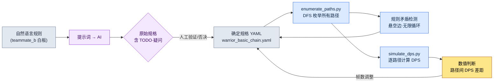

# 4.3 连招·取消·输入队列 —— 枚举路径并加以验证

战斗设计师组员 B 站在会议室白板前,用马克笔画着方框。基础1、基础2、基础3,还有向旁边岔出去的重击分支。当箭头增加到七条左右时,有人问道:"那么重击挑空之后用闪避取消,还能再回到基础1吗?"组员 B 停下了笔。白板上的图里并没有画出那条路径。是能画却没画,还是规则上根本不可能,他自己也无法当场回答。

这就是连招设计真正的难题。连招在脑海里看上去像"1-2-3 连起来再分支到重击"这样简单的一条主干。可一旦掺入取消和输入队列,主干就变成了图。在六个节点上只要再加几条取消边,实际能踩到的路径就会膨胀到几十条。人无法在脑海里把这几十条全部展开。于是,"这条路径太强了"这样的数值问题,往往要等它进了构建版本之后才被发现。

本章的目标只有一个:**建立一套不靠手画、而是自动枚举出全部连招路径,并对每条路径加以验证的工作流**。把用自然语言写下的规则转成规格,从规格中枚举路径,再把枚举出的路径送进模拟。在这个过程中,AI 能帮到哪一步、又会在哪里撒谎,我会原原本本地展示出来。

---

## 4.3.1 连招不是表格,而是图

把连招写成表格,会是这样:"基础1 之后是基础2,基础2 之后是基础3。"行与列一目了然。可这张表会撒谎。因为表格假定了一条直线。在真实战斗中,玩家会从基础2 岔向重击,把重击用闪避取消,闪避刚结束又按下基础1。这些分支和循环都藏在了表格的行与行之间。

所以连招真正的形态是**有向图**。动作是节点,连接是边。每条边上挂着输入窗口(何时接受输入)和输入键。节点上挂着持续帧数,部分节点上还挂着奖励条件(必须经过特定节点才会附加伤害倍率)。

把战士角色的一套基础连招画成图,如下所示。六个节点,含取消分支。

<svg viewBox="0 0 720 300" xmlns="http://www.w3.org/2000/svg" font-family="sans-serif" font-size="13">
  <defs>
    <marker id="arrow" markerWidth="10" markerHeight="10" refX="8" refY="3" orient="auto" markerUnits="strokeWidth">
      <path d="M0,0 L8,3 L0,6 Z" fill="#444"/>
    </marker>
  </defs>
  <!-- main chain -->
  <rect x="20" y="40" width="110" height="40" rx="6" fill="#e8f0fe" stroke="#3367d6"/>
  <text x="75" y="65" text-anchor="middle">基础1 (21f)</text>
  <rect x="200" y="40" width="110" height="40" rx="6" fill="#e8f0fe" stroke="#3367d6"/>
  <text x="255" y="65" text-anchor="middle">基础2 (24f)</text>
  <rect x="380" y="40" width="110" height="40" rx="6" fill="#e8f0fe" stroke="#3367d6"/>
  <text x="435" y="65" text-anchor="middle">基础3 (30f)</text>
  <rect x="560" y="40" width="140" height="40" rx="6" fill="#fce8e6" stroke="#c5221f"/>
  <text x="630" y="65" text-anchor="middle">终结技 ×1.5</text>
  <!-- branch -->
  <rect x="200" y="150" width="110" height="40" rx="6" fill="#fef7e0" stroke="#e8a000"/>
  <text x="255" y="175" text-anchor="middle">重击 (33f)</text>
  <rect x="380" y="150" width="110" height="40" rx="6" fill="#fef7e0" stroke="#e8a000"/>
  <text x="435" y="175" text-anchor="middle">挑空 (28f)</text>
  <rect x="200" y="240" width="110" height="40" rx="6" fill="#e6f4ea" stroke="#137333"/>
  <text x="255" y="265" text-anchor="middle">闪避 (18f)</text>
  <!-- edges main -->
  <line x1="130" y1="60" x2="200" y2="60" stroke="#444" marker-end="url(#arrow)"/>
  <text x="165" y="52" text-anchor="middle" font-size="11">10~21f</text>
  <line x1="310" y1="60" x2="380" y2="60" stroke="#444" marker-end="url(#arrow)"/>
  <text x="345" y="52" text-anchor="middle" font-size="11">12~24f</text>
  <line x1="490" y1="60" x2="560" y2="60" stroke="#444" marker-end="url(#arrow)"/>
  <text x="525" y="52" text-anchor="middle" font-size="11">14~30f</text>
  <!-- branch edges -->
  <line x1="255" y1="80" x2="255" y2="150" stroke="#444" marker-end="url(#arrow)"/>
  <text x="300" y="118" text-anchor="middle" font-size="11">重击 6~24f</text>
  <line x1="310" y1="170" x2="380" y2="170" stroke="#444" marker-end="url(#arrow)"/>
  <line x1="255" y1="190" x2="255" y2="240" stroke="#444" marker-end="url(#arrow)"/>
  <text x="300" y="218" text-anchor="middle" font-size="11">闪避取消</text>
  <!-- loop back -->
  <path d="M200,260 C90,260 75,140 75,80" fill="none" stroke="#137333" stroke-dasharray="5,4" marker-end="url(#arrow)"/>
  <text x="110" y="160" text-anchor="middle" font-size="11" fill="#137333">闪避后重新进入基础1</text>
</svg>

与白板有两处决定性的不同。第一,每条边上都标明了输入窗口的帧数范围。"重击 6\~24f"的意思是:从基础2 开始之后的第 6 帧到第 24 帧之间接受重击输入。第二,有一条用虚线画出的闪避→基础1 重新进入的边。这正是组员 B 在会议室里无法当场回答的那条路径。用图明确标出后,"有/没有"就一清二楚了。

这张图若由人手画,六个节点加七八条边。如果有二十个角色、每个角色又有三四套连招,图就会变成几百张。手是跟不过来的。所以要把图写成**文本规格**,再从中自动生成图示与验证。

---

## 4.3.2 规格供人阅读,也供机器解析

把上面的图转写成 YAML 规格。核心是节点(`nodes`)、边(`edges`)、奖励(`bonuses`)三个块。取消规则也视为边的一种 —— 因为打断后跳到另一个节点,归根结底也是一条边。

```yaml
# warrior_basic_chain.yaml
character: warrior
combo_id: basic_chain

nodes:
  - { id: basic_1,  name: 基础1,   duration_frames: 21 }
  - { id: basic_2,  name: 基础2,   duration_frames: 24 }
  - { id: basic_3,  name: 基础3,   duration_frames: 30 }
  - { id: heavy,    name: 重击,    duration_frames: 33 }
  - { id: launch,   name: 挑空,    duration_frames: 28 }
  - { id: dodge,    name: 闪避,    duration_frames: 18, cancels_recovery: true }

edges:
  - { from: basic_1, to: basic_2, input: light, window: [10, 21] }
  - { from: basic_2, to: basic_3, input: light, window: [12, 24] }
  - { from: basic_2, to: heavy,   input: heavy, window: [6, 24] }
  - { from: heavy,   to: launch,  input: heavy, window: [10, 33] }
  - { from: heavy,   to: dodge,   input: dodge, window: [0, 33], type: cancel }
  - { from: basic_3, to: dodge,   input: dodge, window: [0, 30], type: cancel }
  - { from: dodge,   to: basic_1, input: light, window: [8, 18] }   # 重新进入

bonuses:
  - { on: basic_3, requires_path: [basic_1, basic_2], damage_multiplier: 1.5 }
```

这份规格同时满足两类读者。人读到 `window: [6, 24]`,会明白"重击是从基础2 中段开始接受的";机器解析同一行,用于生成图示和枚举路径。一个来源同时产出人的理解和机器的验证。

上面的帧数(`21`、`24`、`[6, 24]`)不是实测值,而是为了本章说明、由作者构造的示例值(未经验证)。在真实项目中,这些值来自动画师制作的蒙太奇(montage)长度和构建版本里的通知(notify)时机。第一次写规格时填入设计师的意图值,等构建版本出来后再捕获、用实测值加以校正 —— 这条校正循环在 4.4 中讲解。

---

## 4.3.3 实操记录(worked transcript)—— 从自然语言到规格

把组员 B 画在白板上的规则用自然语言交出去,让 AI 转成规格 YAML。这里不做概括,而是把提示词全文、Claude 的原始输出、人的验证/否决都原样照搬。"实操记录"指的是完整保留的真实操作过程记录。

### 提示词(全文)

```
下面是战士角色的连招规则。把它转成连招规格 YAML。

规则:
- 基础攻击连成 1、2、3 三段。用轻攻击键。
- 在基础2 进行途中按下重击键,可以岔向重击。
- 重击之后再按一次重击,会把敌人挑空(挑空)。
- 重击随时可以用闪避取消。
- 基础3 也可以用闪避取消。
- 闪避刚结束后,可以用轻攻击重新开始基础1。
- 基础3 只有在基础1 和基础2 都经过之后,伤害才是 1.5 倍。

规格格式:
- nodes(id, name, duration_frames)、edges(from, to, input, window, type)、
  bonuses(on, requires_path, damage_multiplier)
- 取消边用 type: cancel 标记。
- 帧数值,我没给的你不要自己定,留成 TODO 空着。
```

最后一行是关键。明确要求:没给的帧数不准编造。这是在提示词层面强制执行 v3 标准第 3 条(数值要诚实)。

### Claude 原始输出(未经编辑)

````
已转换为规格。帧数值未提供,故留为 TODO。

```yaml
character: warrior
combo_id: basic_chain
nodes:
  - { id: basic_1, name: 基础1, duration_frames: TODO }
  - { id: basic_2, name: 基础2, duration_frames: TODO }
  - { id: basic_3, name: 基础3, duration_frames: TODO }
  - { id: heavy,   name: 重击, duration_frames: TODO }
  - { id: launch,  name: 挑空, duration_frames: TODO }
  - { id: dodge,   name: 闪避,   duration_frames: TODO }
edges:
  - { from: basic_1, to: basic_2, input: light, window: TODO }
  - { from: basic_2, to: basic_3, input: light, window: TODO }
  - { from: basic_2, to: heavy,   input: heavy, window: TODO }
  - { from: heavy,   to: launch,  input: heavy, window: TODO }
  - { from: heavy,   to: dodge,   input: dodge, window: TODO, type: cancel }
  - { from: basic_3, to: dodge,   input: dodge, window: TODO, type: cancel }
  - { from: dodge,   to: basic_1, input: light, window: TODO }
bonuses:
  - { on: basic_3, requires_path: [basic_1, basic_2], damage_multiplier: 1.5 }
```

需要确认的地方:
1. "闪避刚结束后重新开始基础1"我放进了 dodge -> basic_1 这条边,但
   这究竟是在闪避的后摇期间接受输入,还是在闪避完全结束之后,并不明确。
2. 规则里没有提到挑空(launch)之后是否衔接空中连招。
   需要确认挑空是否就是连招的终点。
3. 闪避到底放成节点,还是只放成边(取消动作),这点模糊。暂且放成了节点
   —— 我判断闪避本身是一个具有持续时间的动作。
````

在这里做评估。优点:没有编造帧数,全部留成了 TODO。遵守了提示词的约束。而且末尾仅有的三个问题,都是真正模糊的地方 —— 尤其是第 1 个(重新进入的输入时机)正是组员 B 在会议室里没能当场回答的那个漏洞。AI 比人更早找到了漏洞。

模糊之处:第 3 个里把闪避放成节点,这是见仁见智的判断。闪避既是"取消动作",同时又是"具有持续时间的动作",两边都说得通。AI 选了一边,又如实报告说它模糊,这是诚实的;但这属于设计决策,得由人来定。

### 人的验证/否决

回答三个问题,并否决其中一部分。

- **第 1 个(重新进入时机):** 在闪避后摇期间(8\~18f)接受输入。不是看完整段闪避之后,而是用后摇取消重新进入基础1。→ 采纳,`window: [8, 18]`。
- **第 2 个(挑空之后):** 在本章范围内,把挑空当作连招终点。空中连招另作一套分离出去。→ 采纳 AI 的判断。
- **第 3 个(闪避=节点):** 放成节点。但追加 `cancels_recovery: true` 属性,以明示它是"打断后摇的动作"。→ 部分采纳 + 追加属性。

另有一处要**否决**。AI 没有给 `dodge → basic_1` 边加 `type: cancel`,而这条边是打断闪避的后摇再进入的,具备取消性质,这点没错。但这里把它视为"闪避后的正常进入",当作普通边处理 —— 因为对这个角色而言,后摇取消与正常衔接在游戏手感上没有差别。这是人凭借领域判断覆盖 AI 分类的一个例子。

### 再次请求

```
好。把下面这些反映进去,重新给出最终规格:
- 给 dodge 追加 cancels_recovery: true。
- dodge -> basic_1 边的 window 取 [8, 18]。
- 其余帧数我还是没给,保持 TODO。不过上面那张图的示例值
  (basic_1=21、basic_2=24、basic_3=30、heavy=33、launch=28、dodge=18)
  我会用,所以就用这些值填进去。要用注释标明这是未经验证的示例值。
```

这次再请求得出的结果,就是 4.3.2 的那份 YAML。它不是一次成形的。提示词 → 原始输出 → 验证/否决 → 再请求。正是这个循环造就了规格的可信度。AI 标出模糊之处,人凭领域知识来决断 —— 只靠其中一方都行不通。

---

## 4.3.4 自动枚举路径

既然规格是图,那么连招路径的枚举就变成了**图搜索**问题。从起点节点出发,寻找通往终点节点(或终结技)的所有路径,采用深度优先搜索(DFS)。人在脑海里做不到,而代码瞬间就能完成。

作者团队的隔离工作区 `95_BattleTF` 里有一个负责这项枚举的小脚本。它读取规格 YAML,抽出所有路径,并验证每条路径在规则上是否成立(边是否存在)。只看核心逻辑的话,如下所示。

```python
# 95_BattleTF/enumerate_paths.py (节选)
import yaml

def load_graph(path):
    spec = yaml.safe_load(open(path, encoding="utf-8"))
    adj = {}
    for e in spec["edges"]:
        adj.setdefault(e["from"], []).append(e)
    return spec, adj

def enumerate_paths(adj, start, max_depth=8):
    results = []
    def dfs(node, path, edges):
        # 终点节点(无出边)或达到深度上限则确定路径
        outs = adj.get(node, [])
        if not outs or len(path) >= max_depth:
            results.append((list(path), list(edges)))
            return
        for e in outs:
            if e["to"] in path:        # 防止循环:一条路径中同一节点只走 1 次
                results.append((list(path), list(edges)))
                continue
            dfs(e["to"], path + [e["to"]], edges + [e])
    dfs(start, [start], [])
    return results
```

从 `basic_1` 开始跑,会涌出一大批用手绝对展不全的路径。只看其中一部分,如下所示。

| # | 路径 | 备注 |
|---|---|---|
| 1 | 基础1 → 基础2 → 基础3 | 标准三段,满足终结技奖励 |
| 2 | 基础1 → 基础2 → 重击 → 挑空 | 分支连招 |
| 3 | 基础1 → 基础2 → 重击 → 闪避 → 基础1 → … | 循环进入 |
| 4 | 基础1 → 基础2 → 基础3 → 闪避 → 基础1 → … | 终结技后重置 |

第 3 和第 4 很重要。由于有闪避重新进入的边,连招发生了**循环**。人在白板上没看到的,正是这种循环路径。如果不在 DFS 里加上防循环(同一节点一条路径只走 1 次)的护栏,枚举就会陷入无限循环 —— 这是第一次跑代码时真的卡了一下才发现的陷阱。只要图里存在循环,枚举器就一定需要护栏。

枚举阶段的产物有两类。第一,规则上成立的所有路径列表。第二,**规则矛盾检测** —— 如果规格里有 `dodge → basic_1` 这条边,而 `dodge` 节点的定义却缺失,枚举器就会把它揪出来,标为"指向未定义节点的边"。手写规格时最常犯的错误,就是这种悬空(dangling)引用。

---

## 4.3.5 把枚举出的路径送进模拟

光有路径列表,还不知道"哪条路径太强"。得把每条路径放进 DPS 模拟器。作者团队的 `simulate_dps` 担当这个角色 —— 它接收路径(节点序列)、每个节点的伤害与帧数、奖励规则,计算总伤害和总耗费帧数,再算出每秒伤害(DPS)。

```python
# 95_BattleTF/simulate_dps.py (节选,假定 60fps)
def simulate(path_nodes, node_dmg, node_frames, bonuses):
    total_dmg = 0
    total_frames = 0
    visited = []
    for nid in path_nodes:
        dmg = node_dmg.get(nid, 0)
        # 奖励:若 requires_path 全部经过,则套用倍率
        for b in bonuses:
            if b["on"] == nid and all(r in visited for r in b["requires_path"]):
                dmg *= b["damage_multiplier"]
        total_dmg += dmg
        total_frames += node_frames[nid]
        visited.append(nid)
    seconds = total_frames / 60.0
    return {"dmg": total_dmg, "frames": total_frames,
            "dps": round(total_dmg / seconds, 1) if seconds else 0}
```

把 4.3.4 的枚举结果整批灌进来,每条路径的 DPS 就会落成一张表。下面是把节点伤害用示例值(基础打击 100、重击 180、挑空 140 —— 均为未经验证的加工值)填入后跑出的结果。

| 路径 | 总伤害 | 总帧数 | DPS |
|---|---|---|---|
| 基础1→基础2→基础3 (终结技 ×1.5) | 100+100+150 = 350 | 75 | 280.0 |
| 基础1→基础2→重击→挑空 | 100+100+180+140 = 520 | 106 | 294.3 |
| 基础1→基础2→基础3→闪避→基础1 | 350+0+100 = 450 | 144 | 187.5 |

这张表改变了讨论。"重击分支看上去比标准三段更强?"这样的直觉,变成了"重击路径 DPS 294 对标准 280,领先 5%"这样的数字。如果这 5% 的领先是有意为之,就通过;否则就拉长重击帧数,把 DPS 压下去。在构建版本出来**之前**,就在规格阶段做出这个判断。

把整条工作流压成一张图,如下所示。



规格(D)处在中心,枚举(E)·验证(F)·模拟(G)从那里岔出。一旦检出矛盾或数值失衡,就回到规格去修。白板上没有这条循环 —— 所以白板上的连招,要等进了构建版本之后才知道它错了。

---

## 4.3.6 取消与输入队列 —— 拉长和收窄路径的两个旋钮

到目前为止,我们看了连招图和路径枚举。取消和输入队列,是调节这张图的两个旋钮,方向恰好相反。

**取消会拉长边。** 每追加一条取消规则,图上就多一条边,枚举出的路径数会以乘法暴增。所以取消并不是"越宽松越好"。把取消放得越开,路径就越爆炸,其中混入非预期的强力路径(就像上一节那种循环路径)的概率也随之上升。格斗游戏传统上把取消管得很严,动作 RPG 则放得很宽,原因正在这里 —— 是类型(genre)决定了"允许多少条路径"。并不存在绝对正确的窗口值。

处理取消时,务必分门别类地标明。如果笼统地放成"什么都能取消",枚举器就会在所有节点之间造出取消边,路径将失控膨胀。

| 取消类型 | 规格表示 | 对路径的影响 |
|---|---|---|
| 动作取消 | 特定节点 → 特定节点,type: cancel | 仅追加选择性分支 |
| 闪避取消 | 多个节点 → dodge,window: [0, dur] | 几乎在所有节点都有逃生口 |
| 防御取消 | 多个节点 → guard | 进入防御,通常限于后摇 |
| 不可取消 | 没有出向的 cancel 边 | 发动后一直到底(霸体) |

**输入队列不是收窄路径,而是让路径真的踩得到。** 没有队列时,玩家必须以帧为单位精准对上每条边的输入窗口(例如 `[12, 24]`)。靠人的反应几乎不可能。队列会把在窗口之前按下的输入存进缓冲区,等窗口打开的那一刻自动发动。也就是说,队列不改变图的路径,而是给图上行走的人穿上鞋,让人能在图上走起来。

```yaml
input_queue:
  window_start_ratio: 0.5   # 从动作进度 50% 起缓冲下一个输入
  expire_frames: 10         # 缓冲输入的有效期
  priority: latest          # 同时多重输入时以最后一个为优先
```

三个参数之间的平衡是关键。`window_start_ratio` 太小,连动作前段的输入都会被缓冲,蹦出非预期的后续动作。`expire_frames` 太短,队列就失去意义,又要回头去要求精准;太长,则很久以前按下的输入会姗姗发动,引发"怎么突然动了"的事故。推荐的起始值是 `expire_frames` 5\~15、`window_start_ratio` 0.5 上下 —— 不过这只是要随类型和角色分量去调整的起跑线,而非标准答案。

运营上还有一点。不要把输入队列参数给每个角色都设得各不相同。设一个全局默认值,只对分量特别不同的角色(如巨型 Boss 型等)做 override。如果对二十个角色的队列值各管各的,就分不清哪个是有意的差异、哪个是失误。

最后还有一点要点明。到目前为止,我们只把边当作"有/没有"来处理,但即便边存在,**在那个节点上究竟如何切换到下一个节点**,又是另一个决策。连招之间的连接方式有三个核心分支,虽然超出本书的深度、不用代码展开,但若不提及,规格就只画了一半。

- **取消通知(cancel notify):** 从哪个时点起打断当前动画、接受下一个输入。上面那条边的窗口(`window: [10, 21]`)正是这个通知的表现。把通知提前,连招就变快(在这一击结束之前就接下一击);推后,则每一击都更有分量。也就是说,窗口的起始值不是单纯的数字,而是"这一击要完整展示出来,还是快速切到下一招"这样的手感决策。
- **动画混合(anim blending):** 让两个节点之间平滑过渡。从重击的收招姿势到挑空的起手姿势,在几帧之内做插值。连接顺滑自然,但混合区间里容易出现打击判定的空档,"打断的爽快感"也随之消失。
- **跳帧(frame skip):** 不做混合,跳过当前动画剩余的帧,直接开始下一个节点。连接干脆利落、反应迅速,但姿势可能显得一卡一卡。格斗·动作游戏的"取消感"大多偏这一类。

这三者面对同一条边,却能把游戏手感做成截然相反。在规格阶段只定边的存在与窗口,连接方式(混合 vs 跳帧)通常留到构建版本时,与动画师一起定。不过若在规格里预先留一行 `transition: blend` / `transition: skip` 这样的字段,就能在构建阶段省去再问一遍"这条边当初是定的怎么切来着"。连接方式是连招图里那条隐藏的第三根轴。

---

## 4.3.7 构建版本验证是另一回事(4.4 预告)

到这里为止的所有验证,都发生在**规格之上**。路径枚举、DPS 模拟、矛盾检测,统统以 YAML 为对象。可规格里的帧数值是设计师的意图值,不是构建版本的实测值。动画师做出的蒙太奇的实际长度、构建版本里通知实际触发的帧、输入队列在引擎里实际生效的窗口 —— 这些得捕获构建版本来测量。

要从构建版本的视频里自动抽取 5 个信号(打击发生帧、后摇、取消窗口、输入队列、顿帧)实现难度很高,现实中最可信的是游戏内遥测(telemetry)—— 让构建版本内部打出"这个动作在这一帧接受了这个输入"这样的日志,再把日志与规格对照(捕获方法的比较参见 4.4)。这条对照循环就是 4.4 的主题。如果规格上是 `[12, 24]` 的窗口,在构建版本里被测成 `[14, 26]`,那就是用构建实测来校正规格。

---

## 4.3.8 常见错误与回避法

| 错误 | 为何危险 | 回避法 |
|---|---|---|
| 把连招写成直线表格 | 分支·循环藏在行间被遗漏 | 用图(节点+边)做规格,不手画 |
| 把取消笼统成"什么都行" | 枚举路径暴增,混入强力路径 | 分别明示动作·闪避·防御取消 |
| 枚举器没有防循环护栏 | 闪避重新进入处陷入无限循环 | 每条路径同一节点只走 1 次的护栏 |
| 误把规格帧数当实测 | 意图值与构建值不一致 | 标注意图值,用构建捕获校正(4.4) |
| 把输入队列按角色各管各的 | 无法区分有意的差异/失误 | 全局默认 + 仅对部分做 override |
| 原样相信 AI 填的帧数 | 编造的数值被写入规格 | 用"没给的值留 TODO"提示词强制 |

---

### 本章要点
- 连招不是直线而是图,所以路径要由代码而非由人来枚举。
- 取消是拉长路径的旋钮,输入队列是让人能在路径上走的鞋。
- 同一条边,连接方式(取消通知·动画混合·跳帧)也会把手感做成截然相反。
- 规格之上的验证与构建之上的验证是两回事,后者用遥测更现实。

---

## 动手试试 —— 连招路径枚举迷你流水线

这是一套能动手跟着跑的最小步骤。只要有 Python 和 `pyyaml` 就够了。

**setup.** 建一个工作文件夹,在里面放规格文件和两个脚本。

```
combo-mini/
  warrior_basic_chain.yaml   # 4.3.2 的规格
  enumerate_paths.py         # 4.3.4 的 DFS 枚举器
  simulate_dps.py            # 4.3.5 的模拟器
```

执行 `pip install pyyaml` 后,把 4.3.2 的 YAML 原样粘进规格文件。

**prompt.** 把自然语言规则转成规格这一步交给 AI。原样使用 4.3.3 的提示词,但务必包含最后那条约束。

```
帧数值,我没给的你不要自己定,留成 TODO 空着。
取消边用 type: cancel 标记,模糊的部分单独提成问题。
```

这两行能阻止 AI 编造数值和擅自判断。在得出的规格里,由人来填 TODO 和问题清单。

**verify.** 规格完成后,做两次验证。

```bash
python enumerate_paths.py warrior_basic_chain.yaml   # 所有路径 + 矛盾输出
python simulate_dps.py    warrior_basic_chain.yaml   # 逐路径 DPS 表
```

在枚举输出里确认:(1) 循环路径是否没有无限增长,(2) 是否没有指向未定义节点的悬空边。在 DPS 输出里看路径间的差距是否在意图范围之内。差距大就改规格里的帧数/伤害,再跑一遍。

### 单人精简版

如果没时间另外造工具,就把规格编写和路径枚举放进一次 AI 对话里收尾。给出自然语言规则,并装进一条提示词:"转成连招规格 YAML 之后,从起点节点起,把所有可能路径用深度优先全部列出,循环只走一次就掐断。如果有指向未定义节点的边,就标出来。"AI 会把规格化、枚举、矛盾检测一次性做完。DPS 模拟则把节点伤害以表格一并给出,用"计算每条路径的总伤害与帧数,做成表给我"这样的后续请求来收。精度会差一些,但比白板看得远多了。核心始终不变 —— 连招别在脑海里展开,让它枚举出来看。
