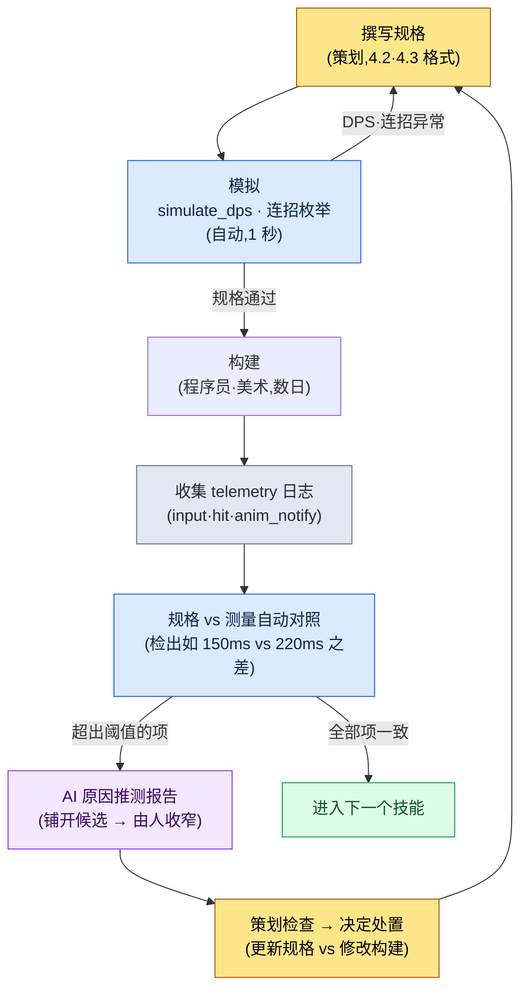

# 4.4 AI 辅助战斗模拟与验证

战斗 TF 的构建 #234 刚刚提交。这是第一次接触新技能 `skill_thunder` 的构建。规格书上写着命中时机为 150ms。我输入指令。指尖的感觉告诉我:慢了,分明慢了。我叫来邻座的团队成员 A:「这个是不是有点延迟?」成员 A 试着打了两下:「嗯……好像确实有点。」两个人都没把握。规格说是 150,可手感却咬定是 200 左右。谁对?指尖与纸面的较量。下一个构建里,又会有人说「体感上还行吧」,而就因为这一句话,又一个构建悄悄流过去了。

本章的目标就是终结这场较量。如果指尖说是 200,那就用数字证明它到底是不是真的 200。而且,要在构建提交*之前*,光看规格就能预先知道「这个技能的 DPS 比目标高出 30%」。在带领 200 人投入的 3A 级 MMORPG、从早期就开始打磨战斗的那段日子里,感觉与数字相左时的那份无措感也是一模一样的。改变的只有一点:如今手里有了能用数字给这种偏差收尾的工具。

如果说 4.2、4.3 讲的是如何*书写*战斗的规格,那么 4.4 讲的就是这份规格是否*按意图运作*。验证有两条轴线。一条是不依赖构建、仅靠计算来验证的模拟,另一条是从实际构建的录像中提取测量值的捕获分析。当两条轴线扣成一个循环,战斗策划的迭代次数就会从以天计缩短到以小时计。

先把结论说在前面:本章的核心,就是*把规格书上写的数字(150ms)和构建中测得的数字(220ms)并排放在一起,读出两者的差异*(4.4.5)。前面几节(模拟器、连招枚举)可以读作让这种对照成为可能的准备步骤。

---

## 4.4.1 等待构建的代价

战斗策划要验证一个新技能,会发生什么事?

策划写规格。程序员录入数据,美术接上动作与特效,构建跑一遍,QA 过一轮,这才轮到策划亲手上手试。快则两天,通常三四天。如果在循环*末尾*才发现「DPS 太高了」,这个发现就成了一道「回到起点重来」的命令。三四天再来一次。

模拟就是在这个循环的*第一步*给出答案的工具。仅凭规格就算一遍。答案不好就改规格,再算一遍。在进入「构建」这个昂贵的阶段之前,规格本身先被过滤一次。这就像先把模型车放进风洞里试一试。在把真车开上道路之前,可疑的设计在桌面上就被淘汰了。

当然,风洞并不能 100% 预测道路。所以才需要第二条轴线——捕获分析。如果说模拟给出的是*理想的答案*,那么捕获给出的就是*构建里实际发生的答案*。把两者并排放在一起、读出差异——这就是本章的全部。

---

## 4.4.2 simulate_dps —— 可执行的模拟器

抽象的伪代码什么也验证不了。所以从一开始就写*能跑*的代码。下面是笔者在战斗 TF 中所用 `simulate_dps.py` 的核心骨架,为了载入本书而剥离了公司数据并加以重构。它不依赖任何外部库,仅靠 Python 标准库即可运行(完整文件参见「动手试试」)。

输入很简单。一个技能是带有 `damage`、`cast_sec`(施法占用时间)、`cooldown_sec`、`resource_cost` 的 dataclass;一个角色则是带有资源总量、每秒恢复量、技能列表、优先级循环序列的 dataclass。运行在其上的主体,只有一条简单的贪心(greedy)规则:「在每一刻可用的技能中,选优先级最高的那个来释放」。它既不比真实玩家聪明,也不比真实玩家笨,目的只是抓住一个*理想上限*。只摘出充当脊柱的那部分,就是这样:

```python
# 以 0.05 秒为一个 tick 构建时间轴。若不在施法中,则按优先级顺序选取第一个可用技能释放。
while t < duration_sec:
    resource = min(char.max_resource, resource + char.resource_regen * tick)
    for name in cooldowns:
        cooldowns[name] = max(0.0, cooldowns[name] - tick)
    if t >= busy_until:                     # 施法动作未结束则等待
        for name in char.rotation:          # 按优先级顺序
            s = skill_by_name[name]
            if cooldowns[name] <= 0 and resource >= s.resource_cost:
                total_damage += s.damage
                resource -= s.resource_cost
                cooldowns[name] = s.cooldown_sec
                busy_until = t + s.cast_sec  # 在此时刻之前无法使用下一个技能
                break
    t += tick
# …(dataclass 定义、warrior 输入、输出循环参见「动手试试」的完整代码)
```

把 `skill_thunder`(伤害 420、施法 0.9s、冷却 6s)设为 warrior 的第一优先级,`skill_dash`、`basic_1` 排在其后,跑 20 秒的结果(`python simulate_dps.py`):

```
平均 DPS: 261.0
  t=  0.0s  skill_thunder  资源=60
  t=  0.9s  skill_dash     资源=47
  t=  1.3s  basic_1        资源=50
  t=  1.6s  basic_1        资源=53
  t=  1.9s  basic_1        资源=55
  ...
```

这个值有什么意义?意义在于,*不依赖构建*、在 1 秒之内,就知道了 warrior 的理想 DPS 上限约为 261 这一事实。如果目标 DPS 是 180,那么这份规格就高出了 +45%,过头了。无需等待构建,现在就可以去调 `damage` 或 `cooldown_sec`。

局限也要诚实地写明。这个模拟器不反映玩家的输入失误、因移动与闪避产生的空档、敌人的干扰。所以测量值总是比实际构建偏高。这不是 bug,而是「上限线」这一模拟器定义本身。与实测之间的差距,在 4.4.5 中用捕获来补上。

> **AI 运用笔记。** 上面的骨架是笔者亲手写的,但要接入新的资源模型(例如怒气槽在受到伤害时累积的结构)时,要像「请给这个 simulate_dps 加一条受击时怒气 +5 的规则。在 tick 循环内,作为独立于现有资源恢复的变量」这样*引用现有代码*来提出请求。如果让它从白纸生成整个模拟器,只会得到无法验证的代码。脊柱由人来定,AI 来添枝。

---

## 4.4.3 连招路径的自动枚举

仅凭 DPS 一个数字还不够。要验证「哪条连招是设计意图中的主连招」,就得*把所有可能的路径*展开来看。用手画树,到了七八个节点脑子就已经爆了。把路径不重不漏地展开,这件事机器压倒性地比人做得好——只是,得让它以人能够回溯检查的形式来产出。

下面是一段接收连招图、枚举所有路径并按 DPS 排序的代码。`combo_graph` 用邻接表记录「某个动作之后可以取消接入哪个动作」,它直接从 4.3 的状态机规格中提取而来。核心是递归展开直到死路尽头的 `all_paths` 生成器。

```python
# enumerate_combos.py —— 展开连招图的所有路径并按 DPS 排序
combo_graph = {"start": ["A"], "A": ["B", "D"], "B": ["C", "E"], "D": ["C"], "C": [], "E": []}
action_stats = {  # (伤害, 耗时秒)
    "A": (300, 0.8), "B": (450, 1.0), "C": (450, 1.2), "D": (600, 1.4), "E": (200, 0.6),
}

def all_paths(node="start", path=None):
    path = (path or [])
    nexts = combo_graph.get(node, [])
    if not nexts:                       # 死路尽头 = 完成的连招
        yield [n for n in path if n in action_stats]
        return
    for nxt in nexts:
        yield from all_paths(nxt, path + [nxt])

results = []
for p in all_paths():
    dmg = sum(action_stats[a][0] for a in p)
    dur = sum(action_stats[a][1] for a in p)
    results.append((p, dmg, round(dur, 1), round(dmg / dur, 1)))

for p, dmg, dur, dps in sorted(results, key=lambda r: -r[3]):
    print(f"{' → '.join(p):<18} {dmg:>5} dmg  {dur:>4}s  DPS {dps}")
```

执行结果:

```
A → D → C            1350    3.4s  DPS 397.1
A → B → C            1200    3.0s  DPS 400.0
A → B → E             950    2.4s  DPS 395.8
```

这里策划该读出的信号不是简单的第一名。三条路径的 DPS 在 396\~400 之间几乎贴在一起——这是一个信号:「无论用哪条连招效率都差不多,所以*主连招没有自己的身份*」。如果意图是「A→D→C 应当是高风险高回报的主连招」,那就该提升 D 的伤害或缩短其耗时,把 DPS 拉高一档。该回到规格了。

在这种自动枚举替代手算的地方,即使连招节点增加到 20 个,人也只需读那张排好序的表。

---

## 4.4.4 构建捕获分析 —— 现实的方法是 telemetry

现在轮到第二条轴线。这是测量构建中实际发生了什么的阶段。人们常会联想到「AI 看构建录像自动分析」,但这里要诚实地划分支路。获取测量值的路径有三条,而三者的成本与精度差别很大。

<svg viewBox="0 0 720 250" xmlns="http://www.w3.org/2000/svg" font-family="sans-serif" font-size="13">
  <rect x="10" y="20" width="220" height="200" rx="8" fill="#fde8e8" stroke="#c0392b" stroke-width="1.5"/>
  <text x="120" y="45" text-anchor="middle" font-weight="bold" fill="#c0392b">A. 录像直接分析</text>
  <text x="120" y="72" text-anchor="middle">从屏幕像素中</text>
  <text x="120" y="92" text-anchor="middle">提取输入·动作·VFX</text>
  <text x="120" y="124" text-anchor="middle" font-weight="bold">精度:低~中</text>
  <text x="120" y="148" text-anchor="middle">实现难度:非常高</text>
  <text x="120" y="172" text-anchor="middle">帧误差 ±1~2</text>
  <text x="120" y="200" text-anchor="middle" fill="#777">研究·演示用</text>

  <rect x="250" y="20" width="220" height="200" rx="8" fill="#fef5e7" stroke="#d68910" stroke-width="1.5"/>
  <text x="360" y="45" text-anchor="middle" font-weight="bold" fill="#d68910">B. 现成视觉 API</text>
  <text x="360" y="72" text-anchor="middle">向外部 vision 服务</text>
  <text x="360" y="92" text-anchor="middle">发送捕获帧</text>
  <text x="360" y="124" text-anchor="middle" font-weight="bold">精度:中</text>
  <text x="360" y="148" text-anchor="middle">实现难度:中</text>
  <text x="360" y="172" text-anchor="middle">IP 泄露风险</text>
  <text x="360" y="200" text-anchor="middle" fill="#777">需检查公司内部政策</text>

  <rect x="490" y="20" width="220" height="200" rx="8" fill="#e8f6ef" stroke="#1e8449" stroke-width="1.5"/>
  <text x="600" y="45" text-anchor="middle" font-weight="bold" fill="#1e8449">C. 游戏内 telemetry</text>
  <text x="600" y="72" text-anchor="middle">引擎将事件</text>
  <text x="600" y="92" text-anchor="middle">连同时间戳一起记录</text>
  <text x="600" y="124" text-anchor="middle" font-weight="bold">精度:高</text>
  <text x="600" y="148" text-anchor="middle">实现难度:低~中</text>
  <text x="600" y="172" text-anchor="middle">直接使用引擎时刻</text>
  <text x="600" y="200" text-anchor="middle" fill="#1e8449" font-weight="bold">现实的选择</text>
</svg>

A 方案(录像像素分析)听起来很有吸引力。从屏幕上自动提取输入显示、角色动作变化、特效首帧、声音波形、伤害数字 UI——这五个信号,这是它描绘的图景。但实际做出来就会发现,由于帧压缩噪点、UI 遮挡、动态模糊,±1\~2 帧的误差是常态。在 60fps 下 1 帧约为 16.7ms。在以 ms 为单位计较命中时机的验证里,±33ms 的噪点是致命的。*实现难度非常高,而精度配不上这份努力。*

所以现实的答案是 C 方案,即**游戏内 telemetry 日志**。引擎其实早已*在内部精确知晓*输入时刻、动画通知(notify)的发生时刻、VFX 生成时刻、伤害应用时刻。与其从像素中推断这些时刻,不如让它用一行日志记下来即可。与其从像素中*还原*出 100ms,不如*原样接收并记下*引擎已知的那 100ms。

```cpp
// 在战斗动作处理代码中加一行(UE C++ 伪示例)
// 在输入接收 / 伤害应用时点调用同一个 logger
CombatTelemetry::Log("input",  SkillName, GetWorld()->GetTimeSeconds());
CombatTelemetry::Log("hit",    SkillName, GetWorld()->GetTimeSeconds());
```

logger 以 JSON Lines 格式逐行输出。

```
{"event":"input","skill":"skill_thunder","t":12.340}
{"event":"hit",  "skill":"skill_thunder","t":12.560}
{"event":"input","skill":"basic_3","t":14.100}
{"event":"hit",  "skill":"basic_3","t":14.166}
```

`input` 与 `hit` 的时刻差,就是测得的命中时机。12.560 − 12.340 = 0.220 秒 = **220ms**。这不是像素分析的 ±33ms,而是引擎时刻原样的值。把这份日志取出来与规格对照,就是下一节的内容。

---

## 4.4.5 实操记录:规格 150ms vs 测量 220ms

现在把两条轴线汇到一处。规格承诺了 150ms,telemetry 测得了 220ms。+70ms。指尖是对的。把缩小这一差距*成因*的过程,与 AI 一起从头跟到尾。不做概括,连 AI 一开始踩空、判断失误的场面也原样载入。

### 提示词

规格说命中时机是 150ms,但测量是 220ms。贴上下面的日志,以人实际会打字的长度来提问。比起冗长的客套,意图明确的简短请求更好——让它连验证方法都写出来的那一行,加上禁止武断的那一行,就是这段提示词的脊柱。

> skill_thunder 的命中时机规格为 150ms,但测量为 220ms,超出 +70ms。请用下面的 telemetry 划分可能的原因,*并写明各自用哪条日志来确定/排除*。不要武断,不确定就标「未确认」。  // 「连验证方法都写出来」「禁止武断」这两点是核心意图。其余客套省略也不影响结果。
>
> ```
> {"event":"input","skill":"skill_thunder","t":12.340}
> {"event":"anim_start","skill":"skill_thunder","clip":"cast_thunder","t":12.340}
> {"event":"anim_notify","skill":"skill_thunder","notify":"HitWindow","t":12.560}
> {"event":"hit","skill":"skill_thunder","t":12.560}
> ```
> 按规格,cast_thunder 的 HitWindow 通知应在 0.150s 位置。

### Claude 原始输出(第一次 —— 验证前,含踩空)

> 对于 +70ms 超出,我推测以下四种原因。
>
> 1. **网络延迟。** 输入往返服务器时可能多出了 70ms。如果是多人构建,请确认 RTT。
> 2. **帧率下降。** 如果构建以 30fps 运行,1 帧为 33ms,通知时机会被四舍五入到帧边界,延迟随之累积。
> 3. **施法动作时长变更。** cast_thunder 片段可能比规格变长,导致 HitWindow 通知被往后推。
> 4. **输入缓冲延迟。** 输入队列可能晚一个 tick 才被处理。
>
> 可能性最高的原因是**第 1 项网络延迟**。70ms 是典型的 RTT 范围。

### 人工验证与驳回

在这里停下,重新看日志。AI 的第一推测(网络)*在这份日志里已被排除*。`input` 与 `anim_start` 恰好打在同一时刻 12.340。这意味着输入进来的瞬间动作立即开始,没有网络往返插足的余地。第 1 项错了。

第 2 项(帧率)也站不住脚。若是 30fps,本该看到 33ms 单位的参差不齐,可 input→hit 恰好是干净的 0.220。这不是帧边界四舍五入,而是*片段内固定位置*的气味。

决定性的线索另有所在。`anim_notify` 的时刻在 `anim_start` 基准上 +0.220。规格说 HitWindow 应在片段开始后 0.150,而实际片段里却固定在 0.220 位置。也就是说,*要么片段本身就被做得与规格不同,要么通知位置从 0.150 被挪到了 0.220*。原因既不是网络也不是帧率,而是**第 3 项,动作/通知数据**。AI 把正确答案的候选包括进了四项之内,但把名次排反了。

### 再次请求的提示词

把排除依据由人手填好后再扔回去。无需长篇解释,只把排除掉的和剩下的事实简短地钉死。

> 排除网络、帧率。(依据:input=anim_start 时刻相同,故输入→动作无延迟 / input→hit 为 0.220,无帧噪点且稳定。)剩下的事实:anim_notify 在 anim_start +0.220,规格为 +0.150。仅凭这一事实缩小原因,并以*行动为单位*写明该向程序员、动画师请求什么。  // 核心是「以行动为单位」——不是推测,而是以「向谁请求什么」收尾。

### Claude 原始输出(第二次)

> 根据所给依据,原因可缩小为**动画片段 cast_thunder 的 HitWindow 通知被放在了 0.220s 而非 0.150s**。剩下两条分支。
>
> - **(甲)通知对准 0.150,但整个片段变慢了** —— 如果播放速度(play rate)低于规格或片段时长变长,那么 0.150 位置就会被拉伸到实时的 0.220。
> - **(乙)通知位置本身被挪到了 0.220** —— 片段时长不变,只是标记移动了。
>
> 区分两条分支的确认方法:
> 1. **向动画师**:请求 cast_thunder 的 HitWindow 通知帧号、片段总帧数,以及与规格撰写时点数值相比的变更记录。如果标记被挪动,则为(乙)。
> 2. **向程序员**:确认 skill_thunder 的 montage play rate 是否为 1.0,角色攻击速度属性是否会乘到这个片段上。如果 play rate 为 0.68(=0.150/0.220),则为(甲)。
> 3. 在其他角色攻击速度下再测一次 anim_start→anim_notify 的间隔。若间隔随攻击速度变化则为(甲),不变则为(乙)。
>
> 建议处置:若确认为(乙),把通知改回 0.150,或把规格更新为 0.220(取意图所在的一边)。若确认为(甲),检查 play rate 应用逻辑。

这次的输出值得采纳。它没有把推测当作定论,而是分成了(甲)/(乙)两条分支,并把*用数据区分每条分支的方法*与*该向谁请求什么*以行动为单位写了出来。尤其是第 3 项确认(改变攻击速度后重新测量)是人容易遗漏的决定性分歧点。把这份报告原样带进会议,会议就不再是争论「原因是什么」的场合,而成了「在 30 分钟内确定是(甲)还是(乙)并选定处置」的场合。

这份实操记录展现的核心,是 AI 并不会一开始就给出正确答案这一事实。第一次输出是把网络列为首位的踩空。只有当*读日志、排除候选的人工验证*介入,分析才终于收敛到正确答案。AI 把候选铺得很宽,人来收窄。这一分工就是整个 4.4 的方法论。

---

## 4.4.6 把两条轴线合成一个循环 —— 验证循环

模拟(4.4.2\~4.4.3)与捕获分析(4.4.4\~4.4.5)若各跑各的,只值一半。当合为一体时,就形成了下面的循环。



由于模拟在构建*之前*给出答案,进入构建的规格已经被过滤过一次。所以构建之后发现的问题,性质就从「规格错了」收窄为「规格与实现相左」。4.4.5 的 +70ms 正是后者——规格 150 是合理的,只是实现偏成了 220。这一区分消除了会议上的责任归属之争。

不过这个循环并不能覆盖所有战斗内容。像主 Boss 的招牌演出这种*感觉即内容*的领域,无法被还原成 DPS 数字。模拟擅长基于数值的内容,而演出依然得靠人眼的录像评审来定夺。循环在数值之河里打转,演出之河则另自流淌。

---

## 4.4.7 在六个月运营中看到的

这是笔者运营过的某款 MMORPG(以 refgame 系列操作手感为目标的项目A)战斗 TF 六个月的测量。下列数值是从 TF 内部记录中摘出的*实测值*,并说明:构建数、时间是以循环为单位四舍五入后的值(不是精确到分钟,而是以循环、半天为单位的测量)。

| 项目 | 引入前 | 引入后 |
|---|---|---|
| 新技能验证循环 | 平均 3\~4 个构建 | 平均 1\~2 个构建 |
| 100 个技能的构建验证 | 半天(手动) | 30 分钟(telemetry 自动对照) |
| 数值会议 | 2 小时(主观讨论) | 30 分钟(基于数据) |
| 构建前夕发现的缺陷 | 平均 5\~8 件/构建 | 平均 1\~2 件/构建 |

比数字更重要的变化,是会议的*性质*。引入前,会议有一半是「这个技能太强了」对「不,正合适」。指尖对指尖的较量。引入后,那个位置变成了「测量 DPS 比目标高 +12%,测量命中时机比规格高 +70ms。是缩短动作,还是把伤害降 10%?」从争论*问题是什么*的时间,转变为决定*怎么修*的时间。

这一转变的代价也诚实地写明。把 telemetry logger 植入战斗代码全局的初期工作约 1\~2 周,把规格 schema 统一到全部角色与技能上又额外耗了一个季度。第一个季度里,我认为模拟与 telemetry 两者只要有一个跑起来就够了。两者扣成一个循环,是从第二个季度才开始的。

---

## 4.4.8 常见错误与规避

有五种反复出现。

第一,绝对信任模拟值。simulate_dps 的 261 是*上限*,不是实测。不与 telemetry 比较的话,就总会高估。

第二,不做测量。只对规格做模拟、却不用 telemetry 看构建,4.4.5 那样的 +70ms 就会悄悄累积。telemetry 日志记录不是选项,而是战斗代码的基础设施。

第三,不把报告带进会议。即使自动报告已经摆在那儿,只要它不在会议议程上,就没人会看。把「本次构建 telemetry 对照表」作为议程的固定项纳入。

第四,不经验证就采纳 AI 的推测。正如 4.4.5 所见,AI 的第一次推测是踩空的。AI 是拓宽候选的工具,不是下结论的工具。绝不跳过「用日志排除候选」这道由人来做的步骤。

第五,每个技能的规格结构都不一样。如果某个技能把 `cast_sec` 写成 `cast_time`、另一个写成 `castMs`,那模拟器也好、对照脚本也好,每次都会崩。把一份共同的规格 schema 强制到所有技能上——这是 4.4 整套工具得以运转的前提。

第一个季度不必把五个全都搞定。哪怕只立住一两个,循环也会明显变短。其余的会在循环转动中自然补上。

---

## 4.4.9 Part 4 收尾

4.1\~4.4 依次讲了战斗策划的坐标、Look & Feel、连招、模拟。4.1 讲战斗策划把什么视作可测量的对象,4.2 讲如何测量与调整命中时机、顿帧、特效同步,4.3 讲如何把连招、取消、输入队列写成状态机,而 4.4 讲这一切规格是否按意图运作、如何在不依赖构建/在构建中加以验证。

读完 Part 4 的战斗策划,一周会这样改变。周一,新技能规格上挂载 simulate_dps 自动验证。周二,用连招路径自动枚举检查主连招的身份。周三,构建提交后 telemetry 对照表自动弹出。周四,基于数据的讨论 30 分钟。周五,修订下个循环的规格。构建循环从 3\~4 次减到 1\~2 次,会议缩短到一半以下。打击感这一抽象之物,转移到了可测量的 220ms。

而构建 #234 的那一幕——对于「这个是不是有点延迟?」这个问题,如今由 telemetry 日志替我们回答说「是 220ms」。指尖与纸面的较量,结束了。

下一个 Part 5 是叙事策划。它将进入 2.3 中介绍的 NarrativeDocs Layer 0\~4 结构的正式应用案例。

---

## 动手试试

**setup.**
1. 请把下面的 `simulate_dps.py` 整段原样写出来。无依赖,用 `python simulate_dps.py` 即可立即运行,并复现 4.4.2 的「平均 DPS: 261.0」。

```python
# simulate_dps.py —— 不依赖构建、仅凭规格计算 DPS
from dataclasses import dataclass

@dataclass
class Skill:
    name: str
    damage: float          # 单次命中伤害
    cast_sec: float        # 施法(动作占用)时间(秒)
    cooldown_sec: float    # 再次使用的冷却时间(秒)
    resource_cost: float   # 资源消耗(MP/气力)

@dataclass
class Character:
    name: str
    max_resource: float
    resource_regen: float  # 每秒资源恢复
    skills: list           # list[Skill]
    rotation: list         # 优先级顺序(技能名)

def simulate_dps(char: Character, duration_sec: float, tick=0.05):
    cooldowns = {s.name: 0.0 for s in char.skills}   # 剩余冷却
    skill_by_name = {s.name: s for s in char.skills}
    resource = char.max_resource
    total_damage = 0.0
    busy_until = 0.0          # 施法动作结束的时刻
    log = []
    t = 0.0
    while t < duration_sec:
        resource = min(char.max_resource, resource + char.resource_regen * tick)
        for name in cooldowns:
            cooldowns[name] = max(0.0, cooldowns[name] - tick)
        if t >= busy_until:   # 若不在施法中则选取下一个技能
            for name in char.rotation:          # 按优先级顺序
                s = skill_by_name[name]
                if cooldowns[name] <= 0 and resource >= s.resource_cost:
                    total_damage += s.damage
                    resource -= s.resource_cost
                    cooldowns[name] = s.cooldown_sec
                    busy_until = t + s.cast_sec
                    log.append((round(t, 2), name, resource))
                    break
        t += tick
    return total_damage / duration_sec, log

if __name__ == "__main__":
    warrior = Character(
        name="warrior", max_resource=100, resource_regen=8,
        skills=[
            Skill("skill_thunder", damage=420, cast_sec=0.9, cooldown_sec=6, resource_cost=40),
            Skill("skill_dash",    damage=180, cast_sec=0.4, cooldown_sec=3, resource_cost=20),
            Skill("basic_1",       damage=60,  cast_sec=0.3, cooldown_sec=0, resource_cost=0),
        ],
        rotation=["skill_thunder", "skill_dash", "basic_1"],
    )
    dps, log = simulate_dps(warrior, duration_sec=20)
    print(f"平均 DPS: {dps:.1f}")
    for t, name, res in log[:8]:
        print(f"  t={t:>5}s  {name:<14} 资源={res:.0f}")
```

2. 请在战斗引擎代码的输入接收点、伤害应用点各加一行 telemetry 日志(4.4.4)。把引擎时刻(`GetTimeSeconds` 等)原样记下来是关键。

**prompt.** 请从构建 telemetry 中挑一个与规格相左的项,按 4.4.5 的格式向 AI 提问——贴上日志摘录,并务必包含「不要把推测当定论,要写明各原因的验证方法,不确定就标为未确认」。

**verify.** *不要原样采纳* AI 的第一次输出。请亲自读日志,用手抹掉可排除的候选(像 4.4.5 排除网络、帧率那样),附上依据后再次请求。当最终报告以「原因推测 + 向谁请求什么」的行动为单位收尾时,再把它带进会议。

**单人精简版。** 如果全局安装 telemetry logger 有负担,就只在你要验证的*那一个技能*上打 input、hit 两行。simulate_dps 也只看那一个技能的 DPS。不要铺开整套工具,先用最可疑的一个技能把循环转一圈,再扩展。

---

### 本章要点
- 模拟在构建前计算规格的理想上限,把以天计的验证缩短为以小时计
- 构建测量靠的不是录像而是 telemetry 日志更现实,把引擎时刻原样记下来
- AI 是拓宽原因候选的工具,而用日志收窄候选的验证是人的职责
