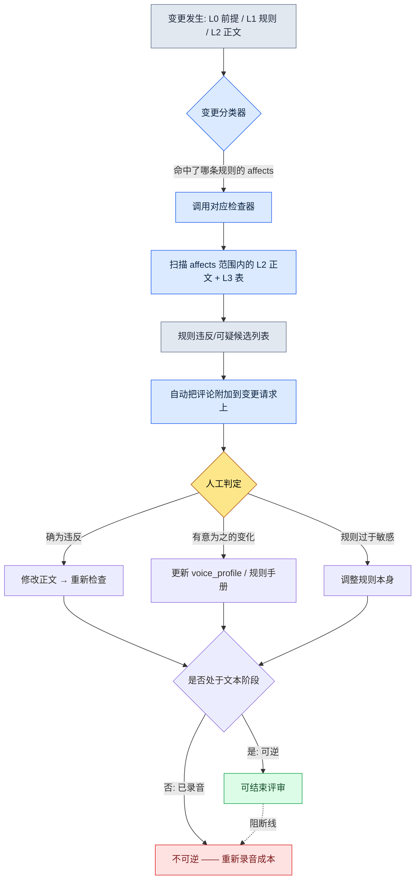

# 5.2 世界观 → 角色 → 任务 的一致性验证

临近 Beta，QA 提交了一份 Bug 报告。标题是"国王说话不用敬语"。正文很短："在 3.4 的开场过场动画里，K_001（国王）对玩家说了'喂，等一下'。这个角色从 1.1 到 3.3 一直用的是'阁下'。"

我去问编剧，得到的答复出乎意料。"那句台词不是我写的。"追查之后才发现，是一位外包编剧在赶工填补一条过场动画分支时随手加进去的。我们的角色圣经（character bible）里本来就有 voice_profile，但那位外包编剧从没看过那份文档。规则在文档里，台词却从文档外进来了。

这就是一致性事故的本质。它不是因为没有规则，而是因为规则没能一路跟进到正文里。而如果这一句话出现在过场动画里，那就更可怕了。过场动画通常会配上配音录制。如果只是文本，改一次就完事；可一旦录完音才发现，就会带来重新召集配音演员、重新录音、重新混音这种不可逆的成本。一致性验证真正的目的，是"在录音之前"把问题揪出来。

本章讲的就是如何用规则手册和检查器、而不是人眼，来揪出这类事故的工作流。我们会原样看真实产出：lore_consistency_rule 规则手册如何成为检查器的输入，voice_lint 如何把语气波动挑成可疑候选，以及为什么最终判定无论如何都要留在人的位置上。

---

## 5.2.1 一致性事故是从哪里漏出去的

把上线 RPG·MMORPG 的用户评论汇总起来看，叙事一致性事故会收敛成几种固定模式。种类看似不同，原因却几乎只有一个。

- **世界观矛盾**：1.1 里"魔法被禁止了" → 1.3 里 NPC 却若无其事地使用魔法
- **语气波动**：同一个 NPC 在不同章里说话方式、敬称发生变化（前面那个"国王不用敬语"的事故）
- **时间线冲突**：已经死掉的 NPC 在后半段又完好无损地重新登场（死亡标记同步缺失）
- **奖励与叙事不一致**：叙事上是"国王御赐之剑"，数据上却是随处可见的杂货道具
- **势力关系矛盾**：刚刚宣布与 A 势力敌对，A 势力的 NPC 就紧接着热情地打起招呼

这五种看上去像是五种不同的事故，但追查下去，它们都从同一个地方漏出去。是 Layer 0（世界前提）或 Layer 1（规则）变了，而这个变更没有传播到 Layer 2（正文）和 Layer 3（数据表）。规则更新了，正文却还停留在旧规则之上。

想靠人工评审来堵住它是不现实的。一个章节里牵连着 50 名 NPC、2,000 行台词、30 个任务，当你改动一行规则时，要让人去 100% 追踪它的影响波及到哪里，这是不可能的。漏掉的那一行在评审阶段不会被抓到，会在上线后的评论区里被抓到。

可话说回来，自动检查也并不能保证 100%。关键在于职责分工。**自动检查负责快速挑出可疑候选，判定由人来做。** 自动化的目的是减少人工评审的时间，而不是取消人。一旦这个前提被模糊掉，后面要讲的所有失败都会接踵而至。

---

## 5.2.2 lore_consistency_rule —— 喂给检查器的规则手册

项目A 的 L1 文档之一就是 `lore_consistency_rule.md`。这份文档既是供人阅读的指南，同时也是检查器解析的输入。frontmatter 里的 `atoms` 和 `affects` 把这两个角色绑在了同一份文档上。

```markdown
---
title: 世界设定（lore）一致性规则
layer: L1
atoms:
  - lore_check_world_rule
  - lore_check_character_voice
  - lore_check_timeline
  - lore_check_faction_relation
related:
  derives_from: [world_premise, narrative_pillar]
  affects: [main_quest/*, character_bible/*, dialogue_id_table]
---

## 1. 世界规则（World Rule）
- 起始状态下魔法被禁止 → 使用魔法时需注明（时点、使用者、正当理由）
- 神处于沉默状态 → 禁止描写其直接回应（允许梦境·幻象）

## 2. 角色语气规则
- 强制参照每个角色的 voice_profile
- 撰写新台词时须遵守 voice_profile 的 5 个项目（词汇、句子长度、敬称、情感表达、禁忌表达）

## 3. 时间线规则
- 所有 NPC 都要定义 status_timeline（存活 / 受伤 / 死亡 / 失踪 / 位置变更）
- 在台词·登场时点自动核查 status_timeline

## 4. 势力关系规则
- 记录 faction_relation_matrix 的变更时点
- 变更之后的台词要反映新的关系
```

`affects` 这一行定义了检查器的扫描范围。一旦 world_premise 发生变化，检查器就会把 `main_quest/*`、`character_bible/*`、`dialogue_id_table` 全部重新过一遍。过去要靠人在脑子里追踪"影响会波及到哪里？"的工作，现在由写在规则手册里的依赖关系图来代替。

voice_profile 是这份规则手册所引用的另一份 L2 资产。一个角色的画像，其各个项目都以数值化·枚举型的方式录入，以便检查器拿来作为比较基准。

```yaml
# character_bible/K_001_voice_profile.yaml
character_id: K_001
display_name: 国王
voice_profile:
  vocabulary_register: 古风_正式         # 词汇等级
  avg_sentence_len: 18                   # 平均句子长度（字）
  honorific: "阁下"                      # 第二人称敬称（固定）
  emotion_expression: 克制               # 情感外露程度
  forbidden_terms: ["喂", "等一下", "哈"] # 禁忌表达
```

有了这份 yaml，"国王不用敬语"这件事才会从人的直觉变成机器可比较的项目。honorific 是"阁下"，台词里却出现了"喂"，那它就不是意见，而是规则违反的候选。

---

## 5.2.3 一致性验证流程

变更发生的那一刻，检查器就被触发。流程如下。



最后那个分支才是本章隐藏的脊柱。所有一致性判定都**必须在文本阶段、也就是可逆阶段就结束**。一旦评审推到录音·选角之后，修改就变成不可逆的了。所以 voice_lint·timeline_lint 这类检查器，关键不在于跑得"快"，而在于跑得"早"。过场动画台词在进入录音队列之前，至少要通过一次。

检查器共有四种，各自与规则手册的一个章节一一对应。

- `world_rule_lint.py` —— L1 世界规则 + 所有 L2 正文 → 魔法使用·神回应等违反候选
- `voice_lint.py` —— voice_profile + dialogue_id_table → 语气波动的可疑台词
- `timeline_lint.py` —— npc status_timeline + 所有台词·登场时点 → 死亡 NPC 重新登场等冲突
- `faction_lint.py` —— faction_relation_matrix + dialogue tone → 关系矛盾的台词

四个检查器都不是 100% 准确。所以输出的名字不叫"违反"，而叫"可疑候选"。

---

## 5.2.4 实操记录（worked transcript）：把 voice_lint 跑一遍

光说"有检查器"这种抽象的话，没什么感觉。我们实际跑一遍。下面是复现前面"国王不用敬语"事故的输入。

**setup** —— 从 dialogue_id_table 取出两行待检查台词。

```
dialogue_id_204  speaker=K_001  text="喂，等一下啊。你先说。"
dialogue_id_217  speaker=K_007  text="……该死，又失败了。从头再来。"
```

**prompt** —— 检查器本体是基于规则跑的（正则·长度比较·禁忌词匹配）。AI 只接在"为什么可疑"这一处——用编剧能读懂的自然语言来解释。检查阶段的 LLM 提示词全文如下。

```
这些是 voice_lint 挑出来的可疑候选。不要下判定，只针对每个候选，
用 1~2 句话说明它似乎违反了哪个 voice_profile 项目以及依据。
不要断言"违反了/没违反"，只说到"疑似……"为止。

[voice_profile]
K_001: honorific="阁下", avg_sentence_len=18, forbidden=["喂","等一下"]
K_007: forbidden=["该死"]

[可疑候选]
- dialogue_id_204 (K_001): "喂，等一下啊。你先说。"
- dialogue_id_217 (K_007): "……该死，又失败了。从头再来。"
```

**Claude 原始输出**（不作概括·整理，原样照录）

```
[dialogue_id_204 / K_001]
这句台词疑似与 honorific 项目冲突。voice_profile 将第二人称敬称
固定为"阁下"，而本句使用了"你"，敬称本身并未体现出来。此外，
forbidden_terms 中的"喂"和"等一下"都出现了，疑似偏离了词汇等级
（古风_正式）。与平均句子长度 18 字这一基准看上去没有直接抵触，
但语气本身变得随意，这一点疑似是违反信号。

[dialogue_id_217 / K_007]
forbidden_terms 中的"该死"被原样使用，疑似违反禁忌表达项目。
不过由于 K_007（学者）的 emotion_expression 项目未给出，仅凭
现有信息难以判断这一表达是有意的情绪高涨还是单纯的越界。
判定需要编剧来审查。
```

这段输出里有我们故意留下的两处诚实。第一，在 204 上 AI 说"平均句子长度看上去没有直接抵触"，**没有把不违反的项目硬说成违反**。第二，在 217 上 AI 承认"emotion_expression 项目未给出，难以判断"，**承认信息不足并把判定交给了人**。如果 AI 把所有可疑都强推成"确定违反"，那才是更危险的检查器。

**verify** —— 编剧在变更请求里原样收到这条评论。判定由编剧来做。

- 204：确为违反。这是外包编剧没看 voice_profile 就加进去的台词 → 修改正文，重新检查
- 217：有意为之的违反。这是 K_007 在 3.4 崩溃时情绪高涨的台词 → 在 voice_profile 中加上 `emotion_peak_exception` 标记，把 217 登记为例外

两个候选是同一个检查器挑出来的，结局却完全相反。一个是改正文，一个是改规则。机器无法自动完成这个分叉，正是下一节的要点。

---

## 5.2.5 为什么判定是人的位置

检查器只挑到可疑为止、把判定交出去，有三个理由。

第一，**存在有意为之的违反。** 在角色崩溃或转变的章节里，语气会被有意地动摇。上面的 217 就是如此。自动拒绝型的检查器会把编剧的演出意图给挡掉。

第二，**规则本身在进化。** 如果同一类可疑总是被判定为"有意为之的变化"，那就是规则跟不上现实的信号。检查结果不只是让人去改正文，也让人去改规则手册。

第三，**新角色·新势力需要一个学习区间。** voice_profile 才填了两三个项目的新 NPC，冒出很多可疑是正常的。在这个时期如果上了自动拒绝，编剧就会把检查器当成敌人。

自动检查和人工判定的边界足够清晰，检查器才能活下来。要是做成自动拒绝型，一个月之内编剧们就会说"把这玩意儿关了吧"。这就像给公司大门装一个太过灵敏的自动感应器，每次有人经过门就关上，最后总会有人把感应器拆掉。检查器不该是关门的装置，而该是"有人从这里经过了"的提示装置。

再补充一个注脚。评审必须在文本阶段结束这条原则（前面流程图里的阻断线），同样适用于人工判定。编剧的"有意为之的违反"判定也得在录音之前完成。录音之后再翻案，问题就不再是检查器的问题，而变成了工序成本的问题（可逆/不可逆边界的全貌见 5.4.5）。

---

## 5.2.6 测量 —— 6 个月前后

在项目A 中，我们分阶段引入了 4 种检查器，并测量了 6 个月。下面是基于实测日志，但用方向·比例代替绝对值来呈现的（公司内部测量，非作者推测）。

- **单个章节的评审时间**：引入前约 5 天 → 引入后约 2 天（不到一半）
- **上线后发现的一致性事故**：每章 3\~5 件 → 0\~1 件
- **每位编剧的单章产出速度**：4 周 → 2.5 周
- **规则手册（L1）的更新频率**：每季度 1\~2 次 → 每月 1\~2 次

最后一项最有意思。有了检查器，规则就算频繁修改也很安全。改一行规则，它的影响会被自动可视化，于是变更的恐惧减少了，规则进化得更快了。一致性工具真正的效果，与其说是"减少了事故"，不如说更接近于"能够无所畏惧地修改规则了"。

不过，上面这些数字是 4 种检查器全部运转时的数字。更重要的一点是，在引入初期，光是 voice_lint 一个就已经产生了可见的效果。没必要一开始就把 4 种全都打开。

---

## 5.2.7 把 AI 放在哪里

自动检查器的本体，基于规则更高效。同样的输入要得到同样的结果，信任才会积累，而 LLM 是非确定性的，不适合放在那个位置。AI 放进另外四个位置。

- **规则违反候选的探测** → 规则（正则·关键词·长度·结构检查）。不用 LLM
- **可疑候选的依据说明** → LLM。就是上面实操记录里看到的"为什么可疑"的自然语言说明
- **替代台词的初稿生成** → LLM。供编剧审查的初稿，定稿由编剧决定
- **voice_profile 自动更新候选的建议** → LLM。从数十章正文中提取模式，给出项目补强方案

规则快速且确定，LLM 擅长说明与生成。把这两者的角色混在一起，两边都会坏掉。把检查交给 LLM，就会出现同一句台词昨天通过、今天却被拦下的情况；把说明交给正则，就只能得到"honorific 项目违反"这种机器语。

---

## 5.2.8 引入顺序与常见失败

一开始就把 4 种检查器全做出来，负担会先于效果到来。推荐的顺序是从最便宜·效果最大的开始。

1. **voice_profile 5 项目标准化**（约 1 个月）—— 先把 character_bible 的格式落地。这件事比检查器更优先
2. **voice_lint 最小版本**（约 1 周）—— 只做禁忌词汇匹配。光是拦住一个词，上线后的社交媒体事故就能每季度减少 1\~2 件
3. **timeline_lint**（1\~2 周）—— 死亡标记核查。哪怕只抓住死掉的 NPC 重新登场，体感也很大
4. **world_rule_lint + faction_lint**（1\~2 个月）—— 剩下的两种
5. **LLM 辅助**（再加 1\~2 个月）—— 整合说明·初稿生成

要强调的一点是，光是第 2 步（voice_lint）效果就已经很大。前面那个"国王不用敬语"的事故，正是靠这一步就能抓住的类型。

引入过程中反复出现的失败也几乎是固定的。

- **做成了自动拒绝型** → 退回到"可疑候选 + 人工判定"的结构
- **规则手册与编剧脱节运营** → 规则手册的变更必须经编剧达成共识，并让编剧能够提出修改规则手册的请求
- **voice_profile 流于形式** → 先用 1 名角色把 5 个项目完整填满，再扩展
- **不知道检查结果在哪里** → 强制把检查结果自动附加到变更请求的评论里
- **让 LLM 去做检查本身** → 检查交给规则，只把说明交给 LLM
- **录音之后才评审** → 评审在文本阶段结束。不越过可逆区间

最后一项比前面所有项目都贵。别的失败丢的是时间，这个失败丢的是配音演员的档期。

---

下一章（5.3）讲的是不靠检查器，而靠 AI 辅助来撰写叙事正文的流程。我们会看到如何把 L0 语气和 L1 规则作为上下文注入，让 AI 给出的不是泛泛的答案，而是属于我们这个世界的答案。

---

### 本章要点
- 一致性事故不是因为没有规则，而是因为规则没能传播到正文里才产生。
- 检查器只挑到可疑为止，判定由人来做，检查器才不会被废弃。
- 所有一致性评审都必须在录音前的文本（可逆）阶段结束。

### 下一章预告
- 5.3. AI 辅助叙事写作 —— 注入 L0 语气·L1 规则上下文

---

## 动手试试

**setup** —— 从 character_bible 里挑 1 名角色，用 yaml 把 voice_profile 的 5 个项目（词汇等级·平均句子长度·敬称·情感表达·禁忌表达）完整填满。再从 dialogue_id_table 里抽出这个角色已有的 10 行台词，汇集到一个文件里。

**prompt** —— 原样使用上面实操记录里的检查辅助提示词。核心是两条约束："不要下判定"和"只说到疑似……为止"。在输入里附上 voice_profile yaml 和那 10 行台词。

**verify** —— 把输出的可疑候选逐行自己判定一遍。如果是真违反就改正文，如果是有意为之的变化就在 voice_profile 里加上例外标记。同时确认 AI 是否把"不违反的项目"也硬说成违反，是否承认"信息不足"。如果 AI 把所有项目都断言为违反，就强化提示词里"不要下判定"的约束。

### 单人精简版

如果你是既没有 4 种检查器、也没有规则手册的单人开发者，不要检查器本体，光靠一条提示词也能达到同样的效果。只需手动维护每个角色的 voice_profile yaml，每写一条新台词，就把该角色的 yaml + 新台词附到上面那条辅助提示词里，去拿到"可疑候选"。虽然没有自动化，但**判定靠人、AI 负责说明**这个核心结构照样活着。只要守住一条就行——在交给录音·语音合成之前，让这道审查走一遍。不越过可逆阶段这条原则，与团队规模无关。
