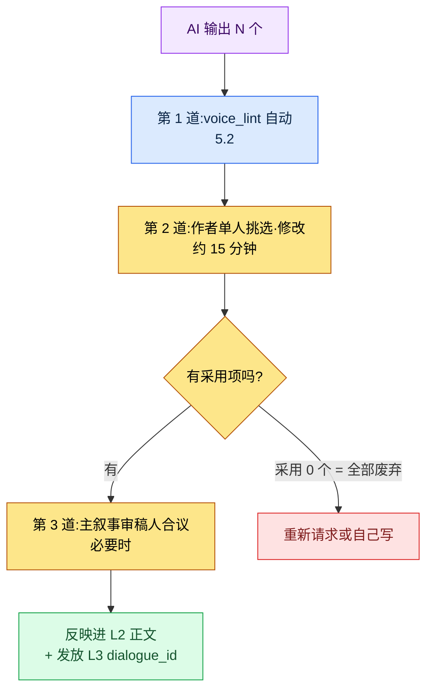
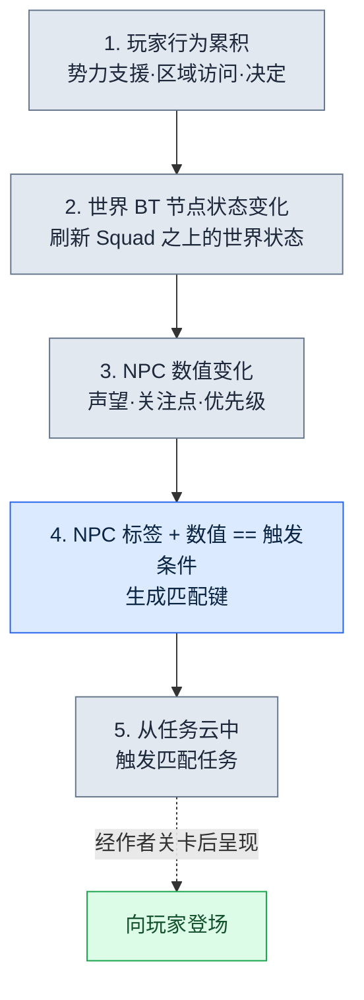

# 5.3 AI 辅助叙事写作

那天我在为一个新的支线 NPC 草拟第一句台词。我在空白的聊天框里敲下"帮我写 5 句村庄铁匠 NPC 的台词"。5 秒后,屏幕上跳出"勇士啊,把你的武器交给我吧"。那不是一种似曾相识,而是一种我几乎能说出确切在哪儿见过的句子。把同样的提示词放进别的团队的别的游戏里,也会得到一模一样的回答。那一刻我意识到的并不是模型弱,而是我什么都没告诉模型——我没让它了解我们的游戏。

AI 很会写一般化的奇幻句子。可它写不出我们这个世界的句子。差别只有一个,就是上下文注入。每次请求时把 L0 基调和 L1 规则一并送进去,AI 吐出的那一行就会从"似曾相识的句子"变成"这个游戏的句子"。本章讲的是把这种注入按四层来运营的实务,最后把同一原理拔高到世界模拟的规模,把更进取的应用(世界 BT(BehaviorTree,行为树)+ 任务云)作为研发最前沿来点明。

---

## 5.3.1 上下文为空时会发生什么

在叙事领域,AI 辅助是导入最快、也最快失去信任的环节。因为它的失败模式几乎一模一样。

你扔一句"给我 5 句任务开场台词",回来的就是 5 种以"勇士啊,我们村子……"开头的一般化奇幻句。你说一句"帮我改改这个角色的台词",声音就被抹平,所有 NPC 都收敛成相似的语气。你说一句"帮我写第 1 章梗概",拿到的就是你见过的那些 RPG 梗概的平均值。

问题不在模型,而在上下文是空的。模型输出的是训练数据的平均值。不想要平均值,就得给它一个能远离平均值的线索。本章的主题就是这个线索怎么造、怎么注入。

在笔者运营的 MMORPG 项目(以下称项目A)里,叙事 AI 辅助会按顺序堆叠四层上下文。5.1 中把 NarrativeDocs 拆解为 Layer 0\~4 的那套结构,在这里被原样复用为注入单元。

<svg viewBox="0 0 720 300" xmlns="http://www.w3.org/2000/svg" font-family="sans-serif">
  <rect x="20" y="20" width="680" height="46" rx="6" fill="#1f2d3d"/>
  <text x="40" y="40" fill="#fff" font-size="14" font-weight="bold">Layer A · 系统提示词</text>
  <text x="40" y="58" fill="#9fb3c8" font-size="11">作者人设 · 禁忌(几乎不变,定义一次)</text>

  <rect x="20" y="78" width="680" height="46" rx="6" fill="#27496d"/>
  <text x="40" y="98" fill="#fff" font-size="14" font-weight="bold">Layer B · L0 愿景</text>
  <text x="40" y="116" fill="#bcd4e6" font-size="11">world_premise · narrative_pillar · tone_manifesto (≈7,000 tok,缓存)</text>

  <rect x="20" y="136" width="680" height="46" rx="6" fill="#2e6171"/>
  <text x="40" y="156" fill="#fff" font-size="14" font-weight="bold">Layer C · L1 规则(择需注入)</text>
  <text x="40" y="174" fill="#cfe8df" font-size="11">只挑出与任务相关规则的 _summary 节(缓存)</text>

  <rect x="20" y="194" width="680" height="46" rx="6" fill="#3e885b"/>
  <text x="40" y="214" fill="#fff" font-size="14" font-weight="bold">Layer D · L2 邻近正文</text>
  <text x="40" y="232" fill="#e3f2e8" font-size="11">同一角色的上一句台词 · 同一章梗概(原样不动,每次都变)</text>

  <rect x="180" y="254" width="360" height="36" rx="6" fill="#c0392b"/>
  <text x="200" y="277" fill="#fff" font-size="13" font-weight="bold">任务指令:"此时此刻 K_007 的台词 3 案"</text>

  <line x1="360" y1="66" x2="360" y2="78" stroke="#888" stroke-width="2"/>
  <line x1="360" y1="124" x2="360" y2="136" stroke="#888" stroke-width="2"/>
  <line x1="360" y1="182" x2="360" y2="194" stroke="#888" stroke-width="2"/>
  <line x1="360" y1="240" x2="360" y2="254" stroke="#888" stroke-width="2"/>
</svg>

四层并不是每次都全部塞进去。按任务类型只取出需要的层。如果是一个角色的下一句台词草稿,A + B(只要基调)+ D(那个角色最近的 10 行台词)就够了。如果是新支线任务的梗概,就追加 C(quest 结构规则)。如果是分支结果 4 案,C(分支规则)+ D(分支前的整段正文)就会变重。这就好比从书桌上的文件柜里,按任务大小挑出人设表、世界观一行、规则手册某页、邻近正文一沓,再发出去。

---

## 5.3.2 一段实操记录(worked transcript)—— K_007 的第一句情感台词

> 实操记录(worked transcript)= 完整保留的真实操作过程记录。

与其用抽象去讲,不如把一次真实请求从头跟到尾。这次的任务是为同一个角色(学者型 NPC,公司内部 ID `K_007`)第一次需要流露情感的场景,草拟 3 案台词。先从提示词全文开始。

**发出的提示词(Layer A + B(基调)+ D + 任务指令 + 输出格式):**

```
[系统]
你是项目A 的叙事作者。不要用"勇士""被选中者"这类 RPG 套话,
语气照着下面这几句上一段台词的基调走。不知道的设定别瞎编,
就回答"凭上下文无法判断"。你只写草稿,决定由我来做。

[L0 基调 —— tone_manifesto 摘录]
这个世界的情绪基调是克制。人物不会轻易把感情说出口。
情感不是爆发,而是以裂痕的方式显露。多用省略与短句。

[参考 —— K_007 的上 5 句台词(按时间顺序,原样不动)]
1. "……这事我也是头一回听说。"
2. "有记录吗?没有的话就得怀疑。"
3. "在确定之前,先别动。"
4. "我的意见就这些。"
5. "……抱歉。我是不是太冷淡了。"

[情境]
同伴 NPC 受伤归来。学者第一次必须流露情感。

只要 3 案,每案不超过 25 字。每案末尾加(反应类型:愤怒/悲伤/否认)标签,
说明和开场白都去掉。
```

**Claude 的原始输出(未经摘要、未经改写,原样照录):**

```
1. "……为什么一个人全扛下来。傻不傻。"(反应类型:悲伤)
2. "我该去看记录的。是我,是我漏掉了。"(反应类型:否认)
3. "没事。都没事。所以你别——"(反应类型:否认)
```

不在这里停下才是关键。作者读完三案并加以验证。1 案基调对了。上一段第 5 句"……抱歉"所显露的那道裂痕,被 1 案用"傻不傻"这一个词接住了。是采用候选。2 案"是我,是我漏掉了"里那种结巴,和学者的克制略有出入。保留。3 案标签错了。反复说"没事"更接近回避而不是否认,而我们的 voice_profile 里并没有学者用回避来处理情感的模式。否决。

**重新请求(明确给出否决理由再发一次):**

```
3 案否决。反复说"没事"不是这个学者的模式。他处理情感
不是回避,而是"对没能核实事实的自责"。1 案我采用。
2、3 案的位置,给我两案和 1 案不同调子的。不要结巴,不超过 25 字。
```

**Claude 的第二次输出:**

```
2. "记录不会说谎。是我没去看。"(反应类型:自责)
3. "……坐下。先处理伤口。话以后再说。"(反应类型:悲伤)
```

这次两案都通过了。2 案把"记录"这个学者的核心词汇(上一段第 2 句"有记录吗?")重新用作自责的媒介,3 案以克制的祈使句展现了学者把情感压成行动的模式。最终采用 1 案 + 2 案 + 3 案。这三行经过 5.2 的 `voice_lint` 自动验收后被反映进 L2 正文,并在 L3 中获发 `dialogue_id`。

这一段实操记录里装着本章的全部。基调注入(L0)救活了 1 案,原样不动的邻近正文(L2)让学者的词汇"记录"在重新请求时被再利用,输出格式的强制堵住了闲话,作者否决关卡过滤掉了 3 案错误的标签。AI 没有最终决定哪怕一行。

---

## 5.3.3 Layer A —— 系统提示词,一行就左右全局

铺在最上面的是人设定义。定一次,几乎不再改。上面那段实操记录里的系统区块就是它的实物。五行里最后一行("写草稿,决定由作者来做")最重要。这行一缺,AI 就会自信地端出装作"最终版"的句子,而作者就从验收变成了打分。其次重要的是第三行("不知道的设定别编,就回答无法判断")。没有这行,模型就会用貌似合理的谎言去填空。在叙事里,貌似合理的谎言会在几天后以世界设定冲突的形式回来。

---

## 5.3.4 Layer B —— L0 愿景与缓存的位置

L0 篇幅不大(按 5.1 的标准约 4.5 章篇幅)。几乎每次都能整段注入。以韩文为准估算,`world_premise.md` 约 2,500 token,`narrative_pillar.md` 约 1,500 token,`tone_manifesto.md` 约 3,000 token,合计约 7,000 token。(这些数字是笔者的估算,未经验证。随分词器与文档修订而变。)

每次请求都重新发 7,000 token,成本会累积。所以挂上提示词缓存。这是 Anthropic 与 OpenAI 都支持的功能,缓存命中时输入 token 成本会大幅下降。关键是在消息内部把会变的和不变的分开放。

```python
messages = [
    {"role": "system", "content": SYSTEM_PROMPT},
    {"role": "user", "content": [
        {"type": "text", "text": L0_FULL,      "cache_control": {"type": "ephemeral"}},
        {"type": "text", "text": L1_SELECTED,  "cache_control": {"type": "ephemeral"}},
        {"type": "text", "text": L2_ADJACENT},   # 每次都变 —— 不缓存
        {"type": "text", "text": TASK_INSTRUCTION},  # 每次都变
    ]},
]
```

挂了 `cache_control` 的 L0 和 L1 是缓存对象,而 L2 邻近正文和任务指令每次都变,所以不缓存。把缓存块始终聚拢在消息前段,是命中率的关键。会变的块一旦夹在前面,它后面的缓存就全部失效。把这个顺序搞错,是开了缓存却省不下成本的最常见原因。

> 缓存命中率与成本节省数值的细节,在第 22 部分(成本)章节里讲。这里只要记住"把会变的赶到后面"这条原理就够了。

---

## 5.3.5 Layer C —— 不把 L1 规则整个塞进去

L1 规则手册篇幅大,全塞进去上下文会撑爆,更糟的是模型会抓不住要点。只挑与任务相关的规则,而且只挑 `_summary` 节。

抽取主线任务分支结果时,挑 `dialogue_branching_rule` 和 `faction_relation_matrix`。新 NPC 台词,就挑对应 NPC 的 `voice_profile` 和 `tone_manifesto`。世界设定词典新条目,就挑 `lore_consistency_rule` 和 `world_premise`。支线任务骨架,就挑 `quest_template` 和 `reputation_model`。选择由人亲手做,或沿着 wikilink 图(第 7 部分)自动抽取;自动抽取时,召回率优先于精确率。因为漏掉一条规则的损失,远大于多放一条规则的损失。

不把规则手册正文全塞进去,而是在规则手册文件开头放一个 `_summary` 节,只注入它。

```markdown
---
title: 分支规则
layer: L1
---

## _summary
- 分支只在章节末尾发生
- 分支为 2~3 案。禁止 4 案及以上
- 分支选择对声望产生 +/-1 影响,结局分支为 +/-3
- 所有分支结果必须在 24 小时内呈现结果
- 分支不可撤销(建议分离存档,UI 提示)

## 1. 分支发生时点规则
(详细说明,供运营者参考 —— 不注入 LLM)
...
```

`_summary` 的 5 行,比正文 50 行对 LLM 输出质量更有效。模型更能遵守简短而斩钉截铁的规则。冗长的说明会分散模型的注意力,而被分散的注意力会以违反规则的形式回来。

---

## 5.3.6 Layer D —— 邻近正文不做摘要

上一句台词、邻近任务、同一章梗概。这是变动最大的上下文。同一角色的新台词,就按时间顺序放那个角色的上 10 行台词;章节中段的任务,就放章节梗概和同一章任务的 1 行摘要;分支结果结局,就放分支前的整段正文和选项文本。放太多,LLM 就输出平均值;放太少,就给出一般化的输出。合适的区间在 1,500\~3,000 token 之间(以笔者观察为准,未经验证)。

一条核心规则:邻近正文不加工、不摘要,原样不动地放进去。上面那段实操记录里,学者的上 5 句台词原样不动地放了进去,所以模型才能在重新请求阶段精准地抓住"记录"这个词,把它再利用为自责的媒介。如果当初把那 5 句摘要成"学者谨慎而冷淡"再放进去,作者那些细微的选择就会全部消失,模型也就重新回到平均值。摘要不是在减少信息,而是在抹掉作者已经做出的决定。

---

## 5.3.7 作者验收工作流 —— 把废弃率当指标用

AI 输出永远是草稿。验收要通过既定的关卡。



作者从 N 个里挑出 0 个(全部废弃)也是正常的。正如上面那段实操记录里 3 案被否决,否决不是失败,而是关卡起了作用的证据。所以要按作者、按角色测量废弃率,把它作为上下文注入质量的指标。

废弃率在 0\~20% 是上下文充分的稳定运营,就照原样放着。20\~50% 是一般运营区间,只做监控。升到 50\~80% 就重新检查是不是漏选了 L1 规则。超过 80% 就不是个别规则的问题,而是系统提示词、人设本身错位了,于是要重写 Layer A。废弃率每周按作者汇总一次,在复盘里共享。

不过废弃率不是绝对指标。变化快的角色(例如上面实操记录里的 K_007,处于第一次流露情感的转折点)即使废弃率高也正常。数字是对话的起点,不是判决。

---

## 5.3.8 安全 —— 如何阻止上下文泄露

L0\~L1 是游戏的核心 IP。要是把它们原样发给外部 LLM API 让人放心不下,选项就出现分岔。把外部 API 在"不用于训练"的合同下原样使用最快,但需要法务审查。把公司名、专有名词替换成 placeholder 再发,会增加额外处理成本,也会损伤自然度。自托管(开源模型)数据安全,但质量与运营负担大。把 L0 留在内部、只把草稿送往外部的混合方案,运营复杂。

笔者的项目A 采用第一种方案(外部 API + 不用于训练合同)。第二种方案试过后放弃了。因为 placeholder 替换会把正文抹平成"○○ 王国的 ○○ 学者就 ○○ 说了……"这种形态,把输出质量整个搞垮。匿名化扼杀质量,是贯穿全书反复出现的取舍(参见第 1 部分匿名化章节)。在叙事里这种损伤尤其大。因为专有名词本身就是基调。

---

## 5.3.9 常见失败与对策

不给系统提示词、只扔任务指令,出来的就是平均值。先铺好人设与禁忌。每次都整段注入 L0 却不用缓存,成本就会漏。把缓存块聚到前面。把 L1 规则手册整个塞进去,模型就抓不住要点。只抽 `_summary` 节。把邻近正文摘要后放进去,作者的选择就被抹掉。原样引用。不定输出格式,相当一部分回答就会以"这里是 3 个候选:"开头,甚至会跟来作者把那段开场白误当正文的事故。明确标出数量、长度、标签。把 AI 输出当最终版用,验收关卡就垮了。永远让它通过作者关卡。不测废弃率,工具的健康度就依赖人的印象。按周汇总,在复盘里共享。

---

## 5.3.10 从保守的应用到进取的应用

到此为止都是保守的应用。作者用心地注入上下文,AI 只做一行一行的草稿。单位是"这个角色的下一句台词 3 案""这个任务的梗概"这类小活儿。稳定,但在量产规模和动态反应性上有局限。

这里先点明一件事。程序化生成、世界模拟、动态任务,是策划们二三十年前就在纸上画出的愿景。基于确定性规则手册的 PCG 处理过副本房间、武器属性、刷怪分布这类数值领域,却碰不到自然语言正文、角色人设、叙事分支、NPC 对话。也就是说,策划的相当一部分一直停留在纸上。2024\~2026 年 LLM 与图像模型的进步,把那片领域拉到了可实现的位置。AI 进步的核心意义不在于模型分数,而在于那些长久停留在纸上的策划,其可实现性被打开了。只不过,可能性被打开,和落地为可运营的系统,是两回事。

### Layer 分解是程序化生成的前提

5.1 的 Layer 0\~4 分解不是单纯的整理,而是程序化生成的前提。五个层级各自对应生成流水线的哪个阶段(L0 锚点 → L1 规则手册 → L2 正文 → L3 数值 → L4 关卡),在 §6.6 和 5.1.11 里讲过了。要点只有一个 —— 在一整块文档上,生成器无法决定从哪里读、往哪里写,不知道 L0 在哪儿导致上下文模糊,L1、L2 在同一个文件里冲突,量产线就垮了。先有 Layer 分解,在它之上程序化生成才能运转。这里我们把这个前提应用到叙事 AI 辅助的量产阶段。

### 进取应用的骨架 —— 任务云

三个要素被捆在一起。第一,NPC Persona 被程序化生成。主线 NPC 靠作者亲手,但支线 NPC 由 6.2\~6.3 的 generator、Squad 流水线来量产。每个 Persona 连同 `voice_profile` 一起附上标签(职业·势力·性向·角色)。第二,世界 BT 坐到 Squad 之上。如果说 Squad 把一个狩猎场 NPC 群组的行为捆在一起,那么世界 BT 就在它之上,接收玩家行为的累积数值,刷新整个世界的状态。玩家帮了哪个势力、常去哪个区域、做了哪些决定,会撼动世界 BT 节点状态,被撼动的节点又反映进影响圈内 NPC 的数值(声望·关注点·优先级)。第三,任务是云模型。除主线任务外,所有任务都被程序化生成,各自带着标签(谁·在哪·为何·何时)和触发条件漂浮着。任何任务都不固定在特定 NPC 上。

触发要经过五个阶段。



打个比方,任务不是插在图书馆书架上,而是飘在空中的云。NPC 一旦到达某个状态,适合它的那朵云就会降下来,落到手里。在这个结构里,AI 不是写一行的助手,而是同时处理三件事:程序生成的 Persona、任务的自然语言正文(说明·台词),世界 BT 状态反映进 NPC 时的词汇变动(保持同一个 `voice_profile`,但话题随世界状态而变动),以及验证阶段的可疑分类器(这个任务可不可以在这个 NPC 身上触发)。

### 不可逆边界 —— 验收必须在文本阶段结束

进取应用里,可逆/不可逆边界(5.4.5)依然成立。云中触发的任务台词若未通过验收就流向语音流水线,代码回滚也救不回来。所以把所有验收关卡(`voice_lint`、可疑分类器、作者关卡)放在不可逆边界之前,是进取应用的安全装置。自动量产叠加得越多,这道关卡就要比保守应用更硬。

### 在哪里停下,以及为何不停下

本书不涉及进取应用的完成形态。那要另写一本书的篇幅,而且每家公司、每个项目的基础设施前提都不同。只要记住两点。首先,做不好保守应用的团队,进取应用也做不了。保守应用里验收关卡转不起来,进取应用里云就会失控。要让运营存活,程序化生成基础设施、世界 BT 节点定义与测试工具、触发任务的自动可疑分类 + 作者关卡、触发率·废弃率·玩家满意度的同步追踪、误触发任务的自动回收与替换,这些必须一并具备。五者缺一,就会在一个季度内被废弃。因为一致性事故暴增,人工验收跟不上。

其次,进取应用不是增加量产的工具,而是增加动态反应性的工具。只盯着量产,云里就会塞满一般 RPG 的平均值,玩家遇到的是一个"看上去更多样、却更空"的世界。话虽如此,这条路也并非只有风险。这片领域是游戏策划研发的最前沿。在程序化生成、模拟、LLM 相遇的地方,最有可能诞生真正全新的游戏形态。即便眼下很少会在公司导入,也值得把它当作未来 5\~10 年的方向之一来留意。

---

## 5.3.11 把一整章从头到尾动手试试

下面是把本章的保守应用原样再现的步骤。

**setup.** 把 L0 的三个文件(`world_premise.md`·`narrative_pillar.md`·`tone_manifesto.md`)合成一段文本,装进 `L0_FULL` 变量。系统提示词照着上面实操记录那五行原样写,但别漏掉最后一行("写草稿,决定由作者来做")。把要抽台词的角色的上 10 行台词,原样不动地收成文本。

**prompt.** 把消息按 `[系统] → [L0 基调] → [参考:上一段台词原文] → [情境] → [输出格式]` 的顺序组装。输出格式里务必明确写出"恰好 N 案 / 每案最多字数 / 标签 / 其余一概禁止"。只对 L0 和 L1 挂 `cache_control`,把会变的块赶到消息后面。

**verify.** 把拿到的 N 案逐行验证。基调与上一段台词是否连得上,标签与实际反应是否相符,我们这个角色不用的模式(回避·结巴等)有没有混进来,逐一去看。要否决的案,明确写出理由再重新请求。采用 0 个也正常,要以废弃率记录下来。只有通过的案才经过 `voice_lint` 反映进 L2,并在 L3 中获发 `dialogue_id`。

**单人精简版.** 即使没有 API、缓存、`voice_lint`,核心依旧不变。一个 ChatGPT/Claude 聊天框就够了。每次把角色的上 5\~10 行台词复制粘贴铺在最前面,输出格式 3 行始终附上,在拿到的回答里要否决的写明理由再重新请求。不用缓存,只要保持同一个对话线程,前文上下文就会原样留着。废弃率在一张纸上像"本周采用 12 / 总计 30"这样用手数着记就够了。工具再小,四层注入与验收关卡这套骨架,对单人作者也同样有效。

---

### 本章要点
- 上下文四层(系统·L0·L1·邻近正文)中只要缺一层,输出就会收敛到平均值
- 缓存活在"把不变的 L0·L1 赶到前面、把会变的正文挪到后面"这种分离上
- 验收关卡与废弃率运转起来,进取应用(任务云)才不会失控

### 下一章预告
- 5.4. 对话·声音一致性 —— 用 AI 抽取·更新 `voice_profile`,并对声音做验收
