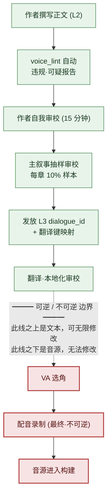

# 5.4 台词·语音一致性

录音棚里。导演戴着耳机，抬手给出提示。配音演员读出学者 NPC 的台词。"哇，真是太厉害了。"导演的手停住了。这个角色在整整 5 个章节里，一次都没用过"哇"这样的感叹词。他是个连脏话、连现代感叹词都不会挂在嘴边、说话总是把话尾压低的学者。可台词稿上却原样写着这一句。

这里同时产生了两笔成本。第一，要改这一句，配音演员就得重读。出场费和录音棚的时间，钟表早已在转动。第二，更可怕的是导演没能抓住这一句、就这么放过去的情形。录音结束、音源进入构建之后，那位学者在游戏里就永远那样说话了。录下来的音源不像文本那样可以靠一行改动撤回。必须重新约同一位配音演员、同样的状态、同一个录音棚。

本章讨论的就是那个录音棚门前的虚线。虚线之上是文本，可以无限次修改；虚线之下是音源，改不了。所有台词的审校都必须在虚线之上结束。要做到这一点，每个角色"这个人是这样说话的"就必须不是记在脑子里，而是记录成文件，并且每当有新台词上来，都要自动与那份文件比对。那份文件称为 `voice_profile`，比对工具称为 `voice_lint`。

---

## 5.4.1 语音容易动摇的地方

叙事一致性事故中，最常爆发的就是角色语音的动摇。往往要等到上线之后，才会收到"这个 NPC 怎么突然语气变了"的反馈。原因每次都几乎相同。

作者换人，同一个 NPC 就变成了另一个人。即便作者不换，过了 6 个月，本人也会忘掉自己定下的语气。写新台词时若不翻开那个角色之前的台词，上下文就断了。语音规则只在作者脑子里、没有落成文档，就传不到下一个人手中。还有最近两年里增长最快的第五个原因——不带任何角色信息就把"帮我写这个 NPC 的台词"丢给 LLM，AI 会返回一段平均而无可挑剔、因而不属于任何人的台词。

第五个原因是引入 AI 带来的副作用。上一章（5.3）的上下文注入是处方，但要是注入的上下文本身就单薄，那就没什么可注入的。那个上下文正是 `voice_profile`。本章要看的就是创建这份文件、自动检查、并在录音棚门前收尾的一整个循环。

---

## 5.4.2 voice_profile —— 由五个项目固定下来的声音

在项目A中，每个 NPC 都用五个项目持有一份 `voice_profile`。词汇范围（常用词群／绝对不用的词群）、句子长度（平均·最大字数）、敬称体系（第一·第二人称、敬语比例、称呼）、情感表达（直接·间接·克制中的哪一种方式）、禁忌表达（绝对不用的词·句式）。五个项目全部都要附上具体示例。若只有"沉稳的学者"这类抽象描述，每个人读出来都不一样。下一位作者会按自己的方式去想象那个学者。

学者 NPC `K_007` 实际的 profile 格式如下。这份文件就成了 `voice_lint` 的输入。

```markdown
---
title: K_007 学者 voice_profile
layer: L1
character_id: K_007
atoms:
  - voice_profile_k_007
related:
  derives_from: [character_bible/k_007.md]
  affects: [dialogue_id_table (K_007 的所有台词)]
---

## 1. 词汇范围
- 常用："记录"、"依据"、"情形"、"推断"、"数据"、"案例"
- 绝对不用："感觉"、"直觉"、"命运"、"神的旨意"、"内心的声音"

## 2. 句子长度
- 平均：18 字
- 最大：35 字（超过则拆成两句）
- 常见短促停顿："……并非如此。""先看记录。"

## 3. 敬称体系
- 第一人称："我"
- 第二人称：职务优先（队长、司令官）。只有在亲近之后才称名字。
- 敬语 100%（回忆场景除外）
- 几乎没有感叹词。有的话也只是"……啊。"

## 4. 情感表达
- 几乎没有直接表达（愤怒·喜悦）
- 以沉默·话尾含糊来表达（"……要是那样的话。"）
- 悲伤：以转移话题来回避（"……说点别的吧。"）

## 5. 禁忌表达
- 一切脏话
- 现代感叹词"哇"、"啊哈"、"厉害"
- 一句话里出现两个及以上三音节以上的汉字词
- "命运"、"预言"等神秘主义词汇
```

这种格式的核心在于，每一处抽象的位置都附着一行示例。不是"克制情感"，而是附上 `"……要是那样的话。"` 这样一句实际台词。这样下一位作者、译者、`voice_lint` 才会看到同一套标准。
若用翻译·本地化的眼光重新审视这五个项目，会分成两类。**语言相关**属性（词汇范围·句子长度·敬称体系的表层形态）必须随翻译的每种语言重新设定；而**语言无关**属性（是克制情感还是直接表达、什么话始终不说出口这样的态度）则无论译成哪种语言都必须照样守住。把本地化工作交付出去时若一并把这个区分传过去，就能避免译者只改表层词汇、却连角色态度都动摇了的情况。

---

## 5.4.3 实操记录（worked transcript，完整保留的真实操作过程记录）：从正文里把 profile 打捞出来

一开始就从空白开始写 50 名 NPC × 5 项目 = 250 条，会流于抽象。正文一行都没有就写下"这个角色是个冷漠的学者"，那份冷漠到底是什么，谁都不知道。所以把顺序倒过来。只有主要 NPC 5～7 名从一开始就完整撰写，其余的等正文台词累积到 20～30 行之后，再从那些台词里反向提取 profile。

下面是 `K_007` 的台词累积到 25 行之后，抽出 profile 初稿的真实实操记录。不做概括，连 AI 出错的地方也原样保留。

**[作者抛出的提示词全文]**

```
以下是角色 K_007 的 25 行台词。

1. "先看记录吧。"
2. "……情形对不上。"
3. "只是推断而已。没有依据。"
4. "那个案例我也知道。"
5. "……并非如此。数据不一样。"
   （…… 第 6～23 条不作省略，全部引用 ……）
24. "……要是那样的话，我就退出。"
25. "说点别的吧。"

请从中提取常用词汇（只取实际出现过的）、平均句子长度、敬称·称呼模式、
情感表达方式、一次都没用过的表达范围，这五项。
每一项用编号引用 2～3 行作为依据的台词，"沉稳的"·"冷漠的"这类
主观印象不要写。
```

**[Claude 的原始输出 —— 未经修饰]**

```
1. 常用词汇
   - "记录"（第1条）、"情形"（第2条）、"推断/依据"（第3条）、
     "案例"（第4条）、"数据"（第5条）
   → 集中于事实·证据类名词。

2. 平均句子长度
   - 25 行平均约 14.6 字。最长 21 字（第24条）。
   → 以短句为主。

3. 敬称·称呼
   - 第一人称"我"（第3·24条）。结句词尾为敬语。
   - 第二人称称呼在这 25 行里未出现。
     → 仅凭此样本无法断定称呼模式。（需作者确认）

4. 情感表达
   - 无直接情感词。以"退出"（24）处理拒绝，
     以转移话题"说点别的吧"（25）处理悲伤/回避。
   → 克制·间接型。

5. 一次都没用过的范围
   - 感叹词、脏话、神秘主义词汇均未出现。
   ※ 但"未出现"不等于"禁忌"。
      样本仅 25 行偏少，可能只是偶然未出现。
```

这里有两点需要点明。第一，AI 在第 3 项停住了。它自己划出了"仅凭此样本无法断定"的界限。称呼在这 25 行里没出现，所以它没去推测——这才是诚实的输出。要是 AI 填上"第二人称推测为'队长'"，那就是幻觉，进入 profile 就是污染。第二，AI 在第 5 项自己加了免责。"未出现 ≠ 禁忌"是关键警告。感叹词在这 25 行里没出现，也可能是偶然。

**[作者的验证·驳回]**

作者采纳了第 1·2·4 项。第 3 项称呼，作者翻开 character_bible，手动填上"队长优先，亲近后称名字"——AI 留空的位置由人来补。第 5 项，作者照 AI 的警告，没有把"未出现"直接升格为"禁忌"。而是作者对照角色设定，只把"现代感叹词·脏话·神秘主义"确定为禁忌，其余未出现的词汇作搁置处理。

**[作者的再次请求]**

```
"命运"、"预言"就定为禁忌。再帮我提取 10 个意思相近的神秘主义词汇。
不过 K_007 作为学者，在反驳·批判的语境里也可能引用，所以那种例外情形
也用一行一起标出来。
```

这最后一次再请求很重要。机械地扩大禁忌，连"学者在批判迷信时说'什么命运之类的'"这种正当台词都会被挡住。所以让它在定义禁忌的同时一并定义例外语境。AI 把候选范围铺开，作者来划边界。转完这一圈之后，`voice_profile_k_007` 才确定下来、固定到 L1。

强制要求引用依据（"用编号引用"）、禁止主观形容词（"禁止写沉稳的"），AI 的幻觉就会减少，也给作者留出了可供验证的表层。profile 不是 AI 来写的，而是 AI 铺出初稿、作者来固定的。

---

## 5.4.4 voice_lint —— 每条新台词自动比对

只要 `voice_profile` 落成文件，每当有新台词上来，就可以自动比对。五项检查中，在实战里效果大的是禁忌词汇匹配（词汇是否落入禁忌列表）和词汇范围违规（是否进入绝对不用的词群）这两项。句子长度偏离·敬称缺失·常用词汇比例误报（false positive）多，只作辅助使用。要是连一行回忆场景把平均长度带偏都全抓出来，作者就会对警告变得麻木。

`voice_lint` 接收一章的新台词集合，给出这样一份报告。

```
voice_lint 结果（ch04 新台词 32 行，profile=voice_profile_k_007）
─────────────────────────────────────────────
[违规] dialogue_id_412 — K_007
  内容："哇，真是太厉害了！"
  事由：禁忌词汇"哇"、"厉害"（profile §5）
  → 需作者审阅

[可疑] dialogue_id_421 — K_007
  内容："那命运难以接受。"
  事由：禁忌词汇范围"命运"（profile §5）
        但'反驳·批判语境'可作例外 —— 由作者判定
  → 需作者审阅

[正常] 30 条台词
─────────────────────────────────────────────
小结：违规 1 / 可疑 1 / 正常 30
```

违规为红色，可疑为黄色。两者都必须经作者判定才能通过。这里有一条绝对原则——`voice_lint` 不会自动驳回（5.2 原则的延续）。看上面的 `dialogue_id_421`。"命运"是禁忌，但若是学者反驳迷信的语境，就可能是正当的引用。那个判断工具做不了。自动驳回型的 lint 会把这种微妙的位置全都挡死，还会从作者手里夺走打磨语气的机会。lint 是标示可疑之处的手电筒，不是锁门的锁。

---

## 5.4.5 审校关卡 —— 可逆与不可逆之间的虚线

本章的脊梁是这一张图。一句台词从作者手中出发、走到配音演员口中的途中，审校关卡逐级铺开。而在那条流程正中央，有一条粗虚线。



绿色是可逆阶段，红色是不可逆阶段。虚线之上（绿色）全是文本。一句台词不满意，用键盘改就行。成本是作者的几分钟。虚线之下（红色）是音源。配音演员在录音棚里读了那一句、音源进入构建的那一刻，那句台词就作为资产固定下来了。要改的话，必须重新约同一位配音演员、同样的状态、同一个录音棚，出场费·录音棚·导演时间会和第一次一模一样地再花一遍。日程紧的话，同一位配音演员的追加场次本身可能都约不上。

所以只有一条规则统辖着所有工作流——**所有审校关卡都在虚线之上结束。**录音不是审校阶段。它是把审校全部完成的结果固定为资产的阶段。若在虚线之下冒出"这句台词不太对劲"的疑问，那不是还要再审校的位置，而是上一级审校有遗漏的信号。手电筒必须在虚线之上全部照完。录音棚不是可以漆黑的地方，而是不可漆黑的地方。

图正中央，主叙事抽样审校定为"每章 10% 样本"。这个比例是审校时间与准确度的平衡点（作者运营值，未验证的估计）。降到 5% 以下事故会漏出，提到 20% 以上则单个主叙事会成为瓶颈。因为 lint 已经预先筛掉了违规·可疑，样本就从 lint 通过的部分里抽——人眼专注于工具抓不到的语境错误（例如：看似正当的"命运"引用其实是角色崩塌）。

---

## 5.4.6 角色会变化 —— profile 的版本管理

角色若从头到尾一个样地说话，剧情就停滞了。经历了同伴之死的学者，若还用之前一模一样的语气说话，反倒是假的。若变化是有意为之，`voice_profile` 也要一起升版本。

```markdown
---
character_id: K_007
voice_profile_versions:
  - v1: ch01~ch05 (初期 —— 克制情感、短句学者)
  - v2: ch06~ch10 (同伴死亡后 —— 情感表达频率上升)
  - v3: ch11~ (觉醒后 —— 出现直接化的说话方式)
---
```

每个版本都有各自的 profile 文件，`voice_lint` 看检查对象台词的章节编号，挑出该用哪个版本。若拿 v1 的"克制情感"规则去套 ch07 的台词，正常的变化台词就会全部被标为可疑。变化不是 bug，而是设计。

升版本的信号有三种。作者有意动摇语气时，就提议新版本并与主叙事达成一致。若 `voice_lint` 的可疑件数在某个角色身上越来越多，那就是作者在无意识中移动语气的——版本该更新的信号。若 character_bible 里追加了变化事件（死亡·觉醒·背叛），就会弹出 profile 更新 alert。不过一个角色若每章都变，一致性就会崩塌，所以现实中的版本数为每个角色 2～4 个。

> **[方向标 —— 若以语音空间来看角色之间（眼下还为时尚早）]** 如果说 `voice_lint` 用规则守住的是'单个角色内部'的一致性，那么把各角色实际的台词集合（一个角色说过的全部台词）嵌入（embedding）为一个点的'语音空间'，看的则是'角色之间'是否拉开了足够距离——若那些点彼此越凑越拢，那就成了 §5.3.1·§5.4.1 所指出的语音趋同·收敛的直接测量值。但不要把距离阈值固定为绝对数值，只应把它读作'正在凑拢'的方向标，它不是替代 `voice_lint` 的判定关卡（这个想法与 §8.2.7 的维度向量压缩处在同一位置，概念直观已在附录 M 里用一张地图讲清——它是方向标，不是处方）。

---

## 5.4.7 因多语言·VA 而成倍增加的一致性单位

台词被译成多种语言、再配上配音演员的语音之后，管理单位会成倍增加。一行韩文分岔成英文·东南亚各语言，每一种又都承载着语气。

翻译一致性里最常漏的地方，是同一个表达在每一章被翻得不一样（用翻译记忆一致性检查来抓）。角色 `voice_profile` 未反映到翻译里（另附按角色的翻译指南）、新词汇未登记进术语集（术语集 lint）紧随其后。翻译指南从 `voice_profile` 自动生成——把"这个角色格式体 100%、无感叹词、神秘主义词汇为禁忌"自动附在翻译指示书的开头。译者把那位学者译成英文时，看到的是同一道边界。

VA（Voice Actor，配音演员）审校，是触及虚线之下前、最后一道文本可逆阶段的审校。语气一致性（愤怒·悲伤表达的强度）由导演和叙事来看，发音准确性（专有名词）由术语集负责人来看，气息·停顿（profile 中"常见短促停顿"之类的指示）由导演来看。审校结果记录在 `voice_review_log.md`（L4）里，以通过·驳回标注，下次角色选角时参考。

驳回尽可能在选角·录音之前结束。在录音棚里发现的台词稿错误，会把那天的整场录制整个搞垮，连带动摇下一场的日程。但靠推迟录音来关掉审校并不是答案。如果审校频频卡在录音棚前，那是上一级（作者·主叙事）工作流晚了，而不是录音日程的问题。

---

## 5.4.8 六个月的测量与成本

在项目A中，对引入 `voice_profile` + `voice_lint` 前后追踪了六个月。绝对件数是作者的估计（未验证），只信方向·比例即可。

| 项目 | 引入前 | 引入后 | 方向 |
|---|---|---|---|
| 每章语音事故（上线后） | 5～8 件 | 1～2 件 | 约 1/4 |
| 新 NPC 语音定型 | 3 个章节 | 1 个章节 | 1/3 |
| 单个作者管理的 NPC 数 | 约 15 名 | 约 40 名 | 约 2.5 倍 |
| 翻译一致性事故（每章） | 10～15 件 | 2～4 件 | 约 1/4 |
| 语音审校时间（每章） | 3 天 | 1 天 | 1/3 |

最有意义的一行是单个作者管理的 NPC 数。约 2.5 倍并不是说裁减了作者，而是说同一个作者能增加每章的 NPC 多样性。世界更加熙攘。

看成本结构，运营成本远小于引入成本。`voice_profile` 撰写为主要 7 名、作者 2 周，`voice_lint` 工具为开发 1～2 周、维护每月 1 天。运营这边为每章作者自我审校 15 分钟、主叙事抽样审校约 2 小时（10% 样本）、变化章节的 profile 更新为每个角色 1～2 天。运营成本小，系统才能存活。运营沉重的工具会在一个季度内悄悄被废弃。

---

## 5.4.9 常见的失败

| 模式 | 处方 |
|---|---|
| profile 里只有抽象描述（"沉稳的"） | 每个 5 项目强制附实际台词示例 |
| 一开始就想着完整写满 50 名 | 主要 7 名完整 + 其余从正文累积反向提取 |
| voice_lint 自动驳回型 | 违规·可疑 + 作者判定。驳回只能由人 |
| 机械地扩大禁忌 | 在禁忌处一并写明例外语境（"可作反驳引用"） |
| 角色变化时 profile 未更新 | 版本管理（v1·v2·v3），按章节编号套用 |
| 翻译中未传达 profile | 从 profile 自动生成翻译指南 |
| 录音后试图修改台词 | 录音不可逆。审校在虚线之上收尾 |
| 把审校压缩进录音日程 | 以改进上一级工作流来解决 |
| profile 只存在脑子里 | 一律落成文件。脑子里的东西会随作者换人而消失 |

---

## 动手试试 —— voice_lint 一个循环

新章节台词上来时，用一份 profile 转一圈的最小流程。

**setup**
1. 打开目标角色的 `voice_profile_<id>.md`。没有的话，就先收集正文台词 20～30 行。
2. 把新台词整理成 `id / 角色 / 内容` 格式的纯文本集合。

**prompt**

```
这是 K_007 的 voice_profile §5（禁忌表达）。
[粘贴禁忌列表]

ch04 新台词 32 行。
[按 id / 内容 格式粘贴]

请把每条台词分类为 [违规]（直接含禁忌词汇）/ [可疑]（触及禁忌范围但
可能有例外语境）/ [正常]。[违规]·[可疑] 用表格列出 id·内容·事由。
判定由我来做，所以不要自动驳回。
```

**verify**
1. 先看 [违规]。明显的就改文本（在虚线之上，免费）。
2. [可疑] 按语境判定。是正当引用就通过，否则修改。
3. 从通过的部分里抽 10% 作样本发给主叙事，再过一遍语境错误。
4. 所有判定都结束之后，才发放 dialogue_id 并交给录音队列。录音棚门前不再做任何检查。

**单人精简版** —— 如果你是做不出工具的单人开发者，就给每个角色的 `voice_profile` 只写 §5（禁忌表达）这一项。每次写新台词时，把那份禁忌列表附在提示词开头，让 AI"只标出落在这份列表里的台词"。不用工具，靠一行提示词就能拿到 lint 八成的效果。在交给录音（或 TTS）之前，只要让它过这一遍，录音棚门前的虚线就守住了。

---

### 本章要点
- 语音动摇的五个原因中，AI 趋平增长得最快，处方不是单薄的上下文，而是附有示例的 voice_profile。
- voice_lint 只标示违规·可疑，驳回由人来做，并在禁忌处一并定义例外语境。
- 所有审校都在录音棚门前的虚线之上收尾——虚线之下的音源不像文本那样可以撤回。

### 下一章预告
- 6.1. 程序化内容生成与 AI —— 在哪里相遇
