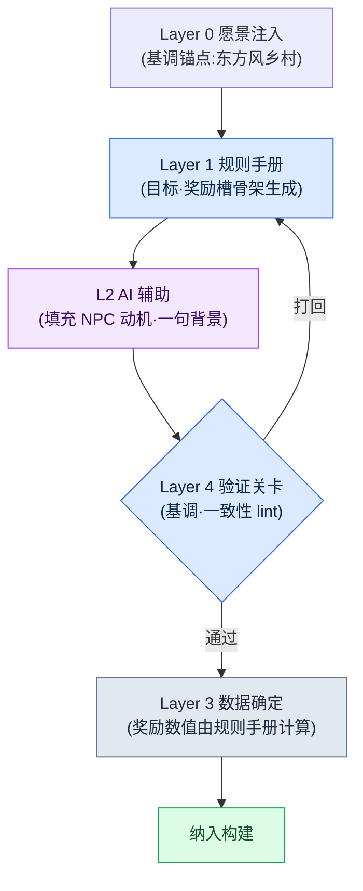

# 6.1 程序化内容生成与 AI —— 两轴交叉的一格

周一早晨的策划会议。白板上写着一行字:"上线前要做 1,000 个支线任务。"有人按起了计算器。一名作者每个任务花一天,就是四年;哪怕五个人一起上,也接近一年。房间里的空气沉了下来。在这个房间里坐了 24 年的我知道,面对这个数字,人们总是分成同样的两派:一派说"砍掉一些量",另一派说"用工具量产"。而几乎每一次,结论都是两者都要。

程序化内容生成(Procedural Content Generation,以下简称 PCG)正是"用工具量产"那一派的老答案。副本房间的布局、武器词条的组合、敌人刷新池,早在 20 年前就靠规则手册和概率表实现了自动化。新出现的并不是 PCG 本身,而是在自然语言、图像、叙事进入的位置上,换成了 LLM 与生成模型。

不过,本书想说的并不是"把 AI 接到 PCG 上"。那谁都会做。问题在于接在*哪里*。面对一整块内容,如果不把它落在自动化的哪一档强度、结构的哪一层交汇的那"一格"上钉死,就会陷入有工具却没有位置的状态。本章要看的,是如何把那"一格"画成坐标,以及在那一格之上,一块内容如何真正地在流水线上跑完一圈。

---

## 6.1.1 PCG 一直止步的地方

传统 PCG 擅长确定性。相同的输入产生相同的输出,并且可以验证。副本房间图、武器词条的 prefix·suffix、敌人刷新分布因此很早就站稳了脚跟。"烈焰之剑 +5"在 20 年前就能自动生成。

问题总是出在紧接着的那个位置。房间布置好了,但房间里 NPC 的名字、外形、简短背景仍留在作者手里。"烈焰之剑 +5"能生成,可"国王遗失的最后一柄剑"这一句却生成不出来。哪怕任务 generator 拼出了目标与奖励的组合,"为什么要做这个任务"仍要由人来写。

在体量大的游戏里,这个位置一直是瓶颈。可量产的部分与需要人工的部分,比例大约是 4 比 6,而那需要人工的 6 成吃掉了排期的大半。哪怕量产线快速产出那 4 成,只要 6 成跟不上,整个周期就被拖到那个速度上。

LLM 和图像模型进入的位置恰好就在那里。规则手册处理不了的自然语言、叙事、视觉领域,也被纳入可量产的范围。但这并不意味着把这个位置整个交给 AI 就是答案。AI 每次给出的答案都略有不同,一旦上下文为空,就会吐出一般 RPG 的平均值。因此需要设计*结合点*。结合点由两条坐标轴来定义。

---

## 6.1.2 第一条轴:自动化强度(L0\~L3)

纵轴讲的是,把人、规则手册和 AI *按什么比例混合*。在笔者所在的某家 MMORPG 开发公司(以下称"项目A")里,把它切成四档来用。

**L0 —— 完全手工。** 所有文字与决定都出自人手。主线任务正文、标志性角色台词、分支结局。一致性与叙事深度直接关系到游戏身份认同的位置。

**L1 —— 规则手册自动化。** 传统 PCG 的位置。规则手册、概率表、BSP 之类的确定性算法负责产出,人只做评审。副本房间布局、武器词条组合、敌人刷新是代表。

**L2 —— 规则手册 + AI 辅助。** 规则手册搭好骨架,AI 填充细节。支线任务梗概、普通 NPC 的名字与简短背景、狩猎场介绍文。人只负责输入的元数据和最后的验证关卡(verification gate,即由人或检查器把关的验证环节,类似质量门禁 quality gate)。

**L3 —— AI 优先 + 人工评审。** AI 负责生成正文,人只做评审。看着诱人,但非确定性、幻觉、一致性受损的风险都集中在这里。

核心是 L2。它把 L1 的稳定性与 L3 的量产力合到一起,而两边的缺点则用验证关卡挡住。L3 让人很想尽快引入,但笔者多次见到它因评审负担暴增而在一两个季度内被废弃的案例。100 个里有 70 个被标为可疑项,那就比人从头写 100 个还要贵。

---

## 6.1.3 第二条轴:Layer 结构(L0\~L4)

只靠纵轴,量产线是转不起来的。内容*本身*必须被拆解成层,自动化才有可进入的位置。这就是第 5 部分讲过的 Layer 拆解,也是内容领域里的横轴。五个层各自对应程序化生成的一种角色(锚点·规则手册·正文·数值·关卡)这一通用说明已在 §2.3.6 讲过,这里直接套用到内容量产线上。Layer 0 愿景是基调与世界观锚点(每次生成都注入),Layer 1 系统是生成规则手册(规则·概率表·标签体系),Layer 2 内容是生成结果堆积的正文位置(支线任务·NPC 背景·城市介绍文),Layer 3 数据是数值·ID·关系(奖励·刷新·曲线),Layer 4 构建·QA 是验证关卡(lint·一致性检查·作者评审)。

这两条轴讲的是不同的事。纵轴说的是"人插手多少",横轴说的是"内容的哪个部位"。而两者只有相乘才有意义。只有把一块内容钉在两轴的交点,也就是*一格*上,"这由谁、在哪里、怎么做"才算定下来。

---

## 6.1.4 两轴合为一张 —— 自动化 × Layer 矩阵

把一路用文字讲下来的两条轴,叠成一张格子看看。横向是内容的 Layer,纵向是自动化强度。每一格里的标签,是项目A中实际占据那一格的内容。颜色越深的格子,越接近量产线的重心。

<svg viewBox="0 0 760 440" xmlns="http://www.w3.org/2000/svg" font-family="sans-serif" font-size="12">
  <rect x="0" y="0" width="760" height="440" fill="#ffffff"/>
  <!-- 축 제목 -->
  <text x="380" y="22" text-anchor="middle" font-size="14" font-weight="bold">自动化强度(纵向) × Layer 结构(横向)</text>
  <text x="380" y="416" text-anchor="middle" font-weight="bold">→ Layer 结构(内容的哪个部位)</text>
  <text x="18" y="220" text-anchor="middle" font-weight="bold" transform="rotate(-90 18 220)">↑ 自动化强度(人插手多少)</text>
  <!-- 열 헤더 -->
  <g text-anchor="middle" font-size="11" font-weight="bold">
    <text x="190" y="52">L0 愿景</text>
    <text x="310" y="52">L1 系统(规则手册)</text>
    <text x="430" y="52">L2 内容(正文)</text>
    <text x="550" y="52">L3 数据</text>
    <text x="670" y="52">L4 构建·QA</text>
  </g>
  <!-- 행 헤더 -->
  <g text-anchor="end" font-size="11" font-weight="bold">
    <text x="124" y="92">L0 手工</text>
    <text x="124" y="172">L1 规则手册</text>
    <text x="124" y="252">L2 规则手册+AI</text>
    <text x="124" y="332">L3 AI优先</text>
  </g>
  <!-- 격자 칸: x=130..730 (5열,120폭) y=60..380 (4행,80높이) -->
  <!-- 행 L0 수작업 -->
  <rect x="130" y="60" width="120" height="80" fill="#dfe7f3" stroke="#7a93c0"/>
  <text x="190" y="104" text-anchor="middle" font-size="10">亲手写一句基调</text>
  <rect x="250" y="60" width="120" height="80" fill="#f4f6fa" stroke="#c8c8c8"/>
  <rect x="370" y="60" width="120" height="80" fill="#eef1f6" stroke="#c8c8c8"/>
  <text x="430" y="98" text-anchor="middle" font-size="10">主线任务</text>
  <text x="430" y="112" text-anchor="middle" font-size="10">标志性台词</text>
  <rect x="490" y="60" width="120" height="80" fill="#f4f6fa" stroke="#c8c8c8"/>
  <rect x="610" y="60" width="120" height="80" fill="#f4f6fa" stroke="#c8c8c8"/>
  <!-- 행 L1 룰북 -->
  <rect x="130" y="140" width="120" height="80" fill="#f4f6fa" stroke="#c8c8c8"/>
  <rect x="250" y="140" width="120" height="80" fill="#b9cae6" stroke="#5b78ad"/>
  <text x="310" y="178" text-anchor="middle" font-size="10">副本房间布局</text>
  <text x="310" y="192" text-anchor="middle" font-size="10">词条·刷新概率表</text>
  <rect x="370" y="140" width="120" height="80" fill="#f4f6fa" stroke="#c8c8c8"/>
  <rect x="490" y="140" width="120" height="80" fill="#eef1f6" stroke="#c8c8c8"/>
  <text x="550" y="184" text-anchor="middle" font-size="10">奖励曲线计算</text>
  <rect x="610" y="140" width="120" height="80" fill="#f4f6fa" stroke="#c8c8c8"/>
  <!-- 행 L2 룰북+AI (무게중심) -->
  <rect x="130" y="220" width="120" height="80" fill="#f4f6fa" stroke="#c8c8c8"/>
  <rect x="250" y="220" width="120" height="80" fill="#eef1f6" stroke="#c8c8c8"/>
  <text x="310" y="264" text-anchor="middle" font-size="10">定义生成规则手册</text>
  <rect x="370" y="220" width="120" height="80" fill="#7fa0d4" stroke="#385583"/>
  <text x="430" y="258" text-anchor="middle" font-size="10" font-weight="bold" fill="#ffffff">支线任务骨架</text>
  <text x="430" y="274" text-anchor="middle" font-size="10" fill="#ffffff">NPC 简短背景·介绍文</text>
  <text x="430" y="289" text-anchor="middle" font-size="9" fill="#ffffff">★ 重心</text>
  <rect x="490" y="220" width="120" height="80" fill="#f4f6fa" stroke="#c8c8c8"/>
  <rect x="610" y="220" width="120" height="80" fill="#eef1f6" stroke="#c8c8c8"/>
  <text x="670" y="264" text-anchor="middle" font-size="10">lint·一致性检查</text>
  <!-- 행 L3 AI우선 -->
  <rect x="130" y="300" width="120" height="80" fill="#f4f6fa" stroke="#c8c8c8"/>
  <rect x="250" y="300" width="120" height="80" fill="#f4f6fa" stroke="#c8c8c8"/>
  <rect x="370" y="300" width="120" height="80" fill="#e6ddec" stroke="#a98ec0"/>
  <text x="430" y="344" text-anchor="middle" font-size="10">更新公告初稿</text>
  <rect x="490" y="300" width="120" height="80" fill="#f4f6fa" stroke="#c8c8c8"/>
  <rect x="610" y="300" width="120" height="80" fill="#eef1f6" stroke="#c8c8c8"/>
  <text x="670" y="344" text-anchor="middle" font-size="10">作者评审关卡</text>
</svg>

这张格子是本章的核心。原本散落在文字里的"主线是 L0""支线是 L2""奖励归规则手册"之类的判断,汇聚到*一个坐标*上。会议上有新内容进入议题时,只需问一句"这是哪一格"就够了。格子一旦定下,那格的纵坐标告诉你谁来插手,横坐标告诉你是哪个部位。

读这张格子,有两点会映入眼帘。第一,重心(深色格)在 L2 行 × Layer 2 列。支线任务骨架、NPC 背景就在那一格,是量产线的心脏。第二,一块内容并不只待在一格里。支线任务的正文(Layer 2)在 L2 格,但它的奖励数值(Layer 3)则下沉到 L1 格。同一个任务,*不同部位住在不同格子*。这正是把两轴分开的理由。

---

## 6.1.5 在一格之上跑动的迷你流水线

在重心格 —— L2 行 × Layer 2 列,支线任务骨架 —— 之上,看一块内容如何真正跑完一圈。流程如下。



我们用一份实操记录(worked transcript,即完整保留的真实操作过程记录)把这个流程走一遍。假设要做一个乡村里的杂活任务。

**第 1 步 —— Layer 1 规则手册抽出骨架。** 规则手册是确定性的,只把槽位填出来。

```
[任务骨架 —— 规则手册输出]
地区: 乡村_3
委托人角色: 采药人
目标类型: 采集(药材 x6)
干扰要素: 狼群刷新(夜间)
奖励槽: { gold: ?, exp: ?, item: 采集镰 }
```

**第 2 步 —— 向 AI 请求细节。** 提示词全文如下。(先把 Layer 0 愿景作为上下文输入。)

> 你是一款以东方奇幻乡村为舞台的 MMORPG 的任务作者。基调锚点:"朴素,却笼罩着迷信与恐惧的乡野"。接收下面的骨架,写出委托人的一句动机、NPC 名字,以及呈现给玩家的两句委托文。绝对不要编造奖励数值(由系统决定)。输出为 JSON。
> 骨架: { 地区: 乡村_3, 委托人: 采药人, 目标: 采集 6 个药材, 干扰: 夜间的狼, 奖励物品: 采集镰 }

**第 3 步 —— Claude 的原始输出。**(不作概括,原样照录。)

```json
{
  "npc_name": "三月婆婆",
  "motive": "每到夜里,狼嚎把药圃糟蹋得不成样子,她再也不敢去挖那最后的药材。",
  "quest_text": "一到夜里,狼群就把药圃翻得乱七八糟。我怕得挪不动步子,劳您替我到山脚下挖六株药材回来吧。",
  "reward": { "gold": 120, "exp": 300 }
}
```

这里要停下来看一点。AI *在没被要求的情况下*,还是造出并填进了 `reward` 字段。这恰好说明了第一轴与第二轴为何必须分开。奖励数值(Layer 3)是 L1 规则手册的位置,不是 AI(L2)的位置。把它交给 AI,数字就会每次调用都晃动,奖励曲线随之崩掉。

**第 4 步 —— 人工验证与拒绝。** 评审者做两件事。(1)*删除* `reward` 字段 —— 这是规则手册要填的格。(2)看基调。"三月婆婆"、一句动机、两句委托文都合乎乡村基调,通过。若 AI 塞进了"魔法师公会的委托"这类世界观之外的词,就在这里打回,退回到骨架步骤。

**第 5 步 —— Layer 3 数据确定。** 被删掉的奖励槽由规则手册重新填上。这是绑定地区等级与目标难度的确定性公式。`gold: 85, exp: 240`。不是 AI 随口吐出的 120·300,而是符合曲线的值。

这一圈就是重心格的标准循环。规则手册出骨架,AI 添血肉,人做关卡,规则手册再出数值。1,000 个内容全都跑这个循环。格子既已定下,就不必每次再为"这由谁来做"争论一遍。

---

## 6.1.6 定格子时要问的五个问题

要决定把新内容放进格子的哪一格,五个问题会有帮助。每当会议上出现量产议题时,把它们记下来一起作答,格子分配的一致性会在一个季度内稳定下来。

一、量产负担有多大。上线前需要 N 个?N 一旦超过 100,L0 行几乎不可能。

二、一致性要求有多高。若内容之间的一致性是体验的核心,验证关卡(Layer 4)就得够强;若多样性才是核心,就有往更上面的行走的余地。

三、能否容忍非确定性。这是每次略有不同的结果会带来丰富度的领域,还是相同结果才是信任核心的领域。

四、评审成本是多少。每块内容是 5 分钟还是 30 分钟,决定了运作周期的长短。

五、出事时的成本是多少。是可以自由废弃、重写,还是一旦放出去就直接酿成用户事故。

把这五问抛给支线任务,答案会朝一个方向汇聚。1,000 个以上(L0 不可能)、一致性低于主线、容许非确定、评审 5\~10 分钟、事故成本低(可单独废弃)。五个答案一汇合,L2 行 × Layer 2 格便顺理成章。把同样的五问抛给主线任务,则朝相反方向汇聚。50 个、一致性与叙事深度最高、不容许非确定、评审成本大、事故成本极大 —— 就是 L0 格。

---

## 6.1.7 四个常见陷阱

即便画好了格子,会掉进去的陷阱也大同小异,反复出现的有四个。

第一,**从 L3 行起步。** 抱着"AI 自动搞定 100 个"的期待出发,评审就会暴增。先让 L1 格落地,再往上升到 L2,L3 只在一部分内容上谨慎使用。上面那条迷你流水线里,人删掉奖励字段的那一个动作,小小地展示了 L3 行为何危险。

第二,**不要规则手册,把整件事整个交给 AI。** "帮我做 100 个支线任务"招来的是一般 RPG 的平均值。必须先由 Layer 1 规则手册搭好骨架,AI 在其上填血肉,才能产出属于我们这款游戏的内容。写一本规则手册,是 PCG 里最费工、最无趣的活儿,但一旦跳过它,其上的所有量产都会塌回平均值。

第三,**验证关卡(Layer 4)空缺。** AI 输出自动进入构建,就会直接引发一致性事故。无论哪一格,人工关卡都是必需的。

第四,**只看成本就定工具。** LLM API 成本每个季度都在下降,但一致性事故的成本不会下降。定工具时,要在 API 成本之上,再加上一致性与评审时间的总和来看。

---

## 6.1.8 度量 —— 迁到重心格后的六个月

在项目A,把支线任务从 L0 格迁到 L2 格之后,笔者度量了六个月。下面这些数字里,绝对值是笔者的估算(未经验证),而变化的方向与比例才是实测中观察到的部分。

| 项目 | L0 时期 | 转为 L2 后 |
|---|---|---|
| 作者人均写 1 个任务 | 约 4 小时 | 约 50 分钟(元数据 30 分钟 + AI 5 分钟 + 评审 8 分钟) |
| 每周量产 | 5 个 | 30\~40 个 |
| 废弃率 | 几乎 0% | 约 20% |
| 一致性事故(每季度) | 3\~5 起 | 5\~8 起(加固后正常) |
| 作者满意度(10 分) | 8 | 6 → 7(政策加固后) |

废弃率升到了 20%,但量产速度是原来的 6\~8 倍,净吞吐量因此增加了 4\~5 倍。一致性事故小幅升到每季度 5\~8 起,但通过验证关卡与规则手册的加固,在一个季度内回到了正常范围。

最大的变化不是数字,而是人。起初作者们觉得自己成了"量产评审员",满意度从 8 跌到 6。为了挽回这一点,我们插入了一项政策:在主线任务与标志性支线任务(每座城市 1\~2 个)上,明确保障作者的时间。这是要钉死一点 —— 量产线不是要吸走作者的时间,而是要成为把那些时间送回主线的工具。六个月后,满意度回到了 7。

从这次度量里要带走一点。迁格子的决定,必须让吞吐量、作者时间的分配、满意度一起跟上。只看吞吐量,量产是成功了,人却走了。

---

## 6.1.9 先做 Layer 拆解,PCG 在其上

Layer 拆解是程序化生成的前提,这个通用命题在 §2.3.6。这里只看它在 PCG 格子上如何显现。横轴(Layer 0\~4)模糊不清的团队,任何一格都无法稳定运转。不知道 Layer 0 愿景在哪里,每个 generator 的基调锚点就是空的,只会产出一般 RPG 的平均值;Layer 1 规则手册与 Layer 2 正文混在一个文件里,改动一行规则时就得连带触碰正文里的几十处;Layer 3 数据被写进正文里,奖励曲线调整一次,作者就要花上一周 —— 上面那条迷你流水线里,把奖励拆成独立槽位单放,就是这个原因。

所以在引入 PCG 之前,要检查的不是工具选择,而是*横轴是否已经拆解*。在五层齐备的团队里,接上一个 L1 generator 的成本,是一名作者一个季度。在五层混作一团的团队里,同样的引入会在两个季度内因一致性事故而被废弃。

五层不必一开始就完美。分离要循序渐进,接口要窄。头一个季度里,哪怕只把 Layer 0 的一句基调和 Layer 1 的一本规则手册拆出来,generator 可进入的位置也就打开了。但这并不意味着可以无限拖延。若 Layer 2 正文与 Layer 3 数据始终是一整块,下一章的具体工具也站不住脚。

---

## 6.1.10 下一章预告

下一章会解剖一个占据这张格子重心格的具体工具:量产各城市狩猎场的 `proj_city_hunting_generator`。看输入元数据、规则手册骨架、AI 正文、验证关卡如何被绑成一个循环,以及本章的迷你流水线在真实工具的规模上如何放大。

---

### 本章要点
- 自动化强度(纵向 L0\~L3)与 Layer 结构(横向 0\~4)只有相乘才有意义。
- 量产线的重心是 L2 行 × Layer 2 格,即支线任务骨架。
- 横轴拆解在先,PCG 只在其上的某一格里运转。

---

## 动手试试 —— 把一块内容放到一格上

**setup.** 选一种量产候选内容(例如支线任务)。把 Layer 0 的一句基调和 Layer 1 的规则手册骨架(槽位定义)拆成单独的文件。奖励数值槽在规则手册一侧留空。

**prompt.** 先把愿景作为上下文输入,再给出骨架,并明确写上"不要编造奖励数值,输出为 JSON"。把上面第 2 步的提示词直接改一改用就行。

**verify.** 看三点。(1)AI 若擅自加了奖励字段,就删掉(L3 是规则手册的位置)。(2)有世界观之外的词,就打回到骨架步骤。(3)只有通过的部分,才由规则手册填上奖励数值并纳入构建。

**单人精简版.** 没有团队也行。你自己用文本文件做出一本规则手册(5 个槽位)和一句基调就够了。把 10 个任务用上面的循环跑一遍,数一数评审时打回了几个。打回率若超过 30%,说明格子选错了 —— 要么把规则手册骨架做得更细密,要么下降一行(L1)重新看。打回率一旦稳定,那就是在你自身的规模上、这一格能运转的信号。
