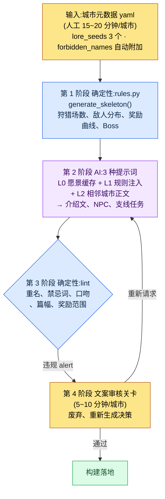

# 6.2 city_hunting_generator —— 4 周内造出 30 座城市

> 主要读者:负责内容量产的 MMORPG 策划(中等规模(10\~50 人)团队)
> 面向单人/业余读者的精简版:§6.2.10「一个人只需做到这些」

我还记得第一次拿到日程表、得知上线前需要 30 座城市那天的估算。一座城市由 5\~10 行的介绍文、3\~5 处狩猎场、每处狩猎场 5\~10 名 NPC 与 2\~3 个支线任务、1\~3 种特产道具、1 只城市 Boss 构成。用手工雕琢一座城市要花 1\~2 周。30 座就意味着一名文案要把整整 6 个月全耗在城市上。

然而那 6 个月根本挤不出来。文案的时间被主线任务和标志性角色占满,30 座城市必须与那些工作并行推进。「让 AI 把 30 座城市都造出来不就行了」——这个最初的冲动很快就破灭了。整包丢给它,只会得到 30 座彼此雷同的奇幻村庄。本章要看的,是为替代这一冲动而打造的工具 `city_hunting_generator` 如何把输入、规则手册、AI、验证这四个阶段串成一个循环,以及当这个循环真正完整跑完一遍时,会产出什么、又会废弃什么。

> **作者实际运营备注**
> 本章的 `city_hunting_generator` 是作者在公司 R&D 文件夹中实际运营的工具经匿名化后的版本。文件名、代码结构、验证项都忠实照搬自真实工具,城市名(silvermark 等)、公司专有名称已替换为书中用名。输出正文是对真实会话的重现。

---

## 6.2.1 人只负责元数据和最后的审核

工具的整体流程分为四个阶段。关键在于:第 1 阶段和第 3 阶段是确定性的(规则手册),只有第 2 阶段是 AI。规则手册从两端把住骨架与验证,即便夹在中间的 AI 每次给出略有不同的答案,城市之间的一致性也不会动摇。人只介入最初的输入(元数据)和最后的关卡(审核)。



在这张图里,人工触及的地方只有两处:最上方把一页元数据干净地填进去的位置,以及最下方对 lint 抓不到的语气、叙事作出判断的位置。中间那些枯燥的骨架生成与正文量产,交给规则手册和 AI 去跑。有一处关键设计:lint(第 3 阶段)即便发现违规也不自动废弃,只把 alert 上报给文案关卡(第 4 阶段)——理由将在 §6.2.5 中说明。

---

## 6.2.2 输入 —— 一页城市元数据

文案为每座城市写一页元数据。撰写时间 15\~20 分钟。虽短,但这一页就是后续三个阶段的全部输入。

```yaml
# city_021_silvermark.meta.yaml
city_id: city_021_silvermark
region: west
climate: cold_arid
dominant_faction: scholar_guild
cultural_tone: scholarly_strict
level_range: [25, 30]
lore_seeds:
  - 100 年前是魔法封印的中心地
  - 封印减弱的最初征兆在这座城市被观测到
  - 学者公会总部所在地
neighbors: [city_018, city_023]
# forbidden_names:(脚本自动附加 —— 文案无需填写)
```

最重要的槽位是 `lore_seeds`。3\~5 个核心事件决定城市的身份。太少,AI 会吐出一座普通的奇幻城市;太多,事件之间会相互矛盾。以作者的经验,3 个最为稳定。

`forbidden_names` 不由文案填写。脚本会读取既有城市、角色的名字列表,自动附加到元数据里。因为当 30 座城市 × 平均 50 名 NPC 累积起来,靠人脑去检查 1,500 个名字是否重复是不可能的。无需每次手动写上「别和其他城市的 NPC 重名」。

---

## 6.2.3 第 1 阶段 规则手册 —— 用确定性搭好骨架

规则手册接收元数据,生成城市的结构骨架。代码很简单。

```python
# city_hunting_generator/rules.py (骨架)
def generate_skeleton(meta):
    region_rules = REGION_RULES[meta.region]
    hg_count = region_rules.hunting_grounds_range.sample()
    enemy_dist = ENEMY_RULES[meta.climate][meta.dominant_faction]

    skeleton = {
        "hunting_grounds": [
            {
                "id": f"{meta.city_id}_hg_{i}",
                "level": meta.level_range[0] + i,
                "enemy_types": enemy_dist.sample(k=3),
                "reward_curve": calc_reward(meta.level_range[0] + i),
                "npc_count": region_rules.npc_per_hg,
                "sidequest_count": region_rules.sidequest_per_hg,
            }
            for i in range(hg_count)
        ],
        "boss": {
            "id": f"{meta.city_id}_boss",
            "level": meta.level_range[1] + 2,
            "pattern": BOSS_PATTERNS[meta.region],
        },
    }
    return skeleton
```

结果是确定性的。输入相同的元数据,就会得到相同的骨架。奖励曲线是否落在按 region·level 划定的标准范围内、敌人分布是否符合 climate·faction 规则,都由代码来保证,并有回归测试兜底。这一阶段绝不交给 AI。因为一旦让 AI 每次调用都为奖励曲线抽出不同的数字,城市之间的平衡当场就会动摇。

输入 silvermark 的元数据,`rules.py` 会返回一个空骨架:4 处狩猎场(`city_021_silvermark_hg_0`\~`hg_3`)、每处狩猎场 6 格 NPC 槽位、3 格支线任务槽位,以及 1 只 32 级 Boss。这是一张还没有名字、也没有正文、等待填充的格子表。填这些格子,就是第 2 阶段 AI 的工作。

---

## 6.2.4 第 2 阶段 AI —— 生成自然语言正文

规则手册搭好骨架之后,AI 在其上填入自然语言正文。城市介绍文,NPC 的名字、外形、简短背景,支线任务梗概,特产道具的风味文本(flavor text),都在这里产出。

调用模式沿用了上下文注入的四层结构。缓存 L0 愿景(world_premise + tone_manifesto),选择性注入 L1 规则(city_naming_rule + region_west_lore),再加上 L2 相邻正文(其他城市的 NPC 名字列表),最后附上任务指令。城市介绍文的提示词是可以直接复制使用的形态。

```
[L0 上下文] world_premise + narrative_pillar + tone_manifesto  (缓存)
[L1 上下文] city_naming_rule, region_west_lore
[输入] city_021_silvermark.meta.yaml + lore_seeds 3 个

给这座城市写一篇 6~8 行的介绍文。把三个 lore_seeds 都自然地融进去,
去掉「和平的村庄」这类 RPG 套话。语气要学者化、严格,克制抒情。
只要正文,不要前言或解说。
```

同样的模式在 NPC 量产、支线任务的调用中原样重复。差别只在上下文和输出格式。NPC 调用中会加入 `forbidden_names`(禁止与其他城市的 NPC 重名)槽位,支线任务调用中则加入「委托任务的 NPC 须从上面已生成的 NPC 中选取」的约束。

那么实际会产出什么?我们完整地跑一遍。

---

## 6.2.5 完整跑完一个循环 —— 输出、验证、废弃

如果只是抽象地写「AI 填充正文」,就无法知道这个工具究竟吐出了什么。我们把 silvermark 这一座城市的循环,从输入一直跟到废弃,完整地走一遍。

> **[第 2 阶段 AI 输出 —— 城市介绍文](真实会话重现)**
>
> 西尔弗马克(Silvermark)是一座封印之城。100 年前,七位学者为阻止西境魔力的泛滥,在这里的地下立起了封印阵,而城市便在那座阵上,一块石头一块石头地垒砌、生长起来。学者公会总部的钟楼是研读封印脉络的观测所,而非朝向神明的尖塔。最近 3 年,观测记录里反复写着同一行字:「脉在变冷。」封印减弱的最初征兆,不在别处,正是在这座城市的仪表盘上第一次颤动。街上的学者们不会大声谈论此事,只是钟楼的火整夜不熄的日子,多了起来。

这里,3 个 lore_seeds(封印中心地、减弱的最初征兆、学者公会总部)都写进了正文,没有「欢迎冒险者的和平村庄」这类套话,scholarly_strict 语气(克制抒情,使用观测、记录类词汇)也得到了保持。这就是一份能够通过的输出该有的样子。

接着,同一个循环填充狩猎场 `hg_0` 的 6 格 NPC 槽位中的 3 格。

> **[第 2 阶段 AI 输出 —— 3 名 NPC](真实会话重现)**
>
> **1)多伦·维尔(Doren Vale)** —— 钟楼观测助理。50 多岁,一只眼上永久装着黄铜放大镜。记录封印脉络细微震动的工作,已经做了 30 年。话很少,只用数字交谈。*「今天 12.4。昨天 12.1。在往上走。不是好事。」*
>
> **2)米拉·科斯特(Mira Kost)** —— 公会档案库管理员。30 多岁,墨渍再也擦不掉地留在手指上。她守护着封印阵的设计原本,却坚信能读懂那张图纸的学者早已全部离世。对外来者戒心很重。
>
> **3)格雷姆(Grem)** —— 钟楼下的守炉人。身份不明,年龄不详。他唯一的工作就是不让钟楼的火熄灭,对询问封印之事的人,只答一句「看着火就行」。*(标记为存疑 —— AI 自行申报)*

值得注意的是,第三名 NPC「格雷姆」是 AI 自己给它打上了 *存疑标记*。好的提示词能让 AI 说出「这一个我没有把握」。现在,第 3 阶段的 lint 要对这一批输出执行检查了。

> **[第 3 阶段 lint 输出](真实格式)**
>
> ```
> [PASS] 篇幅检查:介绍文 7 行(基准 6~8)
> [PASS] 奖励范围:hg_0~hg_3 reward_curve 在标准范围内
> [WARN] 重名:"Mira Kost" —— 与 city_014_riverhold 的 "Mira Veldt"
>        姓氏(Kost/Veldt)不同,但名字(Mira)相同。forbidden_names 近似冲突。
> [PASS] 禁忌词汇:tone_manifesto 违规 0 件
> [WARN] 口吻一致性:"格雷姆" 台词 voice_lint 置信度 0.62(未达阈值 0.70)
> ```

lint 抓出了 2 件违规,但没有自动废弃任何一件,只是作为 WARN 上报给文案关卡。这正是 §6.2.1 中预告过的设计核心。一旦把自动否决权也交到验证器手里,文案们不出一两个月就会把那个开关关掉。因为机器会把有意为之的变体也一并扼杀,连文案亲自去权衡那条边界的机会都被夺走了。所以,筛出可疑候选的活儿交给机器,而这些候选是留是弃的最后判断,则留在人的手里。

> **[第 4 阶段 文案审核 —— 判定与废弃]**
>
> 文案这样处理了这 2 件 alert。
>
> - **Mira Kost** → 保留。虽与 riverhold 的 Mira Veldt 同名,但在不同城市、不同姓氏,不存在同时登场的可能。作为有意变体予以通过。(不过,是否要把 forbidden_names 规则从「名+姓完全一致」改为「仅名字冲突也报 WARN」,另记一笔待议。)
> - **格雷姆** → **废弃。** voice_lint 置信度偏低就是信号。重读之后发现,「看着火就行」这样的守炉人角色,与 scholarly_strict 的城市语气相抵触。当学者公会主导的城市里出现走神秘主义语气的 NPC,城市的身份认同就会被冲淡。废弃后重新请求。

文案一旦决定废弃,就会再跑一次重新请求。「废弃格雷姆的槽位。请重新生成一个符合同一狩猎场学者公会语气(观测、记录、严格)的守炉人 NPC。禁用神秘主义词汇。」AI 这次回以一位记录钟楼炉温、连火都当作数据来看的老人,该输出以 voice_lint 0.81 通过。输入 → 骨架 → 正文 → 验证 → 废弃 → 重新生成的一个循环,在这里闭合。

这一圈就是本书贯穿始终的「Show(展示)」标准。工具吐出什么、什么被拦下、人又亲手毙掉什么——若不曾完整地看过哪怕一次,「用 AI 量产」这句话就是空洞的。

---

## 6.2.6 废弃率不是工具的失败,而是关卡在起作用的信号

在上面的循环里,有 1 名 NPC 被废弃。放到整座城市来看,废弃会更多。审核时间平均每座城市 5\~10 分钟,废弃率 NPC 约 20%,支线任务约 33%。

这里如实交代这些比例的计算依据。废弃率是在导入初期,亲自审核包括 silvermark 在内的 5 座城市并逐一计数得出的值。NPC 是审核的 30 名中废弃 6 名(20%),支线任务是审核的 15 件中废弃 5 件(33%)。由于样本仅 5 座城市、规模很小,它不是精确的总体比例,而应当作「五中取一、三中取一」量级的方向值来读。等 30 座城市全部审核完之后的累计比例,可能比这更低,也可能因狩猎场性质不同而更高。

重要的是,废弃率 0% 并不是目标。废弃 0% 更像是审核走了形式的信号。当五名 NPC 中有一名因语气不合而被废弃、三个支线任务中有一个因与 lore_seeds 贴合不上而被重新生成时,审核关卡才是在真正运转。

---

## 6.2.7 度量 —— 30 座城市 4\~5 周

我们对比工具导入前后。下面的时间数值是包括 silvermark 在内的早期城市的实测平均,「导入前」一列是工具出现之前手工作业时期文案的估算。没有任何加工过的数字。

| 项目 | 导入前(手工) | 导入后(实测) |
|---|---|---|
| 单座城市撰写时间 | 1\~2 周 | 约 30 分钟(元数据 15 分钟 + AI 5 分钟 + 审核 8 分钟) |
| 30 座城市总周期 | 相当于 1 名文案 6 个月 | 4\~5 周 |
| 废弃率(NPC) | ——(全部手工撰写) | 约 20%(30 名中 6 名) |
| 废弃率(支线任务) | —— | 约 33%(15 件中 5 件) |
| 一致性事故(每座城市) | 几乎没有 | 0\~1 件 |

只看表格,亮点在数字;可真正的成效出在别的格子里。原本险些被城市量产捆住的文案时间被释放出来,一名文案每个季度的主线任务产出得以大幅增加(具体倍数每个季度不同,故不下定论 —— 方向是「主线产出明显增多」)。量产工具不是在吞噬文案的时间,而是作为把时间释放出来的工具在运转(§6.1.8 那句警告——一旦文案觉得自己成了「审核机器」,工具就会被抵制——在这里同样适用)。

---

## 6.2.8 不放进 generator 的内容

即便自动化的范围变宽了,以下内容仍留在工具之外。

| 内容 | 留在工具之外的理由 |
|---|---|
| 主线任务正文 | 一致性、叙事深度直接关系到游戏的身份认同 |
| Boss 招式、演出 | 视觉、交互细节繁多,交给设计师上手更快 |
| 标志性主要角色 | 需要完整撰写 voice_profile,无法量产 |
| 分支结局 | 属于文案亲自决策的领域 |
| 每座城市 1\~2 个标志性支线任务 | 由文案挑选并亲自制作 |

「能够量产」这一事实,不该自动导向「就应该量产」的决定。正如在 silvermark 循环中看到的,工具能把 6 名 NPC 中的 5 名量产得很好。然而,要扛起那座城市「封印正在变冷」这一核心张力的那一名标志性 NPC,由文案亲手雕琢。只要自动化的边界足够清晰,量产工具反而会成为守护那块核心领域的工具。

---

## 6.2.9 五种常见的失败

| 失败模式 | 为何失败 | 处方 |
|---|---|---|
| lore_seeds 只写 1\~2 个 | AI 输出被拉平到普通 RPG 的平均水准 | 强制 3 个以上(§6.2.2) |
| 不用规则手册,直接让 AI 整包量产 | 「造 30 座城市」→ 30 座雷同的村庄 | 第 1 阶段规则手册无法跳过(§6.2.3) |
| 没有 lint,只依赖文案审核 | 审核者把时间耗在处理琐碎的规则违规上 | 先做第一道自动验证(§6.2.5) |
| 遗漏重名检查 | 1,500 个名字的重复靠人脑无法完成 | forbidden_names 自动附加(§6.2.2) |
| 不度量文案满意度 | 吞吐量上去了,但抢走文案时间就会被抵制 | 明确保障主内容时间(§6.2.7) |

第五种最常被忽视。要让文案乐于作出像废弃 silvermark 的格雷姆那样的判断,就必须给文案留出量产审核之外、亲自雕琢的时间。只度量吞吐量却不度量文案的时间,工具在 KPI 上是成功了,人却会离开。

---

## 6.2.10 动手试试 —— 今天就能做的一步

> **一个人只需做到这些**:没有规则手册的代码也没关系。挑一座你自己游戏(或你喜欢的游戏)里的城市、地区,按 §6.2.2 的格式手写一份元数据(3 个 lore_seeds 是关键),再把 §6.2.4 的介绍文提示词原样贴上去,跑一遍看看。从产出的 NPC 里挑一个语气不合的,亲自对它反驳:「这个 NPC 与城市语气相抵触,废弃、重来」——这样一来,你就能亲身体会到审核关卡究竟是怎样一组判断的集合。

如果是团队,就从下面这一步开始。先做出一份元数据 yaml 表单和 `forbidden_names` 自动附加脚本。规则手册骨架(`generate_skeleton`)和 lint 放在之后。哪怕只有输入表单和重名检查这两样,也能先挡住 AI 正文量产崩成「30 座雷同村庄」的两种常见失败。

---

## 6.2.11 下一章预告

6.3 将讨论 NPC Persona/Squad 流水线。如果说 6.2 的 generator 是把多伦、米拉这样的 NPC 逐个量产,那么 Persona/Squad 则把这些 NPC 以组为单位捆在一起。这是一套让同一狩猎场的五名 NPC 不再是彼此无关的木偶集合,而是作为一个小型社会来运转的方法。

---

### 本章要点
- 第 1、3 阶段是规则手册(确定性),只有第 2 阶段是 AI —— 人只负责输入和审核关卡。
- 只有把输出、验证、废弃完整地看过一遍,「AI 量产」才不空洞。
- 废弃率 20、33% 不是工具的失败,而是关卡在起作用的信号。

### 下一章预告
- 6.3. NPC Persona/Squad 流水线
