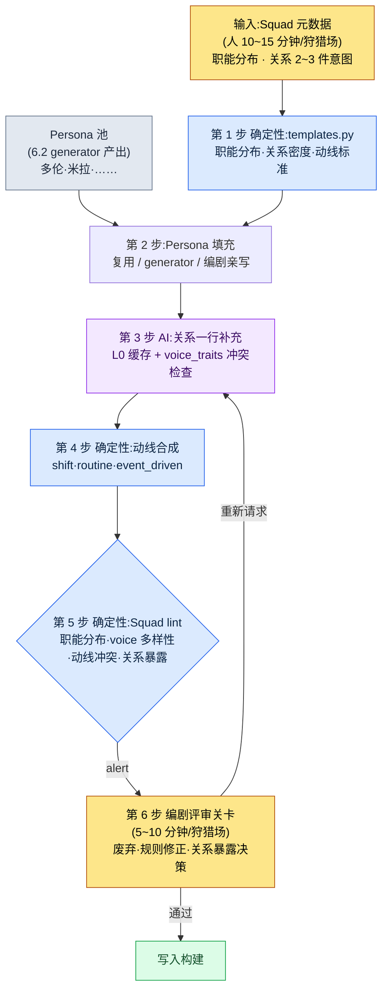

# 6.3 NPC Persona 与 Squad —— 从玩偶博物馆到小社会

> 主要读者:负责 NPC·狩猎场内容的 MMORPG 策划(中等规模(10\~50 人)团队)
> 面向单人/业余读者的精简版:§6.3.10「一个人的话，做到这些就够」

我记得那一天,我用 6.2 的 generator 在一个狩猎场里量产了五名 NPC,把它们放进游戏里看了看。名字·外形·简短的背景都填好了,只标了坐标就摆了上去。可当我真正在那个狩猎场里走一圈,却感到一种说不出的死气。五个人待在同一个空间里,却从未彼此提及一句。两个人叠在同一块岩石上。本来需要有人担任商人,五个人却全是学者。多伦也好、米拉也好,单独看都是没问题的 NPC,可一旦捆在一起,就成了一堆玩偶。

这就是玩偶博物馆的状态。单个 NPC 都做好了,作为群体却没有活起来。本章讲的是把那五个人捆成一个小社会的流水线。核心拆解是 Persona 与 Squad。用办公室来打比方,Persona 是员工的个人名片,Squad 是一个团队的组织架构图。名片摞了 50 张,却没有组织架构图,公司就转不起来。而本章的脊梁在最后一步——把捆好的群体是否"像彼此相识那样说话和行动",与 AI 一起走完整整一个循环来验证的那个环节。

> **作者实际运营备注**
> 本章的 Squad 流水线,是作者对自己在公司 R&D 文件夹中运营的 NPC Persona/Squad 工具做的匿名化处理。yaml 结构·验证项·voice_lint 阈值都忠实照搬了实际工具,城市·NPC 名称则与 6.2 一样替换为书中用名。输出正文是对真实会话的重现。

---

## 6.3.1 Persona 是名片,Squad 是组织架构图

Persona 是单个 NPC 的身份。它承载名字·外形·voice_profile·职能。6.2 的 generator 造出来的就是 Persona。多伦·韦尔、米拉·科斯特各自都是一个 Persona。

Squad 是把这些 Persona 捆成群体的单位。它定义在一个狩猎场里五个人以怎样的职能分布、彼此是什么关系、如何移动。

| 单位 | 承载内容 | 创建主体 |
|---|---|---|
| Persona | 名字·外形·voice_profile·职能 | generator(6.2) |
| Squad | 职能分布·关系·动线 | Squad 流水线(本章) |

不把这两者分开,两件事就会同时卡住。只量产 Persona 就成了玩偶博物馆,想从 Squad 做起又没有可填的 Persona。分开之后,每个单位的运营都变得简单。不过,分离并不等于割裂。关键是在两个单位之间铺好复用·验证的通路,这正是本章的正题。

这套 Persona→Squad 的拆解不只是简单的归整,它打开了走得更远的一条路。只有当 NPC 群体以职能·关系·数值被规整化,日后世界状态(玩家行为的累积)才能撼动 NPC 的数值,而这些数值又成为任务触发条件,一路走到动态反应性。本章只点到那种进阶应用的入口,正面处理的部分只到"由人评审的保守量产"为止。

---

## 6.3.2 输入 —— 一页 Squad 元数据

Squad 骨架从每个狩猎场一页元数据开始。这与 6.2 的城市元数据是同一套思路。人只定下职能分布和关系意图,填充的活儿交给规则手册与 AI。

```yaml
# city_021_hg_3.squad.yaml
squad_id: city_021_hg_3_squad
hunting_ground: city_021_silvermark_hg_3
type: hunting_ground_residents
size: 5
roles:
  - role: quest_giver
    count: 1
    voice_traits: [authoritative, scholarly]
  - role: lore_keeper
    count: 1
    voice_traits: [scholarly, withdrawn]
  - role: merchant
    count: 1
    voice_traits: [practical, dry]
  - role: bystander
    count: 2
    voice_traits: [varied]
relationships:
  - between: [quest_giver, lore_keeper]
    type: mentor_and_former_student
  - between: [merchant, bystander_1]
    type: regular_customer
movement_pattern: stationary_with_shifts
```

最重要的槽位是 `relationships`。关系若为 0 件,五个人到最后仍是陌路。关系太多(5 人有 5 件以上)则玩家要记的东西太多,反而被淹没。据笔者经验,5 人 Squad 配 2\~3 件核心关系最为稳定。`voice_traits` 是让五个人各自拥有不同嗓音的装置。若五个人全填 `scholarly`,在验证阶段就会因 voice 趋同而被拦下。

---

## 6.3.3 第 1 步·第 2 步 —— 规则手册骨架与 Persona 填充

规则手册先定下 Squad 骨架的标准。按狩猎场的 region·type,尺寸·职能分布·关系密度·动线模式的默认值都写进了代码。

```python
# npc_squad/templates.py (节选)
SQUAD_TEMPLATES = {
    ("west", "hunting_ground_residents"): {
        "size_range": (4, 6),
        "role_distribution": {
            "quest_giver": 1,
            "merchant": 1,
            "lore_keeper": (0, 1),
            "bystander": (1, 3),
        },
        "relationship_density": 2,        # 建议关系数
        "movement_pattern": "stationary_with_shifts",
    },
    ("east", "outpost_squad"): {
        "size_range": (3, 4),
        "role_distribution": {
            "commander": 1,
            "scout": 1,
            "support": (1, 2),
        },
        "relationship_density": 1,
        "movement_pattern": "patrol_loop",
    },
}
```

这一步是确定性的。西部居民 Squad 里出现五个全是 quest_giver 这种事故,在代码层面就不可能发生。职能分布一旦越出规则,当场就会被拦住。

接下来给每个槽位填入 Persona。路子有三条。池子里有合适的 Persona 就复用(出场权重 +1),没有就用 6.2 的 generator 新造,若是主线任务的核心人物则由编剧亲自撰写。silvermark 的 hg_3 Squad 把 quest_giver·lore_keeper 用 6.2 已经量产好的米拉·多伦填上,另外新抽了 merchant 与 2 名 bystander。到这里为止,与 6.2 的 generator 循环相同。本章真正的活儿在其后——验证捆好的群体是否真的像一个群体那样运转的那个环节。

---

## 6.3.4 走完一个完整循环 —— 关系补充·动线·一致性验证

如果只抽象地写一句"AI 补充关系",就看不出这条流水线到底吐出什么。下面把 silvermark hg_3 这一个 Squad 的后半段循环,从关系文本生成一直跟到废弃·重新请求,完整走一遍。

### 第 3 步 —— AI 关系补充

Squad 骨架里录入的关系标签(`mentor_and_former_student`)是抽象的,在游戏里看不见。把它变成一行描写、埋进 NPC 台词·事件,就是第 3 步。提示词是可以直接复制来用的形态。

```
[L0 上下文] world_premise + tone_manifesto  （缓存）
[L1 上下文] city_021_silvermark.lore（学者公会主宰，scholarly_strict）
[Persona 1] quest_giver —— 米拉·科斯特，公会档案库管理员，30 多岁，墨迹斑斑
[Persona 2] lore_keeper —— 多伦·韦尔，钟楼观测助手，50 多岁，只用数字交流
[关系标签] mentor_and_former_student

请把这两人（师父–昔日弟子）的关系，写成 1~2 行可用于游戏台词的背景描写。
多伦用数字、米拉用文书——让两种口吻不相冲突。语气用严格的学者风，
去掉神秘主义或"老朋友"之类的套话。只要正文。
```

> **[第 3 步 AI 输出 —— 关系一行]（真实会话重现）**
>
> 二十年前,多伦教过米拉封印阵观测记录的记法。如今立场颠倒,多伦测出的数值,由米拉誊抄进档案库的账簿。两人每周二都会为观测值与账簿对不上的某一格,短暂地争执一番。

这段输出不错。`mentor_and_former_student` 被具体化了,多伦的"数字"与米拉的"文书"没有冲突地被拧进同一个场景(把数值誊进账簿),scholarly_strict 语气也保持住了。同一套提示词,也会在 merchant–bystander_1 的 `regular_customer` 关系上重复一遍。

### 第 4 步 —— 动线合成

NPC 若整天站在一个地方,就又成了玩偶。规则手册来填动线模式。stationary 是固定一处(卫兵·Boss),stationary_with_shifts 是每 8 小时微调位置(普通),routine_loop 是基于时间表(居民),event_driven 是仅在触发时移动(任务 NPC)。这一步是确定性的,不调用 AI。

### 第 5 步 —— Squad 一致性 lint(这条流水线的关卡)

现在来查捆好的五个人是否真的像一个群体那样运转。如果说 6.2 的 lint 看的是单个 NPC,那么这个 lint 看的是群体一致性。

> **[第 5 步 Squad lint 输出]（真实格式）**
>
> ```
> [PASS] 职能分布：quest_giver 1 · lore_keeper 1 · merchant 1 · bystander 2（满足规则）
> [PASS] 关系密度：2 件（建议 2，满足）
> [WARN] voice 多样性：scholarly 系 3/5 —— quest_giver·lore_keeper·bystander_2
>        的 voice_profile 余弦相似度 0.83（超过阈值 0.80）。有趋同风险。
> [WARN] 动线冲突：14:00~16:00 区间 merchant·bystander_1 坐标半径 1.5m 重叠
> [FAIL] 关系暴露：定义了 2 件关系，但 5 人台词中任何地方都 0 次提及其他成员。
>        关系仅存在于数据中 —— 游戏内可见性为 0。
> ```

lint 抓出了三件。三件都不自动废弃,而是提交到关卡——可疑候选由机器挑出,但要杀还是要留由人来定,这与 §6.2.5 是同一套设计。

> **[第 6 步 编剧评审 —— 判定与废弃]**
>
> 编剧这样处理了这三件 alert。
>
> - **voice 趋同 (WARN)** → 废弃 bystander_2。即便是学者之城,五个人都是学者口吻也会让狩猎场单调。请求把 bystander_2 重新生成为 `practical, dry` 语气的杂役工。(quest_giver·lore_keeper 两人都是学者,是城市身份使然,予以保留。)
> - **动线冲突 (WARN)** → 修正规则。把 merchant 的 shift 起始偏移推后 +2 小时,化解 14:00 的重叠。不调用 AI,只调整动线参数。
> - **关系暴露 0 (FAIL)** → 最重要的一件。定义了整整两件关系,却在游戏里一次都不露面,那份数据就是死数据。编剧决定挑选一件核心关系(多伦–米拉),把它埋进台词。

三件里有两件靠规则·重新生成合上了,最后那个 FAIL 才是这条流水线的核心。编剧追加请求了多伦对话分支的一行。

```
请在多伦的台词里，插入仅仅一行、像不经意间流露出与米拉关系的话。
不要说明腔，要像顺带一提。学者风语气，只要一行台词。
```

> **[重新请求的输出]**
>
> *"那张图纸在档案库里。去问米拉吧。……二十年前是我教那家伙怎么读的，如今反过来了。"*

这一行加进去的一刻,两个 NPC 的关系就从数据表搬到了游戏画面上。输入(Squad 元数据)→ 骨架 → Persona 填充 → 关系补充 → 动线 → 一致性验证 → 废弃·暴露决策,这一个循环在此合上。

这一圈就是本章的 Show 标准。"用 Squad 把 NPC 捆成社会"这句话,若没有哪怕一次看到人把关系暴露 0 件的 FAIL 用一行台词合上的场景,就是空洞的。

---

## 6.3.5 Persona→Squad 全流程

把上面的循环用一张图放在这里。要点是:第 1·2·4·5 步是确定性的(规则手册·lint),只有第 3 步是 AI;而且人的手只触及最上面的输入和最下面的关卡。



人的手触及的地方只有两处。最上面定下职能·关系意图的环节,最下面判定 lint 抓不到的语气·叙事的环节。中间的骨架·动线·验证由规则手册来跑,关系正文由 AI 来跑。

---

## 6.3.6 让关系在游戏中可见的三个装置

第 5 步 lint 的 `关系暴露` 项最常出现 FAIL。因为关系只在数据里活着。把关系从数据里拽进游戏的装置有三个。

第一,**台词引用**。像 §6.3.4 里多伦那句台词那样,NPC 用一行提及其他成员。最便宜,效果也最大。

第二,**动线交叉**。每周二多伦与米拉一同待在档案库的场景,能在游戏里被观察到。玩家偶然看到,就会察觉"那两个人是不是有牵连"。只要第 4 步的动线与关系一致,它自然就会出现。

第三,**分支条件**。拒绝 quest_giver 的请求,lore_keeper 的好感度也会一起下降。这第三个装置正是 §6.3.1 所说进阶应用的入口——关系越过单纯的描写,开始对游戏状态产生影响的那个环节。

三个装置不必都用。在 5 人 Squad 里,哪怕只把 2\~3 件核心关系用第一·第二个装置暴露出来,狩猎场的体感也会大不相同。过多的话,玩家要记的东西就多了。编剧在评审阶段挑选要暴露的关系插进去,其余的只留作数据。

---

## 6.3.7 度量 —— 诚实地

比较工具引入前后。不使用加工过的数字。时间·比例是亲手评审 silvermark 等几个早期狩猎场时数出来的值,"引入前"一列则是手工时期编剧的估算。

| 项目 | 引入前(手工·估算) | 引入后(实测) |
|---|---|---|
| 一个狩猎场的 Squad 捆绑 | 约 3\~4 小时 | 约 25 分钟(元数据 12 分钟 + AI 5 分钟 + 评审 8 分钟) |
| 关系暴露(台词·动线)件数 | 每个狩猎场 0\~1 件 | 核心 2\~3 件中暴露 1\~2 件 |
| 动线冲突(同一坐标 2 人以上) | 每个狩猎场 2\~3 件 | 用 lint 提前拦截,0\~1 件 |
| voice 趋同废弃 | —(无检查) | 5 人中 0\~1 人重新生成 |

样本只有几个狩猎场,数量小,所以不该当作精确的总体比例,而应读作方向值。最大的变化不在表里。因为 lint 的 `关系暴露` FAIL 会强行把"这个狩猎场,一件关系都看不见"摆到编剧面前,量产成果作为玩偶博物馆上线的情况在结构上减少了。废弃 0%·暴露 0 件并非目标(§6.2.6),这一点在这里也一样。Squad 吸收了捆绑工作的大部分,但像多伦最后那一行台词那样的核心,必须给编剧留出亲手雕琢的时间。

---

## 6.3.8 Persona 池 —— 同一个人物出现在多座城市时

Squad 稳定之后,自然随之而来的运营就是 Persona 池。同一个 Persona 可以在多座城市出场。隶属学者公会的 NPC 在三四座城市里被遇见,反倒很自然。这不会让世界显得狭小,而是显得彼此相连。

```yaml
persona_pool:
  - id: persona_doren_vale
    voice_traits: [terse, numeric]
    appearance_count: 3
    appearance_cities: [city_021, city_018, city_023]
    signature: false
  - id: persona_mira_kost
    voice_traits: [scholarly, withdrawn]
    appearance_count: 2
    signature: false
```

复用比例有一个健康区间。

| 复用比例 | 状态 |
|---|---|
| 低于 20% | NPC 数量暴增,识别负担 |
| 30\~50% | 健康的运营区间 |
| 70% 以上 | NPC 令人厌倦,多样性受损 |

不过,让一个 NPC 出现在太多城市,就会变成"这人怎么又来了"。一个 Persona 最多出场城市定为 5 座作为上限。Boss 房间·标志性人物禁止复用(`signature: true`)。同一个 Persona 从第二次出场起,强制施加视觉变化(灯光·道具)。这个 30\~50% 的区间不是精确数值,而是运营指南——要按团队·游戏规模来校准。

> **[方向标 —— 若把 Persona 池当作分布来看(眼下还为时尚早)]** 如果是池子已长到数百 NPC 的团队,还有一个更进一步的方向——它与 §8.2.7"维度向量"一节处在同一位置,是一块方向标(不是处方——概念直觉见附录 M)。§6.3.4 的 voice_lint 已经用两个 Persona 的余弦相似度(0.83 这样的值)来看"接近程度"。把同一套嵌入(embedding)铺到整个池子上,就能把令人厌倦不靠编剧的印象、而靠分布密度来诊断——"学者口吻扎堆挤在一角"的状态,会呈现为那片区域的点密度。这样一来,与其在低密度区域里再新画一个"又一个相似的学者",不如在相近的两个 Persona 之间填入插值出来的变体,把多样性补上,这条路就打开了。不过,要一并放在心上的注意点有两个。用插值抽出的 Persona 很容易变成把两个 NPC 生硬混合的"死中间值",最终还得由人重新把 voice 救活。而且上面那个厌倦比例(30\~50%)不是精确值,而是运营指南,一旦把它换算成嵌入距离,松散就有可能装成精确的样子藏起来——距离值是帮助编剧判定的信号,而不是判定本身。

---

## 6.3.9 六种常见的失败

| 失败模式 | 为何失败 | 处方 |
|---|---|---|
| 只量产 Persona 而无视 Squad | NPC 50 名都齐了,狩猎场却死气沉沉 | 引入 Squad 骨架规则手册 (§6.3.3) |
| 无职能分布规则的自由生成 | 出现只有五个商人、0 个学者这类分布事故 | 强制 role_distribution (§6.3.3) |
| 只放关系标签而缺一行描写 | 关系抽象,在游戏里看不见 | 第 3 步 AI 关系补充 (§6.3.4) |
| 无关系暴露检查 | 定义了关系,却在台词·动线上 0 件暴露 | 第 5 步 `关系暴露` lint (§6.3.4) |
| 缺动线冲突检查 | 同一时间同一地点 2 人,上线后频发 | 坐标·时段自动检查 (§6.3.4) |
| 复用比例 0% 或 70%+ | 0% 是量产暴增,70%+ 是令人厌倦 | 池运营 + 出场上限 (§6.3.8) |

第四种最常被漏掉。定义关系与让关系在游戏里可见,是两件不同的工作,没有检查,后者几乎总是缺席。在 silvermark hg_3 里,如果 lint 没有把关系暴露 0 件作为 FAIL 摆出来,多伦和米拉就只会在数据表里是师徒关系。

---

## 6.3.10 动手试试 —— 今天就能做的一步

> **一个人的话，做到这些就够**:没有规则手册、没有 lint 也行。从你自己的游戏(或喜欢的游戏)里某一处的 NPC 中挑 3\~5 名,按 §6.3.2 的格式,用手写下职能和 2 件关系。接着把 §6.3.4 的关系补充提示词原样贴上,拿到一行描写,最后亲自问一句——"这段关系,现在在游戏台词的哪里看得见?"一处都没有的话,那就正是 lint 的 `关系暴露 0` FAIL。在一名 NPC 的台词里插进其他成员的一行,亲手把那个 FAIL 合上,你就会切身体会到 Squad 验证抓的到底是什么活儿。

如果是团队,就从下面这一步开始。先做一张 Squad 元数据 yaml 表单,以及第 5 步 lint 中的 **`关系暴露` 检查这一行**(用 grep 查每个 NPC 台词文本里是否出现其他成员的名字·职能)。职能分布检查·动线冲突检查放在其后。哪怕只有关系暴露这一项检查,也能先挡住量产狩猎场作为玩偶博物馆上线这一最常见的失败。

用 setup → prompt → verify 概括就是——**setup**:在 Squad 元数据 yaml 里定义职能·关系,用 templates.py 定下骨架。**prompt**:按 §6.3.4 的格式拿到关系一行,同时强制禁止 voice_traits 冲突·禁止套话。**verify**:跑一遍第 5 步 lint 确认 `关系暴露` FAIL,把一件核心关系埋进台词,亲手合上。

---

### 本章要点
- Persona 是名片,Squad 是组织架构图——分开来,玩偶博物馆才会变成社会。
- 关系补充·动线·一致性验证要完整走一遍,"捆成社会"才不空洞。
- 由人用一行台词合上 `关系暴露 0` FAIL,才是这条流水线的心脏。

### 下一章预告
- 6.4 内容量产工作流 —— 把 Persona·Squad·城市生成捆成一周循环
