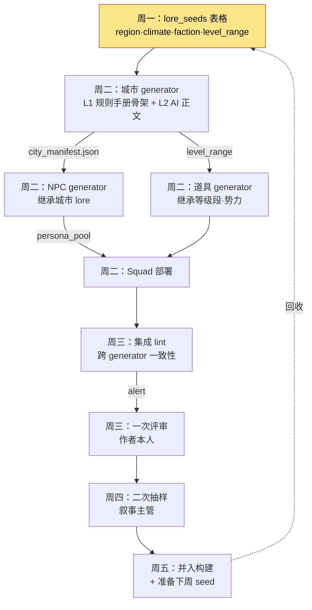

# 6.4 内容量产工作流 —— 把多个 generator 串成一条产线

三个工具各自完工的那一周，我一口气跑了城市 generator、NPC generator 和道具 generator。三者各自都运行良好。城市生成了 7 座，NPC 生成了 110 名，武器生成了 60 件。可几天后坐下来评审时，我才发现自己把同一个陷阱踩了三遍。

城市 `port_harman` 被生成成了“没落的渔村”，可布置到那座城市里的 NPC 们，人设却是“繁荣贸易港的富商”。原因在于城市 generator 和 NPC generator 看的是不同的 lore_seeds。武器 generator 则在这座推荐等级为 12\~18 的城市里，把 40 级的传说武器铺进了商店。三个工具各自都没错，却因为没被串起来而错了。

本章讲的不是造一个工具的故事，而是把 6.2 的城市 generator、6.3 的 NPC Squad 以及道具 generator **串成一条生产线**来运转的故事。工具有三个，陷阱却不是三个——它们会在工具之间的缝隙里重新冒出来。

---

## 6.4.1 生产线这一视角

如果把城市·NPC·道具 generator 各自单独去跑，每个工具的输出就会和另一个工具的输入对不上。解法不是把工具做得更聪明，而是**在上游一次性固定好共享的元数据，再让各个工具在它下面排成一队**。如果说 6.2 ch2 的城市 generator 是单个工具的范本，那么本章要做的，就是把那个工具降格为产线上的一个工站。

整条产线是这样流动的。



关键是 `city_manifest.json` 这条箭头。城市 generator 在造出一座城市的同时，把这座城市的身份（是没落的渔村，还是繁荣的贸易港）产出成一份 manifest，NPC generator 和道具 generator **把这份 manifest 当作输入接收下来**。我当时踩的那个陷阱，正是因为缺了这条箭头。所谓把工具串起来，就是在工具之间放进这一行契约。

---

## 6.4.2 把工具串起来的一行契约 —— manifest

城市 generator 每造出一座城市，都会一并吐出一份 `city_manifest.json`，它的实际形态如下。这个文件会成为 NPC·道具 generator 的输入。

```json
{
  "city_id": "port_harman",
  "display_name": "哈尔曼港",
  "lore_seeds": ["没落的渔村", "旧日贸易的余响", "缺盐"],
  "region": "南部沿海",
  "dominant_faction": "渔民公会",
  "level_range": [12, 18],
  "tone": "衰落·坚韧",
  "forbidden_names": ["哈兰", "哈尔门"],
  "neighbors": ["salt_marsh", "old_pier"]
}
```

NPC generator 继承 `lore_seeds` 和 `tone`，造出“没落渔村里那群坚韧的人”。道具 generator 继承 `level_range`，只铺 12\~18 级的武器。`forbidden_names` 是邻城已经用过的名字，两边都会避开。三个工具看的是同一份契约。

制作这份 manifest 时，我给 Claude 的提示词如下。这是把量产产线上游绑在一起的、最重要的一次调用，所以原样照录全文。

> 你是 MMORPG 城市 generator 的 manifest 生成器。接收下面的作者元数据，生成 city_manifest.json。
>
> 作者输入：
> - city_id: port_harman
> - lore_seeds: 没落的渔村、旧日贸易的余响、缺盐
> - region: 南部沿海
> - level_range: 12-18
>
> 规则：
> 1. dominant_faction 从 lore_seeds 推断，但不得与邻城（salt_marsh、old_pier）的势力重复。邻城势力为 [盐田公会、走私团]。
> 2. forbidden_names 里填入已在邻近城市使用过的 NPC/地名。提供的列表：[哈兰、哈尔门]。
> 3. tone 控制在两个词以内，且不与 lore_seeds 矛盾。
> 4. 区分标注推测的值和作者明确指定的值。

Claude 的原始输出是这样的。不作概括，原样照录。它在一个地方违反了规则。

> ```json
> {
>   "city_id": "port_harman",
>   "display_name": "哈尔曼港",
>   "lore_seeds": ["没落的渔村", "旧日贸易的余响", "缺盐"],
>   "region": "南部沿海",
>   "dominant_faction": "走私团",   // ← 推断：缺盐 + 旧贸易 = 走私
>   "level_range": [12, 18],
>   "tone": "衰落·贪婪",
>   "forbidden_names": ["哈兰", "哈尔门"],
>   "neighbors": ["salt_marsh", "old_pier"]
> }
> ```
> （推断的值：dominant_faction、tone、display_name / 作者明确指定：其余）
> 注意：我把 dominant_faction 选成了“走私团”，但规则 1 里邻城 old_pier 已经是“走私团”了。这违反了规则。作为替代候选，建议改用“渔民公会”。

这里重要的是 AI 主动报告了自己的规则违反。从 lore_seeds（缺盐·旧贸易）来看，“走私团”是个有吸引力的推断，但**在产线层面上却是冲突**。邻城已经是走私团了。我采纳了 AI 的建议，把 `dominant_faction` 改成“渔民公会”，`tone` 改成“衰落·坚韧”。“贪婪”是从走私团这个前提里推出来的词，和渔民公会并不相配。

这一次的验证·否决·重新指定，守住了产线的上游。manifest 一旦错了，它下面的 110 名 NPC 和 60 件武器就全都会建立在错误的前提之上。在上游花 5 分钟，就能在下游省下 3 小时。

---

## 6.4.3 集成 lint —— 检查工具之间的缝隙

单个 generator 的 lint 只看自己的输出。城市 lint 看城市是否遵守了规则手册，NPC lint 看人设是否保持了 voice 一致性。但我一开始踩的陷阱，**不在各个工具内部，而在工具之间**。所以产线在单个 lint 之上，还需要多一层——把城市·NPC·道具放在一起读、做交叉验证的集成 lint。

集成 lint 实际会抓到的项目如下。

| 检查项 | 比较什么 | 当时漏掉的 |
|---|---|---|
| lore 一致性 | city.lore_seeds ↔ npc.persona | 是渔村却有富商 |
| 等级段一致性 | city.level_range ↔ item.required_level | 12\~18 的城市里有 40 级武器 |
| 势力冲突 | city.faction ↔ neighbor.faction | 两座走私团城市相邻 |
| 名称重复 | 全部 city·npc·item 的名称池 | forbidden_names 未收集 |

下面是跑这个集成 lint 时的部分真实输出。它不做自动废弃，只抛出 alert，交由人来判定。

> ```
> [集成 lint] port_harman 产线检查 —— 3 alert
>
> ALERT-1（lore 一致性）port_harman
>   city.lore_seeds = ["没落的渔村", ...]
>   npc[merchant_04].persona = "繁荣贸易港的富商"
>   → 可能矛盾。需确认是否为有意变形。
>
> ALERT-2（等级段一致性）port_harman
>   city.level_range = [12,18]
>   item[blade_legend_07].required_level = 40
>   → 超出推荐等级段 28。请重新审视商店摆放。
>
> ALERT-3（名称重复）—— 信息
>   npc[fisher_02].name = "哈兰"
>   city.forbidden_names = ["哈兰", ...]
>   → 与 forbidden_names 冲突。建议重新生成 NPC 名称。
> ```

看到 ALERT-1，我犹豫了一下。NPC 是“繁荣贸易港的富商”，这未必就一定是错的。如果这座城市是**过去繁荣、如今没落**的，那么“曾经富有、如今潦倒的商人”反而是个好故事。于是我把 ALERT-1 判定为“有意的变形”而非废弃，同时提出一行修改：把 NPC 人设改成“抓着昔日繁荣贸易港残迹不放的老商人”。ALERT-2 是明显的事故，我把武器删掉了。ALERT-3 只重新生成了名字。

不是自动 lint 挡住了事故，而是自动 lint 把事故**摆到了人的眼前**，判定由人来做。这正是 6.1 里说的 L2（规则手册 + AI 辅助）的核心。AI 造出骨架和 alert，人做最后的判定。像 ALERT-1 那样，把“看似错误、其实是好故事”的东西分辨出来，是规则手册做不到的。

---

## 6.4.4 用一周周期来运转产线

把工具串起来之后，就需要节奏。产线以一周为单位运转最为稳定。一周，短到不会让评审暴增，又长到不会让回收变慢，正好卡在我桌上日历的一格里。

| 星期 | 产线工站 | 作者时间 |
|---|---|---|
| 周一 | 编写 lore_seeds 表格（manifest 上游） | 半天（5\~7 座城市 × 15\~20 分钟） |
| 周二 | 城市→NPC→道具 generator 连锁执行 | 无作者介入 |
| 周三 | 集成 lint + 一次评审（本人） | 1 小时（5\~10 分钟/座） |
| 周四 | 二次抽样评审（叙事主管） | 2\~3 分钟/座 |
| 周五 | 并入构建 + 准备下周 seed | 很短 |

周二是产线的心脏。城市 generator 产出 manifest，NPC generator 就接住它，道具 generator 也接住它，Squad 一路做到部署。这条连锁在没有作者介入的情况下在后台运转。作者则在这段时间写主线任务（L0 完全手工）。把工具串起来的真正回报就在这里。工具各自为战时，作者周二要动三次手；串起来后，一次都不用动。

一名作者一周量产 5\~7 座城市，连同附带的 NPC·武器一起。4 周就是 20\~28 座城市。30 座的目标，6 周就达成了。

---

## 6.4.5 产线的健康度 —— 每周要看的四个指标

产线是否健康，不靠印象，而靠数字来看。这是每周自动汇总的四个指标。

| 指标 | 正常范围 | 偏离时的信号 |
|---|---|---|
| 集成 lint 通过率 | 80\~95% | 低于 60% 说明 manifest 上游坏了 |
| 跨 generator 冲突 | 每座城市 3\~5 件 | 10 件以上说明 generator 间的契约破裂 |
| 人工评审废弃率 | 10\~20% | 30% 以上说明量产参数不对 |
| 单个作者的周期时间 | 5 天 | 7 天以上说明认知负担过重 |

最有产线特征的指标是第二个，**跨 generator 冲突数**。只用单个工具时，这个数字根本不存在。这个数字一旦突然超过 10 件，就不是某个工具坏了，而是**工具之间的契约（manifest）破裂了**。通常是改了城市 generator 的 manifest schema，而 NPC generator 还在读旧 schema 时爆掉。没有这个指标，那种事故要到上线才会被发现。

这四个指标每周录入，汇入季度复盘。趋势一旦变差，就把下周的量产城市数从 5\~7 座减到 3\~5 座，去查原因。

---

## 6.4.6 让产线崩塌的三种事故

把多个工具串起来后，会出现单个工具时没有的事故。这里记下我常见的三种。

**第一，契约不一致事故。** 城市 generator 的 manifest 里加了新字段，NPC generator 却不认识这个字段。跨工具冲突指标随之激增。工具各自独立开发时，很容易只更新一边。应对办法是在 manifest schema 里放一个 `version` 字段，让下游 generator 一旦发现版本不一致就立刻抛出 alert。这不是去催逼人，而是强制契约。

**第二，上游污染事故。** 一旦 manifest 建立在错误的前提上生成（比如 §6.4.2 里的“走私团”），它下面的一切都会被污染。人工评审废弃率超过 30%，可翻看被废弃的输出，NPC 单个的质量都好好的。单个没问题，错的是前提。应对办法是在 manifest 生成阶段再加一道评审。与其评审下游的 110 个，不如评审上游的 1 个。

**第三，模型漂移事故。** LLM 自动更新，输出特性随之改变。城市·NPC·道具三个 generator 会同时晃动。这时要检查最近一周的变更，分析 5 个废弃样本，再调整提示词或上下文。监控一周后确认恢复。

三种事故的共同应对是一样的。**不责怪人，而是强化契约。** 如果原因是作者只写了一行 lore_seeds，那么与其说“请写三行”，不如在 manifest lint 里加一道强制检查。但这并不意味着人的责任为 0。与系统强化并行，事故模式要在复盘中共享。

---

## 6.4.7 作者的时间去了哪里

把产线串起来的真正目的，不是取消作者，而是让作者能专注于招牌内容。下面用一张图画出：工具各自为战时作者的时间是怎么散掉的，串起来之后又是怎么聚拢的。

<svg viewBox="0 0 640 250" xmlns="http://www.w3.org/2000/svg" font-family="sans-serif" font-size="13">
  <text x="160" y="20" text-anchor="middle" font-weight="bold">引入前（工具分离）</text>
  <text x="480" y="20" text-anchor="middle" font-weight="bold">引入后（产线整合）</text>
  <!-- before bars -->
  <rect x="40" y="40" width="180" height="28" fill="#1d4ed8"/>
  <text x="50" y="59" fill="#fff">主线任务 30%</text>
  <rect x="40" y="72" width="120" height="28" fill="#2563eb"/>
  <text x="50" y="91" fill="#fff">招牌内容 20%</text>
  <rect x="40" y="104" width="180" height="28" fill="#9ca3af"/>
  <text x="50" y="123" fill="#fff">量产支线评审 30%</text>
  <rect x="40" y="136" width="90" height="28" fill="#9ca3af"/>
  <text x="50" y="155" fill="#fff">量产 NPC 15%</text>
  <rect x="40" y="168" width="30" height="28" fill="#d1d5db"/>
  <text x="76" y="187" fill="#374151">运营 5%</text>
  <!-- after bars -->
  <rect x="360" y="40" width="280" height="28" fill="#1d4ed8"/>
  <text x="370" y="59" fill="#fff">主线任务 50%</text>
  <rect x="360" y="72" width="170" height="28" fill="#2563eb"/>
  <text x="370" y="91" fill="#fff">招牌内容 30%</text>
  <rect x="360" y="104" width="85" height="28" fill="#9ca3af"/>
  <text x="370" y="123" fill="#fff">评审 15%</text>
  <rect x="360" y="136" width="30" height="28" fill="#9ca3af"/>
  <text x="396" y="155" fill="#374151">NPC 5%</text>
  <text x="360" y="187" fill="#374151" font-size="12">运营 0% —— 产线吸收</text>
  <text x="40" y="225" fill="#b45309" font-size="12">主线+招牌内容 50% →</text>
  <text x="360" y="225" fill="#b45309" font-size="12">主线+招牌内容 80%</text>
</svg>

主线和招牌内容上聚起了作者时间的 80%。但这个分配不会自动维持。引入产线后，作者时间往往会全流向评审。所以要每月测量时间分配，一旦主线跌破 50%，就减少量产城市数，把主线时间夺回来。时间分配得靠制度来守。

---

## 6.4.8 把产线扩展到其他内容

城市·NPC·道具产线稳定之后，就把同一套骨架扩展到副本·图鉴·线上活动。核心是**不制造新的模式**。“副本和城市不一样，得用别的结构”这种诱惑总会冒出来。但产线的骨架（共享 manifest → generator 连锁 → 集成 lint → 人工评审）是完全一样的。要替换的只有输入元数据的格式和领域规则手册。

如果是副本，`dungeon_manifest.json` 里会加上 `boss_pattern`·`encounter_flow` 这类字段，Boss 走位之类的领域规则会给集成 lint 再添一行。骨架相同，只有规则不同。保持同一套骨架，作者就不必再学一个新工具，集成 lint 的基础设施也能原样复用。不过这并不是说可以忽视领域特殊性。副本里显然需要城市所没有的走位规则。

---

## 6.4.9 运转六个月的结果

这是在我的项目里，把这条集成产线运转六个月的结果，与把城市·NPC·道具 generator 各自单独去跑的时期作对比。下面的绝对数字并非精确统计，而是**作者推测（未经验证）**，但方向和比例遵循实测趋势。

| 指标 | 工具分离时期 | 产线整合之后 |
|---|---|---|
| 量产城市（6 周） | 18 座 | 28 座 |
| 周二作者介入次数 | 每座城市 3 次 | 0 次 |
| 跨 generator 冲突（上线后发现） | 每季度 8\~12 件 | 每季度 2\~4 件 |
| 单个作者每季度的主线任务 | 3 个 | 8 个 |
| 上游评审时间 / 下游评审时间 | 0 / 3 小时 | 5 分钟 / 1 小时 |

最重要的变化在最后一行。工具分离时，上游评审是 0，下游评审是 3 小时。把产线串起来、在上游对 manifest 做评审之后，上游的 5 分钟抹掉了下游的 2 小时。事故不再从工具之间的缝隙漏出去，上线后的一致性事故也从每季度 8\~12 件减到了 2\~4 件。

而且权衡（trade-off）变得明确了。以前每个季度都会绕着“量产很危险”这种抽象争论打转。现在则是在“冲突 -8 件 / 主线 +5 个”这样的具体对比之上做决定。

---

## 6.4.10 七种常见的失败

1）不把工具串起来、各自单独去跑。陷阱不在工具内部，而在工具之间产生。

2）没有 manifest 就把 generator 连起来。缺了共享契约，下游就会和上游对不上。

3）用单个 lint 代替集成 lint。单个 lint 看不到跨工具冲突。

4）把周期从 5 天压缩到 3 天。5 天是评审的安全余量。

5）不评审上游（manifest），却去评审下游。与其看下游的 110 个，不如看上游的 1 个。

6）把事故只归为人的责任。强化契约·自动化规则才是答案。

7）搭好产线之后却“不用”。强制执行一周周期，和工具本身一样重要。

---

## 动手试试

**setup.** 准备好城市 generator（6.2）和 NPC generator（6.3）。为两者约定一份共享的 `city_manifest.json` schema。字段至少要有 `lore_seeds·region·faction·level_range·forbidden_names·tone·version`。

**prompt.** 直接沿用上面正文里的 manifest 生成器提示词。核心是最后两条规则：“不要与邻城势力重复”（防止跨工具冲突）和“区分标注推测的值和明确指定的值”（可评审性）。造出城市就产出 manifest，再把 NPC·道具 generator 连接成以这份 manifest 为输入。

**verify.** 把集成 lint 跑一遍。它会交叉检查 lore 一致性·等级段一致性·势力冲突·名称重复这四项。alert 一旦冒出来，不要自动废弃，交由人来判定。分辨“看似错误、其实是好故事”（没落贸易港里的老商人），是人的职责。

**单人精简版.** 就算工具只有城市·NPC 两个，产线也能成立。在一张电子表格里，按城市写下各自的 lore_seeds·level_range·forbidden_names，只要把那一行整段贴进 NPC generator 的提示词，就已经起到了 manifest 的作用。集成 lint 哪怕只有城市-NPC 的 lore 一致性这一行，也能挡住那个陷阱。没有宏大的基础设施，只要守住“在工具之间放进一行契约”这一条原则，产线就能开始运转。

---

### 本章要点
- 陷阱不在工具内部，而在工具之间产生，用 manifest 把那道缝隙绑起来
- 集成 lint 不是废弃装置，而是把事故摆到人眼前的装置
- 上游 5 分钟的评审，抹掉下游 2 小时的评审——要在上面就拦住
