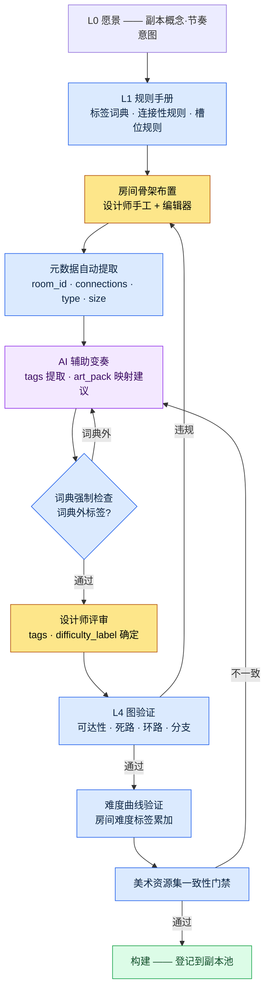

# 7.1 程序化关卡设计总纲

副本第47号房间的出口被堵死了。构建通过了,QA 也通过了。玩家在 Boss 房间前对着墙站着的截图被发到社区,是在上线第三天。那个房间是两个季度前把手工制作的房间复制粘贴过来的,复制的过程中,东侧的一条通路没有连接信息,只留下了视觉外观。没有人验证过它。当时也没有能验证它的工具。

本章讲的是如何构建一种结构,让这类事故在构建阶段被自动拦截。关键不在于绘制空间的手上功夫,而在于用规则来运营附着于空间的数据的方式。

---

关卡设计的工作现场更接近制图室。图纸一张一张出自人手,但图纸之间的一致性、复用与验证,由图纸柜的运营规则决定。手工画一个副本谁都会,而把100个副本用一致的难度曲线和没有死路的图运营起来,靠的不是手艺,而是系统的问题。

在笔者担任策划总监的项目A(面向国内 + 东南亚的 MMORPG,中等规模(10\~50人)团队,移动端优先)中,这套系统的名字就是一份名为 `Procedural_Level_Design_Master` 的文档。本章讲的是这份文档整合了什么、AI 介入到哪一步、又在哪里停手。笔者曾主导一款每一局都会重新生成副本的移动端 Roguelite RPG 的策划,以规则运营程序化空间的这段经验,构成了本章的底色。

## 7.1.1 两条路 —— 是生成空间,还是运营空间的元数据

关卡自动化分为两个方向。一个是对空间本身进行程序化生成。BSP 分割(Binary Space Partitioning,把空间递归地二等分来布置房间的经典手法)、wave function collapse、drunken walk 网格这类传统 PCG(Procedural Content Generation,程序化内容生成)都属于这一类。另一个是运营空间的元数据 —— 房间标签、连接性、难度标签、事件槽位。

传统 PCG 擅长第一种。在 Roguelike 或沙盒这类以"每局都是新地图"为游戏性核心的品类里,第一种才是正解。但 MMORPG 不同。玩家会把同一个副本刷上几十遍,刷到动线都背下来。所以副本必须是手工打磨的固定空间,而自动化能切入的位置不是空间本身,而是**让这个空间可被运营的元数据**。

元数据为什么是运营的脊柱,按产出物逐项来看就一目了然。

| 产出物 | 若没有元数据 |
|---|---|
| 数十个副本池 | 无法检索哪个房间在哪里,无法复用 |
| 难度曲线验证 | 没有各房间的难度标签,无法绘制曲线 |
| 任务·Boss 位置自动布置 | 没有事件槽位元数据,只能手动输入坐标 |
| 美术团队同步 | 没有房间类型 → 美术资源集的映射,视觉不一致 |
| 玩家动线·停留时间测量 | 无法进行基于房间 ID 的遥测 |

没有元数据的副本能构建出来,却无法运营。就像藏书满架却没有索引的图书馆。这正是本章聚焦于"空间元数据运营"的原因。

## 7.1.2 总纲文档整合了什么

`Procedural_Level_Design_Master` 把四项标准捆到一份文档里:房间元数据格式、房间标签词典、连接性规则、验证检查清单。先看看这四项散落各处时会发生什么。五名设计师各自从不同文件里参照格式,`type` 字段就有人写 `combat`、有人写 `Combat`、有人写 `battle_room`。检索坏掉,统计坏掉,最终自动化也坏掉。

把这四项标准按 Layer 归位,各自的位置就很清晰。格式、词典、规则位于支配生成的规则手册(L1);生成出的房间正文位于内容层(L2);表格值位于数据层(L3);验证位于构建·QA 门禁(L4)。

<svg viewBox="0 0 720 300" xmlns="http://www.w3.org/2000/svg" font-family="sans-serif" font-size="13">
  <rect x="20" y="20" width="680" height="44" rx="6" fill="#1e3a5f" stroke="#0f1f33"/>
  <text x="36" y="40" fill="#fff" font-weight="bold">L0 愿景</text>
  <text x="120" y="40" fill="#cfe2ff">关卡概念·节奏意图(不变锚点,每次生成·验证都注入)</text>
  <text x="120" y="56" fill="#9fc0e8" font-size="11">—— art_pack 色调,难度意图</text>

  <rect x="20" y="76" width="680" height="44" rx="6" fill="#2a5d3a" stroke="#173a22"/>
  <text x="36" y="96" fill="#fff" font-weight="bold">L1 系统</text>
  <text x="120" y="96" fill="#d6f5df">规则手册 —— 房间元数据格式 · 标签词典 · 连接性规则</text>
  <text x="120" y="112" fill="#a8dcb8" font-size="11">—— 总纲文档捆绑之处</text>

  <rect x="20" y="132" width="680" height="44" rx="6" fill="#5d4a2a" stroke="#3a2e17"/>
  <text x="36" y="152" fill="#fff" font-weight="bold">L2 内容</text>
  <text x="120" y="152" fill="#f5e6cf">附着了元数据的房间正文(生成并打磨过的空间)</text>

  <rect x="20" y="188" width="680" height="44" rx="6" fill="#4a2a5d" stroke="#2e173a"/>
  <text x="36" y="208" fill="#fff" font-weight="bold">L3 数据</text>
  <text x="120" y="208" fill="#ead6f5">房间尺寸·连接表·事件槽位 ID·敌人数据</text>

  <rect x="20" y="244" width="680" height="44" rx="6" fill="#5d2a2a" stroke="#3a1717"/>
  <text x="36" y="264" fill="#fff" font-weight="bold">L4 构建·QA</text>
  <text x="120" y="264" fill="#f5d6d6">图验证 · 难度曲线验证 · 美术资源集一致性门禁</text>
</svg>

所谓总纲文档整合四项标准,并不是"把正文全塞进一个文件",而是"把规则汇聚到 L1 这个位置"。正因如此,后文将出现的自动化才能架设在 Layer 边界之上(分离一旦崩塌会发生什么,7.1.11 会讲)。

## 7.1.3 房间元数据格式 —— 自动化附着的输入位

一个房间遵循以下格式。这份格式就是自动化的输入接口。

```yaml
room_id: dungeon_021_room_07
dungeon: dungeon_021_silvermark_library
type: combat_room          # combat / puzzle / lore / safe / boss
size: medium               # small / medium / large
difficulty_label: hard_for_level_28
tags: [scholar_theme, vertical_layout, water_hazard]
connections:
  - target_room: dungeon_021_room_06
    type: door
    direction: south
  - target_room: dungeon_021_room_08
    type: passage
    direction: east
event_slots:
  - slot: enemy_spawn_1
    constraints: [scholar_enemy, level_28]
  - slot: lore_object_1
    constraints: [scholar_lore]
movement_complexity: 4     # 1~5
estimated_clear_time_sec: 90
art_pack: scholar_library_v2
```

每个字段都有一个以上的自动化消费方。`type` 用于副本池统计和难度计算,`tags` 用于检索·复用·美术资源集映射,`connections` 用于图验证(死路检查),`event_slots` 用于任务·Boss 自动布置。没有消费方的字段就不放进格式里 —— 只会增加输入成本,却没有价值。

## 7.1.4 房间标签词典 —— 小而正交

标签是元数据的检索键。一旦无限增殖,检索就会坏掉。抽屉上贴了200个标签,就没法找到什么在哪里。所以按5个类别 × 每个类别约6个 enum,合计约30个来运营。

| 类别 | enum 数 | 示例 |
|---|---|---|
| theme | 8 | scholar_theme, ruins_theme, forest_theme … |
| layout | 5 | vertical_layout, horizontal_corridor, open_arena … |
| hazard | 6 | water_hazard, fire_hazard, falling_hazard … |
| interaction | 4 | puzzle_required, lever_activation … |
| narrative | 7 | flashback_trigger, dialogue_zone … |

一个房间的标签不超过5个,正常是3\~4个。要新增标签,必须通过四道门禁:每季度至少是5个房间的使用候选;无法用现有标签组合表达;检索·美术资源集映射的用途明确;运营1个月后仍能维持5个房间。最后一条是关键。临时造出来的标签只用一次就被弃置,词典就会被污染。

## 7.1.5 程序化关卡管线 —— 从规则手册到验证

到目前为止的这些标准如何串成一条流程,这条连接线正是本章所支撑的骨架。它是一条从规则手册出发、经过 AI 辅助变奏、以护栏验证收尾的管线。



这条管线有三个特点值得点明。第一,规则手册(L1)位于一切生成的上游。第二,AI 只在规则手册所定义的词典内变奏 —— F 门禁会把词典外的输出退回。第三,验证(H·I·J)被固定为构建前的门禁,违规由代码拦截,而不依赖人的注意力。第47号房间的事故,正是因为没有 H 门禁才发生的。

## 7.1.6 连接性规则 —— 用图来验证的护栏

房间元数据的 `connections` 字段把整个副本变成一张有向图。一旦成为图,验证就是自动的。

| 检查 | 违规时的处理 |
|---|---|
| 起始房间 → Boss 房间可达 | 以构建失败拦截 |
| 死路(出口1个 + non-safe_room) | alert —— 设计师复核 |
| 双向连接一致性(有 A→B 却没有 B→A) | 自动校正 |
| 环路长度 —— 2\~3个房间的短循环 | alert |
| 分支宽度 —— 同时4个以上的分支 | 设计师复核 |

测量脚本是下面这个样子。它是在标准图算法(最长路径·平均出度·循环计数·最短路径)之上,套了一层副本术语的薄封装。

```python
# level_graph_metrics.py
def measure(dungeon):
    graph = build_graph(dungeon.rooms)
    return {
        "depth":            longest_path_length(graph),
        "branching_factor": avg_out_degree(graph),
        "loop_count":       count_loops(graph),
        "dead_ends":        count_dead_ends(graph),
        "boss_reachability": shortest_path(graph.start, graph.boss),
    }
```

五个指标会以可与其他副本比较的形式输出,用作副本池的多样性指标。不过指标多样并不意味着副本有趣。指标是用来拦截事故的,不是用来保证趣味的。零死路并不能保证趣味。趣味来自设计师的洞察,而图验证只是托住底,别让那份洞察被事故淹没。

## 7.1.7 实操示例 —— 把 tags 提取交给 AI、拒绝、再请求

自动化里,人最常想撒手不管的部分就是 `tags` 输入。给100个房间打标签很枯燥,只看房间截图连人都会犯迷糊。这种重复且判定标准明确的活儿,恰恰是 AI 适合承接初稿的位置。本节把实际跑过的那套工作流 —— 提示词、AI 被拒绝的输出、人的再请求 —— 原样铺开,不加任何修饰。

**第一次提示词:**

```
[输入]
- 房间截图:(附件)
- 房间面积:18m × 12m,天花板高9m(垂直2层结构)
- 布置的敌人:scholar_phantom × 3, water_elemental × 1
- 相邻房间 type:lore_room(西侧), combat_room(东侧)
- 房间内有浅水洼

从下面的词典里,只挑3~5个适合这个房间的标签。不要造词典外的标签,
只用逗号分隔标签 enum。

[标签词典 30个]
theme: scholar_theme, ruins_theme, forest_theme, cave_theme,
       crypt_theme, swamp_theme, mechanical_theme, celestial_theme
layout: vertical_layout, horizontal_corridor, open_arena,
        maze_layout, bridge_layout
hazard: water_hazard, fire_hazard, falling_hazard,
        poison_hazard, crush_hazard, dark_hazard
interaction: puzzle_required, lever_activation, key_gate, hidden_passage
narrative: flashback_trigger, dialogue_zone, lore_object_zone,
           ambush_setup, ritual_site, vista_point, rest_anchor
```

**Claude 第一次输出(原始未加工):**

```
scholar_theme, vertical_layout, water_hazard, ambush_setup, two_story_layout
```

这里直接暴露出两个问题。一是 `two_story_layout` 是词典里没有的标签——模型被"垂直2层结构"这个输入带偏,造出了词典外的词。二是标签已经触到5个的上限,而 `vertical_layout` 和 `two_story_layout` 在语义上重叠,相当于在 layout 类别里占了两格。

**人的拒绝判断。** `two_story_layout` 违反了词典强制,属于自动拒绝对象(管线的 F 门禁)。`ambush_setup` 则两可 —— 虽然布置了3只敌人,但从截图看,究竟是伏击布局还是单纯的战斗房间,并不清楚。这有可能是模型过度解读了。相邻房间都是 lore/combat,叙事性伏击触发的依据很薄弱。拒绝。

**第二次再请求:**

```
two_story_layout 词典里没有,而且和 vertical_layout 重叠。去掉。
ambush_setup 也去掉 —— 有敌人不等于就是伏击。
// (意图:narrative 标签只在叙事意图明确时使用,单纯战斗已由 type 表达)
空位不必硬凑。3~4个才正常。重新打标签。
```

**Claude 第二次输出:**

```
scholar_theme, vertical_layout, water_hazard
```

这次减到了3个,全部在词典之内,也没有类别重复。人接受了这个结果。房间格式里的 `tags: [scholar_theme, vertical_layout, water_hazard]` 就这样定了下来。

这个实操示例的教训有两条。第一,AI 会对输入里的某个细节("2层")过拟合,从而冲出词典之外 —— 词典强制门禁必须在代码层面把它拦住。第二,AI 有填满空位的倾向 —— 不明说"不必硬凑",它就会把5格全填满。这两种失败都很常见,而两条处方都不能靠提示词,得由规则手册(词典 + 上限)来强制,才稳定。

## 7.1.8 元数据量产 —— 谁来填,谁来评审

设计师手工填一个房间的元数据要花5\~10分钟。一个副本(20\~30个房间)就是2\~5小时,100个副本就是200\~500小时(笔者估算,未经验证 —— 以每个房间的平均输入时间 × 房间数换算出的上限值)。全部手工填,设计师就成了元数据输入的奴隶。

所以要按领域划分填写的主体。

| 领域 | 填写主体 |
|---|---|
| room_id · dungeon · connections | 编辑器自动提取(L3) |
| type · size | 基于房间面积·连接数的自动分类 |
| tags | AI 辅助 + 设计师评审(7.1.7) |
| event_slots | 按房间 type 的规则手册 |
| difficulty_label | 房间内敌人数据汇总的自动计算 |
| art_pack | 房间 type · 副本 theme 映射 |

设计师亲手确定的,大概只有 `tags` 的评审和 `difficulty_label` 的最终审批。其余由工具来填,人来评审。自动化的目的,是把设计师从输入中解放出来,让他回到节奏、标志性房间、复用策略这些判断上。

## 7.1.9 房间复用及其陷阱

总纲标准最大的效用是房间复用。有30个能用标签检索的房间,就能组合出5\~10个副本。但复用比例一高,副本就会变得乏味。所以复用要连带配上护栏。

| 护栏 | 定义 |
|---|---|
| 一个房间最多出现在5个副本中 | 自动追踪出现频次 |
| 第二次出现时强制视觉变奏 | 更换灯光·道具 |
| Boss 房间·标志性房间禁止复用 | 用 flag 强制 |
| 追踪复用房间的负面反馈 | 玩家遥测 |

复用是降低成本的手段,不是目的。一旦把复用率本身当成 KPI,玩家体验就会变得单调。0%(所有房间都是新的)会让量产成本暴涨,超过70%则各个副本彼此难以区分。从经验看,30\~40% 这个区间是成本与多样性的平衡点(方向性观察,精确阈值因项目而异)。

## 7.1.10 常见失败与处方

| 模式 | 处方 |
|---|---|
| 元数据格式被5个人解读出5种 | 用总纲文档在 L1 统一 |
| 标签增殖到50\~100个 | 30个词典 + 四道门禁 |
| 不做死路检查就构建 | 把图验证设为构建门禁 |
| 设计师手工处理所有元数据 | 编辑器提取 + AI 辅助 |
| AI 生成词典外标签 | 用词典强制门禁自动拒绝 |
| 复用0%或70%+ | 30\~40% 区间 + 变奏护栏 |

## 7.1.11 Layer 分解是程序化关卡生成的前提

到目前为止,以规则手册·生成·验证展开的 7.1.2\~7.1.6 的结构本身,就是 Layer 分解的产物。"Layer 分解是程序化生成·自动化的前提"这一一般命题(L0 锚点 → L1 规则手册 → L2 正文 → L3 数值 → L4 门禁,揉成一团生成就会崩塌),已在 §6.6 讲过。这里把它应用到关卡元数据运营上。

没有这层分离,房间布置·BSP·节奏·叙事触发器就会混在一个文件里,每移动一个房间,节奏意图·事件槽位·连接性图就会同时坏掉。就像制图室·材料仓库·验收室全堆在一张桌子上,抽走一张图纸,材料送货单和验收单也跟着被带出去。所以 7.1.7 的 AI 辅助能运作,也是靠 Layer。房间 ID·连接性在编辑器(L3 自动提取)填,标签在 AI(L1 词典强制)填,difficulty_label 在汇总(L3→L4)填。自动化是架设在 Layer 边界之上;若架在一整团之上,第一个季度内事故就会暴增,工具本身随之被废弃。

不过,这并不意味着一开始就得把五格抽屉完美备齐。分离要渐进,接口要窄,这是原则。第一个季度里,哪怕只分出 L1 规则手册(标签词典 + 连接性规则)和 L3 表格(房间元数据表),自动化也就有了切入的位置。L0 节奏意图和 L4 验证门禁,在后续季度里逐步填。标准统一了,自动化才有切入的位置;自动化切入得越多,设计师就越是从一个房间的手工操作里脱身,转而专注于节奏、标志性、复用的判断。

---

### 本章要点

- 关卡自动化的新位置不在空间本身,而在空间元数据的运营。
- 验证必须固定为构建门禁,而不是靠人的注意力,事故才不会漏到线上。
- AI 变奏只在规则手册定义的词典内允许,词典外的输出由代码拒绝。

---

## 动手试试

**setup.** 选一个副本,为每个房间做一张只含 `room_id · type · connections · tags` 四个字段的 YAML 表。标签则先把5个类别、约30个 enum 的词典固定在一张纸上。

**prompt.** 放入房间截图 + 面积 + 敌人种类 + 相邻房间 type,用"只从这个词典里挑3\~5个标签,禁止词典外标签,不要硬凑空位"来请求(照搬 7.1.7 的提示词)。

**verify.** (1) 如果 AI 输出里有词典外标签,就拒绝并再请求。(2) 用 `connections` 构建图,检查起始→Boss 的可达性和死路 —— 只要出现一处违规,就把那个房间标记为不可构建。

### 单人精简版

如果你是没有工具基础设施的单人开发者,就把总纲文档从一页 Markdown 开始。标签词典30行、连接性规则5行、验证检查清单5行,就够了。图验证方面,房间在10个以下的话,在纸上画箭头、只用眼睛确认死路,也能拿到80%的效果。关键不是工具,而是"给房间附上数据,再用规则检查这些数据"这个习惯本身。工具等到房间超过50个、手工检查变得吃力时,再引入即可。

### 下一章预告

- 7.2 BehaviorTree 编辑器 —— 把关卡的相邻领域 AI 行为树,基于规则手册·元数据来运营
