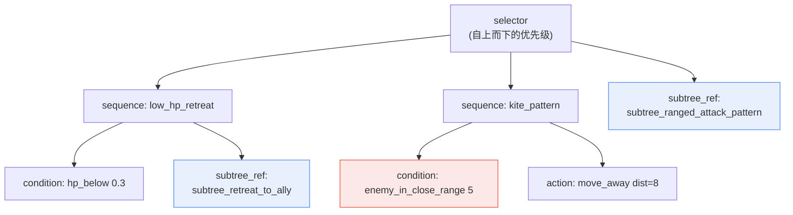
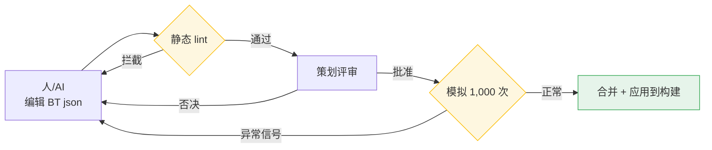

# 7.2 BehaviorTree 编辑器 —— 人与 AI 共同编辑并验证 BT json 的实操记录(worked transcript)

一只见习法师贴着玩家挥刀砍杀。这是一个按远程法术施法者设计的 NPC。它的 HP 薄如纸片,近战中只要挨一下就会死,可它却毫无拉开距离的打算。构建日志里没有任何报错。在编辑器里重新打开 BehaviorTree,节点也都好好地连着。盯着看了一个小时,才找到原因:后退分支的距离条件填的不是 `5`,而是 `0.5`。本该在敌人进入 5 米以内时就逃跑,可现在只有对方逼近到 0.5 米——也就是几乎贴脸——后退分支才会触发。

问题只是一个数字。在图形化节点编辑器里,这个数字要展开节点内部的面板才看得到,而且不会留在变更历史里。没有办法追溯是谁在什么时候改了这个值。从那天起,笔者的项目A 就不再用图形方式,而是改用 json 来处理 BehaviorTree。本章记录的,正是人与 AI 共同编辑这份 json、再由机器自动验证的一个完整周期。

---

## 7.2.1 BT(BehaviorTree,行为树)从手中失控的地方

行为树是定义敌方 NPC 战斗、移动、反应的事实标准结构。选择器(selector)按优先级依次尝试各分支,序列(sequence)则把条件与动作按顺序串起来。结构本身很简单。问题在于规模。

在笔者的项目A 中,一个敌方 NPC 的 BT 大约由 50\~200 个节点构成,而需要运营的 NPC 超过了 100 个。相乘之后,BT 节点总量就达到数万量级。在这个规模下,总会有那么一刻——面对"改动这个后退模式会影响到哪些 NPC?"这样的问题,人已经无法回答了。这就像桌上摊开着一百本笔记,改了第一本里的一行,却要用眼睛去追剩下九十九本中哪里会受到波及。

笔者从图形化 BT 转向 json 时,提出了四点要求。

<svg viewBox="0 0 720 250" xmlns="http://www.w3.org/2000/svg" font-family="sans-serif">
  <rect x="0" y="0" width="720" height="250" fill="#fafafa" stroke="#ddd"/>
  <rect x="30" y="30" width="300" height="80" rx="8" fill="#e8f0fe" stroke="#4285f4"/>
  <text x="180" y="58" text-anchor="middle" font-size="15" font-weight="bold" fill="#1a73e8">以文本形式保存(json)</text>
  <text x="180" y="82" text-anchor="middle" font-size="12" fill="#444">用 git diff 追踪到每一行改动</text>
  <text x="180" y="100" text-anchor="middle" font-size="12" fill="#444">"一个数字"的事故会留在历史里</text>

  <rect x="390" y="30" width="300" height="80" rx="8" fill="#e6f4ea" stroke="#34a853"/>
  <text x="540" y="58" text-anchor="middle" font-size="15" font-weight="bold" fill="#188038">节点元数据标准化</text>
  <text x="540" y="82" text-anchor="middle" font-size="12" fill="#444">用 category、tags 检索与复用</text>
  <text x="540" y="100" text-anchor="middle" font-size="12" fill="#444">"查找相似 BT"变成一行查询</text>

  <rect x="30" y="140" width="300" height="80" rx="8" fill="#fef7e0" stroke="#fbbc04"/>
  <text x="180" y="168" text-anchor="middle" font-size="15" font-weight="bold" fill="#b06000">subtree 引用(引用复用)</text>
  <text x="180" y="192" text-anchor="middle" font-size="12" fill="#444">一个公共模式由多个 BT 共享</text>
  <text x="180" y="210" text-anchor="middle" font-size="12" fill="#444">只改一处 → 批量应用,而非复制粘贴</text>

  <rect x="390" y="140" width="300" height="80" rx="8" fill="#fce8e6" stroke="#ea4335"/>
  <text x="540" y="168" text-anchor="middle" font-size="15" font-weight="bold" fill="#c5221f">变更影响自动可视化</text>
  <text x="540" y="192" text-anchor="middle" font-size="12" fill="#444">subtree 的修改会波及哪些 BT</text>
  <text x="540" y="210" text-anchor="middle" font-size="12" fill="#444">由脚本算出,而非靠人推测</text>
</svg>

商用游戏引擎自带的 BT 编辑器集成方便,可视化调试能力强。只是它往往以二进制(binary)资产的形式保存,文本 diff 与变更影响追踪较弱。笔者的项目A 面向的是运营 BT 超过 100 个的长期运营(LiveOps)游戏,因此选择了自行开发独立的 json BT 格式与编辑器。有一点要讲清楚:这并非所有团队的正确答案。如果运营 BT 不足 50 个,直接沿用引擎自带的编辑器几乎总是更划算。自研的正当性,本章末尾会再谈。

---

## 7.2.2 BT json —— 用文本描述一个敌人的行为

先看看成品的样子。下面是学者公会远程支援型 NPC 的一部分 BT。核心有两点:一是所有行为都是文本,git 能逐行追踪;二是用 `subtree_ref` 来引用公共模式。

```json
{
  "bt_id": "bt_scholar_archer_v3",
  "category": "ranged_combatant",
  "tags": ["scholar_faction", "ranged", "support"],
  "description": "学者公会远程支援型。保持距离 + 后退优先。",
  "root": {
    "type": "selector",
    "children": [
      {
        "type": "sequence",
        "name": "low_hp_retreat",
        "children": [
          {"type": "condition", "fn": "hp_below", "param": 0.3},
          {"type": "subtree_ref", "id": "subtree_retreat_to_ally"}
        ]
      },
      {
        "type": "sequence",
        "name": "kite_pattern",
        "children": [
          {"type": "condition", "fn": "enemy_in_close_range", "param": 5},
          {"type": "action", "fn": "move_away", "param": {"distance": 8}}
        ]
      },
      {"type": "subtree_ref", "id": "subtree_ranged_attack_pattern"}
    ]
  }
}
```

把这棵树画成图,就是选择器自上而下尝试三个分支的结构。请注意:开头那个 bug——`enemy_in_close_range` 的 `param` 是 `5` 还是 `0.5`——在 json 里变成了一眼就能看见的一行。



| 元素 | 作用 |
|---|---|
| `bt_id` | git diff、变更追踪键 |
| `category`、`tags` | 检索、复用单位 |
| `subtree_ref` | 引用公共模式(改一处 → 更新多个 BT) |
| `description` | 供策划、剧情作者共享 |

标红的 `enemy_in_close_range 5` 就是开头那个让人耗掉一个小时的节点。在 json 里,一次代码评审就能揪出来。

---

## 7.2.3 subtree 库 —— 用引用取代复制粘贴

超过 100 个敌人的行为里存在重复的模块。比如"退到盟友身后""退到掩体后""远程攻击模式"这类。如果把它们复制进每个 BT,那么改一处后退逻辑时,就得手动找出一百个地方逐一修改。因此,公共模式被拆分成独立的 subtree 文件,只用 `subtree_ref` 来引用。

```
subtree_library/
├── retreat_patterns/
│   ├── subtree_retreat_to_ally.json
│   ├── subtree_retreat_to_cover.json
│   └── subtree_retreat_random.json
├── attack_patterns/
│   ├── subtree_ranged_attack_pattern.json
│   ├── subtree_melee_combo.json
│   └── subtree_aoe_attack.json
└── reaction_patterns/
    ├── subtree_react_to_ally_death.json
    └── subtree_react_to_player_taunt.json
```

这样安排后,"改动这个 subtree 会影响到谁?"这个问题就不再是人的推测,而成为脚本的输出。影响追踪器很简单:打开所有 BT,收集引用了该 subtree 的 BT 的 `bt_id`。

```python
# bt_impact_tracker.py
import json, glob

def has_subtree_ref(node, target_id):
    if isinstance(node, dict):
        if node.get("type") == "subtree_ref" and node.get("id") == target_id:
            return True
        for child in node.get("children", []):
            if has_subtree_ref(child, target_id):
                return True
    return False

def find_affected_bts(subtree_id):
    affected = []
    for bt_file in glob.glob("bts/*.json"):
        bt = json.load(open(bt_file, encoding="utf-8"))
        if has_subtree_ref(bt["root"], subtree_id):
            affected.append(bt["bt_id"])
    return affected

# 使用
affected = find_affected_bts("subtree_ranged_attack_pattern")
# → ["bt_scholar_archer_v3", "bt_ranger_v2", "bt_sniper_v1", ...]
```

在笔者的项目A 中,这个函数被绑定到了变更请求(Pull Request)阶段。只要有人改动 subtree 文件,受影响的 BT 列表就会自动作为评论附到 PR 上。评审者在合并前就能看到"只改了一行后退模式,却让 12 个远程敌人全部发生了变化"这一事实。

---

## 7.2.4 实操记录 —— AI 撰写新 BT 初稿的一个周期

从这里开始,是本章分量最重的部分。所谓实操记录(worked transcript),就是完整保留的真实操作过程记录:本节把新敌方 NPC"见习法师"的 BT 初稿交给 AI,再由人对其输出进行验证、否决、重新请求——这一整个周期不加修饰、原样呈现。之所以不做顺滑删减,是有原因的:AI 在第一次输出里错在哪里、怎么错的,这种失败的纹理正是本章想要传达的全部。

### Step 1 —— 人给出的提示词(全文)

```
[敌方 NPC 概念]
学者公会的见习法师。HP 低,法术伤害高。
优先规避近战。退到盟友身后后再施放法术攻击。

[category] ranged_combatant

[参考 BT] bt_scholar_archer_v3
(结构相似。只是把弓箭攻击换成法术攻击)

[已定义的函数 enum]
condition: hp_below, enemy_in_close_range, ally_nearby, mana_below
action: move_away, cast_spell, retreat, wait
subtree_ref id(可用列表):
- subtree_retreat_to_ally
- subtree_ranged_attack_pattern   # 基于弓箭。不用于法术
- subtree_magic_attack_pattern

请仅按这个概念编写 BT root 节点的 json。尽量使用 subtree_ref,直接节点尽量少,
函数只能取自上面的 enum。不要添加概念中没有的行为。不要说明,只要 json。
```

### Step 2 —— Claude 的第一次输出(未加工,原样呈现)

```json
{
  "bt_id": "bt_scholar_apprentice_v1",
  "category": "ranged_combatant",
  "tags": ["scholar_faction", "magic", "fragile"],
  "description": "学者公会见习法师。近战规避 + 退到盟友身后 + 法术攻击。",
  "root": {
    "type": "selector",
    "children": [
      {
        "type": "sequence",
        "name": "low_hp_retreat",
        "children": [
          {"type": "condition", "fn": "hp_below", "param": 0.4},
          {"type": "subtree_ref", "id": "subtree_retreat_to_ally"}
        ]
      },
      {
        "type": "sequence",
        "name": "avoid_melee",
        "children": [
          {"type": "condition", "fn": "enemy_in_close_range", "param": 6},
          {"type": "action", "fn": "move_away", "param": {"distance": 10}}
        ]
      },
      {
        "type": "sequence",
        "name": "mana_recover",
        "children": [
          {"type": "condition", "fn": "mana_below", "param": 0.2},
          {"type": "action", "fn": "wait", "param": {"frames": 120}}
        ]
      },
      {"type": "subtree_ref", "id": "subtree_ranged_attack_pattern"}
    ]
  }
}
```

### Step 3 —— 人的验证与否决

拿到输出后,先过一遍 lint(下一节会讲),再用眼睛读。有三处出了问题。

1. **最后一个分支错了。** `subtree_ranged_attack_pattern` 是基于弓箭的攻击模式。尽管 enum 注释里写了"不用于法术",AI 还是拿来了名字相似的弓箭模式。见习法师应该用 `subtree_magic_attack_pattern`。—— **否决。**

2. **添加了概念中没有的行为。** `mana_recover` 分支(`mana_below` → `wait 120frame`)是概念里只字未提的行为。尽管提示词里明确写了"禁止添加未指定的行为",AI 似乎还是判断"既然是法师,管理法力就很自然",于是把它塞了进来。看着合理,却违反了规格说明。—— **否决。**

3. **后退阈值可疑。** `hp_below 0.4` 比参考 BT(`0.3`)更早开始后退。见习法师确实更脆弱,所以这可能是有意为之。但 AI 从未给出依据,因此这是该由策划决定的事项。—— **保留,待策划确认。**

### Step 4 —— 人的重新请求

```
只改这三处。最后一个分支 subtree_ranged_attack_pattern 是弓箭模式,
换成 subtree_magic_attack_pattern;mana_recover 分支概念里没有,整段删除;
hp_below 0.4 改回参考 BT 的 0.3——如果有理由用 0.4,就在 description 里写一行。
其余保持不变,只要 json。
```

### Step 5 —— Claude 的第二次输出(修订版)

```json
{
  "bt_id": "bt_scholar_apprentice_v1",
  "category": "ranged_combatant",
  "tags": ["scholar_faction", "magic", "fragile"],
  "description": "学者公会见习法师。近战规避 + 退到盟友身后 + 法术攻击。HP 低,后退阈值保持 0.3(与 archer 相同)。",
  "root": {
    "type": "selector",
    "children": [
      {
        "type": "sequence",
        "name": "low_hp_retreat",
        "children": [
          {"type": "condition", "fn": "hp_below", "param": 0.3},
          {"type": "subtree_ref", "id": "subtree_retreat_to_ally"}
        ]
      },
      {
        "type": "sequence",
        "name": "avoid_melee",
        "children": [
          {"type": "condition", "fn": "enemy_in_close_range", "param": 6},
          {"type": "action", "fn": "move_away", "param": {"distance": 10}}
        ]
      },
      {"type": "subtree_ref", "id": "subtree_magic_attack_pattern"}
    ]
  }
}
```

第二次输出通过了 lint,策划在检查时把 `avoid_melee` 的距离 `6` 对齐 archer 下调一档到 `5`,随后交给了模拟验证关卡。这里能学到的东西很清楚:AI 能快速填出 BT 的骨架,但几乎每次都会犯两类错误——"拉来名字相似的错误 subtree"和"把貌似合理的额外行为在无规格依据的情况下塞进来"。这两类错误只能靠人的眼睛和 lint 关卡拦下。因此 AI 的输出是初稿,而非最终稿。

---

## 7.2.5 自动 lint —— 机器先一步抓住人会漏掉的东西

BT 直接关系到用户体验。如果敌人贴脸却不逃跑的事故就这样上线,最终会以评分的形式反噬回来。所以在合并前,先由机器检查一遍。

| 检查项 | 违反时 |
|---|---|
| 不可达节点 | alert(选择器中永远触及不到的分支) |
| 无限循环风险 | 拦截(没有退出条件的 sequence 循环) |
| `subtree_ref` 目标不存在 | 拦截 |
| 动作/条件函数在 enum 之外 | 拦截 |
| 节点数激增(>500) | alert(建议拆分 BT) |
| 同一 category 内 BT 响应时间偏差 | alert(疑似平衡回归) |

最后一项是这套 lint 的独到之处。如果同属 `ranged_combatant` 的五个 BT,在模拟中的平均响应时间明显拉开,那就是有人不知不觉破坏了某一个的平衡的信号。它是用统计手段去捕捉静态检查抓不到的"苗头"的装置。

静态 lint 之后是模拟验证。无需打出实际构建,直接在模拟器里把 BT 跑 1,000 次,统计出各项数据。

| 测量项 | 正常范围 |
|---|---|
| 平均生存时间(对标准玩家) | 按 category 的基准值 |
| 攻击模式多样性(熵) | 0.6 以上 |
| 后退/接近行为比例 | 按 category 的基准值 |
| 单次行为平均耗时 frame | 60 frame 以下 |

不用打包出实际构建,在 5\~10 分钟内就能看出"这个 BT 是不是死得太快""是不是只重复一种行为"。一旦出现异常信号,就改 json、重跑模拟。这个周期从以天计缩短到以分钟计,正是 json 化的实际收益。



---

## 7.2.6 度量 —— 什么减少了

下面用表格列出笔者的项目A 引入前后的对比。绝对数值会随团队规模、游戏类型而变化,因此属于笔者的推测(未经验证)。但方向与比例,是实际运营中观察到的原样结果。

| 项目 | 引入前(直接用引擎自带 BT) | 引入后(json + 编辑器) |
|---|---|---|
| 编写一个新敌人的 BT | 1\~2 天 | 2\~4 小时 |
| 掌握 BT 变更影响 | 依赖推测与经验 | 自动(subtree 影响列表) |
| 变更后验证 | 需要实际构建 | 模拟 5\~10 分钟 |
| 运营 100 个敌方 NPC | 3 名策划全职 | 1\~2 名策划 |
| 上线后 BT 事故(异常行为) | 每季度 10\~15 起(笔者推测) | 每季度 2\~4 起(笔者推测) |

最有意义的是,最后两行同时发生了变化。通常削减人手会导致质量下降。而这里,策划人数减少的同时,事故也减少了。因为原本由人手动追踪的变更影响与验证,被机器接管了。自动化的价值,与其说在于"变快",不如说在于这种"人减少的同时质量反而变好"。

---

## 7.2.7 自研,还是借用现成方案

读完本章就下结论"我们也来做一个 json BT 编辑器吧",那可就麻烦了。笔者的项目A 之所以选择自研,是因为特定条件恰好都凑齐了。

| 选项 | 优 / 劣 |
|---|---|
| 直接使用引擎自带 BT | 集成容易 / json 转换、diff 弱 |
| 借用外部 BT 库 | 标准化优势 / 学习曲线、定制受限 |
| 自研 json BT 编辑器 + 运行时 | 自由度、可追踪性最高 / 开发成本大 |

项目A 选择第 3 项的依据有四点。

- diff、git 追踪是必需的——自带 BT 是二进制资产,无法追踪开头那个"一个数字"的事故。
- subtree 引用与自动影响追踪是运营的核心——这在标准 BT 工具里是薄弱功能。
- 需要在与构建分离的运行时里跑模拟验证。
- 以 AI 辅助编写为前提——基于文本(json)对大语言模型(LLM, Large Language Model)有着压倒性的亲和力。

开发成本约 1\~2 个月。只有当运营 BT 达到 100\~300 个、且长期运营周期足够长时,才收得回来。在 30\~50 个的规模下是回不了本的。也就是说,自研的投资回报(ROI, Return On Investment)只有在规模和运营周期两者都有保障时才会出现。如果是小团队,那就只从本章带走这几条原则——"用 json 保存""用 subtree 引用""AI 输出要通过 lint + 评审关卡"——而工具则应当搭在自带编辑器或外部库之上使用。

---

## 7.2.8 常见的失败

| 模式 | 处方 |
|---|---|
| 只把 BT 当作二进制资产来管理 | 保存为 json,让 git 追踪重新可用 |
| 不用 subtree,在每个 BT 里复制粘贴相同模式 | 拆到 subtree 库里去引用 |
| 手工做 BT 影响追踪 | 把影响分析脚本绑定到 PR 上 |
| 不用模拟,只在实际构建里验证 | 运行一个与构建分离的模拟器 |
| 不经评审就使用 AI 输出的 BT | 让它通过 lint + 策划 + 模拟三重关卡 |
| 不衡量自研 ROI | 只在 100 个以上、且长期运营时才自研 |

---

### 本章要点

- 只有把 BT 保存为 json,"一个数字"的事故才会留在 git diff 里、可被追踪。
- subtree 引用与自动影响追踪,能挡住 100 个规模运营中的复制粘贴地狱。
- AI 能快速填出 BT 的骨架,但错误的引用和规格之外的行为要靠人来抓。

---

## 动手试试

这是小团队今天就能尝试的最小周期。

**setup** —— 把一个正在运营的敌方 NPC 的 BT 亲手写成 json(`bt_id`、`category`、`tags`、`root`)。把一块公共的后退/攻击模式拆到 `subtree_library/` 里,用 `subtree_ref` 来引用。

**prompt** —— 把一个相似的新敌人交给 AI。直接套用上面实操记录里的提示词骨架(概念 + category + 参考 BT + 可用函数 enum + "禁止添加未指定的行为" + "只要 json")即可。

**verify** —— 让 AI 的输出通过三道关卡后再合并:(1)过滤 enum 之外的函数与不存在的 subtree 的 lint,(2)人眼,(3)模拟或游戏内的简短验证。务必确认 AI 是否塞进了"名字相似的错误 subtree"和"貌似合理却在规格之外的行为"。

### 单人精简版

如果没有余力去做编辑器,那么工具只要文本编辑器加 git,再加一个 30 行的 `bt_impact_tracker.py` 就够了。把用自带编辑器写好的 BT 导出成 json 上传到 git,只把 subtree 拆成独立文件来引用。再把影响追踪脚本挂到提交钩子(commit hook)上,哪怕是一个人,也能把"改动这个后退模式会让哪个敌人发生变化"从推测变成输出。仅凭这一个习惯,开头那个"一个数字耗掉一个小时",就缩短成了代码评审里的一行。

---

### 下一章预告

- 7.3 副本·野外模式库 —— 把房间元数据与 subtree 模式结合,将关卡打包成运营单位。
