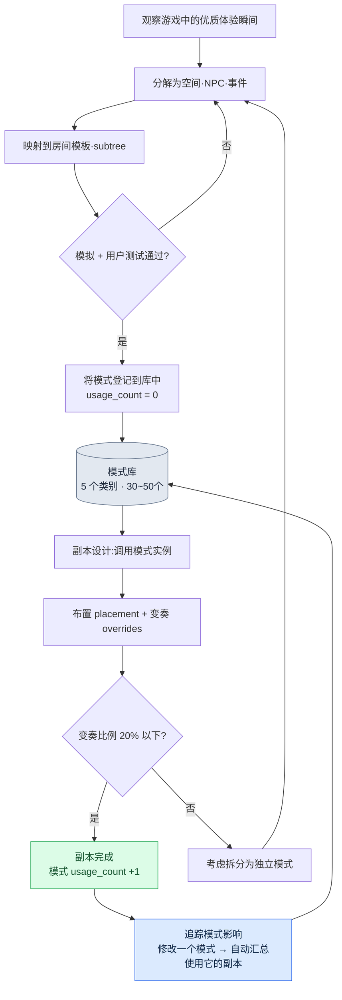

# 7.3 副本·野外模式库

在一次副本评审会上,一位新人关卡设计师把自己做的一个副本投到了屏幕上。狭窄的走廊、从后方紧追的快速敌人、在岔路口的闪避抉择。这是个做得不错的副本。问题在于,它和我们此前已经在十一个不同副本里做过的东西有着微妙的差异。敌人的追击速度、陷阱触发的时机、岔路口出现的时点,没有一处是相同的。这位新人相信自己做出的是名为"追击副本"的同一种体验,但用户实际感受到的手感却副本各异。

那天我们做的决定很简单:把"走廊追击"这种体验精确地定义一次,然后把这个定义固化下来。下次无论谁做追击副本,都不再从零开始搭建,而是取出这个固化好的定义来用。这就是模式库的开端。

如果说房间是空间单元、BehaviorTree(行为树)是行为单元,那么模式就是把空间、行为与事件捆在一起的运营单元。一个模式被多个副本复用后,量产负担会减轻;更重要的是,用户获得的体验能在各副本之间保持一致。

---

## 7.3.1 作为运营单元的模式

拿菜谱里的食谱来打比方就很准确。一份食谱上,食材、烹饪步骤、火候、成品照片一并列出。哪怕换了餐厅,只要照同一份食谱来做,味道就一样。只不过每家餐厅允许略作变奏。模式也一样:空间(房间)、行为(BT 子树)、事件(event)、结果(奖励·难度),再加上设计师的意图说明,一并打包在内。

<svg viewBox="0 0 720 250" xmlns="http://www.w3.org/2000/svg" font-family="sans-serif" font-size="13">
  <rect x="10" y="10" width="700" height="230" fill="#fafafa" stroke="#ccc"/>
  <text x="360" y="35" text-anchor="middle" font-size="15" font-weight="bold">模式 = 五个要素的组合</text>
  <rect x="40" y="60" width="120" height="60" rx="6" fill="#e3f0ff" stroke="#5a8fd0"/>
  <text x="100" y="85" text-anchor="middle" font-weight="bold">空间</text>
  <text x="100" y="105" text-anchor="middle" font-size="11">房间元数据 1~3个</text>
  <rect x="180" y="60" width="120" height="60" rx="6" fill="#e9f7e9" stroke="#6aa86a"/>
  <text x="240" y="85" text-anchor="middle" font-weight="bold">行为</text>
  <text x="240" y="105" text-anchor="middle" font-size="11">BT 子树 1~2个</text>
  <rect x="320" y="60" width="120" height="60" rx="6" fill="#fdf3e0" stroke="#d0a05a"/>
  <text x="380" y="85" text-anchor="middle" font-weight="bold">事件</text>
  <text x="380" y="105" text-anchor="middle" font-size="11">event 槽</text>
  <rect x="460" y="60" width="120" height="60" rx="6" fill="#fde9ec" stroke="#d05a6e"/>
  <text x="520" y="85" text-anchor="middle" font-weight="bold">结果</text>
  <text x="520" y="105" text-anchor="middle" font-size="11">奖励·难度规则</text>
  <rect x="600" y="60" width="90" height="60" rx="6" fill="#f0e9fd" stroke="#8a5ad0"/>
  <text x="645" y="85" text-anchor="middle" font-weight="bold">意图</text>
  <text x="645" y="105" text-anchor="middle" font-size="11">说明</text>
  <text x="360" y="160" text-anchor="middle" font-size="13" font-style="italic">"走廊追击模式" = 狭窄走廊 + 快速敌人 BT + 陷阱 event + 闪避奖励</text>
  <line x1="100" y1="180" x2="620" y2="180" stroke="#999" stroke-width="1"/>
  <text x="360" y="210" text-anchor="middle" font-size="12">→ 一经验证,即可在 5~10 个副本中再生产同一种体验</text>
</svg>

一个模式一旦定义好,就能让每个副本都稳定地产出同一种体验——就像一份经过验证的食谱能在多家餐厅做出同一种味道。只不过同一份食谱,每家餐厅仍会留一点变奏。如何管理这些变奏,占了模式运营的一半分量。后文要讲的 overrides 就是这一环。

---

## 7.3.2 模式的组合流程

模式库的核心在于:先把模式固化为规则手册,再把它们组合起来生成副本。设计师不是在空白屏幕上从头搭建副本,而是挑选经过验证的模式加以布置,只对一部分作变奏。



这条流程的左半段(观察→分解→映射→验证→登记)是制造模式的过程,右半段(调用→布置·变奏→完成→追踪)是消费模式的过程。制造很少发生,消费则频繁发生。库运营得当时,这种不对称就会转化为量产效率。

---

## 7.3.3 五个基本类别

笔者的项目A属于动作RPG一类,因此把模式分为五个类别。这套分类依赖于品类。若是恐怖游戏,埋伏与叙事节拍的比重会不同;若是解谜游戏,利用环境的战斗会成为核心。不要把分类本身当作绝对,应先确定自己游戏的核心体验是什么,再来划定类别。

| 类别 | 核心体验 | 示例 |
|---|---|---|
| pursuit | 追击·逃脱 | 走廊追击、峡谷逃脱 |
| ambush | 埋伏·突袭 | 进入房间时埋伏、视野死角埋伏 |
| puzzle_combat | 利用环境的战斗 | 拉杆·陷阱 + 战斗 |
| boss_phase | Boss 阶段 | Boss 阶段 1\~3 模式 |
| narrative_beat | 叙事节拍 | 回忆触发、同伴登场 |

在这五个类别里,模式总数大致维持在三十到五十个之间。这个数字是有理由的。一旦模式超过一百个,设计师就无法把整个库装进脑子里。那一刻起,库就变成了检索起来费时的仓库,设计师宁可从头去搭。库一旦开始被冷落,一致性这个初衷就会崩塌。因此,有意识地管理模式数量的上限,和类别设计一样重要。

---

## 7.3.4 固化模式的格式

一个模式由一份 YAML 文件固化下来。下面是把项目A实际使用的格式做了匿名化处理的版本。公司专有的资产名和副本编号已被遮去,但字段结构与运营方式保持原样。

```yaml
---
pattern_id: pattern_corridor_pursuit_v2
category: pursuit
description: 快速敌人在狭窄走廊中从后方追击,玩家在岔路口做出闪避抉择
tags: [horizontal_corridor, scholar_theme_compatible]
rooms:
  - room_template: corridor_long
    size: medium
    connections_required: 2
  - room_template: junction_3way
    size: small
    connections_required: 3
npc_behaviors:
  - subtree_ref: subtree_aggressive_chase
    count: 2
  - subtree_ref: subtree_ranged_support
    count: 1
events:
  - type: trap_activation
    trigger: room_1_midpoint
  - type: enemy_spawn
    trigger: room_1_entry
difficulty_modifier: 1.2   # 相较普通房间的 1.2 倍压力
reward_modifier: 1.3
clear_time_estimate_sec: 60
art_pack_compatible: [scholar_library, generic_dungeon]
narrative_slots:
  - slot: dialogue_during_chase
    constraints: [short_dialogue, fear_emotion]
usage_count: 12            # 在 12 个副本中使用
last_modified: 2026-05-18
deprecated: false
---
```

这一份文件同时定义了十二个副本各自的一部分。`usage_count: 12` 这一行的分量正来自于此。修改这个模式,意味着十二个副本会同时受到影响,因此动一个模式文件,与改一个房间是不同分量的事。

`subtree_aggressive_chase`、`subtree_ranged_support` 这样的引用,直接指向 7.2 中在 BehaviorTree 编辑器里定义的 subtree。关键在于:模式并不直接把 BT 收纳进来,而只是引用它。改动 BT,所有引用了该 BT 的模式都会自动跟进。空间(房间模板)与行为(subtree)各自在自己的库中管理,模式只承担把这两者编织起来的组合表角色。`clear_time_estimate_sec`、`difficulty_modifier` 这类数值只是笔者环境下的运营值,并非普适常数。你必须用自己游戏的模拟与用户测试亲自测量后填入。

---

## 7.3.5 把模式实例化到副本中

设计副本时,不从头搭建模式。而是从库中调用,指定它放在哪里,再用 overrides 覆盖只在这个副本里需要不同的部分。

```yaml
---
dungeon_id: dungeon_021_silvermark_library
pattern_instances:
  - instance: corridor_pursuit_1
    pattern_id: pattern_corridor_pursuit_v2
    placement:
      - room_id: dungeon_021_room_03
        as: corridor_long
      - room_id: dungeon_021_room_04
        as: junction_3way
    overrides:
      - field: npc_behaviors.0.subtree_ref
        value: subtree_scholar_chase   # 学者主题变体
      - field: events.0.trigger
        value: room_1_2nd_third         # 触发位置微调
---
```

这里的副本 021 照原样使用"走廊追击"模式,只是把追击的敌人从普通敌人换成学者主题变体,并把陷阱触发的位置从走廊中段稍微往后挪了一点。模式的 80% 保持原样,只对 20% 作了变奏。

这个比例有来自运营经验的依据。变奏太少(接近 0%)时,各副本会像互相抄袭一样令人厌倦。变奏太多(超过 50%)时,那就不再是同一个模式了——你以为调用的是同一个模式,实际体验却完全不同,又回到了新人当初拿来的那个副本一模一样的处境。因此我们定下一条运营规则:当一个实例的 overrides 超过模式字段的一半时,那就不是变奏,而是新模式的信号,该把它拆分为独立模式了。

---

## 7.3.6 改一行,会牵动哪里

修改 `pattern_corridor_pursuit_v2`,会影响十二个副本。若靠人手工追踪,必定会漏掉一两个。因此我们准备一个自动梳理模式与副本关系的小工具。

```python
# pattern_impact.py
import json
from glob import glob

def find_dungeons_using(pattern_id):
    affected = []
    for d in glob("dungeons/*.json"):
        dungeon = json.load(open(d, encoding="utf-8"))
        for inst in dungeon.get("pattern_instances", []):
            if inst["pattern_id"] == pattern_id:
                affected.append({
                    "dungeon": dungeon["dungeon_id"],
                    "instance": inst["instance"],
                    "has_overrides": bool(inst.get("overrides")),
                })
    return affected
```

这个函数返回的列表里,关键是 `has_overrides` 标志。没有 overrides 的副本原样使用模式,因此自动更新也是安全的。有 overrides 的副本,其专属变奏可能与模式修改发生冲突,因此需要人工的额外评审。

与其让人一一去掂量修改的分量,不如让工具在 5 分钟内报告"本次修改影响 12 个副本,其中 4 个有变奏,需要亲自查看"。减轻改动模式时的恐惧,才是这个工具真正的价值。看不见影响范围时,设计师就干脆不去动模式,库便成了一潭死水。

---

## 7.3.7 模式如何诞生,以及 AI 的位置

这里正面回应一个最常被问到的问题:"模式的编写不也可以交给 AI 吗?"

答案很明确:不行。编写一个模式,设计师的洞察是脊柱。什么才是好的追击体验、岔路口为什么必须在那里、陷阱为什么不在走廊中段而要在 2/3 处触发才能让紧张感立起来——这是亲手打磨过游戏、看过用户反应的人才有的判断。让 AI 从头去搭模式,所有模式都会收敛成四平八稳的平均形态。库里会塞满"不出错的模式",而"令人难忘的模式"却消失了。

但这并不是说 AI 无事可做。在编写模式的五个阶段中,有两处 AI 是强力的辅助。

| 阶段 | 产出 | AI 的角色 |
|---|---|---|
| 1. 观察游戏中的优质体验瞬间 | 笔记 | 设计师独立完成 |
| 2. 把该瞬间分解为空间·NPC·事件 | 初稿 yaml | 设计师独立完成 |
| 3. 映射到既有的房间模板·subtree | 候选映射 | AI 辅助(推荐候选) |
| 4. 模拟 + 用户测试 | 验证 | AI 辅助(执行模拟) |
| 5. 登记到库 | usage_count = 0 | 设计师独立完成 |

第 3 阶段是 AI 辅助的核心。当设计师写下"快速敌人在狭窄走廊中从后方追击"这样的初稿时,要人从已经积累到数十个的房间模板与 subtree 库中一一翻找哪个符合这个意图,是低效的。这里让 AI 来推荐映射候选。下面是把实际使用的提示词做了匿名化处理的版本。

```
[输入]
- 设计师的模式初稿 yaml(附于下方)
- 房间模板库(名称 + 标签 + 尺寸清单)
- subtree 库(名称 + 行为摘要清单)

请从库中挑选并推荐用来实现这个模式的房间模板和 subtree。
各推荐 2~3 个,附上适合度 1~5 分,以及基于标签·尺寸的一行依据。
库里没有的不要编造,只做推荐;若全部都在 3 分以下,请说明需要新建。
```

针对这个提示词,Claude 实际返回的输出如下。为了原样呈现它在哪里犹豫、在哪里断言,这里一字未改地照录。

```
房间模板候选:
1. corridor_long  (适合度 5)
   依据:标签 horizontal_corridor 一致,size medium 契合"狭窄走廊"的意图。
2. corridor_narrow_short  (适合度 3)
   依据:虽窄但长度较短,难以拉开追击距离。布置岔路口的空间不足。
3. hall_wide  (适合度 1)
   依据:宽阔的大厅与"狭窄走廊"的意图完全相反。追击压迫感立不起来。

subtree 候选:
1. subtree_aggressive_chase  (适合度 5)
   依据:已定义从后方追击的行为,带有移动速度权重。
2. subtree_ranged_support  (适合度 3)
   依据:本身并非追击,但可作为施压辅助布置 1 个。
3. subtree_patrol_basic  (适合度 2)
   依据:巡逻行为与追击意图不符。缺少触发后转入追击的节点。

岔路口(junction)房间模板:
未能在库中找到同时满足 3way 分岔 + small 尺寸条件的项。
junction_3way 最为接近,但 size 标签为空,
无法确定适合度。需要设计师确认。
```

最后一段是这份输出中最有价值的部分。AI 对岔路口房间模板说了"不确定",没有编造不存在的答案。设计师收到这份报告后,发现 `junction_3way` 的 size 标签确实是空的,于是先从这条元数据补起。如果 AI 无视空标签、径直给出适合度 5,设计师就会因错误的信任而照单采纳。

这才是 AI 辅助的正确形态。AI 铺开候选、标出不确定,选择与责任则留给设计师。若映射结果的适合度全都偏低,那就产生了编写新模板的另一项工作,而这项编写又回到了人的手上。

> **[方向标 —— 如果把模式压缩为"体验向量"(眼下仍为时过早)]** 请把它当作研究动向而非处方来读。§7.3.1 已经把模式称作"食谱"。一个模式,近似于房间元数据·行为 subtree·event·difficulty/reward_modifier·clear_time 打成一包的坐标值。把这一包压缩为"体验向量",当适合度全都偏低、需要新建时,就不必逐一翻找上面那条流程,而可以把它锁定为压缩空间中的空白区域;§7.3.8 的 deprecated 判定,也可以用坐标距离来强化对近邻重复的识别。只是要附上三条限定。difficulty/reward_modifier 正如 §7.3.4 所说是笔者的运营值,各游戏的轴尺度不同,压缩空间无法原样移植;插值只到给空位"标注"为止,而非模式的"生成";在那个标注之上真正去搭建模式,仍不越过本节的原则——设计师的洞察才是脊柱。这一构想与 §8.2.7 的维度向量压缩处于同一位置,概念直观见附录 M——留作根基足够扎实的团队几年后再去审视的领域。

---

## 7.3.8 收拢不再使用的模式

库,填满容易,清空却难。运营大约一年后,那些建好却几乎无人使用的模式会堆积起来。放着不管,库的检索成本就会上升,设计师挑选模式时还得连那些已死的选项一并翻看。因此要定期收拢。

| 条件 | 处理 |
|---|---|
| 6 个月内 usage_count 零增长 | 归为 deprecated 候选 |
| 在评审会上决定废弃 | 标记 `deprecated: true` |
| 已在使用的副本 | 原样保留(历史性保留) |
| 新建副本 | 禁止使用该模式 |

关键在于,废弃并不等于删除。已经在使用该模式的副本照旧保留。因为动一个正在线上运营中运行的副本,比拦住一个新模式更危险。`deprecated: true` 只是"从现在起不要再新用"的标记,而非抹去过去的命令。

就像每个季度把书桌抽屉里不用的工具拿出来整理一次那样,库也要排定每季度收拢一次的日程。没有这份日程,库就只会朝一个方向膨胀,某一刻便沦为被设计师冷落的仓库。

---

## 7.3.9 诚实地衡量成效

这是笔者在项目A中运营模式库一年所观察到的变化。下表中的时间数值是笔者环境下的估计(未经验证),只有方向和相对比例是真实观察到的。

| 项目 | 引入前 | 引入后 | 备注 |
|---|---|---|---|
| 单个副本的设计时间 | 约 2 周 | 约 1 周 | 笔者估计,方向明确 |
| 副本间的体验一致性 | 离散度大 | 稳定 | 基于用户评价,定性 |
| 每个模式的平均使用副本数 | — | 约 8 个 | 量产效率的核心指标 |
| 新设计师上手 | 约 2 个月 | 约 3 周 | 笔者估计,体感最明显 |
| 摸清模式改动的影响 | 手工 1\~2 天 | 自动 5 分钟报告 | pattern_impact.py 的引入成效 |

最令人印象深刻的变化,是倒数第二行——新人上手。模式库无意间充当了设计教科书的角色。新人只要读一份模式文件,就能理解"这款游戏的追击体验是这样做出来的",于是前辈守在旁边讲解的时间大幅减少。当初新人拿来的那个各不相同的副本问题,竟由库本身化解了。

"每个模式的平均使用副本数约 8 个"这个数字,意味着同一个模式被复用了八次,这是量产效率的诚实度量。只不过 8 这个值依赖于笔者游戏的副本规模与模式设计。在副本数量少、或每次都要求不同概念的游戏里,这个值会小得多。

---

## 7.3.10 不建库的决定

最后,得讲一个足以推翻整章的观点才算诚实。模式库并非万能。确实存在一些环境,建库与运营的成本收不回来。

| 条件 | 建议 |
|---|---|
| 副本少于 5 个 | 手工即可,无需建库 |
| 只有 1 名设计师 | 脑子里就是库 |
| 只发行一次,无线上运营 | 复用机会本身就少 |
| 每次都是完全不同的概念 | 复用比例低,ROI 收不回 |

库的 ROI(Return on Investment,投资回报率)只有在三个条件同时具备时才收得回:有线上运营、设计师在三人以上、副本超过二十个。长线运营的 MMORPG 之所以是典型的适用对象,原因就在这里。如果自己的项目落在上表的某一行,那就该在动手建库之前停下来重新考虑。工具只有在存在问题时才有价值,而对一个只有五个副本的项目来说,模式库的成本大于它要解决的问题。

---

## 7.3.11 常见失败与对策

| 症状 | 对策 |
|---|---|
| 模式超过 100 个,设计师记不住 | 精简到 30\~50 个,每季度用 deprecated 收拢 |
| 用人手追踪模式影响(会有遗漏) | 使用 pattern_impact.py 之类的自动追踪工具 |
| overrides 达 80% 以上(实质上不算复用) | 变奏过大 → 拆分为独立模式 |
| 把模式编写整个交给 AI | 编写靠设计师洞察,AI 只辅助第 3·4 阶段 |
| 不测量 usage_count | 自动汇总 + 在季度复盘中审查 |
| 不向新人讲解库 | 在上手资料中加入库的导览 |

这张表的第二行和第四行最常绊住人。不把影响追踪自动化,设计师就会惧怕修改模式,库随之僵化;把编写交给 AI,库则会收敛为平均。这两种失败都会扼杀库的生命——也就是"经过验证的体验的复用"。

---

## 7.3.12 第 7 部分收尾

第 7 部分把关卡这一领域垒成了三个层次。7.1 确立了房间元数据、标签与连通性的标准(空间),7.2 讲了基于 JSON 的 BehaviorTree 编辑器、subtree 与模拟(行为),而本章走到了把这两者连同事件一起打包复用的模式库(运营单元)。把空间与行为分开处理的运营中,同一处的决定每周以不同形态摇摆的那个问题,靠模式这一捆包固化下来加以解决——这正是整个第 7 部分的主干。

这条脉络与 Layer 整合设计严丝合缝地咬合在一起。游戏整体空间基调这一愿景在最上层,其下是关卡生成规则与 BT 规则这一系统层,房间、BT 与模式库构成内容层,副本实例与模式使用统计沉淀为数据,lint、模拟与用户遥测在构建·QA 环节对其加以验证。模式库既是这五层中内容层的脊柱,又是向上遵循系统规则、向下生成数据统计的连接环。

---

### 本章要点
- 模式是把空间·行为·事件捆在一起的运营单元;若把三者分开处理,同一种体验就会每周以不同形态摇摆
- 80% 复用 + 20% 变奏是推荐比例;变奏一旦超过一半,那就是新模式的信号
- 模式编写是设计师洞察的位置,AI 只到推荐映射候选与辅助模拟为止

### 下一章预告
- 8.1 CombatBalance · CombatFormula 运营 —— 数值设计的两份文档分离

---

## 动手试试 —— 固化一个追击模式

### setup
1. 在工作目录下建立 `patterns/` 和 `dungeons/` 两个目录。
2. 把房间模板的名称清单和 subtree 的名称清单,各准备成一份每行一个名称的文本文件。(没有现成库的话,各用 5 个虚构名称起步也行。)
3. 把上文正文里的 `pattern_impact.py` 原样保存下来。

### prompt
由设计师亲自写模式初稿 yaml(这部分是人的活儿)。然后只把映射交给 AI。照用正文里的映射提示词,只是在输入中附上自己的初稿和两份库清单。别漏掉两行关键约束。

```
- 不要编造库里没有的新模板。只做推荐。
- 若适合度全都在 3 以下,请明确说明需要新建。
```

### verify
1. 逐行确认 AI 有没有编造库里没有的模板名称。
2. 看适合度分数有没有附上基于标签·尺寸的依据。没有依据的分数不要信。
3. 把模式实例化到 2 个以上的副本后,运行 `find_dungeons_using("pattern_...")`,确认这两个副本被准确捕捉到。

### 单人精简版
如果你一个人做小游戏,库这套系统就过头了。你只需挑一段自己最中意的副本片段,把那份体验写成一份 yaml 就够了。做下一个副本时,打开那一份复制过来,只改 20%。模式库的本质——经过验证的体验的复用——在一份文件上同样成立。等规模变大,那时再加上类别与追踪工具即可。
