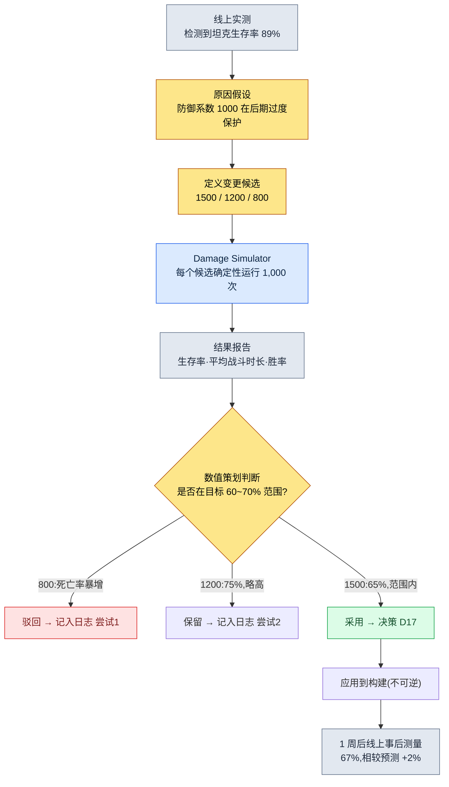

# 8.1 战斗平衡公式 —— 确定性这一规则手册的位置

> **本章学习目标**(难度 🟡 实务 · 前置:四则运算·表格计算):把战斗平衡拆分为公式的位置与数值的位置,并以确定性·可追溯性这两项性质为依据,区分哪些环节可以交给 AI、从哪里开始必须由人用规则手册锁定。

凌晨两点,一条告警弹了出来:线上服务器的坦克职业生存率冲到了 89%。没有一个坦克打不到 Boss 收尾,而不会死的坦克又太多了。为了找出是谁动过手脚的痕迹,我打开了数据表。一行防御系数映入眼帘——`DEF / (DEF + 1000)`。这个 1000 究竟是在什么时候、经谁的手、以什么依据从 1200 降到了 1000,表里哪儿都没写。于是一场追查开始了:翻聊天记录、翻构建历史,最后不得不追溯到三年前已经离职的那位数值策划的记忆里,才算到头。

只要运营过战斗平衡的人,都会撞见这样的场景一两回。而这一幕的真正病根,并不在于那个 1000 是错的。而在于:这个数字住在**公式**的位置上,可公式变更的**历史**却哪儿都找不到。战斗平衡公式是游戏里最应当具备确定性的领域,也是最应当可追溯的领域。这两项性质为何会成为不该把 AI 放进这个位置的理由,正是本章的脊梁。

> **给非专业读者的一句话。** 本部分的 z-score·模拟·曲线即便让你感到陌生,也没关系。你只需带走这一条——**"对于同样的输入必须始终给出同样输出的规则(公式),不要把 AI 放进来。"** 区分哪里需要确定性、哪里需要探索的这一判断,同样适用于会计规定·结算逻辑·合同条款这类处理"不能出错的规则"的所有岗位。公式本身,从 8.1.2 起再慢慢看也不迟。

---

## 8.1.1 公式就是规则手册

做游戏设计做久了,手里会攥着两类文档:经常变的,和几乎不变的。在战斗平衡里,几乎不变的那一类就是公式。"伤害如何计算"一个季度改上一两次,"这个角色的攻击力是多少"一周就要改上五六次。把频率不同的两股流放进同一个文件,经常翻动的手,就会把偶尔才翻的那张纸撕破。

在笔者运营的项目A里,战斗平衡被拆成了两个位置:公式的位置(这里称为 `CombatFormula`)和数值的位置(`CombatBalance`)。下面原样引用住在公式位置上的一行。

```
final_damage = base_damage × dmg_multiplier × (1 − defense_factor) × variation

  base_damage    = skill_base × ATK × skill_coeff
  defense_factor = DEF / (DEF + 1000)
  variation      = uniform(0.95, 1.05)
```

这个公式就是规则手册。你可以联想桌游的规则书。规则书只会写"掷骰子,按掷出的点数移动",不会写"这一局要是运气好,可以多走几步"。同样的输入,永远给出同样的输出——这就是确定性(determinism)。代入攻击力 180、防御力 80、技能系数 2.1,无论何时何地、算多少遍,都必须得出同样的伤害。假如同样的输入却给出不同的输出,那它就不是平衡工具,而是一台赌博机器。

确定性这一项性质,正是不该把 AI 放进这个位置的第一个理由。稍后再细看。先来看看公式该如何长得像一本规则手册。

战斗公式的核心区域,并不是一行伤害就能了结的。至少有三行是作为一组存在的。

```
# 伤害
final_damage = base_damage × dmg_multiplier × (1 − defense_factor) × variation

# 暴击
crit_damage  = final_damage × crit_multiplier
crit_chance  = base_crit + (LUK × 0.1)            # 上限 50%

# 治疗
heal         = base_heal × healing_power × (1 − sickness_factor)
```

把这三行写成代码块而不是自然语言,是有理由的。自然语言会留下解释的余地。"防御力越高,伤害越低"这句话,并没有说清楚是线性递减,还是曲线递减,又在哪里停下。`DEF / (DEF + 1000)` 只能有一种读法。规则手册的本职,就是把解释的余地压到 0。

---

## 8.1.2 曲线决定确定性

防御系数 `DEF / (DEF + 1000)` 这一行里,装着这款游戏整套平衡哲学。把这一行画成图,就能看出缘由。横轴是防御力,纵轴是所受伤害被削减的比例。

<svg viewBox="0 0 640 320" xmlns="http://www.w3.org/2000/svg" font-family="sans-serif">
  <rect x="0" y="0" width="640" height="320" fill="#ffffff"/>
  <!-- axes -->
  <line x1="70" y1="270" x2="610" y2="270" stroke="#333" stroke-width="1.5"/>
  <line x1="70" y1="270" x2="70" y2="30" stroke="#333" stroke-width="1.5"/>
  <!-- y gridlines -->
  <line x1="70" y1="150" x2="610" y2="150" stroke="#e0e0e0" stroke-width="1"/>
  <text x="40" y="275" font-size="12" fill="#666">0%</text>
  <text x="34" y="155" font-size="12" fill="#666">50%</text>
  <text x="34" y="55" font-size="12" fill="#666" >~91%</text>
  <text x="300" y="300" font-size="13" fill="#333">防御力 DEF →</text>
  <!-- x ticks -->
  <text x="60" y="288" font-size="11" fill="#666">0</text>
  <text x="190" y="288" font-size="11" fill="#666">1000</text>
  <text x="320" y="288" font-size="11" fill="#666">2500</text>
  <text x="470" y="288" font-size="11" fill="#666">5000</text>
  <text x="585" y="288" font-size="11" fill="#666">10000</text>
  <!-- DEF/(DEF+1000) curve: x in [0,10000] mapped to [70,610]; y reduction in [0, ~0.909] mapped to [270, 50] -->
  <path d="M70,270 C 110,180 160,140 200,135 C 280,124 360,98 470,78 C 540,66 580,58 610,52"
        fill="none" stroke="#c0392b" stroke-width="2.5"/>
  <!-- diminishing-return marker at DEF=1000 (50%) -->
  <circle cx="200" cy="135" r="4" fill="#c0392b"/>
  <line x1="200" y1="135" x2="200" y2="270" stroke="#c0392b" stroke-width="1" stroke-dasharray="4 3"/>
  <text x="208" y="128" font-size="11" fill="#c0392b">DEF=1000 时伤害减少 50%</text>
  <!-- linear ghost for contrast -->
  <line x1="70" y1="270" x2="430" y2="50" stroke="#95a5a6" stroke-width="1.5" stroke-dasharray="5 4"/>
  <text x="430" y="48" font-size="11" fill="#95a5a6">(若为线性 —— 未采用)</text>
  <text x="120" y="240" font-size="11" fill="#c0392b">前期陡峭</text>
  <text x="470" y="100" font-size="11" fill="#c0392b">后期平缓(收益递减)</text>
</svg>

这条曲线会缓缓贴向渐近线(asymptote)。它在防御力 1000 处正好把伤害削去一半,再往后无论怎么堆,都够不到 100%。无敌之所以不可能,就藏在这一行里。若像灰色虚线那样是线性的,那么防御力到 1000 时伤害就被全部挡住,再往上就越过界,进入负数伤害(挨打反而回血)这种说不通的区域。所以线性没有被采用。

这里回到凌晨两点的那场事故。假设有人把这个 1000 上调到 1200。整条曲线会向右平移。同样的防御力挡下的伤害变少了,于是全游戏的坦克都被削弱,输出职业的单位时间伤害则上升。**公式里的一个常数,就撼动了整个游戏。** 这跟改动一个数值(某个角色的攻击力)相比,影响的量级截然不同。这一差别,正是必须把公式和数值放在不同位置的理由,也是公式变更必须附带历史的理由。

---

## 8.1.3 公式变更必附带历史

凌晨两点的追查之所以是地狱,原因只有一个:没有变更历史。在项目A里,改公式不是改一行代码,而是**记录一件决策**。公式旁边跟着一份名为 `CombatFormula_Decisions` 的独立文档,里面这样写着。

```markdown
## 决策 D17 (2026-04-22)
- 变更:将 defense_factor 由 DEF/(DEF+1000) → DEF/(DEF+1500)
- 事由:高等级区间(LV40+)坦克生存率 89%(线上实测)。是 Boss 战被拖长的原因。
- 尝试 1:以 800 模拟 → 坦克死亡率暴增,进 Boss 后 1 分钟内团灭者众多 → 回滚
- 尝试 2:以 1200 模拟 → 生存率 75% → 尚可,但高于目标(60~70%)
- 尝试 3:采用 1500 → 模拟生存率 65%(在目标范围内)
- 影响 atom:combat_defense_formula, combat_tank_class_balance
- 事后测量(1 周):线上生存率 67%(相较模拟预测 65% 为 +2%,在范围内)
```

这一件,回答了六个月后的那句"为什么会变成这样"。更重要的是,尝试 1 和尝试 2 都留了下来。只要记着 800 为何不行、1200 为何没被采用,下一个人就不会重蹈同样的覆辙。当新的数值策划加入团队时,这一组决策日志就是最好的上手资料。

这里有一点要老实点明。上面尝试 1·2·3 的模拟数值(死亡率、生存率 75%、65%)是为了展示运营流程而给出的**笔者估算值(未经验证)**。每款游戏的曲线和目标范围都不一样。但"变更之后跟着尝试,尝试之后跟着模拟依据,采用之后跟着事后测量"这个**结构**,与真实运营别无二致。这个结构里只要空掉一格,空掉的那一格就会以凌晨两点的追查回到你身边。

把公式、数值、历史这三个位置放在一起看,就是下面这样。

<svg viewBox="0 0 660 280" xmlns="http://www.w3.org/2000/svg" font-family="sans-serif">
  <rect x="0" y="0" width="660" height="280" fill="#ffffff"/>
  <!-- CombatFormula -->
  <rect x="30" y="40" width="180" height="120" rx="8" fill="#fdecea" stroke="#c0392b" stroke-width="1.5"/>
  <text x="120" y="66" font-size="14" text-anchor="middle" fill="#c0392b" font-weight="bold">CombatFormula</text>
  <text x="120" y="88" font-size="11" text-anchor="middle" fill="#333">公式(规则手册)</text>
  <text x="120" y="110" font-size="11" text-anchor="middle" fill="#666">每季度改 1~2 次</text>
  <text x="120" y="130" font-size="11" text-anchor="middle" fill="#666">确定性 · 禁用 AI</text>
  <text x="120" y="150" font-size="11" text-anchor="middle" fill="#666">影响:整个游戏</text>
  <!-- CombatBalance -->
  <rect x="240" y="40" width="180" height="120" rx="8" fill="#eaf2fb" stroke="#2c6fbb" stroke-width="1.5"/>
  <text x="330" y="66" font-size="14" text-anchor="middle" fill="#2c6fbb" font-weight="bold">CombatBalance</text>
  <text x="330" y="88" font-size="11" text-anchor="middle" fill="#333">数值(表格)</text>
  <text x="330" y="110" font-size="11" text-anchor="middle" fill="#666">每周改 5~10 次</text>
  <text x="330" y="130" font-size="11" text-anchor="middle" fill="#666">通过模拟关卡</text>
  <text x="330" y="150" font-size="11" text-anchor="middle" fill="#666">影响:对应角色</text>
  <!-- Decisions -->
  <rect x="450" y="40" width="180" height="120" rx="8" fill="#eafaf1" stroke="#27865a" stroke-width="1.5"/>
  <text x="540" y="66" font-size="14" text-anchor="middle" fill="#27865a" font-weight="bold">_Decisions</text>
  <text x="540" y="88" font-size="11" text-anchor="middle" fill="#333">决策历史(日志)</text>
  <text x="540" y="110" font-size="11" text-anchor="middle" fill="#666">每次变更 1 件</text>
  <text x="540" y="130" font-size="11" text-anchor="middle" fill="#666">事由·尝试·事后测量</text>
  <text x="540" y="150" font-size="11" text-anchor="middle" fill="#666">上手核心资料</text>
  <!-- arrows -->
  <line x1="210" y1="100" x2="240" y2="100" stroke="#888" stroke-width="1.5" marker-end="url(#ah)"/>
  <line x1="120" y1="160" x2="120" y2="200" stroke="#27865a" stroke-width="1.5" marker-end="url(#ah)"/>
  <line x1="540" y1="160" x2="540" y2="200" stroke="#27865a" stroke-width="1.5" stroke-dasharray="4 3"/>
  <path d="M120,205 L540,205" stroke="#27865a" stroke-width="1.5" fill="none"/>
  <path d="M540,205 L540,162" stroke="#27865a" stroke-width="1.5" fill="none" marker-end="url(#ah)"/>
  <text x="225" y="225" font-size="11" text-anchor="middle" fill="#27865a">一次公式变更 → 一件决策日志(附事由·尝试·事后测量)</text>
  <defs>
    <marker id="ah" markerWidth="8" markerHeight="8" refX="6" refY="3" orient="auto">
      <path d="M0,0 L6,3 L0,6 Z" fill="#888"/>
    </marker>
  </defs>
</svg>

---

## 8.1.4 一条公式变更的真实流程

现在从头跟一遍 D17 是怎么定下来的。这就是确定性规则手册在实务中运转的方式。



在这个流程里,要准确看清模拟器的角色。`Damage Simulator` 会把三个候选各跑 1,000 遍。这里的 1,000 遍,并不是把同样的输入重复 1,000 次。公式里 `variation = uniform(0.95, 1.05)` 这个 ±5% 的随机数,再加上暴击概率这另一个随机数,让每一局的结果各不相同。跑上 1,000 局,是为了看**分布**——看平均生存率、最坏情况,以及战斗时长的离散程度。

重要的是,这个模拟器本身必须是确定性的。只要给同一个随机数种子,这 1,000 局就要一字不差地复现出来。唯有如此,"用 1500 得出 65%"这行 D17 的记录,才能在六个月后同样复现、得到验证。如果模拟器每次都给出不同结果,决策日志就成了谎言。

笔者第一次做这个伤害模拟器是在 2008 年。那时它是 Excel 宏,如今在项目A里,它被封装成了 `balance-sim` 技能。18 年间,工具的外壳换了又换,可里头装的规则手册,从来没有一次是概率性的。这才是关键。

---

## 8.1.5 为什么奖励曲线和公式绝对禁用 AI

现在来到本章最想说的一句。在 AI 几乎进入游戏设计每一个位置的今天,有唯一一个位置绝对不能放它进来——那就是战斗公式与奖励曲线这一确定性的核心。

LLM 本质上是概率性的。对同一个问题,每次的回答都会略有不同。这正是它产出好文字和好点子的力量之源,但放到规则手册的位置上却是致命的。若让 LLM 来回答"防御力 80 的角色会受到多少伤害",今天它可能答 92,明天答 94。这就等于桌游规则书每翻一页,骰子点数的含义都在变。

奖励曲线更危险。"从 30 级升到 31 级所需的经验值"一旦定下,就同时规定了数十万人的进度速度。哪怕只掺进 ±2% 的抖动,某些玩家做着同样的刷怪,也会比旁边的人升得慢。公平性就此崩塌。确定性,与公平是同义词。所以奖励曲线由人一手定下、录入表格,再也不交给概率。

但这并不是说要把 AI 从整个平衡领域里赶出去。边界才是关键。

| 领域 | AI | 理由 |
|---|---|---|
| 伤害·治疗公式计算 | 绝对禁止 | 确定性核心。同样输入 = 同样输出一旦被打破,就是赌博机器 |
| 奖励·经验值曲线 | 绝对禁止 | 同时规定数十万人的进度。一旦抖动,公平性崩塌 |
| 模拟器内部运算 | 绝对禁止 | 无法复现时,决策日志即成谎言 |
| 模拟结果异常模式检测 | 可以 | 从 1,000 条结果中以 z-score 检测"这个角色超出正常范围" |
| 变更候选探索 | 可以 | 如"在 base_atk ±10% 范围内提出 5 个候选"这类受限探索 |
| 决策日志初稿撰写 | 可以 | 会议内容 → Decisions 条目初稿(由人评审) |
| 事后测量报告摘要 | 可以 | 对线上数据做自然语言摘要 |

界线很清楚。**AI 只住在确定性核心的外侧。** 计算和模拟的内侧是规则手册,分析、提议、落成文字的外侧才是 AI 的位置。这条线一旦越过,同样的输入就会开始给出不同的结果,从那一刻起,平衡工具便失去了信任。

这条边界,与 8.2 将要看到的经济系统是完全相同的结构。在经济里,资源产出·消耗公式同样是确定性的,而通货膨胀模式的检测才是 AI 的位置。整个平衡领域,都以同一副骨架运转。

---

## 8.1.6 更进一步 —— 用 z-score 提出候选的进阶式应用

到目前为止,都是人来做候选、模拟来验证的保守式应用。再往前一步,连做候选这件事也可以交给工具代劳。只是,规则手册依旧属于人和确定性。

起点是异常模式检测。从 1,000 局模拟结果中,查看各角色胜率·生存率的分布,用 z-score 度量它偏离均值多少个标准差。z 超过 2 的角色会被自动标记为"超出正常范围"。凌晨两点的那个坦克,想必也会被这套检测揪出来。

要让检测延伸到提出候选,还需要两样东西。第一是**变更空间的定义**。在 CombatBalance 表格里设一列如 `tunable_range`,明确写出"这个数值可以在什么范围内改动"。第二是**模拟并行化**。要在构建关卡的时间内跑完 10 个候选 × 1,000 局 = 10,000 局,就得有并行基础设施。

这三样(z-score 检测 · 变更空间定义 · 模拟并行化)一旦齐备,留在数值策划手里的决策就收窄成"采用哪个候选"这一件。从 0 做出候选,和从五个里挑一个,负担是不一样的。这里 AI 触及的仍只是提出候选与解读报告,模拟内侧的运算与采用的决策,是确定性与人的位置。

最后点一下可逆性。改表格也好、跑模拟也好,都是可逆的,可以随意撤回。唯一不可逆的位置,是应用到构建。上线的数值一旦被玩家看到,就会以社区反响留存下来,即便回滚,痕迹也抹不掉。所以一切评审,都在应用到构建之前、可逆的阶段内收尾。

---

## 动手试试 —— 安全地处理一次公式变更

**setup.** 把战斗公式从自然语言说明中剥离出来,做一份只用代码块书写的 `CombatFormula` 文档,并在它旁边建一份空白的 `CombatFormula_Decisions` 日志文档。数值则单独拆到一张表格(`CombatBalance`)里。

**prompt.** 不要用 AI 去改公式,只把它用在**分析·起草**上。例如,把模拟结果的 CSV 交给它,这样请求。

```
请从附上的 1,000 次模拟结果中,计算各角色胜率的 z-score,
把 z>2 的角色整理成表格。对每个角色,
请结合依据推测哪个数值(攻击力/防御力/技能系数)
最有可能是异常原因。不要改动数值本身 —— 只提出候选。
```

**verify.** 不要照单全收 AI 给出的候选。把候选数值直接录入 `CombatBalance` 表格,用 `Damage Simulator`(或 `balance-sim`)给同一个种子,再跑 1,000 次。确认两点。(1) 模拟结果是否落入目标范围。(2) 用同一个种子再跑一遍,是否一字不差地复现。两项都通过就采用,采用后立刻在 `_Decisions` 里写下事由·尝试(含被驳回的候选)·预测值。应用到构建 1 周后,把线上实测值补记到那份日志里。

### 单人精简版

即便是没有团队、也没有模拟器的单人开发,骨架照样能运转。把公式记在代码注释里,或另用一张 `.md`,以代码块写下,并在那个文件的最底部放一节 `## 变更历史`。只要改动了公式里的任何一个常数,就写一行日期·事由·改动前的值。模拟器用一段 30 行的 Python 循环就够了。固定随机数种子,把角色数值代入公式跑 1,000 遍,哪怕只输出平均胜率,也已经从"凭感觉改"迈向了"凭依据改"。AI 就只用来读那份输出 CSV、总结"哪个角色不对劲"。唯有把一行公式交给 LLM 去计算这件事,无论规模大小,都别做。

---

### 本章要点

- 战斗公式是一份对同样输入给出同样输出的规则手册,一旦它的确定性被打破,平衡工具就沦为赌博机器。
- 公式变更必须附带一份记有事由·尝试·事后测量的决策历史,才能回答六个月后的"为什么会变成这样"。
- AI 只住在确定性核心之外(异常检测·提出候选·报告),绝不进入公式计算和奖励曲线。
