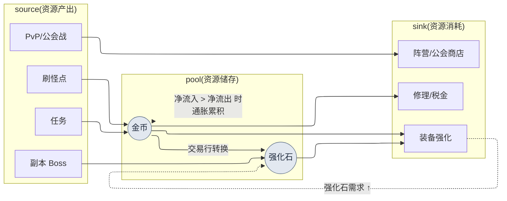

# 8.2 用 Machinations 建模经济 —— 用模拟而非开会来控住通货膨胀

> 主要读者:负责线上经济的 MMORPG 数值/系统策划(中等规模(10\~50 人)团队)
> 面向单人/业余读者的精简版:§8.2.10「一个人的话,只需做到这些」

最早察觉金币开始泄漏的,不是账单,而是交易行。上线第二个月,强化石的行情悄悄上涨,一个月后翻了一倍。为了查明原因我召集了一场会议,可会议室里冒出来的全是"感觉"。有人说新副本的奖励给多了,有人说是刷怪点的效率变高了,还有人说不过是高等级玩家变多了而已。每种说法都像那么回事,于是什么也没能定下来。一个小时耗在了猜测上,最后以"先等下周再多看看数据"收场。

问题在于资源不止一种。金币、强化石、声望、荣誉、灵魂石各自都有 source(流入的路径)和 sink(流出的路径),而这些路径又彼此供养。强化石 Boss 也会掉金币。用金币买来的装备又会消耗强化石。当 5 种资源与数十条流动纠缠在一起时,光靠脑子里的心算,连一种资源一周的收支都算不出一个诚实的数字。本章讲的,是把这种缠绕搬进 **Machinations 节点模型**,并让经济变更的决策不再靠会议上的猜测、而是靠 **模拟关卡(simulation gate)** 来通过。经济设计的一般理论,别的书里已经讲得够多,本章只聚焦于把那套理论 *放进 AI 工作流去跑的那一环*。

> **笔者实际运营笔记**
> 本章的案例,是把笔者在公司 R&D 文件夹中运营的经济试点文档(`Economy_Machinations_Pilot`)与经济调研工作区做了匿名化处理。资源种类、source/sink 结构、Pilot 四个阶段都忠实地照搬了实际运营,而公司专有名称、真实数值则替换为书用版本,或只以比例、方向来表述。AI 输出正文是对真实会话的重现。

---

## 8.2.1 经济不是"5 种资源",而是"数十条流动"

把经济资源列成表,只有五行,看上去很简单。陷阱不在资源,而在连接资源的 **流动** 的数量上。

| 资源 | source(流入) | sink(流出) |
|---|---|---|
| 金币 | 刷怪、任务奖励、交易行出售 | 购买装备、强化、修理、税金 |
| 强化石 | 副本 Boss、活动 | 装备强化、合成 |
| 声望 | 支线任务 | 阵营商店、转职 |
| 荣誉 | PvP、公会战 | PvP 商店、公会设施 |
| 灵魂石 | 击杀 Boss | 角色复活、学习技能 |

资源虽只有 5 种,但 source 与 sink 加起来有二十几个,而且资源之间还会相互转换(用金币购买强化石的交易行,既是金币的 sink,又是强化石的 source)。一旦这些流动开始彼此供养,"金币多投放 5%,强化石行情会怎样"这类问题,只盯着一种资源就答不出来。这正是角色平衡(8.1)与经济平衡决定性不同的地方。角色平衡用一行公式就能收口,而经济是 **随时间累积的动态系统**,即便一周收支接近 0,累积 26 周也会把交易行压垮。

所以经济工作的本质,不是"把数字挑好",而是 **"用模拟去看流动如何随时间累积"**。而手工搭建、修改这套模拟模型既枯燥,每做一次又都会有遗漏。反复而容易漏项的初稿工作,可评审又必须牢牢握在人手里 —— 这种性质的工作,正是 AI 与人的分工线画得最干净的地方。

先用一张图,放上本章要处理的经济循环的骨架。



虚线才是本章的核心。强化 sink 拉高强化石需求,从而推高强化石行情(`UP -.-> S`);而当金币净流入超过净流出时,那部分超额每周都会堆进池(pool),累积成通货膨胀。这两条虚线,靠手算根本无法追踪,所以才需要模型。

---

## 8.2.2 Machinations —— 把经济搬进节点图的工具

Machinations 是一款把经济流动画成节点图、并在其上运行模拟的工具。这一节要做的,是把 §8.2.1 的 mermaid 搬成一个真正能跑的模型。

| 节点 | 作用 | 在上图中 |
|---|---|---|
| Pool | 资源储存库 | 金币、强化石 |
| Source | 资源产出 | 刷怪、任务、Boss |
| Drain | 资源消耗 | 强化、修理、商店 |
| Converter | 资源转换 | 交易行(金币→强化石) |
| Trigger | 条件触发 | 活动、晋级奖励 |

用这些节点为经济建模,再把模拟跑 1,000 次,得到的就不是单一结果,而是一个分布。形如"26 周后金币行情中位数 +X%,前 10% 玩家 +Y%"。不过 Machinations 并非万能,引入它本身就是一种成本。

| 局限 | 对策 |
|---|---|
| 与游戏代码分开运行,同步会错位 | 用真实 telemetry 每月/每季校准(§8.2.6) |
| 节点图一大,可读性就崩 | 按资源拆成子图,从单一资源起步(§8.2.4) |
| 模拟用的是简化的玩家模型 | 用真实行为分布校准,设定误差阈值 |
| 结果解读依赖领域知识 | 把从模拟数值到决策的关卡标准化(§8.2.5) |

所以 Machinations 并不是一款无条件引入的工具。只有当 **5 种以上资源 + 资源转换流动 + 线上运营** 这三个条件叠加时,它才值得。2\~3 种资源的简单经济,用 Excel 就够了,那种情况下引入 Machinations,收益还没到,运营负担先到了。

---

## 8.2.3 [实操记录] 用 AI 起草金币单一资源模型

光看工具说明,还是不知道它实际会吐出什么。这里把"仅金币一种资源搬进 Machinations 模型"的一个完整周期,从输入提示词一直跟到人的驳回,走到底。输入提示词可以原样复制使用,输出则是对真实会话的重现。

### 第 1 步 —— 输入:把金币流动整理成机器可读的表

先把金币的 source·sink 从数据表里提取出来,做成一张表。这不是新写,而是提取。

```yaml
# gold_flows.yaml —— 金币单一资源流动(现行数据表摘录)
resource: gold
sources:
  - id: hunting        # 刷怪点掉落
    trigger: per_kill
    note: 各等级段的掉落曲线套用 reward_curve 规则
  - id: quest_reward   # 任务奖励
    trigger: per_complete
  - id: market_sell    # 交易行出售
    trigger: per_trade
sinks:
  - id: gear_buy       # 购买装备
  - id: enhance        # 强化费用
  - id: repair         # 修理
  - id: tax            # 交易行税金(既是 sink,也是回收金币的核心)
# 玩家行为分布(每小时刷怪次数·任务完成率)目前仍为空 → 让 AI 若做假设就标示出来
```

### 第 2 步 —— 提示词:让它建模,但强制约束假设与格式

```
附件 gold_flows.yaml 是金币这一单一资源的 3 个 source、4 个 sink。
请据此起草一份可搬进 Machinations 模型的节点规格草案。

规则:
1) 把每条流动按节点类型(Source/Drain/Pool/Converter)分类。
2) 为每个节点提出"以一周为准、每名玩家的期望流量"的算式,
   若需要玩家行为假设(每小时刷怪次数·任务完成率等),
   就把该假设单独另起一行标为"★假设"。不要把假设藏在正文里。
3) 把 source 总流入与 sink 总流出分开,计算一周净收支(net)。
4) 要体现交易行税金(tax)是唯一把金币从经济中永久移除的 sink,
   并区分其他 sink(强化·修理)只是把金币转移给 NPC、并非回收。
5) 凡是你"没有把握"的假设,单独用 ★ 标出,交给人来决定。

输出格式:表格(节点 | 类型 | 一周流量算式 | 假设 | 把握度)。除此之外不要有任何说明。
```

这段提示词里真正写得长的,不是"去建模"的指令,而是"把假设写在哪里、怎么写"的规则。在经济建模中,若放任 AI 自由发挥,它会把假设藏起来、只吐出一堆看似合理的数字。那样一来,即便模型错了,也指不出 *到底哪里错*。**把玩家行为假设从正文里揪出来、单独立成一行** —— 这项请求的分量全压在这里。假设露出来,才能验证。

### 第 3 步 —— Claude 的输出(重现,节选)

```
| 节点          | 类型      | 一周流量算式                            | 假设             | 把握度 |
|--------------|-----------|----------------------------------------|------------------|-------|
| hunting      | Source    | 每小时击杀 × 平均掉落 × 周游玩时长        | ★每周 15h,击杀 80/h | 中  |
| quest_reward | Source    | 日常任务数 × 奖励 × 7 × 完成率           | ★完成率 0.7      | 中    |
| market_sell  | Source    | (玩家间转移 —— 非净增)                  | 对净经济零贡献    | 高    |
| gear_buy     | Drain     | 购买频率 × 平均价                        | ★每周 1.2 次     | 低    |
| enhance      | Drain     | 强化尝试 × 每次费用                      | ★每周 8 次       | 中    |
| repair       | Drain     | 刷怪时长 × 修理率                        |                  | 高    |
| tax          | Drain     | 交易额 × 税率(★唯一永久回收的 sink)     | ★税率 5%         | 高    |
| ── 净收支    | net       | Σsource − Σsink ≈ +(以中活跃为准为正)   | 汇总以上假设时    | ★低  |

★假设警告:market_sell 是玩家↔玩家的金币转移,对经济总量零贡献。
把它计入 source 会重复计算通胀。需要在模型中单独处理。
★没有把握之处:gear_buy 频率(每周 1.2 次)是猜测。没有真实购买 telemetry
就可能把 sink 低估/高估 → 需要人来决定。
```

这份输出里最有价值的不是表格,而是 **最下面两行——"★假设警告"与"★没有把握之处"**。AI 主动把自己模型的两处弱点上报了出来。好的提示词,能让 AI 说出"这个假设我信不过"。

### 第 4 步 —— 验证与驳回(人的位置)

这份输出不能直接塞进模型。AI 上报的两处 ★ 里,有一处实际上是会毁掉模型的缺陷。

AI 起初把 `market_sell`(交易行出售)归为了 Source。可交易行出售,是 **玩家 A 的金币转移到玩家 B** 的过程,并不是经济里凭空多出了金币。把它计入 source 流入,就会把通货膨胀重复计算一遍。AI 虽然用 ★假设警告自己点了出来,但在表格正文里,它仍旧把这条留在了 Source 一栏 —— 报是报了,却没从模型里剔除,这是一份只对了一半的输出。这同时也是人这一侧的数据缺陷:输入的 yaml 里没有标明 `market_sell` 的性质(玩家间转移 vs 新增产出)。

于是重新提出请求。

```
market_sell 是玩家↔玩家的金币转移,并非经济总量的 source(修正输入
遗漏)。请把该节点从 source 汇总中剔除,改为只以"交易行税金(tax)
永久回收转移额的一部分"这一 sink 反映到模型里。请重新计算净收支,
并用一行展示剔除 market_sell 对 net 的影响。
```

AI 重新给出了一个把 `market_sell` 从 source 中移除、只留税金作为 sink 的模型。结果净收支(net)比最初的估计更低了 —— 这暴露出:把交易行出售错当成 source 时,通货膨胀是被高估了的。**这一次往返正是关键。** 人若从头手工搭建,要花半天,而且节点分类的失误自己很难抓出来;可 AI 起草 +"强制标示假设"+ 一次驳回,只需一小时以内,并且靠"AI 上报 ★、人来判定"这一结构,像重复计算这样的缺陷,在进入模型之前就被拦下了(笔者估计 —— 节省的时间因团队、资源数而异,与其看绝对值,不如把它当作"从头手工"与"起草+评审"之间的结构差异来读)。

---

## 8.2.4 一次一种资源 —— 用 Pilot 四阶段引入

金币模型收口了,并不意味着可以把全部资源一次性建模。笔者的运营也没有把整体一股脑塞进去,而是走了从单一资源起步、经过验证·校准再扩展的四个阶段。

| 阶段 | 范围 | 核心关卡 |
|---|---|---|
| 1. 单一资源(金币)建模 | source 3·sink 4,§8.2.3 会话 | 节点分类·标示假设 |
| 2. 模拟 vs 实际对比 | 模拟一周 net vs telemetry 一周 | 是否通过误差阈值 |
| 3. 模型精度校准 | 反映玩家行为分布(低/中/高活跃) | 按 segment 重新测量误差 |
| 4. 资源扩展(5 种) | 逐步加入强化石·声望·荣誉·灵魂石 | 验证转换流动(交易行) |

第 2 阶段的对比验证,是这四个阶段的心脏。模拟与实际若对不上,错的不是游戏,而是模型。用一个对不上的模型去做决策,那决策就会在线上以事故的形式回来。所以扩展(第 4 阶段)永远只在通过第 2·3 阶段的验证之后才做。这个顺序一旦被打破,也就是跳过单一资源验证、把 5 种资源一次性塞进去,就连"哪种资源的模型错了"都没法分离出来指认。

---

## 8.2.5 模拟关卡 —— 给经济变更决策架起拦截屏障

模型通过验证后,就要在每一个影响经济的变更决策前面立起 **模拟关卡**。这是把过去在会议上靠"感觉"放行的决策,改成靠模拟通过来放行的地方。

| 决策类型 | 模拟义务 |
|---|---|
| 新增 source·sink | 必须 |
| 变更资源转换比率(交易行汇率等) | 必须 |
| 设计新副本·活动奖励 | 必须 |
| 价格变更(±10% 以上) | 必须 |
| 验证新职业效率 | 必须 |
| UI 变更等与经济无关 | 豁免 |

关卡实际如何运作,这里在 §8.2.3 验证过的金币模型之上,把一个决策放上去过一遍。

> **[模拟关卡 —— 活动奖励决策](真实格式重现)**
>
> ```
> [变更方案] 周末活动:每日登录奖励 +500 金币
> [关卡]     新增 source → 必须模拟
> [模拟 1000 次结果]
>   - 一周金币净收支:+6,900 → +10,400(+50%)
>   - 累积 26 周时金币行情中位数 ~+28%(通胀警告:超过 ±10%)
>   - 前 10% 活跃玩家:~+41%(segment 偏差大)
> [判定]     FAIL —— 超出稳定区间(±10%/长期)
> [校正方案] 给活动 source 同时附上 sink:活动限定商店(回收金币)
>            重新模拟 → 累积 26 周 +9%(PASS)
> ```

关卡的价值在最后两行。"投放 +500 奖励"这个决策,若是在会议上靠猜测,大概会以"应该没问题"放行。模拟关卡则把这决策换算成 26 周 +28% 的通胀摆出来,还进一步强制给出 **要加 source,就把 sink 一起挂上** 的校正。把经济变更判定为不是靠猜测、而是靠模拟的通过/失败 —— 这就是关卡的全部。

这里点一个常掉进去的陷阱:segment 偏差。以中活跃玩家为准是 +28%,而前 10% 则是 +41%。赚金币最多的那批玩家,累积通货膨胀也最快,所以模拟不能只看平均,得按 segment 分别去跑。只看平均,就会漏掉由高活跃玩家引发的行情崩塌。

---

## 8.2.6 模型在上线后靠 telemetry 每月进化

要让模拟关卡被信任,模型就不能与实际游戏对不上。游戏每周都在变,模型也得跟着校准。上线后,用真实 telemetry 每月(变更少的时期则每季)去校准模型。

```
模型校准周期(每月)
─────────────────────────────────
1. 提取一个月的真实玩家 telemetry(按资源汇总流动)
2. 按 segment(低/中/高活跃)算出 source·sink 的实测流量
3. 与 Machinations 模拟逐项对比
4. 误差 >15% 的项 = 调整模型参数(该项的 ★假设错了)
5. 调整后重新模拟 → 作为下个月关卡的基准模型使用
```

核心是第 4 步。误差大的项,正是 §8.2.3 中 AI 用 ★ 上报过的"没有把握的假设"与实际对不上的信号。比如 AI 猜测的 `gear_buy` 频率(每周 1.2 次),若实测是每周 2 次,就把那条假设换成 telemetry 的值。一旦停下这项校准,模型就会与游戏慢慢拉开距离,某个季度的模拟关卡便会闯出"放行了、实际却来了通胀"的事故。那一刻,模拟本身的信任会在事后崩塌。校准不是运营的附带工作,而是让关卡保持存活的常规周期。

---

## 8.2.7 进阶式应用 —— 异常模式检测·变更空间·模拟并行化

到这里为止,是经济建模的"保守式应用":人来发起变更,用模型验证,依结果决策。再往前一步,8.1.6 里见过的进阶式应用的三条轴 —— z-score 检测 · 定义变更空间 · 模拟并行化 —— 在经济这套基础设施之上同样会打开。

**第一,异常模式检测。** 每月校准周期(§8.2.6)里的误差对比,不再靠人用眼睛看,而是让代码先把"模型-实测偏差超过阈值"的项挑出来报上来。强化石行情翻倍,不再是看着交易行才知道,而是"强化石 source 流量相对模型偏离 +30%"这样一条 alert,会在开会之前就送到。

**第二,定义变更空间。** 不是"投放 +500 奖励,还是不投放"的二选一,而是把奖励范围(0\~+1000)与同时挂上的 sink 范围定义为一个变更空间,那么就能在这个空间里搜索满足通胀 ±10% 的组合。人来定"从哪到哪",空间内的最优组合搜索则交给自动化。

**第三,模拟并行化。** 不是把一个变更方案跑 1,000 次,而是把变更空间里的几十个候选各跑 1,000 次并行,一次性对比分布。过去在会议室里一个方案一个方案讨论的场面,变成对候选矩阵的模拟结果做比较。

共同的思想,是把人 *发起* 变更的位置,挪到让代码 *搜索* 变更空间的位置。但前提是:保守式应用(§8.2.3\~8.2.6)已稳定运转、模型也经 telemetry 验证之后,才谈得上。若拿没验证过的模型去自动搜索变更空间,错的模型只会自信地给出错的最优值。

> **[激进式应用 —— 把经济压缩成"维度向量"来搜索](目前尚为时过早)**
>
> 这是比进阶式应用再往前迈一步的领域。请把它当作研究动向来读,而非定论(若你是初次接触维度向量·嵌入(embedding),先看一眼附录 M 的那张"地图",下面就容易读了 —— 本书的五个"方向标"全都在那张图上打转)。走到这里的经济模型,是 5 种资源与数十条流动缠在一起的高复杂度系统,而 §8.2.7 的变更空间搜索,归根结底也是把那数十条流动逐一当成参数去跑。激进的想法,是把这份复杂度本身 **压缩成维度向量**,再在那个压缩空间之上求解。
>
> 一个看似遥远的类比可作线索。常被列为定性、难以把握的领域——烹饪食谱,在一项研究(Epicure —— Radzikowski·Chen,2026,arXiv:2605.22391 · 演示 epicure.kaikaku.ai)中,从 11 个来源的 414 万条食谱里,提炼出 1,790 种标准食材,把食材之间的关系压缩成数百维的向量。关键在于:即便是"味道"这样的定性对象,只要把食材间的关系换算成坐标,相似的食谱就会在向量空间里聚到一起,并可在其间做插值来搜索新的组合 —— Epicure 也展示了在这个压缩空间里,把某种食材朝特定菜系方向旋转、以寻找对应食材的插值搜索。
>
> 经济的原理也一样。把 source·sink·转换流动各自当作一个维度、用向量来表示经济状态,那么"通胀 ±10% 之内的稳定经济"就会被圈定为该空间中的一块区域。于是,不必再把变更方案一个个送去模拟,而是可以直接在那块稳定区域之内/附近搜索解。过去逐一去跑、去比的 §8.2.7 的并行模拟,有可能被收窄为压缩空间之上的一次搜索。
>
> 为何说"目前尚为时过早"。第一,决定把什么当作维度(哪些流动是独立的、哪些是从属的)这件事本身就是领域难题。第二,压缩本质上就是丢弃信息,被丢掉的那个维度上有可能爆出线上事故。第三,这一切只有在保守式应用的 telemetry 验证(§8.2.6)足够扎实时才有意义 —— 若压缩前的模型已与游戏对不上,压缩只会把那份误差也一并干净利落地压进去。所以这一节不是处方,而是 **方向标**。眼下要做的,是把保守式应用诚实地跑起来;维度向量,则留给那些根基积累得足够厚的团队,在几年后再去审视的研究领域。

---

## 8.2.8 度量 —— 会议被模拟替代的地方

对比工具引入前后。下表的时间·频率,承载的是引入初期运营中体感到的方向,与其当作精确的绝对值来读,不如读作它朝哪个方向移动了才对。

| 项目 | 引入前(会议·手算) | 引入后(模拟关卡) |
|---|---|---|
| 经济变更决策 → 落地 | 2\~4 周(反复猜测·再讨论) | 1\~3 天(模拟验证 1 次) |
| 通货膨胀事故 | 每季 1\~2 起(事后发现) | 每季 0\~1 起(关卡事前拦截) |
| 新增 source·sink 频率 | 每季 1\~2 次(心里没底,趋于保守) | 每月 1\~2 次(模拟提供安全保障) |
| 经济会议频率 | 每周 3\~4 次 | 每周 1\~2 次 |

比起表里的数字,最后一行的含义更大。会议频率下降,是因为模拟替代了讨论。"我觉得强化石那边可能要来通胀"一旦变成"模拟结果 26 周 +28%",过去围着猜测争论一小时的场面,就以 5 分钟的结果共享收场。这与笔者系统的复盘中固化下来的一个概念(atom `automation_signal_value_over_time_savings` —— 自动化的价值不在于节省时间,而在于暴露信号)恰好是同一处。模拟关卡真正的产物,不是省下来的时间,而是让数字占据了会议上原本由猜测占据的位置。

不过有一点要诚实说明。表里的"每季 1\~2 起 → 0\~1 起"不是精确测量值,而是运营体感的方向。通货膨胀事故的计数会随定义(把行情 ±百分之几视为事故)而变,所以与其看绝对起数,不如读作"从事后发现转向事前拦截"这一结构变化才对。

---

## 8.2.9 常见的失败

| 模式 | 为何会失败 | 对策 |
|---|---|---|
| 把全部资源一次性建模 | 无法分离出哪种资源的模型错了 | 从单一资源 Pilot 起步(§8.2.4) |
| 不经评审就接受 AI 模型的假设 | 交易行重复计算之类的缺陷会原封不动进入 | 强制标示假设 + 人来驳回(§8.2.3) |
| 不设模拟关卡就变更经济 | 事后修复通胀的成本极大 | 定义必须模拟的项目(§8.2.5) |
| 只模拟平均、忽视 segment | 漏掉由高活跃玩家引发的行情崩塌 | 按 segment 模拟(§8.2.5) |
| 上线后不做 telemetry 校准 | 模型与游戏拉开距离,关卡信任崩塌 | 每月/每季校准周期(§8.2.6) |
| 用未验证的模型自动搜索变更空间 | 错的模型会自信地给出错的最优值 | 保守式应用稳定后再进阶(§8.2.7) |

第二种最常被漏掉。就像 §8.2.3 里看到的交易行重复计算,AI 会自信地吐出一个看似合理的模型,却只用 ★ 上报自己假设的弱点、把缺陷留在正文里。那些 ★ 若不由人来判定,错的模型就会被放行,其上的所有模拟决策也就一起错了。

---

## 8.2.10 动手试试 —— 今天就能做的一步

> **一个人的话,只需做到这些**:没有 Machinations、没有 telemetry 也行。挑出你自己游戏(或你喜欢的游戏)里的一种资源,把它的 source·sink 写在纸上,再把 §8.2.3 的提示词原样贴上去,拿到一份一周净收支的模型草案。然后挑一条 AI 用 ★ 标出的假设,试着反驳它"这个假设我信不过,重新给出依据",你就会亲身体会到:经济模型是由哪些假设捆在一起的 —— 以及其中一条假设错了,结论会怎样被推翻。

如果是团队,就从下面这一步开始。不要全部资源,而是挑出 **最成问题的那一种资源**(通常是金币或强化石),先只搭起 §8.2.3 的单一资源模型,再对一种经济变更决策(例如活动奖励)套上 §8.2.5 的模拟关卡。哪怕只有一种资源 + 一种决策,也足以把会议上围着猜测争论的场面,换成一行数字。

用 setup → prompt → verify 来概括 —— **setup**:把那一种问题资源的 source·sink 提取为 yaml。**prompt**:按 §8.2.3 的格式拿到节点模型草案,并强制让它用 ★ 标示玩家行为假设。**verify**:由人亲自驳回并重新请求 AI 上报的 ★ 假设与节点分类(尤其是玩家间转移 vs 新增产出)。

---

### 本章要点
- 经济不是 5 种资源,而是随时间累积的数十条流动,所以需要模拟。
- AI 的模型草案要强制标示假设,再由人来驳回那些假设。
- 经济变更不靠会议猜测,而靠模拟关卡的通过/失败来判定。

### 下一章预告
- 8.3 Damage Simulator(2008\~) —— 一款用了 18 年的模拟工具,在 AI 时代如何被重新利用
