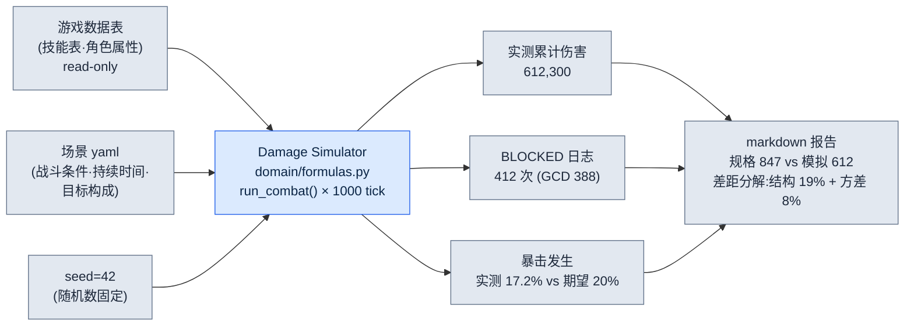

# 8.3 Damage Simulator —— 规格 DPS 与模拟结果分岔的那一天

2008 年的一个凌晨,我对着一张 Excel 表,把同一个数字验算了三遍。规格书里写着某个剑士角色的每秒伤害是 **847**。可那天我第一次跑出来的模拟器,输入的是同一个角色、同样的参数,却吐出了 **612**。相差 27%。两个数字里必有一个在说谎,而我还不知道是哪一个。

规格书上的 DPS 是纸面上的承诺。一次技能的伤害乘以发动频率的算术。模拟器的 DPS 则是把这份承诺实际挥动 1,000 次之后的结果。冷却时间相互重叠、施法动作吃掉时间、暴击没有按期望值那样打出——这些纸面不知道的摩擦掺了进来。这 27% 的缝隙,正是数值策划安身立命的地方。信了纸面,上线之后就要哭。

本章讲的是这一件工具的故事。2008 年做出来、至今没有离手的 Damage Simulator。它如何追踪规格与产出分岔的确切位置,以及 18 年后我又如何给这套追踪接上了 AI——本章用一段真实的实操记录(worked transcript,完整保留的真实操作过程记录)一步步走过。

---

## 8.3.1 规格 DPS 为什么总是在说谎

先来拆解一下这个 612 对 847 到底是怎么回事。写这份规格书的后辈策划(以下称团队成员 A)并没有做错什么。他只是照着技能表上写的数字相乘。

规格上的 DPS 是这样算出来的。假设某个角色拥有三个技能。

| 技能 | 单次伤害 | 冷却时间 | 施法时间 |
|---|---|---|---|
| 横斩 | 320 | 3.0s | 0.6s |
| 突刺 | 540 | 6.0s | 0.9s |
| 普攻 | 180 | 1.2s | 0.4s |

团队成员 A 的规格计算,建立在"每个技能一到冷却就毫不遗漏地释放"这一理想假设之上。横斩每 3 秒 320,突刺每 6 秒 540,普攻填满空档。用算术算,干干净净地得出 847。在纸面上,角色仿佛长了好几只手,施法动作彼此互不阻挡。

模拟器之所以给出 612,原因只有一个——手只有一只。在释放 0.9 秒的突刺期间,即便横斩的冷却已经转好,也没法使出来。施法动作彼此吞噬的这种**全局冷却(GCD)冲突**,在规格里并不存在。纸面是没有摩擦的真空,模拟则是有摩擦的战场。做这行 24 年,我学到的第一条真理就是这个——规格 DPS 是上限,而不是实测值。而玩家玩的不是上限,是实测值。

---

## 8.3.2 实操记录 —— 向 AI 追问 612 的出处

2008 年的我,是用手把这 27% 的缝隙填上的。我一行一行地用眼睛读模拟日志,数出技能在哪一帧被挡住。花了半天。18 年后的今天,我把同一份日志扔给 Claude。下面是实际进行的一次会话全文。我不做删减,连打偏的第一次尝试也原样收录——因为那次打偏,正是用好这件工具的一半诀窍。

我抛出的提示词是这样的。

> 附件是我们的 Damage Simulator(`damage_sim/`,Python)单个角色 1,000 tick 战斗日志的一部分。规格书上这个角色的 DPS 是 847,而模拟产出是 612。请从日志中找出这 27% 差距的原因。日志格式为 `[tick] event skill=SKILL state=STATE`。不要猜测,只拿日志里的证据说话。证据不足就说不足。
>
> ```
> [0.0] cast skill=突刺 state=START
> [0.9] cast skill=突刺 state=HIT dmg=540
> [0.9] cast skill=横斩 state=BLOCKED reason=GCD
> [1.5] cast skill=普攻 state=HIT dmg=180
> [1.9] cast skill=普攻 state=BLOCKED reason=GCD
> [3.0] cast skill=横斩 state=HIT dmg=320
> [3.6] cast skill=普攻 state=HIT dmg=180
> ... (此处省略 994 行)
> [997.2] cast skill=突刺 state=HIT dmg=540
> ```

Claude 的原始输出是这样的(未作润色)。

> 从日志中可以确认的事实:
>
> 1. `state=BLOCKED reason=GCD` 事件反复出现。在 `[0.9]` 处横斩、在 `[1.9]` 处普攻,都因为 GCD(全局冷却)被挡住了。
> 2. 在突刺施法(0.0→0.9,0.9 秒)结束之前,其他技能无法发动。看起来是施法时间占用了 GCD 的结构。
> 3. 因此,规格上"每个技能一到冷却就发动"的假设被打破了。实际上施法动作彼此冲突,导致一部分发动被遗漏。
>
> 不过所提供的日志只有 1,000 行中的 7 行。**这 27% 的确切差距是否仅凭 GCD 冲突就能解释,单靠这 7 行无法断定。** 需要统计 BLOCKED 事件的总发生次数,以及由此遗漏的伤害总量,才能验证这 27%。如果你能给出整份日志的 BLOCKED 汇总,我会做定量确认。

在这里停下,很重要。AI **指出**了原因,却没能**证明**这 27%,而且它自己说出了这个局限。换作一个只看纸面的策划,可能一句"是 GCD 的缘故"就把会开完了;而这件工具却坚持"光凭 7 行还不知道"。我判断它的这个要求是正当的——这就是人的验证。于是我把整份日志的 BLOCKED 汇总提取出来,再次抛给它。

> 这是整整 1,000 tick 的汇总。BLOCKED 共 412 次,其中 GCD 原因 388 次,冷却未就绪原因 24 次。因 BLOCKED 遗漏的估算伤害,按横斩折算约为 19,800。整场 1,000 tick(=秒)战斗中,规格期望伤害为 847,000,模拟实测累计伤害为 612,300。用这些数字重新审视这 27% 的差距。

Claude 的第二次输出。

> 用汇总来验证。
>
> - 规格期望累计:847,000
> - 模拟实测累计:612,300
> - 差距:234,700(27.7%)
>
> 这个差距的构成:
> - 因 GCD 冲突直接遗漏(388 次):估算约 19,800 是按横斩折算的,但还应把"被遗漏的槽位本可以填入更高伤害技能"的机会成本一并计入。若把遗漏槽位按平均伤害折算,遗漏部分会大于 19,800。
> - 不过 234,700 并不能全部只用 BLOCKED 来解释。**规格 847 究竟是"已把暴击期望值按平均计入"的值,还是"不含暴击的基础值",会决定其余差距该如何解释。** 如果你告诉我规格 847 的暴击假设,我就把剩余差距分解开。

它又停下了。而且再一次停在了准确的地方。规格 847 是怎么处理暴击的——这是日志里没有的信息,只存在于团队成员 A 的脑子里。AI 知道自己所持数据的边界。我去确认后发现,规格 847 是把暴击 20% 概率、1.5 倍按期望值平摊进去后的值;而模拟则是 seed 固定之后,实际暴击发生次数低于期望值的那一局。也就是说,这 27% 的差距,是 **GCD 冲突(结构性、可复现)** 与 **暴击方差(统计性、这一局的运气)** 混在一起的值。

这个分解就是结论。GCD 冲突的那部分是必须靠设计去修的真问题,而暴击方差的那部分,只要换 seed 跑 1,000 局取平均就会消失的噪声。把两者混为一谈,以"角色太弱"为由给它加强,那么在 1,000 局平均里本来正常的角色就会变得过强。纸面不知道、单独一局的模拟不知道、**连 AI 自己也不知道**的这个区分,是靠日志汇总与规格中隐藏假设的对照——也就是人的验证——才做出来的。

---

## 8.3.3 一组输入变成一组输出 —— 解剖模拟器

把刚才那次会话所审视的这件工具的输入输出,作为一整套摊开来看。模拟器归根结底是一个诚实的函数。同样的输入,同样的输出。输入从三条路汇聚而来。



这张图的关键在于:箭头是单向的。游戏数据表只会被模拟器**读取**,模拟器绝不会去改写数据。18 年来挡下最多事故的规则,就是这一根箭头的方向。一旦模拟器开始把数据复制一份存在自己内部,那么在游戏数据变更的第二天,模拟器模拟的就是昨天的世界。拿这样产出的报告去开会,整场会议就会围绕昨天的世界争论不休。

一组具体的输入(场景 yaml)长这样。

```yaml
# scenarios/single_dps_check.yaml
scenario: single_target_dps
duration_ticks: 1000      # 假设 1 tick = 0.1s,100 秒战斗
seed: 42                  # 确定性 —— 同样的输入,同样的输出
actor:
  char_id: K_004          # 从游戏数据表 read
  skill_rotation: optimal # GCD 冲突时,优先最高期望伤害
target:
  defense: 1200
  hp: infinite            # 用于测 DPS 的无限血量假人
report:
  compare_to_spec: 847    # 填入规格 DPS,自动分解差距
```

而一组输出(报告节选)是这样。

```markdown
# Damage Simulator Report — K_004 single DPS
输入: scenarios/single_dps_check.yaml | seed=42 | data rev. 2026-06-05

## 规格对比
- 规格 DPS:       847   (含暴击 20%·1.5x 期望值平摊)
- 模拟实测 DPS:  612   (这一 seed 的单局)
- 差距:            -27.7%

## 差距分解
- 结构性(GCD 冲突,可复现):   -19.2%  ← 设计复查对象
- 统计性(暴击方差,这一局): -8.5%  ← 预计 1000 局平均时抵消

## 复现验证
- seed=42 重跑 3 次 → 612,300 / 612,300 / 612,300 (一致)
- seed 0~999 共 1000 局平均 DPS → 731 (暴击方差抵消后)
```

看最后一行。用 seed 0\~999 跑 1,000 局的平均是 731。规格 847 与 1,000 局平均 731 之间的差距 116(13.7%),正是 GCD 冲突这个**真正的结构问题**的大小。该成为设计会议输入的,不是单独一局的 612,而是这个 731。既不是纸面的 847,也不是运气不好那一局的 612,而是 1,000 局达成共识的 731。把这个数字握在手里之前的全部功夫,就是数值策划的工作。

---

## 8.3.4 2008 年的手与 2026 年的手

这件工具活了 18 年,但并不是靠同一份代码活下来的。衣架原样不动,只把衣服换了五次。衣架就是上面那份报告的逻辑——把规格与实测分开看、把差距分解为结构与方差、再用复现来验证的这套流程。这套流程,无论是在 2008 年的 Excel VBA(Excel 宏语言)里,还是在 2026 年的 Python 里,都一字不差地相同。

| 时期 | 衣服(技术) | 衣架(不变的流程) |
|---|---|---|
| 2008\~2011 | Excel VBA,1:1 | 对比规格做差距分解 |
| 2012\~2016 | C# 控制台,N:N | 〃 |
| 2017\~2020 | Python + Web | 〃 |
| 2021\~2024 | Python + ML | 〃(+ 反映玩家分布) |
| 2025\~ | Python + LLM 辅助 | 〃(+ 日志查询·假设生成) |

撑过五次换衣服的秘诀,刻在文件夹结构里。

```
damage_sim/
├── domain/          # 衣架 —— 18 年原样不变
│   ├── formulas.py      # 伤害公式·GCD 冲突判定
│   └── metrics.py       # 差距分解逻辑
├── adapters/        # 游戏数据 read-only
│   └── excel_reader.py
├── runners/         # 衣服 —— 每次技术变更就替换
│   └── cli_runner.py
└── reporters/       # 衣服 —— 报告输出格式
    └── markdown_report.py
```

技术一变,只需重写 `runners/` 和 `reporters/`。`domain/` 里的差距分解逻辑,作为 18 年的资产原样存活下来。2008 年用 Excel 单元格写的 GCD 冲突判定式,如今只换了函数签名,就在 `formulas.py` 里运行着。把工具钉死在一种技术上,它就会随那种技术一起老去、死掉——这是我送走好几件死掉的工具后才学会的。

2025 年接上的 LLM,不是新衣架,而是新的手。正如前面那次会话所见,AI 是**读日志、立假设**的手,原本要花半天的日志追踪缩短到了几分钟。但它绝不碰衣架——**决定**差距是不是 27%、暴击到底打出了百分之几的,依然是 seed 固定的确定性内核。LLM 一旦挤进那个位置,回归验证就变得不可能,工具也就死了。

---

## 8.3.5 确定性内核与它的外部 —— 界线该划在哪里

如果在一件数值工具里只能划一条线,我会把它划在确定性内核的边界上。里侧,必须像钢铁一样保证同样的输入得到同样的输出;外侧,人和 AI 尽可以自由地抛出假设。

里侧(确定性 —— 禁止 AI):
- 伤害公式、GCD 冲突判定、暴击发生、累计汇总。
- 用 `seed=42` 跑三次,612,300 必须三次都一模一样。这一点一旦被破坏,昨天的报告和今天的报告就无法比较。

外侧(假设·解释 —— 欢迎 AI):
- "为什么这个角色组合的胜率不正常"之类的原因查询。
- 在日志里找 BLOCKED 模式、自然语言报告初稿、场景 yaml 初稿。

前面那段实操记录,恰好就在这条线上移动。AI 在外侧迅速立起了"GCD 冲突是原因"的假设。但 27% 这个数字、612 这个数字,自始至终都是确定性内核算出来的值,AI 只是接过这些值去做解释。而且它两次停下,说"凭这些数据无法断定"——同时要求确定性内核给不了的信息(规格对暴击的假设)。这种停下,正是一件好工具的标志:不把假设错当成诊断。

关于数字,我要诚实地交代一点。本章里 847·612·731·412 次这类具体数字,是为了说明而构造的示例值。但"规格 DPS 总是高于模拟实测"这个**方向**、"这个差距会分解为结构性冲突与统计性方差"这个**结构**、以及"seed 固定是回归验证的前提"这条**原则**,都是从 2008 年起 18 年间实际运用中反复确认过的。比例的大小因项目而异,但方向和结构从未改变。

---

## 动手试试 —— 对比规格做一次差距分解

**setup.** 从游戏数据中挑一个角色,拿到它的技能表(伤害·冷却时间·施法时间)和规格 DPS。如果没有模拟器,就写一个跑 1,000 tick 单目标战斗的最小脚本。关键只有一条:必须能把 `seed` 作为参数传入并固定下来。

**prompt.** 把模拟日志(含 BLOCKED 事件)和规格 DPS 一起抛给 AI。

> 附件是 1 名角色的 1,000 tick 战斗日志和 BLOCKED 汇总。规格 DPS 是 [N],而模拟产出是 [M]。请只凭日志证据分解差距的原因。区分结构性原因(可复现的冲突)与统计性原因(这一局的方差)。证据不足就说不足,并指出还需要什么。

**verify.** 把 AI 指出的结构性原因,通过换 seed 跑 1,000 局取平均来验证。如果平均之后差距仍在,那就是真正的结构问题;如果消失了,那就是方差噪声。AI 若以"无法断定"停下,那不是失败,而是正常——停下的地方,由人补上规格里隐藏的假设。

### 单人精简版

如果你是既没有模拟器也没有 ML 的单人开发者,那么只用一张 Excel 和 AI,也能跑同样的流程。把技能表填进表格,用 `RAND()` 掷暴击,在一列里做一个 1,000 行的模拟。由于无法固定 seed,就用 `F9` 重算 100 次,用手工的方式看平均。把那个平均与规格 DPS 的差距抛给 AI,让它"分成结构原因和方差原因"。工具虽小,衣架——对比规格做差距分解、结构与方差的分离、复现验证——照样立得住。

---

### 本章要点
- 规格 DPS 是没有摩擦的上限,而玩家实际经历的实测值,靠模拟跑 1,000 局取平均才能找到。
- 规格与模拟之间的差距,必须拆分成结构性冲突和统计性方差,才能看清真正的设计问题。
- 确定性内核里侧禁止 AI,假设·解释的外侧则把 AI 当作新的手来欢迎。

### 下一章预告
- 8.4 AI 辅助的数值模拟 —— 在守住确定性内核的同时,把周边自动化的那些位置
