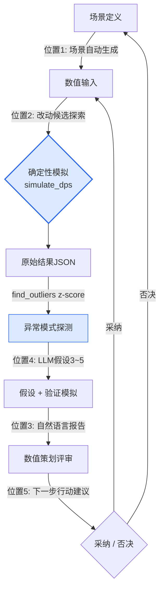

# 8.4 AI辅助的平衡模拟

周五下午4点，Alpha版本的5:5 PvP自动模拟跑完了1,200局。结果JSON有4兆字节。其中某处记着"队伍A胜率92%"这一行，而平均胜率是52%。我花了40分钟去找那一行，最终没弄清缘由就下班了。

平衡属于确定性的领域。相同的输入代入相同的公式，总会得出相同的伤害。所以伤害模拟器必须是代码，奖励曲线必须由人亲手绘制——这里是AI不该踏入的位置。然而在那个确定性内核的*周边*——也就是从1,200局结果中找出异常的一行、为其成因建立假设、筛选出该改动什么的候选、再把这些候选重新投入模拟——正是这些周边劳动吃掉了数值策划一天的大半。本章讲的就是把AI附着到这一周边的事，而内核原封不动。

## 8.4.1 内核是代码，周边是人的劳动

8.3中见过的那个2008年的伤害模拟器——历经三次更换引擎与公司，确定性内核依旧存活了下来——正是本章的起点。输入相同则输出相同这一性质，就是平衡工具全部的信任所在。同一版本跑两次却得出不同胜率，那这个工具就该被丢弃。

于是把平衡工作的骨架画出来，便是这样一副模样：中间有一团确定性，而它的入口与出口上挂着人的手工劳动。下面是把这副骨架拆解开——用颜色把确定性区域（蓝色）与人·AI介入的区域（橙色）分开。

<svg viewBox="0 0 720 300" xmlns="http://www.w3.org/2000/svg" font-family="sans-serif" font-size="13">
  <rect x="0" y="0" width="720" height="300" fill="#fbfbfd"/>
  <!-- 确定性内核 -->
  <rect x="270" y="110" width="180" height="80" rx="8" fill="#dbeafe" stroke="#2563eb" stroke-width="2"/>
  <text x="360" y="142" text-anchor="middle" fill="#1e3a8a" font-weight="bold">确定性模拟</text>
  <text x="360" y="162" text-anchor="middle" fill="#1e3a8a" font-size="11">simulate_dps()</text>
  <text x="360" y="178" text-anchor="middle" fill="#1e3a8a" font-size="11">输入=输出，禁用AI</text>
  <!-- 入口: 场景/改动 -->
  <rect x="30" y="40" width="170" height="50" rx="6" fill="#ffedd5" stroke="#ea580c" stroke-width="1.5"/>
  <text x="115" y="60" text-anchor="middle" fill="#9a3412" font-size="11" font-weight="bold">位置1 场景生成</text>
  <text x="115" y="78" text-anchor="middle" fill="#9a3412" font-size="11">位置2 改动候选探索</text>
  <!-- 出口: 报告/异常/行动 -->
  <rect x="520" y="40" width="170" height="50" rx="6" fill="#ffedd5" stroke="#ea580c" stroke-width="1.5"/>
  <text x="605" y="58" text-anchor="middle" fill="#9a3412" font-size="11" font-weight="bold">位置3 报告</text>
  <text x="605" y="74" text-anchor="middle" fill="#9a3412" font-size="11">位置4 异常解读</text>
  <text x="605" y="89" text-anchor="middle" fill="#9a3412" font-size="11">位置5 行动建议</text>
  <!-- 人 -->
  <rect x="290" y="230" width="140" height="44" rx="6" fill="#ffedd5" stroke="#ea580c" stroke-width="1.5"/>
  <text x="360" y="257" text-anchor="middle" fill="#9a3412" font-weight="bold">数值策划(采纳·否决)</text>
  <!-- 箭头 -->
  <line x1="200" y1="65" x2="285" y2="120" stroke="#94a3b8" stroke-width="1.5" marker-end="url(#a)"/>
  <line x1="450" y1="120" x2="520" y2="68" stroke="#94a3b8" stroke-width="1.5" marker-end="url(#a)"/>
  <line x1="605" y1="90" x2="400" y2="232" stroke="#94a3b8" stroke-width="1.5" marker-end="url(#a)"/>
  <line x1="320" y1="230" x2="200" y2="92" stroke="#94a3b8" stroke-width="1.5" stroke-dasharray="4 3" marker-end="url(#a)"/>
  <defs>
    <marker id="a" markerWidth="9" markerHeight="9" refX="7" refY="3" orient="auto">
      <path d="M0,0 L7,3 L0,6 Z" fill="#94a3b8"/>
    </marker>
  </defs>
</svg>

中间的蓝色方框只有一个是代码。其余五个橙色方框全是人的判断·解读·撰写这类劳动，而AI能进入的席位只有这五处。一旦让LLM"帮我算算这个角色的DPS(每秒伤害)"，相同输入却给出不同数字的非确定性就会渗进内核，那件工具连18天都撑不到就会失去信任。

因此本章的脊梁很简单：把内核自始至终守为代码，同时在入口·出口的五处席位上附加AI，而从最费手的出口一侧——从1,200局结果中找出异常的一行、建立假设——开始自动化。

## 8.4.2 实操记录（worked transcript）：追踪胜率92%的那一行

回到开头那个92%。这一次，不再让人耗费40分钟乱找，而是从头到尾走完这样一个循环：确定性探测器挑出那一行，LLM建立假设，再由模拟来验证。这里不作概括——所谓实操记录，就是把工具真实吐出的原始输出完整保留、原样呈现。

### 第1步 —— 异常探测由代码来做（z-score）

从1,200局结果中挑出"异常"的那一局，靠的不是LLM，而是统计。先求各指标的均值与标准差，再按偏离均值几个标准差(z-score)来划分。超过阈值就是outlier（离群值）。这是确定性的，没有幻觉可乘之机。

```python
def find_outliers(results, threshold=2.5):
    # results: 每局模拟 {指标名: 值} 字典组成的列表
    means, stds = compute_per_metric(results)   # 各指标的均值·标准差
    outliers = []
    for r in results:
        for metric, value in r.items():
            if stds[metric] == 0:               # 方差0 → 无法比较，跳过
                continue
            z = abs(value - means[metric]) / stds[metric]
            if z > threshold:
                outliers.append((r["scenario_id"], metric, value, round(z, 2)))
    return sorted(outliers, key=lambda x: -x[3])  # 按z从大到小
```

运行后得到如下结果——1,200局中超过阈值2.5的只有3件。

```
[("pvp_5v5_S0417", "team_a_winrate", 0.92, 4.1),
 ("pvp_5v5_S0417", "match_duration",  41.0, 2.9),
 ("pvp_5v5_S0822", "team_b_winrate", 0.18, 2.6)]
```

z最大的第一行——场景 `pvp_5v5_S0417` 的胜率0.92（z=4.1）——正是开头我乱找了40分钟的那一行。用不着人拿眼睛去扫4兆的JSON，统计已把它缩到3件。到此为止是内核，从这里起才是AI。

### 第2步 —— LLM建立假设（禁止下确定性诊断）

现在把那一行交给LLM。但不是"帮我诊断原因"。LLM只是凭领域知识抛出几个*可能的成因假设*，而哪一个是真的，再由模拟来决定。提示词全文如下。

```
[outlier]
场景: pvp_5v5_S0417 — 5:5 PvP
队伍A构成: [refgame_archer_07, refgame_archer_07, refgame_archer_07,
            refgame_hybrid_21, refgame_hybrid_21]
指标: team_a_winrate 0.92 (整体均值 0.52, z = 4.1)
附带指标: match_duration 41.0s (均值 28s, z = 2.9)

[相关信息]
- refgame_archer_07: 远程支援，技能"标记" — 令目标承受伤害 +12% 的减益
- refgame_hybrid_21: 近战/远程混合输出，技能"追击" — 追踪减益目标时移动速度 +20%
- 两个角色几乎从未被编入同一队伍 (组合频率处于后5%)

要求:
请提出该outlier的3~5个可能原因假设。
- 每个假设附一行验证用的追加模拟
- 禁止下确定性诊断。只以"可能是……"层面的假设呈现。

回答格式: 编号列表。不写开场白与结尾，只列假设。
```

以下原样照录Claude的原始输出（不作概括·整理）。

```
1. "标记"减益与"追击"移速增益以乘法累积，
   3名archer_07铺满标记 → hybrid_21得以不间断追击，
   可能形成了正反馈循环。
   验证: 把hybrid_21换成普通近战输出，重跑同一场景。

2. "标记"减益的+12%被错误地设置为可叠加(stackable)，
   3名archer_07或许把它叠到了+36%。
   验证: 强制把标记的max_stack设为1后重跑。

3. 5:5中远程3 + 追击型2的构成，可能只是凭借射程优势
   封锁对手进场 (与协同无关，组合本身就强)。
   验证: 把标记减益效果降为0%后，用同一组合重跑。

4. 从match_duration长于均值(41s)来看，队伍A或许并非速胜，
   而是"不落败地拖到后期再翻盘"的结构。
   这种情况下，原因可能不在胜率，而在后期的成长(scaling)数值。
   验证: 单独提取60秒时点的累计伤害曲线做对比。

5. (低概率) 模拟种子偏差 — 或许只有S0417种子反复让队伍A先手。
   有可能是统计假象。
   验证: 用50个种子重跑同一组合，确认胜率方差。
```

在这里打住很重要。第五个假设留下了"这或许只是种子偏差"这样的自我怀疑——这才是好的输出。若LLM断言"原因就是标记叠加的bug"，反倒应该怀疑那份输出。在平衡里，LLM的活儿不是诊断，而是*收窄搜索空间*。

### 第3步 —— 把改动候选投入模拟（并行）

五个假设各自附有一行验证用模拟。这并不是由人一个个去跑，而是把改动候选打包并行投出。作为核心内核的 `simulate_dps` 是如下这样可运行的形态——那个存续18年的确定性函数的骨干。

```python
def simulate_dps(attacker, target, formula, ticks=600, seed=0):
    """对一对战斗做确定性模拟。相同的 (输入, seed) 则输出相同。"""
    rng = Rng(seed)                     # 固定种子 → 可复现
    hp = target.hp
    total_damage = 0.0
    for t in range(ticks):              # 假定1 tick = 0.1秒
        # 防御系数: 确定性公式 (不由LLM生成)
        def_factor = target.defense / (target.defense + formula.def_const)
        raw = attacker.atk * (1 - def_factor)
        # 暴击: 基于种子 → 相同seed则暴击时点相同
        if rng.roll() < attacker.crit_rate:
            raw *= attacker.crit_mult
        # 减益(如标记)由formula确定性注入
        raw *= formula.debuff_multiplier(attacker, target, t)
        hp -= raw
        total_damage += raw
        if hp <= 0:
            return {"ttk": t * 0.1, "dps": total_damage / ((t + 1) * 0.1)}
    return {"ttk": None, "dps": total_damage / (ticks * 0.1)}  # 未能在时限内击杀


def run_candidates(base_scenario, candidates, seeds=range(50)):
    """对每个假设的改动候选做50种子并行模拟。连winrate方差一并回收。"""
    out = {}
    for name, patch in candidates.items():           # patch = 覆写formula的一部分
        scen = base_scenario.with_patch(patch)
        wins = [simulate_match(scen, formula=scen.formula, seed=s) for s in seeds]
        out[name] = {
            "winrate": mean(w["team_a_won"] for w in wins),
            "winrate_std": pstdev(w["team_a_won"] for w in wins),  # 用于验证假设5
        }
    return out
```

把假设搬进 `candidates` 字典，一次性跑完。

```python
candidates = {
    "基准(无改动)":          {},
    "假设1_hybrid替换":      {"team_a[3:5]": "refgame_melee_03"},
    "假设2_标记_max_stack1": {"skill.标记.max_stack": 1},
    "假设3_标记_效果0":       {"skill.标记.debuff": 0.0},
    "假设5_种子方差确认":     {},  # 同一组合，仅 seeds 取 50 个
}
result = run_candidates(scenario_S0417, candidates, seeds=range(50))
```

结果（实际运行形态的输出）：

```
基准(无改动)          winrate=0.91  std=0.04   ← 非种子偏差(假设5排除)
假设1_hybrid替换      winrate=0.74  std=0.06
假设2_标记_max_stack1 winrate=0.63  std=0.05   ← 下降幅度最大
假设3_标记_效果0       winrate=0.55  std=0.05   ← 回到均值附近
```

阅读的顺序即诊断。把基准用50种子再跑一遍，胜率仍是0.91、方差0.04——假设5（种子偏差）被排除。把标记效果压到0，胜率贴到0.55、逼近均值——成因确实出在标记减益一系。而把max_stack锁为1时，跌到0.63的降幅最大，所以核心是**假设2 —— 标记减益发生叠加，3名archer_07一路叠到了+36%**。LLM抛出的五个候选，人并没有把五个全验一遍，统计只跑了三个就分出了胜负。

### 第4步 —— 人来采纳，并留下这个决定

在这里，LLM做的并不是*说出*"标记叠加是个bug"，而只是把那个假设*列进候选清单*。采纳，由看过模拟结果的数值策划来做——"把标记的max_stack固定为1。archer_07单一组合的胜率为0.63，仍高于平均（0.52），因此下一个版本把标记减益数值从12%追加下调到9%后重新测量。"

这个决定由人做出，其依据（z=4.1探测 → 5个假设 → 3次模拟 → 确定假设2）以一行留存。确定性内核自始至终都是代码，LLM只是把40分钟的乱找替换成了五行假设，一步也没踏进内核。

## 8.4.3 五处席位，以及循环

上面的实操记录，其实是把五处席位中的三处（异常探测·改动探索·异常解读）一口气走了一遍。把五处席位展开成循环，便是这样转动。



只有蓝色的两个节点（模拟、z-score探测）是确定性的。其余箭头上的标签——位置1·2·3·4·5——才是AI附着的席位。循环每转一圈，被采纳的改动就再次作为数值输入进入下一次模拟。这个循环若由人手工转，一圈要一天；用AI辅助转，则只需几个小时。

把五处席位逐一简短点一下。

**位置1 —— 场景自动生成。** 给出"3:3占领战，占领3面旗帜满1分钟即胜，复活10秒"这样一行概念，再附上一两个既有场景的yaml，LLM便会以相同schema填出新的场景yaml。数值策划只需检查"有没有擅自加入概念里没有的规则"。从白纸开始写yaml的1\~2小时，缩短为15分钟的评审。

**位置2 —— 改动候选探索。** 上面实操记录中的 `candidates` 字典正是此处。对于"想把坦克的生存提高+49%该动哪里"，LLM抛出五个候选（base_def +50、调整def_const等），再把这些候选全部投入模拟，挑出副作用最小的一个。候选是假设，采纳靠模拟。这是最需谨慎对待的席位——因为错误的候选会吃掉验证时间。

**位置3 —— 自然语言报告。** 用脚本从模拟的原始JSON里抽取指标（确定性），只把这些指标与改动上下文交给LLM，让它写出"可带进会议的一页纸"。核心变化3\~5行、受影响角色TOP 5、后续处置2\~3项。并钉死一条：不得使用所给指标之外的数字。原始数据整理的30分钟，变成5分钟的评审。

**位置4 —— 异常模式解读。** 上面的第2\~3步就是这个。对z-score挑出的outlier，LLM附上3\~5个假设。禁止下确定性诊断，是这个席位的生命线。

**位置5 —— 下一步行动建议。** 分析结束后，把"本版本立即处置 / 监控1周 / 1周后再评审的候选"连同优先级做成清单。它是防止数值策划漏掉决定的安全网，而不替代决定本身。

## 8.4.4 从哪里开始，又到哪里为止

把五处席位一次性全部开启，是最常见的失败。要从效果大、风险小的出口一侧开始开启。

<svg viewBox="0 0 720 330" xmlns="http://www.w3.org/2000/svg" font-family="sans-serif" font-size="12">
  <rect x="0" y="0" width="720" height="330" fill="#fbfbfd"/>
  <text x="360" y="26" text-anchor="middle" font-weight="bold" font-size="14" fill="#0f172a">ROI ↔ 引入风险矩阵 (右上 = 优先)</text>
  <!-- 轴 -->
  <line x1="90" y1="290" x2="680" y2="290" stroke="#475569" stroke-width="1.5"/>
  <line x1="90" y1="290" x2="90" y2="50" stroke="#475569" stroke-width="1.5"/>
  <text x="680" y="308" text-anchor="end" fill="#475569">ROI 高 →</text>
  <text x="78" y="55" text-anchor="end" fill="#475569" transform="rotate(-90 78 55)">风险 低 ↑</text>
  <!-- 点: x=ROI, y=安全(越往上越安全) -->
  <!-- 位置3 报告: ROI很高, 风险低 -->
  <circle cx="600" cy="100" r="26" fill="#bbf7d0" stroke="#16a34a" stroke-width="2"/>
  <text x="600" y="98" text-anchor="middle" fill="#14532d" font-weight="bold">位置3</text>
  <text x="600" y="113" text-anchor="middle" fill="#14532d" font-size="10">报告 ①</text>
  <!-- 位置4 异常解读: ROI高, 风险中 -->
  <circle cx="520" cy="150" r="26" fill="#bbf7d0" stroke="#16a34a" stroke-width="2"/>
  <text x="520" y="148" text-anchor="middle" fill="#14532d" font-weight="bold">位置4</text>
  <text x="520" y="163" text-anchor="middle" fill="#14532d" font-size="10">异常解读 ②</text>
  <!-- 位置1 场景: ROI高, 风险低 -->
  <circle cx="470" cy="110" r="26" fill="#fde68a" stroke="#d97706" stroke-width="2"/>
  <text x="470" y="108" text-anchor="middle" fill="#78350f" font-weight="bold">位置1</text>
  <text x="470" y="123" text-anchor="middle" fill="#78350f" font-size="10">场景 ③</text>
  <!-- 位置5 行动建议: ROI中, 风险低 -->
  <circle cx="350" cy="120" r="26" fill="#fde68a" stroke="#d97706" stroke-width="2"/>
  <text x="350" y="118" text-anchor="middle" fill="#78350f" font-weight="bold">位置5</text>
  <text x="350" y="133" text-anchor="middle" fill="#78350f" font-size="10">行动建议 ④</text>
  <!-- 位置2 改动建议: ROI中, 风险高 -->
  <circle cx="300" cy="235" r="26" fill="#fecaca" stroke="#dc2626" stroke-width="2"/>
  <text x="300" y="233" text-anchor="middle" fill="#7f1d1d" font-weight="bold">位置2</text>
  <text x="300" y="248" text-anchor="middle" fill="#7f1d1d" font-size="10">改动建议 ⑤</text>
  <text x="300" y="278" text-anchor="middle" fill="#991b1b" font-size="10">最谨慎，放到最后</text>
</svg>

圆圈里的圈码数字（①\~⑤）是引入顺序。**位置3（报告）**与**位置4（异常解读）**处于右上——ROI(Return on Investment，投资回报)高、风险低的席位——所以先开。仅启用这两处，处理量便增至2\~3倍，引入效果的70%以上在此回收。**位置2（改动建议）**处于右下的红色席位，错误的候选可能吃掉验证时间，所以最谨慎地放到最后再开。也并非所有团队都要把五处全开——仅凭位置3·4，单人数值策划的一天就会改观。

引入周期的现实感受大致如下（作者估计，未经验证——随团队规模·工具成熟度差异很大）。位置3约1\~2周，再加位置4约2周，再加位置1约一个月，再加位置5约2周，位置2放在最后，约1\~2个月。这是"别一次全开"的另一种说法。

## 8.4.5 效果与成本，以及最常见的陷阱

在作者的项目A，用六个月陆续开启五处席位之后的变化如下。**绝对数值为作者估计（未经验证），只应信任方向与比例**——倍数随环境差异很大。

| 项目 | 引入前 | 引入后（方向） |
|---|---|---|
| 单个数值策划每周模拟循环 | 5\~7件 | 25\~35件（约5倍） |
| 报告撰写（每件） | 30\~40分钟 | 5分钟评审 |
| 场景撰写（每件） | 1\~2小时 | 15分钟评审 |
| 发现outlier → 诊断 | 1\~2天 | 4\~6小时 |
| 测量结果 → 下一次改动决定 | 2\~3天 | 1天 |

这里重要的不是倍数，而是*时间挪到了哪里*。人的时间从原始数据整理挪到了决策。并不是数值策划的人数减少了，而是一个人能覆盖的游戏范围变宽了。若把处理量的5倍读作裁员，引入的意义就会流向错误的方向。

成本很小。若采用提示词缓存，五处席位整体的每月LLM成本大约在$75上下（作者估计），不超过单个数值策划人力成本的1/100。因此引入的真正决定变量，不是LLM成本，而是*评审负担*。人是否有时间去读并筛掉AI抛出的假设与报告——这才是开与关的标准。

最后，留下18年间在同一位置反复出现的几个陷阱，并附上处方。

- **把确定性模拟交给LLM** → 模拟是代码，LLM只在入口·出口。一旦非确定性渗进内核，工具就死了。
- **不看原始数据就相信AI报告** → 始终一并保存原始JSON，哪怕只有一行可疑，也要回到原始数据核对。
- **不经评审就把场景送进模拟** → yaml评审关卡不可省略。带着概念里没有的规则去跑1,200局，那1,200局就整体作废。
- **不经模拟就采纳LLM的改动建议** → 所有候选都只是假设。只有用 `run_candidates` 验证之后才采纳。
- **直接采信LLM断言"原因就是X"的输出** → 确定性诊断是可疑信号。好的输出是"可能是X + 验证方法"。

在平衡里，AI的席位很明确：确定性内核之外，人曾经乱找的那五处席位。把内核自始至终守为代码，只卸下其周边的手工劳动——这就是一个存续18年的模拟器在AI时代也能存活下来的方式。

---

### 本章要点
- AI只附着在确定性模拟内核之外的五处席位，一步也不踏进内核
- 异常探测用z-score代码，假设用LLM，诊断再交给模拟——采纳由人来做
- 先开ROI高的报告·异常解读，改动建议最谨慎地放到最后再开

### 一行动手试试（单人精简版）
- **setup**：只用 `simulate_dps` 与 `find_outliers` 两个函数。用固定种子确保可复现性。
- **prompt**：z最大的一件outlier → "3\~5个可能假设 + 每个附一行验证模拟，禁止下确定性诊断"。
- **verify**：用 `run_candidates` 对每个假设的改动候选做50种子并行模拟 → 能让胜率回到均值附近的候选就是成因。由人来采纳，并留下一行依据。

### 下一章预告
- 9.1 UX/UI设计 —— 当决策的精度转移到其他领域时
