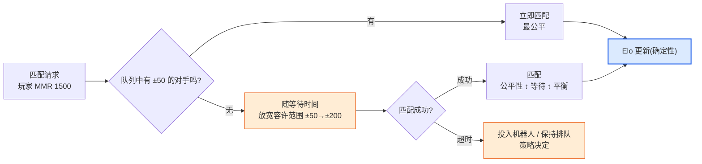
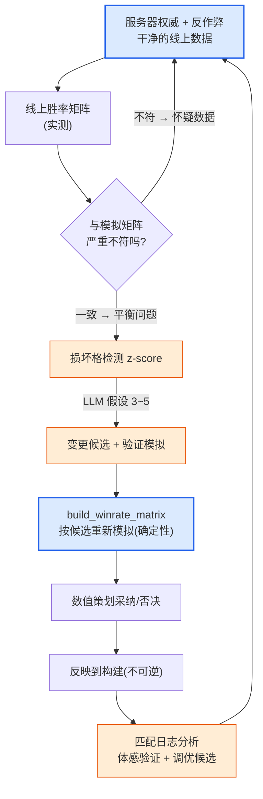

# 8.5 PvP·竞技平衡 —— 胜率矩阵·匹配·服务器权威

到目前为止,本部分的四章都在和同一个对手作战。一个 Boss 能在几秒内被击杀吗、坦克能有 89% 的存活率吗、金币在流失吗——全都是围绕**单一目标**的伤害、生存与收支的故事。可是在 PvP 中,对手是人。人不会像 Boss 那样按固定套路行动,即便是同一个职业,手法也各不相同,而最关键的是,他们*会盯着彼此的弱点下手*。PvE 平衡做得再深,PvP 却整块空缺,这种情况之所以常见,正是因为如此。单一目标的 DPS 曲线在 8.1\~8.4 已经讲透,但"剪刀胜过布"这张相克之网,却还一次都没有画过。

本章填补这块空白。要讲的有三样——承载职业与阵容之间相克关系的**胜率矩阵**、决定让谁与谁对战的**匹配/MMR**,以及能让上述所有数值沦为虚假的**服务器权威·反作弊**。而贯穿整个本部分的那条界线,在这里依然不变:战斗公式是确定性的,匹配与相克检测是 AI 辅助。一步都不会走偏。

---

## 8.5.1 PvP 区别于 PvE 的唯一一点

在 PvE 中,角色的强度是**绝对值**。剑士的 DPS 是 800 就是 800,Boss 就实打实地承受这 800。可是在 PvP 中,强度是**相对的**。剑士的 800 对弓手来说足够,但对能把自己所受伤害降低 30% 的盾兵而言,会被削减到 560 而显得不足。同一个角色的强度,会*随着对手是谁*而变化。仅此一点,就让 PvP 平衡成为与 PvE 根本不同的问题。

因此,PvP 平衡的单位不是单个角色的数字,而是**一对关系**。"剑士 vs 弓手"的胜率、"剑士 vs 盾兵"的胜率各自独立存在,把这些关系全部汇总,就成了一张表。横轴和纵轴都放同一份职业清单,每一格里写着"行击败列的概率"。这就是**胜率矩阵**。如果说 PvE 有 DPS 曲线,那么 PvP 就有这张矩阵。

<svg viewBox="0 0 660 300" xmlns="http://www.w3.org/2000/svg" font-family="sans-serif" font-size="13">
  <rect x="0" y="0" width="660" height="300" fill="#ffffff"/>
  <text x="330" y="28" text-anchor="middle" font-weight="bold" font-size="14" fill="#0f172a">PvE 是绝对值,PvP 是关系</text>
  <!-- PvE side -->
  <rect x="30" y="60" width="120" height="60" rx="8" fill="#eaf2fb" stroke="#2c6fbb" stroke-width="1.5"/>
  <text x="90" y="86" text-anchor="middle" fill="#2c6fbb" font-weight="bold">剑士</text>
  <text x="90" y="106" text-anchor="middle" fill="#333" font-size="11">DPS 800</text>
  <line x1="150" y1="90" x2="210" y2="90" stroke="#888" stroke-width="1.5" marker-end="url(#ph)"/>
  <rect x="210" y="60" width="120" height="60" rx="8" fill="#f3f4f6" stroke="#6b7280" stroke-width="1.5"/>
  <text x="270" y="86" text-anchor="middle" fill="#374151" font-weight="bold">Boss</text>
  <text x="270" y="106" text-anchor="middle" fill="#333" font-size="11">原样承受 800</text>
  <text x="180" y="150" text-anchor="middle" fill="#2c6fbb" font-size="11">PvE:强度 = 绝对值</text>
  <!-- PvP side -->
  <rect x="30" y="190" width="120" height="50" rx="8" fill="#fdecea" stroke="#c0392b" stroke-width="1.5"/>
  <text x="90" y="220" text-anchor="middle" fill="#c0392b" font-weight="bold">剑士 800</text>
  <line x1="150" y1="200" x2="210" y2="200" stroke="#16a34a" stroke-width="1.5" marker-end="url(#ph)"/>
  <rect x="210" y="180" width="120" height="34" rx="6" fill="#dcfce7" stroke="#16a34a" stroke-width="1.2"/>
  <text x="270" y="202" text-anchor="middle" fill="#14532d" font-size="11">弓手 → 800(有效)</text>
  <line x1="150" y1="215" x2="210" y2="232" stroke="#dc2626" stroke-width="1.5" marker-end="url(#ph)"/>
  <rect x="210" y="222" width="120" height="34" rx="6" fill="#fee2e2" stroke="#dc2626" stroke-width="1.2"/>
  <text x="270" y="244" text-anchor="middle" fill="#7f1d1d" font-size="11">盾兵 → 560(不足)</text>
  <text x="200" y="284" text-anchor="middle" fill="#c0392b" font-size="11">PvP:强度 = 随对手而变</text>
  <!-- matrix hint -->
  <rect x="400" y="60" width="230" height="196" rx="8" fill="#fbfbfd" stroke="#94a3b8" stroke-width="1.2"/>
  <text x="515" y="84" text-anchor="middle" fill="#0f172a" font-size="12" font-weight="bold">→ 胜率矩阵</text>
  <text x="515" y="106" text-anchor="middle" fill="#475569" font-size="11">行击败列的概率</text>
  <text x="430" y="140" fill="#475569" font-size="11" font-family="monospace">       弓手  盾兵  法师</text>
  <text x="430" y="162" fill="#16a34a" font-size="11" font-family="monospace">剑士   .58  .42  .50</text>
  <text x="430" y="184" fill="#475569" font-size="11" font-family="monospace">弓手   --   .55  .47</text>
  <text x="430" y="206" fill="#475569" font-size="11" font-family="monospace">盾兵   --   --   .61</text>
  <text x="515" y="238" text-anchor="middle" fill="#94a3b8" font-size="10">(数字为示例 —— 非实测)</text>
  <defs>
    <marker id="ph" markerWidth="8" markerHeight="8" refX="6" refY="3" orient="auto">
      <path d="M0,0 L6,3 L0,6 Z" fill="#888"/>
    </marker>
  </defs>
</svg>

读右表的方法很简单。若"剑士 vs 盾兵"这一格是 0.42,就表示剑士击败盾兵的概率为 42%,也就是盾兵占优的相克关系。所有格都接近 0.50 固然是完美的平衡,但这样的游戏并不好玩。要像石头剪刀布那样存在**循环相克**的关系,职业选择才有意义。问题出在这个循环在某处断裂、出现某个职业击败所有人的格子时。如果说凌晨两点的坦克是 PvE 的事故,那么"盾兵 vs 全职业胜率超过 60%"就是 PvP 的事故。

这里要先钉死一点。填进这些格子的数字(0.58、0.42 等)全都是**示例,而非实测**。每款游戏的职业数、技能、目标平衡线都不一样。本章要信赖的不是数字,而是*如何填矩阵、如何检查、以及在这检查的哪一环接入 AI*这一结构。

---

## 8.5.2 填矩阵靠模拟,读矩阵靠 AI

填胜率矩阵的一格,用的正是 8.4 中所见的那套确定性模拟工具。把"剑士 vs 弓手"自动模拟 1,000 局,数一数剑士赢了多少局,那就是这一格的胜率。若职业有 N 个,格子就有 N×N 个,每格各跑 1,000 局,一张表就填满了。这套模拟自始至终都是代码——给相同的种子,就必须一字不差地复现出相同的矩阵。唯有如此,"这一版盾兵变强了"这句话才不是假的。

这里有一个 PvP 独有的陷阱。在 PvE 模拟中,对手(Boss)是固定套路,但在 PvP 模拟中,**对手也得选择行动**。决定剑士如何作战的机器人(bot policy)两边都要有。而这个机器人若是笨的,整张矩阵就都变成假的——让操作糟糕的机器人互相对战,得出的会是"随便什么时候都乱放技能的职业"获胜的矩阵,可在真正熟练的玩家手里结果可能恰恰相反。因此,PvP 矩阵上必须始终附带一条注脚:"这个机器人模仿的是哪种水平的玩法"。机器人通常用启发式规则(冷却好了就放、HP 低于 30% 就撤退等)来编写,而这套启发式规则本身是确定性的。

把机器人策略的要点落成可运行的形态,就是下面这样——输入相同就选相同行动、没有任何幻觉可乘之隙的函数。

```python
def bot_decide(me, enemy, cooldowns, t):
    """确定性机器人策略。(状态)相同就行动相同。不由 LLM 生成。"""
    # 1) 生存优先:HP 低于 30% 就闪避/撤退
    if me.hp_ratio < 0.30 and cooldowns["escape"] <= 0:
        return Action("escape")
    # 2) 克制技能:敌人若非减益免疫则优先标记
    if cooldowns["mark"] <= 0 and not enemy.has("debuff_immune"):
        return Action("mark", target=enemy)
    # 3) 攻击距离管理:近战敌人贴身时拉开距离(远程职业)
    if me.is_ranged and dist(me, enemy) < me.kite_range:
        return Action("reposition")
    # 4) 其他:选冷却就绪的最大伤害技能
    return best_ready_damage_skill(me, cooldowns)


def simulate_pvp_match(class_a, class_b, formula, seed=0):
    """确定性地模拟一场 1:1。伤害直接沿用 8.1 的公式。"""
    rng = Rng(seed)
    a, b = spawn(class_a), spawn(class_b)
    for t in range(MAX_TICKS):
        for me, foe in ((a, b), (b, a)):
            act = bot_decide(me, foe, me.cooldowns, t)
            apply_action(act, me, foe, formula, rng)   # formula = 确定性伤害公式
        if a.hp <= 0 or b.hp <= 0:
            break
    return {"winner": "a" if b.hp <= 0 else "b" if a.hp <= 0 else "draw",
            "duration": t * TICK}
```

填满一整张矩阵的,是把这个函数在每一格各跑 1,000 次的外层循环。

```python
def build_winrate_matrix(classes, formula, n=1000):
    matrix = {}
    for ca in classes:
        for cb in classes:
            if ca == cb:
                continue
            wins = sum(
                simulate_pvp_match(ca, cb, formula, seed=s)["winner"] == "a"
                for s in range(n)
            )
            matrix[(ca, cb)] = wins / n          # ca 击败 cb 的比例
    return matrix
```

到这里都是内核,自始至终是代码。AI 接入的不是*制作*这张表的环节,而是*读*这张表的环节。N 若为 8,格子就有 56 个,让人用肉眼扫过 56 个胜率去找"哪里坏了",这跟凌晨两点的 4MB 的 JSON 是同一种苦工。挑出异常格子的,就交给 8.4 的 z-score 检测原样完成。

```python
def find_broken_cells(matrix, low=0.40, high=0.60):
    """确定性地筛出大幅偏离平衡线(0.5)的格子。"""
    broken = []
    for (ca, cb), wr in matrix.items():
        if wr > high or wr < low:
            broken.append((ca, cb, round(wr, 2)))
    return sorted(broken, key=lambda x: abs(x[2] - 0.5), reverse=True)
```

检测把格子缩窄后,就把那一格交给 LLM。但纪律与 8.4 相同——**禁止下确定诊断,只给假设和验证模拟**。例如,给出"盾兵 vs 法师 0.68(z 值最大)"这一行,然后这样请求。

```
[损坏的格子]
盾兵 → 法师 胜率 0.68(平衡线 0.50,矩阵内 z 值最大)
附带:该对局的平均持续时间 38s(整体平均 22s)

[相关信息]
- 盾兵:所受伤害 -30% 的被动"铁壁",沉默技能"盾击"(2 秒)
- 法师:全部伤害的 70% 集中在一个施法 1.5 秒的技能上
- 两个职业的对战频率在实测队列中居前(热门组合)

请求:这一相克崩坏的可能原因假设 3~5 个 + 每条各配一行验证模拟。
禁止下确定诊断。只用"可能是……"的程度表述。
```

LLM 只是抛出诸如"铁壁 -30% 与 2 秒沉默叠加,可能形成法师一次都放不出核心施法技能就阵亡的正反馈 / 验证:把沉默持续时间减到 1 秒,对同一格重新模拟"这样缩小搜索空间的假设而已。什么才是真的,还得再按候选逐个跑 `build_winrate_matrix` 来判定。就连对局持续时间是平均的 1.7 倍这条线索,也由 LLM 一并编入假设——人用肉眼扫 56 格时容易漏掉的那个关联,正是 AI 在这一环节替你省下的时间。

---

## 8.5.3 匹配:掩盖相克关系的另一重平衡

即便把胜率矩阵调得完美无缺,让玩家觉得"输了"的真正原因另有其处:**跟谁对战**。实力 1500 的玩家遇上 2200 的玩家,即便职业相克是 5:5,结果也已注定。所以匹配不是单纯的服务器功能,而是**平衡的一部分**。如果说矩阵负责职业之间的公平,那么匹配负责实力之间的公平。

大多数竞技游戏都设有 MMR(Matchmaking Rating,匹配分)。这是一个赢则升、输则降的隐藏分数,把分数相近的玩家凑到一起。分数更新用的是确定性公式——Elo 用得最广,而且因为是公开标准,是本书能够引用的少数几个算式之一。

```
# Elo:公开标准更新式(并非编造的值)
expected_a = 1 / (1 + 10 ** ((rating_b - rating_a) / 400))
new_rating_a = rating_a + K * (score_a - expected_a)
#   score_a:赢为 1,输为 0
#   K:更新强度常数(由游戏自行决定,通常在 16~40 范围内选取)
#   400, 10:Elo 定义中固定的常数
```

这个式子本身是确定性的,不是 AI 该介入的地方。然而匹配中有一处仅靠确定性公式解不开的*张力*:**公平性 ↔ 等待时间**的取舍。只匹配分数完全相同的对手,对局固然公平,但队列里若没有这样的对手,玩家就要等上 10 分钟。宽松地容许分数差,虽然能快速匹配,对局却变得不公平。越是凌晨时段、冷门职业、高分段,这种张力就越严重。



只有蓝色节点(Elo 更新)是确定性的。橙色节点——何时把容许范围放宽多少、超时后做什么——才是 AI 辅助触及的地方。但即便在这里,AI 也不做*实时匹配决策*。那是必须快速且可复现的服务器逻辑,是规则驱动代码的地盘。AI 接入的,是为**调优这套规则而做的分析**:概括"上周匹配日志中,哪个分段、哪个时段、哪个职业的对局质量(胜率偏差·等待时间)较差",并提出"如何改动容许范围曲线才能缩短哪个区间的等待时间"的候选。这正是 8.4 的位置 3(报告)、位置 4(异常解读)、位置 2(变更候选探索)换到匹配日志这个舞台上而已。

也点一下匹配与胜率矩阵纠缠的那个环节。匹配算法若不考虑职业、只对齐分数,损坏的相克格子就会被原样暴露。盾兵击败法师 68% 的那一格还活着,而匹配又频繁把这两者凑到一起,法师玩家体感上的失败就会比矩阵数值堆积得更多。所以矩阵检查与匹配日志分析并非各转各的,而是*同一循环的入口与出口*——在矩阵里修复损坏的格子,再到匹配日志里确认那一格实际被凑了多少次。

---

## 8.5.4 服务器权威:平衡的前提

到目前为止的所有讨论——矩阵、MMR、模拟——都暗中预设了一件事:**玩家上报的结果是真实的**。在 PvE 中,这几乎不成问题。一个人打 Boss,能骗谁呢?可是在 PvP 中有对手,赢了分数就涨,于是**产生了作弊的动机**。一旦出现篡改伤害、篡改位置、无视冷却的客户端,8.1 的确定性公式就只在纸面上是确定性的。在真实服务器上,某人的剑士正打出比公式高两倍的伤害。

所以竞技游戏的第一条平衡规则,排在矩阵之前:**别让客户端来决定结果**。伤害计算、冷却判定、命中判定——一切触及平衡的运算,权威都在服务器。客户端只发送输入(往哪移动、放哪个技能),而这个输入是否符合公式、冷却是否转好、是否在攻击距离内,全部由服务器重新校验。客户端发来的"伤害 999"被服务器无视,只有服务器按公式算出的值才被采用。

<svg viewBox="0 0 680 270" xmlns="http://www.w3.org/2000/svg" font-family="sans-serif" font-size="12">
  <rect x="0" y="0" width="680" height="270" fill="#ffffff"/>
  <text x="340" y="26" text-anchor="middle" font-weight="bold" font-size="14" fill="#0f172a">服务器权威 = 平衡公式的唯一执行者</text>
  <!-- client -->
  <rect x="40" y="80" width="160" height="110" rx="8" fill="#fdecea" stroke="#c0392b" stroke-width="1.5"/>
  <text x="120" y="106" text-anchor="middle" fill="#c0392b" font-weight="bold">客户端</text>
  <text x="120" y="128" text-anchor="middle" fill="#333">只发送输入</text>
  <text x="120" y="148" text-anchor="middle" fill="#666" font-size="11">"使用技能1,坐标(x,y)"</text>
  <text x="120" y="170" text-anchor="middle" fill="#991b1b" font-size="11">无法决定结果</text>
  <!-- arrow -->
  <line x1="200" y1="120" x2="290" y2="120" stroke="#888" stroke-width="1.5" marker-end="url(#sh)"/>
  <text x="245" y="112" text-anchor="middle" fill="#666" font-size="10">输入</text>
  <line x1="290" y1="155" x2="200" y2="155" stroke="#16a34a" stroke-width="1.5" marker-end="url(#sh)"/>
  <text x="245" y="172" text-anchor="middle" fill="#16a34a" font-size="10">校验后的结果</text>
  <!-- server -->
  <rect x="290" y="70" width="200" height="130" rx="8" fill="#dbeafe" stroke="#2563eb" stroke-width="2"/>
  <text x="390" y="96" text-anchor="middle" fill="#1e3a8a" font-weight="bold">服务器(权威)</text>
  <text x="390" y="118" text-anchor="middle" fill="#1e3a8a" font-size="11">冷却/攻击距离校验</text>
  <text x="390" y="138" text-anchor="middle" fill="#1e3a8a" font-size="11">伤害 = 公式(8.1)</text>
  <text x="390" y="158" text-anchor="middle" fill="#1e3a8a" font-size="11">确定性 · 执行</text>
  <text x="390" y="184" text-anchor="middle" fill="#1e40af" font-size="11">无视"伤害 999"</text>
  <!-- anticheat / logs -->
  <rect x="540" y="80" width="110" height="110" rx="8" fill="#ffedd5" stroke="#ea580c" stroke-width="1.5"/>
  <text x="595" y="106" text-anchor="middle" fill="#9a3412" font-weight="bold" font-size="12">异常日志</text>
  <text x="595" y="128" text-anchor="middle" fill="#9a3412" font-size="11">不可能的输入</text>
  <text x="595" y="146" text-anchor="middle" fill="#9a3412" font-size="11">模式检测</text>
  <text x="595" y="170" text-anchor="middle" fill="#9a3412" font-size="11">可 AI 辅助</text>
  <line x1="490" y1="135" x2="540" y2="135" stroke="#888" stroke-width="1.5" marker-end="url(#sh)"/>
  <defs>
    <marker id="sh" markerWidth="8" markerHeight="8" refX="6" refY="3" orient="auto">
      <path d="M0,0 L6,3 L0,6 Z" fill="#888"/>
    </marker>
  </defs>
</svg>

服务器权威一旦崩塌,整个平衡工作都变成假的。胜率矩阵调得再精细,只要线上有一个职业篡改伤害,那张矩阵就只是纸面上的承诺。所以反作弊不是独立的安全工作,而是**平衡数据的可信度问题**。当线上胜率与模拟矩阵严重不符时,第一个该怀疑的不是"公式错了吗",而应是"这份数据干净吗"。

这里 AI 的位置又一次清晰起来。作弊判定本身——"将此输入判为无效"——是确定性规则的活。0.1 秒内移动 30 米的输入在物理上不可能,所以用规则拦截。相同的输入必须给出相同的判定,而且不能造成冤枉的封禁,因此这里不能放概率性的 LLM。相反,**把异常模式*作为候选*筛出来的活**,是 AI 辅助能触及的。从服务器日志中,汇集诸如"这个账号的命中率分布偏离人类分布 z 值几何""这一组账号共享同一种异常模式"之类的候选,提交人工评审。把 8.1 的表搬到 PvP,界线就是这样。

| 领域 | AI | 理由 |
|---|---|---|
| 服务器伤害·命中·冷却判定 | 绝对禁止 | 确定性内核。相同输入=相同判定一旦被打破,公平性崩塌 |
| Elo/MMR 分数更新 | 绝对禁止 | 公开标准的确定性式子。一旦动摇,排名就变成假的 |
| 作弊拦截(封禁)判定本身 | 绝对禁止 | 不容冤枉的封禁。相同证据=相同判定 |
| 胜率矩阵模拟 | 绝对禁止 | 无法复现时,"职业变强了"就成了假话 |
| 损坏相克格的检测·解读 | 可以 | 用 z-score 筛出格子,由 LLM 提假设(禁止下确定诊断) |
| 匹配日志质量分析·调优候选 | 可以 | 提出等待/公平取舍的变更候选(经模拟验证) |
| 作弊嫌疑模式候选提取 | 可以 | 仅提交人工评审的候选。封禁决定归人与规则 |

这条界线与 8.1 一字不差。**AI 只栖身于确定性内核之外**。负责执行的内侧——伤害、分数、封禁——是规则手册,而检测、解读、推候选的外侧,才是 AI 的位置。

---

## 8.5.5 串成一个循环

三个主题——矩阵、匹配、服务器权威——不是各转各的三件事,而是同一个竞技平衡循环的三个区段。服务器权威保证数据干净,用这份数据检查矩阵,借匹配日志确认检查结果在真实队列里如何被体感,再用模拟验证候选并反映到构建。



蓝色节点(服务器权威、模拟重算)是确定性的,橙色节点(检测·假设·匹配分析)是 AI 辅助。这个循环里最常见的失败,是跳过 C 这个分支。线上矩阵与模拟不符时若直接动公式,实际上是追着被作弊污染的数据去削弱一个本无问题的职业。先怀疑数据是否干净的这一个分支,在 PvP 中扮演着与 8.1 的"变更记录"相同的角色——一旦漏掉,凌晨两点就会卷土重来。

最后,留下 PvP 平衡中 18 年里的几个陷阱,并附上处方。

- **机器人策略很笨却相信矩阵** → 始终注明机器人水平,可能的话用线上实测胜率来校正。机器人矩阵只给*方向*,绝对值交给实测。
- **匹配只对齐分数、无视职业相克** → 损坏的格子若还活着,匹配就会把它暴露出来。矩阵检查与匹配分析要串在同一个循环里。
- **把线上胜率的偏差直接归咎于公式** → 先怀疑数据是否干净(作弊·bug)。用被污染的数据去削弱,会毁掉本无问题的职业。
- **把作弊检测交给 LLM** → 封禁判定归确定性规则。LLM 只做到*候选提取*为止。冤枉的封禁无法挽回。
- **以胜率 0.50 为目标把所有格子拉平** → 完全均衡会扼杀职业选择的意义。目标是*循环相克*,而非所有格子都是 0.50。

在 PvP 中,AI 的位置与 PvE 相同:确定性内核——伤害、分数、封禁、模拟——之外的检测·解读·候选。内核用代码与服务器权威守护,只减去人扫 56 格、在匹配日志里摸索的那点手工劳动——本章就是整个本部分以同一副骨架运转的最后一个证据。

---

## 动手试试 —— 检查一张胜率矩阵

**setup.** 请编写把 8.4 的 `simulate_dps` 扩展为 1:1 的 `simulate_pvp_match`,以及驱动双方机器人的 `bot_decide`(启发式确定性)。先固定种子,确认同一张矩阵能否复现。伤害务必原样取用 8.1 的公式,并用一行记下机器人所模仿的玩法水平。

**prompt.** 用 `find_broken_cells` 筛出平衡线(0.40\~0.60)之外的格子后,只把 z 值最大的那一格交给 LLM。

```
针对所附的损坏格子(盾兵 vs 法师 0.68,对局持续时间 38s/平均 22s),
请提出 3~5 个可能原因的假设,并为每条各配一行验证用的重新模拟。
相关技能·被动信息附于下方。禁止下确定诊断——只用"可能是……"。
不要直接改数值,只提候选。
```

**verify.** 别照单全收 AI 的假设。把每条假设的变更候选放进 `build_winrate_matrix`,用相同的种子重新模拟,同时确认那一格是否在回到 0.50 附近的同时*没有打坏别的格子*(PvP 的改动很容易修好一格却弄坏旁边一格)。只采纳满足这两个条件的候选,并像 8.1 那样在决策日志里留下理由·被否决的候选·预测值。应用到构建一周后,把线上实测胜率补记进那份日志。

### 单人精简版

哪怕是只有两个职业、也没有服务器的单人原型,骨架也是一样的。矩阵 2×2 就够了,模拟只需在 8.1 那个 30 行的循环上,再加一行机器人策略(冷却好了就放最大伤害技能)即可。服务器权威只要用代码结构守住"别让客户端决定结果"这条原则就行,正式的反作弊在还没有玩家之前并不需要。MMR 起初也先省略,只需跑 1,000 局,确认矩阵是否向一边倾斜超过 60%。AI 只用于读那结果、概括"哪场对局坏了、又可能是为什么"。无论规模大小,只有一条线要守住——伤害与胜负由代码和服务器决定,绝不交给 LLM。

---

### 本章要点

- 在 PvP 中,强度不是绝对值,而是关系。单位不是单个角色的数字,而是胜率矩阵的一格;目标不是所有格都 0.50,而是循环相克。
- 填矩阵靠确定性模拟,筛出损坏格并提出假设靠 z-score 与 AI。匹配的公平性↔等待取舍以及作弊模式也遵循同一条界线——执行归代码·服务器,检测·候选归 AI。
- 服务器权威是平衡的前提。线上胜率与模拟不符时,先怀疑数据是否干净,而不是公式。

### 下一章预告
- 9.1 UX/UI 设计 —— 当决策的精度转移到另一个领域时
