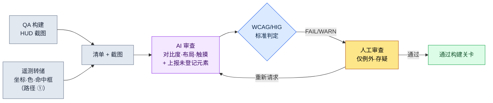

# 9.1 把 HUD 截图挂到 lint 上 —— 让 AI 抓出视线偏离与对比度不足的地方

> 首要读者:负责 HUD·UI 的 UX 策划（中等规模（10\~50 人）团队）
> 面向个人/业余读者的精简版:§9.1.8 「一个人的话,做到这些就够」

在 QA 构建中把新的减益提示叠加到 HUD 上的那天,设计师说"看得很清楚",而第二天用户论坛上就出现了"减益看不见,结果死了"。提示浮现在屏幕中央,灰底配上浅黄色文字。在设计师的显示器上看得见,但在战斗中爆炸特效铺满屏幕的 6 英寸手机上却看不见。问题在于,这并不是第一次。每一个构建、每一个画面,同一类事故都以"这次应该没事吧"反复上演。

本章聚焦于打断这种重复的一项工作。**它是一个 lint 关卡:接收一张完成的 HUD 截图作为输入,自动检测 P0 元素是否偏离了视线所及的区域（顶部状态栏、两侧底部操作角）,以及文字对比度是否越过了可读阈值。**优先级表、视线流动、平台分支这类 HUD 设计的通用原则,其他书里已经讲得足够多,因此本章只把篇幅用在*让这些原则在每次构建中自动强制生效的审查循环*上。关键在于,让 AI 看着画面,用坐标和数字说出"这行字对比度只有 2.0:1,不到 WCAG 4.5:1",从而用代码和标准取代"我看着挺清楚啊"这种口舌之争。

---

## 9.1.1 审查标准不是"感觉",而是公开标准

HUD 审查之所以每次都因人而异得出不同结论,是因为标准停留在"看得见/看不见"这种主观判断上。所幸,可读性与无障碍的相当一部分,标准机构早已用数字钉死了。无需编造。

| 审查项 | 标准依据（出处） | 自动判定 |
|---|---|---|
| 普通文本对比度 | 4.5:1 以上（WCAG 2.1 SC 1.4.3） | 可以 —— 用前景·背景颜色值计算 |
| 大号文本（18pt+）对比度 | 3:1 以上（WCAG 2.1 SC 1.4.3） | 可以 |
| 非文本（图标·计量条）对比度 | 3:1 以上（WCAG 2.1 SC 1.4.11） | 可以 |
| 触摸目标最小尺寸 | 44×44 pt（Apple HIG） / 48×48 dp（Material） | 可以 —— 按元素尺寸 |
| 拇指可达区域 | **横握双手操作**时,左·右底部角落为"易触"（左拇指=移动,右拇指=技能）。业界通用的 thumb-zone 模型 | 部分 —— 按区域规则 |

只有最后一行（拇指可达区域）不是定量合格线,而是业界通用模型,上面四行则是 W3C·Apple·Google 公开的合格线。对比度尤其明确。WCAG 甚至公开了公式,要求用 `(L1+0.05)/(L2+0.05)` 计算两种颜色的相对亮度。把灰色（#888）背景配浅黄（#D4C84A）文字的对比度代入这个公式,得出约 2.0:1 —— 不到 4.5:1,即标准上明确的不合格。这是"在设计师显示器上看得见"这类反驳站不住脚的地方。

这里先说清一件事。MMORPG·RPG 的手机画面**以横屏（landscape）为标准**。原因在于信息量与操作。同样的英寸数,横握时一屏能容纳的常驻信息比竖屏多,而且双手拇指可以同时操作左（移动）·右（技能）。竖屏单手握持适合休闲消除·放置类,但不适合同时信息量大、需要双手操作的 MMORPG。因此本章所有的视线·布局判定都以横屏双手握持为前提。画面分为:上方的横向状态栏、左右两个底部操作角、二者之间的中央游戏区域,以及游戏区域下方的中央底部槽位栏（消耗·自动道具·快捷槽）。

这五行,就是本章要交给 AI 的**审查规则手册**。必须能说出"减益文字对比度 2.0:1,违反 SC 1.4.3",而不是"减益好像有点看不清",无论是人来审查还是 AI 来审查,才能得出相同的判定。

把平台基准和 PC 并列起来,审查的出发点就清晰了。项目A 是移动优先 + PC 辅助,因此把两套基准都放进规则手册。

| 基准 | PC（辅助平台） | 移动端（优先平台,横屏） |
|---|---|---|
| 画面·输入 | 27 英寸+ / 鼠标 1px 精度·悬停·快捷键 | 6.x 英寸横屏 / 双手拇指,无悬停 |
| 同时常驻信息 | 可承受 30\~50 种 | 12\~16 种为上限（作者推测,未经验证） |
| 视线·操作可达 | 全屏（光标随处可达） | 仅顶部状态栏 + 左·右底部角落 + 中央底部槽位栏为"易触" |
| 精度 | 1px 点击 | 最小 44pt 触摸目标（HIG） |
| 核心审查风险 | 信息过密导致的认知负荷 | 屏幕狭小 + 手指遮挡 + 中央被淹没 |

PC 凭借鼠标精度·悬停提示·大屏幕,即使显示大量信息,视线与操作也够得着。移动端因为横屏比竖屏好一些,但装不下 PC 那么多,可点击元素被束缚在两侧拇指角上,又没有悬停,因此 P0 信息必须常驻显示。所以移动端 HUD 审查的本质不是"好不好看",而是**"P0 是否位于视线所及之处（顶部·两角）,文字是否越过标准对比度"**。让这一判定不因人而异地用标准钉死,就是本章要做的事。

---

## 9.1.2 [实操记录] 把一张 HUD 截图挂到 lint 上

这里完整演示实际运行的一个周期。下面忠实再现了作者项目（移动优先 MMORPG,下称"项目A"）的一次战斗 HUD 审查会话——这种把真实操作过程完整保留下来的记录,本书称为"实操记录（worked transcript）"。输入提示词可以直接复制使用,输出则是对真实会话的重构。

### 第 1 步 —— 输入:把截图 + 元素清单一起丢过去

只丢截图,AI 就会"猜测"画面。因此把构建已经掌握的元素坐标·颜色·分类,作为清单（manifest）一并放进去。这不是重新写,而只需从构建产物中提取即可（提取方法的现实在 §9.1.4 中如实比较）。

```yaml
# hud_capture_manifest.yaml —— 随 QA 构建截图一并附上
screen: { w_pt: 844, h_pt: 390 }   # 6.x 英寸横屏,pt 单位（横握）
elements:
  - id: hp_bar        # 生命条
    class: P0
    rect_pt: [12, 18, 150, 16]      # x, y, w, h —— 顶部左侧
    fg: "#FF5A5A"  ; bg: "#1A1A1A"
  - id: skill_slot_1  # 技能槽（右拇指）
    class: P0
    rect_pt: [760, 300, 40, 40]     # ← 右下角,注意尺寸
    fg: "#FFFFFF"  ; bg: "#202830"
  - id: debuff_alert  # 减益提示（昨天新增）
    class: P0
    rect_pt: [400, 180, 70, 24]     # ← 屏幕中央,注意位置
    fg: "#D4C84A"  ; bg: "#888888"   # ← 注意对比度
  - id: minimap
    class: P1
    rect_pt: [744, 20, 80, 80]       # 右上角
    fg: "#A0C0FF"  ; bg: "#101820"
```

### 第 2 步 —— 提示词:让它审查,但强制标准与格式

```
附上的截图是项目A 的战斗 HUD（横握双手）,yaml 是该画面各元素的坐标·颜色·分类。请对照两者进行审查。
对比度用 fg/bg 按 WCAG 计算,把数值也写出来 —— 文本 4.5:1、图标·大号字 3:1,不达标就判 FAIL。
P0 若偏离顶部状态栏或左·右底部角落、浮现在屏幕中央,就判 WARN（中央会被战斗特效淹没）。
操作元素若小于 44pt,或超出拇指角·中央底部槽位栏,就判 FAIL。
清单里没有但画面上能看到的,单独上报;拿不准的,归为"存疑"交给我。
只用表格给我（元素|检查|测量值|判定|备注）,不要解释。
// (意图:P0=必须在 0.5 秒内找到的信息 / 消耗·自动·快捷槽在中央底部才是正常的)
```

值得注意的是,比起审查规则本身,更多的行数花在了"如何输出这些规则"上。给 AI 自由,它就会吐出"整体挺清爽的"这类恭维。因此要预先钉死**计算式（WCAG 对比度）、合格线（4.5:1·44pt）、输出格式（表格）、必须标注测量值的义务,以及"拿不准就交给人"这一出口**。这五颗钉子把恭维变成了测量值。

### 第 3 步 —— Claude 的输出（重构,原始）

```
| 元素          | 检查   | 测量值                    | 判定 | 备注                              |
|--------------|-------|--------------------------|------|----------------------------------|
| hp_bar       | 对比度 | #FF5A5A/#1A1A1A = 5.7:1   | PASS | 非文本计量条,满足 3:1             |
| hp_bar       | 布局   | 顶部左侧 (12,18)          | PASS | P0 顶部状态栏                     |
| skill_slot_1 | 触摸   | 40×40 pt,右下角          | FAIL | 不到 HIG 44pt,差 4pt（角落 OK）  |
| skill_slot_1 | 布局   | 右下 (760,300)            | PASS | 右拇指可达角                     |
| debuff_alert | 对比度 | #D4C84A/#888888 = 2.0:1   | FAIL | 普通文本不到 4.5:1（SC 1.4.3）   |
| debuff_alert | 布局   | 屏幕中央部 (400,180)      | WARN | P0 却在中央 —— 被战斗特效淹没     |
| minimap      | 对比度 | #A0C0FF/#101820 = 9.8:1   | PASS |                                  |
| minimap      | 布局   | 右上 (744,20)             | PASS | P1,允许置于顶部状态栏右侧         |

追加上报:
- 清单里是 4 种,但截图左下角还能看到一个黄色闪烁图标
  （坐标估计 ~70,330）。疑似清单遗漏。（存疑 —— 仅凭画面
  无法断定是什么元素）

小结:FAIL 2 件（skill_slot_1 触摸、debuff_alert 对比度）,WARN 1 件（debuff_alert
布局）,存疑 1 件（未登记图标）。
```

输出中最有价值的部分不是合格/不合格的表格,而是**最下方的"追加上报"与"存疑"**。AI 在画面上抓出了清单里没有的闪烁图标,又把"它到底是什么"这件自己无法断定的事交给了人。好的提示词,能让 AI 说出"这个我不知道"。

### 第 4 步 —— 验证与否决（人的位置）

不能照单全收这份输出。AI 的审查本身,要由人再审查一遍。实际上在这次会话里,就有一件被人推翻。

`debuff_alert` 的对比度 FAIL 和布局 WARN 是对的。灰底浅黄正如 §9.1.1 所见,违反标准;把 P0 提示放在横屏画面中央,也是会被战斗特效淹没的典型错误。到这里为止 AI 是对的。

问题出在 `skill_slot_1` 的触摸 FAIL 上。AI 照单信了清单里的 `40×40 pt`,判定为"不到 44pt";但在实际构建中,这个槽位视觉上是 40pt,而**触摸命中框四周各扩展了 6pt**,实际点击区域是 52pt。清单的 `rect_pt` 只装了*绘制出来的矩形*,没有装*命中框* —— 也就是说,这是输入数据的缺陷,而非 AI 的误判。AI 在给定的数据范围内判定得很准确（角落位置的判定是对的）,而人知道代码不了解的构建实情（命中框扩展）。这个 FAIL 由人驳回。

于是同时做两件事。修改清单提取脚本,让它也提取命中框（修复数据缺陷）,并向 AI 重新发起请求。

```
skill_slot_1 视觉尺寸是 40pt,但命中框四周各扩展 6pt,实际点击区域是 52pt（已在清单里加了 hit_rect）。请按这个基准重新看触摸。
debuff_alert 的 FAIL/WARN 保持不变,请提出 3 组对比度超过 4.5:1 的配色（保留黄色系,背景调暗）。再给一个把它从中央移到顶部状态栏右侧的坐标。
```

AI 把 `skill_slot_1` 按命中框 52pt 基准更正为 PASS,并为减益的对比度返回了 3 套配色方案——把背景铺成较暗的 #2A2A00、做出 7.8:1——以及把提示移到顶部状态栏右侧（约 600,18）的坐标。一次往返就结束了。**每次构建都靠肉眼扫一遍画面,同样的事故就会反复发生;但把截图+清单挂到 lint 上,对比度·布局·触摸的违规就会落成数字,人只需判定代码不了解的例外（命中框）和存疑（未登记图标）**（审查一屏,靠手要十几分钟,用这个循环只要几分钟 —— 作者推测,未经验证的假设。与其看绝对时间,不如从"肉眼扫视"与"用标准测量"的结构差异去理解）。

---

## 9.1.3 横屏 HUD 的视线·布局 —— 为什么中央是危险的

把上面那次会话中 `debuff_alert` 之所以得到 WARN 的原因,以及 P0 信息应当放在哪里,用一张图留存下来,之后所有的布局判定都会更快。横握的手机上,画面分为四处。**上方的横向状态栏**（视线最先落到、手指不去的只读区）,**左·右两个底部角落**（双手拇指可达的操作位 —— 左拇指=移动,右拇指=技能）,二者之间的**中央游戏区域**（战斗发生的地方）,以及游戏区域下方的**中央底部槽位栏**（放置消耗·自动道具和快捷槽·技能槽的地方）。下图中,绿色·琥珀色是 P0 与槽位安全的区域,红色是 P0 提示会被淹没的游戏中央。

<svg viewBox="0 0 660 340" xmlns="http://www.w3.org/2000/svg" role="img" aria-label="移动端横屏 HUD 的视线区域与 P0/P1 布局图">
  <!-- 手机外框（横向） -->
  <rect x="20" y="30" width="620" height="280" rx="30" ry="30" fill="#0f1117" stroke="#3a3f4b" stroke-width="3"/>
  <rect x="34" y="44" width="592" height="252" rx="14" ry="14" fill="#11151d"/>
  <!-- 顶部状态 band（绿色 —— 视线第一优先,只读） -->
  <rect x="34" y="44" width="592" height="56" fill="#14532d" opacity="0.55"/>
  <path d="M44 52 H616" fill="none" stroke="#22c55e" stroke-width="2.5" stroke-dasharray="6 4"/>
  <text x="330" y="92" fill="#bbf7d0" font-family="sans-serif" font-size="12" text-anchor="middle" font-weight="bold">上方横向状态栏 —— 视线第一优先 (HP · MP · 目标,只读)</text>
  <!-- 中央危险带（红色）:游戏区域,放 P0 会被特效淹没 -->
  <rect x="180" y="100" width="300" height="138" fill="#7f1d1d" opacity="0.4"/>
  <text x="330" y="158" fill="#fecaca" font-family="sans-serif" font-size="13" text-anchor="middle">中央 —— 游戏区域（特效爆发）</text>
  <text x="330" y="178" fill="#fecaca" font-family="sans-serif" font-size="11" text-anchor="middle">放 P0 提示会被淹没 —— debuff_alert 卡住的地方</text>
  <!-- 中央底部槽位栏（琥珀色 —— 消耗·快捷槽·自动,游戏区域下方） -->
  <text x="330" y="240" fill="#b45309" font-family="sans-serif" font-size="11" text-anchor="middle" font-weight="bold">中央底部 —— 消耗·快捷槽·自动</text>
  <rect x="248" y="248" width="164" height="42" rx="8" fill="#f59e0b" opacity="0.5" stroke="#f59e0b" stroke-width="2" stroke-dasharray="5 4"/>
  <circle cx="298" cy="270" r="11" fill="#fbbf24"/><text x="298" y="274" fill="#000" font-size="8" text-anchor="middle">药水</text>
  <circle cx="330" cy="270" r="11" fill="#fbbf24"/><text x="330" y="274" fill="#000" font-size="8" text-anchor="middle">自动</text>
  <circle cx="362" cy="270" r="11" fill="#fbbf24"/><text x="362" y="274" fill="#000" font-size="8" text-anchor="middle">槽位</text>
  <!-- 左下拇指角（绿色） -->
  <path d="M34 296 L34 146 A150 150 0 0 1 184 296 Z" fill="#14532d" opacity="0.7"/>
  <path d="M34 146 A150 150 0 0 1 184 296" fill="none" stroke="#22c55e" stroke-width="2.5" stroke-dasharray="5 4"/>
  <text x="92" y="254" fill="#bbf7d0" font-family="sans-serif" font-size="13" text-anchor="middle" font-weight="bold">左拇指</text>
  <text x="92" y="274" fill="#bbf7d0" font-family="sans-serif" font-size="12" text-anchor="middle">移动</text>
  <!-- 右下拇指角（绿色） -->
  <path d="M626 296 L626 146 A150 150 0 0 0 476 296 Z" fill="#14532d" opacity="0.7"/>
  <path d="M626 146 A150 150 0 0 0 476 296" fill="none" stroke="#22c55e" stroke-width="2.5" stroke-dasharray="5 4"/>
  <text x="568" y="254" fill="#bbf7d0" font-family="sans-serif" font-size="13" text-anchor="middle" font-weight="bold">右拇指</text>
  <text x="568" y="274" fill="#bbf7d0" font-family="sans-serif" font-size="12" text-anchor="middle">技能</text>
  <!-- 实际元素点 -->
  <rect x="60" y="60" width="60" height="10" rx="3" fill="#ef4444"/><text x="90" y="68" fill="#fff" font-size="8" text-anchor="middle">HP</text>
  <rect x="60" y="78" width="60" height="10" rx="3" fill="#3b82f6"/><text x="90" y="86" fill="#fff" font-size="8" text-anchor="middle">MP</text>
  <rect x="300" y="56" width="44" height="20" rx="4" fill="#0ea5e9" opacity="0.8"/><text x="322" y="70" fill="#fff" font-size="8" text-anchor="middle">目标</text>
  <rect x="560" y="54" width="48" height="40" rx="6" fill="#0ea5e9" opacity="0.7"/><text x="584" y="78" fill="#fff" font-size="8" text-anchor="middle">地图 P1</text>
  <circle cx="330" cy="204" r="13" fill="#facc15" opacity="0.5"/><text x="330" y="208" fill="#000" font-size="6" text-anchor="middle">减益?</text>
  <circle cx="92" cy="220" r="17" fill="#22c55e"/><text x="92" y="224" fill="#000" font-size="9" text-anchor="middle">移动</text>
  <circle cx="556" cy="222" r="14" fill="#22c55e"/><text x="556" y="226" fill="#000" font-size="9" text-anchor="middle">技能</text>
  <circle cx="592" cy="210" r="13" fill="#22c55e"/><text x="592" y="214" fill="#000" font-size="9" text-anchor="middle">技能</text>
  <circle cx="600" cy="272" r="12" fill="#22c55e"/><text x="600" y="276" fill="#000" font-size="8" text-anchor="middle">技能</text>
</svg>

规则很简单。**P0 信息（HP·MP·核心提示）要放在绿色区域（上方横向状态栏或两侧底部角落）之内。**因为那是视线最先落到、或拇指常驻的必经之处。相反,**游戏中央（红色）是战斗本身发生的地方**,在这里放 P0 提示,特效铺满屏幕的那一刻信息就会被淹没。有一点要注意 —— 游戏中央与**中央底部**是不同的。游戏中央危险,但其下方的**中央底部槽位栏（琥珀色）是消耗·自动道具和快捷槽·技能槽栖身的地方**。为了一眼看到自己使用或自动消耗的东西,才把它放在两拇指之间。此外,**只读的信息（HP/MP/目标血量）放在顶部**,**可点击元素（移动·技能）放在两侧底部角落**,**消耗·槽位放在中央底部** —— 这三者就是手指·视线的区域。§9.1.2 中减益提示之所以得到 WARN,用这张图一张就能说明 —— 因为把必须在 0.5 秒内看到的 P0,偏偏放到了最看不见的游戏中央。更正方案中把它移到顶部状态栏右侧,正是把它送回了这张图里的绿色区域。

---

## 9.1.4 坐标该怎么提取 —— 实现的诚实

本章的 lint 建立在"各元素的坐标·颜色"能干净地进来这一前提上。然而,这些坐标*从哪里、怎么提取*,才是实际中最现实的分岔口。这是书里常常含糊带过的地方,所以这里如实比较三条路径。正确答案不止一个,会随团队情况而不同。

| 路径 | 做什么 | 优点 | 缺点 / 现实 |
|---|---|---|---|
| ① 游戏内遥测（telemetry）日志 | 由构建直接转储 UI 框架所绘制控件的坐标·尺寸·颜色 | 坐标**精确**（非估计）,连命中框·锚点都能拿到 | 需要在 UI 代码里埋入转储钩子。需要程序员协作。一旦铺好,最为可信 |
| ② 现成的 vision API | 把截图送入 OCR·目标检测 API,提取文本·框的坐标 | 无需修改构建,外部截图也可以 | 坐标是**近似值**,对计量条·图标这类非文本的分类较弱。外传 = 未公开构建的泄露风险 |
| ③ 自行实现（像素分析） | 直接读取截图,用启发式提取色彩边界·框 | 依赖最少,用于色彩对比度计算已足够 | 不知道元素的*含义*（它是不是 P0）。必须与清单对照才有用。有维护负担 |

三条路径的关系,恰好解释了本章的实操记录。§9.1.2 中,**对比度检查之所以准确,是因为颜色值（fg/bg）通过①·③准确地进来了**;而**触摸 FAIL 之所以被人推翻,是因为命中框在清单里缺失了**（②·③看不到命中框,只有①看得到）。也就是说,*对比度*仅凭像素也能抓到,但*触摸命中框*没有①遥测（telemetry）就抓不到。带着对这一局限的认识出发,才能划清 AI 审查结果可信到什么程度的那条线。

作者项目的选择,是**以①遥测为正本,AI 则作为对照截图+遥测清单的审查者**这样一种结构。只在画面上出现、而清单里没有的东西（§9.1.2 那个未登记的闪烁图标）由 AI 抓,清单里有、而画面上对不上的东西由人抓。只靠其中之一,两边都会留下盲区。



人手触及的只有两处。把遥测转储干净地放进去的位置（最前）,以及判定代码·标准抓不住的例外（命中框）·存疑（未登记元素）的位置（最后）。中间那些枯燥的对比度计算与布局对照,交给 AI 和标准去跑。

---

## 9.1.5 把规则手册变成代码 —— 对比度·触摸·角落的自动关卡

AI 审查每次都重新算一遍,会耗费 token 和时间。像对比度·触摸·角落可达这类**能落到确定性上的项目,由代码先处理。**AI 只介入代码抓不住的部分（画面语义解读、未登记元素）。两者不是竞争,而是分工。

```python
# hud_lint.py —— HUD 清单标准校验（骨架）
# 输入:遥测清单（每个元素的 rect/hit_rect/fg/bg/class/interactive）
# 输出:WCAG/HIG + 双手可达违规列表

def _luminance(hex_color):           # WCAG 相对亮度
    r, g, b = (int(hex_color[i:i+2], 16) / 255 for i in (1, 3, 5))
    f = lambda c: c/12.92 if c <= 0.03928 else ((c+0.055)/1.055) ** 2.4
    R, G, B = f(r), f(g), f(b)
    return 0.2126*R + 0.7152*G + 0.0722*B

def contrast_ratio(fg, bg):          # WCAG 明暗对比度
    L1, L2 = sorted((_luminance(fg), _luminance(bg)), reverse=True)
    return (L1 + 0.05) / (L2 + 0.05)

def in_thumb_corner(e, w, h):
    """是否为横握时双手拇指可达的左·右底部角落。"""
    x, y = e["hit_rect"][0] / w, e["hit_rect"][1] / h
    bottom = y > 0.55
    left_corner  = bottom and x < 0.30   # 左手拇指 = 移动
    right_corner = bottom and x > 0.70   # 右手拇指 = 技能
    return left_corner or right_corner

def lint(elements, screen_w, screen_h):
    issues = []
    for e in elements:
        # 规则 A:明暗对比度（文本 4.5:1 / 非文本·大号字 3:1）
        need = 4.5 if e["kind"] == "text" else 3.0
        cr = contrast_ratio(e["fg"], e["bg"])
        if cr < need:
            issues.append(f"[A] {e['id']}: 对比度 {cr:.1f}:1 < {need}:1 (WCAG SC 1.4.3)")
        # 规则 B:触摸目标 —— 以命中框为准（不是视觉尺寸）
        if e.get("interactive"):
            tap = min(e["hit_rect"][2], e["hit_rect"][3])   # ← 是 hit_rect 而非 rect
            if tap < 44:
                issues.append(f"[B] {e['id']}: 点击 {tap}pt < 44pt (HIG)")
            # 规则 C:操作元素应位于双手拇指角（左·右底部）
            if not in_thumb_corner(e, screen_w, screen_h):
                issues.append(f"[C] {e['id']}: 操作元素被放在了双手拇指角之外 "
                              f"(x={e['hit_rect'][0]}, y={e['hit_rect'][1]})")
    return issues
```

这段代码能终结会议上"这行字是不是有点看不清?"的口舌之争。当代码输出 `[A] debuff_alert: 对比度 2.0:1 < 4.5:1 (WCAG SC 1.4.3)`,就没什么可争的了。改就是了。值得注意的两行:规则 B 看的是 `hit_rect` 而非 `rect`,以及规则 C 只让操作元素从左·右两个底部角落通过 —— §9.1.2 中人推翻 AI 的那条教训（命中框）,和横屏双手握持的可达极限,一起进了代码。不是单一的"拇指弧"阈值,而是把左拇指（移动）·右拇指（技能）两个角落分开来看,这才是横屏判定的核心。人抓过一次的例外,从下次起由代码来抓。因此留给 AI 的只是一个狭窄的角色:"除了代码判为 PASS 的之外,上报只在画面上出现的异常（未登记元素·视觉重叠·截断）"。能靠确定性抓的交给代码,需要画面语义解读的交给 AI,了解构建实情的例外交给人 —— 这个分工才是核心。

---

## 9.1.6 本章数值的出处

本章出现的数值,出处只有三类。对比度 4.5:1·触摸 44pt·48dp 是 WCAG SC 1.4.3·HIG·Material 的官方值,#888 背景配 #D4C84A 文字约为 2.0:1,也是把颜色值代入该公式的计算值（§9.1.1·§9.1.5）。"审查一屏靠手要十几分钟、用循环只要几分钟"·"横屏常驻信息 12\~16 种"是未经验证的作者推测,正文里已如此注明。其余的（各构建的对比度 FAIL 数、触摸命中框不达标数、拇指角偏离数、遥测误触率）都是能从构建日志里直接数出来的值。像用户投诉数这类无法凭一个 HUD 断定因果的结果指标,没有列入 KPI。

---

## 9.1.7 常见的失败

| 模式 | 为什么失败 | 处方 |
|---|---|---|
| 在设计师显示器上肉眼审查 | 缺了 6 英寸·战斗特效的条件,对比度事故反复 | 把截图 lint 作为构建关卡（§9.1.2） |
| 只把截图丢给 AI 说"帮我看看" | 靠猜测坐标做近似判定,不可信 | 附上遥测清单（§9.1.4） |
| 用视觉尺寸判定触摸目标 | 漏了命中框扩展,把好端端的按钮判成 FAIL | 以 `hit_rect` 为准检查（§9.1.5） |
| 把 P0 提示放在屏幕中央 | 被战斗特效淹没,"看不见结果死了" | 移到顶部状态栏·两角（§9.1.3） |
| 把操作按钮放在画面左侧中央·顶部 | 横屏双手握持时拇指够不着 | 移到左·右底部角落（§9.1.5 规则 C） |
| 以竖屏单手握持为前提设计 | MMORPG 以横屏双手为标准,信息·操作对不上 | 转为横屏双手（§9.1.1） |
| 用"看得见/看不见"讨论对比度 | 结论因人而异 | 改用 WCAG 4.5:1 的计算值（§9.1.1） |

第四个最常反复出现。急着叠加新提示时,空位只剩画面中央,就放那儿 —— 而那个中央恰恰是游戏发生的地方。

---

## 9.1.8 动手试试 —— 今天就能做的一步

> **一个人的话,做到这些就够**:没有遥测、没有清单也可以。给自己的游戏（或喜欢的游戏）拍一张横屏 HUD 截图,用取色器取出最小的两三个文字·图标的前景/背景色并手动记下,再贴上 §9.1.2 的提示词跑一次。挑一个 AI 算出的对比度数值,用在线 WCAG 对比度计算器亲手验算一遍,你就会切身体会到"看得见/看不见"是如何变成数字的。如果 AI 把某个 P0 放在了画面中央,不妨反驳它"再看看为什么中央是危险的"。

如果是团队,就从下面这一步开始。先和程序员就"从 UI 框架转储控件坐标·色·命中框的遥测钩子（路径 ①）"达成一致,然后从 §9.1.5 的 `contrast_ratio` 这一个函数开始放进构建。对比度计算是标准公式,不会有异议,哪怕只有一个函数,每次构建的对比度 FAIL 也会落成数字。之后再叠上 `in_thumb_corner`,横屏双手操作元素的角落偏离也能由代码抓住。布局·未登记元素这类解读,在其上叠一层 AI 即可。

---

### 本章要点
- HUD 审查标准不是感觉,而是公开标准（WCAG 4.5:1·HIG 44pt）。
- 把截图+遥测清单交给 AI,检出对比度·布局·未登记元素。
- 横屏双手握持时,可点击元素放两侧底部角落,只读信息放顶部状态栏 —— 中央会被淹没。

### 下一章预告
- 9.2 技能槽是 4 列还是 8 列 —— 一个决定同时对认知·战斗·平台·面积产生的影响,用测量来求解的案例
