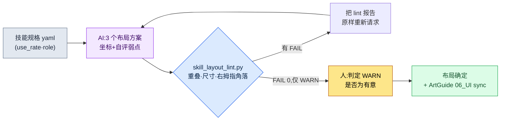

# 9.2 技能按钮排布 —— AI 生成 3 个布局方案,lint 负责淘汰

> 主要读者:移动优先动作·MMORPG 的 UX·战斗策划(中型团队)
> 面向个人/业余读者的精简版:§9.2.7「一个人的话,做到这一步就够」

如何把新职业的 6 个技能摆到移动端屏幕的哪个位置、以什么方式摆放。每当这个问题被摆上会议桌,最初的 30 分钟总是如出一辙。有人在白板上画出六个圆圈,另一个人说"那个位置拇指够不到",又有人接话"那往上挪的话小地图就被挡住了"。三个人说的都对,可结论一直没出来。到了下一次会议,同一块白板又被重画一遍。

问题在于:画布局草案这件事,和检查这份草案是否遵守规则这件事,在同一个人的脑子里混作一团。画的人往往难以否决自己画出来的东西。本章把这两件事拆开。**画多个布局草案这种枯燥的活儿交给 AI,而草案是否违反了重叠·拇指角落·触控尺寸规则,则由代码来淘汰。** 人只站在最后一个位置上——从代码放行的方案里,凭"游戏手感"挑出一个。如果说 9.1 立起了整个 HUD 的规则手册,那么本章就是把这份规则手册,一直贯彻到技能按钮——这个手指触碰最频繁的部件——上的一个完整循环。

---

## 9.2.1 技能按钮为何棘手 —— 它不是"用来读的信息",而是"用来按的信息"

HUD 上的大多数元素只是用来读的。没有人会去按 HP 条。所以在 §9.1 的拇指角落示意图中,HP·MP·目标血量放在手指够不到的顶部只读区域也无妨。技能按钮恰恰相反。它要以 0.1 秒为单位精准按下,而战斗中视线一直盯着敌人,手指是凭*记忆*去找位置的。位置只要稍有偏差,当场就会误触。

MMORPG 移动端以横屏双手握持为标准,需要按的元素放在左右两个下角,消耗品/道具槽放在底部中央(为什么横屏是标准、这三个区域各是什么,在 §9.1 中讨论)。在这一标准下,技能几乎全部铺在**右手拇指够得到的右下角簇**里(左手拇指被绑定在左下角的移动上)。这里做一个区分——以 0.1 秒为单位按下的主动技能落在这个右下角簇里,而消耗品·自动道具·快捷槽则单独放在两个拇指之间的底部中央槽位带上。本章只讨论主动技能按钮,所有坐标判定都以横屏双手握持为前提。

因此技能按钮的布局同时被三条确定性规则绑定——最小触控目标(HIG 44pt)、相邻按钮间距(Material 8dp)、拇指可达性(技能位于右拇指的右下角)。这三项都已写在 §9.1.1 立起的规则手册里,是可以凭坐标和尺寸判定的项目,因此公开标准的数值沿用那份规则手册(触控 44pt·间距 8dp 是公认数值,只有右拇指角落是业界通用模型)。这三项就成为本章淘汰 AI 布局方案的**lint 的第一层输入**。当代码说的不是"这个按钮是不是有点小?",而是"skill_3 是 40pt,不足 HIG 44pt"时,白板前的 30 分钟就消失了。

把平台基准与 PC 并排来看,布局的出发点就清晰了。PC 是精密·大量,移动端横屏则限于双手角落(完整对比表见 §9.1 规则手册)。单看技能输入,差别很明显——PC 用快捷键,技能无论摆在屏幕哪里,手指都在键盘上,所以可达性不成问题,槽位也可以很多。移动端横屏既没有悬停也没有快捷键,所以技能要按频率铺在**右拇指够得到的右下角**(同屏最多 6\~8 个),并把最常用的技能放在角落内侧(最容易够到的位置)。因此移动端技能布局的本质不是"好看的排布",而是**"在右拇指角落内按频率做优先级布局 + 规则手册验收"**。而画多个草案这件事,若由人手工来做,既枯燥又每次标准都会飘。枯燥又善变的重复劳动——正是 AI 比人更不知疲倦地完成的地方。

---

## 9.2.2 [实操记录(worked transcript)] 新职业 6 个技能的布局方案 —— 让 AI 生成 3 个方案

本节从输入到废弃,完整展示把新职业"萨满"的 6 个主动技能布局到移动端的一个循环。以下内容忠实再现了作者项目(移动优先 MMORPG,下称"项目A")的新技能 UI 工作会话。输入与提示词可以直接复制使用,输出则是对真实会话的重构。

### 第 1 步 —— 输入:把技能规格做成机器可读的表

把 6 个技能的使用频率与基本性质做成 yaml。使用频率是从数据表的战斗日志中提取的值,并非新编造出来的。

```yaml
# skill_set_shaman.yaml —— 新职业"萨满"的 6 种主动技能
screen: { w: 2400, h: 1080, dpr: 3 }   # 以 6.x 英寸横屏为准,pt = px / dpr
skills:
  - id: s1_quickbolt    # 基础攻击,最频繁
    use_rate: 0.41      # 战斗中使用占比(日志提取)
    role: spam          # 连点
  - id: s2_hex          # 减益,频繁
    use_rate: 0.22
    role: core
  - id: s3_totem        # 放置型,一般
    use_rate: 0.14
    role: core
  - id: s4_heal         # 治疗,偶尔但紧急
    use_rate: 0.11
    role: panic         # 危急时立即
  - id: s5_curse        # 群体减益,偶尔
    use_rate: 0.08
    role: situational
  - id: s6_ultimate     # 终极技,罕用
    use_rate: 0.04
    role: burst
```

核心字段是 `use_rate` 和 `role`。最常按的 `s1_quickbolt`(41%),以及危急时须在 0.2 秒内找到的 `s4_heal`(panic),必须放在右拇指最容易够到的位置(右下角内侧)。罕用的 `s6_ultimate`(4%)放在角落边缘、稍远一些也无妨。这一优先级就是下一步 AI 布局的全部输入。

### 第 2 步 —— 提示词:强制生成 3 个方案,并以数字形式接收坐标

```
附件 yaml 是新职业的 6 种主动技能。请在横屏双手握持的画面上做出 3 个技能按钮布局方案。技能铺在右手拇指够得到的右下角(左手被绑定在左下角的移动上)。
三个方案要用不同的理念——例如角落扇形、2 行网格、频率加权式。每个按钮给出 x,y,w,h(以 px 为单位,画面 2400x1080,dpr 3,pt=px/3)。
常用或 role=panic 的技能放在右拇指容易够到的角落内侧,触控目标不小于 132px(44pt),相邻间距不小于 24px(8dp)。
每个方案务必一并写上一行设计意图和你自己看到的一个弱点——没有弱点的方案不行。每个方案只给(排布理念|坐标表|设计意图|自评弱点),不要多余说明。
```

在这段提示词里,比布局指示更下功夫的地方,是强制规定输出格式和弱点申报。坐标不以数字形式接收就无法运行 lint,所以钉死了 px 输出;同时要求一并给出"这个方案的 1 个弱点",让 AI 先说出自己的局限。若是随意地说"帮我做个好看的 UI",出来的就是普通移动端 RPG 的平均布局,而且没有图、只有文字描述。

### 第 3 步 —— Claude 的输出(真实会话重构,节选)

```
== 方案 A:右下角扇形 ==
排布理念:以右拇指旋转轴为中心,把 6 个按钮排成扇形。按频率由内向外。
| id          | x    | y   | w   | h   | pt   |
|-------------|------|-----|-----|-----|------|
| s1_quickbolt| 2160 | 912 | 168 | 168 | 56pt |
| s2_hex      | 2016 | 852 | 132 | 132 | 44pt |
| s3_totem    | 2052 | 996 | 132 | 132 | 44pt |
| s4_heal     | 1884 | 924 | 132 | 132 | 44pt |
| s5_curse    | 1920 | 780 | 120 | 120 | 40pt |
| s6_ultimate | 1788 | 840 | 120 | 120 | 40pt |
设计意图:把常用的 s1 做成最大、最易够到,放在右下角内侧。
自评弱点:s5、s6 为 40pt,可能不足 HIG。扇形外侧右拇指可达性模糊。

== 方案 B:2 行网格(2x3)==
排布理念:右下角 2 行 x 3 列网格。优先视觉对齐。
| id          | x    | y   | w   | h   |
|-------------|------|-----|-----|-----|
| s1_quickbolt| 2208 | 912 | 132 | 132 |
| s2_hex      | 2052 | 912 | 132 | 132 |
| s3_totem    | 1896 | 912 | 132 | 132 |
| s4_heal     | 2208 | 756 | 132 | 132 |
| s5_curse    | 2052 | 756 | 132 | 132 |
| s6_ultimate | 1896 | 756 | 132 | 132 |
设计意图:所有按钮同一尺寸,对齐整齐。
自评弱点:上排(s4、s5、s6,y=756)处于右拇指角落的上边界,可达性模糊。
         紧急治疗 s4 在上排,危急时可能找得慢。

== 方案 C:频率加权扇形 ==
排布理念:s1 为中心大圆,其余按频率环绕在右拇指旋转轴周围。
| id          | x    | y   | w   | h   |
|-------------|------|-----|-----|-----|
| s1_quickbolt| 2184 | 900 | 180 | 180 |
| s2_hex      | 2028 | 852 | 144 | 144 |
| s3_totem    | 2052 | 996 | 132 | 132 |
| s4_heal     | 1908 | 912 | 144 | 144 |
| s5_curse    | 1932 | 792 | 120 | 120 |
| s6_ultimate | 1812 | 972 | 120 | 120 |
设计意图:手自然落到 s1,把紧急的 s4 放大并放在角落内侧。
自评弱点:因为是扇形,按钮间距不均匀。s2-s5、s4-s6 有临近冲突之虞。
```

三个方案都申报了自评弱点,这是这份输出的核心。A 是"担心不足 40pt",B 是"紧急治疗在上排",C 是"担心临近冲突"。AI 先指出了自己所画之图的薄弱之处。但这只是自我申报,真正的判定由代码来做。

### 第 4 步 —— lint:代码淘汰三个方案

用眼睛比较三个方案,又会开始"B 看着更整齐吧"这类口味之争。于是把三个方案原样喂给 §9.2.3 的 `skill_layout_lint.py`。结果如下。

```
[方案 A] 右下角扇形
  [FAIL] B-size  : s5_curse 40pt < 44pt (不足 HIG)
  [FAIL] B-size  : s6_ultimate 40pt < 44pt (不足 HIG)
  [WARN] C-corner: s6_ultimate x=1788 —— 角落左边界,右拇指可达"一般"
  → 通过 4/6,致命违规 2

[方案 B] 2 行网格(2x3)
  [FAIL] C-corner: s4_heal     y=756 (0.70h) 未低于 0.55h → 右拇指角落上方
  [FAIL] C-corner: s5_curse    y=756 (0.70h) 未低于 0.55h → 右拇指角落上方
  [WARN] role    : s4_heal(panic) y=756 —— 紧急技能在上排
  → 通过 4/6,致命违规 2

[方案 C] 频率加权扇形
  [FAIL] A-overlap: s2_hex ∩ s5_curse 间距 18px < 24px (不足 8dp)
  [FAIL] A-overlap: s4_heal ∩ s6_ultimate 间距 12px < 24px (不足 8dp)
  → 通过 4/6,致命违规 2
```

三个方案全部被淘汰。有意思的是,自我申报与 lint 判定几乎重合。AI 说是"弱点"的地方,实际就出了违规。但自我申报只是"担心",而 lint 给的是"s2_hex 与 s5_curse 间距 18px"这样的数字。会议上没什么可争的。

这一步有一个重要决定。不要因为三个方案全被淘汰就回到起点。**把 lint 报告原样贴进下一条提示词,重新请求。**

### 第 5 步 —— 重新请求:把 lint 报告原样喂进去

```
三个方案的 lint 结果原样贴在这里(上面的报告)。从中只挑违规最容易修的一个方案,只给出把 FAIL 全部变为 0 的一版修正方案。
所有按钮都不小于 132px(44pt),间距不小于 24px(8dp),s4_heal(panic) 放在右拇指角落内、仅次于 s1 最容易够到的位置。
只给坐标表,并逐行写明哪个 FAIL 是如何解决的。
// (意图:角落内 = x>横向70%(1680),y>纵向55%(594))
```

AI 选了方案 A(角落扇形)。因为它的违规只是"两个按钮尺寸不足",改动量最小。它给出的修正方案是:把因过小而被淘汰的 s5·s6 放大到 132px,并随着尺寸变大把扇形曲线略微推向角落内侧,以确保间距。

```
== 方案 A'(修正)==
| id          | x    | y   | w   | h   | pt   |
|-------------|------|-----|-----|-----|------|
| s1_quickbolt| 2160 | 900 | 168 | 168 | 56pt |
| s2_hex      | 2010 | 846 | 132 | 132 | 44pt |
| s3_totem    | 2046 | 990 | 132 | 132 | 44pt |
| s4_heal     | 1872 | 918 | 144 | 144 | 48pt |
| s5_curse    | 1908 | 774 | 132 | 132 | 44pt |
| s6_ultimate | 1740 | 858 | 132 | 132 | 44pt |
解决:B-size s5 40→44pt / B-size s6 40→44pt /
     C-corner s6 x=1740(0.725w)·y=858(0.79h) 保持在角落内侧 →
     role: s4_heal 放大到 144px,强化紧急识别。
```

把方案 A' 再次喂给 `skill_layout_lint.py`。

```
[方案 A'] 右下角扇形(修正)
  [PASS] B-size  : 全部按钮 ≥ 44pt
  [PASS] A-overlap: 最小间距 30px ≥ 24px
  [PASS] C-corner : 全部操作按钮在右拇指角落内 (x≥1680, y≥594)
  [WARN] C-corner : s6_ultimate x=1740 —— 角落左端,可达"一般"
  → 通过 6/6,致命违规 0,WARN 1
```

FAIL 变成了 0。剩下的 1 条 WARN(`s6_ultimate` 在角落左端,右拇指可达不是"容易"而是"一般")代码不会自动扼杀,而是上交给人。而且这条 WARN 其实是**有意为之的设计**。s6 使用频率 4%,是最罕用的终极技,所以角落最内侧的位置应当让给常用的 s1,把它放在边缘才对。人判定"这条 WARN 是有意的"并放行。输入 → 生成 3 个方案 → lint → 全军覆没 → 重新请求 → 通过的一个循环,在此闭合。

这一圈就是本章的 Show 标准。若不从头到尾看清 AI 画了什么、lint 淘汰了什么、人保住了哪条 WARN,"用 AI 生成了 UI 方案"这句话就是空的。

---

## 9.2.3 把 lint 写成代码 —— 重叠·拇指角落·HIG 尺寸

上述循环的心脏,是淘汰三条规则的 30 余行代码。§9.2.1 表中的三个项目原样变成三个函数。

```python
# skill_layout_lint.py —— 技能按钮排布验证(骨架)
# 输入:AI 给出的按钮坐标列表 [{id, x, y, w, h, role, use_rate}]
# 输出:A-overlap / B-size / C-corner 违规列表
# 前提:横屏双手握持。技能铺在右手拇指够得到的右下角。

MIN_TAP_PX    = 132    # HIG 44pt * dpr 3 = 132px
MIN_GAP_PX    = 24     # Material 8dp * dpr 3 = 24px
RIGHT_CORNER_X = 0.70  # 屏幕横向 0.70 右侧 = 右拇指角落
BOTTOM_Y       = 0.55  # 屏幕纵向 0.55 下方 = 底部角落

def in_right_thumb_corner(b, w, h):
    """横屏握持下,是否为右手拇指够得到的右下角。
    (左手拇指=左下角移动,右手拇指=右下角技能)"""
    rx, ry = b["x"] / w, b["y"] / h
    return rx > RIGHT_CORNER_X and ry > BOTTOM_Y

def lint(buttons, screen_w, screen_h):
    issues = []
    # 规则 B: 触控目标最小尺寸 (HIG 44pt)
    for b in buttons:
        side = min(b["w"], b["h"])
        if side < MIN_TAP_PX:
            issues.append(f"[FAIL] B-size : {b['id']} {side//3}pt "
                          f"< 44pt (不足 HIG)")
    # 规则 A: 相邻按钮重叠/间距 (最近两条边的距离)
    for i, a in enumerate(buttons):
        for c in buttons[i+1:]:
            gap = edge_gap(a, c)          # 两个矩形的最短间距(px)
            if gap < MIN_GAP_PX:
                issues.append(f"[FAIL] A-overlap: {a['id']} ∩ {c['id']} "
                              f"间距 {gap}px < {MIN_GAP_PX}px (不足 8dp)")
    # 规则 C: 操作元素须在右拇指角落内。panic 越靠角落内侧越好。
    for b in buttons:
        rx, ry = b["x"] / screen_w, b["y"] / screen_h
        if not in_right_thumb_corner(b, screen_w, screen_h):
            issues.append(f"[FAIL] C-corner: {b['id']} "
                          f"x={b['x']}({rx:.2f}w) y={b['y']}({ry:.2f}h) "
                          f"→ 右拇指角落外")
        elif b.get("role") == "panic" and rx < 0.78:
            issues.append(f"[WARN] role   : {b['id']}(panic) "
                          f"紧急技能靠近角落内侧边界")
    return issues
```

这段代码让会议上"B 方案更好看啊"这种口味发言失效。好看是在 lint 放行之后才谈的事。凡是被 lint 吐出 `[FAIL]` 的方案,好看与否都进不了构建。这是把 §9.1.1 立起的 HUD lint 关卡,彻底应用到技能按钮这个最棘手的部件上——凭坐标·尺寸可判定的交给代码,"这条 WARN 是不是有意的"这类判断交给人的分工,在这里同样成立。

整个循环一目了然地看,就是下面这样。



人经手的地方只有两处。最前端——把输入规格干净地放进去,以及最末端——判定 lint 杀不掉的 WARN。中间那些枯燥的 3 方案生成与坐标检查,由 AI 和 lint 来跑。

---

## 9.2.4 记录通过率 —— 用数字看工具的性能

只生成一次布局方案就收工,便无从知道这个工具运作得好不好。所以每一次都把 lint 结果记入日志。记录的值很简单——**AI 给出的方案在第一次 lint 中通过了几个(首次通过率),以及经过几次重新请求达到 FAIL 0(往返次数)。**

下面的数值,是用这个循环制作 3 个新职业(萨满外加 2 种)技能 UI 时亲手计数的实测值。样本仅 3 个职业(共 9 次布局会话),很小,所以应当把它当作方向值而非精确的总体参数来读。没有任何加工过的数字。

| 项目 | 实测 | 备注 |
|---|---|---|
| AI 首个布局方案中 lint 首次通过 | 9 次中 1 次 | 其余 8 次有 1 个以上 FAIL |
| 首次通过时的平均 FAIL 数 | 每方案 1.8 件 | 大多是尺寸不足或在右拇指角落外 |
| 达到 FAIL 0 的平均往返 | 1.4 次 | lint 报告再投入方式 |
| 最常见的 FAIL 类型 | B-size(尺寸不足) | 其次是 C-corner(右拇指角落) |

最重要的一行是第一行。**AI 首次给出的方案,9 次里有 8 次没能通过 lint。** 这不是这个工具的失败,而是正常运作的信号。让 AI 自由给出坐标,它就常常违反 HIG 44pt。lint 每次都把它揪出来,再把报告回喂,1\~2 次往返就归零。假如首次通过率是 100%,那意味着 lint 太松,而不是 AI 完美。

这份通过率日志,也成为决定 lint 规则该收紧还是放松的依据。若某类 FAIL 每次都以"其实是有意的"为由被人放行,那这条规则就太严了。反过来,如果上线后收到误触投诉、而 lint 却放行了,那就是规则太松。

---

## 9.2.5 把确定方案画成图 —— 按钮排布 SVG

把 §9.2.2 中通过 lint 的方案 A' 按坐标原样画出来,就是下图。表里的数字在真实画面上是什么形状,得看图才抓得住。横屏手机双手握持的姿势下,左手拇指落在左下角(移动),右手拇指落在右下角(技能簇)。圆的大小与触控目标(pt)成正比,颜色表示拇指可达难度(绿色容易 / 黄色一般)。

<svg viewBox="0 0 660 340" xmlns="http://www.w3.org/2000/svg" role="img" aria-label="주술사 스킬 6버튼 우하단 코너 클러스터 배치 확정안 SVG (가로 화면)">
  <!-- 폰 외곽 (가로) -->
  <rect x="20" y="30" width="620" height="280" rx="30" ry="30" fill="#0f1117" stroke="#3a3f4b" stroke-width="3"/>
  <rect x="34" y="44" width="592" height="252" rx="14" ry="14" fill="#11151d"/>
  <!-- 상단 상태 band (빨강 — 읽기 전용) -->
  <rect x="34" y="44" width="592" height="56" fill="#7f1d1d" opacity="0.42"/>
  <text x="330" y="92" fill="#fecaca" font-family="sans-serif" font-size="12" text-anchor="middle">顶部 —— 仅状态显示(HP · MP · 目标,只读)</text>
  <!-- 중앙 게임 화면 -->
  <text x="300" y="190" fill="#5b6675" font-family="sans-serif" font-size="13" text-anchor="middle">游戏画面(战斗发生的地方)</text>
  <!-- 좌하단 엄지 코너 (초록, 이동) -->
  <path d="M34 296 L34 156 A140 140 0 0 1 174 296 Z" fill="#14532d" opacity="0.55"/>
  <path d="M34 156 A140 140 0 0 1 174 296" fill="none" stroke="#22c55e" stroke-width="2" stroke-dasharray="5 4" opacity="0.7"/>
  <circle cx="90" cy="240" r="18" fill="#166534" stroke="#22c55e" stroke-width="2"/>
  <text x="90" y="238" fill="#bbf7d0" font-size="9" text-anchor="middle" font-weight="bold">移动</text>
  <text x="90" y="249" fill="#86efac" font-size="6" text-anchor="middle">左拇指</text>
  <!-- 우하단 엄지 코너 (초록 점선 경계, 스킬 클러스터) -->
  <path d="M626 296 L626 156 A140 140 0 0 0 486 296 Z" fill="#14532d" opacity="0.30"/>
  <path d="M626 156 A140 140 0 0 0 486 296" fill="none" stroke="#22c55e" stroke-width="1.5" stroke-dasharray="5 4" opacity="0.7"/>
  <text x="556" y="138" fill="#86efac" font-family="sans-serif" font-size="10" text-anchor="middle">右拇指"容易"角落 ↘</text>
  <!-- 상단 읽기 정보 점 (참고) -->
  <circle cx="70" cy="72" r="8" fill="#7f1d1d"/><text x="70" y="76" fill="#fecaca" font-size="8" text-anchor="middle">HP</text>
  <circle cx="120" cy="72" r="8" fill="#7f1d1d"/><text x="120" y="76" fill="#fecaca" font-size="8" text-anchor="middle">MP</text>
  <circle cx="330" cy="68" r="8" fill="#7f1d1d"/><text x="330" y="72" fill="#fecaca" font-size="7" text-anchor="middle">目标</text>
  <circle cx="588" cy="72" r="8" fill="#7f1d1d"/><text x="588" y="76" fill="#fecaca" font-size="8" text-anchor="middle">地图</text>
  <!-- 스킬 6버튼: 우하단 코너 클러스터. 크기=pt 비례, s1 최대 코너 안쪽 -->
  <!-- s1 56pt 최대 초록, 코너 가장 안쪽(우엄지 잘 닿음) -->
  <circle cx="590" cy="248" r="22" fill="#14532d" stroke="#22c55e" stroke-width="2.5"/>
  <text x="590" y="246" fill="#bbf7d0" font-size="10" text-anchor="middle" font-weight="bold">s1</text>
  <text x="590" y="257" fill="#86efac" font-size="7" text-anchor="middle">56pt</text>
  <!-- s2 44pt -->
  <circle cx="552" cy="234" r="17" fill="#166534" stroke="#22c55e" stroke-width="2"/>
  <text x="552" y="232" fill="#bbf7d0" font-size="9" text-anchor="middle">s2</text>
  <text x="552" y="242" fill="#86efac" font-size="6" text-anchor="middle">44</text>
  <!-- s3 44pt -->
  <circle cx="562" cy="276" r="17" fill="#166534" stroke="#22c55e" stroke-width="2"/>
  <text x="562" y="274" fill="#bbf7d0" font-size="9" text-anchor="middle">s3</text>
  <text x="562" y="284" fill="#86efac" font-size="6" text-anchor="middle">44</text>
  <!-- s4 heal 48pt, panic 강조 -->
  <circle cx="516" cy="256" r="19" fill="#166534" stroke="#facc15" stroke-width="3"/>
  <text x="516" y="254" fill="#fef08a" font-size="9" text-anchor="middle" font-weight="bold">s4</text>
  <text x="516" y="264" fill="#fde68a" font-size="6" text-anchor="middle">紧急</text>
  <!-- s5 44pt -->
  <circle cx="524" cy="218" r="17" fill="#166534" stroke="#22c55e" stroke-width="2"/>
  <text x="524" y="216" fill="#bbf7d0" font-size="9" text-anchor="middle">s5</text>
  <text x="524" y="226" fill="#86efac" font-size="6" text-anchor="middle">44</text>
  <!-- s6 44pt, WARN 노랑(보통), 코너 왼쪽 끝 -->
  <circle cx="486" cy="240" r="17" fill="#3f3f1a" stroke="#f59e0b" stroke-width="2.5"/>
  <text x="486" y="238" fill="#fde68a" font-size="9" text-anchor="middle">s6</text>
  <text x="486" y="248" fill="#fbbf24" font-size="6" text-anchor="middle">一般</text>
  <!-- 범례 -->
  <circle cx="70" cy="285" r="5" fill="#166534" stroke="#22c55e"/><text x="80" y="288" fill="#86efac" font-size="8" text-anchor="start">容易</text>
  <circle cx="150" cy="285" r="5" fill="#3f3f1a" stroke="#f59e0b"/><text x="160" y="288" fill="#fbbf24" font-size="8" text-anchor="start">一般(s6=罕用终极技,有意)</text>
</svg>

看图就能一眼理解 lint 报告中最后那条 WARN。只有 `s6_ultimate`(黄色)位于右下角的左端,是右拇指可达"一般"的位置。但 s6 是使用频率 4% 的终极技,放在角落边缘才对。最常用的 s1(绿色,最大 56pt)放在右拇指最容易够到的角落内侧右下,紧急治疗 s4(黄色边框)则放大尺寸,好让危急时手能快速找到。左手拇指被绑定在左下角的"移动"上,所以技能全部聚在右侧角落。一张坐标表与一张图精确一致——这正是把坐标以数字形式接收的原因。

---

## 9.2.6 常见失败

| 模式 | 为何失败 | 处方 |
|---|---|---|
| 只在白板上画圆圈开会 | 没有坐标无法 lint,口味之争反复 | 以 px 接收坐标喂给 lint(§9.2.2) |
| "AI 帮我做个好看的技能 UI"整包外包 | 没有规则手册就只是普通 RPG 平均布局 | 3 方案+坐标+自评弱点的强制提示词 |
| 以竖屏单手握持为前提布局 | MMORPG 以横屏双手为标准,技能在右拇指角落 | 以横屏 2400x1080、右下角为基准做 lint |
| 只用眼睛比较布局方案 | 每次都漏掉不足 HIG·重叠 | 用 `skill_layout_lint.py` 自动判定 |
| 首个方案通过 lint → 就安心以为工具做好了 | 可能是 lint 太松的信号 | 用通过率日志检查规则收紧(§9.2.4) |
| 连 WARN 都由代码自动拦截 | 连有意的布局(罕用终极技)也被杀掉 | WARN 交由人判定(§9.2.3) |

第五种最常被忽视。AI 首个方案每次都通过,心情固然好,但那通常意味着 lint 规则太松。9 次里有 8 次被淘汰才是健康的状态。

---

## 9.2.7 动手试试 —— 今天能做的一步

> **一个人的话,做到这一步就够**:没有 lint 代码也行。挑出你自己游戏(或喜欢的游戏)的 4\~6 个技能,按 §9.2.1 的格式手写一份规格(use_rate 大致按频率排序即可),把 §9.2.2 的提示词原样贴上,拿到 3 个方案。然后不用卷尺,只把"44pt = 132px"记在脑子里,在 AI 给出的坐标表中用手找出小于 132px 的按钮并圈出来。再假设是横屏,看看有没有技能落在右下角(横向 70% 右侧 + 纵向 55% 下方)之外。这一次就会让你亲身体会 lint 在做什么。

团队的话,就从下面这一步开始。先把 §9.2.3 的 `skill_layout_lint.py` 三个函数(尺寸·间距·右拇指角落)用代码固定下来。三个函数就够了。有了规则手册,无论是 AI 布局方案还是设计师草案,都能用同一条线来量,只有通过 lint 的方案才会流转到美术团队的 `96_ArtGuide/06_UI/`,经 `_convert_md_to_html.py` → `_SyncToArtRepo.bat` 路径自动 sync。在确定坐标抵达美术团队之前,人的最后一件事,只是把某一条 WARN 判定为"有意"。

---

### 本章要点
- 技能按钮是"用来按的信息",坐标只要错一位就会误触。
- MMORPG 移动端是横屏双手握持——技能铺在右拇指的右下角簇里。
- AI 生成 3 个方案,lint 淘汰重叠·尺寸·右拇指角落(HIG 44pt)。
- AI 首个方案 9 次里有 8 次被淘汰,才是健康 lint 的信号。

### 下一章预告
- 9.3 ArtGuide/06_UI 协作 —— 把已确定的 UI 决策,通过 md→html 自动 sync 交给非策划的美术团队的协作标准
