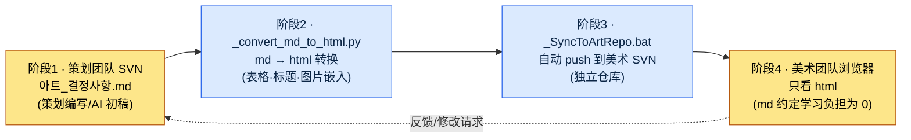

# 9.3 ArtGuide/06_UI 协作 —— 策划用 md 写，美术团队只看 html

> 主要读者：每天与非策划职能（美术）协作的 UX·UI 策划（中等规模团队）
> 面向单人/业余读者的精简版：§9.3.8「一个人的话，做到这些就够」

策划用 Markdown 把 UI 决定事项整理好，事情就会变得利落：能做版本管理，能看到 diff，还能原样丢给 AI。问题在于美术团队不读 Markdown。更准确地说，他们没有理由去读。对美术设计师说"请从 SVN 拉取 `아트_결정사항.md` 来看"，一半人根本没装 SVN 客户端，另一半人则对着在记事本里打开、`##` 标题和表格语法全乱掉的画面问"这个要怎么看啊"。

这里错误的处方是"教美术团队用 Markdown"。美术设计师的时间应该花在推敲像素上。花在学习 Markdown 约定、SVN 检出、看 diff 上的时间全是损耗。正确的处方是**在策划这一侧把转换与传递自动化，把美术团队的学习负担降到 0**。策划用 md 写，脚本把它转成 html，另一个脚本再把它推送到美术仓库，美术团队在浏览器里只看 html。本章会把这条流水线实际从头到尾跑一遍 —— 从用 AI 生成决定事项初稿的环节，到转换·传递的自动化，再到人工究竟拒绝了什么。

---

## 9.3.1 协作真正崩掉的地方是"格式"

很多书把策划与美术协作崩掉的原因归结为"决策权模糊"：谁定颜色、谁定功能。这种分工固然重要，但无论把分工表画得多好，**只要美术团队读不了这张分工表**，就什么都不会发生。实务中更常出事的地方不是决策权，而是传递格式。

在笔者的项目（移动优先 MMORPG，下称"项目A"）里，实际反复出现的事故是这样的。

| 事故 | 表面原因 | 真正原因 |
|---|---|---|
| 美术拿旧版决定事项在做 | "没拉到最新的" | 传递是手动（邮件附件），导致遗漏 |
| 决定事项表格显示错乱 | "这怎么回事" | 用记事本打开了 md |
| "那个决定写在哪儿？" | 口头传达 | 正本（canonical）散落在聊天里 |

三起事故都不是决策权的问题。它们的根源在于**正本文档没有以美术团队能读的格式、自动地、始终保持最新地传递过去**。所以本章的工具不是分工表，而是传递流水线。分工只要达成一次共识就完事，而传递在每次决定变化时都会发生。

先看实际的文件夹结构。项目A 的美术指南在 `workspace/96_ArtGuide/` 下分为 7 个领域。

```
96_ArtGuide/
├── 00_Common/      # 通用（风格·配色板·打光基准）
├── 01_Character/
├── 02_Animation/
├── 03_Monster/
├── 04_NPC/
├── 05_VFX/
├── 06_UI/          # ← 本章所讲的领域
└── 07_Env/
```

另外，这个文件夹里还放着两个运维文件：`_convert_md_to_html.py` 和 `_SyncToArtRepo.bat`。这两个文件就是本章的脊梁。

---

## 9.3.2 四阶段同步流水线 —— 从策划的 md 到美术团队的浏览器

整个流程分为四个阶段。关键在于**人（策划）只碰阶段1的 md，其余三个阶段全部由脚本来跑**。美术团队只看阶段4的 html，甚至不需要知道 md 的存在。



下面逐一点明每个阶段到底做什么。

**阶段1（策划，人工）** —— 在 `06_UI/아트_결정사항.md` 里用 Markdown 写下决定事项。如何在这个环节嵌入 AI，是 §9.3.4 的脊梁。决定事项就是"按钮 primary 颜色 #3A7BD5""触控目标最小 44pt"这类条目。

**阶段2（`_convert_md_to_html.py`，自动）** —— 把 md 转换为 html。不是简单转换，而是把表格渲染得便于美术团队阅读，把 `` 图片引用内联嵌入，并加上目录。产出的是美术设计师在浏览器里双击一次就能打开的自包含 html。

**阶段3（`_SyncToArtRepo.bat`，自动）** —— 把转换好的 html push 到**美术团队独立的 SVN 仓库**。关键在于策划仓库和美术仓库是分开的。美术团队只看自己的仓库即可，不需要了解策划仓库的权限和结构。

**阶段4（美术团队，人工）** —— 美术设计师在浏览器里打开同步到自己仓库的 html。既不用学 Markdown 语法，也不用学 SVN 命令，更不用学怎么看 diff。**md 约定的学习负担为 0**，这正是这条流水线的设计目标，也是它的成功标准。

反馈从阶段4 回到阶段1。美术说"这个决定怪怪的"，策划就改 md，阶段2\~3 又会自动跑一遍。美术只需要重新打开更新后的 html 即可。

---

## 9.3.3 为什么要把转换·传递自动化 —— 学习负担的不对称

这里先停一下，把设计意图讲明白。把 md 转成 html 这件事本身微不足道。真正的设计在于决定了**谁来承担谁的学习负担**。

选项有两条路。

<svg viewBox="0 0 640 300" xmlns="http://www.w3.org/2000/svg" role="img" aria-label="学习负担分配的两种方式对比 —— 美术团队学 md 的方案 vs 策划承担自动化的方案">
  <!-- 左侧：错误方案 -->
  <rect x="20" y="20" width="280" height="260" rx="10" fill="#1a1014" stroke="#7f1d1d" stroke-width="2"/>
  <text x="160" y="48" fill="#fecaca" font-family="sans-serif" font-size="15" text-anchor="middle" font-weight="bold">方案 A —— 美术团队学 md</text>
  <rect x="50" y="70" width="100" height="44" rx="6" fill="#3a1518" stroke="#b91c1c"/>
  <text x="100" y="97" fill="#fca5a5" font-family="sans-serif" font-size="12" text-anchor="middle">策划</text>
  <text x="100" y="135" fill="#fca5a5" font-family="sans-serif" font-size="11" text-anchor="middle">只写 md</text>
  <line x1="150" y1="92" x2="190" y2="92" stroke="#b91c1c" stroke-width="2" marker-end="url(#arrowR)"/>
  <rect x="190" y="70" width="100" height="44" rx="6" fill="#3a1518" stroke="#b91c1c"/>
  <text x="240" y="91" fill="#fca5a5" font-family="sans-serif" font-size="12" text-anchor="middle">美术 5 人</text>
  <text x="240" y="107" fill="#fca5a5" font-family="sans-serif" font-size="10" text-anchor="middle">×SVN·md 学习</text>
  <text x="160" y="170" fill="#fda4af" font-family="sans-serif" font-size="11" text-anchor="middle">学习成本 = 1 次编写 ×</text>
  <text x="160" y="188" fill="#fda4af" font-family="sans-serif" font-size="11" text-anchor="middle">乘以美术人数</text>
  <text x="160" y="222" fill="#f87171" font-family="sans-serif" font-size="12" text-anchor="middle" font-weight="bold">负担蚕食像素作业时间</text>
  <text x="160" y="240" fill="#f87171" font-family="sans-serif" font-size="12" text-anchor="middle" font-weight="bold">→ 最终被弃用</text>
  <!-- 右侧：采纳方案 -->
  <rect x="340" y="20" width="280" height="260" rx="10" fill="#0d1512" stroke="#15803d" stroke-width="2"/>
  <text x="480" y="48" fill="#bbf7d0" font-family="sans-serif" font-size="15" text-anchor="middle" font-weight="bold">方案 B —— 策划做自动化</text>
  <rect x="370" y="70" width="100" height="44" rx="6" fill="#0f2417" stroke="#16a34a"/>
  <text x="420" y="91" fill="#86efac" font-family="sans-serif" font-size="12" text-anchor="middle">策划</text>
  <text x="420" y="107" fill="#86efac" font-family="sans-serif" font-size="10" text-anchor="middle">md+脚本 1 次</text>
  <line x1="470" y1="92" x2="510" y2="92" stroke="#16a34a" stroke-width="2" marker-end="url(#arrowG)"/>
  <rect x="510" y="70" width="100" height="44" rx="6" fill="#0f2417" stroke="#16a34a"/>
  <text x="560" y="91" fill="#86efac" font-family="sans-serif" font-size="12" text-anchor="middle">美术 5 人</text>
  <text x="560" y="107" fill="#86efac" font-family="sans-serif" font-size="10" text-anchor="middle">html 双击</text>
  <text x="480" y="170" fill="#86efac" font-family="sans-serif" font-size="11" text-anchor="middle">学习成本 = 策划 1 次</text>
  <text x="480" y="188" fill="#86efac" font-family="sans-serif" font-size="11" text-anchor="middle">(美术负担为 0)</text>
  <text x="480" y="222" fill="#4ade80" font-family="sans-serif" font-size="12" text-anchor="middle" font-weight="bold">美术只专注于像素</text>
  <text x="480" y="240" fill="#4ade80" font-family="sans-serif" font-size="12" text-anchor="middle" font-weight="bold">→ 得以持续</text>
  <defs>
    <marker id="arrowR" markerWidth="8" markerHeight="8" refX="6" refY="3" orient="auto"><path d="M0,0 L6,3 L0,6 Z" fill="#b91c1c"/></marker>
    <marker id="arrowG" markerWidth="8" markerHeight="8" refX="6" refY="3" orient="auto"><path d="M0,0 L6,3 L0,6 Z" fill="#16a34a"/></marker>
  </defs>
</svg>

关键在于不对称。方案 A 的学习成本要乘以美术人数，而且每来一名新人就重复发生一次。方案 B 里策划只要写一次脚本就完事，美术一侧的边际成本为 0。**把负担压给能自动化的一侧，而不是人多的一侧** —— 这就是非策划职能协作工具的第一原则。一旦这条原则被打破，也就是协作工具强迫对方职能去学新东西，那么这个工具在一两个季度内就会"没人用"。

---

## 9.3.4 [实操记录（worked transcript）] 用 AI 生成 UI 决定事项的 md 初稿

前面说阶段1 由策划来写 md，这里把用 AI 生成这份 md 初稿的环节完整走一个循环。决策会议结束后，会留下零散的记录（聊天·白板照片·口头共识）。把这些整理成正本的决定事项 md 很枯燥，而且每次格式都会走样。这正是最适合交给 AI 的活儿。不过，**决定本身由人来做，AI 只负责把决定整理成既定格式** —— 这条边界是关键。

### 第 1 步 —— 输入：原始会议记录

```
[UI 决策会议记录 —— 关于 06_UI 技能槽，原始未整理]
- 说要把技能槽按钮尺寸调大。因为在移动端太小了。
- 颜色由美术来定。不过 primary 色调保持蓝色系。
- 槽位禁用（冷却）状态的表现，商定为灰色+数字叠加。
- 多语言……技能名变长怎么办？暂时搁置。
- 啊，还有长按弹出技能说明（这是功能，策划已确定）。
```

### 第 2 步 —— 提示词：强制区分决定/搁置/责任方

```
附件是 UI 决策会议的原始记录。请整理成要交给美术团队的决定事项 Markdown。
把每一项分类为 [确定]/[搁置]/[美术决定]（确定=策划拍板、美术照做；搁置=未决+原因；美术决定=属于视觉表现由美术定、策划只给约束），并各附一行依据/约束 —— 如果记录里没有依据，就如实写成"依据未记载"，不要用猜测来填。
像触控尺寸这种能用公开标准验证的，要注明标准；记录里没有的项目，绝对不要新编造。
表格用 |项目|分类|决定/约束|依据|是否可验证|，并包含 frontmatter（title、layer: L1），给出完整全文。
```

这段提示词的重心不在整理本身，而在于强制分类和禁止编造。让 AI 整理决定事项时，它会热心地把记录里没有的"最佳实践"补进来，而这些补充在美术团队看来就成了"策划已敲定的决定"。所以要钉下三根钉子：**[确定]/[搁置]/[美术决定] 分类、依据义务，以及"记录里没有就不要编造"**。

### 第 3 步 —— Claude 的原始输出（真实会话还原）

```markdown
---
title: 06_UI 决定事项 —— 技能槽
layer: L1
---

# 06_UI 决定事项 —— 技能槽

| 项目 | 分类 | 决定/约束 | 依据 | 可验证 |
|---|---|---|---|---|
| 技能槽按钮尺寸 | [确定] | 最小 44×44 pt 以上 | 移动端触控目标，Apple HIG 建议 44pt | ✅ 坐标·尺寸 |
| primary 色调 | [美术决定] | 保持蓝色系（约束），精确值由美术定 | 记录："primary 色调保持蓝色系" | △ 颜色值 |
| 冷却状态表现 | [确定] | 灰色叠加 + 剩余数字 | 会议商定 | ◯ 视觉评审 |
| 技能名多语言长度 | [搁置] | 后续会议 | 记录："暂时搁置" —— 长文本语言（德·俄）未做验证 | — |
| 长按技能说明 | [确定] | 长按 → 显示工具提示 | 功能确定（策划领域） | ◯ 行为评审 |
| 槽位间距 | [确定] | 建议最小 8 dp | 依据未记载 —— 记录里没有，参考 Material 建议值 | ✅ |
```

### 第 4 步 —— 验证与拒绝（人工的环节）

这份输出不能原样当作正本上传。有一行有问题。

就是最后一行 `槽位间距 | 最小 8 dp`。回头再看记录，会议里**根本没提过**间距。是 AI 自己判断"既然是移动端 UI，总该有个间距标准吧"，于是热心地把 Material Design 的建议值加了进来。这违反了规则 5（"禁止编造记录里没有的项目"）。AI 虽然如实标注了 `依据未记载`，但根本就不该造出这个条目本身。这一行一旦到了美术团队手里，就会被读成"策划已敲定 8dp 间距"。

于是重新提出请求。

```
"槽位间距"在会议记录里没有，是你加上去的。请从表格里删掉。
记录里没有但看起来需要决策的，不要放进表格，只作为候选列到最下面的"## 未决 —— 下次会议议题"；决定事项表里只保留记录中实际有的项目。
```

AI 把间距条目从表格里删掉，并在最下面把"下次会议议题：槽位间距标准（目前未定）、多语言技能名长度处理"单独分离为候选。现在决定事项表里只剩下会议上真正定下的内容，而 AI 想到的合理候选则从"确定"降级为"议题"。这一分离之所以重要，是因为美术团队拿到的文档里**一旦混淆了什么是确定、什么还在讨论，美术就会把未定事项当作确定去开工**。

经过这一次往返，阶段1（md）就完成了。现在它离开人的手，进入阶段2\~3 的自动化。

---

## 9.3.5 阶段2\~3 自动化 —— 转换与传递不经人手

完成的 md 现在交给脚本处理。转换脚本的骨架很简单。

```python
# _convert_md_to_html.py (骨架)
# 输入：06_UI/*.md (策划编写的决定事项)
# 输出：同名的 .html (美术团队在浏览器中打开的自包含文件)

def convert(md_path):
    md_text = read(md_path)
    front, body = split_frontmatter(md_text)          # 提取 title·layer
    html_body = markdown_to_html(body, extensions=[
        "tables",        # 表格渲染 (解决美术在记事本里看到的错乱表格)
        "fenced_code",
    ])
    html_body = embed_images_inline(html_body, base_dir=md_path.parent)
    # ↑ 将  这类引用内联嵌入 →
    #   美术无需另外获取图片文件
    toc = build_toc(html_body)                         # 自动生成目录
    return render_template(title=front["title"], toc=toc, body=html_body)
```

这里的关键是，转换不是简单的 md→html，它还多做了三件事：**把表格正确渲染**（美术在记事本里看到的错乱 `|---|` 消失了）、**把图片内联嵌入**（美术不必另外获取图片文件）、**自动加上目录**（决定事项再长，美术也能跳到想看的条目）。正是这三件事，让"只看 html 就行"真正成立。

传递脚本则是这样组织的。

```bat
REM _SyncToArtRepo.bat (骨架)
REM 1) 将 06_UI 的所有 md 转换为 html
python _convert_md_to_html.py 06_UI\*.md

REM 2) 把转换好的 html 复制到美术 SVN 工作副本
xcopy 06_UI\*.html %ART_REPO%\UI\ /Y

REM 3) 自动提交·push 到美术 SVN (独立仓库)
svn add %ART_REPO%\UI\*.html --force
svn commit %ART_REPO%\UI -m "[auto] 06_UI 决定事项更新"
```

策划要做的只是双击一次 `_SyncToArtRepo.bat`（或者挂一个钩子，让它在提交决定事项时自动执行）。这样，转换·复制·推送到美术仓库就会一次跑完。美术团队更新自己的仓库，最新的 html 就已经到位了。

> **AI 能介入到哪一步** —— 这段阶段2\~3 的自动化代码，完全可以让 AI 来写。"写一个脚本，接收 md 文件夹，转换成含表格·图片的 html，再 push 到独立 SVN"，这是 AI 擅长的领域。然而**哪个决定要定为确定、什么要交给美术决定**（§9.3.4），不会委托给 AI。代码交给 AI，决定交给人 —— 全书反复出现的这条分工，在这里同样适用。

---

## 9.3.6 图片提示词也要先写"设计意图"

在美术协作中，AI 被用错的典型例子就是图片提示词。策划给美术团队提供参考图、或者想快速把概念可视化时，会用图像生成 AI。此时常见的失误，是一上来就写结果描述（"蓝色圆角按钮、发光效果、4K"）。

笔者的协作原则之一是 `image_prompt_design_intent_first` —— **图片提示词也不要先写结果描述，而要先写设计意图**。

| 方式 | 提示词 | 问题/效果 |
|---|---|---|
| 结果优先（差） | "蓝色圆角按钮、发光、4K、游戏 UI" | 美术无法追问"为什么是蓝色？"。意图蒸发 |
| 意图优先（好） | "直观传达技能可用/冷却状态的技能按钮。可用=让人想立刻按下的视觉吸引力，冷却=抑制。色调为 primary 蓝色系" | 美术看到意图后，可以反向提出更好的视觉方案 |

区别在于美术团队拿到提示词后能做什么。只拿到结果描述，美术要么照着画，要么无视，二选一。**拿到设计意图，美术就能提出一个把这个意图解得更好的自己的视觉方案。**这正是策划在不侵犯美术决定领域（§9.3.4 的 [美术决定]）的前提下，还能给出方向的方法。策划给出"为了什么"，美术决定"看起来怎样"。

所以，在 §9.3.4 的决定事项 md 里放图片参考时，图注也不写"蓝色按钮"，而写"以区分冷却状态为目的的槽位 —— 精确表现由美术决定"。转换脚本会把这条图注连同图片一起嵌入 html，于是美术会同时拿到图片和意图。

---

## 9.3.7 度量 —— 什么是能诚实计数的

有一种诱惑，想把这条流水线的效果写成"协作事故减少了 70%"之类的数字。这种数值一旦没经过验证，就会削弱本书的可信度。诚实地做个区分。

**可用公开标准验证的** —— 决定事项里出现的触控 44pt·间距 8dp·对比度 4.5:1 这类公开标准，遵循 §9.1 的规则手册。它们不是编造的数值，而是可以原样引用、并用 lint 自动验证的值。

**可度量的运营指标** —— 这条流水线实际能计数的是这些：美术拿旧版开工的事故数（传递若是自动的则收敛到 0）、美术团队新人第一次打开决定事项所花的时间（双击 html 的话是分钟级）、决定变更反映到美术仓库的延迟（脚本执行时间）。这三项不是"感觉"，而是能用日志·观测来计数的。

**笔者的推测（未经验证的假设）** —— "比手动邮件传递时遗漏更少"这个方向是明确的，但由于没有另外记录样本，精确的下降率不做断言。与其看绝对值，不如按**方向**来读：传递若掌握在人手里，忙碌的一周必定会出现遗漏；传递若是脚本，遗漏就会在结构上消失。

---

## 9.3.8 动手试试 —— 今天就能做的一步

> **一个人的话，做到这些就够**：没有美术团队、没有 SVN 也没关系。假设你要把 UI 决定传给你委托的外包美术，或者一起协作的朋友。照搬 §9.3.4 的提示词，用 AI 生成一张 md —— 把脑子里零散的 UI 决定分类为 [确定]/[搁置]/[美术决定]。然后从中找出一条 AI"热心补进来"的项目（记录里原本没有的），反驳它一句"这个我没定过，删掉"，你就能亲身体会到，在整理决定这件事上，人和 AI 的边界到底在哪。转换只需 `markdown` 包的一行 `python -m markdown decision.md > decision.html` 就足够。

如果是团队，就从下面这一步开始。别一上来就写宏大的双向同步，而是先放进**一行转换 + 一行传递**：一个把决定事项 md 转成 html 的转换脚本（只做 §9.3.5 里的表格渲染·图片嵌入），外加一行把这个 html 复制到美术能看到的位置（无论是共享盘还是独立仓库）。哪怕只有这两行，"美术在记事本里看 md 撞上错乱表格"这一最常见的事故也会消失。分工表·决策权的梳理，是再往后的事。

用 setup → prompt → verify 概括，就是这样。

| 步骤 | 要做的事 |
|---|---|
| setup | 先放进 `_convert_md_to_html.py`（转换）+ 一行传递（复制/push） |
| prompt | 用 §9.3.4 的提示词，把会议记录整理成 [确定]/[搁置]/[美术决定] 的 md |
| verify | 拒绝 AI 编造的项目（记录里没有的）→ 自动执行转换·传递 → 美术只确认 html |

---

### 本章要点
- 协作真正崩掉的地方不是决策权，而是传递格式。
- 策划用 md 写，脚本以 html 传递 —— 美术学习负担为 0。
- 决定整理用 AI 初稿，拒绝编造项目靠人 —— 代码交给 AI，决定交给人。

### 下一章预告
- 10.1 integrity_check atom 综合 —— 把 UI 验证扩展为整个游戏数据的验证。
