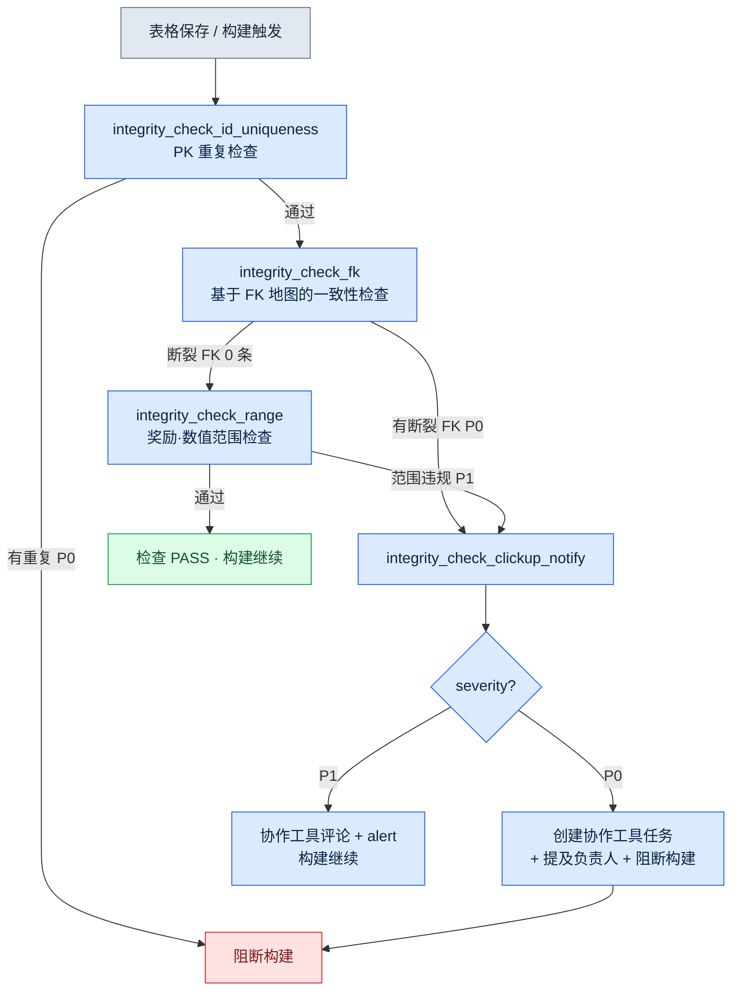

# 10.1 一致性校验 atom —— 守护 30 张表 FK 的 cascade

周五晚上 6 点 40 分。那天定下要在下周一的公司内部构建里新加入 12 种任务。我在 `quest_table` 里追加新行,在奖励表里填上对应的行,又在对话表里把 NPC 台词接上。三张表,约 50 行。我用眼睛扫了两遍,看上去没有问题。

周一早上,构建挂了。新任务中有一条所引用的 `reward_id` 在奖励表里并不存在。周五晚上我把一行奖励删掉后又重新加了回来,过程中把 id 敲错了一个字符——把 `rwd_q318` 敲成了 `rwd_q381`。这是一种人眼绝对抓不住的笔误。两张表位于不同的文件夹,由不同的人、在不同的时间去改动。行数只有 50 的时候,眼睛还抓得住。可一旦超过 30 张表开始通过外键(FK)互相引用,人的眼睛就不再是一件检查工具了。

本章要展示的,是一种能在构建挂掉之前抓住这个笔误的检查 atom——`integrity_check_fk`——它如何校验 30 多张表的 FK 一致性,并在出现断裂时,通过协作工具(一种管理任务与日程的 SaaS——本项目使用 ClickUp,JIRA、Redmine 也是同一类)通知到负责人;我会沿着自己实际跑过的一个会话,把这个流程呈现出来。

我进入这个行业,起点正是从别人做好的东西里找出错位的那一行。单机游戏的 QA 与验收是我的第一份工作,那时手和眼睛是唯一的检查工具。二十多年过去,如今我把同样的活儿交给了代码——就在人眼不再充当检查工具的那个位置上。

---

## 10.1.1 检查该抓住什么 —— FK 断裂的结构

先用图来看清楚检查的是什么。游戏数据表就如同关系型数据库。一张表的列指向另一张表的主键。一旦这根箭头断掉,运行时游戏要么崩溃,要么更糟——悄无声息地显示一个空值。

<svg viewBox="0 0 640 260" xmlns="http://www.w3.org/2000/svg" font-family="sans-serif" font-size="13">
  <rect x="20" y="30" width="150" height="90" rx="6" fill="#eef4ff" stroke="#3b6fb6" stroke-width="1.5"/>
  <text x="95" y="50" text-anchor="middle" font-weight="bold">quest_table</text>
  <line x1="20" y1="60" x2="170" y2="60" stroke="#3b6fb6"/>
  <text x="32" y="78">quest_id (PK)</text>
  <text x="32" y="98" fill="#c0392b">reward_id (FK)</text>
  <text x="32" y="116" fill="#c0392b">npc_id (FK)</text>

  <rect x="250" y="20" width="150" height="60" rx="6" fill="#eafbe7" stroke="#3a9d3a" stroke-width="1.5"/>
  <text x="325" y="40" text-anchor="middle" font-weight="bold">reward_table</text>
  <line x1="250" y1="50" x2="400" y2="50" stroke="#3a9d3a"/>
  <text x="262" y="68">reward_id (PK)</text>

  <rect x="250" y="150" width="150" height="60" rx="6" fill="#eafbe7" stroke="#3a9d3a" stroke-width="1.5"/>
  <text x="325" y="170" text-anchor="middle" font-weight="bold">npc_table</text>
  <line x1="250" y1="180" x2="400" y2="180" stroke="#3a9d3a"/>
  <text x="262" y="198">npc_id (PK)</text>

  <line x1="170" y1="93" x2="250" y2="55" stroke="#3a9d3a" stroke-width="2" marker-end="url(#ok)"/>
  <line x1="170" y1="111" x2="250" y2="175" stroke="#c0392b" stroke-width="2" stroke-dasharray="6 4" marker-end="url(#bad)"/>
  <text x="430" y="120" fill="#c0392b" font-weight="bold">npc_id 'npc_307' →</text>
  <text x="430" y="140" fill="#c0392b">npc_table 中不存在(断裂的 FK)</text>

  <defs>
    <marker id="ok" markerWidth="8" markerHeight="8" refX="6" refY="4" orient="auto"><path d="M0,0 L8,4 L0,8 Z" fill="#3a9d3a"/></marker>
    <marker id="bad" markerWidth="8" markerHeight="8" refX="6" refY="4" orient="auto"><path d="M0,0 L8,4 L0,8 Z" fill="#c0392b"/></marker>
  </defs>
</svg>

绿色实线是活着的引用:`quest_table.reward_id` 指向的值在 `reward_table.reward_id` 中确实存在。红色虚线是死掉的引用——某条任务的 `npc_id` 指向了一个 `npc_table` 中并不存在的 id。`integrity_check_fk` 要抓的正是这根红色虚线。

项目A的数据表里,这样的引用绝不止一两个。30 多张表彼此指向,若把 FK 箭头全画出来,一页纸都装不下。让人每次都用手去逐一追踪,是不可能的。

---

## 10.1.2 一个会话 —— 检查抓住断裂 FK 的全过程

从这里开始,是我实际跑过的一个会话。我不做概括,而是把提示词全文、原始输出,以及我否决并重新要求的部分,都原样记录下来。

### 第 1 步 —— 读取表格,让它提取 FK 候选

我先让检查器做出一张"哪个列指向哪张表"的 FK 地图。让人把 30 张表的 FK 逐一登记并不现实,于是我让它依据规格书表的列命名规则(`*_id` 指向同名的表)自动推断候选。我输入的提示词全文如下。

> 读取所附的规格书表(`$스키마` 标签页),从所有数据表中推断出看起来像外键(FK)的列。规则:(1)列名为 `xxx_id` 形式,且(2)在 `xxx_table` 或 `xxx_list` 表中存在同名的 PK(Primary Key,主键)列,则视为 FK 候选。把推断结果以 `{source_sheet, source_column, target_sheet, target_column, confidence}` 列表形式输出为 JSON。凡是无法用规则断定的,把 confidence 标为 low 并写明理由。

Claude 的原始输出片段(连同含糊的条目一并原样照录):

```json
[
  {"source_sheet":"quest_table","source_column":"reward_id",
   "target_sheet":"reward_table","target_column":"reward_id","confidence":"high"},
  {"source_sheet":"quest_table","source_column":"npc_id",
   "target_sheet":"npc_table","target_column":"npc_id","confidence":"high"},
  {"source_sheet":"quest_table","source_column":"prev_quest_id",
   "target_sheet":"quest_table","target_column":"quest_id","confidence":"medium",
   "note":"名字不是 quest_id 而是 prev_quest_id,因此未命中规则。推测为同表自引用。需人工确认"},
  {"source_sheet":"reward_table","source_column":"item_id",
   "target_sheet":"item_table","target_column":"item_id","confidence":"high"},
  {"source_sheet":"dialogue_table","source_column":"speaker_id",
   "target_sheet":"npc_table","target_column":"npc_id","confidence":"low",
   "note":"无法确定 speaker_id 指向的是 npc_id 还是 player。似乎也存在 speaker 为 'player' 的行。无法断定"}
]
```

这里有两个条目我没有直接放行。`prev_quest_id`(自引用)我采纳为检查对象,但亲手加上了"空值(第一个任务)不算违规"这条例外。`dialogue_table.speaker_id` 我否决了——因为确实存在 `speaker` 为 `'player'` 的行,若把它当作 FK 来检查,所有玩家台词都会被判成假违规。

这次否决很重要。若把自动推断出的 FK 地图不经评审就直接使用,首次运行就会涌出数百条假违规。必须由人过滤一遍,检查才能赢得信任。

### 第 2 步 —— 用评审过的 FK 地图定义检查 atom

我把过滤后的 FK 地图固定为 `integrity_check_fk` atom 的输入。atom 的格式如下。这是项目A中实际使用的一个检查 atom 的全文。

```yaml
---
name: integrity_check_fk
description: 依据登记的 FK 地图,校验所有 source 列的值都存在于 target 表的 PK 中
type: integrity_check
category: data
priority: P0          # 断裂的 FK 阻断构建
execution_time:
  - on_save           # 表格保存时仅检查该表
  - on_build          # 构建时检查全部 FK
  - nightly           # 每天午夜全量 + 报告
input:
  fk_map: fk_map.reviewed.json   # 第 1~2 步中由人评审过的地图
output_format: violation_list
on_violation:
  - notify: clickup           # 失败时通知 ClickUp
related_atoms:
  - integrity_check_clickup_notify
  - integrity_check_id_uniqueness
---
```

检查逻辑本身并不长。它是一个集合成员检查:确认 source 表的每个值是否在 target 表的 PK 集合中。

```python
def check_fk(fk_map, sheets):
    violations = []
    for fk in fk_map:
        pk_set = {r[fk["target_column"]] for r in sheets[fk["target_sheet"]]}
        for i, row in enumerate(sheets[fk["source_sheet"]]):
            val = row[fk["source_column"]]
            if val in ("", None):          # 空 FK 为例外(第 1 步定下的规则)
                continue
            if val not in pk_set:
                violations.append({
                    "fk": f'{fk["source_sheet"]}.{fk["source_column"]}',
                    "row": i + 2,          # 表头 1 行 + 1-index
                    "value": val,
                    "target": fk["target_sheet"],
                    "severity": fk.get("severity", "P0"),
                })
    return violations
```

### 第 3 步 —— 跑检查,抓住真正断裂的 FK

我用评审过的地图对全部 30 张表跑了检查。输出是标准的 `violation_list`。以下是那天实际得到的结果(id 与表名做了匿名化处理,违规条数与结构均为真实)。

```json
{
  "check": "integrity_check_fk",
  "executed_at": "2026-05-18 09:14:02",
  "input_files": 31,
  "violations": [
    {"fk": "quest_table.reward_id", "row": 318, "value": "rwd_q381",
     "target": "reward_table", "severity": "P0",
     "message": "reward_id 'rwd_q381' 在 reward_table 中不存在。推测为 'rwd_q318' 的笔误"},
    {"fk": "quest_table.prev_quest_id", "row": 502, "value": "q_0500",
     "target": "quest_table", "severity": "P0",
     "message": "prev_quest_id 'q_0500' 在 quest_table 中不存在。推测为 'q_500' 的写法不一致(0 填充)"}
  ],
  "summary": {"fk_checked": 23, "rows_scanned": 4117, "violations": 2, "passed": 4115}
}
```

周五晚上那个笔误(`rwd_q381`)在第一行就被抓到了。第二条则是我此前并不知道的另一个问题。某条任务的 `prev_quest_id` 是 `q_0500`,而实际的任务 id 是 `q_500`。这是加了 0 填充导致的写法不一致。在人眼里两者看着一样,但作为字符串却是不同的值,于是游戏找不到前置任务,便把这条任务一直留在锁定状态。这是一类若上线就会有玩家来咨询的缺陷。

`message` 字段里的"推测为笔误""推测为 0 填充",是我让检查器在单纯的成员匹配失败之外,一并给出最接近的 PK 值(以编辑距离为准)的那部分。它能缩短人去追查"这为什么会断"的时间。不过这些推测终究只是提示,真正的修正值由人来定。

---

## 10.1.3 断裂发生时 —— 直到协作工具通知的 cascade

到这里,是单个检查的动作。但检查即便抓住了违规,没人看见也就没有意义。关键在于让违规径直抵达负责人的那条流程。在项目A中,这条流程由一个名为 `integrity_check_clickup_notify` 的独立 atom 负责(在 JIT 元数据中其影响力评分为 294.93,是验证 atom 组里评分最高的 atom 之一——这意味着,让一致性失败抵达人,与检查本身同等重要)。

完整的 cascade 如下。各检查 atom 依次执行,某一环节一旦出现 P0 违规,便流向通知 atom。



这个 cascade 里包含两个设计决策。

第一,**PK 重复检查排在 FK 检查之前。** FK 检查以 target 表的 PK 唯一为前提。若 PK 有重复,"这个值是否在 PK 集合中"这一问题本身就失去了意义。因此我在 `integrity_check_fk` 的 atom 里显式写入 `related_atoms: integrity_check_id_uniqueness`,并在 cascade 中固定了顺序。一旦所依赖的检查失败,FK 检查就跳过——因为跑了也只会得到假结果。

第二,**通知的强度按 severity 分级。** P0(断裂的 FK)会在协作工具里创建任务,提及 FK 地图中登记的负责人(若是 `reward_table` 就是奖励负责人),并阻断构建。P1(奖励数值超出建议范围——与其说是错,不如说是需要复核的情形)只留下评论和 alert,构建照常通过。若把所有违规都设成阻断构建,人们很快就会学会无视构建阻断。阻断只用于真正必须拦下的地方。

协作工具中实际生成的任务正文,就是 `violation_list` 中一个条目原样转换后的形态。

```
[P0] integrity_check_fk 违规 —— 构建已阻断
表:quest_table  |  列:reward_id  |  行:318
值 'rwd_q381' 在 reward_table 中不存在。
最接近的候选:'rwd_q318'(编辑距离 1)
负责人:@奖励_负责人  |  检出:2026-05-18 09:14  |  构建:nightly-0042
```

从检查结果到抵达人的收件箱,全程无需一次人工介入。检查 → 分类 → 创建任务 → 提及,是一条流水线。之所以能做到,是因为 `violation_list` 是标准的输出格式。无论由哪个检查 atom 抓到,输出结构都一样,所以一个通知 atom 就能接收并处理所有检查的结果。

---

## 10.1.4 减少假违规的运营 —— 留下评审证据

第一次打开检查,必定会冒出假违规。第 1 步的 `speaker_id` 就是一例。若放任不管,人们就会把违规报告学成"反正大多是假的,不看也罢"——这是检查器信任崩塌最常见的路径。

在项目A中,我们用 `human_review_attestation_evidence_mandatory` 这一原则来防止它。当判定为假违规并做例外处理时,**必须把是谁、在何时、为何这样判断作为证据留存下来**。FK 地图文件(`fk_map.reviewed.json`)的每个例外条目都会附上以下内容。

```json
{
  "source_sheet": "dialogue_table", "source_column": "speaker_id",
  "excluded": true,
  "review": {
    "by": "李旼洙", "at": "2026-05-18",
    "reason": "speaker_id 取 npc_id 或 'player' 字面量。不适合单一 FK 检查。",
    "follow_up": "新增 speaker_type 列后,考虑以分支检查方式重新引入"
  }
}
```

没有这份证据,等到很久以后"这一列为什么不检查?"的疑问再次浮现时,便没有依据可答。于是又把它加回检查,又看到数百条假违规。评审证据能让同样的争论不再重复。

---

## 动手试试 —— 首次搭建 FK 一致性检查

这是为想在自己的数据表中引入 FK 检查的读者准备的最小步骤。

**setup.** 把数据表文件夹,以及列的规格说明(哪一列是 PK、哪一列是 FK)集中到一处。如果没有规格说明,只凭列名规则(`*_id`)也能开始。

**prompt.** 把下面的内容输入给检查器。

> 从这些数据表中推断 FK 候选。若 `xxx_id` 列指向 `xxx_table` 中同名的 PK,则视为 FK。把结果输出为 `{source_sheet, source_column, target_sheet, target_column, confidence}` JSON,凡是无法用规则断定的,把 confidence 标为 low 并写明理由。

**verify.** 对输出的 FK 地图,**务必由人逐行评审。** 自引用(`prev_*`)、字面量混杂(如 `'player'`)、多态引用(视情况指向不同表的列),自动推断经常出错。用过滤后的地图跑检查,把首次运行得到的违规逐条分类为"真断裂 / 假违规"。假违规做例外处理,但要把理由留存在文件里。

走完这三步,周五晚上一个字符的笔误在周一弄垮构建这种事就不会再发生。检查会在周六凌晨的 nightly 里抓住那个笔误,而在周一上班之前,一条协作工具任务已在等着负责人。

**单人精简版.** 即便独自工作、没有协作工具,这项检查依然有意义。手写十来行 FK 地图,只跑上面那个 Python 函数,就能抓到断裂的引用。通知用控制台输出或文本文件就够了。关键不在通知渠道,而在于"让机器抓住人眼抓不住的引用错误,并送达到人"这一流程本身。

---

### 本章要点
- FK 一致性在表格超过 30 张时,人眼已无法把控,而一个集合成员检查便可代劳。
- 自动推断出的 FK 地图必须经人评审,过滤假违规并把理由作为证据留存,是检查器可信度的核心。
- 检查的价值不止于抓住违规,而在通过协作工具通知 cascade 抵达负责人时才算完整。

### 下一章预告
- 10.2 决策一致性 3-layer 传感器 —— 越过数据完整性,进入更复杂的验证:抓住决策与决策、决策与数据、决策与用户之间的错位。
