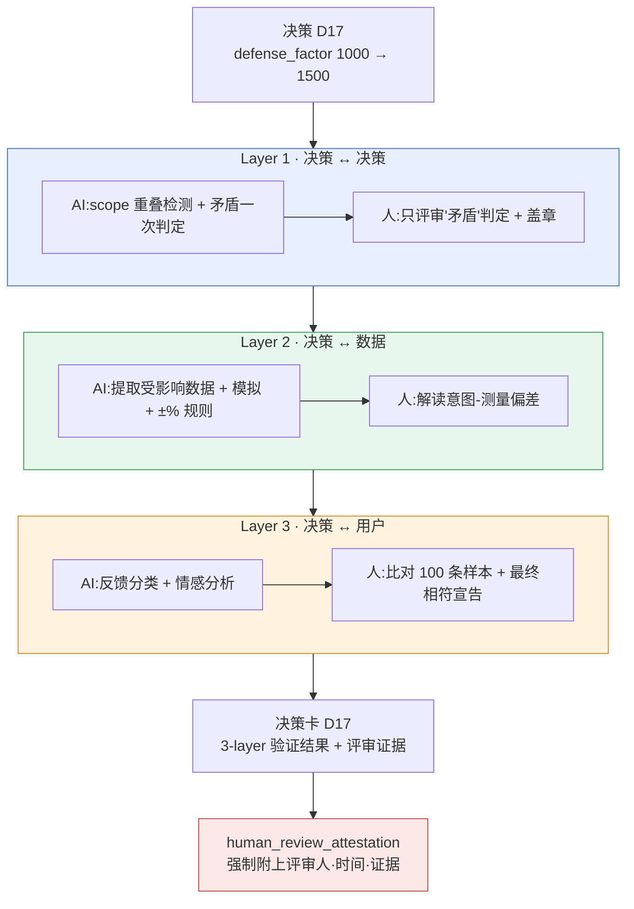

# 10.2 决策验证 3-layer 传感器 —— 人工评审证据的位置

晚上 11 点,nightly 任务往协作工具里插入了一张卡片。标题是 `[integrity] D17 相符度测量未执行 已过 7 天`。这条告警的意思是:一条应用了一周的决策,在"是否真的按意图生效"这一点上还没有任何人确认,却一直留在构建里。数据本身没问题。表格格式、外键(FK)、enum 都通过了。但决策没有得到验证。

这道落差正是本章的起点。即便数据完整无缺,决策仍可能出错,而捕捉这种错误的位置,与数据检查处在不同的地方。把这个位置分成三个层,并明确每一层中 AI 辅助到哪里、人在哪里盖章 —— 这就是决策验证 3-layer 传感器。

---

## 10.2.1 数据通过了,决策也可能是错的

`check` cascade 会一次性运行四类检查 —— doc-audit(文档一致性)、data-qa(数据质量)、integrity(完整性)、link(交叉引用断链)。这四项都通过,意味着"数据没问题"。但在没问题的数据之上,仍可能叠加着一条错误的决策。

奖励表格在格式上再完美,只要它的数值会引发通货膨胀;外键(FK)再唯一,只要两个任务在同一时刻占用同一个 NPC;voice 再一致,只要两个角色的关系设定相互矛盾 —— 数据检查全部通过,而决策却全部错误。数据检查看的是"格子是否填好了",决策检查看的是"这个值与其他决策、其他数据、真实用户是否相符"。用会计来打比方,前者是记账凭证的格式检查,后者是财务报表的一致性审计。

因此,决策验证要设置一个与数据验证**相互分离的传感器**。一旦捆在同一个检查里,就会被压成"通过/失败"一行,失败时到底是数据问题还是决策问题,解读起来就变得含糊。分离开来,责任才清晰。

---

## 10.2.2 三个层、三个时点、三类评审人

3-layer 传感器的核心,在于把验证的**维度**拆成三个。每一层所看的对象、运行的时点、AI 与人的分工都各不相同。



三个层的最后一道章都由人来盖 —— 这道章正是 `human_review_attestation_evidence_mandatory` atom 强制要求的证据。每一层看的是什么、由谁在哪里盖章,下面依次来看。

---

## 10.2.3 Layer 1 —— AI 筛选,人只评审"矛盾"

这一层检查新决策是否与既有决策相冲突。决策对的数量随决策数的平方增长,200 条决策就约有 2 万对。人无法用手全部看完。于是先由 AI 跑一遍初筛过滤。

```python
# decision_conflict_check.py —— Layer 1 传感器
def check_new_decision(new_decision, existing_decisions):
    conflicts = []
    for existing in existing_decisions:
        if has_overlap(new_decision.scope, existing.scope):   # 机械初筛:scope 交集
            verdict = llm_judge(new_decision, existing)        # AI 二次判定:矛盾/补充/无关
            if verdict.label == "矛盾":
                conflicts.append({
                    "with": existing.id,
                    "label": verdict.label,
                    "reason": verdict.reason,
                    "needs_human_review": True,                # 人工评审标志
                })
    return conflicts
```

`has_overlap` 是机械式的初筛过滤器。scope 是 atom 的领域(`combat`·`narrative`·`economy` 等),因此交集计算很精确。不重叠的对立即丢弃。2 万对通常会缩减到几十对。只有这几十对交给 AI 来看。

### 完整实操记录(worked transcript)—— Layer 1 矛盾判定

这里把实际往返的内容完整展示到底。不做摘要,含糊的输出也原样保留。

**① 人发出的提示词(全文)**

```
请判断下面两条决策是否相互矛盾。

[决策 A](2026-03-XX)战斗全局冷却统一为 0.5 秒,适用于所有技能
[决策 B](2026-04-XX)治疗类技能不适用全局冷却

判定格式(只用这个格式,禁止多余的话):
- label: 矛盾 | 补充 | 无关
- reason: 一行
- confidence: 0.0~1.0

不要猜测。依据薄弱时请调低 confidence。
```

**② Claude 的原始输出(未加工)**

```
- label: 补充
- reason: 决策 B 是在决策 A 所定的 0.5 秒统一规则上,追加"治疗类"这一明确例外的结构,并未推翻规则,而是将其收窄。
- confidence: 0.74
```

**③ 人的验证 / 否决**

判定是"补充",confidence 0.74。按规则,"补充·无关"是自动通过,但只要 confidence 低于 0.8,就要求人至少确认一行。负责评审的团队成员 A 重新读了决策 B 的原文,发现了一点 —— 决策 B 上附有一条但书:"但治疗类技能也有 1.2 秒的自身冷却"。AI 只收到了摘要后的一行,没能把这条但书作为输入拿到。团队成员 A 将 AI 的判定作**接受但补强**处理,并把"AI 所看到的输入不完整"记录了下来。

**④ 重新请求(补强输入后)**

```
[追加但书] 决策 B 上附有一个条件:"治疗技能免除全局冷却,但拥有 1.2 秒的
自身冷却"。请把这条但书纳入,重新判定。
```

```
- label: 补充
- reason: 自身冷却 1.2 秒比全局的 0.5 秒更长,因此治疗技能尽管被免除,
  反而拥有更长的间隔。与 A 的意图(防止乱放技能)不冲突,故补充关系得到加强。
- confidence: 0.91
```

判定依旧是"补充",但依据变得扎实,confidence 从 0.74→0.91。团队成员 A 在此盖了章。关键不在结果,而在**过程的记录** —— AI 一次判定、人发现的输入缺漏、补强后的重新请求、最终评审。这四个步骤原样录入决策卡的 Layer 1 证据栏。

这段实操记录的原则只有一条。**即便是 AI 的"补充·无关"判定,也不会无条件放行。**不是 AI 错了,而是 AI 拿到的信息不完整,而发现这一点的,是了解决策原文的人。

检查的时点有三处。新增决策时即时检查 + 告警,pending atom 晋升时先检查再晋升,nightly 对全部决策对重新检查。

---

## 10.2.4 Layer 2 —— AI 几乎全包,人负责解读偏差

这一层测量决策如何反映到数据上、又是否与意图相符。它最容易自动化,也最精确。只要模拟器和数据表已经就位,加上验证规则即可。

以决策 `D17`(defense_factor 1000→1500)为例,传感器会自动拉取 `CombatBalance` 表格、自动模拟结果以及受影响的角色数据,把意图(坦克生存 +49%)与测量(模拟 +52%)进行比较。相符判定的规则是定量的。

| 测量相对意图的偏差 | 处理 | 由谁 |
|---|---|---|
| ±10% 以内 | 相符(自动通过) | AI |
| ±10\~25% | 告警 · 复查 | 人来解读 |
| 超过 ±25% | 违规 · 必须重新审议决策 | 人来决定 |

这里人的角色不是"AI 说相符了,那就通过"。**解读告警区间与违规区间**才是人的工作。D17 的模拟为 +52%,落在 ±10% 之内,属于自动相符;但同一次模拟还吐出了一个附带效果 —— 混合型角色 `K_021` 在意图之外变强了 +28%。这并非 D17 的直接意图,因此不触发相符判定规则。规则上是通过的,在人眼里却是事故 —— 抓住这个区间,正是 Layer 2 中人存在的理由。

这一层的自动化率约 95%,是三层里最高的。之所以仍剩下 5%,正是因为这种解读。数字通过规则,与那个数字对游戏而言是否正确,是两个不同的问题。

---

## 10.2.5 Layer 3 —— AI 分类,人做最终相符宣告

三层里最难的一层。它看的是决策是否按意图作用到了真实用户身上。它以构建发布后 1\~2 周的实测指标(坦克平均生存时间、含坦克的 5:5 PvP 胜率)和自然语言反馈(论坛·社交媒体)作为输入。

自然语言反馈成为验证的输入,是这一层的特点。约 200 条论坛帖、约 1,500 条社交媒体内容,由 AI 分门别类并标注情感。

```
[AI 反馈分类 —— 坦克相关 1 周收集]
   正面 62%   负面 23%("坦克太强了"占多数)   无关 15%
```

在这里停下就是陷阱。AI 的情感分类一旦混入韩语和英语,准确度就会下降("坦克变强了哈哈"到底是正面还是讽刺,判定会摇摆)。因此运营规则规定:**每季度由人亲自分类 100 条样本,与 AI 的结果做比对。**若比对中的误差超过阈值,该季度的分类就不予采信,由人全量重新分类。

最终的相符宣告由人来做。就 D17 而言,实测 +44%(模拟预测 +52%,误差 8% —— 正常范围),反馈以正面为主。AI 整理并提交了"正面为主 + 落在意图范围内"这一输入,而**盖章判定为"相符"的是人**。自动化率约 70%,人占 30%。唯独这一层,完全自动在根本上不可能。因为用户的含义,机器无法一路判定到底。

---

## 10.2.6 人工评审证据不是可选项,而是强制项

如果三层的最后一道章都由人来盖,那么一旦缺少**这道章确实盖过的证据**,整个系统就会崩塌。有人只是嘴上说评审过、实际却没做,这种情况如何防范?在项目A中,atom `human_review_attestation_evidence_mandatory` 强制解决这一点。

这个 atom 的规则简单且不容妥协。**只要决策卡的任何一层发生了"AI 判定 → 人工评审",就必须在卡片上附上评审人标识、评审时间、评审证据(补强备注、否决理由、样本比对结果三者中至少一项)。证据一旦为空,该卡片就无法晋升为"验证完成"。**

证据为空时,`integrity_check_clickup_notify` atom 便会启动。它一旦检测到一致性失败 —— 这里指"评审章盖了,证据却没有" —— 就立即在协作工具里创建一张卡片。本章开头那张晚上 11 点的卡片,正是这套机制。

这两个 atom 结成一对,构成"对验证的验证"。3-layer 传感器验证决策,attestation atom 验证这道验证是否真由人做过,notify atom 抓出证据缺漏并予以通报。AI 的辅助再广泛,**责任的最后一格,也要由留下证据的那个人的名字**来填。

---

## 10.2.7 决策卡 —— 验证与证据汇集于一页之处

汇集三层结果与评审证据的单位,就是决策卡。一张卡片是一条决策的完结单元,并流向季度复盘的输入。下面是 D17 卡片的结构。

<svg viewBox="0 0 720 430" xmlns="http://www.w3.org/2000/svg" font-family="sans-serif" font-size="13">
  <rect x="10" y="10" width="700" height="410" rx="10" fill="#fafbfc" stroke="#888"/>
  <text x="30" y="40" font-size="16" font-weight="bold">决策卡 D17</text>
  <text x="30" y="62" fill="#555">变更:defense_factor 1000 → 1500   ·   应用 2026-03-XX</text>
  <line x1="30" y1="74" x2="690" y2="74" stroke="#ccc"/>

  <rect x="30" y="86" width="660" height="86" rx="6" fill="#e8f0ff" stroke="#4a72c0"/>
  <text x="42" y="106" font-weight="bold" fill="#2a4a90">Layer 1 · 决策一致</text>
  <text x="42" y="126">✓ 无矛盾决策   ·   与 7 条相邻决策为补充关系</text>
  <text x="42" y="146" fill="#b03a3a">证据:团队成员 A,2026-03-XX 14:20,输入缺漏补强备注 1 条</text>
  <text x="42" y="164" fill="#777" font-size="11">AI 一次判定 → 人工评审(confidence 0.74 → 补强后 0.91)</text>

  <rect x="30" y="180" width="660" height="78" rx="6" fill="#e8f7ed" stroke="#3a9a5a"/>
  <text x="42" y="200" font-weight="bold" fill="#1f6a3a">Layer 2 · 数据相符</text>
  <text x="42" y="220">✓ 模拟 +52% vs 意图 +49%(相符,±10% 内)</text>
  <text x="42" y="240" fill="#c07a1a">⚠ K_021 混合型意图之外 +28% —— 人工解读:需要后续决策</text>

  <rect x="30" y="266" width="660" height="78" rx="6" fill="#fff3e0" stroke="#d08a2a"/>
  <text x="42" y="286" font-weight="bold" fill="#9a5a10">Layer 3 · 用户相符</text>
  <text x="42" y="306">✓ 实测 +44% vs 模拟 +52%(误差 8%,正常)   ·   反馈以正面为主</text>
  <text x="42" y="326" fill="#b03a3a">证据:季度样本 100 条人工比对完成,AI 分类一致率 88%</text>

  <rect x="30" y="352" width="660" height="52" rx="6" fill="#fde8e8" stroke="#c04a4a"/>
  <text x="42" y="374" font-weight="bold" fill="#a02020">整体:✓ 相符(K_021 副作用后续决策已登记到协作工具)</text>
  <text x="42" y="394" fill="#777" font-size="11">attestation 验证:三个层均确认已附评审证据 → 允许卡片晋升</text>
</svg>

红色那几行是关键。每一层的"证据:"一行若为空,attestation atom 就会阻止卡片晋升,notify atom 则通知协作工具。半年后若有人问"当初为什么把 defense_factor 定为 1500",这一张卡片就能把意图、测量、实测乃至评审人一并答清楚。决策卡运行在与第18部分决策追踪 atom 相同的元数据流之上。

---

## 10.2.8 自动化率与引入顺序

三个层的自动化程度各不相同(分别约为 80%·95%·70%,如前几节所见)。三者都是部分自动、最后一道章也都由人来盖,但人的工作量整体上减少了 80% 以上。

引入从 Layer 2 开始。只要模拟和数据表已经就位,加上验证规则即可,1\~2 个月就能见效。接着是 Layer 1(基础设施投入少而效果大,再加 1 个月),最后是 Layer 3(基础设施投入最大,效果也最大,再加 2\~3 个月)。想从一开始就装上 Layer 3 而搁浅,是常见的失败。

> **关于数字标注**:上面的自动化率与下面的效果比例,是基于作者项目运营观察的**作者估计(未经验证)**。它们不是精密测量值,应当作方向与大致比例来读。相符判定规则的 ±10%/±25% 阈值是实际的运营规则,atom 名称(`integrity_check_clickup_notify`、`human_review_attestation_evidence_mandatory`)是真实存在的 atom。

引入前后的变化,按方向来概括是这样的。每季度的决策矛盾事故从若干件降到近乎 0 件;决策后 1 周的相符度测量执行率从少数升到大多数;事故发生前的副作用发现率从不足一半升到大多数。最有意义的变化是可追溯性 —— 事隔许久之后仍能回溯决策背景的比例,从少数变成了几乎全部。因为决策卡保存了游戏的决策历史。

---

## 10.2.9 常见失败

| 模式 | 处方 |
|---|---|
| 只运行 Layer 1(仅做矛盾检查) | 增设 Layer 2·3 来补齐维度 |
| 一开始就引入 Layer 3 | 从 Layer 2 起,按基础设施由小到大的顺序 |
| 不加批判地接受 AI 的"补充·无关"判定 | confidence 阈值 + 人工样本评审 |
| 只盖评审章却不附证据 | attestation atom 阻断晋升 |
| 无视证据缺漏的告警 | 把 notify atom 的协作工具卡片视为未完成 |
| 盲信用户反馈的 AI 分类 | 每季度人工比对 100 条样本 |

---

### 本章要点

- 数据完整与决策一致是不同的传感器。捆在同一个检查里,失败的解读就会含糊。
- 三个层都由 AI 辅助,但最后一道章由人来盖。只是维度不同,原则相同。
- 评审证据一旦为空,卡片就无法晋升。attestation atom 做的是"对验证的验证"。

---

### 动手试试 —— 单人精简版

**setup.** 把决策日志汇总到一个文件里(决策 id·scope·意图·应用日期)。scope 像 `combat`·`narrative`·`economy` 那样固定为 enum。若没有模拟器,Layer 2 也可以先从"相关数据表的手动比较"开始。

**prompt.** 每当出现新决策,就把它与既有决策逐对拿去问 AI。请固定格式。
```
请判断下面两条决策是否相互矛盾。
[决策 A] ...
[决策 B] ...
只输出格式:label(矛盾|补充|无关) / reason 一行 / confidence 0.0~1.0
禁止猜测。依据薄弱则调低 confidence。
```

**verify.** 对"矛盾"判定以及 confidence 低于 0.8 的判定,请由人重新读一遍决策原文加以确认。确认后,必须在决策卡上留下**评审人姓名·时间·备注(补强/否决/比对三者之一)**。证据栏一旦为空,就不要把那张卡片提升为"验证完成" —— 这一行就是 attestation atom 的单人版。哪怕是单人运营,也要为半年后的自己留下证据。
