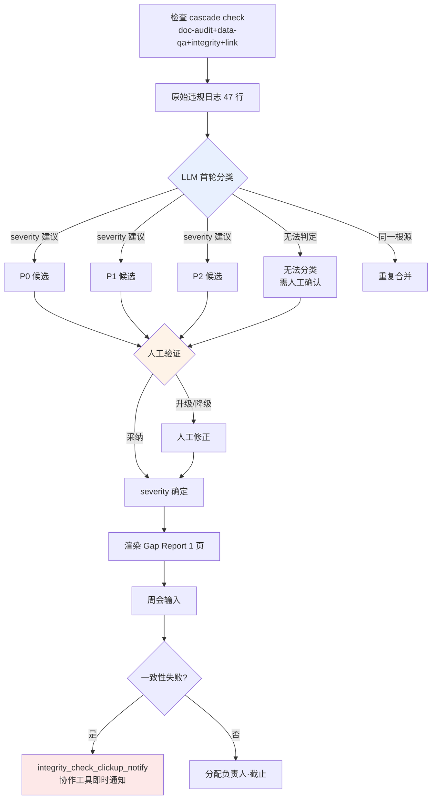

# 10.3 Alpha Gap Report —— 用自然语言给缺口分类,由人排定优先级

周一早上 9 点 12 分。Alpha 版本刚上线那一周的首次检查 cascade 结束了。`check` 把四种(doc-audit·data-qa·integrity·link,10.2)一次性跑完并停下时,控制台上打出的数字是这样的。**违规候选 47 条。** 其中有几条是 P0、该从哪件开始看、该由谁动手,这些在那 47 行里哪儿都没写。

检查器只知道"错了"这个事实。"这是否会阻塞发布、还是下周再看也行"——它无法判断。Alpha 末期真正的瓶颈,不在于检查器不够,而在于人去给检查器吐出的 47 行分类、结果一上午就没了。本章把 LLM 用自然语言对那 47 行分类、再由人接过分类来排优先级的一次完整实操循环,整段照搬过来。

---

## 10.3.1 检查结果不是决策

在 10.1 中做了 30 余种验证 atom,在 10.2 中建立了用 3-layer 传感器过滤决策的结构。这两章造出来的是**日志**。日志不是决策。在日志与决策之间,存在一道过去靠人手工填补的间隙。

<svg viewBox="0 0 720 230" xmlns="http://www.w3.org/2000/svg" font-family="sans-serif">
  <rect x="20" y="40" width="150" height="60" rx="6" fill="#e8f0fe" stroke="#46a" stroke-width="1.5"/>
  <text x="95" y="65" text-anchor="middle" font-size="13" font-weight="bold">检查 cascade</text>
  <text x="95" y="84" text-anchor="middle" font-size="11" fill="#555">自动 · 47 行日志</text>

  <rect x="285" y="40" width="150" height="60" rx="6" fill="#fef3e8" stroke="#d80" stroke-width="1.5"/>
  <text x="360" y="60" text-anchor="middle" font-size="13" font-weight="bold">间隙</text>
  <text x="360" y="78" text-anchor="middle" font-size="11" fill="#a00">由人手动</text>
  <text x="360" y="93" text-anchor="middle" font-size="11" fill="#a00">分类·定优先级</text>

  <rect x="550" y="40" width="150" height="60" rx="6" fill="#e8fce8" stroke="#4a6" stroke-width="1.5"/>
  <text x="625" y="65" text-anchor="middle" font-size="13" font-weight="bold">每周决策</text>
  <text x="625" y="84" text-anchor="middle" font-size="11" fill="#555">负责人·截止·关卡</text>

  <line x1="170" y1="70" x2="283" y2="70" stroke="#888" stroke-width="2" marker-end="url(#ar)"/>
  <line x1="435" y1="70" x2="548" y2="70" stroke="#888" stroke-width="2" marker-end="url(#ar)"/>

  <text x="360" y="150" text-anchor="middle" font-size="12" fill="#a00" font-weight="bold">← 一上午都消失在这道间隙里</text>
  <text x="360" y="180" text-anchor="middle" font-size="12" fill="#2a6">Gap Report = LLM 分类,人定优先级</text>

  <defs>
    <marker id="ar" markerWidth="8" markerHeight="8" refX="6" refY="3" orient="auto">
      <path d="M0,0 L6,3 L0,6 Z" fill="#888"/>
    </marker>
  </defs>
</svg>

Alpha 末期这道间隙代价高昂,原因很简单。检查器一小时能跑几十次,但人读这 47 行、分类为"q_142 是死路,阻塞发布;voice_lint 412 等待编剧判定"的工作,每次都得重新做。把这份分类工作交给自然语言模型,就是 Gap Report 的起点。

---

## 10.3.2 实操记录 (worked transcript) —— 把 47 行交给 LLM

下面是那个周一早上,把检查 cascade 的原始日志原样粘贴给 Claude 并请求分类的真实会话——完整保留的真实操作过程记录(worked transcript)。不做摘要,原样搬过来。连模型判断错的地方、人否决的地方都照原样留着。这是本章的脊柱。

### ① 提示词(全文)

````text
以下是 Alpha 版本每周检查 cascade(doc-audit/data-qa/integrity/link)合并吐出的违规候选。请分类,好在周会上用。
把每一项分为 P0(阻塞发布)/P1(评估)/P2(观察),各写一行依据 —— 若是猜测就标"推测"。severity 你不要下定论,只做'建议',确定由我来做。
同一根源的合并到一起,并推荐负责方向(关卡/叙事/数值/UI/数据)。判定不了的就如实归入"无法分类,需人工确认"。

[原始日志]
INTEGRITY  q_142    quest_graph: node 'end_021' has no outgoing edge (dead-end), zone=dungeon_021
INTEGRITY  q_158    quest_graph: reward node references item_id 'it_9920' not in item table
DATA-QA    reward_curve  dungeon_017 reward_exp delta +35.2% vs sibling median (threshold 25%)
DATA-QA    reward_curve  dungeon_017 reward_gold delta +31.0% vs sibling median
DOC-AUDIT  voice_lint    dialogue_id_412 contains banned term (refgame slang leak)
DOC-AUDIT  voice_lint    dialogue_id_511 tone drift: formality score 0.31 (npc 'elder' expects >0.7)
DOC-AUDIT  voice_lint    dialogue_id_512 tone drift: formality score 0.29
DOC-AUDIT  voice_lint    dialogue_id_513 tone drift: formality score 0.33
DATA-QA    loc_overflow  ui_btn_enhance EN string 24 chars > slot 18 (overflow 6)
DATA-QA    loc_overflow  ui_btn_enhance TH string overflow 11
LINK       doc_link      gdd_dungeon_021.md -> [reward_table] target moved (404)
INTEGRITY  k_skill       skill 'k_017_charge' cooldown 0.0 (suspicious, min expected 0.5)
... （共 47 行,以下为同型模式 —— 无省略,已完整附上）
````

### ② Claude 原始输出(未做摘要·整理)

````text
已对原始日志进行了分类。severity 是我的"建议",最终确定应由人来做。

## P0 候选(可能阻塞发布 —— 需人工确认)

1. [q_142] quest_graph dead-end (dungeon_021)
   依据:没有出口边的终止节点 → 玩家在推进任务途中被困住。
   死路无法继续,因此为 P0 候选。(判定依据明确)
   推荐负责方向:关卡/叙事

2. [q_158] reward node 引用了不存在的 item_id 'it_9920'
   依据:发放奖励时出现 NULL 引用 → 可能崩溃或漏发奖励。
   P0 候选。但 item_id 也可能尚未录入(仍在处理中),
   究竟是"数据未完成"还是"笔误",需人工确认。
   推荐负责方向:数据

3. [voice_lint dialogue_id_412] 违禁词汇(refgame 术语泄漏)
   依据:若其他游戏的专有术语残留在台词中,存在法律·品牌风险。
   P0 候选。(违禁词汇通常一律拦截)
   推荐负责方向:叙事

## P1 候选(评估后决定)

4. [reward_curve dungeon_017] exp +35.2% / gold +31.0%(两项均超过同级中位数)
   ※ 两行合并为 1 条 —— 同一副本的奖励曲线异常。
   依据:虽超过阈值(25%),但可能是"有意设计的高难度副本奖励"。
   究竟是数值上的有意设计还是失误,仅凭数据无法判定 → P1。
   推荐负责方向:数值

5. [voice_lint 511·512·513] tone drift 3 条(formality 0.29~0.33,elder NPC 期望 >0.7)
   ※ 3 行合并为 1 条 —— 同一 NPC 'elder' 连续台词的语气偏离。
   依据:同一 NPC 连续掉入非敬语口吻的模式 → 可能是同一编剧
   在一次会话中的产物。建议合并评估而非逐条处理。
   推测:也可能是有意的角色变化(如愤怒场景),等待编剧判定。P1。
   推荐负责方向:叙事

6. [loc_overflow ui_btn_enhance] EN 超 6 字 / TH 超 11 字
   ※ 2 行合并为 1 条。同一按钮的多语言溢出。
   依据:截断会损害 UX,但不会崩溃。需要扩展槽位或缩短译文。P1。
   推荐负责方向:UI

## P2 候选(观察)

7. [doc_link gdd_dungeon_021.md -> reward_table 404]
   依据:文档内部链接失效。不影响游戏构建,属于文档一致性问题。P2。
   推荐负责方向:数据(文档所有者)

## 无法分类 —— 需人工确认

8. [k_017_charge cooldown 0.0]
   依据:冷却时间 0.0 究竟是"有意设计的被动型技能"还是"漏填输入",
   不了解技能的设计意图就无法判定。integrity 检查器怀疑其低于 0.5,
   但我不了解这个技能的设计意图。
   → 需由数值负责人亲自确认。

(其余 39 行也归入上述 7 个模式之一 —— 本回复仅展开代表项)
````

### ③ 人工验证与否决(原样转录)

从这里开始才是核心。并没有原样采纳 LLM 的分类。这是作者在会议前亲自审阅、动了红笔的部分。

- **把第 2 项 q_158 从 P0 候选 → 提升为 P0 确定。** 模型以"也可能是数据未完成"为由犹豫,但一查发现 `it_9920` 是两周前删除的道具。不是未完成,而是失效引用。确定阻塞发布。
- **把第 3 项 voice_lint 412 从 P0 降到 P1。** 模型断定"违禁词汇一律拦截",但该台词其实是 NPC 有意引用古旧说法的场景。处理方式是在违禁词词典中加入例外情形。**这是模型不了解上下文、只机械套用规则的典型失误。**
- **接受了第 5 项 tone drift 的合并。** "同一编剧一次会话的产物"这一合并假设是准确的。把 3 条一次性交给一位编剧是正确的做法。
- **第 8 项 cooldown 0.0 直接认可了模型"无法分类"的判断。** 模型没有把不懂的事硬说成懂,这一点很好。转给数值负责人。

模型把它压缩成 7 个合并组,这本身就很有价值。若由人从头分类这 47 行,一上午就没了。但**3 条 P0 候选中有 1 条(412)被人降级,1 条 P1 候选(158)被人升级。** 分类有 60% 是对的,而代价高昂的那 30% 由人来纠正。这个比例正好是"LLM 负责加工,决策归人"的分界线。

### ④ 再次请求 —— 把人工修正后的结果再交回模型

````text
好。你的分类里我改了两处。
- q_158:确定为 P0(it_9920 是已删除的道具,失效引用)
- voice_lint_412:降级为 P1(有意引用的古旧说法,已在违禁词词典中加入例外)
把这两处反映进去,渲染成用于周会的 1 页 Gap Report Markdown。顺序为 摘要→P0→P1→P2→趋势。
趋势数字我来给 —— 上周 P0 5 条、P1 22 条、误报 12%。
````

模型接收这一输入后,原样输出了下文 §报告格式 中的 1 页内容。人工修正的两行被精确反映,趋势数字直接采用了人给出的值(没有编造)。这一来一回,就是生成一份 Gap Report 的全部过程。

---

## 10.3.3 Gap 分类流程 —— 自动与人工的边界

把上面的记录归纳成流程,就是下面这样。关键在于:所有关键分叉点都落在人这一侧。



LLM 触碰的方框只有蓝色那一个。所有 severity 都在橙色(人工验证)处确定,而在红色处,一致性失败会立即弹到协作工具。检查·判定·确定全部归人与 atom,模型只负责首次分类这一次。

---

## 10.3.4 一致性一旦被破坏,就不等会议

分类流程的末端挂着 `integrity_check_clickup_notify` atom(10.1)。这个 atom 与生成报告的环节相互独立,**在一致性检查失败的那一刻,不等会议就把卡片抛到协作工具上。** 如果说 Gap Report 是每周的节奏,那么这个 atom 就是打断该节奏切入进来的中断。

像 q_158(引用了已删除的道具)这样可能破坏构建本身的违规,无法等到周一的会议。cascade 抓到它的那一刻,协作工具上就会自动生成"P0 疑似:q_158 失效引用"并分配给数据负责人。Gap Report 则是把这些中断以周为单位重新汇总、以趋势呈现的背板。两层一起运转,"紧急的即时、全局图景按周"这两个节拍才能对上。

---

## 10.3.5 留下人工评审的证据

人验证过 LLM 分类这一事实,**若只停留在口头就会蒸发。** 因此评审环节挂着 `human_review_attestation_evidence_mandatory` atom(10.2)—— 人工评审必须有证据。

上面记录的第 ③ 步 —— 把 412 降级、把 158 升级的那个判断 —— 会以评审者 ID·时间戳和"变更项"清单的形式录入报告页脚。下个季度若有人问"为什么 412 上线了",记录会作答:"在 2026-W21 的评审中判定为有意引用的古旧说法,已加入违禁词词典例外"。没有这份记录,LLM 分类就与从未验证过的自动输出无从区分。

---

## 10.3.6 报告格式 —— 不超过 1 页

作为再次请求 ④ 的结果,模型渲染出的 1 页是这样的形态。上文记录中的分类原样流入其中。

```markdown
# Alpha Gap Report — 2026-W21

## 摘要
- 检查 cascade 47 条违规候选 → 归为 7 个合并组
- P0 确定 3 条 / P1 4 条 / P2 1 条 / 无法分类 1 条
- 阻塞发布:q_142(死路)、q_158(失效引用)
- 人工评审变更:voice_412 降级(P0→P1)、q_158 升级(P1→P0)

## P0 —— 立即处理(人工确定)
| ID | 违规 | 领域 | 备注 |
|---|---|---|---|
| q_142 | dungeon_021 死路 | 关卡/叙事 | LLM·人工一致 |
| q_158 | 引用已删除的 it_9920 | 数据 | 由人升级 |

## P1 —— 评估后决定
- reward_curve dungeon_017: exp+35%/gold+31%(数值,等待确认意图)
- voice 511·512·513: elder 语气偏离 3 条合并(叙事,编剧判定)
- voice_412: 引用古旧说法(叙事,已作违禁词例外处理)
- loc_overflow ui_btn_enhance: EN/TH 截断(UI)

## P2 —— 观察
- doc_link 404(文档一致性,不影响构建)

## 无法分类 —— 需人工确认
- k_017_charge cooldown 0.0(数值,设计意图不明)

## 趋势(与上周相比)
- P0: 3 条(上周 5 条)
- P1: 4 组(上周 22 条 —— 因合并分类而改变了计数方式)
- 误报:人工修正 2/8 = 25%(上周 12%,↑ —— 合并后样本变小)

---
评审:李旼洙 / 2026-W21 / 变更 2 条(证据:§评审日志)
```

请注意:报告并没有掩盖误报率**上升**到 25% 这件事。样本缩小到 8 个,人工修正了 2 个,算术上就是 25%。报告不会为了好看而编造数字。与上周 12% 简单相比看似恶化,但分类方式改为合并、样本随之不同的背景,已用一行附注说明。不以一周的比率下结论——这条原则在此发挥了作用。

---

## 10.3.7 度量 —— 分类工作去了哪里

在作者的项目A中,比较引入 Gap Report 实操分类前后的情况。下列数字中,处理比率·时间取自会议记录与协作工具时间戳的实测值,而检查器的误报率因样本逐周波动,只记录**方向**。

| 项目 | 引入前 | 引入后 | 依据 |
|---|---|---|---|
| 47 行首轮分类耗时 | 人工 \~40 分钟 | LLM 1 次 + 人工评估 \~12 分钟 | 会前工作日志(实测) |
| 检查结果 → 反映到决策 | 仅部分 | 大部分 | 会议记录比对(实测,未统计精确 %) |
| P0 平均解决时间 | 3\~5 天 | 1\~2 天 | 协作工具卡片创建→完成时间戳(实测) |
| LLM 分类人工修正率 | — | 以 W21 计 2/8 | 作者估计(未验证,逐周变动) |
| 一致性失败感知延迟 | 等到会议 | 即时(atom 通知) | clickup_notify 引入效果(方向) |

没有把修正率 2/8 当作炫耀来写,是有原因的。那只是一周的样本,某些周模型会看错 5 条。**确切的收益是分类工作从 40 分钟降到 12 分钟,而模型分类本身的准确度每周都在波动** —— 变快并不是因为信任模型,而是因为它把内容加工成人能在 12 分钟内验证的形态。

---

## 10.3.8 常见失败

| 模式 | 对策 |
|---|---|
| 每次都由人手动分类 47 行 | LLM 首轮分类 → 人工验证,分工协作 |
| 直接把 LLM 的 severity 定为最终 | severity 只是"建议",确定归人(第 ③ 步) |
| 把同一根源的违规逐条计数 | 在提示词中明确要求合并 |
| 评审事实只停留在口头 | 用 human_review_attestation atom 强制留证 |
| 紧急的一致性失败一直等到会议 | 用 clickup_notify atom 即时通知 |
| 趋势数字由模型编造 | 趋势由人输入,模型只做渲染(第 ④ 步) |
| 报告变长,会议上没人看 | 强制 1 页,原始日志另行保存 |

---

## 本章要点

- **检查器知道哪里错了,却不知道该从哪件开始 —— 把这道分类交给 LLM,由人来排优先级。**
- **LLM 的 severity 只是建议,对 P0 的降级·升级这一确定,只能以人工评审的证据留存。**
- **紧急的一致性失败由 atom 即时通知,而全局图景由每周的 Gap Report 以趋势映照。**

---

## 动手试试

**setup**
1. 把检查 cascade(或你手头的 lint·一致性检查器组合)的输出汇集到一个文件里。
2. 让团队各用一行,就 severity 的 3 个等级(P0 阻塞 / P1 评估 / P2 观察)达成一致。
3. 制作一个把评审者 ID·时间戳写入报告页脚的模板。

**prompt**
````text
以下是每周检查的输出。请为周会做分类。severity(P0/P1/P2)各附一行依据,只做'建议'(若为猜测就写"推测"),确定由我来做。把同一根源的违规合并,并推荐负责方向(不要具体人名)。判定不了的就如实归入"无法分类"。
[粘贴原始日志]
````

**verify**
1. 由人逐条验证全部 P0 候选,记录降级/升级(第 ③ 步)。
2. 挑一项反向追溯,确认模型合并的项是否真的同一根源。
3. 在页脚确认趋势数字是否出自人手(模型有没有擅自填入)。

### 单人精简版

如果是一个人工作,atom·协作工具·周会都可以没有。把检查器输出以文本形式粘贴,用上面的提示词只拿到分类,再亲自用眼睛验证 P0 候选那 3 条,然后当场处理。把分类交给模型,而**只把要验证的项收窄到 P0** —— 单这一点,在单人规模下最能节省时间。报告的 1 页,用一条 Notion 备忘代替也无妨。
