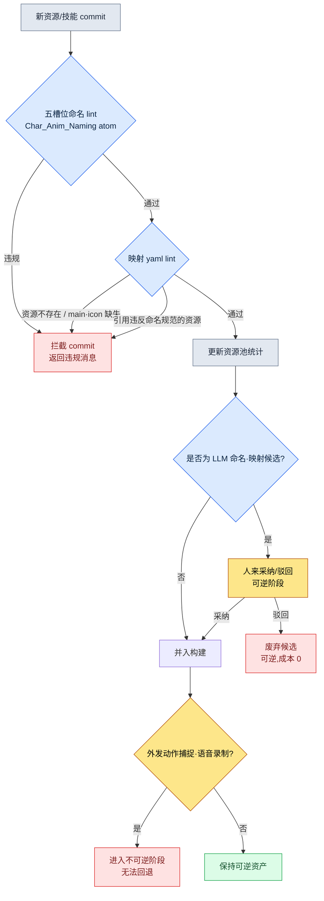

# 11.1 命名规范与技能-美术映射

冲刺(sprint)结束前两天,战斗美术师通过团队即时通讯工具发来一段短视频。新武士职业的三段连招。第一段和第二段都有刀风声,第三段却一点声音都没有。无声。他本人说声音都加好了,音效负责人说文件都交付了。两人都不是在说谎。声音文件确实在仓库里,名为 `combo3_swing_final_real.wav`。而游戏代码要找的名字是 `sfx_K012_combo3_swing.wav`。两者没有一个字符重合。

追查这起无声事故,花掉了那天整个下午。这不是某一个片段、某一个声音的问题。只要名字由人随意来起,这类事故每个季度都会重新冒出几十起。本章讲的就是把这种自由变成规则的故事。

> **本章要回答的问题**
> - 在 1万个资源的规模下,名字为什么不是自由而是规则
> - 把命名规范以 atom(最小知识单元)强制固化、并用 lint 自动校验后,能封住什么
> - 一个技能所挂的动画、VFX、音效、图标映射,由 AI 起草、由人采纳的实操记录

> **给非专业读者的一句话。** 1万个资源、fbx 文件名格式,看上去像是游戏行业特有的事情。但你要带走的那一点,并不挑领域——**"一旦名字可以随意起,检索、自动化、连接就会一起被锁死。"** 规模一大,命名就必须从个人偏好变成规则,而只有成为规则的名字,代码才能自动找到并使用——这个原则,适用于任何处理文档、资产、客户记录的工作。

---

## 11.1.1 1万个资源这个规模

笔者所主导的项目A是一款移动优先的 MMORPG。角色动画资源的大致规模如下。玩家职业数量、敌方 NPC 种类是实际运营数值,片段数量与总量估计为笔者估算(未经验证)。

| 资源 | 数量 |
|---|---|
| 玩家角色职业 | 6 |
| 敌方 NPC 种类 | 80\~100 |
| 单个角色平均片段 | 100\~150(笔者估算) |
| 片段总量估计 | 约 10,000\~15,000(笔者估算) |

1万个。这相当于 1万个抽屉。站在 1万个没有贴标签的抽屉前找"攻击动作放哪儿了",等于把赌注押在人的记忆力上。而这个赌注一定会输。找不到,结果只有两种。要么工作时间翻倍,要么因为没找到而把同一个动作重新做一遍。后者更糟。因为资源会变得臃肿,而且日后同一个动作会以两个略有差异的版本到处流动。

名字若处于自由地带,被锁死的不只是检索。"由代码凭技能 ID 自动取到动画文件"的自动路由也会一起被锁死。如果无法从名字里读出规则,代码就必须为每一个技能都握着一张手写的映射表,记录该用哪个文件。每进来一个新角色,这张表就得靠人手动加长。

---

## 11.1.2 五槽位命名格式 —— 固化为 atom

项目A的动画文件名固定为五个槽位。

```
<role>_<id>_<category>_<action>_<variant>.fbx

char_K001_idle_default_v1.fbx
char_K001_locomotion_walk_forward.fbx
char_K001_combat_attack_combo1_v2.fbx
char_K001_react_hit_heavy.fbx
enemy_E021_combat_skill_aoe_v1.fbx
```

五个槽位都遵循既定的 enum。允许自由输入的槽位只有 `id` 一个,而且这个槽位也被约束为 `[A-Z]\d{3}` 格式。

| 槽位 | enum 数量 | 示例 |
|---|---|---|
| role | 4 | char, enemy, pet, mount |
| id | 格式固定 | K001, E021, P003, M005 |
| category | 8 | idle, locomotion, combat, react, death, social, cinematic, system |
| action | 每个类别 10\~30 | walk, run, attack, skill_aoe, hit_heavy |
| variant | 格式固定 | default, v1, v2, _short, _long |

这里的关键不是格式本身,而是把格式输入(存放)在哪里。如果把命名规范写在一页 wiki 文档里,那就是一张没人读的标签。笔者把这套规范做成了名为 `Char_Anim_Naming_Convention` 的单一事实源(single source of truth)atom,让人、lint、LLM 全都只盯着这一个 atom。当格式不再是文档、而是被固化为 atom 的那一刻,命名的性质就从"建议事项"变成了"必须通过的关卡"。

`action` 槽位的 enum 可能无限膨胀,这是它的弱点。因此要按类别用一部字典来管理标准 action。

```yaml
combat:
  - attack_basic
  - attack_combo1
  - attack_combo2
  - skill_<skill_id>
  - parry
  - dodge_forward
  - dodge_back
react:
  - hit_light
  - hit_heavy
  - knockback
  - stagger
  - stun
locomotion:
  - idle
  - walk_forward
  - run_forward
  - sprint
  - jump_start
  - jump_loop
  - jump_land
```

是否把新 action 加入字典,由一套流程来判断。每个季度是否有 3 个以上角色会用到,用现有 action 是否真的表达不出来,类别是否明确,以及最重要的一点——是否可以用 variant 吸收掉。只要能用 variant 处理,就不新增 action。action 字典保持在 100 个以内,是运营健康的信号。不过这并不当作绝对上限。新类型或新职业进来时,一次可能就增加 30\~40 个。要拦住的不是数字,而是无节制的增殖。

---

## 11.1.3 lint 拦下提交

把格式输入为 atom 之后,就需要一个自动强制执行该 atom 的校验器。人不可能每次都用肉眼去检查五个槽位。下面就是这个 lint 的骨干。

```python
# anim_naming_lint.py
import re, yaml

NAMING_PATTERN = re.compile(
    r"^(?P<role>char|enemy|pet|mount)_"
    r"(?P<id>[A-Z]\d{3})_"
    r"(?P<category>idle|locomotion|combat|react|death|social|cinematic|system)_"
    r"(?P<action>[a-z_]+?)"
    r"(?:_(?P<variant>v\d+|short|long|light|heavy|left|right|forward|back))?"
    r"\.fbx$"
)

ACTION_DICT = yaml.safe_load(open("char_anim_naming_convention.yaml"))

def check(filename):
    m = NAMING_PATTERN.match(filename)
    if not m:
        return f"命名规则违规(5槽位格式不匹配): {filename}"

    category, action = m.group("category"), m.group("action")
    # skill_<id> 形式是动态 action,因此只检查 prefix
    base = "skill" if action.startswith("skill_") else action
    if base not in ACTION_DICT.get(category, []):
        return f"不在 action enum 内({category}): {action}"

    return None
```

新的 fbx 一进入仓库,这个检查就会运行。若违规,提交(commit)就会被拦下。这里重要的一点是,不把违规归咎于人。与其责怪造成无声事故的美术师,不如把责任推给工具——"那个名字本就不该被提交进来"。人会犯错,工具去拦住这个错误。这就是命名系统的基本姿态。

命名一旦被强制,作为回报,自动路由就被打通了。

```python
def play_skill_animation(character, skill_id):
    anim_path = f"char_{character.id}_combat_skill_{skill_id}.fbx"
    if not exists(anim_path):
        anim_path = f"char_{character.id}_combat_skill_default.fbx"  # fallback
    play(anim_path)
```

手写的映射表消失了。即便进来新角色、新技能,只要按规范添加动画文件,代码一行都不用改。回到那起无声事故——如果那个声音文件只能以 `sfx_K012_combo3_swing.wav` 这个规范名字进来,那么 `combo3_swing_final_real.wav` 一开始就会在提交阶段被弹回,那天整个下午也就保住了。

variant 槽位是守住 action enum 的安全阀。同一动作的版本(v1、v2)、长度(_short、_long)、强度(_light、_heavy)、方向(_forward、_back)全部由 variant 吸收,从而不必让 action 细分,而是把它们接住。而游戏代码可以根据上下文来选用这个 variant。

```python
def select_variant(base_action, context):
    if context.distance < 3:
        return f"{base_action}_short"
    if context.distance > 10:
        return f"{base_action}_long"
    return base_action
```

这等于说,命名规范成了代码的分支点。

---

## 11.1.4 一个技能十个资源 —— 映射 yaml

如果说命名是 L1,那么连接技能与资源的映射就是 L2。一个技能通常会牵着 2\~3 个动画、1\~3 个 VFX、2\~5 个音效、1 个 UI 图标。平均下来是 10 个资源。200 个技能就是约 2,000 个映射对象。靠人脑管理这个规模是不可能的。因此为每个技能设一份 yaml,把该技能的资源绑定为只从这一份里读取。

```yaml
---
skill_id: skill_K001_combo1
description: K001 连招1(三段连续)
type: melee_combo
animations:
  - clip: char_K001_combat_attack_combo1_v2.fbx
    role: main
    bone_alignment: spine_03
vfx:
  - asset: vfx_K001_combo1_slash.vfx
    socket: weapon_tip
    timing_ms: [0, 150, 300]
  - asset: vfx_hit_blood_light.vfx
    socket: target
    timing_ms: [150]
sound:
  - asset: sfx_K001_combo1_swing.wav
    volume: 0.8
    timing_ms: 0
  - asset: sfx_hit_metal_light.wav
    volume: 0.6
    timing_ms: 150
ui_icon: icon_skill_K001_combo1.png
ui_tooltip_key: skill_K001_combo1_tooltip
verified: true
---
```

这一份就是一个技能的全部资源。而这份 yaml 里所有的资源路径都遵循 11.1 的五槽位规范。命名 lint 一垮,这套映射也跟着垮。两层作为一对协同运作。

映射一旦集中到一处,影响追踪就自动被打通。当你想彻底替换某一个 VFX 时,不必再靠人手翻查它会影响到哪些技能。

```python
def find_skills_using(asset):
    affected = []
    for path in glob("skills/*.yaml"):
        skill = yaml.safe_load(open(path))
        for cat in ("vfx", "sound", "animations"):
            for entry in skill.get(cat, []):
                if entry.get("asset") == asset or entry.get("clip") == asset:
                    affected.append(skill["skill_id"])
    return affected

# find_skills_using("vfx_hit_blood_light.vfx")
# → ["skill_K001_combo1", "skill_K005_combo2", "skill_E021_attack_basic", ...]
```

在资源替换会议上,受影响的技能清单会自动附上。在"改了这个会影响到哪儿?"这个问题被问出来之前,答案就已经摆在会议记录旁边了。

映射也配有 lint。所有资源文件是否真实存在,animations.main 与 ui_icon 是否各有一个,timing_ms 是否落在动画时长之内,以及——所有资源路径是否都通过 11.1 的命名规范。最后一项就是把两层钉在一起的那根钉子。构建时自动运行。

---

## 11.1.5 命名·映射的校验流程

把到目前为止的命名 lint 与映射 lint 如何汇成一道关卡,用流程图梳理一下。



请注意,这条流程的末端有一道可逆/不可逆的边界。yaml 修改、LLM 候选、关键帧,这些全都是可逆的。不满意就废弃即可,成本几乎为 0。然而一旦进入动作捕捉拍摄、配音演员录音、标志性嗓音选角,就变成不可逆了。这牵涉到演员与录音棚的预约、录音间、合同、市场认知。因此,所有命名、映射、人格设定(persona)的决策,都必须在不可逆阶段之前——也就是在 yaml、LLM 候选、关键帧这一可逆区域之内完成。

---

## 11.1.6 实操记录 —— 把新技能映射初稿交给 AI

到这里为止讲的是系统,现在原封不动地展示一段真实会话,看 AI 究竟在哪里介入——这就是实操记录(worked transcript,完整保留下来的真实操作过程记录)。这一幕,是让 LLM 为新火焰技能 `skill_K012_flame_burst` 起草资源映射初稿。

**提示词(全文):**

```
以下是我们项目的角色动画命名规范(atom)、现有资源池统计,
以及一份相似技能的 yaml。

[命名规范]
<role>_<id>_<category>_<action>_<variant>.fbx
role: char|enemy|pet|mount / category: idle|locomotion|combat|react|death|social|cinematic|system

[资源池 TOP 使用资源]
sfx_hit_metal_light.wav (47 个技能), vfx_dust_kickup.vfx (38 个技能),
vfx_fire_burst_med.vfx (22 个技能), sfx_fire_whoosh.wav (19 个技能)

[相似技能 yaml]
skill_id: skill_K005_fire_slash / type: melee_fire
animations: [char_K005_combat_attack_fire_v1.fbx]
vfx: [vfx_K005_fire_slash.vfx, vfx_fire_burst_med.vfx]
sound: [sfx_K005_fire_swing.wav, sfx_fire_whoosh.wav]

新技能: skill_K012_flame_burst (K012 武士, 范围火焰爆发, 单段)
请编写这个技能的映射 yaml 初稿。尽量复用现有资源池,
对需要新制作的资源用 [NEW] 标签标注。
```

**Claude 原始输出(未作摘要·整理):**

```yaml
skill_id: skill_K012_flame_burst
description: K012 武士 范围火焰爆发 (单段)
type: aoe_fire
animations:
  - clip: char_K012_combat_skill_flame_burst_v1.fbx   # [NEW] 需要新建动作
    role: main
    bone_alignment: spine_03
vfx:
  - asset: vfx_fire_burst_med.vfx     # 复用 (资源池 22 个技能)
    socket: ground
    timing_ms: [200]
  - asset: vfx_K012_flame_ring.vfx    # [NEW] 表现范围用的新建资源
    socket: ground
    timing_ms: [200, 350]
sound:
  - asset: sfx_fire_whoosh.wav        # 复用 (资源池 19 个技能)
    volume: 0.8
    timing_ms: 0
  - asset: sfx_explosion_low.wav      # [NEW] 推测为新建爆炸音
    volume: 0.9
    timing_ms: 200
ui_icon: icon_skill_K012_flame_burst.png   # [NEW]
ui_tooltip_key: skill_K012_flame_burst_tooltip
verified: false
```

> 备注:在 `char_K012_combat_skill_flame_burst_v1.fbx` 中,action 是
> `skill_flame_burst`,但按命名规范,skill action 应为 `skill_<skill_id>`
> 格式,是否正确需确认。规范里没有明确说明该用 `skill_K012` 还是
> `skill_flame_burst`,因此这里做了推测。

**人工验证/驳回:**

最后那条备注精准地点出了弱点。并不是 LLM 不懂,而是规范 atom 里那个槽位的格式写得含糊。实际上,项目A 的规范用的是 `skill_<skill_id>` 格式。因此正确的文件名是 `char_K012_combat_skill_K012_v1.fbx`。LLM 生成的 `skill_flame_burst` 被驳回。而 `sfx_explosion_low.wav` 虽被标为 [NEW],但重新查看资源池后发现,`sfx_impact_heavy.wav` 已经在 47 个技能里被当作爆炸音使用。因为给 LLM 的资源池统计只到 TOP 4,所以漏掉了。于是把新制作改为复用。

**再次请求:**

```
按以下两点修改后重新编写。
1. skill action 的格式是 skill_<skill_id>。K012 技能对应的 action 就是 skill_K012。
2. 资源池里有 sfx_impact_heavy.wav (47 个技能, 爆炸/冲击音)。
   请复用它,而不是新制作 sfx_explosion_low.wav。
完整的资源池统计如下。[附全部 38 种]
```

在这一轮循环里,LLM 做的是"像模像样的初稿",人做的是"发现规范的含糊之处、发现资源池遗漏、做出复用决策"。LLM 有一种倾向,太容易把资源候选标成 [NEW],所以复用判断始终握在人手里。不过,从空白页面从头写 yaml,和拿到一份可采纳/可驳回的初稿再修改,两者的工作负担并不一样。

---

## 11.1.7 从保守到进步 —— 人只负责采纳的阶段

上面这段记录,正是进步式应用的一个场景。命名·映射的运营分为两个阶段。

在保守阶段,由人来赋予命名、编排映射,自动化只负责校验(lint)与追踪(`find_skills_using`)。目前大多数 MMORPG 的角色·资源运营都停在这里。在进步阶段,命名初稿、映射初稿,乃至 NPC 人格设定的生成,都由 LLM 给出候选,留在人手里的决策收窄为"采纳哪个候选"这一件。

进步阶段要站稳脚跟,需要具备三样东西。第一是命名规范的 lint 引擎。LLM 给出的命名候选,也要和人写的一样通过五槽位 lint,才会被采纳。上面记录中 LLM 的 `skill_flame_burst` 被驳回,靠的就是这道关卡。第二是 NPC 人格设定的自动生成器。只要把角色 yaml 拆解为 voice_profile·anim_set·skill_set 三条轴,LLM 就能接收"五十多岁武士、沉稳、低嗓音"这样的描述,分别为三条轴各自给出候选。为 100 个 NPC 从零编排三条轴,和在每个人格的几个候选里挑选,负担并不相同。第三是映射候选的生成器。它是 `find_skills_using` 的反方向——把"适合这个新技能的现有资源"检索与资源池统计绑在一起,按槽位给出复用候选。这是既降低新制作成本、又提高复用率的双向效果。

三个要素都跑在同一套基础设施(yaml·lint·资源池统计)之上。只有当命名规范与映射 yaml 对齐为单一事实源时它们才运转,一旦对齐崩坏,连给 LLM 的输入本身都不存在了。

值得一提的是,这三个要素在 2010 年代理论上也是可行的。卡住的有三处。无法用自然语言理解一个动作是什么,因而给不出五槽位候选;把 voice·anim·skill 分开再组合,当时属于人的直觉领域;想用文字描述去找"感觉相似的 VFX"也很困难。2023 年以后,随着 LLM 的发展,这三处都进入了可以辅助的范围。原本只停留在纸面上的进步式角色资源化愿景,相当一部分已经移到了可以实务应用的阶段。

---

## 11.1.8 度量 —— 引入前后

这是项目A 命名·映射引入前后的对比。检索时间与新人上手周期是笔者实际体感·记录到的走向,比例类项目是季度复盘中汇总的实测值。需要说明,部分绝对数值为笔者估算(未经验证)。

| 项目 | 引入前 | 引入后 |
|---|---|---|
| 动作检索时间(动画师) | 5\~10 分钟 | 30 秒 |
| 重复制作比例 | 12\~15% | 1\~2% |
| 新角色路由代码改动 | 50\~100 行 | 0 行 |
| 新技能资源缺失事故 | 每季度 5\~8 起 | 0\~1 起 |
| 未使用资源积压(库中占比) | 约 30% | 约 8% |
| 新动画师上手 | 2 周 | 3 天 |

最后一项最不起眼,却是效果最大的。一个命名规范 atom,本身就成了上手指南。对新动画师只要一句"名字就按这五个槽位来起,lint 拦你就听 lint 的",第一天就能开始干活。

---

## 11.1.9 常见的失败

| 模式 | 处方 |
|---|---|
| 命名规范只放在 wiki 文档里 | 固化为单一 atom + lint 强制 |
| action enum 无限增殖 | 字典 + 新增流程 |
| 未经命名校验就提交 | 用自动 lint 拦截提交 |
| 在代码里硬编码映射表 | 基于命名的自动路由 |
| 不用 variant 而让 action 细分 | 用 variant 槽位吸收 |
| 资源映射分散在代码·表格·文档中 | 统一到一份 yaml 文件 |
| 未经校验就采纳 LLM 映射候选 | 命名 lint + 人工复用判断 |
| 把命名违规归为人的责任 | 加强 lint,把责任交给工具 |

---

### 本章要点
- 在 1万个资源的规模下,名字不是创作者的自由,而是必须通过的关卡
- 把命名规范输入为 atom 并用 lint 强制,自动路由与映射就被打通
- LLM 给出命名·映射初稿,人只判断采纳与复用

### 动手试试

**setup** —— 把动画文件名定义为 `<role>_<id>_<category>_<action>_<variant>.fbx` 五个槽位,并把各类别的 action 字典汇集到一份 yaml 文件里。把这份 yaml 声明为团队的单一事实源。

**prompt** —— 给 LLM "[命名规范 yaml] + [资源池统计] + [相似技能 yaml 1 份]",请它给出新技能的映射 yaml 初稿。明确要求它区分复用资源与新制作资源([NEW] 标签)。

**verify** —— 让 LLM 输出的所有资源路径都通过命名 lint(即上文的 `anim_naming_lint.py`)。通不过就驳回。通过的候选中带 [NEW] 标签的,由人重新翻查资源池,判断是否可以复用。

### 单人精简版
- 不用 atom,在一页 README 里写下五槽位规范与 action 字典。
- lint 就用 `anim_naming_lint.py` 一个文件挂到 git pre-commit hook 上。
- 技能数量少时,不用映射 yaml,先用一张电子表格(技能为行 × 资源为列)开始,等超过 200 个时再迁移到 yaml。
- LLM 映射初稿用免费/低价模型也足够。关键在于人握住 lint 与复用判断。

### 下一章预告
- 11.2 宠物·坐骑系统 —— 在照搬角色模式就会过度的领域里,用模板+实例 90% 共享的结构,让 AI 批量生产实例、由 lint 校验的变奏
