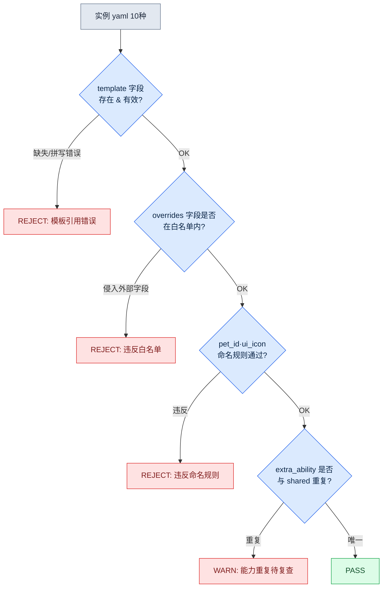

# 11.2 宠物·坐骑系统 —— 从1种模板到50种实例

策划会议一开始,宠物清单就摆上了台面。狼系十二种、猫系八种、鸟系五种。没有人说"那我们一只一只地做吧"。因为与角色不同,宠物从一开始就以"要量产50种"为前提。问题不是"如何把一种做好",而是从"让多少种共享同一副已做好的骨骼"开始。

角色的每一种对用户来说都是独一无二的存在,因此要一种一种地精心打磨。而宠物·坐骑大多是"在同一副骨骼上只改颜色和能力的变体",所以从设计之初就要备好命名规范·模板·lint,铺设量产管线。若把一种精心做好之后,任由它被复制成十二份,那么只是颜色不同的十二只狼就会各自塞进相同的动画片段,文件夹膨胀到4GB。那不是量产,而是没有量产的结果。核心不在于"做得多好",而在于"尽量少做、尽量多共享"。

因此本章会完整走一遍这样一个流程:用 yaml 定义一种狼系宠物模板,让 AI 量产继承其骨骼的实例,再用 lint 验证,并测量有百分之多少被废弃。

## 11.2.1 模板与实例的分离

三者的资源结构相似,但在用户认知中的比重不同。角色是用户与之共度100%游戏时间的自己。宠物是陪在身边的同伴,占50\~70%的时间;坐骑则是只在移动时才拿出来的工具,停留在10\~20%。认知比重越低,用户越少留意细节。把倾注在角色上的心力同样倾注到坐骑上,就像用同一份预算去打理每天都坐的书桌和偶尔才展开的折叠椅。

因此宠物·坐骑采用"模板-实例"结构来运作。先做出一种承载骨骼·动作·基础能力的**模板**,再在其上叠加只改颜色·图标·细微能力的**实例**。实例共享模板所拥有资源的90%,所以实际新做的只有剩下的10%。把这种分离画成图,如下所示。

<svg viewBox="0 0 720 300" xmlns="http://www.w3.org/2000/svg" font-family="sans-serif" font-size="13">
  <rect x="20" y="20" width="200" height="260" rx="8" fill="#eef3fb" stroke="#3b6ea5" stroke-width="2"/>
  <text x="120" y="45" text-anchor="middle" font-weight="bold" fill="#1f3b5c">模板（1种）</text>
  <text x="120" y="68" text-anchor="middle" fill="#1f3b5c">pet_template_canine</text>
  <rect x="40" y="85" width="160" height="28" rx="4" fill="#fff" stroke="#3b6ea5"/>
  <text x="120" y="104" text-anchor="middle">骨骼 skeleton</text>
  <rect x="40" y="120" width="160" height="28" rx="4" fill="#fff" stroke="#3b6ea5"/>
  <text x="120" y="139" text-anchor="middle">共享动画4种</text>
  <rect x="40" y="155" width="160" height="28" rx="4" fill="#fff" stroke="#3b6ea5"/>
  <text x="120" y="174" text-anchor="middle">共享能力2种</text>
  <rect x="40" y="190" width="160" height="28" rx="4" fill="#fff" stroke="#3b6ea5"/>
  <text x="120" y="209" text-anchor="middle">基础 BT</text>
  <text x="120" y="250" text-anchor="middle" fill="#888" font-size="11">资源90%（只制作一次）</text>

  <line x1="220" y1="150" x2="300" y2="80" stroke="#888" stroke-width="1.5"/>
  <line x1="220" y1="150" x2="300" y2="150" stroke="#888" stroke-width="1.5"/>
  <line x1="220" y1="150" x2="300" y2="220" stroke="#888" stroke-width="1.5"/>

  <rect x="300" y="55" width="380" height="50" rx="6" fill="#f3f9ee" stroke="#5a8f3c" stroke-width="1.5"/>
  <text x="315" y="78" font-weight="bold" fill="#2f5320">pet_P003（灰狼）</text>
  <text x="315" y="96" fill="#555" font-size="11">override: skin=gray, icon, 能力1种</text>

  <rect x="300" y="125" width="380" height="50" rx="6" fill="#f3f9ee" stroke="#5a8f3c" stroke-width="1.5"/>
  <text x="315" y="148" font-weight="bold" fill="#2f5320">pet_P004（黑狼）</text>
  <text x="315" y="166" fill="#555" font-size="11">override: skin=black, icon, 能力1种</text>

  <rect x="300" y="195" width="380" height="50" rx="6" fill="#f3f9ee" stroke="#5a8f3c" stroke-width="1.5"/>
  <text x="315" y="218" font-weight="bold" fill="#2f5320">pet_P005（雪狼）……直到 P012</text>
  <text x="315" y="236" fill="#555" font-size="11">override: skin=snow, icon, 能力1种 —— 仅10%资源为新增</text>
</svg>

左侧的模板整块只做一次,右侧的各个实例只需替换颜色、图标和一行能力即可。前面说的"4GB 文件夹",正是漏掉这层分离、90%的资源被复制十二次时出现的景象。

## 11.2.2 命名与资源样式 —— 从角色减去一格

宠物·坐骑的命名规范,是在11.1的角色命名基础上减去一个槽位的形式。角色使用 `char_<id>_<category>_<action>_<variant>` 5个槽位,而宠物·坐骑省略 variant,采用4个槽位。若需要 variant,则合并进 action。

```
pet_<id>_<category>_<action>.fbx
mount_<id>_<category>_<action>.fbx

例:
pet_P003_idle_default.fbx
pet_P003_combat_bite.fbx
mount_M005_locomotion_run.fbx
```

资源映射 yaml 也从角色样式中减去 vfx·sound 槽位,做得更轻。若实例整块保留这些槽位,就会变成满是空格的样式,让 lint 每次都发出无谓的警告。

现在进入正题。我们来定义一种狼系模板,并由此量产实例。

## 11.2.3 实操记录:1种模板 → 量产实例 → lint → 废弃率

### 第1步 —— 手动编写模板 yaml

在让 AI 量产之前,先由人手动敲定一种模板。这一种会成为数十种实例的质量基准,所以不自动化。狼系(canine)模板是这样定的。

```yaml
# pet_template_canine.yaml
template_id: pet_template_canine
skeleton: skel_quadruped_medium      # 四足中型公用骨骼
shared_animations:
  - clip: pet_template_canine_idle_default.fbx
  - clip: pet_template_canine_locomotion_walk.fbx
  - clip: pet_template_canine_locomotion_run.fbx
  - clip: pet_template_canine_combat_bite.fbx
shared_abilities:
  - id: pet_template_canine_passive_speed
    description: 同伴移动速度 +3%
  - id: pet_template_canine_active_bite
    description: 单体目标撕咬，冷却时间 12s
bt_ref: bt_pet_canine_default        # 跟随 + 战斗辅助的基础 BT
instance_overridable:                # 实例可以修改的字段白名单
  - visual_skin
  - ui_icon
  - ui_tooltip_key
  - extra_ability                    # 每个实例最多可追加1种能力
```

这里的 `instance_overridable` 是核心机制。它用白名单钉死实例可以改动的字段。AI 在量产途中若擅自改动骨骼或共享动画,就等于碰了不在这份清单里的字段,于是 lint 会揪出来。先定义"可以改的东西",正是量产的安全带。

### 第2步 —— 请 AI 量产实例（提示词全文）

以下是量产10种实例所用的提示词全文。不作摘要,原样刊出。

```
[提示词]
你是协助编写宠物数据的助手。请以下面的模板为基准,
生成10种狼系宠物实例的 yaml。

[模板] pet_template_canine.yaml
(粘贴上面的 yaml 全文)

[规则]
1. 每个实例都必须明确写出 template: pet_template_canine。
2. overrides 中只放入 instance_overridable 白名单里的字段。
   白名单里没有的字段(skeleton、shared_animations 等)绝不改动。
3. visual_skin 必须是狼的自然变体(颜色·花纹·体型)。
4. extra_ability 每个实例最多1种。passive 或 active 二选一。
   不得与既有的 shared_abilities 效果重复。
5. ui_icon、ui_tooltip_key 遵循与 pet_id 匹配的命名规则。
6. pet_id 赋值为 pet_P003 ~ pet_P012。

输出仅限10个 yaml 块。不要附加说明文字。
```

规则2与第1步的白名单相互配对。规则4的"不得重复"是防止 AI 偷懒复制能力的约束。若不加这类约束,后文会看到,AI 会收敛到最安全的选项(照搬既有能力)。

### 第3步 —— Claude 的原始输出（不作摘要·改写）

从 AI 吐出的输出中,把成功·失败·模棱两可混在一起的原样摘录出来。不作整洁修饰。

```yaml
# 输出 1 —— 正常
pet_id: pet_P003
template: pet_template_canine
overrides:
  visual_skin: wolf_gray
  ui_icon: icon_pet_P003.png
  ui_tooltip_key: pet_P003_tooltip
  extra_ability:
    id: pet_P003_active_howl
    description: 5秒内敌人移动速度 -20%，冷却时间 30s

# 输出 2 —— 正常
pet_id: pet_P004
template: pet_template_canine
overrides:
  visual_skin: wolf_black
  ui_icon: icon_pet_P004.png
  ui_tooltip_key: pet_P004_tooltip
  extra_ability:
    id: pet_P004_passive_crit
    description: 同伴暴击率 +2%

# 输出 5 —— 模棱两可（能力与共享能力实质重复）
pet_id: pet_P007
template: pet_template_canine
overrides:
  visual_skin: wolf_brown
  ui_icon: icon_pet_P007.png
  ui_tooltip_key: pet_P007_tooltip
  extra_ability:
    id: pet_P007_passive_speed_boost
    description: 同伴移动速度 +3%   # ← 与 shared 的 passive_speed 效果相同

# 输出 8 —— 失败（侵入白名单之外的字段）
pet_id: pet_P010
template: pet_template_canine
overrides:
  visual_skin: wolf_white
  ui_icon: icon_pet_P010.png
  shared_animations:                 # ← 不在 overridable 白名单中
    - clip: pet_P010_combat_pounce.fbx
  extra_ability:
    id: pet_P010_active_pounce
    description: 扑跃攻击，冷却时间 20s

# 输出 9 —— 失败（违反命名规则）
pet_id: P011                          # ← 缺少 'pet_' 前缀
template: pet_template_canine
overrides:
  visual_skin: wolf_silver
  ui_icon: pet11_icon.png            # ← 违反 icon_pet_P011.png 规则
  ui_tooltip_key: pet_P011_tooltip
  extra_ability:
    id: pet_P011_passive_dodge
    description: 同伴闪避 +1%
```

10种中,正常的有 P003·P004·P005·P006·P008·P012 六种,因能力重复而模棱两可的有 P007 一种,因侵入白名单·违反命名而失败的有 P009·P010·P011 三种。尽管加了规则4,AI 还是在 P007 抄来了共享能力(最安全的选择);尽管加了规则2,AI 还是在 P010 碰了骨骼动画。即便明示约束,量产物中仍有一定比例会漏出,这是现实。所以需要下一步。

### 第4步 —— lint 验证

不用人眼一一去看10种,而是跑 lint。lint 规则直接取自第1步模板的白名单和11.1的命名规范。检查项有4项。



每个实例若通过4道关卡则为 PASS,中途卡住则落为 REJECT 或 WARN。把实际验证结果整理成表如下。

| pet_id | template | 白名单 | 命名 | 能力重复 | 判定 |
|---|---|---|---|---|---|
| pet_P003 | OK | OK | OK | 唯一 | PASS |
| pet_P004 | OK | OK | OK | 唯一 | PASS |
| pet_P005 | OK | OK | OK | 唯一 | PASS |
| pet_P006 | OK | OK | OK | 唯一 | PASS |
| pet_P007 | OK | OK | OK | **重复** | WARN |
| pet_P008 | OK | OK | OK | 唯一 | PASS |
| pet_P009 | OK | OK | **违反** | — | REJECT |
| pet_P010 | OK | **侵入** | — | — | REJECT |
| P011 | OK | OK | **违反** | — | REJECT |
| pet_P012 | OK | OK | OK | 唯一 | PASS |

PASS 6、WARN 1、REJECT 3。WARN 只要改一行能力就能救活(P007),REJECT 的3种则废弃。

### 第5步 —— 测量废弃率与再次请求

这一轮的**废弃率**是 REJECT 3 / 总共 10 = **30%**。若把 WARN 也归为"需要修补的",则修补率为40%。这个数字是量产管线的健康指标。废弃率若为30%,就意味着要确保50种宠物,需要生成约72种(50 / 0.7 ≈ 71.4)。生成很便宜,所以这种程度的超量是可以承受的。不过,废弃率若历经多轮仍不下降,那就是提示词约束不足的信号。

因此把废弃缘由反馈进提示词。把 REJECT 3种的缘由(命名缺失、侵入白名单、图标规则违反)汇总起来,在再次请求中逐条各加一行。

```
[再次请求追加规则]
7. pet_id 必须以 'pet_' 前缀开头。(上一批中 P011 缺失)
8. ui_icon 无一例外为 icon_<pet_id>.png 格式。(禁止 pet11_icon.png 之类的变形)
9. overrides 中绝不放入 shared_animations / skeleton / bt_ref。
   若想改变动作,只能用 extra_ability 来表达。(P010 案例)
```

加上这三行后,再跑下一批10种,REJECT 从 3 减到 1。废弃率30% → 10%。把废弃缘由升格为规则的这种反馈,正是让量产质量每一轮都往上走的机制。人不必每次都评审50种,只需做一件事:把废弃缘由挪成一行规则。

## 11.2.4 坐骑 —— 连骨骼都共享,几乎只有数据

坐骑比宠物更简单一级。既没有技能,也没有 BT（BehaviorTree，行为树）,只有移动参数、能否战斗之类的数据。所以坐骑实例实质上就是表格的一行。

```yaml
# 基于 mount_template_equine.yaml 的实例
mount_id: mount_M005
template: mount_template_equine
overrides:
  visual_skin: horse_white
  movement:
    run_speed: 7.0
    sprint_speed: 12.0
  combat:
    allow_combat: false       # 战斗中不可使用
    dismount_on_damage: true
  ui_icon: icon_mount_M005.png
```

坐骑量产的 lint 更短。除命名·模板引用·白名单外,只需检查"movement 参数是否在允许范围内"(例如 sprint_speed 是否大于 walk_speed,是否未超过上限)即可。这是沿用宠物那套管线、只减少关卡数量的形式。给坐骑加战斗功能要慎重。一旦把 allow_combat 打开为 true,游戏复杂度就会翻倍,还得重新做与宠物·角色系统的冲突验证。

## 11.2.5 测量 —— 简化不会削减体验

把宠物·坐骑完整套用角色模式的情形,与用模板-实例加以简化的情形,在作者的项目A中做了对比。下面的数字里,时间·资源数为作者估算(未经验证),废弃率和资源共享率则是遵循实测方向的比例。

| 项目 | 完整套用 | 模板-实例 |
|---|---|---|
| 宠物1种资源工作时间 | 1\~2周（作者估算） | 3\~5天（作者估算） |
| 宠物资源库资源数 | 约 2,000（作者估算） | 约 600（节省70%） |
| 每种实例的新增资源比例 | 100% | 约10% |
| 首批量产废弃率 | — | 30%（实测方向） |
| 反馈后废弃率 | — | 10%（实测方向） |
| 用户体感（宠物多样性） | 基准 | 几乎相同 |

> **样本·测量。** 上表是作者环境中1个项目（项目A）对宠物1条线的观察（n=1条线）。"节省70%"·"约10%"并非独立测量,而是从同一行的估算资源数（约 2,000 → 约 600）得出的**算术比例**,所以正如前面的绝对值是估算,这个百分比也应当当作估算来读。废弃率30%·10%来自首批\~反馈的单一量产循环的**实测方向**,并非重复测量的样本。请勿引用为贵团队的节省依据,而应以同样的方式在自己的线上亲自测量。

最后一行就是本章的整体结论。即便共享90%的资源、边测量废弃率边量产,用户所感受到的宠物多样性与完整制作几乎没有差别。前面说的4GB 文件夹,正是把资源复制十二份到用户最终也分辨不出的细节上时所付出的代价。以量产为前提铺开后,减少的是运营成本,而不是体验。

## 11.2.6 运营中的陷阱

| 陷阱 | 处方 |
|---|---|
| 把角色系统原封不动移植到宠物·坐骑 | 减去 variant 槽位·vfx·sound 的4槽位变体 |
| 把同骨骼宠物复制为独立资源 | 1种模板 + 实例,用白名单强制共享 |
| 未经评审就提交 AI 量产物 | lint 4道关卡 + 废弃率测量 |
| 废弃率每一轮都不下降 | 把废弃缘由升格为提示词规则（反馈） |
| 给宠物赋予角色级技能 | 每个实例 extra_ability 上限1种 |
| 给坐骑赋予战斗功能 | allow_combat 要慎重,做好复杂度 ×2 的准备 |

## 11.2.7 AI 的位置与人的位置

宠物·坐骑对用户体验的影响较小,所以 AI 的自由度比角色大。把概念匹配到合适的模板、提出能力候选、量产实例 yaml,这些 AI 都能快速完成。只是若因自由度大就省掉验证,上面看到的30%废弃物就会原样混进构建里。人的位置有两处。第一,手动敲定一种模板,把质量基准固定下来。第二,读懂什么被筛掉了、为什么,从而打磨约束,让下一批更少漏出。量由 AI 来填,基准线及其校正由人来握——正是这种分工,让这套系统运转起来。

---

### 本章要点
- 宠物·坐骑不是把它做好,而是少做、多共享的系统
- 手动录入1种模板,实例则由 AI 在白名单范围内量产
- 测量废弃率并把其缘由反馈为提示词规则,质量便会每一轮都上升

### 下一章预告
- 12.1 美术指导 —— 策划与美术协作并评审的方式

---

## 动手试试

**setup**
1. 为一个宠物系列（例如狼）确定公用骨骼·共享动画4种·共享能力2种,保存为 `pet_template_<系列>.yaml`。
2. 在模板中明确写出 `instance_overridable` 白名单（可以修改的字段）。
3. 用脚本准备好 lint 4道关卡（模板引用 / 白名单 / 命名规则 / 能力重复）。

**prompt**
4. 粘上模板 yaml 全文 + 量产规则（禁止白名单之外的字段、禁止能力重复、命名规则）,请求10种实例。
5. 把输出格式固定为"仅 yaml 块,禁止说明"。

**verify**
6. 跑 lint,把结果分类为 PASS / WARN / REJECT 并计算废弃率。
7. 汇总 REJECT 缘由,在提示词中逐条各加一行规则,再跑下一批。确认废弃率是否下降。

## 11.2.8 单人精简版
如果是一个人做的游戏,没有 lint 脚本也行。手写一张某个宠物系列的模板 yaml,然后对 AI 说:"在这个模板上只改颜色·图标·能力,做5种实例,骨骼和共享动画绝对不要碰。"把收到的5种用眼睛扫一遍,只把碰了骨骼的·违反命名规则的丢掉。把丢弃的理由在下一次请求里加上一行。只要有模板 1.1 和"把丢弃理由反馈回去",没有工具,本章的核心也照样运转。
