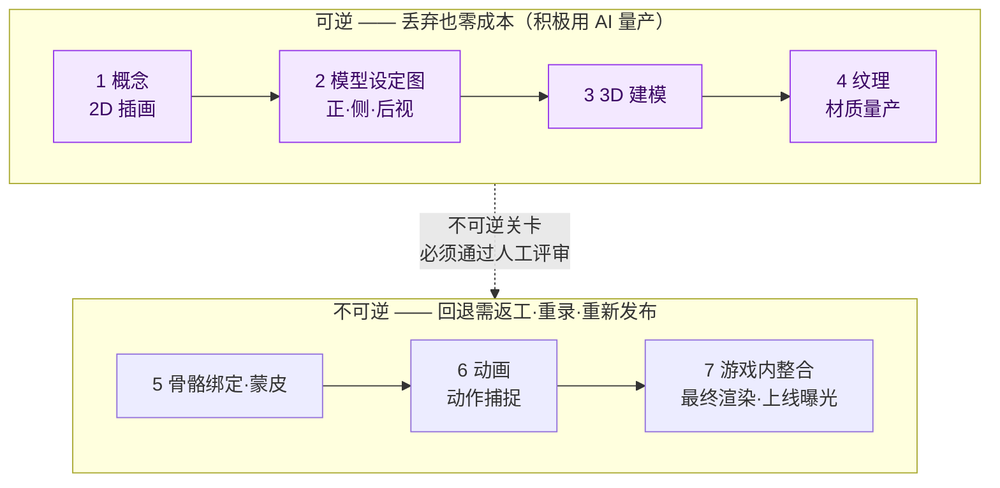
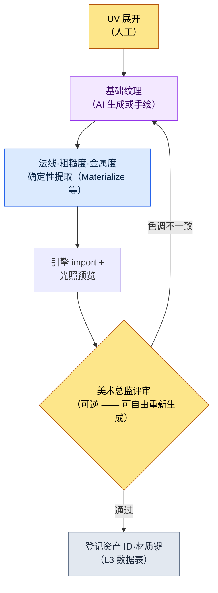

# 12.1 AI 美术资产管线 —— 在可逆阶段量产，在不可逆关卡前停下

> 主要读者：与美术团队协作的游戏策划·美术总监（中等规模（10\~50 人）团队）
> 面向个人/业余读者的精简版：§12.1.8「一个人的话，做到这些就够」

我记得把 AI 生成的 100 张概念图贴在会议室墙上的那一天。30 秒内打印出的 100 张里，美术总监选中的只有 3 张，其余 97 张当场被丢弃。有人把这叫作“97% 的浪费”。可如果是手绘，画师为了抵达那 3 张，大概要花上两周。什么才是浪费，在这里被颠倒了过来。

本章讨论的，是把这种颠倒转化为运营的方法。核心只有一句话。**AI 美术在可逆阶段（概念·纹理探索）可以尽情量产，而在不可逆阶段（最终渲染·动作捕捉·并入构建）之前，设一道由人把守的关卡。** 在可以丢弃的地方就丢掉 99 张，在无法回退的地方则一张也不随意放行。美术工具的用法在别的书里已足够多，本章只专注于*把这些工具安全地嵌入策划管线的那个位置*。

---

## 12.1.1 美术管线上存在一条可回退的界线

美术资产从概念走到游戏内，一共 7 个阶段。把作者项目（以下称“项目A”）的角色资产流程原样搬过来就是这样。重要的不是阶段数量，而是穿过其正中央的**可逆/不可逆分界线**。



左侧四个阶段（概念\~纹理）是**可逆**的。抽出 100 张概念图丢掉 97 张，损失的只是 token 成本；纹理重新生成五次，覆盖掉文件就结束了。所以这一段是 AI 量产能带来最大 ROI（Return on Investment，投资回报）的位置。量产工具以自托管的 Stable Diffusion（SDXL）/ComfyUI 为主轴。原因是 IP 保护 —— 不把资产上传到外部的封闭服务，而在本地运行，并用以角色微调过的 LoRA 与 ControlNet，在每次反复生成时控制同一人物的一致性。封闭式工具（Midjourney 等）只在快速铺开初期情绪板时有限使用，而需要一致性·反复控制的正式量产则交回 SD/ComfyUI。

右侧三个阶段（骨骼绑定之后）是**不可逆**的。动作捕捉会绑定录制棚·演员的档期，最终渲染并入构建、上线曝光后，就会伴随玩家的记忆与社区的反应。一旦跨过去，回退的成本会大于制作的成本。所以在分界线上立起一道**由人把守的关卡**。无论 AI 在可逆区间量产多少，能跨入不可逆的资产，只有通过人工评审的那些。

这一张图就是本章的骨架。“AI 在美术上用到什么程度”这个问题，其实是“这项工作在分界线的哪一侧”的问题。

---

## 12.1.2 [实操记录] 一个概念，从量产到废弃·再请求的全过程

这里把可逆区间的第一步——概念量产，完整展示一个周期。若只是抽象地写“AI 生成概念”，就无法知道真正产出了什么、又废弃了什么。下面是对项目A中量产学者公会资深 NPC 概念的一次会话的忠实再现——一份实操记录（worked transcript，即完整保留的真实操作过程记录）。提示词可以直接复制使用，输出则由真实会话重构而来。

### 第 1 步 —— 输入：先明确策划意图

这里有一个最常出错的地方。就是把提示词以“视觉描述”开头。公司的反馈 atom `image_prompt_design_intent_first` 所固化的原则恰恰相反 —— **图像提示词也是设计意图优先**。不是罗列外形形容词，而是把这个角色在游戏中承担什么功能·叙事放在前面。

```yaml
# concept_brief_scholar_senior.yaml —— 概念量产输入
asset_id: npc_scholar_senior_01
role: 学者公会资深成员 —— 最先观测到封印减弱的人物
function: 主线任务发布 NPC（玩家必须信任的信息源）
narrative_seed:
  - 30 年间在钟塔记录封印脉络的人
  - 把情感藏在数字背后（scholarly_strict 基调）
style_anchor: semi-realistic, painted, 东亚奇幻   # 在 L0 愿景中固定
forbidden: anime 风格 · 现代服饰 · 普通奇幻法师长袍
```

`function` 与 `narrative_seed` 在外形之前。只有当输入本身握着“为什么这个角色必须长成这样”，才能在量产结果中判断“为什么这个更好”。

### 第 2 步 —— 提示词：量产，但强制格式与禁忌

```
基于附上的 concept_brief，生成 6 个角色概念方向提案。
这是用于探索的量产 —— 不是最终稿，而是供美术总监挑选的候选。

规则：
1) 把 function 与 narrative_seed 翻译为视觉。禁止单纯的美型。
   （例：“把情感藏在数字背后” → 用表情·道具·姿态如何体现）
2) 不要偏离 style_anchor。forbidden 项绝对禁止。
3) 6 个方案彼此须有足够差异。细微变体的 6 张没有探索价值。
4) 为每个方案附上一行意图依据（为什么这个方向契合 function）。
5) 你怀疑‘可能与 style_anchor 冲突’的方案，单独标注出来。

输出格式：（方案编号 | 核心视觉 | 意图依据 | 疑似冲突）。除此之外不要任何说明。
```

在这段提示词里，视觉描述所占的篇幅几乎没有。大部分都用在锁定输出格式、钉死禁忌上。因为一旦给 AI 自由，它就会回归到训练数据的平均值——普通奇幻法师。**意图翻译义务、固定 style_anchor、强制 6 个方案的多样性，以及“若有冲突就上报”这条退路**，是阻止回归的四道门闩。

### 第 3 步 —— Claude 的输出（重构，节选）

```
| 方案 | 核心视觉                             | 意图依据                          | 冲突 |
|------|--------------------------------------|-----------------------------------|------|
| 1    | 黄铜放大镜永久佩戴，墨渍手指          | 观测即身份 —— 工具被身体化        |      |
| 2    | 面无表情的老学者，手持带刻度盘的卷轴   | 把情感藏在数字背后 = 无表情+记录物 |      |
| 3    | 钟塔背景，身后冷却中的封印脉络之光      | 职务空间说明人物                  |      |
| 4    | 华丽的星纹刺绣长袍，手持魔力球体        | 强调威严                          | ★    |
| 5    | 一只眼为义眼，毕生观测的痕迹           | 30 年职务的身体代价               |      |
| 6    | 年轻端正的学者，强调美型               | 好感度优先                        | ★    |
```

输出中最有价值的不是表格，而是**标了 ★ 的两行**。AI 自己在 4 号方案（华丽法师长袍、魔力球体）与 6 号方案（美型优先）上上报了“可能与 style_anchor·forbidden 冲突”。若没有第 5 条规则那条退路，这两个方案就会以与其余四个方案一模一样的面孔混进表里。让 AI 自己举手标出可疑之处 —— 这正是自由量产与受控量产的分野。

### 第 4 步 —— 验证与否决（人的位置）

不会原样接收这份输出。美术总监会拿 brief 把 6 个方案过一遍。实际上在这次会话里，判定是这样分开的。

- **废弃 4 号方案。** 正如 AI 所上报的。“手持魔力球体的星纹刺绣长袍”正面违反了 `forbidden: 普通奇幻法师长袍`。这个角色不是使用魔法的人，而是*观测·记录*魔力的人。function 误译。
- **废弃 6 号方案。** 美型优先与 `narrative_seed: 30 年职务的身体代价` 相悖。这个 NPC 的说服力来自“做了很久的人”的磨损。年轻干净的脸会削弱叙事。
- **采用 1·5 号方案，搁置 2·3 号方案。** 1 号方案（放大镜身体化）与 5 号方案（义眼）精确契合了“工具·职务塑造人物”的意图。

这里废弃的 2 件不是损失。若是手绘，要弄清这两个方向是错的得花上好几天，而量产把 6 个方案同时铺开，在一小时之内就筛掉了它们。

### 第 5 步 —— 再请求

```
将 1 号方案（放大镜身体化）与 5 号方案（义眼）的方向合并。
- 把黄铜放大镜 + 一只义眼整合到同一人物
- 情感克制（scholarly_strict）：表情为无，仅用道具诉说职务
- 再次确认 forbidden：法师长袍·魔力球体·强调美型全部禁止
这是要生成‘最终候选 1 案’、交给美术总监手工精修的阶段。
```

AI 再次给出了把放大镜与义眼整合到一位老学者身上的单一方向，那一张图交到概念美术师的桌上，由手工收尾。**量产（6 案） → 废弃（2 案） → 收敛（1 案） → 人工收尾**的一个周期在这里闭合。AI 做出的不是最终资产，而是供美术总监挑选的候选范围。

这一整圈就是本书全书的 Show 标准。若没有哪怕一次从头看到尾——AI 吐出了什么、什么被废弃、人又收尾了什么——那么“用 AI 量产了概念”这句话就是空洞的。

---

## 12.1.3 废弃率高，是探索深入的信号

在上面这次会话里，6 个方案中有 2 个被废弃。若从整条概念线来看，废弃会堆得多得多。贴在会议室墙上的 100 张里，采用的只有 3 张。

要诚实地对待这个比例。这是亲自数了导入初期几次概念会话得到的方向值，而不是精确的总体比例（作者估算，未经验证——会随角色性格·brief 质量大幅波动）。因此，应当把它当作**“比起手工时期，废弃变得自由得多”这个方向**来读，而不是“精确的百分之几”。

重要的是，废弃率 0% 并不是目标。一张纸很贵，就会把一张纸打磨到底。100 张纸在 30 秒内印出，丢掉 99 张也没有负担，探索的幅度也随之变宽。**废弃率上升，是探索深度加深的信号**。试图压低废弃率本身的运营——比如“AI 生成的东西差不多就用吧”这种压力——会把探索的价值一起削掉。§12.1.2 中之所以能毫不犹豫地丢弃 4·6 号方案，正是因为丢弃的成本为 0。

---

## 12.1.4 纹理量产 —— 可逆区间的第二个位置

与概念一并，在可逆区间里 ROI 很大的另一个位置就是纹理。这是为 3D 模型生成材质的阶段，而这里 AI 介入的格子与确定性负责的格子也划分得很清楚。



AI 介入的只有**基础纹理**一格。法线·粗糙度·金属度这类 PBR 贴图不会让 AI 每次生成得都不一样，而是交给确定性提取工具。因为只有从同一基础生成同一贴图，材质才会一致。这与 §6.2 城市生成器中不把奖励曲线交给 AI、而由规则手册把控是同样的分工 —— **能用确定性保证的交给代码，需要探索的交给 AI。**

即便是基础纹理，也并非对所有资产都适合用 AI。像角色面部这种细微细节左右游戏辨识度的地方，依然以人手为先。所以当评审关卡抓到“色调不一致”时，不是自动废弃，而是退回去重新生成。到这里为止全都在分界线左侧 —— 无论重跑多少次都不会有损失的可逆区间。

---

## 12.1.5 不可逆关卡 —— 一致性验证与视觉回归

在跨过分界线之前，检查可逆区间量产的资产是否与整个游戏的调性相违。这是一处仅凭人眼会漏看的地方，所以先由代码打第一遍。

```python
# visual_regression.py —— 资产替换时检测意图之外的变化（骨架）
# 输入: 资产 ID + 替换前/后相同条件的渲染截图
# 输出: 变化等级（向人工评审关卡发出 alert）

def compare_renders(asset_id, before_png, after_png, threshold=(1.0, 5.0)):
    diff = pixel_diff(before_png, after_png)   # 归一化到 0~100
    if diff > threshold[1]:
        return ("BLOCK", f"{asset_id}: 变化较大 {diff:.1f}% —— 评审前禁止进入不可逆")
    elif diff > threshold[0]:
        return ("WARN",  f"{asset_id}: 轻微变化 {diff:.1f}% —— 需确认是否为有意变更")
    else:
        return ("PASS",  f"{asset_id}: 无变化")
```

这 30 行，会在进入不可逆*之前*就抓住“换了一张纹理，结果另一个角色的阴影就崩了”这类事故。关键的设计在于，`BLOCK` 不是自动废弃，而是**只向评审关卡发出 alert** —— 如果连有意的变更（重新设计）都被代码扼杀，画师们在一两个季度内就会说“关掉吧”。可疑的候选由机器挑出，但是否放行到不可逆，由人来决定。

评审要抓的另一件事是**风格一致性**。AI 的输出每次都会有细微差异，所以量产出的概念·纹理是否维持游戏的质感，由人来做最后的把关。只有通过这道关卡的，才会进入骨骼绑定·动作捕捉·最终渲染这些不可逆阶段。因为一旦捕捉了动作并并入构建，一致性事故就只能靠返工·重录·重新发布来修复。

---

## 12.1.6 交给美术团队的只有决定 —— md→html→sync

即便策划用 AI 量产了概念·纹理，真正画图的美术团队仍是另一个组织。这里协作的核心，是**让美术团队不必学习策划团队的工具·约定**。项目A的美术指南（`96_ArtGuide/`）用自动化来解决这一点。

美术决定由策划团队用 md 写，`_convert_md_to_html.py` 转换成 html，再由 `_SyncToArtRepo.bat` push 到独立的美术仓库。美术团队在那个仓库里只看 html —— 既不用懂 md 约定，也不用懂策划团队的 SVN（管线示意图见 §12.2.4）。

而且这份决定文档被分成 7 个域（`00_Common`·`01_Character`\~`07_Env`），各自握着自己的风格规则，在统一关卡处汇合。这就是下一章（12.2）要讲的 ArtGuide 7 个领域，先只说核心就是 —— **把风格规则手册不放进一格、而是分成 7 格抽屉，AI 量产提示词就不必每次在画师脑中重新组装，而是从抽屉里取出。** §12.1.2 的 `style_anchor`·`forbidden` 正是从那些抽屉里取出的输入。只有规则手册被分开，量产结果才不会回归到普通奇幻的平均值。

但这并不意味着每款游戏都得凑齐 7 个领域。若是休闲品类，角色·环境两格也就够了。分离要循序渐进，接口要保持狭窄。

---

## 12.1.7 诚实对待数值与风险的方法

本章的数值只有三类。(1) **方向·比例** —— “量产 100 张采用 3 张”是基于作者经验的方向值（未经验证），因此不当作绝对值，而是读作“在可逆区间废弃成本收敛于 0”这个方向。(2) **测量值** —— 视觉回归变化率（`diff %`）、一致性事故件数、BLOCK 处理件数由 `visual_regression.py` 以数字吐出，因此在会议上可以用数字而非“感觉”来说话。反过来，“留存率上升了”并不由单一美术左右，所以不对因果下定论。

(3) **把风险放进运营成本之内**。AI 美术的三重风险——训练数据版权、风格一致性受损、美术师的岗位——不在 ROI 计算之外，而在其内。作者的方针是：可逆区间积极用 AI，跨入不可逆的最终资产为手工精修，而直接进入构建的资产其 AI 输出比例以 0 为原则。不过这只是一种政策 —— 也有团队只用许可明确的模型，连最终资产也用 AI。法务政策因公司而异，本书给出的不是标准答案，而是划分界线的方法。

三重风险中最常被忽略的是第三个。如果不把 AI 定位为“拓宽探索幅度、增大美术师决定权的辅助”，而是当成“取代美术师的量产机”，那么这个工具即便在 KPI 上成功，也会被组织拒绝。这也是 feedback atom `design_intent_vs_automation_boundary`（设计意图 vs 自动化边界）所固化的地方。

---

## 12.1.8 常见的失败

| 模式 | 为何失败 | 处方 |
|---|---|---|
| 把 AI 概念直接作为最终资产投入构建 | 未经人工评审就通过不可逆阶段 | 分界线前设关卡（§12.1.1） |
| 提示词以外形描述开头 | function 误译 —— 回归为美型法师 | 设计意图优先（§12.1.2，`image_prompt_design_intent_first`） |
| 量产的 6 个方案是细微变体 | 无探索价值，没有可废弃的 | 强制多样性（§12.1.2） |
| 试图压低废弃率 | 把探索深度一起削掉 | 把可逆区间的废弃视为信号（§12.1.3） |
| 连纹理 PBR 贴图也用 AI 生成 | 材质一致性每次调用都晃动 | 分离出确定性提取（§12.1.4） |
| 不做视觉回归就替换资产 | 意图之外的变化漏进不可逆 | `visual_regression.py` 关卡（§12.1.5） |

---

## 12.1.9 动手试试 —— 今天就能做的一步

> **一个人的话，做到这些就够**：没有美术团队、也没有数据表也无妨。挑选你自己游戏（或你喜欢的游戏）里的一个 NPC，按 §12.1.2 的 `concept_brief` 格式，*先于外形*写下 `function` 与 `narrative_seed`，再把 6 案量产提示词原样贴上去跑一次。从跑出的 6 个方案里挑一个与意图相悖的，试着反驳“这是 function 误译，废弃重来”，你就会亲身体会到：可逆区间的废弃不是损失，而是探索。

如果是团队，就从下面这一步开始。在管线上**明确地画一条可逆/不可逆分界线**（§12.1.1）。就“到哪个阶段为止是‘丢弃也为 0’、从哪里起是‘回退很贵’”达成一致，并在那条界线上设一道人工评审关卡。界线一旦画好，“AI 用到哪里”这场每次都从头打起的争论，就会变成“这项工作在界线哪一侧”的一次性判定。

用 setup → prompt → verify 概括就是 —— **setup**：在管线上定义可逆/不可逆分界线与评审关卡。**prompt**：按 §12.1.2 的格式先输入设计意图，量产 6 案，同时强制禁忌·多样性·上报。**verify**：在可逆区间亲自挑出 1 件意图误译，用废弃·再请求闭合一个周期，并在进入不可逆之前用 `visual_regression.py` 打一遍意图之外的变化。

---

### 本章要点
- 在可逆区间（概念·纹理）量产，在不可逆关卡前做人工评审。
- 废弃率上升是探索加深的信号，而不是工具失败。
- 图像提示词也应先输入设计意图，而不是外形。

### 下一章预告
- 12.2 ArtGuide 7 个领域 —— 把风格规则手册分成 7 格抽屉，守住量产的一致性

---
