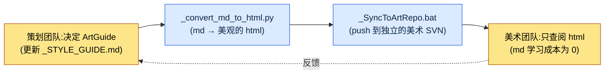

# 12.2 ArtGuide 七大领域(角色·动画·怪物·NPC·VFX·UI·环境)

周四的整合评审。当我们把七个新资产贴在同一屏幕上一看,所有人同时笑了。学者角色是灰色调、沉稳的剪影,而在它旁边炸开的技能 VFX 却是荧光粉。两者在各自的领域里都是完美的决定。角色总监严格遵守了自己的 `_STYLE_GUIDE.md`,VFX 美术也忠实执行了我"要显眼"的规格要求。谁都没有错,可放在同一屏幕上,两款游戏却在互相打架。

这一幕既是把 ArtGuide 拆成七大领域的理由,也是必须把七大领域重新捆在一起的理由。ArtGuide 是游戏的视觉宪法。按领域划分,各领域总监就拥有了自治权,决策随之加快;而若不通过整合评审重新捆合,上面那种荧光粉式的事故就会一个季度一个季度地累积。策划在这一平衡的哪个点上落手,便是本章的全部内容。

---

## 12.2.1 一张资产:七大领域的真实结构

在笔者担任总监的项目A(东方奇幻基调、移动优先的 MMORPG)的设计仓库里,有一个名为 `96_ArtGuide/` 的文件夹。编号 `96` 是为了让美术指南在仓库排序规则下排到几乎最后而加上的,其下则分成七个领域。这不是抽象的"项目美术文件夹",下面就是该文件夹的真实子结构。

<svg viewBox="0 0 760 360" xmlns="http://www.w3.org/2000/svg" font-family="sans-serif" font-size="13">
  <rect x="300" y="10" width="160" height="40" rx="6" fill="#2c3e50"/>
  <text x="380" y="35" fill="#fff" text-anchor="middle" font-size="14">96_ArtGuide/</text>
  <line x1="380" y1="50" x2="380" y2="70" stroke="#888" stroke-width="1.5"/>
  <line x1="70" y1="70" x2="690" y2="70" stroke="#888" stroke-width="1.5"/>
  <!-- 7 domain boxes -->
  <g>
    <rect x="20" y="70" width="100" height="70" rx="5" fill="#e8f0fe" stroke="#4285f4"/>
    <text x="70" y="92" text-anchor="middle" font-weight="bold">00_Common</text>
    <text x="70" y="112" text-anchor="middle" font-size="11">通用规约</text>
    <text x="70" y="128" text-anchor="middle" font-size="11">调色板·规则</text>
  </g>
  <g>
    <rect x="130" y="70" width="100" height="70" rx="5" fill="#fce8e6" stroke="#ea4335"/>
    <text x="180" y="92" text-anchor="middle" font-weight="bold">01_Character</text>
    <text x="180" y="112" text-anchor="middle" font-size="11">玩家</text>
    <text x="180" y="128" text-anchor="middle" font-size="11">角色</text>
  </g>
  <g>
    <rect x="240" y="70" width="100" height="70" rx="5" fill="#e6f4ea" stroke="#34a853"/>
    <text x="290" y="92" text-anchor="middle" font-weight="bold">02_Animation</text>
    <text x="290" y="112" text-anchor="middle" font-size="11">所有</text>
    <text x="290" y="128" text-anchor="middle" font-size="11">动画</text>
  </g>
  <g>
    <rect x="350" y="70" width="100" height="70" rx="5" fill="#fef7e0" stroke="#fbbc04"/>
    <text x="400" y="92" text-anchor="middle" font-weight="bold">03_Monster</text>
    <text x="400" y="112" text-anchor="middle" font-size="11">敌方NPC</text>
    <text x="400" y="128" text-anchor="middle" font-size="11">视觉</text>
  </g>
  <g>
    <rect x="460" y="70" width="100" height="70" rx="5" fill="#e8f0fe" stroke="#4285f4"/>
    <text x="510" y="92" text-anchor="middle" font-weight="bold">04_NPC</text>
    <text x="510" y="112" text-anchor="middle" font-size="11">友好NPC</text>
    <text x="510" y="128" text-anchor="middle" font-size="11">关系·voice</text>
  </g>
  <g>
    <rect x="570" y="70" width="100" height="70" rx="5" fill="#fce8e6" stroke="#ea4335"/>
    <text x="620" y="92" text-anchor="middle" font-weight="bold">05_VFX</text>
    <text x="620" y="112" text-anchor="middle" font-size="11">视觉效果</text>
    <text x="620" y="128" text-anchor="middle" font-size="11">技能·演出</text>
  </g>
  <g>
    <rect x="680" y="70" width="70" height="70" rx="5" fill="#e6f4ea" stroke="#34a853"/>
    <text x="715" y="92" text-anchor="middle" font-weight="bold" font-size="11">06_UI</text>
    <text x="715" y="112" text-anchor="middle" font-size="10">画面·HUD</text>
    <text x="715" y="128" text-anchor="middle" font-size="10">(9.3)</text>
  </g>
  <!-- 07 on second row -->
  <line x1="380" y1="140" x2="380" y2="170" stroke="#888" stroke-width="1"/>
  <g>
    <rect x="300" y="170" width="160" height="60" rx="5" fill="#fef7e0" stroke="#fbbc04"/>
    <text x="380" y="195" text-anchor="middle" font-weight="bold">07_Environment</text>
    <text x="380" y="216" text-anchor="middle" font-size="11">背景·道具·地标</text>
  </g>
  <!-- footer note -->
  <text x="380" y="280" text-anchor="middle" font-size="12" fill="#555">每个领域 = 总监/资深1人自治 + 各领域 _STYLE_GUIDE.md(宪法)</text>
  <text x="380" y="305" text-anchor="middle" font-size="12" fill="#555">00_Common = 横跨七个领域之上的通用上位规约(色彩·材质·时代基调)</text>
</svg>

图示的要点有两个。第一,七个领域并排、平等地拥有自治权。可以想象一间办公室里,同一层排开七间工作室。每个房间的负责人握有本房间的决定权,但在走廊相遇时,不能失去"同属一款游戏"的感觉。第二,其上叠着 `00_Common`。七个房间都必须遵守的通用规约——即整体色彩调色板、材质基准与时代基调——都住在这里。`06_UI` 与 9.1.3 讨论过的 UI 协作标准属于同一领域,因此本章只划出边界便略过。

## 12.2.2 每个领域策划介入的深度各不相同

策划并不会以相同强度介入七个领域。"策划决定意图与叙事、美术决定视觉"这一原则对所有领域都一致,但意图把视觉牵引到哪一步,则因领域而异。

| 领域 | 策划介入 | 策划不该越过的界线 |
|---|---|---|
| 01_Character | 强 | 到概念·性格·势力·角色定位为止。脸部比例·笔触则不属于 |
| 02_Animation | 中 | 到技能动作的"种类·反应"为止。帧时序则不属于 |
| 03_Monster | 强 | 到敌人概念·势力·生态为止。鳞片纹样细节则不属于 |
| 04_NPC | 强 | 到角色定位·关系·voice_profile 为止。服饰刺绣则不属于 |
| 05_VFX | 弱 | 到"缓慢发射、大爆炸、紫色"为止。粒子数量则不属于 |
| 06_UI | 强 | 到信息结构·优先级为止(9.3)。像素间距则不属于 |
| 07_Environment | 中 | 到氛围·地标意图为止。树木多边形则不属于 |

右侧那一栏才是本表的真正内容。即便在标注介入为"强"的领域,策划也有不能越过的界线。角色概念可以强力牵引,但一旦连脸部比例都动手,角色总监的自治就在那一刻崩塌。而且强与弱的边界本身会随品类而摇摆。若是恐怖游戏,VFX 是恐惧的核心,策划介入随之增强;若是休闲解谜,角色介入反而会减弱。上表是项目A的品类基准,并非普遍法则。

## 12.2.3 领域的宪法:_STYLE_GUIDE.md

每个领域都以一组标准文档来运营。来看 `01_Character/` 领域的真实文件构成。

```
01_Character/
├── _STYLE_GUIDE.md          — 角色整体风格(宪法)
├── _COLOR_PALETTE.md        — 色彩·材质指南
├── _PROPORTION_REFERENCE.md — 比例·剪影规则
├── _DO_AND_DONT.md          — 允许·禁止
├── individual/              — 各角色卡
│   ├── K_001_director.md
│   ├── K_007_scholar.md
│   └── ...
└── _REVIEW_LOG.md           — 评审记录
```

`_STYLE_GUIDE.md` 是领域的宪法。各个角色卡(`individual/`)都在这部宪法之上变奏。宪法一旦动摇,其下所有角色都会动摇,因此这一份文件是领域中被最频繁审阅的文档。骨架如下。

```markdown
---
title: 01_Character Style Guide
layer: L1
---

## 1. 基调
- 19世纪工业革命以前的韩国奇幻氛围
- 写实比例(7~7.5 头身,禁止 Q 版变形)

## 2. 色彩
- 饱和度:中等(约实拍的 60~70%)
- 主调色板:继承 00_Common
- 各角色的强调色(1~2 个)

## 3. 服饰规则
- 按势力区分服饰(学者 → 灰色 + 紫色强调)
- 依职业·阶级而定的服饰细节

## 4. DO
- 在 5m 距离仅凭剪影即可辨认是谁
- 以视觉表现势力身份

## 5. DON'T
- 日式动漫风格
- 非古装元素(现代服饰·道具)
- 饱和度过高
```

这里有一行很关键。`## 2. 色彩` 中的"主调色板:继承 00_Common"。这是明文规定:角色领域不自行决定色彩,而是继承上位的通用规约。这一行正是从结构上堵住开篇那起荧光粉事故的装置。只要所有领域的 `_STYLE_GUIDE.md` 在色彩上都继承 `00_Common`,至少色彩冲突在宪法层面就被阻断了。

## 12.2.4 如何把非策划人员拉进协作

这里出现了项目A实际撞上的、最现实的问题。美术团队不读 Markdown。更准确地说,不该强迫他们去读。让美术人员学习 git diff、frontmatter 与 Markdown 标题层级的成本,几乎总是大于由此学习换来的协作效率。把策划团队的工具原封不动地塞给美术团队的那一刻,协作反而会变慢。

所以项目A的流水线可以用一句话概括:"策划团队用 md 做决定,美术团队只看 html"。



关键在于两项自动化资产。`_convert_md_to_html.py` 把领域的 Markdown 指南转换成美术人员可以在浏览器里舒适阅读的 html。色彩调色板会渲染成实际的色块,DO/DON'T 会渲染成视觉对比。`_SyncToArtRepo.bat` 则把那份 html 推送到**独立的美术专用仓库**,而非策划仓库。分离仓库的理由很简单。美术人员只拉取自己的仓库,就不会接触到策划团队内部的 md 历史、正在编写的草稿、其他领域的决策过程。美术人员看到的,只有已确定决策的、易读的成品。Markdown 学习成本降为 0。

在这一结构中,策划多了一项责任。一旦更新 md,就必须跑一遍转换·同步步骤。只更新而漏掉同步,美术团队就会拿着昨天的决定画今天的图。决策与传达之间的这一格若是空着,自治也好、整合也好,都失去了意义。

## 12.2.5 图像提示词也是决策:设计意图优先

作为非策划协作的延伸,在概念阶段使用生成式 AI 时,策划要守住一条原则。以项目A内部规约的名称来说,它叫 `image_prompt_design_intent_first`,展开来讲就是"图像提示词也要先写设计意图"。

用生成图像探索概念时,常见的失败是提示词只被结果物的外观描述填满。比如"身着灰色道袍的 50 多岁东方男性,神情沉静,写实风"。这样的提示词能出图,却装不下**为什么要这样**,于是美术总监在变奏这张图时会迷失方向。设计意图优先原则强制在提示词之前加上一个意图块。

```
[设计意图]
- 角色定位:学者势力的精神支柱,玩家的第一位导师
- 必须被读到的:即便在 5m 距离也能读出"知识分子·非战斗"的剪影
- 势力信号:学者 = 灰色 + 紫色强调(继承 00_Common)
- 禁止:携带武器、华丽甲胄(会被误读为战斗职业)

[提示词]
身着灰色道袍的 50 多岁东方男性学者,紫色衣带强调,
无武器,神情沉静而好学,19世纪以前的韩国奇幻,
写实比例 7.5 头身,饱和度中等,……
```

意图块位于提示词之上时,那张图就成了决策的一部分。下一个人生成同一角色的另一个姿势时,不是照抄外观,而是再次满足意图。当图像不满意需要废弃时,也能围绕"意图中哪一点没被读出来"来讨论。只写外观的提示词止于"我的口味觉得这个更好",不留下可供验证的依据;而意图在前的提示词,则留下了可以推敲何者已满足、何者被遗漏的记录。

这里,工具选择与意图优先原则咬合在一起。要按意图反复生成"同一角色的另一个姿势",光靠提示词是不够的。项目A的工具分工与 §12.1.1 相同——正式量产在自托管 SD(SDXL)/ComfyUI 上挂载角色 LoRA(固定脸部·服饰)与 ControlNet(固定姿势·剪影),让意图块所要求的"5m 距离辨识度"即便姿势改变也得以保持,同时也守住 IP。封闭式工具(Midjourney 等)则只用于早期情绪板一类的用途。

## 12.2.6 实操记录(worked transcript):角色概念规格的一个周期

为了看清领域自治与策划介入实际如何运转,我们把 `01_Character` 的一个周期从头到尾跟一遍。以下是笔者把学者角色(`K_007_scholar`)的概念规格初稿交给 AI 处理的真实工作的还原——所谓实操记录,即完整保留的真实操作过程记录。不做概括,连别扭的输出与笔者的驳回也原样呈现。

**① 笔者抛给 AI 的提示词(全文)**

```
你是我们项目的角色概念助理写手。请遵守以下规约,用 Markdown 写出
K_007_scholar 的概念规格书初稿。

规约:
- 遵守 01_Character/_STYLE_GUIDE.md:19世纪以前的韩国奇幻,7~7.5 头身,
  饱和度中等,禁止日式动漫风格。
- 色彩继承 00_Common 调色板,学者势力的强调色为紫色。
- 必须包含 voice_profile 的 5 个条目(语气/口头禅/禁用语/情绪默认值/关系称呼)。
- 只决定到概念·性格·势力·角色定位为止,脸部比例或笔触之类的视觉细节
  请留空(属于角色总监的自治领域)。
- 输出采用 individual/ 角色卡格式。
```

**② Claude 的原始输出(含败笔,未作改动)**

```markdown
# K_007 学者(Scholar)

## 角色定位
学者势力的精神支柱,也是玩家的第一位导师。

## 外形
- 身高 180cm,7.5 头身,清瘦体型
- 白须,深刻的皱纹,炯炯的目光
- 灰色道袍配紫色衣带
- ★ 推荐:以微微发光的金色瞳孔强调神秘感

## 性格
博学而不傲慢,对弟子严格却不失温和。

## voice_profile
- 语气:缓慢而沉静
- 口头禅:"……正是如此",句尾拖长
- 情绪默认值:平静
- 关系称呼:称玩家为"年轻的朋友"
```

**③ 笔者的验证·驳回(何处、为何有误)**

输出里有两处缺陷。第一,`## 外形` 中的"★ 推荐:金色瞳孔"。这是明显的越权。瞳孔颜色之类的视觉细节属于角色总监的自治领域,AI 却在概念阶段把它钉死了。若原样保留,总监要么以"策划已经定了"为由收起自己的判断,要么无视它而产生冲突,二者必居其一。第二,`voice_profile` 不是 5 个条目,而是 4 个。"禁用语"整个漏掉了。导师角色绝对不会说哪些话,这与性格同样重要,AI 却遗漏了。

**④ 再次请求(只精确修正两处)**

```
只改两点。
1. 在 ## 外形中删除"金色瞳孔"那一行推荐。瞳孔颜色属于角色
   总监的决定领域。外形条目只写到剪影·体型·势力色为止,
   细部色彩·材质则以"(总监决定)"留空。
2. 在 voice_profile 中补上遗漏的"禁用语"条目。明确指出作为学者导师
   不会说的话(脏话、粗俗玩笑、现代用语)。
```

这个周期的教训不是工具,而是边界。AI 很快给出了像模像样的初稿,却替策划越过了不该越的线(视觉细节),又漏掉了必须写进去的东西(禁用语)。验证的标准不是"写得好不好",而是"是否守住了领域自治的边界"。只要还在把 AI 用于角色概念,这道边界的审校就必须由人牢牢握到最后。

## 12.2.7 如何把各领域之间的一致性重新捆合

七个领域一旦拥有自治权,就会像开篇的荧光粉那样,在领域之间产生不一致。常见的类型是固定的几种。

| 不一致类型 | 实际示例 |
|---|---|
| 角色—环境基调差异 | 角色沉稳,背景却华丽,二者各说各话 |
| 角色—VFX 色彩冲突 | 角色为灰色调,技能 VFX 却是荧光粉 |
| NPC—Monster 边界模糊 | 明明是友好 NPC,却被读成怪物般具有威胁 |
| UI—角色色调不一致 | UI 是冷色调,角色是暖色调 |

捕捉这种不一致的装置,是每周一次的整合评审。流程很简单。

```
每周一次 ArtGuide 整合评审(周四)
─────────────────────────────────
1. 随机抽取当周新资产 5~10 个
2. 一起排布到同一屏幕(游戏内模拟)
3. 七个领域总监 + 游戏总监同时评审
4. 发现不一致 → 补强对应领域的 _STYLE_GUIDE
   或补强 00_Common 上位规约
```

关键在第 3 步和第 4 步。评审由各领域总监**同时**进行,以及把发现的不一致不是靠修改单个资产了事,而是回归到指南文档。开篇那起荧光粉事故,如果只把那一个资产改成灰色就收手,下周会一模一样地复发。反之,若在 `00_Common` 中加上"技能 VFX 的饱和度须在角色调色板饱和度 +20% 以内"这条规约,同样的事故就从结构上被关闭。每月累积 4 次的这一周期,是阻止自治固化为孤岛的唯一护栏。

## 12.2.8 自治不是责任的分散,而是决策时间的再分配

把七大领域分离带来的变化,从项目A的运营经验中梳理如下。下表数值中,周期天数与时间基于笔者的运营经验,属于**笔者估算(未经验证)**,并非精确测量值,只应作为分离前后的方向与大致比例来读。

| 项目 | 分离前 | 分离后 | 性质 |
|---|---|---|---|
| 美术决策周期 | 1\~2 周 | 3\~5 天 | 笔者估算(未经验证) |
| 领域间一致性事故 | 每季度多起 | 显著减少 | 仅方向 |
| 游戏总监美术评审时间 | 每周多个小时 | 大幅减少 | 仅方向 |
| 新领域总监上手 | 数月 | 约 1 个月 | 笔者估算(未经验证) |
| 美术资产废弃率 | 高 | 下降 | 仅方向 |

诚实地读这张表,能够断言的只有一点:所有项目都朝同一方向移动了。最明确的效果是,游戏总监的时间被收回了。在没有自治的结构里,所有美术决策都必须经过游戏总监一个人的桌子。这是纸张堆在一张桌子上的结构。分成七大领域后,纸张分散到了七张桌子。纸张的总量不变,但没有任何一张桌子会被压垮。

这里必须斩断最常见的误解。自治不是责任的分散,而是时间的再分配。领域总监决定自己的领域,并不意味着整款游戏的视觉责任被打散成七块。在整合评审上,那七块又重新聚到一处,最终的视觉责任依然收敛于一个人。一旦把自治当作逃避责任的借口——一旦"那不在我的领域内"成了口头禅——开篇那抹荧光粉就会在无人认领的状态下进入构建。

还有一个附带条件。七大领域自治是规模的函数。在小规模(\~10 人)团队里,它反而是过度工程。若还处在一名总监身兼五顶帽子的阶段,那么需要的不是七份领域指南,而是一份整合指南就够了。自治只有在桌子开始不够用时,才真正体现价值。

## 12.2.9 常见的失败与处方

| 模式 | 处方 |
|---|---|
| 不做领域分离,所有决策都集中到游戏总监 | 引入七大领域自治(但从中等规模(10\~50 人)起) |
| 缺少领域 _STYLE_GUIDE | 将各领域宪法的编写设为强制门禁(gate) |
| 缺少领域间的整合验证 | 每周一次整合评审 + 回归指南 |
| 策划连视觉细节都决定 | 只规格到意图·叙事为止,细节交给总监 |
| 自治固化为孤岛 | 在整合评审上回归到 00_Common |
| 更新 md 后漏掉同步 | 养成 `_convert_md_to_html.py` → `_SyncToArtRepo.bat` 的习惯 |
| 图像提示词只有外观描述 | 先行设计意图块(`image_prompt_design_intent_first`) |

---

### 本章要点
- 七大领域自治与每周一次整合评审之间的平衡,才是 ArtGuide 的本体。
- 策划管到意图·叙事为止,视觉细节是领域总监的自治领域。
- 自治不是责任的分散,而是决策时间的再分配。

### 下一章预告
- 12.3 策划案 → 概念 → 游戏内资产的流程

---

## 动手试试

**setup** —— 从最费功夫的一个领域(通常是 `01_Character`)开始。在领域文件夹里建立 `_STYLE_GUIDE.md`(宪法)、`_COLOR_PALETTE.md`、`_DO_AND_DONT.md`、`individual/`。在色彩条目中,务必写上"主调色板:继承 00_Common"这一行。

**prompt** —— 用 AI 起草单个资产卡时,在提示词中写明:(1) 对应领域 `_STYLE_GUIDE.md` 的规约,(2)"只决定到概念·叙事为止,视觉细节以'(总监决定)'留空",(3) 不可遗漏的必需条目(例如 voice_profile 的 5 个条目)。若是图像提示词,则在外观描述之上先写 `[设计意图]` 块。

**verify** —— 拿到输出后,不以"写得好不好"、而以"是否守住了领域自治的边界"来审校。只看两点:① AI 有没有替策划决定了不该越界的视觉细节,② 必需条目有没有遗漏。只把出错的地方精确点出来再次请求。每周四,把 5\~10 个新资产聚到同一屏幕上,与各领域总监同时查看。不一致回归到指南文档(`00_Common` 或领域 `_STYLE_GUIDE`),而不是回归到资产。

**单人精简版** —— 如果是一个人做的游戏,就别建七个领域。把色彩调色板·时代基调·DO/DON'T 汇总到 `00_Common` 一张里,在其中只用标题把角色·环境·VFX 分成若干小节。把资产交给 AI 时,把这一张整个贴进提示词,并一并要求它"若有违反本指南之处,请标出来"。整合评审只需一个人每周一次、把当周做的东西摆到同一屏幕上看的 5 分钟仪式就够了。只是没有可以分担自治的人而已,宪法一张 + 每周一次对齐这一骨架,在单人团队里同样能体现价值。
