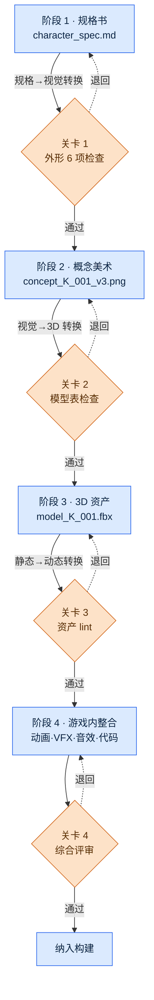

# 12.3 规格书 → 概念 → 游戏内资产的流转

冲刺末期,概念美术师在团队即时通讯工具(IM)里丢来一张角色草图。"这是学者公会的资深成员吧?"画面里的人物是一名 30 多岁的男性,穿着皮甲。而规格书上写的是 40 多岁女性、灰色学者长袍。追查究竟哪里出了偏差后发现,概念美术师拿到的资料是两个月前版本的规格书,而在这期间外形指南已经改过两次。知道这一变更的,只有策划本人。

这起事故不是技术问题,而是流程问题。规格书的一页要变成游戏内的资产,平均需要 4\~8 周,在这期间,一个角色的信息会从策划的脑海里,经手到概念美术师、模型师、动画师,一手接一手地传递下去。每一次交接,格式都可能出现偏差;若在有偏差的情况下被接收,接手者就会用猜测去填补空白。而这份猜测,会在两个月后化作团队 IM 里的一句话回到你面前。

本章讨论的,就是如何把这种一手接一手的流转,从一个人的记忆搬到系统之上。

---

## 12.3.1 一手接一手 —— 4 个阶段与转换点

在项目A中,角色资产流转的路径分为四个阶段。重要的不是阶段本身,而是阶段与阶段之间的转换点。事故不是在阶段内部发生,而是在把资产从一个阶段交给下一个阶段的那一刻爆发。

与其用文字说明这一流转,不如画成图示。而贯穿全书的 24 个部分里,我一直不靠手绘方框,而是让 Claude 生成 mermaid 代码再渲染。本章正是把这一手法应用后得到的结果放进正文,相当于用自己的正文来印证自己的手法。下面就是我请 Claude"用 mermaid 把 spec→asset 的 4 阶段流转画出来,并让转换点关卡清晰可见"后得到的输出,原样渲染的结果。



三个转换点(规格→视觉、视觉→3D、静态→动态)各自都立着一道关卡。关卡就像是在把审批文件交给下一个部门之前检查格式的窗口。格式不符就会被退回(虚线),回到上一个阶段。若接收了格式不符的文件,下一个部门就会用猜测填补空白。这起 IM 事故,正是在没有关卡 1 时发生的。

mermaid 的优势在这张图里显现出来。想要再加一道关卡,或调整阶段顺序时,不必重画方框,只需改动一行文本。因为图示就是文本,它便成了版本管理的对象,和规格书一起被提交(commit)。

---

## 12.3.2 阶段 1 —— 规格书是一切输入的根

流转的起点,是一份 Markdown 规格书。这份文档是随后三个阶段的全部输入。这里若有空白,空白不会消失,而是被甩给下一个阶段,变成猜测。

下面是实际使用的 `character_spec` 格式。`related_atoms` 字段把这份规格书连接到 JIT atom 系统(参见第 11 部分)。

```markdown
---
title: 学者公会资深成员 K_001 角色规格书
type: character_spec
layer: L2
related_atoms: [character_K_001, voice_profile_K_001]
status: draft
---

## 1. 身份
- 名称:(TBD)
- 职责:学者公会资深成员、主要 NPC、可结为同伴
- 势力:scholar_guild
- 性格:学者_严格,威严但公正

## 2. 外形指南
- 年龄:40 多岁
- 性别:女性
- 体格:略高于平均(约 170cm)
- 服装:灰色 + 紫色点缀,学者长袍,眼镜

## 3. 表情·姿态
- 平时:沉着,嘴角下垂
- 愤怒时:沉默 + 回避视线
- 悲伤时:转移话题,表情变化细微

## 4. 游戏内职责
- 主线任务第 1·5·12 章登场
- 发布 8 个支线任务
- 第 7 章加入同伴

## 5. 语音·台词
- voice_profile: scholar_K_001
- 代表性台词 3 句:
  - "那是没有记载的故事吗?"
  - "不要凭感情做决定。数据优先。"
  - "……是你的选择啊。我知道了。"

## 6. 参考资料
- 5 位真实学者的图片(法务审查完毕)
- 参考 refgame 的角色基调
```

外形 6 项(第 2 节的年龄·性别·体格·服装,以及第 3 节的表情·姿态)构成了关卡 1 的检查清单。造成这起 IM 事故的"40 多岁女性 / 灰色长袍"那两行,正出自这一节。倘若关卡 1 起了作用,概念美术师所拿到资料的外形 6 项是否与当前规格书一致,本会在交接之前得到检查。

### 实操记录(worked transcript) —— 填补规格书空白的一次往返

与其从零手动填满整份规格书,不如只定好身份与职责,把外形·表情的初稿交给 Claude 来给出。下面是一次真实往返的全文,未作概括。

**提示词(全文):**

> 以下角色的身份·职责已确定。请据此填写 character_spec 的"2. 外形指南"与"3. 表情·姿态"初稿。
> - 职责:学者公会资深成员、主要 NPC、可结为同伴
> - 性格:学者_严格,威严但公正
> - 势力:scholar_guild
> 约束:refgame 基调(东方奇幻,低饱和度)。外形须仅凭剪影就能与其他主要 NPC 区分开。表情采用不直接流露愤怒·悲伤的克制型。

**Claude 原始输出(原样,未加修饰):**

> ## 2. 外形指南
> - 年龄:40 多岁后半段
> - 性别:女性
> - 体格:偏瘦,165cm 上下(※"威严"是用身高来表现还是用姿态来表现,需要确定 —— 我推荐用姿态)
> - 服装:深藏青色学者服,银线刺绣(※我不清楚势力的配色方案。scholar_guild 是否另有代表色?)
>
> ## 3. 表情·姿态
> - 平时:微微抬起下巴的端正姿态,视线略高于对方
> - 愤怒时:话变少,只有语气转冷
> - 悲伤时:以望向窗外的动作代替,面部几乎没有变化
>
> 还有一点:既然"可结为同伴",战斗中的表情大概也会需要,那是否在这份规格书的范围之外?

**人工验证·驳回:**

这份输出只采纳了一半。表情·姿态一节几乎原样采用 —— 它准确把握了"克制型"这一约束,而"以望向窗外的动作代替悲伤"是规格书里原本没有的好细节。外形则被否决,理由有两点。其一,它把体格定为"偏瘦,165cm",而已确定的规格书写的是"略高于平均,170cm"。Claude 只拿到了身份·职责,无从得知体格,于是做了猜测 —— 这正是关卡该拦下的猜测。其二,服装的藏青色虽符合 refgame 基调,却与我们游戏中 scholar_guild 的代表色(灰色+紫色)相冲突。Claude 抛出的问题("是否另有势力代表色?")恰恰提前点出了这一冲突。

**重新请求:**

> 很好。表情·姿态采纳。外形按以下固定后重新整理:体格 = 略高于平均的 170cm,服装 = 灰色学者长袍 + 紫色点缀(scholar_guild 代表色),佩戴眼镜。战斗表情在这份规格书范围之外,去掉。

这一次往返值得学习的一点是:Claude 用猜测填补空白的那个位置,恰恰就是规格书里的空白。遇到未知值时,Claude 分成了两种做法。势力配色和战斗表情,它以"这一点我不知道"为由用提问的方式挑了出来,而这些提问比关卡检查清单更早点出了缺漏。相反,体格却没有任何"不知道"的标示,直接用一个看似合理的数字填了进去。只要后一种情况存在,人工逐行对照已确定规格书的验证就无法省略。

---

## 12.3.3 阶段 2 —— 概念美术,以及关卡 1

已确定的规格书交到概念美术师手上。流程与 §12.1.2 的概念工作流相同:用 AI 量产数十到数百张,筛选到寥寥几张,再手工打磨出 1\~3 个方案,然后制作模型表(正面·侧面·背面)。

关键在于立于这一阶段末尾的关卡 1。在模型表进入阶段 3(3D)之前,检查以下五项。

| 项目 | 确认标准 |
|---|---|
| 符合规格书外形 6 项 | 服装·体格·年龄·性别·表情·姿态与当前规格书一致 |
| 主要 NPC 之间剪影可区分 | 仅凭 silhouette 就能与其他角色区分 |
| 遵守 ArtGuide `01_Character/_STYLE_GUIDE` | 无违反领域风格指南之处 |
| 与 voice_profile 无矛盾 | 视觉印象不与语音印象冲突 |
| 缩小识别性 | 缩到 UI·小地图大小仍能辨认出是谁 |

这里,`image_prompt_design_intent_first` atom 发挥作用。概念美术师写提示词时,也不是先罗列"灰袍女性学者"这类外形词,而是先放入规格书的设计意图("威严但公正""克制情感的学者")。只攥着外形关键词量产数百张,就会得出一大堆衣服颜色对、眼神却不像学者的图 —— 把意图摆在最前面,正是为了预先减少这类"外形对、印象错"的一堆废图。量产工具与 §12.1.1·§12.2.5 相同 —— 在自托管的 SD(SDXL)/ComfyUI 上,同时挂载角色 LoRA(锁定脸部·服装)与 ControlNet(锁定姿势·剪影),使同一人物即便以不同姿势抽出数百张,脸部也不会崩。

关卡 1 的首项 —— "符合规格书外形 6 项" —— 正是拦住这起 IM 事故的直接门闩。由于在概念草案定型为模型表之前就与当前规格书作了对照,拿着两个月前版本作业造成的偏差,便会在这里被卡住。

---

## 12.3.4 与非策划的协作 —— md 只给策划团队,美术团队只看 html

这里要指出一个运营上的不对称。目前所看到的规格书全是 Markdown,而概念美术师和 3D 模型师并不是为了读 Markdown 才进游戏公司的。因此,项目A 把 §12.2.4 里看到的单向转换管线("策划团队用 md 做决策,美术团队只看 html")原封不动地用在 spec→asset 流转上。策划团队做出的 md 决策被转换成 html,推送到独立的美术 SVN,美术团队只看 html —— md 的学习成本为 0。


`_convert_md_to_html.py` 把 md 转成便于阅读的 html,`_SyncToArtRepo.bat` 再把结果 push 到美术 SVN 而非策划 SVN。分开两个仓库的理由,与 PC 分离原则相同 —— 是为了保护一方的工作流不覆盖另一方。转换始终是策划 → 美术的单向流动,即便美术团队改动了 html,也不会倒流回策划的 md。

这一转换的终点 `96_ArtGuide` 分为 7 个域(`00_Common`·`01_Character`\~`07_Env`)。各域以各自的 `_STYLE_GUIDE` 自治,但 `00_Common` 统管所有域的公共约定(饱和度范围·命名·分辨率)(结构图示见 §12.2.1)。关卡 1 的第三个检查项,正是是否遵守这个 `01_Character/_STYLE_GUIDE`。

---

## 12.3.5 阶段 3 —— 3D 资产与自动 lint

模型表进入 3D 阶段后,要经过 8 道工序:高模建模 → 拓扑重建(游戏用低模) → UV 展开 → 贴图 → 绑定·蒙皮 → 测试姿势 → 检查。这一阶段是 AI 最薄弱的环节。由于 3D 生成模型尚无法给出游戏品质的拓扑重建·UV,人与传统工具才是主角。

作为替代,这一阶段附带关卡 3,即自动资产 lint。不是每次由人去数多边形数量,而是在资产被提交(commit)的那一刻自动检查。

| 检查项 | 通过条件 |
|---|---|
| 多边形数量 | 每个角色的标准范围(作者运营基准 40,000\~80,000) |
| 贴图分辨率 | 2048×2048 标准 |
| UV unwrap 效率 | 利用面积 80% 以上 |
| 骨骼(bone)数量 | 遵守标准骨骼集 |
| 资产命名规则 | 遵守第 11 部分命名规范 |

一旦查出违规,通知就会发给对应的 3D 美术师。这是把原本依赖人眼力的检查移到了确定性之上。多边形数量·分辨率这类项目对错分明,所以既不归 AI 也不归人,而是 lint 脚本的活儿。

这里出现一个不可逆的阶段:烘焙贴图的渲染工序。一旦烘焙(bake)过的贴图无法还原,因此在渲染前关卡 3 会再运作一次。阶段 4 的动作捕捉同样不可逆 —— 捕捉环节在重新召集演员与设备之前,是无法重来的。不可逆阶段之前的关卡,要比其他关卡运作得更严格。

---

## 12.3.6 阶段 4 —— 游戏内整合与综合评审

3D 资产与动画·VFX·音效·代码合到一起,首次出现在游戏中。这是所有工种齐聚一堂的阶段,关卡 4(综合评审)是最后一道门闩。

| 评审项 | 负责 |
|---|---|
| 符合规格书意图 | 策划 |
| 视觉基调·一致性 | 美术总监 |
| 动画自然度 | 动画总监 |
| 游戏内辨识度 | 游戏总监 |
| 性能(frame 负担) | 技术美术 |

每个角色由 5 人花 30 分钟\~1 小时来审。这一阶段的 lint 由资产-资源映射(`Skill_Art_Resource_Mapping`)自动运行,检查游戏内实际挂上的资源与规格书所指的资源是否一致。在整合阶段,AI 的作用仅限于视觉回归测试与 lint 自动化 —— 它不是决定要展示什么,而是逐像素对照昨天与今天的帧是否在无意间发生了变化的确定性工作。

---

## 12.3.7 变更一旦触及某一阶段,下游便全部动摇

本章开头的这起 IM 事故,其实是两起事故的叠加。一是关卡 1 缺失(有偏差的资料通过了),二是变更追踪缺失(外形指南改过两次的事实没有传播到下游)。阻止第二起事故的,是变更影响追踪。

一个角色任何阶段的资料一旦改动,其下游的所有资料都会受影响。这件事若每次由人手工推算,必然会遗漏。因此,设置一个根据链条位置自动扒取下游资料的工具。

```python
# spec_change_impact.py
# 链条的任一环节发生改动,就把其下游(downstream)资产全部收集起来。

CHAIN = ["spec", "concept", "model", "texture", "rig", "anim", "vfx", "ingame"]

def find_downstream_artifacts(spec_id, changed_field):
    artifacts = []
    chain_position = get_chain_position(changed_field)   # 例:"外形.服装" → "spec"(0)
    for stage in CHAIN[chain_position + 1:]:              # spec 下游全部
        artifacts.extend(get_artifacts(spec_id, stage))
    return artifacts

# 用法:K_001 的服装改动时?
changed = find_downstream_artifacts("K_001", "外形.服装")
# → ["concept_K_001_v3.png", "model_K_001.fbx",
#     "texture_K_001_diffuse.png", "rig_K_001.fbx", ...]
```

当 `changed_field` 为 `"外形.服装"` 时,链条位置为第 0 位(spec),其下游的 concept·model·texture·rig 便全部被纳入影响列表。这份列表会以自动通知的形式发给各负责人。用桌上审批夹的比喻来看,修改 1 号审批夹的那一刻,2\~8 号审批夹上会自动插上红旗,插了旗的审批夹便重新进入审阅队列。这起 IM 事故,恰恰是因为没有这面旗才发生的 —— 1 号(规格书外形)改过两次,2 号(概念)上却没插旗。

---

## 12.3.8 度量 —— 4 阶段标准化的效果

下面是作者所运营的项目A标准化前后的对比。绝对时间·件数为作者估算(未经验证),可信的是方向和大致的比例。

| 项目 | 标准化前 | 标准化后 | 方向 |
|---|---|---|---|
| 单个角色(规格书→游戏内) | 8\~12 周 | 4\~6 周 | 约减半 |
| 阶段间猜测事故 | 每季度 10\~15 起 | 每季度 2\~3 起 | 大幅减少 |
| 变更遗漏事故 | 每季度 8\~10 起 | 每季度 1\~2 起 | 大幅减少 |
| 综合评审时间(每个角色) | 分散·重复(共 4\~6 小时) | 30 分钟\~1 小时集中 | 集中化 |
| 新角色设计师上手 | 约 2 个月 | 约 1 个月 | 约减半 |

角色周期大致减半。但不能误解这个数字。标准化不是把所有角色以同一速度批量印出的传送带。主要角色仍要投入近 8 周,配角则 4 周完工。标准化所做的,不是让速度变得均一,而是让各阶段的时间差等能稳定地维持下去。标准一旦滑向管控,就会化作削减创作者创意时间的事故回到你面前 —— 标准化的目的是消除猜测与遗漏,而不是压缩时间。

---

## 12.3.9 各阶段中 AI 的位置

| 阶段 | AI 的作用 | 强度 |
|---|---|---|
| 1. 规格书 | 起草辅助、缺漏提问(策划评审) | 强 |
| 2. 概念 | Stable Diffusion(SDXL)·ComfyUI 量产(LoRA·ControlNet)、LLM 提示词 | 强 |
| 3. 3D | 生成模型尚不成熟,人·传统工具为主 | 弱 |
| 4. 整合 | 视觉回归·lint 自动化 | 确定性 |

阶段 1·2 中 AI 强,阶段 3 由人负责,阶段 4 交给确定性工具。这种分工一旦确立,各阶段的责任就变得清晰 —— 哪些属于 AI 的初稿、从哪里开始是人的决定,在关卡面前不会含糊。

---

## 12.3.10 常见失败与对策

| 模式 | 对策 |
|---|---|
| 规格书缺失外形·表情 6 项 | 阶段 1 必查,让 AI 提出缺漏问题 |
| 略过概念阶段的关卡 | 强制在模型表定型前对照外形 6 项 |
| 手工推算变更影响 | 用 spec_change_impact 自动追踪 |
| 综合评审全堆到最后 | 每个阶段分散设置关卡 |
| 无资产 lint 就构建 | 关卡 3 自动拦截 |
| 强制把所有角色压进 4 周 | 维持各阶段的时间差等 |

第一行与第三行,正是本章开头 IM 事故的直接对策。

---

### 本章要点
- 事故不在阶段内部,而在阶段之间的转换点爆发 —— 关卡守住的正是那个位置。
- 规格书的空白不会消失,而是被甩给下游,变成猜测。
- 变更影响的自动追踪,是阻止遗漏事故最大的护栏。

### 下一章预告
- 13.1 FAQ·元游戏分析 —— 数据·KPI 的起点

---

## 动手试试 —— spec→asset 流转的最小搭建

**setup**
1. 创建一份 `character_spec.md` 格式(身份·外形 6 项·表情·职责·语音·参考 6 个小节,含 `related_atoms` 字段)。
2. 备好 md→html 转换脚本(`_convert_md_to_html.py` 之类),只向美术团队共享 html。
3. 在 4 个转换点挂上关卡检查清单(外形 6 项 / 模型表 / 资产 lint / 综合评审)。

**prompt**
> 以下 character_spec 的身份·职责已确定。请填写"外形指南"与"表情·姿态"初稿,但对不知道的值不要猜测,而要以提问的方式标出。约束:refgame 基调,仅凭剪影即可区分,克制型表情。

**verify**
1. 把 AI 猜测的值(尤其是体格·颜色)与已确定的规格书逐行对照 —— 若有偏差就先驳回,再以固定值重新请求。
2. 在交给模型表之前,让关卡 1 检查清单的 5 项全部通过。
3. 故意改动一行外形,确认 `spec_change_impact` 是否准确吐出下游资产列表。

### 单人精简版
如果是一个人作业,转换管线·美术 SVN·5 人评审就太重了。只保留最少的两样。(1) 一份 `character_spec.md` 格式 —— 外形 6 项必填,禁止留空。(2) 每次改动外形时,养成把"这次变更所触及的下游文件"用一行手写在规格书最底部的习惯。即便没有工具,那一行也能阻止变更遗漏事故。
