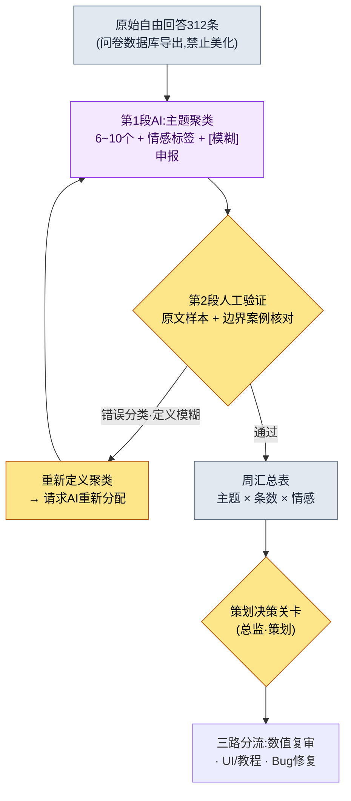
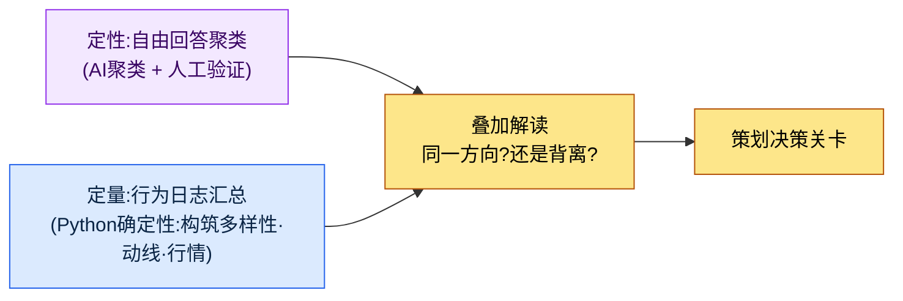

# 13.1 将数百条自由回答归为主题——聚类交给AI,诊断交给人

> 第一读者:需要解读用户反馈与元游戏的MMORPG策划(中等规模(10\~50人)团队)
> 面向个人/爱好者读者的精简版:§13.1.8「一个人的话,做到这些就够了」

上线更新的第二天早上,我还记得游戏内问卷的自由回答栏里堆了312条的那个画面。从只有一句话的短评到写满五行的怒火,什么都有。策划团队没有一个人把那312条全部读完。准确地说,是读不完。就算读了,也只是带着"强化大概太肝了的抱怨很多"这种印象走进会议,而这个印象不过是嗓门最大的那5条制造的错觉。那312条到底在说什么,没有人知道。

本章讲的是:如何在人不必读完那312条的前提下,依然能说清"什么话题有多少条"。核心有两点。第一,把数百条自由回答**归为主题并标注情感**这种枯燥的分类工作交给AI。第二,不照单全收AI的聚类,而是由人**抓出一条错误分类,予以驳回并重新请求**。FAQ与元游戏分析的通论在别的书里也有,本章只聚焦于把这类分析*放进AI工作流里运转的环节*。

---

## 13.1.1 自由回答不是"用来读的材料",而是"用来分类的材料"

FAQ与自由回答是一面镜子,照出策划设想的游戏与用户实际体验的游戏之间的差距。同一个问题一天在服务台被问30次,该做的不是增加接待人手,而是重新设计指示牌。问题在于如何数出这个"30次"。自由回答不是结构化日志,套不上 `GROUP BY`。"强化太贵了"和"资源不够养不起"是同一个主题,字符串却不同。靠人用眼睛归类,312条要花两三个小时,而且归类标准因人而异。

这正是AI该上场的地方。自由回答分类是一项(1)量大、(2)枯燥、(3)需要自然语言语义判断的工作——也就是说,确定性代码做不了,让人来做又很贵。不过有一点要在开工前钉死。**AI产出的是主题聚类(假设),而不是确定的诊断。**"强化不满38%"只是AI打标签的结果,不能直接导向"把强化削弱"的决定。贯穿整个第13部分的原则在这里同样成立——KPI定义与最终诊断交给人,自然语言归类与初步打标签交给AI。

自动化真正的价值也在这一点上。把分类自动化,与其说让分析本身变快,不如说关键在于**312条这个信号每周早上以分好类的形态送到你的办公桌上**。自动化的价值不是节省时间,而是暴露信号(团队运营概念 `automation_signal_value_over_time_savings`)。这就好比原本只是在信箱里堆积的信件,如今每天被分好类、投递到对应的部门。

---

## 13.1.2 [实操记录] 自由回答312条 → 主题聚类

下面完整地走一遍一个周期,展示实际是怎么运转的。以下是把作者项目(移动优先的MMORPG,下称"项目A")游戏内问卷的自由回答做主题聚类的一次会话的忠实再现——所谓实操记录(worked transcript),即完整保留的真实操作过程记录。输入提示词可以照原样复制使用,输出则是对真实会话的重现。

### 第1步——输入:原样丢进自由回答(不加工)

先把原始自由回答提取成机器可读的形态。这只需从问卷数据库里导出即可,并不是重新写。关键是**不美化、不摘要,连错别字、脏话、单个词的回答都原封不动地**放进去。原文越是原始,分类的准确度就越高。

```jsonl
# survey_freetext_2026-W21.jsonl (摘录,312条中的6条)
{"id": 0041, "text": "强化费用疯了 = = 冲10强资源根本攒不够"}
{"id": 0088, "text": "Boss招式挺好玩但奖励太抠了"}
{"id": 0102, "text": "公会战匹配太久了 等了5分钟多"}
{"id": 0156, "text": "不氪金就没法强化 这也叫游戏?"}
{"id": 0203, "text": "新副本氛围很好 音乐也不错"}
{"id": 0274, "text": "邮件里的奖励怎么没到?好像是bug"}
```

### 第2步——提示词:让它聚类,但强制给出类别、依据、模糊项申报

```
把附件 survey_freetext_2026-W21.jsonl(问卷自由回答312条)归为6~10个
主题,并给每条回答打上负面/中立/正面标签。不要拆得太细,一条回答
只归入一个聚类。归不进去的放到"其他"。按聚类给出条数、比例、主要情感、代表原文1条,
以表格呈现;分配没把握的不要硬塞,拿到[模糊]清单里,每条写一句理由。
去掉讲解,只要(甲)聚类定义 (乙)汇总表 (丙)[模糊]清单。
```

这条提示词里真正让它分类的话只有头两行,其余全是把输出形状框死的约束。给AI自由,它要么把聚类拆成20个,要么把所有回答硬塞进某个类别。挡住这一点的,是**聚类数上限(6\~10)、单一归类、情感三分类,以及"没把握就丢进[模糊]"这个出口**四条约束。分类的准确度就出自这道围栏。

### 第3步——Claude的输出(重现,摘录)

```
(甲)聚类定义
C1 强化/成长成本   —— 抱怨强化、资源获取过于繁重
C2 付费压力        —— 认为零氪/微氪被排除在成长之外
C3 内容奖励不足    —— 认为Boss、副本等付出与奖励不成正比、奖励太抠
C4 匹配/等待时间   —— 抱怨公会战、匹配等待过长
C5 内容好评        —— 对新副本、演出、音乐等的正面反馈
C6 Bug/发放遗漏    —— 奖励未发放、报错
其他               —— 不属于以上6类的零散项

(乙)汇总表
| 聚类 | 条数 | 比例 | 主要情感 | 代表原文                                  |
|------|------|------|----------|-------------------------------------------|
| C1 强化成本 | 71 | 23% | 负面 | "强化费用疯了 = = 冲10强资源根本攒不够" |
| C2 付费压力 | 58 | 19% | 负面 | "不氪金就没法强化 这也叫游戏?"          |
| C3 奖励不足 | 49 | 16% | 负面 | "Boss招式挺好玩但奖励太抠了"             |
| C4 匹配等待 | 34 | 11% | 负面 | "公会战匹配太久了 等了5分钟多"           |
| C5 内容好评 | 41 | 13% | 正面 | "新副本氛围很好 音乐也不错"              |
| C6 Bug发放 | 28 | 9%  | 负面 | "邮件里的奖励怎么没到?好像是bug"         |
| 其他       | 31 | 10% | 混合 | (零散项居多)                            |

(丙)[模糊]清单(4条)
- id 0088 "Boss招式挺好玩但奖励太抠了"
  → 归入了C3(奖励不足),但前半句也与C5(好评)重叠。复合回答。
- id 0156 "不氪金就没法强化" → C1与C2的边界。归到了C2。
- (另外2条)
```

输出中最有价值的部分不是汇总表,而是**最底下的[模糊]清单**。这是AI申报自己分配的不确定性、交给人来处理的地方。好的提示词能让AI说出"这条我没把握"。

### 第4步——验证与驳回(人的位置)

这份输出不能原样报上去。人要亲自核对原文样本。实际上,这次会话里就逮到了一条。

翻开C2(付费压力)的58条、逐条扫读原文时,`id 0156 "不氪金就没法强化 这也叫游戏?"` 这一条扎眼。AI把它归到了C2(付费压力)。可这句话的第一痛点不是"付费",而是**"没法强化"**——也就是C1(强化成本)。用户是被强化的墙挡住了,把这堵墙的成因指向了付费,而付费本身并不是不满的核心。C1与C2相邻、容易混淆确实如此,但把这条算作C2,"强化成本"这个信号就会显得比23%更小,真正该动手调整的强化曲线就会在优先级上被挤后。一条错误分类,就是能改变决策方向的边界案例。

于是驳回并重新请求。

```
C1(强化成本)和C2(付费压力)的边界有点混。第一痛点若是"成长墙本身"就归C1,
若是"不付费就被排除的公平性"就归C2,重新划一遍。id 0156的核心是"没法强化",
所以归C1。按这个标准把卡在边界上的重新分配,只告诉我改动了多少条。
```

AI重新划定边界,把原在C2的9条移到了C1。结果C1从71→80条(26%),C2从58→49条(16%)。**"强化成本是单一最大主题"这个图景没变,但它的大小从23%变得更清晰为26%。**一次往返,信号的轮廓就更清晰了。这个重新分配的条数(9条)与比例变化,是这次会话里实际数出来的值(样本312条,单一周次)。

这里要讲清一点。人之所以驳回,并不是因为"AI错了"。归到C2在解释上也说得通。人所做的,是**把聚类定义(即KPI定义)打磨得更锋利,再反馈给AI**。定义由人来定,而用这个定义把312条重新过一遍的劳动,由AI来干。

---

## 13.1.3 流水线——从自由回答到决策关卡

把上面这次会话每周自动跑一遍,就成了流水线。人手要碰的只有两处。把聚类定义打磨锋利的环节(前),以及把分类结果连向决策的关卡(后)。这中间的312条归类与打标签,由AI来跑。



决定性的设计在于:第2段(人工验证)不会让AI的输出自动通过。做成自动通过型,AI一旦划错一次边界,就会每周朝同一个方向扭曲信号。可疑候选(模糊清单)由AI挑出,但要不要改聚类定义,由人来定。而且汇总表本身并不是决策,只不过是**决策关卡的输入**。"C1强化成本26%"是让总监去审视强化曲线的信号,而不是自动削弱的触发器。

---

## 13.1.4 元游戏——把自由回答与行为日志叠在一起看

如果说自由回答是"用户说了什么",那么元游戏(meta-game)就是"用户实际做了什么"。游戏上线后,会沉淀下策划并未设想的玩法,这就是元游戏。比如构筑meta(特定技能组合的扎堆)、动线meta(偏好的刷怪路线)、交易meta(与官方行情不同的玩家共识价)之类。这与自由回答不同,是**用行为日志做定量测量**的,由确定性代码(Python)来汇总。这不是AI该插手的地方。

关键是把两者**叠在一起看**。上面那次会话里,C1(强化成本)的不满以26%居首。此时若行为日志中的构筑多样性指数(头部技能组合的集中度)在同一周下降,那么"无论嘴上还是行动上,都在向单一构筑、单一成长路线收敛"这两个信号就指向同一个方向。当定量与定性一致时,决策才有把握。反过来,若自由回答风平浪静,行为日志却单单向一种构筑扎堆,那可能是用户感到不适却不说出口(即静默流失前夕)的风险信号。



这里的分工同样清晰。行为日志的汇总由**代码而非AI**来做。因为构筑占比或交易行情是不能每次调用都变的确定性数值。AI只用来归类自由回答这种非结构化文本,而定量KPI由代码钉死。

---

## 13.1.5 本章数值的出处

本章的比例遵循序言〈一个承诺〉的原则。§13.1.2中的"C1 23%→26%、重新分配9条"是从样本312条(单一周次)实际数出来的值,因此不作为绝对值,而是当作"强化成本是单一最大主题"这个*方向*来读。因果不下断言——不存在"做了FAQ分析,留存率就上去了"这类表格。取而代之,这套工作流真正可测量的有三项:聚类验证中被人推翻的错误分类条数(为0则是验证流于形式的信号)、算出周汇总所花的时间、定量与定性信号是否一致。

---

## 13.1.6 废弃·重新请求不是工具的失败,而是关卡的信号

在§13.1.2里,人推翻了C2的9条分配。每周跑验证,这种推翻每次都会出现0到几条。重要的是**推翻0条并不是目标**。若验证中一条都没被推翻,那只有两种可能——AI完美(罕见),或者验证者没看原文、只是盖了个章。后者占压倒性多数。

每周逮到一两条边界案例,并以此为契机让聚类定义一点点变得锋利,这时验证关卡才算真正在运转。这是"人必须定期对AI分类的准确度做抽样评审"这一通用原则的具体形态。同一类用户被分散到不同主题的错误分类,若不做评审、只信任自动分类,就会每周累积。

---

## 13.1.7 常见的失败

| 模式 | 为何失败 | 处方 |
|---|---|---|
| 只靠人用眼睛扫读自由回答 | 嗓门大的5条代表312条的错觉 | 用AI聚类做全量分类(§13.1.2) |
| "AI帮我分析下用户反馈"整个甩给它 | 聚类被拆成20个,或强行分配 | 强制聚类数上限·单一归类·[模糊] |
| 不加验证就上报AI的汇总表 | 边界错误分类改变决策方向 | 原文样本 + 亲自核对边界案例 |
| 把汇总比例直接等同于决策 | "不满26%所以削弱"式的自动触发 | 汇总表只是决策关卡的输入 |
| 只看定性、无视行为日志 | 错过无声的静默流失 | 把定量(代码)·定性(AI)叠在一起读(§13.1.4) |
| 让AI去汇总定量KPI | 每次调用数值都变,平衡随之动摇 | 构筑·行情的汇总用确定性代码 |

第三条最常被忽略。汇总表很干净,让人忍不住原样相信。但正如id 0156那一条,边界上的一个错误分类,就能把优先级整个改写。验证不是把312条重读一遍,而是**只把最大的两三个聚类的边界案例**拿原文核对。

---

## 13.1.8 动手试试——今天就能做的一步

> **一个人的话,做到这些就够了**:没有问卷数据库也行。把你自己的游戏(或喜欢的游戏)的商店评论、社区帖子只收集30\~50条文本,原样贴上§13.1.2的提示词跑一次。从跑出的聚类里挑一条"这归得有点怪"的分配,试着反驳"这条回答的第一痛点是别的主题,请重新确定定义并重新分配",你就会切身体会到,聚类原来是一堆判断的集合。

如果是团队,就从下面这一步开始。把一周的自由回答不加美化地导出为 `survey_freetext_YYYY-Www.jsonl`,用§13.1.2的提示词跑一次。然后只把最大的两个聚类的边界案例拿原文核对。聚类定义一旦打磨锋利,之后每周用同一条提示词就能自动积累起可复现的周汇总。

---

### 本章要点
- 自由回答不是用来读的材料,而是用AI全量分类的材料。
- 聚类定义(即KPI定义)由人来定,312条的归类交给AI。
- 验证中推翻0条,是只盖章不看的信号。

### 下一章预告
- 13.2 KPI定义·追踪——精简到5\~7个的诊断表与测量陷阱
