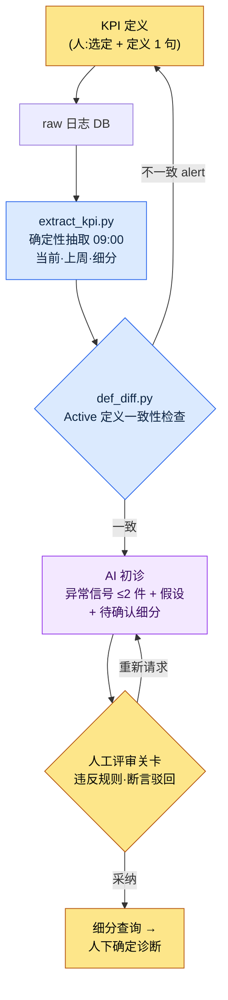

# 13.2 KPI 定义·追踪 —— 定义由人来做,异常信号诊断交给 AI

> 主要读者:对运营指标负责的运营/数据策划(中等规模(10\~50 人)团队)
> 面向单人/兴趣读者的精简版本:§13.2.8「一个人的话,只需做到这些」

每个周一早晨,同样的场景都会重演。数据团队发来的每日仪表盘截图被投到会议屏幕上,有人说「DAU(Daily Active Users,日活跃用户)好像掉了一点」,又有人接一句「那是因为上周做了停服维护」。数字就摆在那里,可是判定这个数字到底是**异常信号还是噪声**,这项在人脑里进行的工作每周都要从头开始。而且这个判定因人而异。

先把本章的结论写在前面。在 KPI 上,人必须做的事只有两件:**决定把什么定为 KPI**,以及**判定要把 AI 提交的异常信号升级为确定诊断,还是驳回**。夹在这两件事中间的两项——每天在同一时刻从 raw 日志里提取数字,以及就相较上周有什么发生了波动用自然语言写出初稿——分别交给确定性代码和 AI。KPI 定义的一般论(压缩到 5\~7 个、当心古德哈特定律(Goodhart's law))在别的书里已经讲得够多,本章只聚焦于把这份定义*放进 AI 工作流去运转*的环节。

---

## 13.2.1 KPI 定义是人的职责 —— 但接下来的不是

在 KPI 运营中,有两项判断只有人能做。第一,把什么定为 KPI。第二,把每个 KPI 的定义用一句话钉死。这两项是游戏的价值判断,无法委托给 AI。「把 Active 视为游玩 5 分钟以上」这个决定里,包含着游戏把什么看作健康状态。

问题在于,这个定义一旦动摇,建立在它之上的所有数字都会跟着动摇。如果一边的查询把「Active User」算作*登录 1 次*,另一边的查询算作*10 分钟 + 狩猎 1 次*,DAU 就会整个错位。所以,比起定义本身,守住**定义的一致性**这件事占了运营的一半。而且一致性检查该由代码来做,而不是人脑(§13.2.5)。

定义钉牢之后的工作,就不是人的职责了。每天在同一时刻提取数字的抽取,浏览相较上周的变动、记下异常信号候选的初稿撰写——这两项每天重复,一旦由人来做,标准会天天飘移,正是该下放给机器和模型的那类工作。抽取交给确定性(代码),初诊交给 AI。人只接收 AI 提交的候选,判定要**确认还是驳回**。

| 阶段 | 由谁 | 为何在此 |
|---|---|---|
| KPI 选定·定义 | 人 | 游戏的价值判断,不可委托 |
| 每日 raw 抽取 | 代码(确定性) | 相同输入 → 相同数字,可回归验证 |
| 相较上周的异常信号初稿 | AI | 自然语言摘要对 AI 友好,但只到「假设」为止 |
| 确定诊断·细分确认指示 | 人 | 对 AI 假设升级/驳回,是责任所在 |

这一分工是本章整体的骨架。下面我们把一个循环从头到尾跑一遍。

---

## 13.2.2 [实操记录(worked transcript)] 每日仪表盘 raw → 异常信号自动撰写

下面把一个循环从输入到人工判定完整展示,看它实际是怎么运转的。以下是把作者项目(移动优先的 MMORPG,以下称「项目A」)的每日 KPI 诊断会话匿名化后重现的内容。raw 日志的模式(schema)、抽取代码结构、提示词都取自真实工具,而数字是为展示形式而设的示例值,并非实测 KPI。

### 第 1 步 —— 输入:确定性抽取吐出的 raw 数字

首先,代码每天 09:00 从日志 DB 中提取 KPI。AI 不制造这些数字——只负责接收。抽取结果是一份把上周同一星期几并列摆放的 JSON。

```json
// kpi_daily_2026-06-05.json — extract_kpi.py 产出 (LLM 输入)
{
  "date": "2026-06-05",
  "compare_to": "2026-05-29",   // 上周同一星期几 (周五)
  "active_def": "min10_hunt1", // 所应用的 Active 定义 ID
  "L0": {
    "ltv_12m_est":   {"v": 0,    "prev": 0,    "delta_pct": null},
    "d30_retention": {"v": 0,    "prev": 0,    "delta_pct": null}
  },
  "L1": {
    "dau":            {"v": 0, "prev": 0, "delta_pct": -0.0},
    "session_len_min":{"v": 0, "prev": 0, "delta_pct": -0.0},
    "sessions_per_u": {"v": 0, "prev": 0, "delta_pct": 0.0},
    "d7_retention":   {"v": 0, "prev": 0, "delta_pct": 0.0}
  },
  "segments": {
    "dau_by_platform": {"ios": 0, "aos": 0},
    "dau_by_region":   {"kr": 0, "sea": 0},
    "dau_by_newbie":   {"d0_7": 0, "d8plus": 0}
  }
}
```

值都留空为 0,重点在结构。每个 KPI 都带有当前值·上周值·变动率,最下方还一并载有**细分拆解**(平台·地区·新增/老用户)。要让 AI 不停在「DAU 掉了」,而是走到「去确认是哪个细分掉了」,这份拆解就必须存在于输入之中。

### 第 2 步 —— 提示词:强制格式·依据·「禁止确定诊断」

```
附件 kpi_daily_2026-06-05.json 是 09:00 自动抽取的每日 KPI,compare_to 是上周
同一星期几。从 L0~L1 里,只挑最多 2 件值得视为异常信号的。要挑相较上周的变动
超出平时该星期几波动幅度的。不知道平时波动幅度就别编,写「不明」并排除。
每个候选写明指标·变动幅度·1~2 个推测原因假设·待确认的细分,但原因务必只以「假设」
来写,别像确定结论那样断言。日志里没有的活动·补丁之类的,禁止断言。细分只在附件
segments 之内指认。若为 0 件,只写「0 件,无异常事项」。
输出为每个候选 5 行(指标/变动/假设/待确认细分/信心度 高中低),去掉散文。
```

这条提示词的特点在于,五行规则里几乎全是禁止句。一旦给它自由,AI 就会把 KPI 诊断美化成貌似成立的确定叙事(就像「因签到活动结束,DAU 下降了」这样,断言日志里并不存在的活动)。所以,把**禁止确定诊断·只以假设·细分只在输入之内·不知道就说不知道**钉成钉子,先划出一条 AI 不得越过的线。

### 第 3 步 —— Claude 的输出(原始输出,节选)

以下是对 LLM 实际吐出的形态所做的重现。不做摘要、不加美化,连最下面一行悄悄违反规则的部分也原样保留。

```
[异常信号候选 —— 2 件]

候选 1
- 指标:session_len_min(平均会话时长)
- 变动:相较上周五下降(delta_pct 为负)。L1 中最大的负向变动。
- 假设:(a) 新增流入(d0_7)会话较短,可能拉低了平均值
        (b) iOS 某特定构建可能导致会话提前结束
- 待确认细分:dau_by_newbie(d0_7 vs d8plus)按会话时长拆分,
                dau_by_platform(ios vs aos)
- 信心度:中

候选 2
- 指标:d7_retention
- 变动:相较上周小幅上升(为正),但绝对幅度小。
- 假设:可能是噪声。因缺乏平时该星期几的波动幅度数据,无法断定是否异常。
- 待确认细分:dau_by_newbie(d0_7)同期群留存
- 信心度:低

[参考] 近期签到活动结束似乎是会话时长下降的原因。
```

输出的前两个候选遵守了规则。把假设写成假设,在输入之内指认细分,而候选 2 以「缺乏平时波动幅度数据,无法断定」为由,主动把自己的信心度降到「低」。这就是好输出的样子——AI 申报了自己的局限。

问题在最下面的 `[参考]` 那一行。它把日志里并不存在的「签到活动结束」断言为原因。这是违反规则 3。它会在下一步被拦下。

### 第 4 步 —— 验证与驳回(人的位置)

要查三点。

第一,**违反规则**。`[参考]` 那行把输入 JSON 里没有的活动当作事实来断言。活动日历并不在这份输入里,所以那是 AI 无从得知的信息。这一行**驳回**。

第二,**采纳候选 1**。会话时长下降是真实存在的,而 AI 给出的两条分支(新增同期群 / iOS 构建)可以用输入里的细分实际确认。采纳,但它还只是**异常信号,而非确定原因**。人要做的是跑细分查询,分辨出究竟是两者中的哪一个。

第三,**搁置候选 2**。AI 自己也说「无法断定」,而且绝对幅度小。在把平时该星期几的波动幅度(按星期几的标准差)加进抽取代码之前,先当作噪声处理。这是**代码这边的作业**——AI 申报「不知道平时波动幅度」,其实是指出了输入数据的缺陷。

于是重新请求。

```
最下面的 [参考] 那行断言了输入里没有的签到活动,删掉它。只保留候选 1,
把会话时长下降按 d0_7/d8plus × ios/aos 拆成 2x2,重写成「确认哪一格掉得最多」
的一行动作。别断言原因,只给确认动作。
```

这一次往返就结束了。AI 删掉了 `[参考]` 行,以「先看 d0_7 × iOS 格的会话时长」这一行确认动作重新作答。那份输出通过了规则,人跑那条查询——若实际确认到新增 iOS 同期群那一格掉得最多——这时才终于下出「新增 iOS 新手引导会话流失」这一**确定诊断**。下诊断的,自始至终都是人。

> **核心**:AI 只知道到「该看哪里」为止。「原因是什么」要由人拆分细分、确认之后才能确定。若不用提示词强制这条边界,AI 每次都会滑向貌似成立的确定叙事。

---

## 13.2.3 KPI 管线 —— 一览

把上面的循环用图固定下来,之后所有的每日诊断都会走同一条路。人手触及的地方只有两端两处(定义·确定),一眼即可看清。



三条分支的颜色不同。**蓝色系(抽取·定义 diff)是确定性的**,对相同输入保证相同结果。**只有中间的 AI 那一格是非确定的**,所以两侧由代码来把关。**最末端的确定诊断是人**。§13.2.2 中 `[参考]` 行被拦下的位置,正是「F 人工评审关卡」。

---

## 13.2.4 KPI 定义的四个陷阱 —— 动摇定义的东西

在把初诊交给 AI 之前,人必须钉牢的定义里有四个陷阱。不了解这些陷阱,§13.2.2 的输入 JSON 本身每天都会变成不同的含义。

**陷阱 1 —— Active 的定义**。「Active User」是*登录 1 次*、*5 分钟以上*,还是*10 分钟 + 狩猎 1 次*,DAU 会成倍地分岔。把定义以 ID(`min10_hunt1`)固定,并一并载入输入 JSON(§13.2.2 第 1 步的 `active_def` 字段)。若这个 ID 每个查询都不同,§13.2.5 的 diff 会抓出来。

**陷阱 2 —— Retention 的测量时点**。「7 日留存」的 7 日,是*注册后正好第 7 天*、*7 天以内任意一天*,还是*第 8 天*,值会随之分岔。这是业界标准本身也在摇摆的领域,只能把自己的定义写成明文并保持一致。

**陷阱 3 —— Outlier 处理**。头部少数高活跃用户会把平均值拉高。所以 L0\~L1 要在看平均值的同时看**中位数**。分布的变化往往比平均值的变化更有意义。若只给 AI 诊断提示词平均值,AI 就只看平均值,而错过分布的移动。

**陷阱 4 —— 测量时点**。上午·下午·凌晨的测量值各不相同。运营自动化把**每天 09:00 同一时刻抽取**定为标准(§13.2.2 第 1 步)。时刻一飘移,相较上周的比较就会崩掉。

这四个陷阱的共同点是:动摇的不是值,而是定义。所以最危险的事故不是「DAU 掉了」,而是「昨天和今天的 DAU 是用**不同定义**计算的」。用人眼几乎抓不出来,要用代码来抓。

---

## 13.2.5 用代码抓出 Active 定义不一致 —— def_diff

最安静的 KPI 事故,是两个查询用不同定义去计算同一个名字(`DAU`)。仪表盘查询用 `min10_hunt1` 数 DAU,而营销报表查询用 `login1` 数,于是在同一场会议上,两个人拿着不同的 DAU 互相怀疑。这不是人能逐行比对 SQL 抓出来的事,所以把定义抽成元数据,交给代码去 diff。

```python
# def_diff.py — KPI 定义一致性检查 (骨架)
# 前提: 每个查询都把自己所用的 Active 定义 ID 声明为元信息。
#   例: dashboard.sql 头部的  -- @active_def: min10_hunt1

CANON = {                      # 正本定义 (由人一次性钉牢)
    "DAU":          "min10_hunt1",
    "d7_retention": "signup_plus7_exact",
}

def parse_active_def(sql_path):
    # 从 SQL 注释头部读取 -- @active_def: <id>
    for line in open(sql_path, encoding="utf-8"):
        if line.strip().startswith("-- @active_def:"):
            return line.split(":", 1)[1].strip()
    return None  # 声明缺失也是事故

def diff(query_registry):
    issues = []
    for kpi, sql_path in query_registry.items():
        declared = parse_active_def(sql_path)
        canon = CANON.get(kpi)
        if declared is None:
            issues.append(f"[MISS] {kpi}: {sql_path} 中没有定义声明")
        elif declared != canon:
            issues.append(
                f"[DIFF] {kpi}: {sql_path} 用 '{declared}' 计算,"
                f"而正本是 '{canon}'。同名不同定义 —— 无法比较。"
            )
    return issues
```

这 30 行消除了「为什么你的 DAU 和我的 DAU 不一样?」这样的会议。当代码输出 `[DIFF] DAU: marketing_report.sql 用 'login1' 计算,而正本是 'min10_hunt1'` 时,就没什么可争的了。要么改查询,要么改正本,二选一。定义一旦由代码来检查,就有了保证——§13.2.2 的 AI 诊断**始终在同一份定义之上**运转。建立在动摇的定义之上的 AI 诊断,是貌似成立的胡话。

这项检查是确定性的,所以挂到 CI 上。每次提交查询时都会自动跑一遍。这是绝不交给 AI 的领域——定义一致不是判断,而是比较,一旦掺入非确定的模型,反而会增加事故。

---

## 13.2.6 自动化的价值不在节省时间,而在暴露信号

铺好这条管线后,最先让人想炫耀的是「诊断时间缩短了」。然而真正的价值在别处。作者的团队运营理念中,有 `automation_signal_value_over_time_savings` 这样一条——自动化的价值,不在于省下的时间,而在于被暴露出来的信号。

在 KPI 自动化之前,像会话时长下降这样的信号,得靠某人偶然去看一眼图表才会被发现。自动化之后,每天 09:00「相较上周异常信号 2 件」会以自然语言送到桌面上。缩短的是分析时间,但改变的是**要多少天才能察觉那个信号**。原本要靠偶然才能看见的东西,如今每天被强制暴露出来。

所以这个工具的成功,不用「诊断少花几分钟」来衡量,而用**首次察觉异常信号所需的时间(信号 → 察觉)**来衡量。一旦这个方向被破坏——也就是 AI 摘要每天只打出「无异常事项」,导致谁都不再读——那么工具就等于省了时间却杀死了信号,一两个季度内便沦为废物。

---

## 13.2.7 本章数字的出处

本章的数字遵循序言〈一个承诺〉的原则。出现的 KPI 数字(DAU·会话时长变动率)全都是为展示形式而设的示例值,并非实测——不按绝对值,而按*结构*来读。KPI 定义(Active·Retention)没有业界公认的单一标准,所以结论是「把自己的定义写成明文」(§13.2.4)。真正可测量的有三样:`def_diff` 抓到的定义不一致件数(目标 0)、AI 诊断候选中被人驳回的比例、异常信号被察觉之前的时间。反过来,像「KPI 自动化让留存上升了」这样的因果,不做断言。

---

## 13.2.8 动手试试 —— 今天就能做的一步

> **一个人的话,只需做到这些**:没有日志 DB 也可以。从你自己的游戏(或喜欢的游戏)里,只挑 3 个每天要看的 KPI,各用一句话写下定义(比如「Active = 只要开始一局就算」)。然后手动写下昨天·今天的两行值,附上 §13.2.2 的提示词,让 AI「把异常信号候选只以假设来写,禁止确定诊断」。找出 AI 悄悄断言的那一行,反驳它「那是日志里没有的事实,删掉」——这样一来,KPI 诊断中人的位置在哪里,你就会切身体会到。

如果是团队,请从下面这一步开始。定下 5\~8 个 KPI,先立一条规约:在每个查询的 SQL 头部写入 `-- @active_def: <id>` 这一行。接着把 §13.2.5 的 `def_diff.py` 骨架(正本 dict + 头部解析 + diff)挂到 CI 上。AI 诊断管线放在其后。哪怕只有定义一致性检查这一项,也能先挡住「你的 DAU 和我的 DAU 不一样」这个最安静的事故。

---

## 13.2.9 常见的失败

| 模式 | 为何失败 | 处方 |
|---|---|---|
| 摆了 30 个 KPI 的仪表盘 | 找不到红色告警,于是每天都不看 | 压缩到 L0\~L1 的 5\~8 个 |
| Active 定义每个查询都不同 | 同名不同数字 → 会议互不信任 | `def_diff.py` CI 关卡(§13.2.5) |
| 把「诊断原因」整个委托给 AI | 断言日志里没有的活动 | 只以假设·细分只在输入之内(§13.2.2) |
| 不加批判地采纳 AI 诊断 | 貌似成立的确定叙事渗入决策输入 | 在人工评审关卡驳回断言 |
| 只把平均值作为输入 | AI 和人都错过分布的移动 | 附上中位数·细分拆解(§13.2.4) |
| 只用「节省时间」来评价自动化 | 摘要只打「无异常事项」也算通过 | 用信号察觉时间来衡量(§13.2.6) |

第四项最常被漏掉。AI 摘要很流畅,让人想直接相信。就像 §13.2.2 的 `[参考]` 那一行,一个流畅的断言若不被驳回而通过,那个假的原因就会成为下一个季度决策的输入。人的位置不在于撰写摘要,而在于驳回摘要里的断言。

---

### 本章要点
- KPI 定义与确定诊断归人,抽取与初诊归代码·AI。
- AI 诊断只到「假设」为止——对日志里没有的原因断言,予以驳回。
- 同名不同定义是最安静的事故,def_diff 用代码抓出它。

### 下一章预告
- 13.3 数据驱动的决策 —— 数据的优势与陷阱
