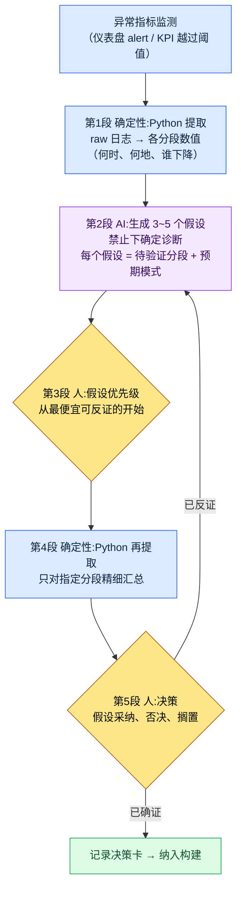

# 13.3 从异常指标到决策 —— AI 提出假设,人做决策

> 主要读者:依据 KPI 做季度决策的数据负责人、总监（中等规模的 10\~50 人团队）
> 面向个人/业余读者的精简版:§13.3.9〈一个人的话,做到这些就够〉

我曾在某个周一早晨的仪表盘上看到一条红线。30 日留存率相比上周明显下滑。会议室里的人各自给出一个原因。有人说是上周更新的新猎场,有人说是竞品的新赛季,有人只说是"季节性因素"。听起来都有道理。问题在于,直到那天下午过去,我们连该验证什么都没能达成一致。假设有五个,可待验证的分段一个都没定下来。

本章讲的是如何结束那样的早晨。核心只有一句。**看到异常指标时,不让 AI 下确定诊断,而让它给出 3\~5 个可验证的假设。** AI 不会断言"留存下降的原因是 X"。它给出的是"若为 X,则这个分段会呈现这样的模样"这类验证设计,而决策由人来做。数据驱动的一般论在别的书里已经足够,本章只聚焦于把那套一般论*落到 AI 工作流上的那个环节*。

---

## 13.3.1 KPI 定义由人,解释辅助交给 AI

先把边界钉死。整章都立在一句话之上。**把 KPI 定义成什么由人来定,而当那个 KPI 出现波动时,只有快速铺开"它为何波动"的假设这一件事由 AI 来协助。**

这条边界一旦崩塌,数据驱动本身就会崩塌。把 KPI 定义交给 AI,"容易测量的东西"就会变成 KPI;把诊断也交给 AI,一句貌似成立的确定判断就会跳过人的验证,直接变成决策。所以只给 AI 开一个区间 —— 在异常被捕捉之后、人做出决策之前,铺开"该怀疑什么、该确认什么"的那个区间。

这种分工与第 13 部分前几章共享同一条脊椎。raw 日志由 Python 以确定性方式提取（13.1）,KPI 定义与层级由人固定（13.2）,而本章是在此之上,只让 AI 承担异常被捕捉时的*解释辅助*。提取靠确定性,定义靠人,解释辅助靠 AI。三者互不混淆,正是这一部分整体的安全装置。

笔者的项目（移动优先的 MMORPG,以下称"项目A"）铺设了支撑这种辅助的真实日志。团队记忆文件夹下的 `_economy_log/`（token、时间经济性日志）、`_scores_latest.json`（指标分数缓存）、`_roi_report.md`（ROI(Return on Investment,投入产出比)报告）就是它们。本章的实操记录（worked transcript）以从这些日志中提取的异常信号为输入。

---

## 13.3.2 决策循环 —— AI 介入的位置只有一格

先用一张图把从单个异常指标通向决策的整个循环固定下来。在这张图里,AI 介入的格子只有一个,即"生成假设"。它之前（提取）和之后（验证、决策）都是人和代码的位置。



人经手的地方有三处。定义什么算异常的位置（最前端,已在 13.2 结束）、挑选先验证哪个假设的位置（第3段）、做出最终决策的位置（第5段）。其间枯燥的日志汇总由 Python 完成,快速铺开假设由 AI 完成。**AI 下确定诊断的格子在这个循环里并不存在。** 假设为被反证而存在,一旦被反证,就回到第2段。

---

## 13.3.3 [实操记录] 留存下降 —— 收取 3\~5 个假设

完整展示实际如何跑完一个循环。下面是对上文那个周一早晨留存下降所做的重现会话。输入的提示词可以照原样复制使用,输出则忠实重现了真实会话。

### 第 1 步 —— 输入:把 Python 提取的异常信号原样抛过去

首先,人不抛出"留存下降了"这种感觉。而是抛出 Python 以确定性方式提取的各分段数值表。这不是新写的,只是从 `_economy_log`/事件日志中提取而已。

```python
# retention_break_extract.py (骨架) —— 异常区间的分段拆解
# 输入:按日的队列留存日志
# 输出:哪个分段下降了多少（供 LLM 输入的表）
def extract_break(rows, kpi="d30_retention", baseline_weeks=4):
    base = mean([r[kpi] for r in rows if r.week < target_week][-baseline_weeks:])
    cur  = [r for r in rows if r.week == target_week]
    return [
        {"segment": s.name,
         "baseline": round(base_by_seg[s.name], 3),
         "current":  round(s.value, 3),
         "delta_pct": round((s.value/base_by_seg[s.name]-1)*100, 1),
         "n": s.sample_size}          # 样本数 —— 太小则可信度低,一并传入
        for s in cur
    ]
```

这段脚本吐出的表,就是给 AI 的第一手输入。关键在于把样本数（`n`）一并传入。要让 AI 不把样本小的分段的波动误当成原因,拿着那份警告的就必须是数据,而不是人。

```
# retention_break_2026Q2W3.txt （提取结果,节选）
segment              baseline  current  delta_pct      n
新用户(注册7日内)      0.41     0.31      -24.4%     8,200
回流(休眠30日以上)     0.28     0.27       -3.6%     1,100
付费(收费)            0.62     0.60       -3.2%     2,400
零氪                 0.34     0.25      -26.5%    14,900
新猎场_游玩           0.39     0.22      -43.6%     3,050
新猎场_未游玩         0.40     0.38       -5.0%    11,200
```

### 第 2 步 —— 提示词:禁止诊断,强制给出假设与验证设计

```
附上的 retention_break_2026Q2W3.txt 是 Python 提取的 d30 留存按分段的变化
（baseline=前 4 周平均,current=本周,n=样本数）。零氪、新猎场_游玩这两个分段
下降很大。不要诊断原因,只需建立 3~5 个可验证的假设。每个假设用
假设一句话 / 待验证的分段（如何进一步拆分） / 若成立会出现的模式 / 证伪的
反证条件,就这四行。样本小的分段（n<2000）不要作为核心依据,若要用则
标注其局限。假设按最便宜就能反证的顺序排列,数据无法判别的,
另行标注"需人工判断"。输出只要假设卡片列表,不要叙述。
```

这段提示词里没有一句"去找原因"。取而代之的,只写明了假设该具备的骨架和不可逾越的界线。给 AI 自由,它就会吐出"大概是新猎场难度的缘故"这类貌似成立的确定判断,而这句话一旦记入会议纪要,就会未经验证地变成决策。挡住它的装置有四个:**禁止断言;每个假设必须给出验证分段、预期模式、反证条件;按反证成本排序;"无法判别的交给人"。** 这是把输出从诊断改造成验证设计的装置。

### 第 3 步 —— Claude 的输出（原始,重现）

```
[假设 1]（反证成本最低）
假设:新猎场的难度成为零氪新用户的进入门槛,推高了 7 日内的流失。
验证分段:将新猎场_游玩分段按"首次死亡次数"区间（0~2 / 3~5 / 6+）重新拆解。
预期模式:若假设成立,首次死亡 6+ 区间的 d7→d30 流失率应急剧上升。
反证条件:若死亡次数与流失率之间不存在单调关系,则否决。

[假设 2]
假设:原因不在新猎场本身,而在同一补丁中捆绑的其他改动（奖励曲线、UI）。
验证分段:未游玩新猎场但在补丁后登录的用户的留存。
预期模式:若未游玩分段也一同下降,则猎场不是元凶。
反证条件:若未游玩分段维持 baseline（约 -5% 水平）,则否决本假设,转向假设 1。

[假设 3]
假设:因外部因素（竞品新赛季）导致零氪整体流失,与猎场无关。
验证分段:付费/零氪 × 是否游玩新猎场 的 2×2 交叉表。
预期模式:若为外部因素,则无论是否游玩猎场,零氪整体都均匀下降。
反证条件:若下降集中于新猎场_游玩,则外部因素说被削弱。

[假设 4]（需人工判断）
假设:测量本身的问题 —— 本周队列定义/日志采集发生了变动。
验证分段:（数据无法判别）需人工确认补丁是否伴随 telemetry 模式(schema)变更。
预期模式:若发生了 schema 变更,则下降可能并非真实,而是测量伪影(artifact)。
反证条件:若确认日志管线无变更,则否决。

注意:"回流"（n=1,100）分段样本太小,未将 -3.6% 视为信号。
```

这段输出中最有价值的部分是假设 4。这是 AI 申报自身局限的地方 —— "这一点数据无法判别,请人来确认 telemetry 模式(schema)是否变更"。好的提示词会让 AI 能够说出"我不知道"。而最后一行 —— 它自行把样本仅 1,100 的分段排除在信号之外 —— 正是规则 3 生效的痕迹。

### 第 4 步 —— 验证与决策（人和 Python 的位置）

不能把这些假设卡片直接搬成决策。由人确定优先级,再由 Python 重新汇总。

假设 2 的反证成本最低。新猎场_未游玩分段在第 1 步的表里已经有了 —— `-5.0%`。它维持了 baseline。也就是说,没玩猎场的用户安然无恙。**假设 2 当场被否决,同时假设 3（外部因素导致整体下降）也随之削弱。** 因为若是外部因素,未游玩的用户本也该一同下降。下降集中在*游玩过*新猎场的用户身上。

于是收窄到假设 1,再跑一次 Python。把新猎场_游玩按首次死亡次数重新拆解后,死亡 6 次以上的区间里 d30 流失格外突出（方向:死亡越多、流失越陡的单调关系 —— 精确数值由构建的 telemetry 测量,这里只看方向）。与假设 1 的预期模式一致。

剩下的是假设 4。人确认了补丁说明 —— telemetry 模式无变更。测量伪影的可能性被否决。至此,决策的材料齐备了。

> **[第5段 人做决策 —— 决策卡]**
>
> - **采纳**:新猎场初期难度（首次死亡频率）是零氪新用户流失的首要动因。下一个构建中对 1\~5 级区间的敌人密度、血量做下调 A/B。
> - **否决**:外部因素说（假设 3）、测量伪影说（假设 4）。
> - **搁置**:奖励曲线（假设 2 的残留）—— 若在调整猎场难度后下降仍未消失,则重新点燃。
> - **AI 的角色记录**:诊断 0 件,提供假设 4 件 + 验证设计。决策由人做。

输入（异常信号）→ 提取 → 假设 → 验证 → 决策,这一个循环在此闭合。AI 一次都没说过"原因就是这个"。它只铺好了验证的路。这就是本章的"展示(Show)"标准 —— "AI 分析了数据"这句话,若不曾把假设了什么、什么被反证、人决定了什么完整看过哪怕一次,就是空洞的。

---

## 13.3.4 为何禁止"确定诊断"

生成假设与确定诊断之间的差别看似微不足道,却划分了决策的安全。把两者并置,差别就一目了然。

| | 确定诊断（禁止） | 生成假设（本章的做法） |
|---|---|---|
| AI 输出 | "留存下降的原因是新猎场难度" | "难度假设 —— 去看首次死亡 6+ 区间,这样就对、那样就错" |
| 人的下一步行动 | 照单全收并决策 | 从最便宜的假设开始尝试反证 |
| 出错时 | 错误决策直接进入构建 | 在验证阶段被否决,成本为 0 |
| 责任归属 | "是 AI 说的"（责任蒸发） | 人挑选假设并决策（责任明确） |

确定诊断真正的危险不在准确度,而在于**它会让人跳过验证**。一句貌似成立的话能平息会议室里的怀疑。反之,假设卡片本身就是一份"去确认这个"的作业,是一种未经验证便无法迈入决策的结构。把 AI 当作假设发生器而非诊断器,原因就在这里。

---

## 13.3.5 Goodhart 预警 —— 让 AI 先点出 KPI 扭曲

数据驱动最深的陷阱是 Goodhart 定律。*"当测量指标成为目标的那一刻,它便不再是好的指标。"* 若把 DAU 设为目标,就会靠人为的推送把 DAU 吹大,而长期留存被削减。问题在于,这种扭曲通常要**在决策做出很久之后**才会以副作用的形式暴露出来。

所以把 AI 提前一格投入。在把决策方案纳入构建之前,先让 AI 回答"若把这个 KPI 设为目标,它会被如何钻空子(game)"。这不是诊断,而是*红队(red team)* —— 故意让它去找我们决策的漏洞。

> **[Goodhart 预警提示词]**
>
> 本季度的目标 KPI 是 d7 留存 +5%p,达成手段的初稿是大幅强化连续 7 日的
> 签到奖励。请你担任这个决策的红队,把"若将该 KPI 设为目标"可能出现的
> Goodhart 扭曲情景 3 个、每个情景中会一同崩坏的护栏指标,以及
> 能及早捕捉扭曲的监控分段,用表格列出来。不要断言,用"可能会这样"的形式。

AI 给出的不是确定的预言,而是一份该怀疑之处的清单。只摘录核心的话,如下。

| Goodhart 扭曲情景（假设） | 会一同崩坏的护栏指标 | 早期监控 |
|---|---|---|
| 只打卡签到,核心内容不游玩 | 每次会话的战斗次数、猎场进入率 | d7 留存 ↑ 与战斗次数 ↓ 同时出现时告警 |
| 奖励通胀导致经济崩溃 | 货币回收/产出比、道具行情 | 追踪 `_economy_log` 回收-产出缺口的扩大 |
| 签到结束后随即断崖式流失 | d8\~d14 留存（奖励刚结束） | 不要只看 d7,把 d14 作为一对来看 |

这张表的价值不在于标准答案,而在于**决策之前就把护栏指标预先成对绑定**。若要把 d7 留存设为目标,就把 AI 点出的"战斗次数"和"d14 留存"放在同一屏上一起看。这样一来,即便 d7 上升,一旦战斗次数随之下降的那一刻 —— Goodhart 扭曲开始的那一刻 —— 就能在副作用累积到季度末之前将其捕捉。用护栏指标绑定,而非把单个 KPI 设为目标,这个习惯正是让 13.2 中定下的"5\~7 个 KPI 的平衡"在决策阶段真正运作起来的方法。

这里要点明一件事。AI 在这次红队中创造的价值并不是"节省时间"。人想出这三个情景所花的时间并不长。真正的价值在于**在做决策的当场就把扭曲信号暴露出来** —— 把平时不看的护栏指标提到决策桌面上来的这种信号效应。自动化的价值不在于节省时间,而在于让平时看不见的信号变得可见（项目A 团队记忆概念 `automation_signal_value_over_time_savings`）。

---

## 13.3.6 不同决策,AI 假设的分量各不相同

生成假设并非对所有决策都同样有用。随着决策的时间跨度与数据密度不同,对 AI 假设该信任多少也会改变。

| 决策类型 | 数据密度 | AI 假设的位置 |
|---|---|---|
| 技能数值平衡改动 | 高（模拟、日志充足） | 假设→验证→决策循环照旧,AI 辅助力强 |
| UI 组件改动 | 高（可做 A/B） | 相同,AI 假设有效 |
| 新内容是否上线 | 中（仅有同类内容可参照） | 假设仅供参考,决策权重偏向人 |
| 长期愿景、新领域 | 低（无先例） | 循环本身跑不起来 —— 由人决策,AI 只做风险罗列 |

规则很简单。**数据越厚的决策,越是照原样跑 §13.3.2 的循环;数据越薄的决策,AI 的角色就从假设发生器下降为风险清单编写器。** 试图用数据去解长期愿景之所以危险,是因为在没有未来数据的地方,AI 若用过去的数据编出貌似成立的假设,那假设就会把愿景往过去拉。没有数据的领域的决策,不是回避或甩给 AI,而是留作由人负责做出的位置。

> **[方向路标 —— 若用嵌入(embedding)把话题、队列坐标化（目前尚为时过早）]**
>
> 请把它当作研究动向而非处方来读。第 13 部分的两个位置上,同一个嵌入构想被打开。一是 §13.1 的自由作答 —— 把非结构化的自然语言用句子嵌入聚类,就能把 §13.1.2 的[模糊]边界案例以"两个话题中心之间的距离"来坐标化,并把离任何中心都远的作答标记为"新话题出现"。另一是 §13.1.4 的行为日志 —— 把游玩日志嵌入,就能把没有人预先定义过的"涌现队列"以向量空间（附录 M 的"地图"）聚类的方式显现出来,从而开辟一条把它投入 §13.3 假设循环的"待验证分段"候选的路（这正是穿透 §13.3.3 所预设的"人预先定义的分段"这一局限一格的位置）。不过,聚类不是原因,而只是假设;小的聚类不是信号（与 §13.3.3 的样本警告同处一地）;给聚类命名的标注,依然是人的分内事（§13.1.1）。尤为重要的是,在压缩所丢弃的维度上,线上事故可能爆发。所以把这个构想放在与经济篇 §8.2.7 的"维度向量"线索完全相同的位置（概念直觉见附录 M）—— 在同一片 telemetry 土壤之上,以同样的克制。它只是 telemetry 扎实铺就的团队几年后才会审视的方向路标,而当下要做的,是诚实地跑好 §13.3.2 的循环。

---

## 13.3.7 本章数字的出处

本章的数字遵循序言〈一个约定〉的原则。Goodhart 定律是 1975 年查尔斯·古德哈特（Charles Goodhart）正式提出的公开命题,项目A 的 `_economy_log`、`_roi_report.md`、`_scores_latest.json` 是真实存在的团队记忆产物,而在一致性校验失败时通知 ClickUp 的规则 `integrity_check_clickup_notify` 是分数为 294.93 的实运营 atom（附录 A.3.6、A.3.1）。§13.3.3 中"首次死亡 6+ 区间流失变陡"只以*方向*通过假设验证得到确认,绝对值则交给了构建的 telemetry。分段表（baseline 0.41 等）是为展示工作流形态的*示例构造*,而非某个特定季度的实测公开值 —— 需要记住的不是数字,而是结构。

---

## 13.3.8 常见的失败

| 模式 | 为何失败 | 处方 |
|---|---|---|
| 向 AI 问"原因是什么" | 貌似成立的确定判断未经验证就被拍板 | 禁止诊断,强制 3\~5 个假设 + 反证条件（§13.3.3） |
| 把样本小的分段的波动当信号 | 把噪声误当成原因 | 在提取阶段一并传入 `n` 并标明阈值 |
| 直奔单个 KPI 作为目标 | Goodhart 扭曲在季度末爆发 | 决策前做 AI 红队 + 护栏指标成对（§13.3.5） |
| 用数据去做没有数据的长期决策 | 过去的假设把未来愿景往下拽 | 按数据密度对 AI 角色分级（§13.3.6） |
| 收到假设未经验证就采纳 | 假设摇身变成结论 | 从最便宜的假设开始反证,善用未游玩分段 |

第三种爆发得最晚。d7 留存上升,决策看起来像是成功,可两个月后 d14 断崖与战斗次数下降一同到来。在决策*之前*把 AI 红队跑一次的那 30 分钟,买下的是那两个月。

---

## 13.3.9 动手试试 —— 今天就能做的一步

> **一个人的话,做到这些就够**:没有日志管线也没关系。从你自己的游戏（或你爱看的游戏的公开指标）里,挑一个最近下滑的数字。把这个数字抛给 AI,但不要说"告诉我原因",而请求"禁止确定诊断,给出 3 个可验证的假设,并附上反证条件"。从中挑一个最便宜就能确认的假设,亲手把数据拆一次,你就会切身体会到"接受诊断"和"验证假设"在决策安全上差别有多大。

如果是团队,就从下面这一步开始。在异常指标提取脚本抽取各分段数值时,加一行,让它**必须一并输出样本数（`n`）**（§13.3.3 的 `retention_break_extract.py`）。然后在确定下一个 KPI 目标时,把 §13.3.5 的 Goodhart 红队提示词跑一次,把一对护栏指标录入决策卡。仅凭这两点,"AI 诊断了原因"就会变成"AI 铺开假设、人验证后做出决策"。

---

### 本章要点
- 让 AI 做的不是确定诊断,而是 3\~5 个可验证的假设。
- 每个假设都强制给出验证分段、预期模式、反证条件。
- 决策前用 Goodhart 红队把护栏指标预先成对绑定。

### 下一章预告
- 14.1 把 PC 的 30 种 HUD 收敛为移动端的 10 种 —— 平台差异化决策的开端
