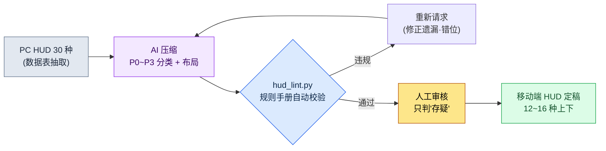

# 14.1 PC HUD 30 种压缩为移动端 10 种 —— 把约束变成规则手册,把压缩交给 AI

> 首要读者:移动优先项目的 UX·系统策划(中等规模(10\~50 人)团队)
> 面向个人/业余读者的精简版:§14.1.7「一个人的话,做到这一步就够了」

我还记得,第一次把在 PC 构建上运行良好的战斗 HUD 放到移动端分辨率上显示的那天。屏幕有一半被各种状态条、图标、小地图和任务追踪器占满,真正的角色反倒看不见了。每一个元素看上去都是必需的。问题在于,"该拿掉哪一个"每次开会都要从头重新吵一遍。有人想保住小地图,有人想保住聊天框。因为依据是"感觉",所以每次得出的结论都不一样。

本章讲的就是终结这场争吵的方法。核心有两点。第一,把移动端约束从"感觉"变成**可验证的规则手册**。第二,把"将 PC 30 种缩减为移动端 10 种"这种枯燥而重复的压缩工作交给 AI,人只做**抓规则手册违规项的审核**。移动端 UX 的通用知识,别的书里已经讲得够多了,所以本章只聚焦于把这些知识*放进 AI 工作流去运转的那个环节*。

---

## 14.1.1 移动端约束不是"注意事项",而是"规则手册"

用表格罗列移动端约束的书有很多。无非是说屏幕小、手指粗、会话短、耗电快。这些都没错,但把表格背下来,到了会上还是答不上"那这个按钮到底行不行"这个问题。只有当约束变成**用数字表示的合格/不合格标准**,AI 和人才能划在同一条线上。

好在,移动端输入约束中的相当一部分,平台公司早已用公开指南钉死了。触摸 44pt(HIG)、48dp(Material)、对比度 4.5:1(WCAG)、间距 8dp 这类公开标准遵循 §9.1 的规则手册,这里只把本章 lint 直接用到的**最小触摸目标 44pt(HIG)**保留为行内说明。这些都是无需编造的数字。要能说出"这个按钮 38pt,不到 HIG 的 44pt",而不是"这个按钮好像有点小",那么无论是人来判还是 AI 来判,都会得出一样的判定。

这里再加一条 —— MMORPG 手游以横屏双手握持为标准,可按压的元素放在两侧底部角落、消耗/槽位放在底部中央(为什么横屏是标准、三区域模型是什么,在 §9.1 中讲解)。本章所有的布局判定都以这种横屏双手握持为前提。

把平台标准和 PC 并排放在一起,压缩的起点就清晰了。PC 精密且能容纳大量(可承载 30\~50 种),移动端横屏受限于双手能够到的角落,12\~16 种就是上限(完整对照表见 §9.1 规则手册 —— 作者估计,未经验证)。因此,移动端工作的本质不是"设计",而是**"把 PC 的 30\~50 种,按优先级压缩为移动端横屏的 12\~16 种"**。而这项压缩若用手工来做,既枯燥,又每做一次基准线就晃动一次 —— 它是把同一套规则不知疲倦地反复套用的活儿,恰好契合 AI 起草、人来审核的分工。

---

## 14.1.2 [实操记录] PC HUD 30 种 → 移动端优先级压缩

下面把实际怎么运转的一个完整周期从头演示到尾。以下内容忠实再现了作者项目(移动优先 MMORPG,以下简称"项目 A")的战斗 HUD 压缩会话,是一份实操记录(worked transcript,即完整保留的真实操作过程的记录)。输入的提示词可以照原样复制使用,输出则是对真实会话的重现。

### 第 1 步 —— 输入:把 PC HUD 规格原样丢进去

先把 PC HUD 元素清单做成机器可读的表。这些内容已经在数据表里了,所以不是重新写,而是抽取出来即可。

```yaml
# hud_pc_inventory.yaml —— PC 构建当前 HUD(节选,30 种中的 12 种)
- id: hp_bar          # 血条
  当前位置: 左上
  常驻显示: true
  可操作: false
- id: mp_bar          # 蓝条
  当前位置: 左上
  常驻显示: true
  可操作: false
- id: skill_slots     # 技能 12 格
  当前位置: 底部中央
  常驻显示: true
  可操作: true
- id: minimap         # 小地图
  当前位置: 右上
  常驻显示: true
  可操作: true
- id: quest_tracker   # 任务追踪
  当前位置: 右侧
  常驻显示: true
  可操作: false
- id: chat            # 聊天框
  当前位置: 左下
  常驻显示: true
  可操作: true
# ... buff_bar, party_frame, target_frame, exp_bar, currency, mail_alert ...
```

### 第 2 步 —— 提示词:钉死分类格式和一行依据

```
把附上的 hud_pc_inventory.yaml(PC 构建当前 HUD 30 种)按移动端横屏握持、双手操作
为标准做优先级压缩。把每个元素分类为 P0(战斗中始终必需)~P3(移除或按情况显示),
常驻显示(P0~P1)合计不要超过 16 种。可操作元素(可操作:true)请建议放到
双手拇指够得着的角落(左下=移动,右下=技能)。每个分类都必须附上一行依据,
存疑的不要硬性判定,单独标出来交给人处理。
输出只要表(元素 | 分类 | 布局区域 | 依据 | 是否存疑),不要说明。
```

值得注意的是,这段提示词里"要求压缩"的指令本身只有一句,其余篇幅全都是把输出圈住的围栏。给 AI 自由,它就会吐出一般 RPG 的平均值。所以要预先输入好**分类标准(P0\~P1 ≤ 16 种)、输出格式(表)、依据义务,以及"存疑就交给人"这条退路**。压缩的质量由这四道围栏决定。

### 第 3 步 —— Claude 的输出(重现,节选)

```
| 元素         | 分类 | 布局区域        | 依据                                   | 存疑 |
|-------------|------|----------------|----------------------------------------|------|
| hp_bar      | P0   | 顶部固定        | 直接关乎死亡,需每 0.5 秒确认            |      |
| skill_slots | P0   | 右下(右拇指)   | 操作核心,必须置于右拇指可达的角落        |      |
| mp_bar      | P0   | 顶部固定        | 判断能否释放技能,需常驻                 |      |
| target_frame| P0   | 顶部中央        | 确认目标血量,战斗判断核心               |      |
| minimap     | P1   | 右上缩小        | 用于确认方向,战斗中可缩小/半透明        |      |
| buff_bar    | P1   | hp_bar 下方     | 确认增益到期,图标可缩小                 |      |
| quest_tracker| P2  | 菜单切换        | 战斗中不需要,平时以切换方式显示          |      |
| chat        | P2   | 左下标签页      | 战斗中自动隐藏,点标签页展开             | ★    |
| party_frame | P1   | 左侧缩小        | 组队时提升为 P0(有条件)               | ★    |
| mail_alert  | P3   | 上下文          | 仅在收到时短暂显示                      |      |
| exp_bar     | P3   | 屏幕最底部 1px  | 信息价值低,一条细线足矣                 |      |
| currency    | P2   | 菜单内          | 战斗中不需要                            |      |

常驻显示(P0+P1)合计:7 种(规则 2 通过:≤16)
存疑 2 项(chat、party_frame)需人工决定:
- chat:若为社交比重高的游戏,可考虑提升为 P1
- party_frame:分类会因单人/组队上下文而不同
```

输出中最有价值的部分不是那张表,而是**最底下两行的"存疑 2 项"**。这是 AI 申报自身局限、把判断交还给人的地方。只要在提示词里留好退路,AI 就不会硬编造答案,而是在自己不确定的地方插上旗子。

### 第 4 步 —— 验证与否决(人的位置)

这份输出不能照单全收。要用规则手册过一遍。实际上,这次会话里就抓到了一处。

AI 把 `party_frame` 放到了"左侧缩小",可横屏握持时,屏幕左侧中央是两只拇指哪一侧都够不到的区域(左手被绑在左下移动、右手被绑在右下技能)。而组队框是需要点击(选中队友)的**可操作元素**。这违反了规则 3("可操作元素放在双手拇指容易够到的角落")。AI 在 party_frame 上漏掉了 `可操作` 标志。这是因为输入 yaml 里 party_frame 的 `可操作` 是空的 —— 也就是说,这是人这一侧的数据缺陷。

于是重新提出请求。

```
party_frame 是需要点击选中队友的可操作元素(刚才输入里漏掉了)。
按照"可操作元素要放在拇指够得着的角落"这条规则重新安排它的布局。请把单人时
和组队时分开来给建议。
```

一个来回就结束了。AI 重新答复:单人时"隐藏",组队时"提升到底部右侧(容易够到)",这个决定通过了规则手册。**压缩 30 种,人从头做要半天,而 AI 起草 + 规则手册审核 + 一次来回则在一小时以内**(作者估计 —— 具体省下的时间因团队和元素数量而异,所以与其看绝对值,不如把它理解为"从头手工做"和"起草 + 审核"之间的结构差异)。

---

## 14.1.3 手指区域 —— 两侧角落与底部中央

把上面会话里反复出现的"手指区域"用一张图固定下来,之后所有的布局判定都会更快。横向握持的手机上,手指够得到、视线也常落到的底部,分成三个位置。左手拇指够到左下(移动)、右手拇指够到右下(技能)角落,而**两只拇指之间的底部中央**,是放消耗品、自动道具和技能槽位的地方。这里虽然不是需要极速反应(twitch)的操作,却是一个重要的扫视(glance)区域 —— 能一眼看到自己在用或自动消耗的东西,偶尔也会去按。P0 操作与槽位是绿色,手指够不到、只用来读的顶部与中央上方是红色。

<svg viewBox="0 0 660 340" xmlns="http://www.w3.org/2000/svg" role="img" aria-label="移动端横屏画面双手拇指可达区域图">
  <!-- 手机外框(横向) -->
  <rect x="20" y="30" width="620" height="280" rx="30" ry="30" fill="#0f1117" stroke="#3a3f4b" stroke-width="3"/>
  <rect x="34" y="44" width="592" height="252" rx="14" ry="14" fill="#11151d"/>
  <!-- 顶部状态 band(红色 —— 难以够到) -->
  <rect x="34" y="44" width="592" height="62" fill="#7f1d1d" opacity="0.42"/>
  <text x="330" y="80" fill="#fecaca" font-family="sans-serif" font-size="13" text-anchor="middle">难以够到 —— 顶部·中央(仅状态显示:HP · MP · 目标,只读)</text>
  <!-- 中央游戏画面 -->
  <text x="330" y="205" fill="#5b6675" font-family="sans-serif" font-size="14" text-anchor="middle">游戏画面(战斗发生的地方)</text>
  <!-- 左下拇指角落(绿色) -->
  <path d="M34 296 L34 146 A150 150 0 0 1 184 296 Z" fill="#14532d" opacity="0.7"/>
  <path d="M34 146 A150 150 0 0 1 184 296" fill="none" stroke="#22c55e" stroke-width="2.5" stroke-dasharray="5 4"/>
  <text x="92" y="250" fill="#bbf7d0" font-family="sans-serif" font-size="13" text-anchor="middle" font-weight="bold">左拇指</text>
  <text x="92" y="270" fill="#bbf7d0" font-family="sans-serif" font-size="12" text-anchor="middle">移动</text>
  <!-- 右下拇指角落(绿色) -->
  <path d="M626 296 L626 146 A150 150 0 0 0 476 296 Z" fill="#14532d" opacity="0.7"/>
  <path d="M626 146 A150 150 0 0 0 476 296" fill="none" stroke="#22c55e" stroke-width="2.5" stroke-dasharray="5 4"/>
  <text x="568" y="250" fill="#bbf7d0" font-family="sans-serif" font-size="13" text-anchor="middle" font-weight="bold">右拇指</text>
  <text x="568" y="270" fill="#bbf7d0" font-family="sans-serif" font-size="12" text-anchor="middle">技能</text>
  <!-- 底部中央槽位带(琥珀色 —— 消耗·快捷槽·自动道具) -->
  <text x="330" y="238" fill="#b45309" font-family="sans-serif" font-size="12" text-anchor="middle" font-weight="bold">底部中央 —— 消耗·快捷槽·自动</text>
  <rect x="256" y="248" width="148" height="44" rx="8" fill="#f59e0b" opacity="0.45" stroke="#f59e0b" stroke-width="2" stroke-dasharray="5 4"/>
  <circle cx="295" cy="270" r="12" fill="#fbbf24"/><text x="295" y="274" fill="#000" font-size="8" text-anchor="middle">药水</text>
  <circle cx="330" cy="270" r="12" fill="#fbbf24"/><text x="330" y="274" fill="#000" font-size="8" text-anchor="middle">自动</text>
  <circle cx="365" cy="270" r="12" fill="#fbbf24"/><text x="365" y="274" fill="#000" font-size="8" text-anchor="middle">槽位</text>
  <!-- HUD 圆点示例 -->
  <circle cx="70" cy="72" r="9" fill="#ef4444"/><text x="70" y="76" fill="#fff" font-size="9" text-anchor="middle">HP</text>
  <circle cx="125" cy="72" r="9" fill="#ef4444"/><text x="125" y="76" fill="#fff" font-size="9" text-anchor="middle">MP</text>
  <circle cx="330" cy="60" r="9" fill="#ef4444"/><text x="330" y="64" fill="#fff" font-size="8" text-anchor="middle">目标</text>
  <circle cx="588" cy="72" r="10" fill="#ef4444"/><text x="588" y="76" fill="#fff" font-size="8" text-anchor="middle">地图</text>
  <circle cx="92" cy="232" r="17" fill="#22c55e"/><text x="92" y="236" fill="#000" font-size="9" text-anchor="middle">移动</text>
  <circle cx="556" cy="240" r="14" fill="#22c55e"/><text x="556" y="244" fill="#000" font-size="9" text-anchor="middle">技能</text>
  <circle cx="592" cy="210" r="13" fill="#22c55e"/><text x="592" y="214" fill="#000" font-size="9" text-anchor="middle">技能</text>
  <circle cx="582" cy="272" r="12" fill="#22c55e"/><text x="582" y="276" fill="#000" font-size="8" text-anchor="middle">技能</text>
</svg>

规则很简单。**只用来读的信息(HP/MP/目标血量)放在红色(顶部·中央上方)也没关系,因为手指根本不会去够它。**反过来,**要按的元素必须落在手指区域(绿色·琥珀色)之内** —— 移动、技能放在两侧底部角落,消耗品、自动道具和快捷槽、技能槽位放在底部中央。这三处都是手指够得到、视线也常去的地方。§14.1.2 里 party_frame 被抓出来的原因,用这一张图就能解释清楚 —— 因为它把要按的元素放在了手指区域之外的左侧中央(阅读区域)。

---

## 14.1.4 把规则手册变成代码 —— 布局方案的自动 lint

压缩方案有没有守住规则手册,每次都靠肉眼看,还是会漏。§14.1.1 的五条规则中,凡是能用坐标和尺寸判定的,就交给代码来审核。人只把时间花在代码抓不到的"存疑"判定上。

```python
# hud_lint.py —— 移动端 HUD 布局方案校验(骨架)
# 输入: AI 提议的布局方案(每个元素的坐标·尺寸·可操作·分类)
# 输出: 规则手册违规清单

MIN_TAP_PT = 44       # Apple HIG 最小触摸目标(pt)

def in_action_zone(e, w, h):
    """横屏握持时手指够得到的区域: 左·右下角 + 底部中央槽位带。"""
    x, y = e["x"] / w, e["y"] / h
    bottom = y > 0.55
    left_corner  = bottom and x < 0.30                 # 左手拇指 = 移动
    right_corner = bottom and x > 0.70                 # 右手拇指 = 技能
    center_slot  = (y > 0.72) and (0.35 <= x <= 0.65)  # 底部中央 = 消耗·快捷槽
    return left_corner or right_corner or center_slot

def lint(elements, screen_w, screen_h):
    issues = []
    for e in elements:
        # 规则 A: 操作/槽位元素必须位于手指区域(两角 + 底部中央)
        if e["可操作"] and not in_action_zone(e, screen_w, screen_h):
            issues.append(f"[A] {e['id']}: 操作·槽位元素被放到了手指区域之外 "
                          f"(x={e['x']}, y={e['y']})")
        # 规则 B: 触摸目标最小尺寸(HIG 44pt)
        if e["可操作"] and min(e["w"], e["h"]) < MIN_TAP_PT:
            issues.append(f"[B] {e['id']}: 触摸目标 {min(e['w'], e['h'])}pt "
                          f"< {MIN_TAP_PT}pt(不到 HIG)")
    # 规则 C: P0/P1 常驻显示总量
    onscreen = [e for e in elements if e["分类"] in ("P0", "P1")]
    if len(onscreen) > 16:
        issues.append(f"[C] 常驻显示 {len(onscreen)}种 > 16 种(过密)")
    return issues
```

有了这 30 行,会上"这个按钮是不是有点小?"就不再是讨论话题,而是判定对象。当代码输出 `[B] skill_slots: 触摸目标 40pt < 44pt(不到 HIG)` 时,就不需要凑意见了,改掉就好。这是把 9.1(HUD)里讲过的 lint 关卡搬到了移动端维度 —— 能用确定性抓到的交给代码,需要非确定判断的交给人,这套分工在移动端同样成立。

整个周期一眼看下来是这样的。



人手接触的地方只有两处。把输入数据干净地放进去的位置(最前),以及做出规则手册抓不到的存疑判断的位置(最后)。夹在中间那段枯燥的 30 种压缩,由 AI 和 lint 来跑。

---

## 14.1.5 本章数字的出处

这里只简短记录本章出现的数字的出处(全书的数字原则见序言「一个承诺」)。触摸 44pt(HIG)、48dp(Material)、对比度 4.5:1(WCAG)是平台官方标准,而"常驻信息 8\~12 种"和"压缩从半天到一小时"是作者基于经验的估计(未经验证),所以要看*方向*而非绝对值。移动端 HUD 上真正可测量的指标是规则手册违规数(lint 为 0)、常驻显示元素数(目标 ≤12)、误触率(telemetry),而留存率这类结果指标不会由一个 HUD 决定,因此不对因果下断言。

---

## 14.1.6 常见的失败

| 模式 | 为什么会失败 | 处方 |
|---|---|---|
| 把 PC HUD 原样缩小移植 | 30 种盖满 6 英寸,游戏看不见 | §14.1.2 压缩会话 |
| "AI 帮我把移动端 UI 做出来"式整体外包 | 没有规则手册就只会得到一般 RPG 的平均值 | 先把规则手册(§14.1.1)输入到提示词里 |
| 压缩方案只靠肉眼审核 | 每次都漏掉触摸尺寸·拇指区违规 | 用 `hud_lint.py` 自动校验 |
| 无依据地"这个拿掉吧"式开会 | 结论每次都在变 | 强制 P0\~P3 + 一行依据 |

---

## 14.1.7 动手试试 —— 今天就能做的一步

> **一个人的话,做到这一步就够了**:没有数据表也没关系。把你自己的游戏(或你喜欢的游戏)的 PC HUD 元素,手写 10\~15 个做成 yaml,再把 §14.1.2 的提示词原样粘贴进去,跑一次看看。找出一个你不同意 AI 分类的项,反驳它"重新给出依据",你就会亲身体会到,压缩其实是一堆判断的集合。

如果是团队,就从下面这一步开始。把现行 HUD 元素清单抽取成 `hud_pc_inventory.yaml`(它已经在数据表里了),再把 §14.1.4 的 `hud_lint.py` 规则手册三条(触摸尺寸·拇指区·总量)先用代码固定下来。有了规则手册,无论是 AI 的压缩方案还是人的初稿,都能用同一条线来量。

---

### 本章要点
- 把移动端约束从要背的表,变成可 lint 的规则手册(HIG 44pt·WCAG 4.5:1)。
- 30 种 → 10 种的压缩交给 AI,规则手册违规审核交给代码,只有存疑的判断交给人。
- 要按的元素放在两侧底部角落之内,要读的信息放在顶部 —— 这一句话决定布局。

### 下一章预告
- 14.2 用 AI 分支管理各平台差异(iOS/Android/PC)
