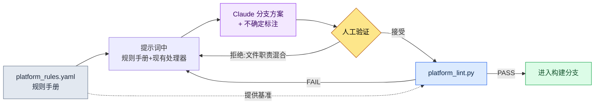

# 14.2 平台差异(iOS / Android / PC)

第一次把 Alpha 版本放到 PC 上的那天,策划团队的即时通讯频道里贴出了一张截图。在移动端占满屏幕底部的虚拟摇杆,此刻在 27 英寸显示器正中央只有巴掌大小地悬着。有人跟了一句:「这个用鼠标怎么操作?」核心逻辑并没有问题。战斗、背包、任务都照常运行。崩掉的只有一处——把输入和画面按移动端前提写死的那块地方。

把同一款游戏发布到 iOS、Android、PC 三处,运营单位看似会变成 ×3,实际上并非如此。核心逻辑只有 1 个,在其上以 ×3 挂载平台适配层。问题在于,「哪里为止是核心、从哪里开始是适配层」这一点很难由人逐一判断。只在 iOS 上正常而唯独在 Android 上出错的分支、只在 PC 上才有意义的按键映射——这类差异无法全部装进脑子里。因此本章的核心是这样一套工作流:把平台约束以规则手册(rulebook)明文化,以该规则手册为依据让 AI 生成分支方案,最后由 lint 抓出违反规则之处。

---

## 14.2.1 三个平台有何不同

先看差异的地形。下面是在项目A(笔者作为设计总监正在参与的移动优先 MMORPG)中评估 PC 辅助发布时整理的平台约束表。其中依据公开标准的数值一并注明了出处,其余为项目内部约定值。

| 领域 | iOS | Android | PC |
|---|---|---|---|
| 输入 | 触控 | 触控(+部分键盘) | 键盘·鼠标·手柄 |
| 最小触控目标 | 44pt (Apple HIG) | 48dp (Material) | 点击——不适用 |
| 屏幕 | 4.7\~6.7 英寸 | 4.5\~7 英寸(差异大) | 21\~32 英寸 |
| 支付 | App Store | Google Play | 自建·Steam |
| 通知 | APNs | FCM | OS·自建 |
| 存储 | iCloud | Google Drive·自建 | Steam Cloud·自建 |
| OS 更换周期 | 1\~2 年 | 1 年(碎片化严重) | 5\~10 年 |

iOS 与 Android 在支付、存储、通知的 *API* 上不同,但用户看到的画面与操作几乎一致。PC 则在输入、画面、视觉效果上整体不同。因此运营负担与直觉相反,不是 ×3 而是接近 ×2——因为 iOS 与 Android 之间的距离很短。

这里重要的不是表格本身,而是把这张表从供人阅读的文档变成供机器读取的规则手册。唯有如此,AI 生成分支方案时才能以它为依据,lint 才能抓出违规。

---

## 14.2.2 划分核心与平台层的那条线

项目A的文件夹结构,是在 1 个核心上挂载 3 个平台适配层的形态。

```
game/
├── core/                  — 游戏逻辑(与平台无关)
│   ├── combat/  inventory/  narrative/  ...
├── platform/              — 平台适配层
│   ├── ios/      → input/  payment/  notification/
│   ├── android/  → input/  payment/  notification/
│   └── pc/       → input/  payment/  ui/
└── shared/                — 两侧共用(工具·渲染)
```

规则只有一条。**core 不以名字调用 platform。**一旦 core 出现 `if platform == "ios"` 这样的语句,层的分离就崩塌了。以输入为例,core 只知道「使用技能1」这一意图(`InputIntent.SKILL_1`),而这一意图是从触控坐标中提取、还是从键盘 `1` 中提取,则由各 platform 层负责。

划出这条线后,下一步就成为可能。添加新平台时,无需触碰 core,只需在 `platform/` 下填入一个文件夹即可。下面这张图,一览这条线在实际中如何分岔。

<svg viewBox="0 0 720 360" xmlns="http://www.w3.org/2000/svg" font-family="sans-serif" font-size="13">
  <rect x="0" y="0" width="720" height="360" fill="#fbfbfd"/>
  <!-- core -->
  <rect x="270" y="20" width="180" height="70" rx="8" fill="#1d3557" />
  <text x="360" y="50" fill="#fff" text-anchor="middle" font-weight="bold">core/</text>
  <text x="360" y="70" fill="#cdd9e8" text-anchor="middle" font-size="11">游戏逻辑 · 与平台无关</text>
  <text x="360" y="84" fill="#cdd9e8" text-anchor="middle" font-size="11">InputIntent · PaymentInterface</text>
  <!-- arrows down -->
  <line x1="360" y1="90" x2="130" y2="150" stroke="#888" stroke-width="1.5" marker-end="url(#a)"/>
  <line x1="360" y1="90" x2="360" y2="150" stroke="#888" stroke-width="1.5" marker-end="url(#a)"/>
  <line x1="360" y1="90" x2="590" y2="150" stroke="#888" stroke-width="1.5" marker-end="url(#a)"/>
  <defs>
    <marker id="a" markerWidth="8" markerHeight="8" refX="6" refY="3" orient="auto">
      <path d="M0,0 L6,3 L0,6 Z" fill="#888"/>
    </marker>
  </defs>
  <!-- platform boxes -->
  <g>
    <rect x="40" y="150" width="180" height="120" rx="8" fill="#e8f0f8" stroke="#1d3557"/>
    <text x="130" y="173" text-anchor="middle" font-weight="bold" fill="#1d3557">platform/ios</text>
    <text x="130" y="196" text-anchor="middle" font-size="11">touch → intent</text>
    <text x="130" y="214" text-anchor="middle" font-size="11">StoreKit · APNs</text>
    <text x="130" y="232" text-anchor="middle" font-size="11">目标 ≥ 44pt</text>
    <text x="130" y="256" text-anchor="middle" font-size="10" fill="#777">iCloud 存储</text>
  </g>
  <g>
    <rect x="270" y="150" width="180" height="120" rx="8" fill="#e8f0f8" stroke="#1d3557"/>
    <text x="360" y="173" text-anchor="middle" font-weight="bold" fill="#1d3557">platform/android</text>
    <text x="360" y="196" text-anchor="middle" font-size="11">touch → intent</text>
    <text x="360" y="214" text-anchor="middle" font-size="11">Play Billing · FCM</text>
    <text x="360" y="232" text-anchor="middle" font-size="11">目标 ≥ 48dp</text>
    <text x="360" y="256" text-anchor="middle" font-size="10" fill="#777">碎片化应对</text>
  </g>
  <g>
    <rect x="500" y="150" width="180" height="120" rx="8" fill="#f8efe8" stroke="#9a4f1d"/>
    <text x="590" y="173" text-anchor="middle" font-weight="bold" fill="#9a4f1d">platform/pc</text>
    <text x="590" y="196" text-anchor="middle" font-size="11">key/mouse → intent</text>
    <text x="590" y="214" text-anchor="middle" font-size="11">Steam · OS 通知</text>
    <text x="590" y="232" text-anchor="middle" font-size="11">手柄 · 按键映射 UI</text>
    <text x="590" y="256" text-anchor="middle" font-size="10" fill="#777">分辨率多样</text>
  </g>
  <!-- shared -->
  <rect x="270" y="300" width="180" height="44" rx="8" fill="#ddd" />
  <text x="360" y="327" text-anchor="middle" fill="#333">shared/ — 工具·渲染</text>
  <text x="360" y="290" text-anchor="middle" font-size="10" fill="#9a4f1d">PC 的输入·画面·视觉整体不同(橙色)</text>
</svg>

iOS 与 Android 的方框是同一蓝色系,唯独 PC 是橙色——用颜色标示了差异的大小。运营负担的不对称在此一目了然。

---

## 14.2.3 规则手册:让机器读取差异

核心转折点在这里。把平台约束写进散文式文档,人会忘记。取而代之,把它们汇集到一个声明式的规则手册文件里。下面是项目A中所用 `platform_rules.yaml` 的节选(从实际文件中,为本章只摘取了核心规则)。

```yaml
# platform/platform_rules.yaml
targets:
  ios:
    min_touch_pt: 44          # Apple HIG
    contrast_ratio: 4.5       # WCAG SC1.4.3
    gamepad: optional         # iOS 17+ 标准
    forbidden_in_core: ["import platform.ios", "StoreKit", "APNs"]
  android:
    min_touch_dp: 48          # Material
    contrast_ratio: 4.5
    forbidden_in_core: ["import platform.android", "BillingClient", "FCM"]
  pc:
    min_target_px: 24         # WCAG SC2.5.8 (指针)
    input: ["keyboard", "mouse", "gamepad"]
    forbidden_in_core: ["import platform.pc", "SteamAPI"]
required_intents: ["MOVE_FORWARD", "ATTACK", "SKILL_1", "SKILL_2"]
```

这个文件同时做三件事。(1) AI 生成分支方案时读取的**规格**,(2) lint 校验所依据的**基准**,(3) 人记录共识的**单一出处**。`forbidden_in_core` 尤为重要——它是绝不允许在 core 文件夹内出现的 token 列表,因而成为机械地抓出层越界的依据。

---

## 14.2.4 实操记录(worked transcript):规则手册 → AI 分支方案 → 验证

现在从头到尾跟一遍实际操作。情况是这样的。在准备 PC 辅助发布的过程中,需要把原本只存在于移动端的输入处理器分支出 PC 版本。以规则手册为依据,向 Claude 索取 PC 输入适配器的初稿,用 lint 验证,直到拒绝·再请求,走完一个循环。

### 1) 提示词(全文)

> 下面是我们项目的平台规则手册节选和现有的 iOS 输入处理器。
>
> [粘贴上面 platform_rules.yaml 的节选]
>
> ```python
> # platform/ios/input/touch_handler.py
> from core.input.input_intent import InputIntent
>
> def map_touch_to_intent(touch_event):
>     if touch_event.location in skill_button_1_area:
>         return InputIntent.SKILL_1
>     if touch_event.is_drag_up:
>         return InputIntent.MOVE_FORWARD
>     return None
> ```
>
> 请参考它,做一份 `platform/pc/input/keyboard_handler.py` 的初稿。约束:(1) 可以 import core,但绝不要 import platform.ios/android,(2) 把 `required_intents` 的 4 个全部映射,(3) 按键映射要能让用户修改,拆分为 dict。没有把握的部分请标出来。

### 2) Claude 的原始输出(未经摘要·整理)

> 这是初稿。我把按键映射抽取到模块顶部的 dict,使用户可以自定义。
>
> ```python
> # platform/pc/input/keyboard_handler.py
> from core.input.input_intent import InputIntent
>
> DEFAULT_KEYMAP = {
>     "w": InputIntent.MOVE_FORWARD,
>     "1": InputIntent.SKILL_1,
>     "2": InputIntent.SKILL_2,
>     # ATTACK 假定为鼠标左键——键盘默认不指定
> }
>
> def map_keyboard_to_intent(key_event, keymap=DEFAULT_KEYMAP):
>     return keymap.get(key_event.key.lower())
>
> def map_mouse_to_intent(mouse_event):
>     if mouse_event.button == "left":
>         return InputIntent.ATTACK
>     return None
> ```
>
> ⚠️ 没有把握的部分:`required_intents` 中含有 ATTACK,但我把它映射到了鼠标而非键盘。规则手册的 `required_intents` 究竟是「只要与输入设备无关地完成映射即可」,还是「要在单一处理器内全部处理」,没有明确规格,因此我假定为前者。若为后者,lint 可能会因 ATTACK 缺失而抓出。

### 3) 人工验证 / 拒绝

这里 Claude 指出的 ⚠️ 之处,恰恰是陷阱所在。我们的 lint(`platform_lint.py`)不是以处理器**文件为单位**,而是以**平台为单位**检查 `required_intents` 是否满足。即便 ATTACK 不在 `keyboard_handler.py` 中,只要在 `mouse_handler` 一侧存在,就能通过。然而 Claude 给出的输出,把鼠标映射一并塞进了 `keyboard_handler.py` 文件里——文件职责混在了一起。结构上虽能通过,却违反了我们的文件夹规则(按输入设备分离文件)。**拒绝。**

拒绝理由用两行说清。(1) 把鼠标映射分离到独立的 `mouse_handler.py`。(2) 为使 ATTACK 在键盘上也能使用,把 `Space` 设为 fallback。

### 4) 再请求 → lint 通过

把再请求后得到的分离版本交给 `platform_lint.py`。lint 读取规则手册,检查以下各项。

```
$ python platform_lint.py platform/pc/
[core-leak]    PASS  — core/ 内 forbidden token 0 处
[intent-cover] PASS  — pc: MOVE_FORWARD, ATTACK, SKILL_1, SKILL_2 (4/4)
[touch-target] SKIP  — pc 为 min_target_px=24 (在 UI 层单独检查)
[no-cross-import] PASS — platform.pc 未引用 platform.ios/android
```

关键在于 `intent-cover` 落到 4/4。AI 生成的初稿是否满足规则手册的基准,不再由人眼、而是由脚本来确定。这一行,替代了在多平台运营中人每次都要在脑中核算的工作。

把这个循环压缩成一张图,如下所示。



规则手册向提示词与 lint **两侧**供给基准,正是这一结构的核心。AI 生成、人判断、lint 确定——三种角色看的是同一份规则手册。

---

## 14.2.5 构建分支:相同的核心,不同的组装

处理器齐备后,构建就是简单的组装。core 与 shared 固定,只替换 platform 文件夹一个。

```
[core/ + shared/ + platform/ios/]      → iOS 构建
[core/ + shared/ + platform/android/]  → Android 构建
[core/ + shared/ + platform/pc/]       → PC 构建
```

在 CI 中,这三者不是**串行**而是**并行**运行,每次构建后立即自动执行 `platform_lint.py`。若串行运行,构建时间会变成 3 倍;若省去 lint,违反规则之处会一直存活到部署阶段。并行构建 + 自动 lint,这两点是多平台 CI 的最低要件。

发布周期因平台而异,因此不会因为构建通过就同时部署。iOS 审核通常为 1\~3 天,对频繁发布较为保守;Android 在数小时内即可生效,可以更频繁地发布;Steam 则在 1\~2 天上下。即便是同一处改动,iOS 也是最晚上线的一方,因此热修复的排期始终以 iOS 为基准倒推。

---

## 14.2.6 UI 变体:通用 80 · 变体 15 · 专用 5

在代码之下,画面也会分岔。以经验来看,推荐的分布是通用组件 80%、平台变体(仅大小·位置不同)15%、平台专用 5%。不过这一比例会因品类而波动——若是休闲益智类,通用可升至 90%,而 MMORPG 因输入差异,变体会更多。

专用组件是发挥平台魅力的地方,并非一味通用化就是答案。移动端的虚拟摇杆·振动、PC 的按键映射 UI·手柄设置这类只在该平台上才有意义的东西,都归入此处。不过专用一旦超过 30%,那就不是魅力,而是运营负担的信号——在 lint 中挂上 `platform-specific-ratio` 警告,即便人忘了,构建也会替你指出。

这里也是 AI 辅助的界线所在。平台差异大多属于确定性规则的领域,因此 AI 与其自由地探索候选,不如用于**生成**满足规则手册的分支方案。输入映射推荐、Figma 设计稿的平台变体转换、多语言×多平台的文本适配,大致就是 AI 实质上添力的地方,而其输出始终必须通过 lint。在进步式自动化之前,先要做的是适配器标准化。

---

## 14.2.7 分离的价值——以及常见陷阱

层分离最大的效果是**新增平台的速度**。在单一代码库上堆叠 if 语句来贴合 PC,实际上接近于做一款新游戏的成本;而不触碰 core、只填充 `platform/pc/`,那段时间就会大幅缩短。新增平台加快的比例因项目而异,所以不断言具体倍数——不过在我们内部评估中,推算 PC 辅助新增的排期相比单一代码假设可缩减到一半以下(笔者估算,未经验证)。作为附带效果,各平台的事故被隔离,core 改动的可信度也随之提升(只改一处即可一致地反映到三个构建中)。

常踩的陷阱与对策如下。

| 陷阱 | 对策 |
|---|---|
| core 中 `if platform == ...` 分支激增 | 用 `forbidden_in_core` lint 拦截,拆分为适配器 |
| 仅凭人眼评审 AI 分支方案 | 用 `platform_lint.py` 确定 intent-cover |
| 把输入设备映射全塞进一个文件 | 按设备分离处理器(keyboard/mouse) |
| 专用组件 30%+ | `platform-specific-ratio` 警告,评估通用化 |
| 构建一通过就三平台同时部署 | 按发布周期差异,以 iOS 为基准倒推 |

这些陷阱的共同点在于「试图靠人的记忆来防堵」。写进规则手册、挂到 lint 上,即便人忘了,构建也会记得。

---

### 本章要点
- 平台约束必须以规则手册文件而非散文来明文化,AI 与 lint 才能看同一份基准
- AI 基于规则手册生成分支方案,人做判断,lint 确定是否满足
- 运营负担不是 ×3 而是 ×2——因为 iOS·Android 的距离很短,唯独 PC 遥远

### 下一章预告
- 14.3 触控 / 鼠标输入设计——两种输入的本质差异

---

## 动手试试

**setup.** 在项目中创建 `platform/platform_rules.yaml`,像上面的节选那样,按平台写下 `min_touch`、`contrast_ratio`、`forbidden_in_core`、`required_intents`。数值不要编造,而要取自公开标准(触控 44pt·48dp·对比度 4.5:1 等公开标准遵循 §9.1 规则手册;PC 指针目标 24px 为 WCAG SC2.5.8)。

**prompt.** 把规则手册节选 + 现有某一平台的处理器一并粘贴,并这样请求。「请遵守这份规则手册,做一份 `platform/<新平台>/input/` 处理器的初稿。绝不要放入 `forbidden_in_core` token,把 `required_intents` 全部映射,没有把握的部分用 ⚠️ 标出。」

**verify.** 运行 `platform_lint.py`(40 行左右的脚本就够),它读取规则手册并检查以下各项。(1) core 文件夹内 `forbidden_in_core` token 0 处,(2) 各平台的 `required_intents` 全部映射,(3) platform 文件夹之间无 cross-import。只要有一项 FAIL,就回到提示词,写下拒绝理由并再请求。

### 单人精简版
如果你独自工作、也没有构建 CI,就把规则手册从 YAML 缩减为一张 Markdown 检查清单。「目标 ≥44pt,禁止在 core 中 import 平台,映射 4 个意图」三行就够。不用 lint 脚本,把成果交给 AI,让它「把这份检查清单的 3 项逐一判定为通过/失败」,就能代替人的核算。关键不在工具的规模——而在于把基准写在脑袋之外,并把生成与验证分开。
