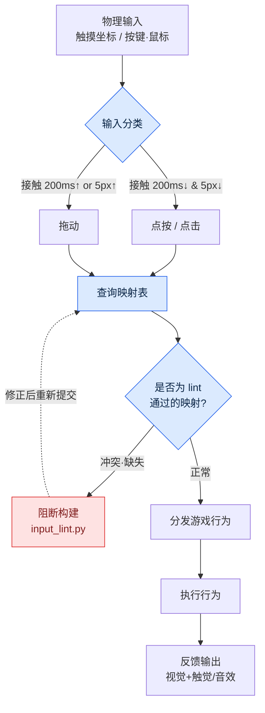

# 14.3 触摸 / 鼠标输入设计

拿到 QA 构建的组员 B 单手握着手机，皱起了眉头。"技能按了三次，只放出来两次。"我凑近屏幕一看，拇指按下技能按钮的那一瞬间，同一根手指正好盖住了按钮旁边约三分之一的区域。用鼠标测试时从未出现过这个问题——因为鼠标没有手指。

这个场景用一句话概括了触摸与鼠标的本质。两者都是"指向某一点"的输入，但一种的指向工具会遮住屏幕，另一种不会。为什么同一个行为要在两种输入上用不同方式来实现，原因就从这里开始。本章先梳理两种输入的差异，随后完整跟随一条实操记录（worked transcript，完整保留的真实操作过程记录）的主干——先让 AI 提出输入映射方案，再亲自验证冲突与可达性。

---

## 14.3.1 两种输入的本质差异

手指的粗细、视野遮挡、多点触控上限、精度全都不同。在用表格把它固化下来之前，先用一个画面来建立直观感受。鼠标光标是一支 1 像素的笔尖，手指则是一枚直径将近 1 厘米的印章。笔尖能写字，但一次只写一个字。印章盖得快却写不了字，而且盖下去的那一刻就看不见纸了。

| 属性 | 触摸 | 鼠标 |
|---|---|---|
| 精度 | 约 7\~10mm（手指接触面） | 1px 级 |
| 视野遮挡 | 手指遮住接触点周围 | 无 |
| 可否悬停 | 几乎不可能（接触 = 输入） | 自由（移动 ≠ 输入） |
| 同时输入 | 2\~10 点多点触控 | 左·右·中·滚轮 |
| 拖动/点按区分 | 需靠时间·距离推断 | 点击/拖动明确 |
| 触觉反馈 | 可以 | 几乎没有 |

这里对设计影响最大的两行是"视野遮挡"和"悬停"。视野遮挡强制决定了结果显示在哪里，而悬停的缺失意味着在移动端，工具提示（tooltip）这一整个信息通道被彻底抹去。其余四行更接近由这两行派生出来的细节。

公开标准把这些差异用数值钉死了——触摸 44pt（HIG）·48dp（Material）·对比度 4.5:1·触摸目标 24 CSS 像素（WCAG SC2.5.8）这类公开标准遵循 §9.1 规则手册。这些数字不是凭喜好，而是人体与测量的产物，所以验证映射时用来衡量的尺子最终也是这套标准。

## 14.3.2 按游戏行为的映射

移动·攻击·技能这三种行为，用两种输入来实现时会如下分岔。一个行为有三种方式，并不意味着没有正确答案，而是意味着游戏定位会强制做出选择。

- 移动 —— 触摸：ⓐ虚拟摇杆（左侧）ⓑ点按屏幕→自动移动 ⓒ拖动→镜头旋转 / 鼠标：ⓐWASD ⓑ点击→自动移动 ⓒ移动鼠标→视角
- 攻击 —— 触摸：ⓐ点按攻击按钮 ⓑ点按敌人→自动攻击 ⓒ滑动→连招 / 鼠标：ⓐ左键 ⓑ点击敌人→自动攻击 ⓒ连点→连招
- 技能 —— 触摸：ⓐ点按技能槽 ⓑ长按技能槽瞄准 ⓒ手势 / 鼠标：ⓐ按键 1\~8 ⓑ按键+鼠标瞄准 ⓒ宏

我所在的项目A（移动优先的 MMORPG）在移动这一行为上：移动端采用 ⓐ+ⓑ 混合方案（摇杆与自动移动并行），PC 端采用 WASD+自动移动。攻击方面，移动端为 ⓑ+ⓐ（点按敌人后再按按钮），PC 端可在 ⓐ·ⓑ 之间自由选择。技能方面，移动端为 ⓐ，或在锁定目标时用 ⓑ，PC 端在按键 1\~8 之上叠加鼠标瞄准。同一款游戏、同一个行为，映射表却出现了两张——这正是本章的全部要点。

问题在于，映射表越长，冲突就藏得越深。长按技能槽（技能瞄准）与拖动屏幕（镜头旋转）在同一区域重叠时会怎样？按键 1\~8 已经被技能占用，若有人把背包快捷键也提议设为 1，又会如何？靠人眼扫一遍表格是会漏掉的。因此需要这样一套工作流：让 AI 提出映射方案，而把验证交给工具。

## 14.3.3 实操记录 —— AI 映射方案与 lint 验证

从这里开始就是本章的主干。让 Claude 提出 PC 键盘/鼠标映射的初稿，由人来验证其输出，运行冲突·可达性 lint 加以驳回，再重新请求——我把这一整个循环原样搬过来。不做概括。原始输出里也含有错误，而我们正是要看清抓出这些错误的过程。

### 提示词（全文）

> 你要设计一款 PC MMORPG 的输入映射。请针对下面的行为列表，提出一份将其映射到键盘/鼠标的 JSON 方案。
>
> 行为：移动（前后左右）、奔跑、跳跃、普通攻击、技能1\~8、背包、地图、角色面板、菜单、视角锁定切换、放大/缩小、上下文菜单（辅助行为）、自动移动切换。
>
> 约束：
> - 遵循业界惯例（WASD 移动、ESC 菜单等）。
> - 不要在同一个物理按键/按钮上重叠两个行为。
> - 每一项包含 `action`、`input`、`note` 字段。
> 输出仅为 JSON 数组。

### Claude 原始输出（原样，未做改动）

```json
[
  {"action": "move_forward",  "input": "W",      "note": "标准移动"},
  {"action": "move_back",     "input": "S",      "note": "标准移动"},
  {"action": "move_left",     "input": "A",      "note": "标准移动"},
  {"action": "move_right",    "input": "D",      "note": "标准移动"},
  {"action": "run",           "input": "Shift",  "note": "按住时奔跑"},
  {"action": "jump",          "input": "Space",  "note": "标准"},
  {"action": "attack_basic",  "input": "Mouse1", "note": "左键主行为"},
  {"action": "skill_1",       "input": "1",      "note": ""},
  {"action": "skill_2",       "input": "2",      "note": ""},
  {"action": "skill_3",       "input": "3",      "note": ""},
  {"action": "skill_4",       "input": "4",      "note": ""},
  {"action": "skill_5",       "input": "5",      "note": ""},
  {"action": "skill_6",       "input": "6",      "note": ""},
  {"action": "skill_7",       "input": "7",      "note": ""},
  {"action": "skill_8",       "input": "8",      "note": ""},
  {"action": "inventory",     "input": "I",      "note": "Tab 让给目标切换"},
  {"action": "map",           "input": "M",      "note": ""},
  {"action": "character",     "input": "C",      "note": ""},
  {"action": "menu",          "input": "Escape", "note": "标准"},
  {"action": "cam_lock",      "input": "Mouse3", "note": "滚轮点击切换视角锁定"},
  {"action": "zoom_in",       "input": "WheelUp",   "note": ""},
  {"action": "zoom_out",      "input": "WheelDown", "note": ""},
  {"action": "context_menu",  "input": "Mouse2", "note": "右键辅助行为"},
  {"action": "auto_move",     "input": "Mouse2", "note": "右键双击自动移动"}
]
```

输出看上去很整洁。正因如此才危险。看最后两行。`context_menu` 和 `auto_move` 都被绑定到了 `Mouse2`（右键）。尽管约束里明确写了"不要在同一个键上重叠两个行为"，模型却在 `note` 里附上"用双击加以区分"的托词，硬是让它们重叠了。这正是不能把 AI 输出原样放进构建的理由。人扫一遍表格，很容易漏掉 23 行中第 22 行与第 23 行的冲突，而模型会为自己的冲突找合理化的借口。

因此把验证交给代码，而不是眼睛。运行一个小巧的 lint，检查冲突（同一输入重复）与可达性（缺失必需行为、双手拇指够不到的角落）。

```python
# input_lint.py — 输入映射的冲突·可达性检查
import json, sys
from collections import defaultdict

REQUIRED = {"move_forward","move_back","move_left","move_right",
            "attack_basic","menu","inventory","map"}

def lint(mapping):
    errors, warns = [], []
    seen = defaultdict(list)
    for m in mapping:
        seen[m["input"]].append(m["action"])
    # 1) 冲突：同一输入绑定 2 个以上行为
    for inp, acts in seen.items():
        if len(acts) > 1:
            errors.append(f"CONFLICT  {inp} <- {', '.join(acts)}")
    # 2) 可达性：缺失必需行为
    actions = {m["action"] for m in mapping}
    for r in sorted(REQUIRED - actions):
        errors.append(f"MISSING   required action '{r}'")
    # 3) 空 note 警告（未记录设计意图）
    for m in mapping:
        if not m["note"].strip():
            warns.append(f"NO_NOTE   {m['action']} ({m['input']})")
    return errors, warns

data = json.load(open(sys.argv[1], encoding="utf-8"))
errs, warns = lint(data)
for e in errs:  print("[ERROR]", e)
for w in warns: print("[WARN] ", w)
print(f"\n=> {len(errs)} error(s), {len(warns)} warning(s)")
sys.exit(1 if errs else 0)
```

把上面的 JSON 保存为 `claude_map.json` 并运行 lint，实际输出如下。

```
[ERROR] CONFLICT  Mouse2 <- context_menu, auto_move
[WARN]  NO_NOTE   skill_1 (1)
[WARN]  NO_NOTE   skill_2 (2)
[WARN]  NO_NOTE   skill_3 (3)
... (skill_4~8 相同)

=> 1 error(s), 8 warning(s)
```

lint 精确地揪出了人眼漏掉的唯一一处冲突。可达性检查通过了（8 个必需行为全部存在）。8 处空 `note` 只是警告，并不阻断构建，但它暴露出未记录设计意图这笔债。现在带着驳回理由把它退回给模型。

### 人工驳回 + 重新请求

> lint 结果显示 `Mouse2` 上 context_menu 与 auto_move 重叠，予以驳回。用双击来区分会带来右键延迟，在战斗中导致误操作。请把 auto_move 分离为独立输入。另外 skill_1\~8 的 note 是空的——请为每个槽逐行填上它属于哪一类技能。

### Claude 重新输出（仅摘录解决冲突的部分）

```json
  {"action": "context_menu", "input": "Mouse2",      "note": "右键 = 仅辅助/上下文行为"},
  {"action": "auto_move",    "input": "Numpad0",     "note": "自动移动切换，与战斗键物理分离"},
  ...
  {"action": "skill_1", "input": "1", "note": "近战主力技能"},
  {"action": "skill_8", "input": "8", "note": "紧急闪避/生存技能 —— 小指可达受限，考虑重新绑定到 Q"}
```

重新输出的最后一行很有意思。模型主动申报了可达性问题，说"8 号键是小指的可达极限"。这与我们下一节要讨论的可达性验证正是同一个主题。再跑一次 lint，会以 `0 error(s)` 通过。要点在于：AI 能快速生成一份 23 行的初稿，但这份初稿是否合规，由人定义的规则（REQUIRED 集合、冲突的定义）和代码来保证。提案由模型出，判定由工具做，决定由人拍板。

## 14.3.4 输入流 —— 从映射到抵达屏幕

把一次物理输入被转换为游戏行为的路径画出来，就能看清上面的 lint 卡在哪个环节。



从左上方进入的物理输入，首先被分类为点按还是拖动（依下一节的 200ms/5px 标准）。分类后的输入会去查询映射表，而这张表在进入构建之前必须通过 `input_lint.py`——这正是图的核心。一旦存在冲突或缺失，就到不了分发环节，会被阻断。映射验证必须在运行时之前、在构建关卡（build gate）处结束。

## 14.3.5 触摸设计的 5 条原则

现在假设映射已经通过，接下来设计这套映射与手指相遇的那个表面。

**原则 1 —— 最小触摸面积。** Apple HIG 的 44pt、Material 的 48dp 是下限。在 HD 屏幕上取大约 100px（Retina 2 倍环境为 200px）上下，就能同时满足两项标准。低于这个值，开头那句"按三次出两次"就会以统计数据的形式显现出来。

**原则 2 —— 拇指可达区域。** MMORPG 移动端以横屏双手握持为标准，需要按压的元素放在下方左右两角、消耗品/技能槽放在中央下方（三区域模型的依据见 §9.1）。P0 行为（左=移动，右=攻击·技能）放在左右下方两角之内，不常看的信息放在可达极限之外的上方。两角相加也不到屏幕的一半，这一点是输入设计的核心。下面的 SVG 展示了横屏模式下双手拇指的可达区域与中央下方的槽位栏。

<svg viewBox="0 0 420 240" xmlns="http://www.w3.org/2000/svg" role="img" aria-label="横屏模式下双手拇指的可达区域">
  <rect x="10" y="10" width="400" height="220" rx="14" fill="#f7f7fa" stroke="#333" stroke-width="2"/>
  <!-- 左侧拇指扇形 -->
  <path d="M 30 230 A 150 150 0 0 1 180 80 L 30 80 Z" fill="#3a7bd5" opacity="0.20"/>
  <path d="M 30 230 A 95 95 0 0 1 125 135 L 30 135 Z" fill="#3a7bd5" opacity="0.40"/>
  <!-- 右侧拇指扇形 -->
  <path d="M 390 230 A 150 150 0 0 0 240 80 L 390 80 Z" fill="#d5533a" opacity="0.20"/>
  <path d="M 390 230 A 95 95 0 0 0 295 135 L 390 135 Z" fill="#d5533a" opacity="0.40"/>
  <!-- 中央上方矩形区域 -->
  <rect x="150" y="22" width="120" height="50" rx="6" fill="#999" opacity="0.18"/>
  <text x="210" y="52" font-size="12" text-anchor="middle" fill="#444">上方 = 可达之外（信息显示）</text>
  <!-- 中央下方槽位栏（琥珀色 — 消耗品·快捷槽）-->
  <rect x="160" y="178" width="100" height="36" rx="6" fill="#f59e0b" opacity="0.35" stroke="#f59e0b" stroke-width="1.5" stroke-dasharray="4 3"/>
  <text x="210" y="200" font-size="10" text-anchor="middle" fill="#92400e">中央下方 = 消耗品·快捷槽</text>
  <text x="78" y="205" font-size="12" text-anchor="middle" fill="#1c4a8a">左拇指</text>
  <text x="342" y="205" font-size="12" text-anchor="middle" fill="#8a2a1c">右拇指</text>
  <text x="78" y="160" font-size="10" text-anchor="middle" fill="#1c4a8a">舒适</text>
  <text x="342" y="160" font-size="10" text-anchor="middle" fill="#8a2a1c">舒适</text>
  <text x="210" y="225" font-size="11" text-anchor="middle" fill="#555">深色区域 = P0 按钮布置 / 浅色区域 = 可达极限</text>
</svg>

深色扇形是拇指能轻松够到的地方，浅色扇形则是必须伸手才够得着的极限。若说 14.3.3 重新输出中模型申报的"8 号键小指极限"是 PC 版的情形，那么移动版对应的失误，正是把 P0 按钮放进这块浅色区域。

**原则 3 —— 规避视野遮挡。** 手指不只遮住接触点，其上方还有整只手覆盖屏幕。点按右下角的技能时，右下角约四分之一会看不见。因此把行为的结果（伤害数字、状态变化）显示在手指够不到的区域。握着左侧摇杆的手会侵占角色与小地图的位置，所以把小地图移到右上角。

**原则 4 —— 拖动/点按的区分。** 与鼠标不同，触摸必须靠时间和距离来推断用户的意图。在整个游戏里统一为一个标准——例如接触在 200ms 以内且移动在 5px 以内为点按，超过则为拖动。这两个数字若忽大忽小，"本想点按结果角色翻滚了"这类意图失败就会累积。上面 mermaid 的分岔点正是这一判定。

**原则 5 —— 触觉。** 振动是无需看屏幕也能传达的唯一通道。不过若对每一次输入都施加振动，就会变成噪音。普通点按不振动，使用技能短促振动，支付确认这类高风险行为强烈振动，击杀敌人则轻微振动——控制在 4\~5 种以内。

## 14.3.6 鼠标设计的 5 条原则

鼠标享有触摸所没有的三种奢侈：悬停、多按钮、光标精度。

**原则 1 —— 悬停。** 鼠标不按下也能指向。把鼠标悬在技能槽上，会弹出名称·冷却时间·说明的工具提示，点击则会释放。触摸没有这个中间状态，所以悬停是 PC 得以叠加更多信息的通道。但要在 14.3.3 的映射阶段就预先意识到：只依赖悬停的信息，到了移动版会无处安放。

**原则 2 —— 多按钮。** 左键是主行为，右键是辅助/上下文，滚轮点击是视角重置，滚轮是缩放。上面 lint 抓出的冲突，正是在这个右键上重叠了两个行为的例子。因按钮多就想把它们全填满，于是制造出冲突。

**原则 3 —— 键盘标准。** ESC=菜单，M=地图，1\~8=技能，WASD=移动，Shift=奔跑，Space=跳跃。用户不用学也应该能猜到。偏离标准的键，要把相应的理由写进 `note` 里——14.3.3 中把 Tab 让给目标切换而非背包的决定就是一例。

**原则 4 —— 视角控制。** 用鼠标拖动来旋转视角，同时明确切换：把光标锁定在屏幕上的游戏模式，与释放光标的 UI 模式。这个切换若含糊，就会出现"关掉菜单后光标却消失了"的混乱。

**原则 5 —— 宏·自动化的允许范围。** 自动攻击·自动移动允许到什么程度，是游戏定位的问题。放得太开，PC 就变成一片宏的画面；一味禁止，从移动端过来的用户门槛就会变高。正确答案是按游戏调性在这条谱系上选取某一个点，而不是两个极端。

## 14.3.7 两端通用 —— 统一输入反馈

原则因平台而异，但用户对同一个行为所获得的"感觉"，即便换了平台也应当一致。不能让从移动端转到 PC 的用户重新学习按钮高亮的含义。

| 情形 | 触摸 | 鼠标 |
|---|---|---|
| 输入识别 | 按钮高亮 + 短促触觉 | 按钮高亮 + 点击音 |
| 输入失败 | 按钮抖动 + 触觉 | 按钮抖动 + 警告音 |
| 冷却进行中 | 环形进度条 | 环形进度条 |
| 恢复可用 | 高亮 + 触觉 | 高亮 + 音效 |

视觉通道（高亮·抖动·进度条）两端相同，只有辅助通道按平台在触觉↔音效之间分岔。这种一致性把多平台用户的学习成本减半。

## 14.3.8 常见失败与处方

| 模式 | 处方 |
|---|---|
| 按钮低于标准下限（44pt/48dp） | 强制取 100px 上下 |
| 在手指遮挡区域显示结果 | 移到非遮挡区域 |
| 滥用触觉 | 控制在 4\~5 种以内 |
| 右键重叠两个行为 | 用 lint 阻断冲突后分离 |
| 把仅悬停的信息原样搬到移动端 | 移动端用点按/长按替代通道 |
| 键位映射写死 | 允许用户自定义 |
| 强制两端相同映射 | 各平台采用自然的映射 |

这张表的第四行就是 14.3.3 实操记录的结论。右键冲突靠人眼扫表几乎每次都会漏掉，而把 lint 挂在构建关卡上则几乎每次都能抓到。

---

### 本章要点
- 触摸是手指遮住屏幕的印章，鼠标是不遮挡的笔尖——把一端的 UX 原样搬过去，就会与手错位。
- 输入映射由 AI 提出，但冲突·可达性由 lint 判定——人眼会漏掉 23 行中那一行冲突。
- 反馈的视觉通道两端统一，只有辅助通道在触觉↔音效之间分开。

### 下一章预告
- 15.1 运营（LiveOps）—— 上线后游戏得以持续运转的周期

---

### 动手试试（setup → prompt → verify）

1. **setup** —— 把行为列表和约束整理到一个文件里（移动·攻击·技能·UI·视角）。把上面的 `input_lint.py` 放进项目。将 `REQUIRED` 集合替换为你自己游戏的必需行为。
2. **prompt** —— 直接使用 14.3.3 的提示词全文，只替换行为列表。把输出固定为仅接收 JSON 数组。
3. **verify** —— 用 `python input_lint.py claude_map.json` 运行收到的 JSON。在 ERROR 归零之前，明确写出驳回理由（冲突输入·缺失行为）并重新请求。WARN（空 note）作为未记录设计意图的债务另行记录。

### 单人精简版
如果是独自开发的小游戏，就精简工具。行为在 10 个以内时，只保留 `REQUIRED` 集合与"同一输入重复"两项检查的 20 行 lint 就足够了。让 AI 给出映射，用这个迷你 lint 只筛掉冲突，然后在真机上按一按，看看拇指（或小指）能否够到。提案由模型出，冲突判定由代码做，可达判定靠你自己的手——只要守住这三点，无论规模大小都行得通。
