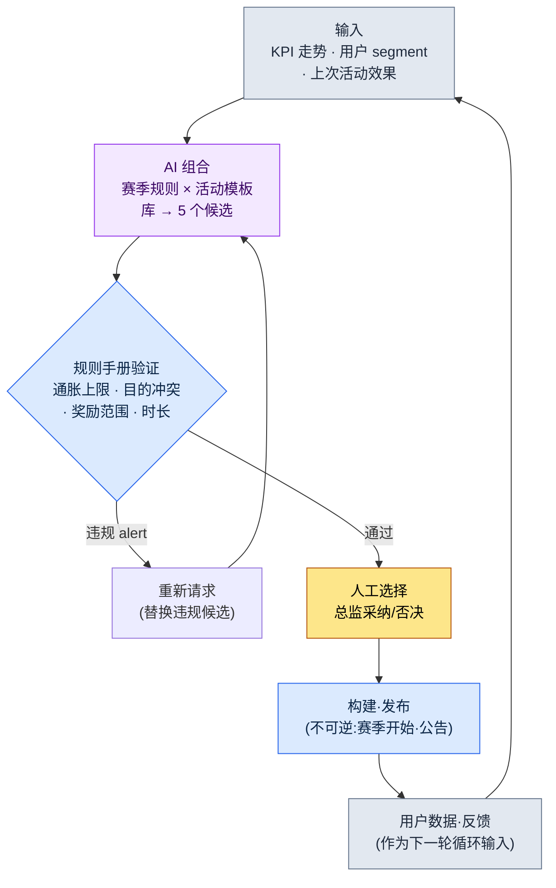

# 15.1 运营(LiveOps)总览 —— 活动候选由 AI 组合,规则手册筛除,人来选定

> 主要读者:首次负责上线后运营(LiveOps)的策划(中等规模(10\~50 人)团队)
> 面向单人/业余读者的精简版:§15.1.7「一个人的话,只做这些」
>
> **前提**:笔者亲历过一款全球上线的移动端 MMORPG 的运营,连同 P2E(Play To Earn,边玩边赚)经济一并经历过,并在此之上叠加了当前项目上线前的 AI 工作流来写作本章。实操记录(worked transcript,即完整保留的真实操作过程记录)是把"输入→AI 组合→规则手册验证→人工选择"的模式,以运营样式实际跑一遍的结果。凡属推测与观察,都明确标注为推测·观察;编造的 KPI 表一概不放。

上线次日清晨的办公室,与上线前不一样了。里程碑结束了,活儿却没有减少,反而只是单位变得更小。原本以季度为单位排布的日程,被切成周·日·小时为单位。而每周都有同一个问题回到会议室:"这个周末上什么活动?"

如果这个问题每周都从一张白纸重新开始,运营团队很快就会疲惫。本章要讲的,就是把这个问题从白纸中解放出来的方法。核心有两点。第一,与其每次都从头绞尽脑汁想活动和赛季,不如把它们沉淀为**由已验证样式构成的库**。第二,把"组合这些样式、生成下周 5 个候选"这种枯燥的初稿工作交给 AI,人只决定**在通过规则手册验证的候选中采纳哪一个**。从 0 开始做,和从 5 个里挑,工作负担是不同的。

---

## 15.1.1 运营不是"感觉",而是"循环"

把运营的标准周期做成表让人背诵的书有很多。无非是周一汇报、周二三准备、周五发布。这些都没错,但只背表格,看不出"本周活动"这个每周都要回来的决策究竟是怎么做出来的。运营的本质不是日程表,而是**闭合的循环**——候选产生、通过验证、由人选定、进入构建发布、用户数据又成为下一批候选的输入,如此一圈。

在这个循环之上,运营的四条轴(内容·活动·数值平衡·CS(客服))各以各自的速度运转。内容是月\~季度,活动是周\~月,数值平衡是周\~双周,CS 是日·小时为单位。四条轴各转各的,那么看着同一份用户数据,每周也会得出不同的决策。因此,把四条轴拧成一个循环,并把这个循环中的一格(活动候选生成)做成 AI 能够运转的形态,就是本章的目标。



需要人动手的地方只有两处。最上面把输入(KPI·segment·过往效果)干净地喂进去的那一处,以及在通过验证的候选中决定上哪一个的那一处。夹在中间那些枯燥的"绞出 5 个组合"和"筛掉规则违反",由 AI 和规则手册来跑。而最下面那一行——已发布的活动所产生的用户数据又回流为输入——正是它让这个循环成其为运营。上线前的设计一旦发出去就结束了,而在运营中,结果会成为下一次的输入。

进入这个循环的两个库(赛季规则·活动模板)的具体内容将在 §15.2 展开,最后一格(用户反馈自动分类)在 §15.3 来看。本章专注于把循环完整地走完一圈。

---

## 15.1.2 [实操记录] 组合 5 个活动候选 → 规则手册验证 → 人工选择

下面把实际怎么跑的完整地展示一整个循环。以下是把笔者在上线前的内容工具中验证过的"库组合 → 规则手册验证 → 人工选择"模式,搬到运营样式(赛季规则 + 活动模板)上实际跑一遍的会话的还原。输入提示词可以直接复制使用,输出则是对那次会话的还原。

### 第 1 步 —— 输入:把库和当前状况原样丢进去

先把组合所需的两样材料,放成机器能读的形态。活动模板库(已验证的样式)和赛季规则库,以及本周的当前状况(KPI·segment)。库一旦建好,每周都可复用。

```yaml
# event_templates.yaml —— 已验证的活动模板库(节选,9 种中的 4 种)
- id: tpl_attendance      # 签到奖励
  目的: [拉新, 回流]
  建议时长: 7~14天
  奖励等级: 低~中
- id: tpl_coop_raid       # 协作团本
  目的: [存量激活, 社区]
  建议时长: 3~7天
  奖励等级: 中~高
- id: tpl_pvp_season      # 竞技赛季
  目的: [社区, 存量激活]
  建议时长: 14~28天
  奖励等级: 高
- id: tpl_limited_package # 限定礼包
  目的: [营收]
  建议时长: 3~7天
  奖励等级: 高 (付费联动)

# season_rules.yaml —— 赛季规则片段(节选)
season_inflation_cap: 每季度'高'等级奖励活动 ≤ 3 次
purpose_conflict_rule: 同一周内禁止同时安排 2 个 [营收] 目的活动
overlap_rule: '高'奖励活动禁止同时 2 个(疲劳·通胀)

# current_state.yaml —— 本周状况
周次: 2026-W23
前两周营收活动: 1 次(本季度累计'高'等级 2 次)
DAU走势: 缓慢下降(过去 4 周 -6%,据行业观察处于'警戒'区间)
主要segment: 可回流的休眠用户占比上升
临近的外部日程: 无
```

### 第 2 步 —— 提示词:让它组合,但强制规定格式和规则

```
用附上的模板·赛季规则·本周状况 yaml,只组合出下周的 5 个活动候选。
不要创造新机制,只用所附模板的组合;是否违反赛季规则由你自己标注,
并为每个候选补上一行:它为何契合当前信号(DAU 下降·休眠回流)。
让目的不要只偏向营收,要分散开;含糊的就标出来交给我。
只用表格,列为:候选·模板组合·主要目的·时长·规则违反·依据·含糊。
```

请注意,这五行规则中没有任何一行在说"要做什么"。它们全是"在什么框架内、以什么为依据来回答"的约束。因为一旦给 AI 自由,它就会吐出一般 RPG 的平均活动。**把材料限制在库以内(规则 1)、赛季规则自查义务(规则 2)、对当前信号作出应对的依据义务(规则 3)、目的分散(规则 4),以及"含糊就交给人"这个出口(规则 5)**——五行合起来,规定的不是候选的样子,而是候选的资格。

### 第 3 步 —— Claude 的输出(还原,节选)

下面是未经摘要的原始输出。其中混着规则违反与含糊的自报。

```
| 候选 | 模板组合                      | 主要目的        | 时长  | 规则违反 | 依据                                       | 含糊 |
|-----|------------------------------|----------------|-------|---------|--------------------------------------------|------|
| C1  | tpl_attendance               | 回流           | 10天  | 无      | 直接应对可回流休眠层占比上升,奖励'中'      | -    |
| C2  | tpl_coop_raid                | 存量激活       | 5天   | 无      | DAU 下降期提供上线动机,刺激社区            | -    |
| C3  | tpl_attendance+tpl_coop_raid | 回流+激活      | 7天   | 无      | 用签到吸引回流 + 用团本留存,组合协同        | -    |
| C4  | tpl_pvp_season               | 社区           | 21天  | 无      | 用长期赛季直接抬升留存曲线本身              | ★    |
| C5  | tpl_limited_package          | 营收           | 5天   | ★违反   | 本季度'高'等级累计 2 次 → 再加则逼近/超出上限 | -    |

规则检查结果:
- C5: 有违反 season_inflation_cap 的风险。本季度'高'等级奖励活动
  已有 2 次。再加上 C5 就到 3 次,逼近上限。DAU 下降期推营收
  可能加重用户疲劳,与信号也方向相反。
- C4: 虽无规则违反,但 21 天的 PvP 赛季占用的不是这一周,而是 3 周。
  它作为'本周候选'是否合适,需要运营策略判断 → 标为含糊。
- C1·C2·C3 通过规则,与当前信号(休眠·DAU)相符。
```

输出中最有价值的部分不是表格,而是**最下面那三行规则检查**。AI 自己抓出并标记了 C5 的通胀违反,又把 C4 以"不算违反,但判断有分歧"为由交给了人。好的提示词,能让 AI 主动申报自身的局限、把球传给人。

### 第 4 步 —— 验证与选择(人的位置)

不能把这份输出照单全收。要用规则手册再过一遍,然后才由人来挑。在这次会话中,实际上有两处出现了分歧。

首先,**C5 拒绝**。AI 已经标出了通胀违反,规则手册代码(§15.1.3)也给出了同样的判定。它撞上了季度'高'等级上限,而 DAU 下降期推营收与当前信号方向相反。没什么可讨论的。拿掉。

接下来是 **C4(21 天的 PvP 赛季)**。这是 AI 以"含糊"交出来的那一项。虽无规则违反,但这不是"本周活动",而是"本赛季的决策"。它不该在一周一圈的循环里当场拍板,而应上升到赛季统合会议。因此本周候选中先搁置,单独抽出作为赛季日历的议题。

在剩下的 C1·C2·C3 中由总监来选。与当前信号(可回流休眠层上升 + DAU 缓慢下降)最契合的,是 **C3(签到+协作团本 组合)**。用签到把休眠层引进来,再用团本把引来的用户留住,这种组合协同与本周信号相符。C1·C2 留在下周的候选池里。

这里还有一个没有就此收尾的候选。定下采纳 C3 之后,发现 7 天的周期与临近的例行维护日重叠了一天。于是又跑了一次重新请求。

```
采纳 C3。不过 7 天周期中的最后一天与例行维护日重叠。
请调整时长后重新提案,别让维护把活动末尾的参与切断。
奖励总量保持不变,只把日程提前。
```

AI 把开始日提前了一天,让活动在维护前结束,重新作答;这一调整通过了规则手册。输入 → AI 组合 → 规则手册验证 → 人工选择 → 日程再调整的一个循环,到这里闭合。

这一圈,就是本书全书的 Show 标准。若不曾把 AI 组合了什么、规则手册筛掉了什么、人选了什么又拒绝了什么完整地看到底一次,那么"用 AI 来产出活动候选"这句话就是空的。

---

## 15.1.3 把规则手册写成代码 —— 候选自动验证

候选是否守住了赛季规则,若每周都靠肉眼看,又会漏。§15.1.2 的三条规则里,凡能用数字判定的,就让代码来把关。人只把时间花在代码抓不住的"含糊"与"选择"上。

```python
# event_lint.py —— 下周活动候选验证(骨架)
# 输入: AI 组合出的候选列表 + 赛季规则 + 季度累计状态
# 输出: 规则违反列表(不是自动拒绝,而是 alert)

def lint(candidates, season, quarter_state):
    issues = []
    high_used = quarter_state["high_reward_count"]  # 季度累计'高'等级次数
    for c in candidates:
        # 规则 A: 通胀上限(每季度'高'等级 ≤ 3)
        if c["奖励等级"] == "高" and high_used + 1 > season["inflation_cap"]:
            issues.append(f"[A] {c['id']}: 追加'高'等级将超出本季度上限 "
                          f"{season['inflation_cap']} 次(当前 {high_used})")
        # 规则 B: 禁止同一周内 2 个 [营收] 目的
    sales = [c for c in candidates if "营收" in c["目的"]]
    if len(sales) > 1:
        issues.append(f"[B] [营收] 目的候选 {len(sales)} 个同时 → 限制为 1 个")
        # 规则 C: 目的扎堆(5 个中若某一目的过半则分散不足)
    from collections import Counter
    top = Counter(c["主要目的"] for c in candidates).most_common(1)[0]
    if top[1] > len(candidates) // 2:
        issues.append(f"[C] 目的 '{top[0]}' {top[1]} 个扎堆(分散不足)")
    return issues
```

这段代码,把会议上"这个奖励是不是太强了?"的争来争去,用一行数字了结。当代码输出 `[A] tpl_limited_package: 追加'高'等级将超出本季度上限 3 次(当前 2)` 时,没什么可讨论的。拿掉就行。这是把 §14.1(移动端 HUD)中讲过的 lint 关卡搬到运营层面——能用确定性抓的交给代码,需要判断的交给人,这种分工在运营中同样成立。

只是有一点不同。这个 lint 即便发现了违反,也**不会自动废弃候选**。它只上报 alert。这与 §6.2(城市生成器)中见到的是同一种设计。一旦装上自动拒绝式的验证,连有意为之的变体(例如:明知季度上限,仍刻意把营收活动排进去的推广活动决策)也会被机器一并杀掉。可疑的候选由机器挑出,但杀还是留,由总监来定。§15.1.2 中拒绝 C5,也不是 lint 杀掉的,而是人看了 lint 的 alert 之后作出的决定。

---

## 15.1.4 上线前与上线后 —— 什么变了

上面这个循环,与上线前的设计循环有两处决定性的不同。与其列成表格,不如把这两点精确点出来。

第一,**结果会成为下一次的输入**。上线前,写好策划案后一路单向流到构建。而在运营中,本周活动所产生的用户数据(参与率·流失·营收·反馈)会作为下周候选组合的输入(`current_state.yaml`)回流。§15.1.1 循环最下面那根箭头就是这个回归。所以运营的 KPI 不是"一次就猜准",而是"每周对着信号做调整"。

第二,**实验成本变小了,但不可逆的点更加尖锐**。上线前是一次决策左右整个季度,而在线上,先跑一个一周的活动,不合适下周就改。可回滚的实验多了起来。然而,**赛季开始与活动公告是不可逆的**。§5.4.5 中讲过的"录音·配音选角 = 不可逆步骤"原则在此照样起作用。用户已经看到的赛季规则·奖励,即便"取消"也会在社区认知里留下痕迹。因此 §15.1.1 循环中的所有验证(AI 组合·规则手册·人工选择),都必须在进入构建·公告这个不可逆格子**之前**、在可逆阶段就结束。把 C4(21 天赛季)从本周当场拍板中抽出、上升到赛季会议,也是这个原则——不可逆的点越是重大的决策,越要经过更长的可逆审议。

这两点,让运营成为一件不同于上线前设计的事。其余的(时间单位从季度→周,反馈从 Beta→实时)都是这两条轴的派生。

---

## 15.1.5 从保守应用到进取应用

§15.1.2 的实操记录是进取应用的一个场景。AI 组合候选,人决定采纳。但并非所有团队一开始就能走到这一步。这里有阶段之分。

在**保守应用**中,由人来提出候选。运营团队在周一会议上亲手策划活动、手写赛季规则、手动分类用户反馈。自动化只负责测量(KPI 仪表盘)和回归检查(构建验收)。据行业观察,目前大多数线上 MMORPG 的运营都接近这一阶段。

在**进取应用**中,连"活动候选的提出"和"反馈分类"也由 AI 出初稿。§15.1.2 是前者的场景,后者(反馈自动聚类)在 §15.3 来看。人的决策收窄为"采纳哪个候选""如何对待 AI 分类出的反馈"这类元决策。

进取应用要立得住,需要具备三样东西。把活动模板·赛季规则拆分·积累为可重新组合单位的**库**(§15.1.2 的 `event_templates.yaml` 就是它的种子),接收当前信号并把候选以初稿形态产出的**候选生成器**(§15.1.2 的提示词),以及把进来的反馈自动分类的**聚类**(§15.3)。这三样与 §5.3.12(世界 BT(BehaviorTree,行为树)·任务云)·§8.1.8(进取式数值平衡)是同一副骨架——这正是本书一以贯之的信息:领域不同,但"把已验证的碎片沉淀为库,由 AI 产出组合候选,由人采纳"这个结构是相同的。

这里先说清一点。库·候选生成器·聚类这类构想,在 2010 年代理论上也是可行的。被卡住,是因为 AI 那时写不出活动公告文·规则说明这类**给用户读的自然语言**,也无法把每天数百\~数千条反馈用自然语言来概括·分类。LLM 发展(2023\~)之后,这两道墙降了下来,原本只停留在纸面上的进取式运营,相当一部分进入了可实现的领域。

---

## 15.1.6 常见的失败

| 模式 | 为何失败 | 处方 |
|---|---|---|
| 每周从白纸策划活动 | 运营团队很快耗竭,候选质量随状态起伏 | 用活动模板库来积累(§15.1.2) |
| "AI 帮我做个活动"整个甩给它 | 没有库·规则,只会得到一般 RPG 的平均水平 | 限制材料 + 强制赛季规则自查(§15.1.2) |
| 候选只靠肉眼验收 | 每周都漏掉通胀·目的扎堆 | 用 `event_lint.py` 自动验证(§15.1.3) |
| 把 lint 做成自动拒绝式 | 连有意为之的推广决策也被机器杀掉 | 只上报 alert,采纳由总监(§15.1.3) |
| 把不可逆决策在周循环里当场拍板 | 赛季公告后回滚会在社区留下痕迹 | 重大决策分离到赛季会议(§15.1.4) |
| 只追求单一 KPI(DAU·营收) | 用户疲劳累积,采纳与信号方向相反的候选 | 向 current_state 输入多轴信号(§15.1.2) |

---

## 15.1.7 动手试试 —— 今天就能做的一步

请按 **setup → prompt → verify** 的顺序,只做一步试试。

- **setup**:把你自己游戏(或你运营过的游戏)中已验证的活动样式挑 4\~5 个,用 `event_templates.yaml` 的格式手写下来(只写目的·时长·奖励等级)。赛季规则有三条一行式的就够了——通胀上限、禁止目的冲突、禁止重复。
- **prompt**:把 §15.1.2 的提示词原样粘贴进去,把本周状况(KPI 方向·主要 segment)填进 `current_state.yaml`,跑一次。
- **verify**:从产出的 5 个候选里,自己挑出违反规则的 1 个,反驳它:"这个撞上了通胀上限,拿掉重来。"看 AI 如何替换,你就会切身体会到,活动组合原来是一束怎样的判断。

> **一个人的话,只做这些**:库 yaml 也好,lint 代码也好,都不需要。只要回想你喜欢的游戏上个季度的 5\~6 个活动,用"目的·时长·奖励"三栏记下来。仅凭这一点,你就能看出:那款游戏并不是每周从白纸绞出来的,而是在反复套用样式。这张表,就是你的第一个模板库。

如果是团队,就从下面这一步开始。把过去 1\~2 个季度的活动收集起来,规整成 `event_templates.yaml`(只留已验证的样式),把三条赛季规则先用 `event_lint.py` 放进代码里。有了库和规则,无论是 AI 组合的候选还是人的初稿,都能用同一把尺子来量。

---

### 本章要点
- 运营不是日程表,而是闭合的循环——结果会成为下一次的输入。
- 活动候选的组合交给 AI,规则违反交给 lint,采纳交给总监。
- 赛季开始·公告不可逆——所有验证都在此之前的可逆阶段完成。

### 下一章预告
- 15.2 活动·赛季运营 —— 如何搭建模板库与赛季规则
