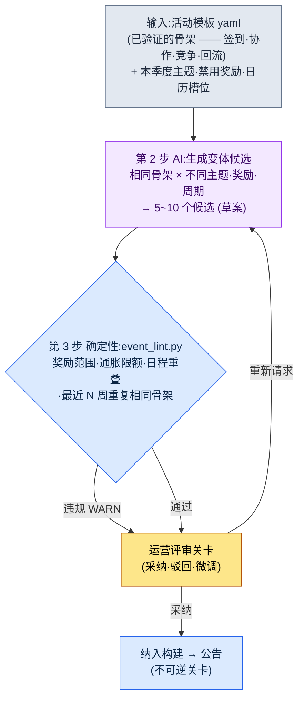
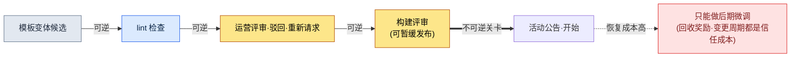

# 15.2 活动·赛季运营 —— 一张模板生成 10 个变体候选,评审只由人来做

> 第一读者:负责运营(LiveOps)的 MMORPG 策划(中等规模、10\~50 人的团队)
> 面向单人/业余读者的精简版:§15.2.9「一个人的话,做到这些就够了」

回想一款上线运营到第 4 年的游戏的周一例会。下周的活动要用什么,每周都从一张白纸开始。有人说"上次的签到活动奖励调高一点再来一次?",就有人回"那是两个月前做过的",而奖励要调高多少,又是凭感觉定。会议一结束,一名运营策划就要花上半天,从头把活动表单填满。每周,从白纸开始,半天。

问题不在于缺想法。运营团队脑子里其实已经有几套经过验证的活动骨架 —— 签到·协作·竞争·回流。往这些骨架里换上主题和奖励,一个为期一周的活动就出来了。只是这个"换装"每次都靠手工、靠感觉,所以又慢,结果又飘忽。

本章要讲的,就是把这个"换装"交给 AI 的方法。核心有两点。第一,把已验证的活动骨架作为**可变体的模板 yaml**录入。第二,把从模板中抽出下周多个候选这件枯燥事交给 AI,而人则**用代码卡住奖励范围·重复之后,只评审调性**。活动策划的一般理论(签到利于拉新、协作利于活跃之类)其他书里已经讲得够多,本章只专注于把那些知识*放进 AI 工作流的那个位置*。

> **作者运营经验备注(坦白说)**
> 上线后以 1\~2 年为单位亲自负责运营的经验,只占作者职业生涯的一部分。本章的工作流是作者把正在运营的量产·评审工具(内容·HUD)搬到活动领域的产物,而效果数值是*业界观察 + 作者推测*,这一点会在正文中随处标明。工具结构(模板 yaml·lint·评审关卡)与作者实际运营的内容量产工具是同一套骨架。

---

## 15.2.1 人只做模板编写和最后的评审

活动量产的整体流程分四步。核心在于:第 1 步(模板)和第 3 步(lint)是确定性的,只有第 2 步是 AI。这与内容量产(§6.2)·HUD 压缩(§14.1)里看到的是同一种分工。规则手册从输入和验证两头把关,那么夹在中间的 AI 每次给出略有不同的变体,奖励平衡和日程也不会乱。



在这张图里,人的手只碰两个地方。最上面,把模板和本季度的约束干净地放进去的位置;最下面,判断 lint 抓不到的"这个主题合不合当下我们游戏的氛围"的位置。而这中间枯燥的候选量产和奖励算术,由模板、AI 和 lint 来跑。

决定性的设计在于:即便 lint(第 3 步)发现了违规,也不会自动丢弃候选,而只是把 WARN 上报给运营关卡(第 4 步)。理由见 §15.2.5。还有,最后那条箭头(公告)是**不可逆**的,这一点把运营和其他量产区分开来。城市 NPC 不满意的话,构建前废弃即可;但已向用户公告的活动,想收回时要付出社区信任的代价(§15.2.7)。

---

## 15.2.2 输入 —— 活动模板 yaml

把运营团队手里已验证的骨架固化为表单。若放任为自由格式的策划案,AI 就不知道该变体什么。槽位分开了,"只换这个槽位"才成立。

```yaml
# event_templates/coop_raid.yaml —— 协作团本骨架 (已验证,运营 4 次)
template_id: coop_raid
purpose: [现有活跃, 社区]             # 只 1~2 个。禁止同时追求 4 个
core_loop: 活动期间全服累计贡献 → 按阶段解锁全服奖励
duration_range: [5, 10]              # 天。超过 10 天会累积疲劳
slots:                               # ← AI 变体的槽位。骨架固定
  theme: { type: 自由, 约束: 遵守季度主题 }
  boss_or_target: { type: 自由, 约束: 优先复用现有Boss素材 }
  reward_tiers: { type: 奖励列表, count: 3~5, 约束: 参照 reward_policy }
reward_policy:                       # ← lint 读取的槽位。禁止变体
  强化石_per_event_max: 30           # 单次活动发放上限
  金币_per_event_max: 50000
  限定时装: 允许 (永久拥有, 经济影响 0)
  现金类资源_直接发放: 禁止
inflation_guard:
  强化石_季度_累计上限: 90           # 季度内所有活动合计
post_event_kpi:                      # ← 事后自动测量槽位
  - 参与率 (相对活动曝光,参与 1 次以上)
  - 强化石价格变动 (事后 30 天,目标 ±10%)
  - 活动后工作日游戏时长 (依赖度信号)
```

最重要的分离是 `slots`(AI 变体)和 `reward_policy`(lint 读取,AI 不得触碰)。主题和 Boss 每次都可以不同,但强化石发放上限是游戏经济定下的红线。这条红线若被 AI 每次调用都抽出不同的数字,通胀就当场开始。所以奖励*项目*由 AI 提议,但奖励*数量*只能在策略范围内浮动,这由 lint 来卡。

同一个文件夹里,`daily_attendance.yaml`(签到)、`pvp_ladder.yaml`(竞争)、`comeback.yaml`(回流)以相同格式放着。这四张,就是本季度候选生成的全部输入池。

---

## 15.2.3 [实操记录] 一张模板 → 生成变体候选

把实际怎么跑的一个完整周期从头到尾展示一遍。输入提示词可以直接复制使用,输出则还原了真实的量产会话。

### 第 1 步 —— 提示词:让它做变体,但强制骨架和策略

```
用附上的 coop_raid.yaml(经 4 次验证的协作团本骨架),只给出下周(W2)的 5 个变体候选。
本季度主题是"夏日 —— 水·祭典·炎热"。
绝对不要动 core_loop,只改 slots(主题·Boss·奖励),
奖励只能在 reward_policy 上限之内,每个候选都附一行说明为何是这个主题·这个奖励。
最近 3 周是 签到·PvP排位·协作团本,所以对又跑协作团本的候选打 [重复注意],
拿不准就打 [存疑] 交给我。只用表格,列为 候选名·主题·奖励tier摘要·依据·标记。
```

六行规则里,*指定*主题或奖励的那种行,一行也没有。全都是"只能改到哪里、不许越过什么、拿不准就上报"的围栏。因为像"帮我做个夏日活动"这样放开,出来的就是普通手游 RPG 的平均水平。**变体范围(只 slots)、奖励上限(reward_policy)、重复注意(最近 3 周的历史),以及"拿不准就交给人"** —— 这道围栏让骨架被守住、让变体被放开。

### 第 2 步 —— Claude 的输出(还原真实会话,节选)

```
| 候选名        | 主题            | 奖励tier 摘要                  | 依据                              | 标记         |
|---------------|----------------|-------------------------------|----------------------------------|-------------|
| 拦洪之堤      | 阻挡河流泛滥    | 强化石 25 / 金币 4万 / 时装     | 协作=筑堤的隐喻,与累计贡献直连     |             |
| 放河灯        | 夏日水祭        | 强化石 20 / 金币 3万 / 称号     | 节日氛围,比起竞争更重烘托气氛      |             |
| 酷暑Boss战    | 讨伐酷暑化身    | 强化石 30 / 金币 5万 / 时装     | 复用现有Boss素材,奖励达上限        | [重复注意]   |
| 洋流竞速      | 乘潮流竞争      | 强化石 28 / 金币 4.5万 / 坐骑   | 协作+竞争混合                     | [存疑]       |
| 锦鲤收集      | 收集型协作      | 强化石 22 / 金币 3.5万 / 称号   | 轻度玩家进入门槛低                 |             |

[重复注意] 酷暑Boss战:core_loop 与 W-3 的协作团本实质相同。
  间隔 3 周重复相同骨架 → 恐引发用户疲劳。建议改用其他骨架(签到/收集)。
[存疑] 洋流竞速:把协作累计 + 个人竞争混进了同一个活动。
  purpose 槽位扩展为 [活跃+竞争]。可能与 1~2 个目的的原则冲突。
```

输出里最有价值的部分不是表格,而是**最下面那两行**。AI 报告了自己的局限并交给人 —— "酷暑Boss战和 3 周前的骨架相同""洋流竞速的目的增加到了两个"。好的提示词,能让 AI 说得出"这个我没把握"。

现在把这一批候选交给 lint 来卡。

---

## 15.2.4 第 3 步 lint —— 用代码卡住奖励范围·重复

候选是否守住了奖励策略和日程重叠,每次都用眼睛看,又会漏。凡是靠 `reward_policy`·`inflation_guard`·日历就能判定的,交给代码来评审。人只把时间花在代码抓不到的调性·趣味判断上。

```python
# event_lint.py —— 活动变体候选验证 (骨架)
# 输入: AI 提出的候选列表 + 模板策略 + 季度日历
# 输出: WARN 列表 (不自动废弃 —— 上报到运营关卡)

def lint(candidates, policy, quarter_ledger, recent_weeks):
    warns = []
    stone_used = sum(quarter_ledger.强化石)   # 本季度已发放的累计
    for c in candidates:
        # A: 单次活动奖励上限 (策略)
        if c.强化石 > policy["强化石_per_event_max"]:
            warns.append(f"[A] {c.name}: 强化石 {c.强化石} > 上限 "
                         f"{policy['强化石_per_event_max']} (单次活动超出)")
        # B: 季度通胀累计上限
        if stone_used + c.强化石 > policy["强化石_季度_累计上限"]:
            warns.append(f"[B] {c.name}: 季度累计 {stone_used + c.强化石} > "
                         f"{policy['强化石_季度_累计上限']} (通胀限额)")
        # C: 最近 N 周重复相同骨架
        if c.template_id in recent_weeks[-2:]:
            warns.append(f"[C] {c.name}: {c.template_id} 骨架在最近 2 周出现过 (重复)")
        # D: 日历槽位冲突 (同一周有其他大型活动)
        if quarter_ledger.slot_taken(c.week):
            warns.append(f"[D] {c.name}: W{c.week} 槽位已排入大型活动")
    return warns
```

把上面实操记录里的五个候选放进这段代码,结果如下。

```
[PASS] 拦洪之堤: 强化石 25 ≤ 30, 季度累计 65+25=90 ≤ 90 (触及边界)
[WARN] [C] 酷暑Boss战: coop_raid 骨架在最近 2 周(W-3)出现过 (重复)
[WARN] [B] 洋流竞速: 季度累计 65+28=93 > 90 (超出通胀限额)
[PASS] 放河灯: 强化石 20 ≤ 30, 季度累计 65+20=85 ≤ 90
[PASS] 锦鲤收集: 强化石 22 ≤ 30, 季度累计 65+22=87 ≤ 90
```

这里有意思的是 `洋流竞速`。AI 因为目的冲突打了 [存疑],而 lint 却因为完全不同的理由 —— **超出季度通胀累计上限** —— 把它拦下。加上强化石 28,季度累计变成 93,超过策略规定的 90。AI 没看到的算术,被代码抓住了。反过来,`酷暑Boss战`则是 AI 的 [重复注意] 和 lint 的 [C] 指向了同一件事。人·AI·代码三者各用不同的网来筛。

多亏这 30 行,"这次奖励是不是有点重?"不再以感觉对感觉收场。只要代码打出 `[B] 季度累计 93 > 90`,就没什么可争的。要么下调奖励,要么换候选。

---

## 15.2.5 把一个周期走到底 —— 评审·驳回·重新请求

若只抽象地写"运营团队来评审",就看不出这道关卡实际筛掉了什么。这里把通过 lint 之后人杀掉什么、留下什么,完整地跟到底一次。

> **[第 4 步 运营评审 —— 判定]**
>
> 运营策划这样处理了 5 个候选。
>
> - **酷暑Boss战** → **驳回。** lint [C]·AI [重复注意] 同时指向它。3 周内又跑一次相同的协作团本骨架,"又是累计贡献啊"的疲劳就来了。备注顺延到下季度槽位。
> - **洋流竞速** → **驳回。** lint [B] 超出通胀限额。把奖励降到 25 就能通过,但 AI [存疑] 点出的目的冲突(活跃+竞争)才是更根本的问题。在协作活动里掺进个人排名,轻度玩家会觉得"到头来还是老玩家的狂欢"。不靠只砍奖励来救,而是整个搁置。
> - **拦洪之堤** → **采纳候选第 1 位。** 只是,lint 虽把 `季度累计 90 触及边界` 判为 PASS,但*边界*这一点让人不放心。用了这个活动,本季度强化石余量就归零。6 月最后一周赛季收尾冲刺就没有奖励余力了。
> - **放河灯 / 锦鲤收集** → **留下。** 两者奖励都轻(20·22),给季度留下余量。

这里,人把通过了 lint 的 `拦洪之堤` 从第 1 位上动摇,正是这道关卡的核心。代码把 `90 ≤ 90` 判为 PASS。按策略不算违规。然而运营策划看的是*整个季度的奖励节奏*。lint 看的是单个活动的合法性,而人看的是季度末的赛季收尾。所以要走一次重新请求。

```
重新生成"拦洪之堤"的变体,把奖励从强化石 25 → 18 下调。
理由:6 月最后一周的赛季收尾冲刺需要留出 12 点强化石余量。
奖励吸引力下降的部分,改用限定时装·称号来
补强体感价值,据此重构 reward_tiers。
```

AI 把强化石降到 18,并把限定时装增加到 2 种(经济影响为 0 的永久拥有奖励),重新给出了候选。再跑一次 lint,`季度累计 65+18=83 ≤ 90`,赛季收尾还剩余量 7。输入 → 候选量产 → lint → 评审 → 驳回 → 重新请求的一个周期,在这里闭合。

这一圈,是本书全书的 Show 标准。工具吐出什么、什么被拦、人杀掉什么,若不哪怕一次地从头看到尾,"用 AI 量产了活动"这句话就是空的。

没有装自动废弃型 lint 的理由也在这个周期里。假如 lint 把 [B] 违规自动丢弃,运营团队就失去了学习 `洋流竞速` 真正问题(目的冲突)的机会,也失去了动摇 `拦洪之堤` 这种*合法但按季度节奏有风险*的候选的位置。可疑的候选由机器来挑,而采纳和驳回由人来定。

---

## 15.2.6 赛季 —— 更大的节奏,相同的分离

如果说活动是周\~月的节奏,那赛季就是季度的节奏。运营方式相同。赛季也一样,把已验证的要素分离成槽位,每季度就只换主题。

| 赛季槽位 | 变体(AI·人) | 固定(策略·lint) |
|---|---|---|
| 赛季主题 | 夏季·冬季·新年 (自由) | — |
| 赛季通行证奖励轨道 | 各阶段奖励项 | 阶段数·完成难度·奖励上限 |
| 赛季 PvP 排行 | 排行奖励项 | 奖励通胀限额 |
| Meta 洗牌 | 新角色·数值平衡 | 变更幅度护栏(§8.1) |

赛季通行证里,人以策略固定的核心数值是**完成率目标**。把难度定到让大约 70% 的活跃用户能到达最终阶段,这是业界常被引用的基准(作者推测 —— 各游戏不同,所以应当读作*方向*而非绝对值:低于 30% 会挫败,超过 90% 则缺乏挑战感)。这个目标一旦录入槽位,AI 提议赛季通行证变体时,也能被强制一并算出"预期完成率"。

季度日历要一眼看清,活动和赛季才不会冲突。这更接近运营团队公用的台历。谁看都看到同一张图,冲突才会减少。

<svg viewBox="0 0 720 300" xmlns="http://www.w3.org/2000/svg" role="img" aria-label="第2季度(4~6月)活动·赛季整合日历">
  <rect x="0" y="0" width="720" height="300" fill="#0f1117"/>
  <text x="16" y="26" fill="#e5e7eb" font-family="sans-serif" font-size="15" font-weight="bold">第2季度整合日历 —— 赛季 1 个(季度)，活动以周为单位</text>
  <!-- 赛季条 -->
  <rect x="16" y="42" width="688" height="30" rx="5" fill="#1e3a5f" stroke="#3b82f6" stroke-width="1.5"/>
  <text x="360" y="62" fill="#bfdbfe" font-family="sans-serif" font-size="13" text-anchor="middle">赛季"夏日祭"(赛季通行证 50 阶 · PvP 排行) —— 4 月~6 月常驻</text>
  <!-- 月份分隔 -->
  <text x="130" y="96" fill="#9ca3af" font-family="sans-serif" font-size="12" text-anchor="middle">4月</text>
  <text x="360" y="96" fill="#9ca3af" font-family="sans-serif" font-size="12" text-anchor="middle">5月</text>
  <text x="590" y="96" fill="#9ca3af" font-family="sans-serif" font-size="12" text-anchor="middle">6月</text>
  <line x1="245" y1="84" x2="245" y2="270" stroke="#374151" stroke-width="1" stroke-dasharray="4 4"/>
  <line x1="475" y1="84" x2="475" y2="270" stroke="#374151" stroke-width="1" stroke-dasharray="4 4"/>
  <!-- 活动块:颜色 = 骨架种类 -->
  <!-- 4月 -->
  <rect x="20" y="110" width="100" height="34" rx="4" fill="#14532d"/><text x="70" y="131" fill="#bbf7d0" font-size="11" text-anchor="middle">W1 签到</text>
  <rect x="128" y="110" width="100" height="34" rx="4" fill="#7c2d12"/><text x="178" y="131" fill="#fed7aa" font-size="11" text-anchor="middle">W2 协作(堤坝)</text>
  <!-- 5月 -->
  <rect x="250" y="110" width="100" height="34" rx="4" fill="#581c87"/><text x="300" y="131" fill="#e9d5ff" font-size="11" text-anchor="middle">W3 PvP排位</text>
  <rect x="358" y="110" width="100" height="34" rx="4" fill="#14532d"/><text x="408" y="131" fill="#bbf7d0" font-size="11" text-anchor="middle">W4 收集协作</text>
  <!-- 6月 -->
  <rect x="480" y="110" width="100" height="34" rx="4" fill="#7c2d12"/><text x="530" y="131" fill="#fed7aa" font-size="11" text-anchor="middle">W5 回流</text>
  <rect x="590" y="110" width="110" height="34" rx="4" fill="#854d0e"/><text x="645" y="131" fill="#fde68a" font-size="11" text-anchor="middle">W6 赛季收尾</text>
  <!-- 通胀量表 -->
  <text x="16" y="180" fill="#9ca3af" font-family="sans-serif" font-size="12">季度强化石通胀累计 (上限 90)</text>
  <rect x="16" y="190" width="688" height="22" rx="4" fill="#1f2937"/>
  <rect x="16" y="190" width="635" height="22" rx="4" fill="#b45309"/>
  <line x1="651" y1="184" x2="651" y2="218" stroke="#ef4444" stroke-width="2"/>
  <text x="640" y="232" fill="#fca5a5" font-size="11" text-anchor="end">当前累计 83 / 限额 90 (余量 7 = 赛季收尾冲刺的份额)</text>
  <!-- 图例 -->
  <rect x="16" y="252" width="14" height="14" fill="#14532d"/><text x="36" y="264" fill="#9ca3af" font-size="11">签到·收集</text>
  <rect x="120" y="252" width="14" height="14" fill="#7c2d12"/><text x="140" y="264" fill="#9ca3af" font-size="11">协作·回流</text>
  <rect x="240" y="252" width="14" height="14" fill="#581c87"/><text x="260" y="264" fill="#9ca3af" font-size="11">竞争(PvP)</text>
  <rect x="360" y="252" width="14" height="14" fill="#854d0e"/><text x="380" y="264" fill="#9ca3af" font-size="11">赛季活动</text>
</svg>

这一张图,把 §15.2.5 的判断用视觉解释了。颜色就是骨架种类。**同一种颜色在 2\~3 周内出现两次,§15.2.4 的 lint [C] 就会响。** 而下方的通胀量表已逼近红线(上限 90),6 月赛季收尾(W6)能用的余量只勉强剩 7 —— 正是把 `拦洪之堤` 奖励降到 18 才保住的那个 7。

---

## 15.2.7 不可逆关卡 —— 在公告前结束所有评审

城市 NPC(§6.2)或 HUD(§14.1)与运营有一点决定性的不同。**公告无法收回。** NPC 调性不合,构建前废弃即可,用户根本不知道那个 NPC 存在过。然而已向用户公告的活动,其奖励·周期·规则都留在了社区里。开始之后再说"活动奖励太重了,要收回",就伴随着不可逆的代价。



本书全书的原则(§5.4.5 配音录制、§8.1 线上构建、第 12 部分最终渲染都是同一条讯息),在运营中同样成立。所有评审 —— 奖励范围、通胀限额、日程冲突、调性 —— 都必须在公告前的可逆阶段结束。§15.2.3\~5 的量产·lint·评审·重新请求整个周期,之所以都在这道不可逆关卡的*左侧*转,原因就在这里。越过关卡之后能做的,顶多是 §15.2.8 的后期微调,而那也在一点点消耗用户信任。

---

## 15.2.8 运营中的信号与处方

公告之后 KPI 照看。只是,与公告前的评审不同,这里能做的只有后期微调。把自动测量的信号和人的处方分开。

| 信号 (自动测量) | 处方 (人来决定) |
|---|---|
| 参与率低于 50% | 后期小幅增强奖励,或延长周期 +2 天 (在公告可信范围内) |
| 参与率 95% 以上 | 太简单 —— 记下一周期的难度备忘,当前活动保持不变 |
| 强化石价格事后 30 天跌幅超过 -10% | 强化 sink(限定商店),下季度下调通胀限额 |
| 活动后工作日游戏时长下降 | 活动依赖信号 —— 增强工作日内容吸引力,调节活动频率 |

最后一行(工作日游戏时长下降)是最常被漏掉的信号。只看活动期间的 DAU(Daily Active Users,日活跃用户),活动总像是成功。然而活动结束后,若用户在工作日不回来,就意味着活动在吸食平日游戏本身的吸引力。所以在 §15.2.2 模板的 `post_event_kpi` 里,从一开始就把"活动后工作日游戏时长"作为槽位录入。不测量,就无法处方。

---

## 15.2.9 效果能诚实地说到哪一步

活动这一章,很容易起想放一张"跑了协作活动,留存率就从 30% 涨到 50%"这样的表的念头。这类数字如果未经验证,会削掉本书的信任。本章能说的只有三点。

第一,**方向可以用业界观察来说。** 签到奖励强化型活动会拉高短期活跃用户数,协作活动会提升社区凝聚,限定礼包会拉高活动期间的营收 —— 这是观察在线运营游戏而来的业界通识。只是*多少*会因游戏·用户构成而偏差很大,把别家公司的数字照搬过来很危险。

第二,**作者的推测就写成推测。** "赛季通行证完成率目标 70%""活动周期超过 10 天会累积疲劳""活动量产半天→一小时"都是作者基于经验的推测,是未经验证的假设。别去背绝对值,读作*结构*(模板+lint 取代白纸策划)就行。

第三,**只把可测量的东西作为 KPI 来承诺。** 留存率这类结果指标不会由单个活动左右,所以不去断定因果。相对地,这套工作流真正能让其变得可测量的,是这些东西 —— lint WARN 件数(直到奖励违规变为 0)、季度通胀累计(相对上限)、相同骨架重复间隔(周)、各活动的参与率与事后强化石价格变动。这四项,在会议上就能用数字而非"感觉"来说。

---

## 15.2.10 常见的失败

| 模式 | 为何失败 | 处方 |
|---|---|---|
| 每周从白纸开始策划活动 | 慢且结果不稳定 | 把已验证的骨架录入模板 yaml (§15.2.2) |
| "AI 帮我做个夏日活动"整包外包 | 出来的是普通 RPG 平均水平的活动 | 固定骨架 + 只变体槽位 (§15.2.3) |
| 奖励数量让 AI 自由提议 | 通胀当场开始 | 用 lint 强制 reward_policy (§15.2.4) |
| 只用眼睛评审候选 | 每次都漏掉季度累计·重复间隔 | 用 event_lint.py 自动验证 (§15.2.4) |
| lint 通过 = 直接采纳 | 看不见季度节奏·目的冲突 | 人工关卡要看整个季度 (§15.2.5) |
| 公告后试图回收奖励 | 不可逆的信任成本 | 所有评审都在公告前完成 (§15.2.7) |
| 只测量活动期间的 DAU | 看不见对工作日吸引力的侵蚀 | 事后工作日游戏时长槽位 (§15.2.8) |

第五个最常被漏掉。一 lint PASS 就直接送去公告,那么像 `拦洪之堤` 那样*合法但会把季度末奖励余力变为 0*的候选,就没了被动摇的位置。代码看单个活动的合法性,人看整个季度的节奏。

---

## 15.2.11 动手试试 —— 今天就能做的一步

> **一个人的话,做到这些就够了**:不用 lint 代码也行。从你自己的游戏(或你喜欢的在线运营游戏)里,挑一个常见的活动骨架,按 §15.2.2 的格式手写一份模板 yaml(`core_loop`·`slots`·`reward_policy` 这三栏是核心)。然后贴上 §15.2.3 的提示词抽出 5 个变体候选,再从中挑一个你觉得"奖励太重"的,反驳它"这个超出了本月的奖励余力,调低了重来"。采纳和驳回究竟是怎样一组判断,会亲身体会到。

如果是团队,就从下面这一步开始。把常跑的 3\~4 个活动骨架录入为模板 yaml,先把 `event_lint.py` 的三行(奖励上限·季度通胀累计·重复间隔)做成代码。哪怕只有模板和这三行,也能先挡住"每周白纸策划"和"奖励凭感觉定"这两种常见失败。这套工作流,是 §15.1.5 的渐进式应用骨架三要素 —— 活动模板·赛季规则库、AI 活动候选生成器、事后自动测量 —— 的第一个实务实现。

---

### 本章要点
- 把已验证的活动骨架录入为模板 yaml,AI 就只变体槽位来量产候选。
- 奖励数量·通胀限额·重复间隔由 lint 来卡,调性·季度节奏由人来卡。
- 公告是不可逆的,所以所有评审都在公告前的可逆阶段结束。

### 下一章预告
- 15.3 用户反馈循环 —— 用户意见与总监愿景的平衡,以及反馈的自动聚类
