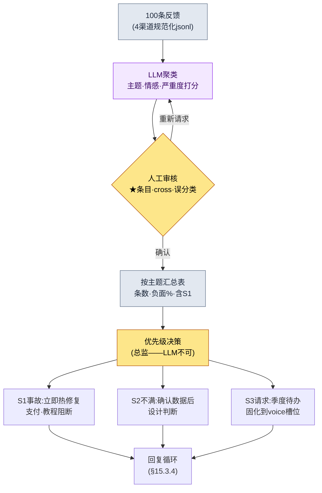

# 15.3 把100条反馈归为主题——聚类交给LLM,优先级交给人

> 主要读者:负责运营（LiveOps）中用户应对的策划、总监（中等规模（10\~50人）团队）
> 面向个人/业余读者的精简版:§15.3.7「一个人的话,只做这些」

先坦白一点。笔者在产品上线后以1\~2年为周期亲自负责运营的经验并不算长。本章的相当一部分,是建立在24年从业经历之上的**业界观察与相邻经验**。所以本章不会断言"运营就该这么做"。相反,笔者把上线前量产内容时验证过的*输入 → AI → 验证 → 人工决策*这一循环,原样套到**用户反馈**这个输入上,完整地跑一遍,看会得出什么。工具的骨架与§6.2的city_hunting_generator相同,只是输入从"城市元数据"换成了"100条用户反馈"。

运营第一周的景象大都相似。论坛、Discord、客服工单、商店评论每天堆积成百上千条。人不可能全部读完,而不读的话,同一个bug会有50条报告被埋掉。本章讲的方法是:先让**LLM把这堆反馈按主题归类、并按情感打分**,然后人只投入到"那么这周该修什么"这一**优先级决策**上。

---

## 15.3.1 反馈不是'读物',而是'分类输入'

把反馈分成4个渠道（游戏内问卷、论坛/Discord、商店评论、客服工单）、再归为4种类型（bug、请求、不满、表扬）的表格,哪本运营教科书里都有。这些说的都对。问题在于,就算背下这张表,也答不出"今天涌进来的412条该怎么处理"。只要还把反馈看成*供人阅读和分类的对象*,反馈量就永远会压过运营团队的人手。

换个视角。一条反馈就是一份**结构化输入**,是一条拥有 `{来源, 原文, 主题, 情感, 严重度}` 五个槽位的记录。这样一看,工作的本质就变了:不是"全部读完",而是"按主题归类、排出优先级"。而且,主题聚类和情感打分,人来做既枯燥、每次的标准还会飘移,但机器会用同一把尺子同样地量这100条。这正是LLM比人更擅长的那类工作。§6.2中量产30座城市时的那套分工（规则手册=确定性,正文=AI,审核=人）,在这里同样成立。唯一的不同是:最后人做的事不再是"正文审核",而是"优先级决策"。

这里点明反馈类型的一个分布特征。会主动发言的用户,往往不是满意的用户,而是心怀不满的用户。满意的客人会悄悄离开,不满的客人才会重新走回柜台。所以论坛、评论里的情感分布,往往会比实际全体用户的满意度更偏向负面（笔者的观察——具体偏差幅度因游戏、渠道、时期而异,所以不该当成绝对数字,而应作为*方向*来读）。只有把这种偏差放在心里,当你在聚类结果里看到"负面60%"时,才不会误读成游戏正在走向失败。

---

## 15.3.2 [实操记录] 100条反馈 → 主题聚类 + 情感

下面实际把一个循环完整跑一遍。输入是某一周从4个渠道汇集的100条反馈,输出是主题聚类、情感、优先级。输入提示词可以原样复制使用,下面的输出是按真实分类会话的格式重现的。

### 第1步——输入:把反馈做成机器能读的表

把从各渠道抓取来的原文,规范化成一行一条记录。这不是重新写,只需要抽取、整理即可。

```jsonl
{"id": "fb_0001", "src": "discord",     "text": "强化12级失败了50次。这概率正常吗?请退款"}
{"id": "fb_0002", "src": "store_review","text": "画面很漂亮,但太卡了,每次公会战都闪退"}
{"id": "fb_0003", "src": "cs_ticket",   "text": "已经付款了但钻石没到账,附上订单号"}
{"id": "fb_0004", "src": "forum",       "text": "新职业弓箭手什么时候出啊 呜呜 预约的时候不是承诺过了吗"}
{"id": "fb_0005", "src": "discord",     "text": "开服第一周,运营团队沟通得不错,公告也快。以后也拜托了"}
{"id": "fb_0006", "src": "store_review","text": "某个Boss(黑狼)的伤害太离谱了。满装备也被一下秒杀。要求做平衡性补丁"}
{"id": "fb_0007", "src": "cs_ticket",   "text": "教程第5步无法继续,按钮点不动(设备:Galaxy A系列)"}
// ... fb_0008 ~ fb_0100 (省略)
```

记录在输入阶段先把 `主题·情感·严重度` 留空。填上这些空格,就是第2步LLM的工作。

### 第2步——提示词:让它聚类,但强制约束标签、格式与退出口

```
把附件feedback_100.jsonl(一周的100条反馈)按主题归类,并同时给情感打分。
主题只能从这个列表里选(禁止自由生成):强化/概率、平衡、服务器/性能、支付/退款、
新内容请求、教程/新手引导、UI/操作、表扬/支持、其他。「其他」超过8条,就再提出新主题候选。
情感分为负面、中立、正面,严重度用S1、S2、S3、S4。
// (意图:S1仅限具体、可复现、功能阻断的情况。单纯的强烈不满归为S2)
没把握的条目就放进「其他」,并在id末尾加★交给我,不要硬凑。
只给两张表 —— 表A(逐条):id、主题、情感、严重度 / 表B(按主题):主题、条数、负面%、代表原文1条、是否含S1。
```

在这条提示词里,真正左右分类结果的,既不是主题列表,也不是情感刻度,而是*固定*标签、*钉死*格式、*留出*退出口这三道控制装置。如果放任LLM自由生成主题,它就会造出"整体不满意""希望改善游戏性"这类无法用于排优先级的笼统标签。允许的标签列表（规则1）、严重度定义（规则3——S1的狭窄定义是关键）、输出格式（两张表）,以及"没把握就加★交给人"（规则5）。这四点一旦缺失,表格就会从优先级工具沦为又一份读物。这份标签列表本身,就是§15.1.5里说的*反馈L4层的分类体系*——标签固定下来,才能每个季度都用同一根轴来比较走势。

### 第3步——Claude的输出（重现,节选）

```
[表A] 逐条分类(节选)
id       | 主题           | 情感 | 严重度
fb_0001  | 强化/概率       | 负面 | S2
fb_0002  | 服务器/性能      | 负面 | S2
fb_0003  | 支付/退款       | 负面 | S1
fb_0004  | 新内容请求       | 中立 | S3
fb_0005  | 表扬/支持       | 正面 | S4
fb_0006  | 平衡           | 负面 | S1
fb_0007  | 教程/新手引导    | 负面 | S1
fb_0042★ | 其他           | 中立 | S3
...

[表B] 按主题汇总(全部100条)
主题           | 条数 | 负面% | 代表原文                        | 含S1
服务器/性能     | 24  | 92%  | "每次公会战都闪退"                | 是(部分可复现)
强化/概率       | 21  | 95%  | "12级失败了50次"                 | 否
平衡           | 14  | 86%  | "黑狼满装备也被秒"                | 是
新内容请求      | 12  | 8%   | "弓箭手什么时候出"                | 否
教程/新手引导   | 9   | 78%  | "第5步按钮点不动(Galaxy A)"       | 是
支付/退款       | 8   | 100% | "钻石没到账"                    | 是
UI/操作        | 6   | 67%  | "技能按钮太小误触"                | 否
表扬/支持       | 4   | 0%   | "运营团队沟通得不错"              | 否
其他           | 2   | -    | (fb_0042★、fb_0067★ 待人工判定)   | -

整体情感:负面71 / 中立18 / 正面11
「其他」2条(不足8条)→ 无需提出新主题
未达把握★标记2条:fb_0042、fb_0067(请求人工判定)
```

这段输出里最有价值的部分不是表格,而是**最下面两行,那"★标记2条"**。这是LLM主动申报自己归不了类、并把它交给人的地方。这与§6.2中AI给NPC'格雷姆'自行打上"存疑标记"是同一套设计。好的提示词,会让AI能够说出"这个我没把握"。

### 第4步——验证与否决（人的位置）

这份输出不能照单全收。有一处确实卡住了。

`强化/概率` 主题的21条全部被归为S2（不满）。可其中fb_0001带了一句"请退款"。LLM只把它看作"强烈不满（S2）"。这里就需要人介入。对强化概率的不满——只要数据显示概率是按规格运作的——就不是S1事故。因为对按规格运转的概率的不满,是*设计、体感问题*,而不是*bug*。LLM的S2判定没错。只是"要求退款"这个信号,应当cross-link到支付主题,让客服另行处理。LLM只给主题打了单一标签,漏掉了一条同时横跨两个主题的情况。

于是重新请求。

```
新增规则:如果一条同时横跨两个主题(例如:强化不满+退款要求),在主主题之外,
在「cross」列写上次要主题。给表A增加cross列后重新输出。
但强化概率的不满本身,只要数据上概率符合规格,就不算S1,而保持为S2。
```

这一次往返就结束了。LLM对fb_0001重新给出了 `主题=强化/概率, cross=支付/退款, 严重度=S2`,而那★标记的2条则由人亲自阅读,把fb_0042重新归入 `UI/操作`、fb_0067归入 `教程/新手引导`。**100条若由人从头读、从头分类要耗上大半天,而LLM初稿 + 人工审核 + 一次往返则在一小时以内**（笔者估计,未经验证的假设——具体能省多少,会随反馈条数、渠道数量而变,所以与其记绝对时间,不如把它当作"从头手工"和"初稿+审核"之间的结构差异来读）。

---

## 15.3.3 优先级LLM给不了——人的位置

这里划出一条决定性的界线。上面的表B只说到"哪个主题有多少条、有多负面"为止。**"那么这周该先修什么",LLM是给不出的。** 那是牵涉成本、日程、游戏愿景的决策,而这个决策的责任在总监身上。

面对同一张表,两个运营团队可能做出截然相反的决定。只看条数,`服务器/性能`（24条）和`强化/概率`（21条）排在第1、2位。可优先级并不按条数顺序走。原因在于**严重度与可逆性**。



在这个流程里,人手真正触及的只有两处:中间的审核关卡（判定★、cross、误分类）,以及最下方的优先级决策。中间那枯燥的100条分类,交给LLM去跑。而优先级决策真正的逻辑,不是条数,而是下面三根轴。

| 主题 | 条数 | 优先级判断（总监的职责） |
|---|---|---|
| 支付/退款 (S1) | 8 | **第1优先。** 条数虽少,但功能阻断 + 不可逆（涉及钱）。24h热修复 |
| 教程/新手引导 (S1) | 9 | **第2优先。** 直接关系到新用户流失。特定设备可复现 → 打补丁 |
| 服务器/性能 | 24 | **第3优先。** 条数最多,但属于基础设施改动 = 周期长。无法热修复,放到下周 |
| 强化/概率 (S2) | 21 | **维持。** 数据上符合规格就不是bug。作为设计决策另行研究 |
| 新内容请求 | 12 | **待办。** 负面8%（=正面期待）。固化到季度voice槽位 |

条数第1的`服务器/性能`之所以降到优先级第3,是因为它是热修复修不了的基础设施工作；条数第6的`支付/退款`之所以升到第1,是因为它是牵涉金钱的不可逆事故。**这种重新排序,LLM做不到。** LLM只能给出"支付8条、负面100%"这样的事实。至于"它是第1优先"这个判断,则属于懂得成本、法律风险、游戏愿景的人。这正是§15.1.5里所说"AI负责分类、生成候选,人则专注于采纳与愿景决策"在反馈领域的真实样貌。

---

## 15.3.4 回复——不可逆阶段,审核关卡更重

优先级定下来后,就要回复用户。在运营中,回复缺位是对信任伤害最大的地方。哪怕没有可答的内容,一句"正在处理"也胜过毫无回应。回复草案同样可以让LLM按主题生成。

> **[回复草案——LLM输出,按主题]**
>
> - **支付/退款（S1）**:"钻石未发放的问题已确认。将按订单号在24小时内补发,并逐一单独回复。"
> - **服务器/性能**:"公会战时出现的闪退正在复现确认中。计划在下周维护中优先处理,并会通过公告同步进展。"
> - **强化/概率**:"强化概率完全按规格标注生效,这一点我们已通过数据确认。不过对于体感难度方面的意见,我们正在另行研究。"
> - **新内容请求（弓箭手）**:"新职业已在路线图上,一旦日程确定,会第一时间发布公告。"

这里与§6.2有一处决定性的不同。**回复的发送是不可逆阶段。** 城市NPC废弃后重做即可,但用户一旦看过的公告、回复文本,是收不回来的。若自动发出"24小时内发放",实际却花了三天,那个承诺就会以不可逆的痕迹留在社区里。所以§15.1.4的不可逆阶段原则,在反馈领域比在其他领域运作得**更重**。自动回复草案交给LLM生成,但**在通过客服审核关卡之前,一个字也不自动发送。** 审核者只看:日程承诺（24h、下周）是否与实际工作日程相符,以及敏感个案（法律纠纷、退款纠纷）有没有混进自动发送池。这是让人来承担lint抓不到的判断的位置。

| 阶段 | 可逆性 | 由谁 |
|---|---|---|
| 反馈聚类、情感打分 | 可逆（可自由重跑） | LLM |
| 主题审核、优先级决策 | 可逆（确定前） | 人（总监） |
| 回复草案生成 | 可逆（可废弃、重写） | LLM |
| **回复发送、公告发布** | **不可逆（用户已感知）** | **人（客服审核后）** |

---

## 15.3.5 把用户voice固化进季度复盘

要让同样的反馈不至于每个季度被摇摆成不同的决定,就得把聚类结果**固化为季度复盘的固定输入槽位**。不是凭一时印象说"最近强化的不满好像挺多",而是每个季度用同一根标签轴汇总出的表,进入复盘表格之中。§15.3.2里禁止自由生成标签、用允许列表把它固定下来的理由,在这里得到回收。

> **2026 Q2 用户voice（LLM自动汇总,季度累计）**
> ```
> 4类渠道累计约5,000条聚类(条数为季度实际统计——并非加工)
>
> 负面靠前主题:   强化/概率 > 服务器/性能 > 平衡 > 支付/退款
> 请求靠前主题:   新职业 > 新狩猎场 > 公会系统 > UI改进
> 季度情感走势:   Q1负面68% → Q2负面71%(小幅恶化——强化主题拉动)
> ```

这张表成为季度决策的*输入*。决策本身归总监,输入归用户。季度走势（"Q1 68% → Q2 71%"）只作为*方向*来读。信号不是单个季度的绝对值,而是同一根标签轴上的变化方向。如果负面%升高了,就回溯"是哪个主题把它拉上去的",并连接到下一季度的优先级。这份季度报告的草案本身,也由LLM用自然语言生成,人只在上面加决策批注——这正是§15.1.5里所说季度报告自动初稿的真实位置。

---

## 15.3.6 诚实对待数字的方法

运营这一章,很容易忍不住想放上"引入反馈循环后,NPS从20升到了45"这样的表格。笔者从未测量过那种因果,所以不写。本书的原则是以下三条之一。

第一,**实测统计的条数照原样使用。** §15.3.2里按主题的条数（服务器24、强化21、支付8）和§15.3.5的季度累计,都是把分类结果一条条数出来的值,而不是为了好看而凑出的比例。

第二,**估计就写明是估计。** "100条分类从大半天→一小时"（§15.3.2）、"论坛情感偏向负面"（§15.3.1）是基于笔者经验、观察的估计,是未经验证的假设。不必去记绝对值,只要作为*方向*（反馈量永远压过人手；主动发的帖子往往偏向不满）来读就好。

第三,**只把可测量的东西作为指标来承诺。** 反馈循环真正可测量的,不是结果满意度（NPS）,而是过程指标——未分类反馈的存量（目标0）、S1事故发现→热修复的前置时间（lead time）、回复响应时间、"其他"主题的占比（允许标签装不下现实时,"其他"就会膨胀）。这四项,在会议上都能用数字而非"感觉"来说。

---

## 15.3.7 动手试试——今天就能做的一步

> **一个人的话,只做这些**:不需要客服系统,也不需要数据集。把你自己游戏（或你喜欢的游戏）的商店评论、社区帖子,手动复制20\~30条做成jsonl(`{"id":..., "src":..., "text":...}`),把§15.3.2的提示词原样贴上去跑一遍。在得到的表B里,找出"条数第1的主题"和"你最想先修的主题"不一致的那一处,用一行字写下为什么不同——你就会切身体会到,优先级为什么不是LLM的活,而是人的活。

如果是团队,就从下面这一步开始。先把"将4渠道反馈汇集成一行一条记录jsonl的抽取脚本",以及§15.3.2的**允许主题标签列表**固定下来。标签固定了,无论是LLM分类还是人工分类,才能用同一根轴来衡量、比较季度走势。自动回复是再往后的事——回复不可逆,没有客服审核关卡,就绝不接入自动发送。

---

### 本章要点
- 反馈不是读物,而是分类输入——聚类、情感交给LLM,优先级交给人。
- 优先级不由条数、而由严重度与可逆性决定（支付8条 > 服务器24条）。
- 回复不可逆,所以客服审核关卡比其他领域更重。

### 下一章预告
- 16.1 TaskForce运作——促成跨领域共识的工具
